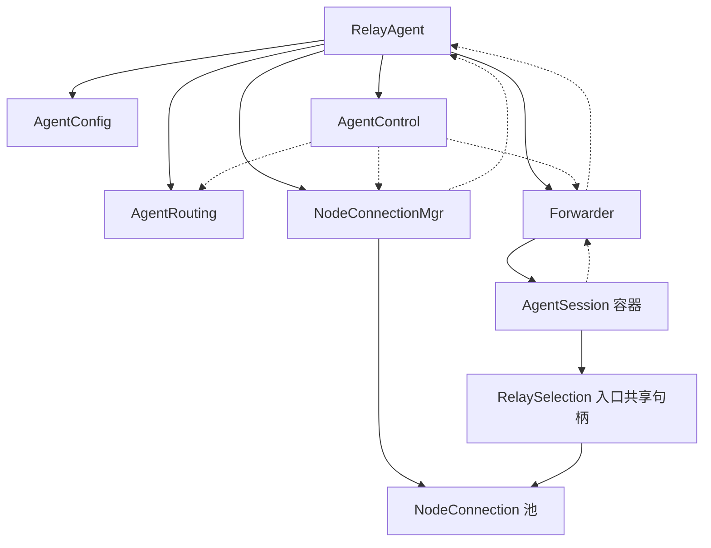
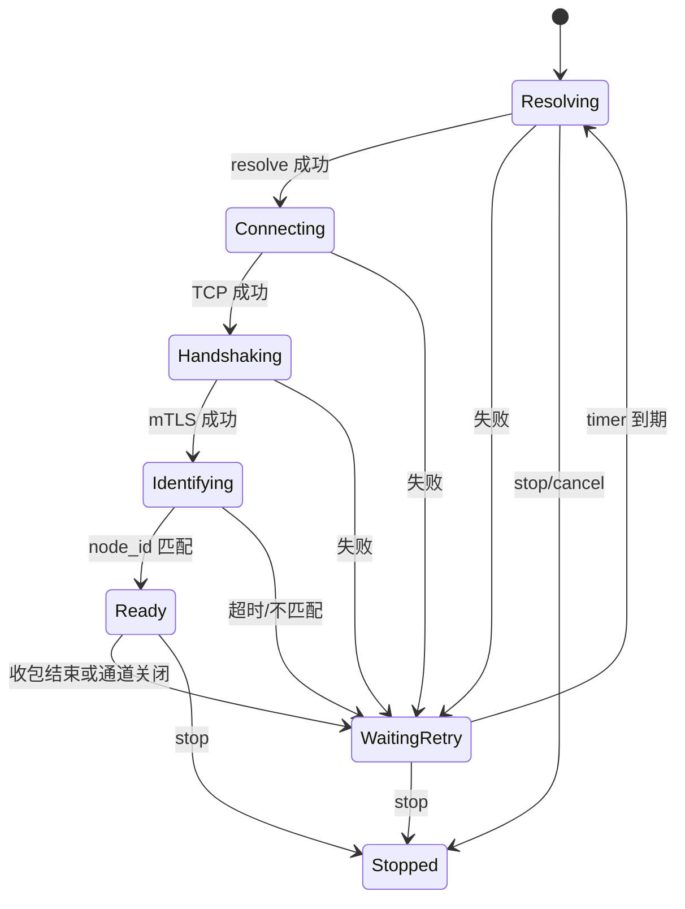
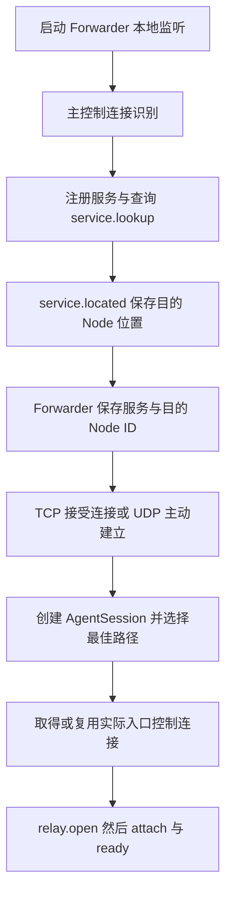

# RelayAgent 设计

[RelayWeave 系统设计](RelayWeave设计.md) · [RelayNode 设计](RelayNode设计.md)

RelayAgent 同时支持发布本地服务和消费远端服务。服务发现确定目的 Node，选路确定实际入口；
AgentSession 向该入口申请业务并接入本端 Node，服务方连接最终目标。Node 协议和 Single/Multi
协调见 [RelayNode 控制协议](RelayNode设计.md#7-控制协议规范)。

## 1. 部件结构与执行域

### 模块职责

| 模块 | 状态所有者 | 拥有的状态及职责 |
|---|---|---|
| RelayAgent | 生命周期在 control_io，start 在 worker 启动前 | 按值保存 AgentConfig、AgentRouting、NodeConnectionMgr 和 AgentControl，持有 Forwarder，组合模块，跨域提交入口选择，协调整体启动与停止 |
| AgentControl | control_io | 服务位置、发现请求、入口等待、发现轮询 timer，注册/查询/控制消息分派，借用同级连接池、路由和 Forwarder |
| NodeConnectionMgr | control_io | primary/附加连接池和双索引，任务启动及完成删除，复用、空闲回收和停止排空 |
| NodeConnection | control_io | 单节点 DNS、socket、身份识别、TLS 接收及退避重连；run 期间原位拥有 Operations |
| AgentRouting | control_io | 拓扑快照、入口探测、候选计算、按目的 Node 共享的 LRU 缓存 |
| Forwarder | transfer_io | 长期 TCP/TLS/UDP 本地监听、服务可用性、业务容器、UDP 来源及重试任务 |
| AgentSession | transfer_io | 单次请求方或服务方业务，协议 socket、接入、ready 等待、复制和统一收尾 |

配置结构和 `load_agent_config()` 保留在 `relay_agent.h/.cpp`，不引入独立配置模块。
`agent_common.h` 只声明跨模块值类型：ServiceKey、ServerRoute 和 RelaySelection。

### 对象所有权



实线表示持有，虚线表示借用。RelayAgent 是唯一组合根，AgentControl 只保存同级模块的引用；
跨域通知单独捕获 Forwarder 的共享引用，保证已排队的工作存活。NodeConnectionMgr 只借用
RelayAgent，不保存反向强引用。连接消息和状态通知经 RelayAgent 分派给 AgentControl，
连接管理器负责在就绪和完成通知时维护身份索引与池所有权，不注册模块回调。

成员按 Config、Routing、连接池、Forwarder、Control 的依赖顺序构造，析构顺序相反；连接池
构造时只保存所属 Agent 的引用，完整构造后的 start 才启动任务。async_stop 先排空所有控制侧
生产者，再排空业务，确保连接回调完成时 Control 仍存活。外部 TLS context 和两个 io_context
必须晚于模块任务销毁。

发现任务和连接任务的 completion 在运行期间保活 RelayAgent；连接后台任务不额外持有
NodeConnection 的 shared_ptr，保证空闲回收的 use_count 判断仍准确。连接池只在 run 完成后
释放池内强引用；此后外部连接句柄可以晚于 Agent 释放，已排空的连接不再保存 I/O 操作或借用其模块。

### 跨执行域接口

两个 io_context 各由一个 worker 执行，主线程通过 signal_io 接收进程信号，共三个线程。

- AgentControl 的全部状态和 NodeConnection 的可变状态只在 control_io 访问。
- Forwarder 和 AgentSession 的 socket、业务容器、UDP 来源和重试状态只在 transfer_io 访问。
- AgentSession 经 Forwarder 调用 RelayAgent::select_relay；RelayAgent 使用 co_spawn 把真实选择
  绑定到 control_io，完成后回到调用者 executor。跨域携带值描述和共享生命周期句柄。
- 控制侧通过 post 把服务可用性、失效和业务通知交给 Forwarder，不直接读取 Session 状态。
- transfer_io 只保留 `(service, protocol) -> 目的 Node ID`；不复制用于发现的连接表和服务地址。
- Session 通过 relay_ready/relay_finished 通知所属 Forwarder，由 Forwarder 更新业务容器和
  UDP 关联；UDP 返回路径也由 Forwarder 使用其拥有的本地监听完成。

## 2. 控制连接、服务发现与选路

### primary 与服务位置

AgentControl 使用普通映射保存服务位置，Node ID 和端点由 ServiceLocation 按值持有；
借用 RelayAgent 直接持有的 NodeConnectionMgr 管理实际入口控制连接：

- 初始配置只决定 primary 入口；
- 每个 `(service, protocol)` 保存自己的目标节点；
- 每个实际连接的入口节点对应一个 `NodeConnection`；
- 同一节点的多个服务复用同一连接；
- 不同节点的连接和 Relay 相互独立。

### NodeConnection 连接池

每条控制连接在可用前都执行 `server.identify/server.identified`。客户端校验服务器返回的 `node_id`：已知位置指定了节点 ID 时，实际连接到其他节点会使该次连接失败。

连接池先按 `node_id` 复用，再按 `host:port` 复用。每个 `NodeConnection` 自己运行连接、接收、清理和重连循环：

- 初始重连延迟由 `reconnect.initial_delay_ms` 指定；
- 失败后翻倍，最多到 `reconnect.max_delay_ms`；
- 连接成功后恢复初始延迟；
- 已知附加节点独立重连，不依赖 primary 在线。

`NodeConnection` 不长期保存强 TLSChannel 引用。每次 `run()` 使用成员中的
`optional<Operations>` 原位拥有 resolver、socket 和 retry timer；运行开始时构造，连接循环退出时由
scope guard 清空，`stop()` 因而可以直接取消这些对象而不引用协程栈地址。当前通道仍只保存
`weak_ptr<TLSChannel>`。协程 completion handler 在任务期间持有 RelayAgent；连接池强持有 NodeConnection，运行协程及其 completion handler 只借用连接。

连接池直接保存普通 `shared_ptr<NodeConnection>`，每个连接只有一个 shared_ptr 控制块。
EntryWait 和活动的请求方 AgentSession 保存同一连接的共享引用，EntryWait 只在入口选择期间存在。
复用现有 5 秒维护周期：附加连接只剩池内引用时开始计时，连续空闲 60 秒后调用 `stop()`；
有会话或等待者持有时不回收，短暂复用也会重新计时，primary 不参与空闲回收。
停止后连接不再 ready，但池内索引与对象保留到 `run()` 完成，随后由 NodeConnectionMgr 的 completion handler 移除。
同节点新请求遇到停止中的连接时等待其任务退出，再使用原地址重建，整个过程仍受原建立截止时间约束。
入口查询结果只保存地址与端口，不长期保留 JSON 回复；DNS 和控制接收恢复时检查停止状态，避免启动下一阶段。
附加节点断线只结束使用它的业务实例；主控制连接恢复后重新注册和发现服务，不设计离线定位。

单条 NodeConnection 的状态转换可以表示为：



Ready 只表示 mTLS 和 `server.identified` 都成功。TCP 已连接或 TLS 已握手但尚未识别节点时，不会注册服务、安装 Forwarder 路由或发送业务请求。

连接失败后的清理顺序为：清除 weak channel、通知 owner 结束使用该控制连接的业务、等待 TLSChannel 断开、等待重连 timer。stop 会同时取消 resolver、socket 和 timer，使协程从任何阶段退出。

### 路由失效与重新发现

客户端每 5 秒通过主控制连接查询尚未定位的服务；定位结果与入口控制连接独立。
主控制恢复后重新注册和发现，不增加主控离线位置缓存或备用发现通道。
只有配置了本地转发的 Agent 才运行发现及探测循环；只发布服务的 Agent 保留主控制连接和服务注册流程。
AgentRouting 不另设探测模式开关；运行时统一合并拓扑节点与必需目标，由必需目标覆盖同名节点地址。
附加入口断线只清理使用它的业务，不触发服务补查；主控制连接恢复和既有轮询负责发现重试。

relay.error 的 service unavailable / service protocol mismatch 若仍对应当前目的 Node，
会清除该次服务位置并通知 Forwarder 清除可用性，再经主控查询。
单节点控制接入超时也重新发现；多节点首 Node 查询失败不删除有效的服务目的位置。
无人使用的附加入口连接在连续空闲 60 秒后停止，任务退出后从连接池移除。服务迁移后新业务重新选路，不重放旧数据或沿用旧票据。
入口失效通知只处理 control 侧等待者；服务丢失由 transfer 侧 clear_service 一次完成可用性清除、
待建立会话及 UDP 会话取消。拓扑变化和服务迁移则分别取消仍在建立的请求方会话。

发现请求和 Relay 请求使用各自执行域内的 `request_id` 分配器。它们的数值可能相同，但由命令类型、连接和对应 pending 容器共同限定，不会把服务查询响应误配到 Relay 打开请求。计数器越过 `uint64_t` 最大值后跳过零。

### 路径缓存与入口等待

AgentRouting 独占容量 16、TTL 15 秒的目的 Node LRU；同一目的 Node 的多个服务共享最佳节点序列，
包括无可用路径的空结果。候选及成本仅用于本次排序和日志，缓存不保存完整候选列表；私有计算只整理当前目的 Node 的候选，
不维护或公开所有目的节点的候选集合。
TTL 到期前复用最佳路径，不因普通质量或同 epoch 拓扑刷新延长寿命或清缓存。
必需探测目标实际变化、有效快照的 epoch 改变、primary 失联和停止会使缓存失效。
算法与实测入口约束见 [图算法与 Agent 接口](RelayWeave设计.md#43-图算法与-agent-接口)。

已经 ready 的入口在校验原截止时间后直接返回，不分配查询编号或等待对象。
AgentControl 的 map 按值持有 EntryWait；它只存在于确实需要等待的入口选择期间，拥有原截止时间、通知 timer、
已定位的端点和可选连接共享句柄。node.located/error 只有来自 primary，且 request_id、node_id、
未取消状态和期限都匹配时才可推进等待。成功、失败或超时由选择协程的 scope guard 删除表项；整体停机不提前清空等待表，避免悬空引用。
停止中的连接保留在池里；其 completion 先通知 AgentControl，等待者释放旧引用、保留端点并被唤醒，
随后池才删索引。新请求因此可在原预算内重建，不会并行启动相同入口的新旧连接任务。

## 3. 本地转发与单次业务

请求方从本地应用进入，服务方从 offer 进入；两端以相同的接入与 ready 约束启动复制，UDP forward 在实例结束后独立决定重试。

### 服务发现、选路与入口连接

service.lookup/located 返回服务所在 Node 的身份和位置，位置记录不意味着已连接该 Node。
AgentSession 在 control_io 调用 select_relay，按目的 Node 读取有效 LRU 或计算最佳路径。
无可用路径或只有一个 Node 时，入口就是服务 Node；多节点入口是路径首 Node。

服务 Node 作为入口时直接使用已发现的位置；其他入口需要时通过主控制连接查询 node.lookup/located。
同一入口复用控制连接表中的现有连接，已经在连接的入口也共享连接任务，不重复查询或连接。
主控制连接始终保留，活动业务各自保留一个入口引用；附加控制连接无业务引用满 60 秒后停止，后台任务完成后从池中移除。
发现服务不会为多跳请求方额外保留尾 Node 控制连接。

路径确定以后才发送 relay.open：单节点只携带原有 request_id/service/protocol；
多节点另带最佳 path 和当前 epoch，不传递建立超时预算。有效缓存不重新计算，仍使用当前 epoch。
入口定位失败结束当前建立，不偷偷换路径；UDP 后续重试会重新执行选择。

### 单次接入、ready 与数据复制

请求方接受本地 TCP/TLS 连接或在 UDP 服务可用后创建 AgentSession；服务方收到 relay.offer 创建 AgentSession。
两种角色使用相同 run/attach 及 run 末尾的统一收尾：

1. 请求方选择入口并发送 relay.open，等待 relay.opened；服务方复用注册服务的控制连接和 offer。
2. 服务方先连接配置的目标，随后双方连接各自 Node 的 data_port。
3. TLS 接入继续使用 mTLS、主机名验证和既有握手超时。
4. 发送带 role/uuid/ticket 的 relay.attach，双方均等待 relay.ready 后开始业务。
5. 控制通知同时匹配控制来源和协议；响应按 request_id 关联请求方，活动通知按本地 UUID 关联。
   同一个 Agent 的 Single 请求方和服务方可以共用一个 UUID，ready/closed/error 必须作用于两种角色。
6. 结束时注销实例、关闭拥有的 socket，释放入口引用；UDP forward 保留并按服务状态决定重试。

单节点 TCP 使用 relay_tcp，TLS 使用 relay_tls；正常业务 EOF 保留半关闭，真实错误取消并排空对向。
多节点使用相同的 relay_tcp / relay_tls，同样允许单向 FIN 后反向排空，并在真实错误时收敛两个方向。
Multi 复制结束后等待 Node 的 stream complete 通知，再释放入口引用，避免控制关闭抢在最后 DATA/FIN 之前。
该正常通知只记录完成，不提前取消数据读取；真实错误仍保存原始原因并收敛当前实例。

relay.open_timeout_ms 是 Agent 本端 TCP/TLS/UDP 共同的建立超时，默认 10 秒。
请求方从创建 AgentSession 开始计时，包含选择入口、连接、opened、attach 和 ready；
服务方从收到 relay.offer 创建 AgentSession 开始，使用自己的配置计时。
首末 Node 各自从创建 NodeSession 开始，使用本地协议对应的 setup_timeout_ms，不跨端传递剩余预算。
各端内部阶段切换不重新计时；Agent 的 connect 和 TLS handshake 同时遵守单步超时与本端剩余建立时间。
任一端失败或超时，通过既有 cancel/close 通知其他端清理；Flow 建路超时和未提交表项的过期回收独立保留。
建立以后不再计时，不给活动业务添加租约、续期或定时结束。

### UDP 本地等待与重试

服务未定位时不创建 AgentSession，也不向 Node 申请资源。UDP listener 继续接收并丢弃无法转发的报文，
服务上线后重新选择路径并申请新实例，不复用旧票据或 Flow。服务丢失时取消当前 UDP 实例，等待重新发现。
服务在发现后、open 前消失时，Node 立即返回 service unavailable；Agent 清除该次发现并重新查询。

等待 ready 时每 500 毫秒重发 UDP attach，所有等待受同一建立预算限制。
失败后的 retry_timer 只控制新实例的退避：从 500 毫秒增加到最多 10 秒，ready 后恢复初始退避。
每次新实例重新执行选路与入口连接；已知服务位置仍有效时不重复发现。

UDP payload 沿用 session 头：单节点保留原最大载荷，多节点为 0..65467 字节，无应用层分片。
本地首次报文固定来源 IP，同一 IP 更换端口会更新返回地址；其他 IP 报文丢弃。
来源地址属于长期 forward，业务结束不重置；返回 payload 在尚无本地来源时丢弃。

### 控制失效、数据端点与停止

clear_server 只取消使用该控制连接的 AgentSession，不删除服务位置。
主控制失效会清空已发现服务位置，使拓扑和未完成建立失效；恢复连接后按原流程重新发现服务。
当前不设计主控断线后的服务定位，不增加位置缓存或备用发现通道。附加入口断开只结束相关实例。
Topology epoch 变化使路径缓存及未完成建立失效，不在原实例中换路。

relay.opened/offer 仍只返回 data_port；数据主机取对应已识别控制连接的 ServerRoute.host。
首末分别拥有本地端点和票据，服务发现位置只用于目的身份及直接入口定位，不充当多跳数据目的地。
ServerRoute 的 weak TLSChannel 由业务入口引用保障存活，发送投递不能替代 opened/ready 确认。

Agent 停止先取消控制任务和探测，再关闭 Forwarder 监听、重试与业务实例，排空跨域选择及数据任务。
每个实例先完成数据取消/清理再释放入口引用，全部业务任务退出以后才销毁 Forwarder 与 Agent。

## 4. 资源归属与取消

control_io 中，AgentControl 拥有服务位置和入口等待，NodeConnectionMgr 拥有控制连接，AgentRouting 拥有拓扑、探测和路径缓存；Forwarder 的 transfer_io
拥有本地 forward 与 AgentSession。数据域只保存 `(service, protocol) -> 目的 Node ID`，
不保存用于选路的另一份控制连接表或服务地址。控制域通过 post 分派可用性和协议消息。

| 对象 | 生命周期与职责 |
|---|---|
| StreamForward | 配置产生的长期 acceptor；每条应用连接独立建立业务 |
| DatagramForward | 配置产生的长期 UDP socket、固定来源 IP/可更新端口、当前会话强引用、重试退避 |
| AgentSession | 一次请求方或服务方接入；独占协议 socket、接入等待、取消和实际数据复制 |
| Forwarder::relays_ | 以本地 request_id 拥有所有业务实例；按控制来源、协议、请求或 UUID 分派消息 |
| AgentControl::entry_waits_ | 只保存尚未完成的入口定位/连接等待；建立成功、失败或取消后立即移除 |
| RelaySelection::connection | 请求方 session 强持有共享入口连接引用；业务清理后释放 |
| NodeConnectionMgr::connections_ | 强持有所有连接直至后台任务完成；按 endpoint/node_id 复用，primary 不参与空闲回收 |

Agent 通过普通共享引用判断附加连接是否仍在使用，不维护 session 使用计数或数字 lease。
只剩池内引用满 60 秒后停止；后台控制协程借用连接，Agent 等任务完成后才移除池内引用。
停止中的索引保留，因此同端点不会同时运行新旧两个连接任务。Session 释放引用无需自定义 deleter 或投递停止任务。

AgentSession 的数据资源使用 StreamData / DatagramData variant，只持有所需协议的资源。
StreamData 拥有应用/目标 TCP socket、Node TCP socket 和可选 TLS stream；
DatagramData 拥有 Node UDP socket，服务方才创建目标 UDP socket；接入时缓存二进制 session 头和路径载荷上限。
UDP 请求方的本地监听仍由 DatagramForward 拥有。

AgentSession 只保存两个控制事件标记 ready、node_closed，以及中止原因 reason。
ready 表明已收到 relay.ready，node_closed 只表示 Node 已结束业务；reason 为空表示没有中止，
非空表示已经中止并包含具体原因。cancel 保留首次原因并关闭 I/O，空原因补为默认取消文本，
后续通知或取消不覆盖原原因。fail 在首次失败发生时调用 cancel，无需保存失败类别。
活动实例处理关闭/错误通知时先验证 reason、stage，再设置 node_closed，字段错误不留下半更新状态。
UDP 的 Node 关闭始终中止实例，因此本地发送只检查 ready 和 reason，发送错误统一交给幂等 fail 处理。
建立期限耗尽的错误仍保留原始异常原因。
relay.open 是否提交只由 run 协程使用，因此 submitted 留在协程内。
收到 Node 的正常 stream complete 通知只唤醒等待，不中断本地数据复制，也不判定本地复制成功。
本地完成由 run 中的复制正常返回且没有中止表示，不额外保存 Completed 状态或完成标记。
即使 Node 已正常结束，本地排空的真实错误仍保留原因；预期取消保留原取消原因。
run 末尾统一清理，在本地中止、Node 未关闭且已提交请求或接受 offer 时通知 Node；
多跳流正常结束须排空本地双向数据并收到 Node 完成通知，之后才能释放入口引用。
TCP/TLS/UDP 共用 ready 等待；UDP 只在其中补充 attach 重发。
取消和资源回收共用幂等 close_io；Node 已关闭时不反向发送 cancel/reject，不再接受该实例的迟到通知。
中止时已由 cancel/fail 关闭 I/O，run 收尾仅在正常完成时执行 close_io，避免重复取消和关闭。
AgentSession 不再绑定协程取消信号；close_io 取消自己的定时器和 resolver、关闭自己的 socket，
异步接入步骤开始前检查 reason 与剩余建立预算，已中止时不再发起下一步操作。
select_relay 的入口等待只由 RelayAgent 的状态、连接/失效事件和原建立截止时间决定。
单个 Session 中止不会打断入口等待；它返回后 run 再检查 reason，释放已取得的入口引用并清理。
因此此阶段的回收可能延迟至剩余建立期限，默认总预算 10 秒，取消不重新计时。
Agent 整体停止仍由 invalidate_entries 设置入口等待原因并唤醒，排空业务后再释放全局资源。

业务任务独立启动并由 Forwarder 计数；运行协程持有实例直到清理结束。
Forwarder 停机同步取消全部已登记实例；Session 建立流程以 reason 检查取消，不重复读取 Forwarder 状态。
AgentSession 只引用其拥有者 Forwarder，通过接口读取连接选项、申请入口并通知 ready/结束；关闭流程保活 Agent，取消并排空全部业务任务后再完成关闭。
UDP 本地发送临时保留当前实例，避免业务退出时销毁尚在发送的 socket；不保留额外弱索引或 pending 表。
DatagramForward 保存当前会话的 shared_ptr；会话仍统一登记在 relays_，清理时按对象身份解除 forward 的引用。
本地接收协程每包复制一次当前强引用并直接 async_send，不再查 relays_、读取 JSON 元数据或创建发送子协程。
发送和返回路径复用缓存的二进制头与载荷上限，接收缓冲区仍保留完整 UDP 容量。
UDP 重试由 Forwarder 拥有的独立协程执行并计入停机排空；服务失效将重试期限提前到当前时刻，
使尚未开始等待的任务也能看到唤醒，重试协程退出等待时才清除标记，
避免旧取消结果覆盖新重试。若服务已恢复，按当前服务位置建立新实例。

## 5. 配置、启动与停止

### 配置与启动

配置字段和示例见 [Producer 配置](RelayWeave设计.md#814-relayagent-producer-配置)、
[Consumer 配置](RelayWeave设计.md#815-relayagent-consumer-配置)。

RelayAgent 构造模块时，AgentControl 从全部 `forwards` 建立服务发现集合。启动本地监听和主控制连接后，
主连接完成 TCP、mTLS 与身份识别，注册本地 `services`、查询尚未定位的服务及拓扑。
服务发现保存目的 Node ID、地址和控制端口，投递给 Forwarder 的只有服务可用性及目的 Node ID；
发现过程不创建到服务 Node 的附加控制连接。



TCP/TLS 服务尚未定位时关闭当前应用连接，监听保留；UDP 此时只保留本地 forward。
服务上线由既有发现循环获知，UDP 重新选择路径后建立新业务实例。

### RelayAgent 停止流程

async_stop 是唯一公开停止入口，可从任一 executor 调用。它先保活 Agent，再跨到 control_io。
状态按 Created/Running → Stopping → Stopped 推进；两个排空阶段按协程顺序执行，不保存重复阶段状态。重复调用等待
同一个 stopped_event，已经 Stopped 时立即完成。实际排空由 Agent 独立持有的任务执行，
取消某个停止等待者不会中断该任务。尚未启动也需要释放 Forwarder 构造时持有的 work guard。

1. RelayAgent 切换到 Stopping，依次请求 AgentControl 停止发现与入口等待、AgentRouting 停止探测、
   NodeConnectionMgr 停止全部连接；另向 transfer_io 投递建立中业务的取消。
2. RelayAgent 依次等待 AgentControl::close 的发现任务 completion、AgentRouting::close 的 DNS/ICMP
   排空，以及 NodeConnectionMgr::close 的全部 run 完成与池内删除。连接完成通知先于删除，
   接收通知的 AgentControl 在整个排空期间仍存活；各模块只等待自己拥有的任务。
3. 所有控制侧生产者都已退出后，RelayAgent 在 transfer_io 队列尾部
   co_spawn Forwarder::async_stop，确保此前投递的消息先被消费。
4. Forwarder 关闭本地监听、取消重试和全部 Session，等待监听、重试及业务任务计数归零，释放 work guard。
5. 全部排空成功后回到 control_io，清空服务元数据，标记 Stopped，通知全部停止等待者。main 在线程 join 后销毁 Agent。

排空异常保留在 Agent 中，向并发及后续停止等待者传播同一错误；状态保持 Stopping，不清空元数据，
也不继续关闭仍可能接收通知的下游依赖。重复调用返回已保存的失败，不自动重试或伪装为已停止。

没有固定睡眠排空，也不在模块仍可能回调或投递消息时销毁依赖。建立中失败、解析/握手被取消、
正常流半关闭以及 UDP 重试均使用相同的拥有关系退出。

## 6. 验证与源码索引

| 测试 | 验证边界 |
|---|---|
| agent_lifecycle | 监听回滚、未启动即停止、重复启动、并发/重复停止、取消等待者不打断停机、排空失败保持状态并传播给所有等待者、释放对象 |
| node_connection | 实际 mTLS 与身份门槛、就绪入口直接返回、按 Node/端点复用、身份冲突、业务引用防回收、60 秒边界、停止中复用、并发排空及连接句柄晚于 Agent 释放 |
| agent_session | Node 完成与本地排空、首次原因、错误通知原子性、原截止时间、停止唤醒及入口回复关联 |
| forwarder | UDP 重试任务所有权、服务恢复时不重叠建立、停止排空 |
| agent_routing / agent_path_cache | 快照、实测路径、缓存共享/空结果/TTL，以及目标、epoch 和主控断线失效 |
| agent_reconnect / agent_cluster / relay_paths | 真实 Node 重启恢复、多服务、多节点固定路径与服务迁移 |
| relay_integration / udp_relay_integration / proxy_relay_integration | TCP/TLS/UDP 和 Proxy 端到端接入、转发及关闭 |

```console
cmake --build build --parallel 1
ctest --test-dir build -L agent --output-on-failure
ctest --test-dir build -L end_to_end --output-on-failure
```

2026-10-22 最终验证：Debug 全目标构建通过（包含已启用的 benchmark 目标），无编译警告或错误；
完整 CTest 共 46 项，45 项通过，probe_integration 因缺少 CAP_NET_RAW 跳过，0 失败，耗时 105.21 秒。
构建记录为 `build/agent-test-surface-build.log`，最终回归记录为 `build/agent-test-surface-full-tests.log`。

回归覆盖就绪入口直接返回、连接句柄晚于 Agent 释放、排空失败向全部等待者传播及正常业务行为。
测试夹具和私有状态访问仅存在于 test/；Agent 不暴露测试专用接口、测试 friend 或测试条件编译分支。
已移除无实际作用的探测模式开关和公有全目的候选查询；内部仅汇集当前目的节点的候选，
路由单元测试通过原有夹具验证私有实现，保留成本、平局排序、节点预算和陈旧数据覆盖。
缓存测试按最后已响应的拓扑请求推进，并显式覆盖新请求提前到达的情况，避免遗漏未响应请求；
失败时保留控制日志。未调整生产侧轮询节奏或放宽测试超时。

简化检查已移除服务位置反向索引、不可达的服务变化分支、EntryWait 的共享分配、完整候选缓存、
重复路由清理，以及同一执行域查重后的重复插入判断、UDP 唯一关联下的重复身份判断和未使用的服务过滤参数。
外部消息身份、请求关联、原截止时间、容量和异步恢复后的取消检查继续保留。
README、测试说明及三个设计文档的本地链接与章节锚点检查通过，git diff --check 通过。
配置解析实现保持原样；这些验证不作为性能测量结果。

- [relay_agent.h](../agent/inc/relay_agent.h)、[relay_agent.cpp](../agent/src/relay_agent.cpp)：配置、组合根、跨域入口及整体停止。
- [agent_common.h](../agent/inc/agent_common.h)：服务身份和跨域选择结果。
- [agent_control.h](../agent/inc/agent_control.h)、[agent_control.cpp](../agent/src/agent_control.cpp)：注册、发现、入口等待和消息分派。
- [node_connection_mgr.h](../agent/inc/node_connection_mgr.h)、[node_connection_mgr.cpp](../agent/src/node_connection_mgr.cpp)：连接池和任务排空。
- [node_connection.h](../agent/inc/node_connection.h)、[node_connection.cpp](../agent/src/node_connection.cpp)：单节点连接与重连。
- [agent_routing.h](../agent/inc/agent_routing.h)、[agent_routing.cpp](../agent/src/agent_routing.cpp)：拓扑、探测、路径和缓存。
- [forwarder.h](../agent/inc/forwarder.h)、[forwarder.cpp](../agent/src/forwarder.cpp)：本地监听、业务容器、UDP 来源和重试。
- [agent_session.h](../agent/inc/agent_session.h)、[agent_session.cpp](../agent/src/agent_session.cpp)：单次业务建立、数据 socket、复制与收尾。
