# RelayNode 设计

[RelayWeave 系统设计](RelayWeave设计.md)

RelayNode 接受 Agent 控制连接和数据接入，管理本机服务目录与业务实例，并通过集群控制面和共享 NodeLink
建立固定路径的数据中继。Single 在本机连接 Consumer 与 Producer；Multi 在路径首末建立业务实例，
中间节点按 Flow 转发数据。

本文依次定义部件与所有权、控制编排、业务生命周期、数据传输、信用与容量、进程生命周期、控制协议及
资源验证。实验记录集中于附录。Agent 内部实现、路由算法和通用系统约束见[系统设计](RelayWeave设计.md)。

章节导航：

- [1. 部件结构与执行域](#1-部件结构与执行域)
  - [Node 的控制、业务和数据部件](#node-的控制业务和数据部件)
  - [业务组件协作](#业务组件协作)
  - [RelayNode 编排与四个执行域](#relaynode-编排与四个执行域)
- [2. 控制面与路径事务](#2-控制面与路径事务)
  - [普通控制会话与本机服务目录](#普通控制会话与本机服务目录)
  - [集群成员与控制消息路由](#集群成员与控制消息路由)
  - [节点地址发布](#节点地址发布)
  - [服务发现流程](#服务发现流程)
  - [Node 业务实例与 Single / Multi 首末协调](#node-业务实例与-single--multi-首末协调)
  - [NodeLinkMgr 全路径安装与授权事务](#nodelinkmgr-全路径安装与授权事务)
  - [查询与观测](#查询与观测)
- [3. 业务建立、转发与收尾](#3-业务建立转发与收尾)
  - [业务流程总览](#业务流程总览)
  - [单节点业务建立与数据复制](#单节点业务建立与数据复制)
  - [多节点路径建立与首末接入](#多节点路径建立与首末接入)
  - [多节点协议数据路径](#多节点协议数据路径)
  - [建立、转发与收尾的责任边界](#建立转发与收尾的责任边界)
- [4. 数据面与载荷所有权](#4-数据面与载荷所有权)
  - [本地数据管理与接入边界](#本地数据管理与接入边界)
  - [TCP、TLS 与 UDP 复制机制](#tcptls-与-udp-复制机制)
  - [FlowProtocol、端点与本地逻辑流状态](#flowprotocol端点与本地逻辑流状态)
  - [LnkChannel 与共享 NodeLink 邻接传输](#lnkchannel-与共享-nodelink-邻接传输)
  - [Node 数据通道二进制帧](#node-数据通道二进制帧)
  - [数据热路径与载荷所有权转移](#数据热路径与载荷所有权转移)
  - [FlowProtocol 共享任务与期限监控](#flowprotocol-共享任务与期限监控)
- [5. 逐跳信用、流控与容量](#5-逐跳信用流控与容量)
  - [设计边界与计费模型](#设计边界与计费模型)
  - [状态变量、准入条件与有界性证明](#状态变量准入条件与有界性证明)
  - [从路径安装到完成写入的实际流程](#从路径安装到完成写入的实际流程)
  - [缓存释放、信用合并与控制帧调度](#缓存释放信用合并与控制帧调度)
  - [慢末端的背压、恢复与数值示例](#慢末端的背压恢复与数值示例)
  - [数量准入、逐 Flow 边界与实际占用](#数量准入逐-flow-边界与实际占用)
  - [窗口、信用周转时间与性能分析](#窗口信用周转时间与性能分析)
  - [失败边界、源码定位与验证](#失败边界源码定位与验证)
- [6. 配置、启动与停止](#6-配置启动与停止)
  - [RelayNode master 配置](#relaynode-master-配置)
  - [RelayNode slave 配置](#relaynode-slave-配置)
  - [容量与超时配置](#容量与超时配置)
  - [RelayNode 进程启动流程](#relaynode-进程启动流程)
  - [RelayNode 停止流程](#relaynode-停止流程)
  - [失败收敛与恢复](#失败收敛与恢复)
- [7. 控制协议规范](#7-控制协议规范)
  - [身份、注册与发现](#身份注册与发现)
  - [业务控制消息](#业务控制消息)
  - [运行状态查询](#运行状态查询)
  - [成员、质量与快照](#成员质量与快照)
  - [成员握手与跨节点消息路由](#成员握手与跨节点消息路由)
  - [共享 Link 建立协议](#共享-link-建立协议)
  - [Flow 路径安装与释放协议](#flow-路径安装与释放协议)
  - [首末业务协调协议](#首末业务协调协议)
- [8. 资源模型与验证](#8-资源模型与验证)
  - [Node 链路内存与分配口径](#node-链路内存与分配口径)
  - [Node 链路协程数量](#node-链路协程数量)
  - [运行开销与资源约束](#运行开销与资源约束)
  - [验证范围与测量方法](#验证范围与测量方法)
  - [Node 链路常量与复现](#node-链路常量与复现)
- [附录 A. 实验与测量记录](#附录-a-实验与测量记录)
  - [信用参数实验与扫描计数](#信用参数实验与扫描计数)
  - [UDP 接收与数量准入的历史验证](#udp-接收与数量准入的历史验证)
  - [标准载荷池性能复核](#标准载荷池性能复核)
  - [普通 TCP 32 KiB 缓冲的历史对照](#普通-tcp-32-kib-缓冲的历史对照)
  - [AsyncEvent 等待队列构造实验](#asyncevent-等待队列构造实验)
- [相关文档](#相关文档)

## 1. 部件结构与执行域

### Node 的控制、业务和数据部件

RelayNode 是进程内的组合根。长期部件承接连接、目录、观测和共享传输；NodeSession 承接一次业务。
下表的“状态所有者”指允许访问可变状态的执行域，实际对象的包含和释放关系见 [业务组件协作](#业务组件协作)、[对象所有权关系](RelayWeave设计.md#621-对象所有权关系)。

| 模块 | 所属进程或库 | 状态所有者 | 职责与主要流程 |
|---|---|---|---|
| `RelayNode` | relayweave-node | 控制编排在 `control_io`，停止入口在外部线程 | 直接持有 RegistryMgr 和业务容器，分派公共控制与中继命令、协调启动和停止 |
| `NodeControl` | RelayNode 的 unique_ptr 成员 | `control_io` | 公共注册/发现、身份/状态/拓扑查询、认证来源与客户端响应回送；只读实例元数据 |
| `NodeMetrics` | RelayNode 的 shared_ptr 成员 | 三个探针分别在 control/TCP/UDP 域，其余统计在 `control_io` | 拥有三个探针定时器、排队延迟、带宽可用率与运行时间；供查询和拓扑只读访问 |
| `ControlSession` | relayweave-node | `control_io` | 接受普通客户端 mTLS 控制连接，接收命令并在断线时触发清理 |
| `ControlRouterSingle` | 单节点 NodeSession 的直接成员 | `control_io` | 本地双方接入、建立期限、ready、取消及控制通知 |
| `NodeSession` | 每个 Node 业务实例 | `control_io` | 直接持有 Single/Multi variant、AttachInfo/AttachPair 值描述及唯一任务取消信号；跨域调用数据操作 |
| `ControlRouterMulti` | 多节点 NodeSession 的直接成员 | `control_io` | 首末 attached/ready/finished/close、Flow 失效与本端建立超时；不承担全局查表 |
| `RegistryMgr` | relayweave-node | `control_io` | 保存控制会话弱引用、服务注册、容量和流量统计 |
| `ClusterMgr` / `ClusterRoom` | relayweave-node | `control_io` | master 成员管理、slave 连接、广播和定向控制消息 |
| `NodeLinkMgr` | relayweave-node | `control_io` | 邻接 Link 授权与复用、全路径 Flow 事务及关闭通知 |
| `StreamPipeline<Transport>` | relayweave-node | `transfer_tcp_io` | TCP/TLS 监听、票据校验、本地配对或端点、限速和实际 I/O |
| `DatagramMgr` | relayweave-node | `transfer_udp_io` | 共享 UDP socket、票据/session/来源校验、本地配对或端点、逐包路由 |
| `FlowProtocol` / `FlowStream` / `FlowDatagram` | protocol | 协议状态在 `cluster_data_io`，端口交接连接 transfer executor | 逻辑流身份、固定路径转发、TCP 逐跳信用及 UDP 有界报文交接 |
| `LnkChannel` / `NodeLink` | protocol | `cluster_data_io` | 相邻 TCP/UDP 接入、物理收发、心跳及连接资源 |
| `Topology` | relayweave-node | `control_io` | 成员探测、质量报告、master 拓扑汇总和不可变快照 |

NodeControl 不拥有业务或后台任务，只借用服务目录、集群发送入口、拓扑、指标和业务元数据。
NodeMetrics 拥有采样任务，Topology 使用采样结果并拥有成员探测和汇总任务；两者都不代替业务控制器。
NodeLinkMgr 协调的是 Link/Flow，不接管 Agent 服务、票据和 ready/closed；数据 manager 不发送业务控制消息。

### 业务组件协作

#### RelayNode 的包含关系与借用关系

下图实线表示包含或拥有，虚线表示借用或访问。运行状态的执行域单独列于 [RelayNode 编排与四个执行域](#relaynode-编排与四个执行域)，不能把拥有关系
理解成可从任意线程调用。配置由 Node 按值保存；四个 io_context 和普通 Agent TLS context 由 main
持有，必须晚于 Node 及其后台任务销毁。集群 TLS context 则是 RelayNode 的直接成员。

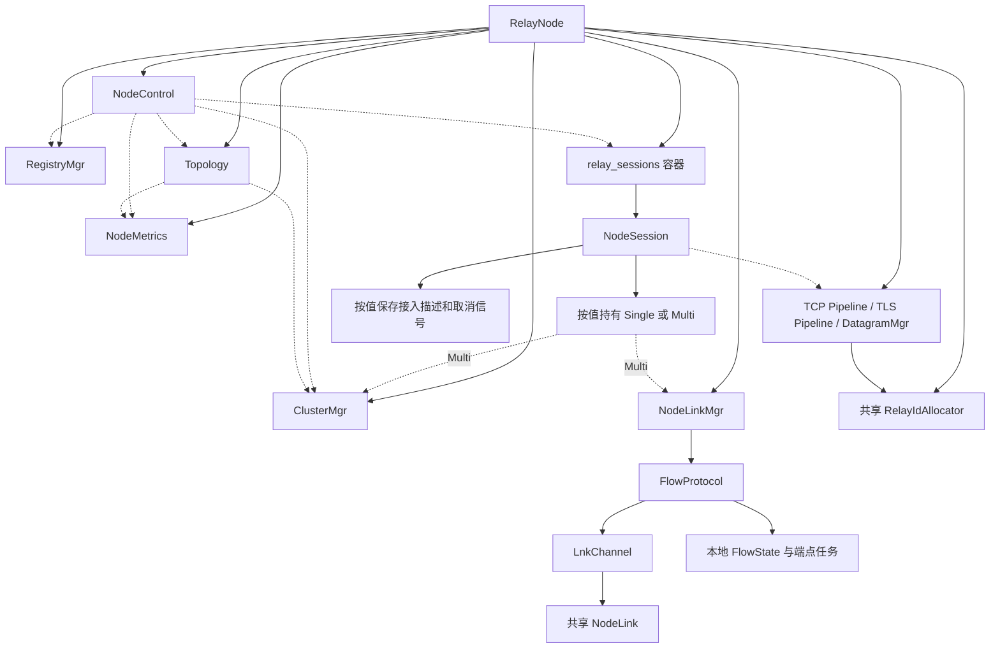

RegistryMgr 只保存 ControlSession 的弱引用，强引用由控制连接任务持有。NodeSession 同样弱引用
Agent 控制连接，其本地数据资源继续归 manager；NodeSession 的值描述不是 socket 或 Flow 的所有者。
RelayNode 的业务容器和任务 completion 保活实例，只有 run 已完成取消、排空及清理后，completion
才从容器移除实例。ClusterMgr 借用 RelayNode 回送消息，停止时必须在 Node 销毁前排空该反向调用。

#### 一次业务在各 Node 上的组成

| 部件或状态 | Single 所在 Node | Multi 首 Node H | Multi 中间 Node I | Multi 末 Node T |
|---|---|---|---|---|
| 本业务 NodeSession | 1 个 Single，管理本地双方 | 1 个 ingress Multi | 无 | 1 个 egress Multi |
| 本业务 Agent 控制连接 | Consumer、Producer；可以是同一连接 | Consumer | 无 | 已注册服务的 Producer |
| 数据 manager 资源 | 一个 LocalPair，拥有双方接入 | 一个 Consumer RemotePair | 无 | 一个 Producer RemotePair |
| 接入描述 | AttachPair，双方同 uuid、不同 ticket；UDP session 不同 | 一个 AttachInfo | 无 | 一个 AttachInfo |
| 服务注册与 ServiceTraffic | 本地 Registry 条目及共享统计 | 本业务不持有服务统计 | 无 | 本地 Registry 条目及共享统计 |
| NodeFlow / 本地 FlowState | 无 | 同一 Flow 的首端 | 同一 Flow 的转发状态 | 同一 Flow 的末端 |
| NodeLink | 本业务不使用 | 连 next 的共享 Link | 连 previous/next 的共享 Link | 连 previous 的共享 Link |

表中的“无”限定于该次业务；各 Node 可同时承载其他服务和业务。master 只有同时位于
路径上时才拥有该 Flow 的本地数据状态；作为路径协调者时，它保存事务，不保存统一的 Agent 业务表。
一个 Agent 可以同时提供服务和使用服务，Single 的两个角色也可以落在同一控制连接上。

业务由本地 forward 持续监听触发，单次 AgentSession 与 NodeSession 对接；Single 在本机配对，Multi
首末经 NodeFlow 连接，中间只转发。Producer AgentSession 负责最终目标 socket，Node 不连接目标服务。

#### 接入描述与身份的使用范围

| 身份或描述 | 谁生成、谁保存 | 用于哪里 | 不应混用的边界 |
|---|---|---|---|
| 普通控制 `session_id` | RelayNode 分配非零进程内 ID，Registry 保存会话 | 服务归属、跨集群查询回送 | 不下发为业务 UDP session |
| 业务 `request_id` | Consumer Agent 提交，控制器保留 | uuid 尚未知时匹配 opened/error/cancel；Multi 重复请求匹配 | 不等于 Flow prepare 的事务 request_id |
| `uuid` | 三类 manager 共用 RelayIdAllocator | 本 Node 数据资源查找、Agent 通知关联 | Single 双方相同；Multi 首末独立分配，不作为跨 Node Flow 身份 |
| `ticket` | manager 为接入角色生成 | RelayAttach 接入授权 | Single 双方不同，不能代替另一角色接入 |
| UDP `session_id` | DatagramMgr 分配非零值并建立 Binding | Agent↔本 Node 的正常业务报文头 | 单边独立，不穿过 NodeFlow，不代表普通控制会话 |
| `epoch + flow_id` | 当前 master epoch 与本次 Flow ID | 全路径授权、首末 peer 通知和 Node DATA | 业务重建使用新 Flow；不复用旧 Flow 状态 |
| Link ID / token | master NodeLinkMgr 建立相邻 Link 时生成 | 邻接传输认证、Link 查找 | 可被多条 Flow 共享，不暴露给 Agent |
| AttachInfo / AttachPair | manager 按值返回，NodeSession 按值保存 | control_io 直接读取 uuid 等字段，构造通知时生成 JSON | 不持有运行资源，关闭后仍保留元数据供通知使用 |

AttachInfo 只保存 uuid、ticket、data_port、session_id；TCP/TLS 的 session_id 为 0，UDP 必须非零。
AttachPair 包含 producer 和 consumer 两个 AttachInfo。NodeSession 以 monostate 表示尚未安装，安装
成功后保存 AttachPair 或 AttachInfo；不能在安装前失败时构造含零值 uuid/ticket/port 的端点通知。
AttachInfo::to_params 按协议写入 UDP session_id 或 TLS framing，协议之外的字段不输出；请求参数
params_ 保存控制协议 JSON。全部线上字段见[控制协议规范](#7-控制协议规范)，执行域交接见 [RelayNode 编排与四个执行域](#relaynode-编排与四个执行域)。

### RelayNode 编排与四个执行域

RelayNode 使用四个互相独立的单线程 `asio::io_context`，各由一个 worker 运行；
`main()` 在主线程运行处理进程信号的 `signal_io`，进程共五个线程。
worker 在提交 `start()` 前已启动；启动失败时保持运行，使已发布的任务能够通过 `stop()` 排空。

四个服务执行域的职责如下：

| 执行域 | 状态与资源 | 处理范围 |
|---|---|---|
| `control_io` | control acceptor、`ControlSession`、`NodeControl`、`NodeMetrics` 控制侧采样、`RegistryMgr`、`ClusterMgr`、`Topology`、服务发现 | 控制状态按顺序修改，会话、服务表和探测状态由本执行域串行访问 |
| `transfer_tcp_io` | 两个 `StreamPipeline` 的 acceptor、Relay 索引和流式数据复制 | TCP/TLS 接入和双向复制独立调度 |
| `transfer_udp_io` | `DatagramMgr`、UDP socket、UDP 路由 | UDP 报文处理与 TCP/TLS、控制面独立调度 |
| `cluster_data_io` | `FlowProtocol` 的流表、信用、计时与所属 `LnkChannel` 的物理收发 | Node 通道与会话数据面同域运行，与业务服务限速隔离 |

#### 跨线程共享状态

同一执行域内的状态由单个 worker 串行访问。跨线程共享的计数、身份集合与观测值按下表同步：

| 状态 | 访问者 | 同步方式 |
|---|---|---|
| ServiceTraffic 访问者列表 | TCP/UDP transfer executor 修改，control_io 生成报告时读取 | 互斥量保护，报告读取副本 |
| RelayIdAllocator 的 ID 集合与序号 | TCP/TLS 与 UDP transfer executor 分配、释放 | 互斥量保护 |
| RelayNode::state_ | 外部所有者线程写入停止状态，control_io 读取 | 原子状态 |
| StreamPipeline::pending_sockets_ | setup 任务更新，外部 stop 等待 | 原子计数与 wait |
| 流量计数、FlowProtocol::forwarded_bytes_ | transfer/cluster_data 更新，control_io 采样 | 原子计数 |
| NodeMetrics 队列延迟与运行标志 | 各探针执行域写入，查询和停止入口读取 | 原子快照与标志 |
| FlowProtocol::event_overflow_ | 数据域报告溢出，控制域读取 | 原子标志 |

#### 跨域操作与完成语义

NodeSession 的跨域操作按调用边界展开如下。短任务执行同步 manager 操作，真正等待的任务在对应
执行域运行并把结果交回 control_io；跨域任务通过 co_spawn 绑定目标 executor；dispatch 不改变当前协程的关联 executor。

| 控制域入口 | 实际执行位置与返回条件 |
|---|---|
| install | 选定 transfer executor 的短任务同步分配资源，按值返回 AttachPair/AttachInfo，成功后才通知 Agent |
| wait_attach | 在选定 transfer executor 等接入事件，使用控制器的绝对 deadline，关闭时返回失败或取消 |
| Single bind_and_activate | 一次 co_spawn 内同步顺序执行 bind_local_pair、activate_local_pair；返回控制域后检查停止及期限，再发 ready |
| Multi bind | control → transfer → cluster_data → transfer → control；FlowProtocol 在自身域验证并绑定端口，manager 在返回后重新检查资源是否关闭 |
| Multi activate | peer 条件满足后，在 transfer executor 独立设 active，返回后再检查取消和期限并发 ready |
| bridge | 在 transfer executor 持续复制或等待 UDP 结束；取消/失败必须先排空所属子任务再返回 |
| close | 屏蔽外层取消后的 transfer 短任务，移除索引并关闭资源；NodeSession 保留描述供后续通知，不清空为 monostate |

单节点选择 LocalPair，多节点选择 RemotePair 的判断统一使用 is_multi；跨域任务捕获该判断及 uuid、
accessor、统计引用的值，不跨域读取控制器状态。close 先读取一次 uuid，为 0 时表示尚未安装而直接返回。
数据 manager 不访问控制状态，也不发送 Agent 业务控制消息。
接入角色、accessor 和 Flow 身份由所选控制器明确传给 NodeSession；
NodeSession 不读取控制器私有业务状态，数据操作和 controller variant 均为实例内部实现。

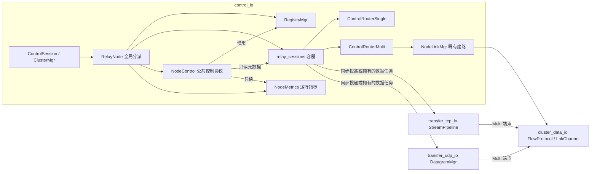

单线程执行域保证同一域内 handler 不并发执行，但不能允许同一个 socket 上出现重叠的异步读或异步写。每种 stream 的读循环和写队列仍各自保持单一所有者。

NodeLink 是相邻 Node 的物理通道，NodeFlow 是固定路径上的双向逻辑流。
NodeLinkMgr 在 control_io 协调建立，直接持有 FlowProtocol；FlowProtocol 在 cluster_data_io 拥有逻辑流表、
信用、端点任务、内存池和共享监控计时器，并按值持有负责邻接连接及物理收发的 LnkChannel。master 只协调建路和转交消息，不保存 Agent 业务实例。
NodeSession 只存在于单节点业务所在 Node，或多节点的首末 Node；中间 Node 不保存服务或 Agent socket。
共享通道与路径事务见 [LnkChannel 与共享 NodeLink 邻接传输](#lnkchannel-与共享-nodelink-邻接传输)、[NodeLinkMgr 全路径安装与授权事务](#nodelinkmgr-全路径安装与授权事务)，Single/Multi 业务协调见 [Node 业务实例与 Single / Multi 首末协调](#node-业务实例与-single--multi-首末协调)，二进制格式见 [Node 数据通道二进制帧](#node-数据通道二进制帧)，热路径见 [数据热路径与载荷所有权转移](#数据热路径与载荷所有权转移)。

## 2. 控制面与路径事务

控制面依次处理控制接入、集群寻址、服务定位和业务编排。NodeLinkMgr 为 Multi 提供已提交的
固定路径；查询与观测读取同一控制域中的目录、业务元数据和指标。

### 普通控制会话与本机服务目录

#### 普通控制连接的接入与退出

1. control acceptor 接受 socket；先检查 Node 为 Running、Registry 的普通会话容量未满。
2. 创建 ControlSession，复用随机 ID 生成器分配非零、当前注册表内唯一的 session_id，向 Registry 登记弱引用并增加任务计数。
   握手中的连接计入 control.max_connections；业务任务另按业务容量准入。
3. 提交唯一会话任务 run_control_session。提交失败立即回滚登记与计数；任务内先通过 TLSChannel::start
   完成 mTLS，随后循环等待 async_receive，只有 Running 时把消息交给 RelayNode 分派。
4. 未知命令、基本字段异常、通道失败或主动断开结束接收循环。先遍历业务并通知 control_disconnected，
   由实例判断归属；再 Registry.remove(id) 删除该连接和全部注册服务，最后等待 async_disconnect 排空通道。
5. 会话任务结束时减少 active_control_sessions_；Stopping 且最后一个会话退出时唤醒控制侧停止等待。

会话任务持有 ControlSession 的强引用，Registry 与业务实例只借用弱引用。会话断开会触发业务取消，
取消后业务任务仍独立排空；不能在删除服务时直接销毁仍有挂起 I/O 的 NodeSession。
发送仅提交消息，握手、心跳、有界队列和连接关闭由 TLSChannel 管理，详见 [TLSChannel 控制通道保障](RelayWeave设计.md#36-tlschannel-控制通道保障)。

#### 服务条目、注册与断线注销

Registry 以 session_id 保存控制会话的 weak_ptr，以 DualIndexMap 保存唯一服务名、所属 session_id、
协议和 ServiceTraffic。服务名走主索引，断线按次索引删除该连接的全部服务；容量检查和查找不扫描
过期 weak 引用。服务条目拥有统计对象，NodeSession 创建时通过 find_service 取得共享统计引用。
注册只返回业务结果，不能创建数据配对；没有独立注销命令、离线注册或服务租约。

服务注册流程为：

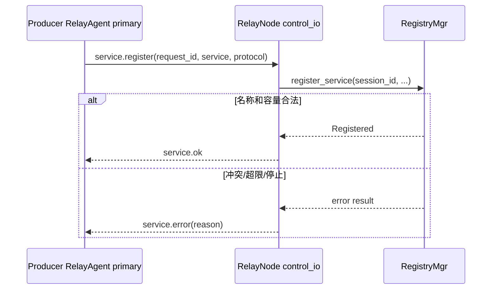

同一会话重复注册同名同协议服务是幂等成功，复用原统计对象；同一节点上其他会话注册同名服务，或同一会话改用另一协议，都会得到名称冲突。服务名在单个 RelayNode 内唯一；不同节点可以注册同名服务，发现端采用当前请求的第一个有效响应。

所有协议在 relay.open 时从 Registry 取得 Producer。注册只更新控制域注册表，不通知数据 manager，
也不复活离线时的旧请求；服务出现后 Agent 重新发现、选路和申请实例。

### 集群成员与控制消息路由

ClusterMgr 将多个 Node 组织为可寻址的控制网络；master 的 ClusterRoom 拥有成员会话，slave 的 Connector 维持上行连接。

#### ClusterRoom 成员与消息分发模型

ClusterMgr 的成员与消息分发模型由四个角色组成：

- `ClusterRoom` 管理参与者集合，并按 `target` 广播或定向投递；
- `ClusterSession` 对应 master 接受的一条 slave 连接；
- `ClusterParticipant::deliver()` 是统一的写入口；
- master 本地逻辑以一个本地 participant 加入 room。

master 接受 socket 后立刻创建 session 并加入 room。session 的读协程先调用 `TLSChannel::start()`，再等待 `cluster.join`。加入成功后，读到的普通消息交给 room；room 遍历参与者并调用 `deliver()`。远端 session 的 `deliver()` 直接调用 `TLSChannel::send()`，握手、帧格式、心跳、发送队列和单写协程由 TLSChannel 管理。

`ClusterRoom` 放在 master 的 `accept_loop()` 协程栈上，只在该结构化协程存活期间存在。停止时先停止所有 session，等待参与者退出，再离开协程。room 和 session 的生命周期由同一个 accept 协程封闭管理。

#### 成员加入与消息路由

| 命令 | 方向 | 参数 | 作用 |
|---|---|---|---|
| `cluster.join` | slave → master | `node_id` | TLS 握手后声明节点 ID |
| `cluster.joined` | master → slave | 无 | 确认加入成功 |
| `cluster.error` | 本地或 master → slave | `reason` | 入群拒绝或真实集群连接失效 |
| 任意非 `cluster.*` | 任意节点 → room | 业务参数及必填 `target`；master 写入 `source` | `target=all` 广播，否则按 node_id 定向 |

`node_id` 由配置声明，编码长度最多 256 字节；配置加载、ClusterMgr 构造及远端入群均执行该限制。
master 拒绝同时在线的重复 ID，也拒绝保留值 `all`。集群 mTLS 确认对端持有 Server CA 签发的节点证书，但协议没有把证书名称与 `node_id` 绑定。

业务消息使用 `CtrlMessage {command, params}`。发送方写入 `params.target`，其中 `all` 表示广播，其他值表示目标节点 ID。master 根据已加入的 session 覆盖写入 `params.source`，调用者不能伪造来源；路由前删除 `target`，RelayNode 接收认证 `source` 和业务字段。业务消息的 `params` 必须是对象，`cluster.*` 命令、`source` 和 `target` 字段由集群层保留。

广播包含发送者，本地节点和远端节点使用相同的接收路径。定向消息只投递给当前在线的目标 participant；目标不存在时按 best-effort 语义丢弃，不退化成广播。

ClusterMgr::broadcast(message) 等价于 send("all", message)；其他 target 使用 send(target, message) 定向发送。
两个接口都要求在 control_io 调用，返回 `SendResult`：`Submitted=0`、`NotConnected=1`、
`Stopped=2`、`InvalidMessage=3`、`QueueFull=4`。master 的 Submitted 表示本地出站队列已受理，
slave 的 Submitted 表示消息已交给加入成功的 TLSChannel；均不保证底层 TLS 入队、远端收到或业务执行成功。
参数或编码错误只拒绝当前消息，不关闭健康连接。master 共享出站队列满视为控制模块致命故障：
立即拒绝后续提交、丢弃待发消息、关闭集群连接，并通知 RelayNode 所有者在执行域外调用 stop()。
RelayNode 切换 Stopping 并唤醒 Link/Flow 等待者，普通监听和 Registry 统一由 stop_control() 关闭；
即使所有者已经开始停机，也仍处理已排队的故障通知，避免关闭任务继续等待失效的集群确认。
致命故障结果由 ClusterMgr 保存，RelayNode 的 stop() 汇总该结果。Node 完成排空后以失败结果退出，
由已有 systemd Restart=on-failure 策略重启。
单条 TLSChannel 队列满沿用通道关闭路径，成员离开或 slave 控制失联负责撤销相关业务。
编码检查前移到发送入口，room 不再为已解码的内部消息重复编码校验。
真正的集群断线继续沿用原有失效通知与业务清理。需要业务结果的调用仍通过响应消息和 request_id 关联。
集群不保存历史、不补发，也不自动重发业务消息。

#### ClusterMgr::Connector 重连

slave 的 `ClusterMgr::Connector` 位于 `slave_loop()` 协程栈上。resolver、socket、retry timer 同样属于该协程栈；`ClusterMgr` 只保留一个临时裸指针用于停止时取消这些操作。

connector 对活动 `TLSChannel` 只保存 `weak_ptr`。一次连接的强引用由当前连接/接收协程持有；接收结束并清理以后弱引用自然过期。下一轮通过 `weak_ptr::expired()` 判断是否需要连接。

连接流程是：解析地址、TCP 连接、TLS 握手、发送 `cluster.join`、等待 `cluster.joined`、持续接收。解析或连接最多等待 5 秒；失败或断线后固定等待 5 秒再重试。重试间隔固定，不使用指数退避。

停止时取消 resolver、socket 和 retry timer，并断开当前 TLSChannel。master 关闭 acceptor 和出站消息队列，停止 room 内 session 并等待它们退出。RelayNode 等待 `ClusterMgr::async_stop()` 完成后才结束 control 侧停止；此时不会再有 ClusterMgr 对 RelayNode 的反向调用。

#### Master accept_loop 的结构化并发

master 的 `accept_loop()` 在栈上创建 ClusterRoom 和本地 participant，然后使用 Asio awaitable 运算符并行等待：

```cpp
co_await (accept_sessions(room) && deliver_messages(room));
```

两个分支分别承担 socket 接入和本地出站消息队列消费。它们共享同一个 control executor 和同一个栈上 room，所有成员操作均在该 executor 串行执行。任一分支异常时，组合 awaitable 结束；外层保存异常，先 `co_await room.async_stop()` 收敛所有 participant，再重新抛出。清理发生在 room 析构之前。

接受到 socket 后，session 在完成 TLS 和 join 前已经计入 room 容量。连接上限同时覆盖握手中和已加入的远端成员。room 的容量判断值为 `max_connections + 1`，其中一个名额用于 master 本地 participant。

#### ClusterSession 生命周期

一个 ClusterSession 只有一个 reader 协程：

1. `co_await channel->start({})` 完成服务端 TLS 握手；
2. 在握手超时时间内直接 `co_await channel->async_receive(timeout)` 等待 `cluster.join`；
3. 验证 node_id 非空、不是保留值 `all` 且未被 room 占用；
4. 回复 `cluster.joined`；
5. 持续直接 `co_await channel->async_receive()`，把业务消息交给 room；
6. 退出时断开 TLSChannel；completion handler 用 weak session 从 room 删除自己。

有限超时由 TLSChannel 的 `async_receive(timeout)` 提供；正常读循环直接 co_await，接收超时与正常接收均在 reader 协程中完成。

session 的 `deliver()` 只调用 TLSChannel 的异步发送入口。ClusterRoom 只操作 participant 接口，socket、TLS 写队列和心跳由 ClusterSession 与 TLSChannel 管理。

#### 广播与定向交付

master 收到 slave 消息后，不直接信任原消息中的 `source`。ClusterRoom 使用已加入 session 的 `node_id` 覆盖该字段，删除传输字段 `target`，再根据 target 把业务消息复制给所有 participant 或只投递给一个目标。master 本地发出的消息同样填入 master 的 node_id。

此机制提供的是当前在线成员间的 best-effort 投递：

- 未加入的 session 不接收业务消息；
- 广播时离线的成员不会在重连后收到历史消息；
- 定向目标不存在或已离线时消息直接丢弃，不自动改为广播；
- 某个 participant 的 `send()` 入队失败不会回滚其他 participant；
- 响应必须是新的业务消息，并携带请求协议定义的关联字段；
- `source` 仍由 master 认证并覆盖，定向投递不会降低来源身份保证。

#### ClusterMgr 与 RelayNode 接口

RelayNode 管理 ClusterMgr 的启动、停止和集群业务消息分派。
业务处理器直接使用 ClusterMgr 的 `send(target, message)` 和 `broadcast(message)`。

RelayNode 独占 `ClusterMgr`，ClusterMgr 反向保存非拥有的 `RelayNode&`。ClusterMgr 在 control executor 上
验证消息来源后直接调用 RelayNode 的私有消息处理入口，该入口将公共控制消息交给 NodeControl，将中继命令交给所属 NodeSession/控制器。
NodeControl 处理服务、节点、集群状态和拓扑查询；NodeLink/Flow 及 `relay.peer.*` 由 RelayNode 交给各自模块处理。
`cluster.error` 清理本地 Flow 协调、端点授权及多节点业务；物理 Link 仍由成员变化和独立心跳判断失效。`cluster.joined` 及未识别的普通命令在该入口结束处理。
这条直接关系与 RelayNode 控制状态位于同一串行 executor，生命周期由 RelayNode 的所有权和停止顺序保证。
发送入口拒绝业务调用使用 `cluster.*` 保留命令，记录原因并返回 InvalidMessage。

### 节点地址发布

`service.located.address` 也是客户端下一条控制连接和数据连接使用的主机地址。服务节点始终发布必填的 `control.advertise_address`；该值应填写请求方可以访问的公网 IP 或 DNS 名称，并且必须在节点证书 SAN 中。`control.address` 只用于绑定本地监听接口，可以填写 `0.0.0.0` 或 `::`，不参与服务地址发布。

### 服务发现流程

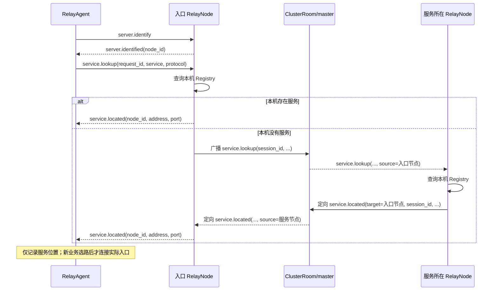

服务端不保存 pending 查询、不创建查询 timer，也不持有等待结果的客户端会话。跨集群查询携带原控制会话的 `session_id` 和入口 `requester_node`。响应回到入口节点时再查 Registry；原会话已经消失就直接丢弃。

转发给普通客户端前，入口节点：

1. 用经过 ClusterSession 认证的 `source` 填写 `node_id`；
2. 删除内部的 `source`、`requester_node`、`session_id`；
3. 保留客户端原始 `request_id`。

查询超时和响应过期由客户端处理。每个服务只接受当前 `request_id` 对应的位置结果；后到的旧响应被忽略。多个节点同时提供同名同协议服务时，当前请求收到的第一个有效位置会把 request 置零，后续响应不再匹配。

跨节点时同一查询的参数演变如下：

| 阶段 | 消息 | 参数 |
|---|---|---|
| RelayAgent 发给入口 | `service.lookup` | `request_id`, `service`, `protocol` |
| 入口广播 | `service.lookup` | `target=all`；上述字段 + 入口普通会话的 `session_id`；ClusterRoom 写入 `source=入口 node_id` |
| 服务节点定向响应 | `service.located` | `target=requester_node`；`requester_node`, `session_id`, `request_id`, `service`, `protocol`, `address`, `port`；ClusterRoom 写入 `source=服务节点 node_id` |
| 入口发给 RelayAgent | `service.located` | `request_id`, `service`, `protocol`, `node_id=source`, `address`, `port` |

`session_id` 只在一次 RelayNode 进程生命周期内标识普通控制会话；它不是公开客户端身份，也不会交给最终 RelayAgent。`requester_node` 用作响应的定向目标，并让入口再次确认消息属于本节点。最终 `node_id` 必须从 ClusterRoom 认证过的 `source` 生成，不能采用业务消息自己携带的 node_id。

如果服务在入口本机，RelayNode 直接构造最终 `service.located`，不经过 ClusterRoom。本地命中与远端命中返回相同的客户端字段。

### Node 业务实例与 Single / Multi 首末协调

RelayNode 根据消息类型与业务身份分派命令，所属控制器推进实例状态。部件和身份见 [业务组件协作](#业务组件协作)；Single 的完整时序见 [单节点业务建立与数据复制](#单节点业务建立与数据复制)，
Multi 的完整时序见 [多节点路径建立与首末接入](#多节点路径建立与首末接入)；正常结束、拒绝、失效和停止的清理顺序统一见 [建立、转发与收尾的责任边界](#建立转发与收尾的责任边界)。

#### 普通控制与集群消息的入口分派

普通控制与集群消息都在 control_io 同步分派：

| 入口及消息 | RelayNode 交给谁 | 生效条件与结果 |
|---|---|---|
| 普通连接的注册、发现、节点定位、列表、负载、流量、集群状态和拓扑查询 | NodeControl | 每条消息验证 params 对象与命令字段，公共查询只读控制域快照 |
| 普通连接的 relay.open/reject/cancel | 全局创建逻辑或已有 NodeSession | 只有 Running 状态接收业务分派；已有业务自行验证控制会话与身份 |
| 集群 Link/Flow 命令 | NodeLinkMgr | 停止期间不接收新的 flow.open，但仍允许管理器接收其余事务和关闭消息直至自身停止 |
| relay.peer.* | 已有 Multi，或 peer.open 的新建出口逻辑 | 只在 Running 时分派，来源由 ClusterMgr 认证 |
| topology.members | Topology，再通知 NodeLinkMgr 和业务实例 | Running 时按新成员/epoch 撤销过期授权和受影响业务 |
| topology.report | Topology | master 校验并汇总报告 |
| cluster.error | NodeLinkMgr、Multi 实例 | 清理本地 Flow 授权并使多节点业务失效；Single 不因集群失联被整体取消 |
| 其他受支持的集群查询和响应 | NodeControl | 清理内部回送字段并把合法响应交回原控制会话 |

普通控制连接不能发送 Link/Flow/peer 命令。未知普通命令或基本参数解析失败会退出接收循环，随后
注销该连接的服务并取消关联业务；已合法解析的服务冲突、容量拒绝、建路失败则返回对应业务错误。
进入 Stopping 后普通会话只收尾，不创建新业务；集群关闭确认仍需要存活的控制和数据执行域。

#### 创建、容量与任务所有权

1. relay.open 先读取 request_id、service、protocol；是否带 path 决定 Single 或 Multi，不由协议决定。
2. Single 查本地 Registry，确认 Producer 在线且协议相同；无服务或协议不符立即 error，不创建等待服务的实例。
3. Multi 首端先确认 request_id 非零、path 至少含两个 Node、首项为本 Node、epoch 当前，再让已有实例
   匹配重复请求；完整路径、成员、地址快照和邻接授权继续交给 NodeLinkMgr 校验。
4. 新建入口与出口统一经过 start_relay：Multi 实例总数不得达到 control.max_connections，且该协议的
   全部 Single/Multi 实例数不得达到 tcp/tls/udp.max_relays。控制连接与多跳业务使用独立计数，不是共享一份名额。
5. 准入后放入唯一 relay_sessions_ 容器，绑定实例的 cancellation_slot，启动 control_io 的业务任务。
   提交失败回滚容器；建立中、活动及取消后尚未排空的任务都继续占用名额。
6. run 返回后 completion 移除实例；容器变空时唤醒 stop_relays。数据 manager 还独立检查本协议
   LocalPair + RemotePair 的容量，控制任务准入不代替数据资源准入。

RelayNode 只通过 NodeSession 的行为接口、protocol/is_multi 和 cancellation_slot 协调实例；不读取
控制器的角色、请求字段、进度或取消信号。NodeSession 按值持有 Single/Multi，控制器只推进自己的实例，
数据 manager 不保存 ControlSession，也不发 opened/offer/ready/error/closed。

#### 已有业务的匹配、重复消息与断线

| 消息或事件 | 匹配与处理 |
|---|---|
| Single relay.open | 不被已有实例消费；每次合法 open 都走新建，没有 request_id 结果缓存 |
| Multi relay.open | 首端按同一 ControlSession 与请求身份匹配；path/epoch/service/protocol 必须一致；已发过 opened 则重发原端点与票据，不新建 Flow；冲突返回 error |
| Agent reject/cancel | 按所属控制会话，再按 uuid 或请求方 request_id 匹配；请求方可在安装前取消；ready 后 reject 不再当作建立失败 |
| Multi peer 消息 | epoch、flow_id、认证 source 三项同时匹配；关闭中尚未排空的实例继续消费匹配消息；相同 peer.open 不创建新出口 |
| 无匹配的 peer.open | 验证 egress_ready：本地 Flow 已提交、自己是末端、source 为首端、transport 与业务对应；再查本地服务并创建 egress NodeSession |
| 无匹配的其他 peer 消息 | 忽略，不从 ready/finished/close 反推新业务 |
| 普通控制连接断开 | 遍历业务，控制器自行判断是否属于该连接；Single 取消其任一方，Multi 取消本端 Agent 所属实例 |
| 成员更新或集群失联 | NodeLinkMgr 检查路径成员、地址及 epoch；Multi 比较 epoch 或接受显式失败原因；Single 保持本地生命周期 |

重复 Multi open 在新建容量检查前匹配；额度饱和时原请求仍返回原接入参数。入口的基本路径/epoch
校验仍先执行；非法或已过期请求不会绕过当前拓扑检查。request_id、uuid 和 Flow 身份各有独立范围，见 [接入描述与身份的使用范围](#接入描述与身份的使用范围)。

#### 控制器进度与协商事件

Single 用 ready_、stop_requested_、deadline_、reason_ 表达建立、运行和终止；取消信号负责打断等待，
最终资源释放仍由 run 收尾完成。Multi 的四个本地进度如下：

| Multi progress | 本端状态 | 资源与通知状态 |
|---|---|---|
| OpeningFlow | ingress 正在取得 Flow | 本端接入资源尚未安装，无 uuid 或接入字段 |
| PeerOpened | ingress 已取得 Flow 并提交 peer.open；egress 创建时从此开始 | peer.open 的远端处理结果由后续 peer 事件确认 |
| AgentNotified | 本地 RemotePair 安装成功，已向本端 Agent 提交 opened/offer | 后续等待 attach、绑定与激活 |
| Ready | 本端已接入、绑定、满足 peer 条件并激活，已通知本端 Agent ready | 开始本地复制；双方复制完成由 finished 事件单独确认 |

peer_prepared_ 在 ingress 表示收到末端 attached，在 egress 表示收到首端 peer.ready；它们是等待本端
激活的条件。peer_finished_ 单独表示对端已排空；stop_requested_ 表示终止，from_peer_ 标识来自对端的关闭，本端不回送 close。
stage 是实际失败位置，可来自 Flow 结果或 peer；reason 保留首次终止原因，不能用本地 progress 覆盖。

Multi 取得 Flow 后并行运行 establish_and_transfer 与 watch_flow；任一分支退出，parallel group 取消并
排空另一分支，再进入统一清理。watch_flow 仅监视该 Flow 的真实关闭，不额外创建业务表或运行租约。
attached/ready 是激活协商，finished 是正常排空协商，close 是终止通知，三类事件不能互相替代。

### NodeLinkMgr 全路径安装与授权事务

NodeLink 是可共享的相邻物理通道，NodeFlow 对应一次业务的固定全路径。Flow 身份为 epoch + flow_id，
不保存独立 Route ID 或路径版本；业务重建分配新 flow_id，相同路径也不复用旧 Flow。TLS 业务使用
TCP NodeFlow，TLS 保护位于 Agent↔Node 接入段，Node 间的加密边界见 [多节点 TLS 的加密边界与复制](#多节点-tls-的加密边界与复制)。

#### 协调者、本地授权与数据状态

open_flow 在 control_io 运行。首 Node 是 master 时直接创建事务；首 Node 是 slave 时向 master
发送 flow.open、等待 flow.opened，master 仍执行同一事务。远程请求预先在本地 remote_flows_ 登记，
master 在消息处理期间同步预留 FlowRequest，再启动异步建路；此后收到的取消按该事务身份匹配。
请求只包含路径、transport 与 Flow 身份；master 不保存服务、Agent 控制连接或业务 ready 状态。

| 控制表 | 所在节点、保存内容与用途 | 删除时刻 |
|---|---|---|
| link_requests_ | master：按排序后的邻接 Node 对和 transport 合并申请，成功结果保留供复用 | Link 失败、关闭、成员/地址/epoch 失效或停止 |
| link_endpoints_ | 相邻端点：本地 Link 的参数、token 和 peer 授权 | 本地 Link 失败、关闭或授权失效 |
| flow_requests_ | master：建立中或已提交的全路径事务与确认掩码 | 建立失败或活动 Flow 开始关闭时转入 closing_flows_ |
| closing_flows_ | master：等待全路径关闭确认和关闭错误 | 全确认、关闭期限到达或控制失效 |
| flow_endpoints_ | 路径 Node：授权参数及数据域确认后的 committed 事实 | 数据域报告关闭、路径或控制失效 |
| remote_flows_ | slave 首 Node：本次远程 open 的身份与结果等待 | 结果返回、超时或取消；未接受成功结果时尽力补交关闭请求 |
| flow_watches_ | slave 路径端点：同一 Flow 的共享关闭等待及原因 | 本地 Flow 关闭或控制失效；已有等待者保活到收尾 |

这些控制表都属于 control_io。实际 Link、FlowState、方向信用和 Prepared/Active/Closed 状态属于
cluster_data_io 的 FlowProtocol/LnkChannel；控制授权不等于实际数据安装完成。数据操作通过
ProtocolEvent 有界通知队列返回，NodeLinkMgr 据此发送 prepared/ready/committed/closed 确认。

#### 相邻 NodeLink 的合并、授权与复用

1. master 确认两 Node 不同、在线、epoch 有效，transport 为 tcp 或 udp；按 Node ID 排序形成
   `(left, right, transport)`，同一键的并发调用共享 LinkRequest。已有成功结果直接返回 Link ID。
2. 新尝试分配非零 ID 和新 token，固定当前两端地址和集群数据端口，向两端发送 link.prepare。
   每端验证 master 来源、epoch、左右身份、peer 地址及端口一致后，登记授权并交数据域准备。
3. 两端都返回 link.prepared 后，master 才发送 link.connect；物理连接角色由左右 Node 排序决定，
   不由 Flow forward/reverse 决定。TCP 和 UDP 的接入认证、UDP 的一次性握手见 [LnkChannel 与共享 NodeLink 邻接传输](#lnkchannel-与共享-nodelink-邻接传输)、[共享 Link 建立协议](#共享-link-建立协议)。
4. 两端都返回 link.ready 才成功，取消建立计时器，保留成功 LinkRequest 供后续 Flow 复用。
5. 新 Link 建立最多 10 秒。失败发送 link.close 并删除复用记录；下一次外层申请使用新的 ID/token。
   单条 Flow 结束不关闭共享 Link，某条 Flow 取消也不取消其他申请者共享的 Link 建立。

Link 事务使用左右两端对应的 bit 记录 prepared 和 ready 确认。completed 表示建立结果已确定；
Link 失效后撤销复用记录和端点授权。数量及保留描述的成本见 [控制面描述保留](#控制面描述保留)。

#### 全路径 Flow 的准备与提交

1. 校验无环的 2..8 Node 路径、transport、当前 epoch、成员地址快照和 Flow 容量；remote 首端还必须
   是 path.front。生成事务 request_id，保留全路径和每条边的 Link ID 槽位。
2. 并行 ensure 每条相邻边。边失败时先结束本 Flow 的建立结果并回滚；已启动的共享 Link 申请继续按
   自身期限收敛，establish_flow 收集已启动边的结果，取消不主动销毁可复用 Link。
3. 所有边成功后再次校验运行状态及路径快照，开始 prepare/commit 共用的 10 秒期限。
4. master 向路径上每个 Node 发 flow.prepare，包含完整授权、Link 序列和剩余 ttl_ms。本地控制层
   验证自己恰在路径、边数为 Node 数减一、Link ID 非零、transport 匹配及 ttl_ms 为 1..10000。
5. 本地控制层保存授权并生成只含本地 previous/next 的 FlowSpec，post 到 cluster_data_io。
   FlowProtocol 再检查实际相邻 Link 已 Ready、epoch/身份/协议及数据容量，安装 Prepared FlowState；
   完成后才通过 ProtocolEvent 发回本 Node 的 flow.prepared。
6. master 收齐全路径 prepared 后发 flow.commit；每个 Node 只能提交已存在且参数一致的表项。
   数据域提交后回传 committed，本地控制授权同时标记 committed=true。
7. master 收齐全路径 committed，才把 FlowResult 标为成功并返回首 Node。此后首 Node 才能发送
   relay.peer.open，末 Node 用已提交的本地授权检查 egress_ready。

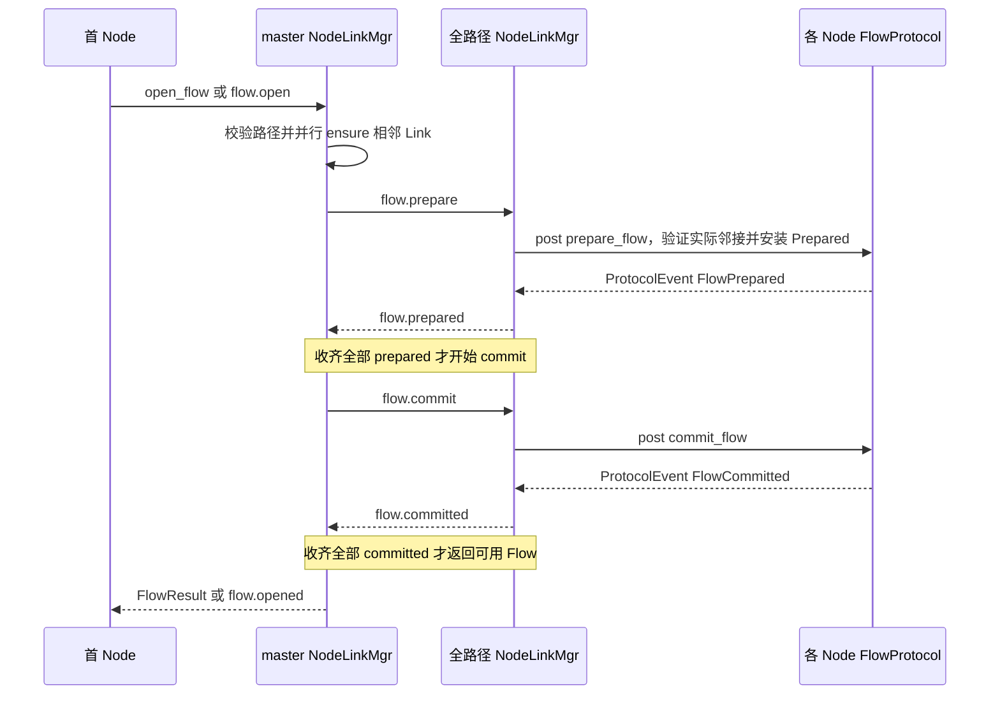

prepare/commit/close 各用一个 8 位掩码记录路径参与者，8 Node 上限只限制单条路径，不限制集群总数。
确认校验认证 source、epoch、flow_id、事务 request_id、路径和 Link 身份。相同 prepare/commit
幂等处理，冲突参数拒绝；commit 不能创建新表项。ttl_ms 是未提交表项的本地准备期限，不是运行租约，
也不是从 Agent 传递来的剩余建立预算；提交后没有周期续租。

#### 失败回滚、主动释放与失效通知

建立失败或取消向全路径发送 flow.close，既回滚 Prepared，也关闭已经提交的本 Flow；共享 Link 保留。
master 的 FlowRequest 从 flow_requests_ 移到 closing_flows_，收到全部 flow.closed 后才确认释放，最多
等待 10 秒。completed 只表示建立结果已确定，released 才表示关闭等待已收敛；两者不能合并。

首 Node 为 slave 时，close_flow 发 flow.close.request 并最多等待 10 秒的本地 Flow 关闭；这不是取得
master 全路径确认的回执。master 自己的 close_flow 才等待全路径释放。取消 wait_flow_closed 不会
关闭健康 Flow；Multi 的 watch_flow 与真正的 close_flow 分别承担观察和释放职责。

FlowProtocol 移除本地 Flow 后，retired_ 保存 ID 与 10 秒期限，退休期内拒绝该身份的 prepare；退休记录
不持有 FlowState。数据域的 FlowError/FlowClosed 经 NodeLinkMgr 唤醒本地等待者，再回报 master
并撤销本地授权。Link 失效影响依赖它的 Flow，普通单 Flow RESET 不扩大成共享 Link 故障。

成员/地址/epoch 失效撤销相关 Link 和 Flow；cluster.error 清理本地 Flow 与授权，物理 Link 继续由
成员更新或独立心跳收敛。单条集群 TLS 队列溢出关闭该连接；master 共享出站队列溢出关闭全部集群连接并使 Node 停机，远端据控制失联回收旧 Flow。没有运行期租约。
远程 open 最多等待 30 秒，Link 与 prepare/commit 的分段期限及 NodeSession 外层 deadline 见 [容量与超时配置](#容量与超时配置)。

### 查询与观测

#### Node 的查询处理与观测旁路

注册、发现和管理查询都经过同一个 NodeControl，查询本身不创建 NodeSession，也不占用业务数据资源。
除普通会话及其目录之外，入口不为跨 Node 查询另存 pending 请求、结果聚合任务或查询定时器：

| 客户端请求 | 本地处理与跨集群行为 |
|---|---|
| server.identify | 返回本 Node 的 node_id；Agent 用于确认所连入口，不把服务位置当作连接身份 |
| service.register/list | 注册本地服务或返回本地名称列表；不把服务目录复制到 master |
| service.lookup | 本地按服务和协议命中则直接回复；未命中广播，各有服务的节点定向回送，Agent 接受当前请求的首个有效结果 |
| node.lookup | 先查当前成员；离线返回 node.error；自己是目标则直接回复，否则定向询问目标自己的普通控制地址 |
| server.load/traffic | 返回本 Node 的队列延迟或服务统计，不访问其他执行域的可变队列 |
| server.cluster | 先回本机状态，再广播 server.status.query；其他节点各自定向回完整状态，没有统一全局完成消息 |
| topology.query | master 本机生成快照；slave 通过集群广播查询，只有 master 响应；入口只接受来自当前 master 的 snapshot |

跨集群响应统一携带 requester_node、普通控制 session_id 和原 request_id。入口确认 requester_node
属于自己、原控制会话仍在，按认证 source 生成 node_id，删除内部字段后再发送；topology.snapshot
额外删除临时 node_id。关闭会话的迟到响应直接丢弃，查询期限和请求过期由客户端处理，见 [服务发现流程](#服务发现流程)、[控制协议规范](#7-控制协议规范)。

NodeControl 汇总的 relays 只包括控制器已 Ready、未请求停止且控制引用仍有效的实例，不把建立中、
关闭中或中间 Node 的 FlowState 当成活动业务。NodeMetrics 拥有三个队列探针、服务采样及带宽可用率；
Topology 借用同一指标，拥有 ProbeSet、成员报告和 master 快照。探测、报告和查询不修改活动业务路径，
只有 epoch/成员或实际 Link/Flow 失效才触发相应业务清理。采样顺序见 [RelayNode 编排与四个执行域](#relaynode-编排与四个执行域)，快照字段和新鲜度见 [拓扑消费与 Dashboard](RelayWeave设计.md#44-拓扑消费与-dashboard)、[成员、质量与快照](#成员质量与快照)。

#### 集群状态查询

Dashboard 等普通客户端只需连接任意一个在线节点，每轮发送一次 `server.cluster {request_id}`。入口先直接返回自己的完整 `server.status.reported` 消息，再以 `target=all` 广播 `server.status.query {session_id, request_id}`。其他节点各生成完整状态，通过 `target=requester_node` 将 `server.status.report` 定向发回入口；入口节点只生成一份本机报告。

查询和响应复用服务发现的路由字段与安全边界：`requester_node + session_id + request_id` 标识原请求，最终 `node_id` 只取定向响应中由 ClusterMgr 认证并覆盖的 `source`，转发前删除全部内部路由字段。不同普通控制会话即使使用相同 `request_id` 也不会串流；会话断开后迟到响应因目标节点或原 session 不存在而直接丢弃。

每条 `server.status.reported` 包含 `request_id`、`node_id`、真实服务器 uptime 和按服务名排序的完整流量报告；地址和三类队列延迟由 `topology.snapshot` 提供。状态报告不含业务分页字段 `page_index/page_count`。协议层在完整 CBOR 消息超过 64 KiB 时自动拆分，在每条 TCP 连接上顺序重组，只把完整消息交给客户端，单个 service 或 accessor map 也可以跨帧。客户端按 `request_id` 和 `node_id` 发布一次节点快照和写入一次历史记录。服务端不保存成员快照、不聚合不同节点的结果，也不发送集群完成消息。

#### 指标采样与拓扑读取

RelayNode 在 control_io 查找中继服务和业务实例、分派 Agent 及 peer 消息；公共控制协议交给 NodeControl。
NodeControl 显式借用唯一 RegistryMgr、ClusterMgr、只读 Topology/NodeMetrics 和只读业务容器，没有反向 RelayNode 引用或独立后台任务。
NodeControl 和 NodeMetrics 共用 `node_control.h/.cpp`；集群参数对象及 source 在 ClusterMgr 入口校验，公共查询复用该结果，仅校验各命令自己的字段。
NodeMetrics::start 在集群启动前记录运行时间、绑定 FlowProtocol；节点就绪后 activate 启动 control/TCP/UDP 三个队列探针定时器，控制域探针同时负责流量采样。
探针与服务流量均每秒采样；control 探针先记录队列延迟，每五秒读取上次采样的服务速率与 take_forwarded_bytes 计算带宽可用率，再采样本次服务流量，最后重新调度。
Topology 和公共查询读取同一份 queue_delays/available/uptime，不复制采样状态。

## 3. 业务建立、转发与收尾

### 业务流程总览

业务建立的前置条件是控制连接可用、Producer 已注册服务、Consumer 已完成服务定位与入口选择。
Node 从接收 `relay.open` 开始管理一次业务，任务退出并移出业务容器后归还名额。

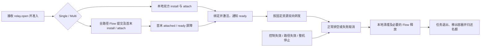

Single 表示两个 Agent 接入同一 Node；Multi 表示分别接入
路径首末 Node。primary 提供注册、发现和拓扑查询；Consumer 的实际业务使用所选入口控制连接，
primary 可以同时是该入口，也可以不在数据路径上。Producer 的服务注册连接属于其接入的末 Node；
集群 master 协调 Link/Flow，只有它本身在提交的 path 上时才转发该业务的数据。

| 业务 | Consumer 接入 | Node 内部路径 | Producer 接入 | 结束规则 |
|---|---|---|---|---|
| Single TCP | 本地 TCP → Agent → Node tcp.port | TCP StreamPipeline LocalPair | Node → Agent → 目标 TCP | 两个方向各自 EOF、半关闭排空 |
| Single TLS | 本地 TCP → Agent → Node tls.port 的 mTLS stream | TLS StreamPipeline LocalPair | Node mTLS → Agent → 目标 TCP | TLS 内业务 FIN 半关闭、双向排空 |
| Single UDP | 本地 UDP → Agent session datagram → Node udp.port | DatagramMgr LocalPair 改写 session 头 | Node session datagram → Agent → 目标 UDP | 控制取消/失效、Agent I/O 失败或 stop |
| Multi TCP | 本地 TCP → Agent → 首 Node tcp.port | 首 RemotePair → TCP NodeFlow → 末 RemotePair | 末 Node → Agent → 目标 TCP | 双向 FIN 排空、首末 finished 后释放 Flow |
| Multi TLS | 本地 TCP → Agent → 首 Node tls.port 的 mTLS stream | 首末 TLS RemotePair，Node 间 TCP NodeFlow | 末 Node mTLS → Agent → 目标 TCP | TLS 内业务 FIN 转 Flow FIN、双向排空及 finished |
| Multi UDP | 本地 UDP → Agent session datagram → 首 Node udp.port | 首 RemotePair → UDP NodeFlow → 末 RemotePair | 末 Node session datagram → Agent → 目标 UDP | 控制取消/失效、Flow 失败或 stop，无 FIN |

TCP/TLS 每个本地应用连接创建独立 AgentSession 和 Node 业务；UDP 每个配置 forward 使用一个当前
AgentSession，多个数据报复用它，不按应用报文或本地源端口创建 NodeSession。三类业务均先接入再 ready，
数据 manager 只有在控制器 bind/activate 完成后才允许业务转发。

### 单节点业务建立与数据复制

前置条件是 Producer 已在该 Node 注册服务，Consumer 有该 Node 的可用普通控制连接。
Single 包含一个 NodeSession、一个 LocalPair，以及双方各自的 AgentSession；TCP/TLS
选择对应 Pipeline，UDP 选择 DatagramMgr。控制通知与数据接入的时序如下。

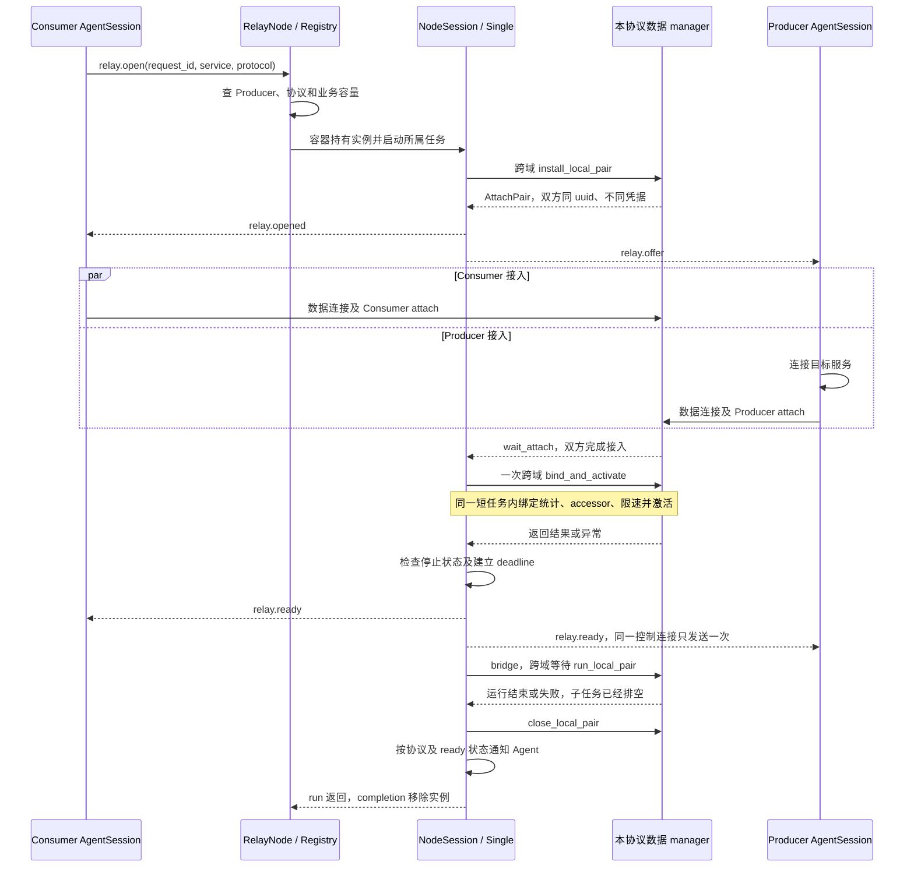

| 阶段 | 需要成立的条件 | 产生或修改的状态 |
|---|---|---|
| 入口查找与准入 | 本地服务存在、协议匹配、该协议业务任务尚有名额 | 创建 Single，保留双方弱控制引用、服务统计及创建时的绝对 deadline |
| install | 数据 manager 仍运行且 LocalPair + RemotePair 未满 | 分配 Node 内唯一 uuid、分角色 ticket；UDP 另建双方 session/Binding，返回 AttachPair |
| opened / offer | 安装成功且未请求停止 | 各自取得角色凭据与数据端口，Producer 的 offer 没有 Consumer request_id |
| wait_attach | 双方通过票据、角色及重复接入检查 | manager 记录 stream 或 UDP 来源，并唤醒双方接入完成事件 |
| bind_and_activate | 双方已接入，统计尚未绑定且 ServiceTraffic 有效 | 单次数据域任务绑定统计、Consumer 控制 peer 作为 accessor、双向令牌桶并设 active |
| ready | 跨域返回后未取消且未超过业务 deadline | ready_=true，再通知 Agent 开始业务；同 Agent 两角色共享控制连接时 ready 去重 |
| bridge | 已激活 | TCP/TLS 等待两方向复制及半关闭；UDP 的共享循环负责收发，任务等待本配对 finished |
| close 与容器删除 | 已取消或复制结束，所属数据子任务已排空 | manager 移除资源索引、关闭 socket/来源、唤醒等待、释放 UUID/accessor；随后控制通知，最后移除 NodeSession |

Consumer/Producer 的 attach 不分先后。无效票据、错误角色、重复接入只拒绝当前 socket 或 datagram，
不能替换已接入资源；两个角色使用不同票据，普通控制身份匹配与数据票据校验各自执行。
NodeSession 的业务 deadline 覆盖到激活后的 ready 检查；每个未识别 TCP/TLS socket 的握手/attach
setup 期限与 max_setup_connections 独立约束未识别接入。

服务不存在时直接 error，不安装资源。建立失败、取消与运行结束均进入同一个 run 收尾；Single 先
关闭本地配对，再发必要的控制通知。ready 后 TCP/TLS 通过数据 socket 表达结束，UDP 必须显式
通知关闭；同一控制连接承担两个角色时的去重及各阶段错误字段见 [建立、转发与收尾的责任边界](#建立转发与收尾的责任边界)。多节点不走 LocalPair，见 [多节点路径建立与首末接入](#多节点路径建立与首末接入)。

#### 单节点 TCP 的实际数据链路

请求方 Forwarder 接受应用 TCP 连接，把 socket 移交给 Consumer AgentSession；Producer AgentSession
按 service 配置解析并连接 target_host/target_port。两个 Agent 分别主动连接同一 Node 的 tcp.port，
各发送一次 relay.attach；这两个公网 socket 和两个本地 socket 都由各自实例持有。
Node StreamPipeline 精确读完 attach 首帧后，把 socket 移入 LocalPair 的 consumer_stream 或 producer_stream。
attach 不带服务名，Node 根据 uuid/ticket/role 找到控制器已经分配的资源，不再次查 Registry。

```text
应用 TCP socket
  ↔ Consumer AgentSession.local
  ↔ Consumer AgentSession.transfer
  ↔ Node LocalPair.consumer_stream
  ↔ Node LocalPair.producer_stream
  ↔ Producer AgentSession.transfer
  ↔ Producer AgentSession.local
  ↔ 目标 TCP 服务
```

ready 后两个 Agent 调用 relay_tcp，Node 的 TcpTransport::relay 同样调用 relay_tcp。
每处启动两个持续复制方向，读取后完成限速等待与写入，再复用缓冲继续读；业务期间不再发 CBOR 帧，
也不按应用消息边界分配 Relay。Node 负责服务方向的限速和流量计数，Agent 只复制业务字节。
32 KiB 是每方向的复制缓冲大小，不是应用数据总长度限制。

应用 `shutdown(send)` 后，Consumer 读到 EOF，只半关闭它到 Node 的发送方向；Node 将对应 EOF
继续传到 Producer，再传给目标服务。目标仍可回传回复，反方向保持运行。目标也发送 EOF 后，
每段两个方向都完成并排空，Node 控制器关闭 LocalPair，两个 Agent 清理自己的实例。
任一处真实读写失败则由 await_transfers 取消并排空另一方向，异常传给当前实例的清理边界，
不会把错误当成正常 EOF 留下另一个无限等包的方向。

#### 单节点 TLS 的接入、解密与结束

业务 `protocol="tls"` 表示 Agent↔Node 数据接入使用 TLS，不要求本地 forward acceptor 或目标 socket
进行 RelayWeave TLS 握手。本地两段仍是 TCP；应用自己的 HTTPS/SSH 等加密可以作为业务字节通过。
两个 Agent 连接 Node 的 tls.port，按实际控制主机地址及 server_name 配置验证证书、设置主机名/SNI，
完成 mTLS 后才在加密 stream 内发送 relay.attach。Node TlsTransport::prepare 完成服务端 mTLS，
再精确读取 attach，把 TLS stream 放入 LocalPair。

```text
应用 TCP ↔ Consumer Agent
  ↔ mTLS 数据连接 ↔ Node consumer TLS stream
  ↔ 解密后的业务字节复制 ↔ Node producer TLS stream
  ↔ mTLS 数据连接 ↔ Producer Agent ↔ 目标 TCP
```

Node 读取一个 TLS stream 的应用字节并写入另一个 TLS stream，由后者重新加密；不会直接搬运原始 TLS record。
Node 的 relay_tls(TLS, TLS) 执行限速和统计，Agent 的 relay_tls(TCP, TLS) 做本地与公网转换。
attach、TLS record 和握手不计入业务流量。

Single 与 Multi TLS 统一保留业务半关闭：本地 TCP EOF 转为 TLS 内的业务 FIN，收到 FIN 只对本地
TCP 执行 shutdown(send)，反向继续复制；两个方向完成后才释放资源。真实读写错误、取消和限速等待失败
取消并排空对向，并向控制器传播原始错误。Node LocalPair 将 DATA/FIN 从一个 TLS stream 转发到另一个。

TLS 接入在 relay.attach 首帧后使用 `length32-fin-v1`：4 字节大端长度，1..65467 表示随后相应长度的
DATA，0 表示 FIN、无帧体。较大的业务写入拆成多帧；应用的原始 TCP 写入边界不保留。
DATA/FIN 同方向有序且均受 TLS 保护，头部和 FIN 不计业务流量；FIN 只结束业务方向，不立即关闭 TLS。
Node TLS endpoint 描述符与 TLS relay.attach 均携带 `tls_framing="length32-fin-v1"`，Agent 校验描述符，
Node 校验 attach，缺失或不同的标识拒绝接入。该格式适用于 TLS 1.2/1.3；旧版未分帧的 Agent/Node
不能与新版混用 TLS 数据接入，部署时需要配套升级。

TLS EOF、close_notify 或 stream_truncated 若在业务 FIN 之前出现，均按传输失败处理，不能当作完整业务结束。
双方业务 FIN 排空后数据所有者才关闭 TLS socket；控制通道仍使用 TLSChannel 自己的关闭流程。

#### 单节点 UDP 的建立、来源绑定与逐包转发

请求方服务位置可用后，DatagramForward 主动创建一个当前 Consumer AgentSession；不等第一包才创建，
也不为每个本地应用源端口建立新会话。Node Single 控制器安装 UDP LocalPair，分配同一 uuid、
不同的 producer/consumer ticket 和 session_id，再通过 opened/offer 下发。
Producer 创建一个目标 UDP socket 并 connect 到 target_host/target_port；两个 Agent 都使用独立的
transfer UDP socket connect 到 Node udp.port。UDP connect 仅固定本地 socket 的对端，并不建立可靠网络连接。

Agent 在 ready 前发送完整 WireMessage relay.attach，每 500 ms 重发一次直到 ready 或本端 deadline。
DatagramMgr 第一次合法 attach 固定该 role 的公网来源 IP/port；重复 attach 不替换来源，业务包不能
把 session 的来源重新绑定。两个 role 都已接入后，Single 绑定统计和限速、激活 LocalPair，并通过
原 mTLS 控制连接向双方发 relay.ready；没有独立的 UDP attach 成功回执。

设 Consumer 的 session_id 为 C，Producer 的为 P，一次请求与回复按如下路径传递：

```text
本地应用 -- 原始 payload --> Consumer DatagramForward
Consumer -- [C][payload] --> Node UDP listener
Node -- [P][同一 payload] --> Producer transfer socket
Producer -- 去掉 P，只发 payload --> 目标 UDP socket

目标 -- reply payload --> Producer target socket
Producer -- [P][reply payload] --> Node UDP listener
Node -- [C][同一 reply payload] --> Consumer transfer socket
Consumer -- 去掉 C，只发 reply payload --> 当前本地应用 endpoint
```

Node 收到数据报后查 bindings_，验证 LocalPair active、来源与 attach 相符、方向令牌足够，原地改写
8 字节头，并在共享 listener 的接收循环内直接 async_send_to；发送完成后才复用接收缓冲。
一次 datagram 对应一次发送，不拼包、不拆包、不解析 JSON，也不为每包启动发送协程。
Consumer 的本地监听与 Node 公网来源绑定不同：第一次有效本地报文记录来源地址，后续只接受同一 IP，
允许其端口变化，并将回复发到最近一次接受的 endpoint；它不是多应用客户端的独立会话表。

ready 前的应用包直接丢弃，不缓存等待；未知 session、来源变化、超长报文或限速不足也丢当前包。
Node 共享 listener 的单次发送失败只影响当前报文，接收循环继续，不把所有 LocalPair 一起结束。
Agent 服务方的两条复制方向使用 await_transfers，独立 socket 的 I/O 失败会取消对向并结束该实例；
请求方发送/接收失败也进入自己的 fail/清理流程。
UDP 没有 EOF 或 FIN，也没有业务空闲租约；控制取消、注册/控制失效或 stop 清除配对和双方 binding，
Node 发 closed，Agent 结束当前 session。请求方本地 listener 仍保留，服务可用时按退避重新申请新实例。

### 多节点路径建立与首末接入

#### 从所选路径到首末业务实例

假设服务在末 Node T，路径为 H → I → T。Consumer 已取得 H 的 Ready 控制连接，Producer 继续
使用向 T 注册服务的控制连接。发现/选路/入口连接属于 Agent，见 [Agent 入口选择、接入与业务生命周期](RelayWeave设计.md#72-agent-入口选择接入与业务生命周期)；Node 从接收以下请求开始：

```json
{
  "command": "relay.open",
  "params": {
    "request_id": 101,
    "service": "home-ssh",
    "protocol": "tcp",
    "epoch": 7,
    "path": ["H", "I", "T"]
  }
}
```

H 验证 request_id 非零、path.front 为自己和当前 epoch，再匹配原请求或准入新 ingress NodeSession。
重复 open 的参数冲突与容量规则见 [创建、容量与任务所有权](#创建容量与任务所有权)、[已有业务的匹配、重复消息与断线](#已有业务的匹配重复消息与断线)；完整无环路径、在线成员、地址和 Link 由 NodeLinkMgr
进一步验证。H 的业务 deadline 从实例创建开始，包含取得 Flow 的时间；T 尚未创建实例，不使用 H 的计时器。

H 在取得全路径提交成功的 Flow 后才向 T 发 relay.peer.open，带 epoch/flow_id、service/protocol 和
Consumer 控制 peer 作为 accessor。T 的 RelayNode 先查已有 Multi，只有未匹配的 peer.open 才验证
egress_ready、服务及出口容量，再创建自己的 egress NodeSession，并从此计算本端 deadline。
T 验证失败返回 peer.close(stage=bind)，不会创建另一个等待服务的业务。

#### 建路、两端接入与激活屏障

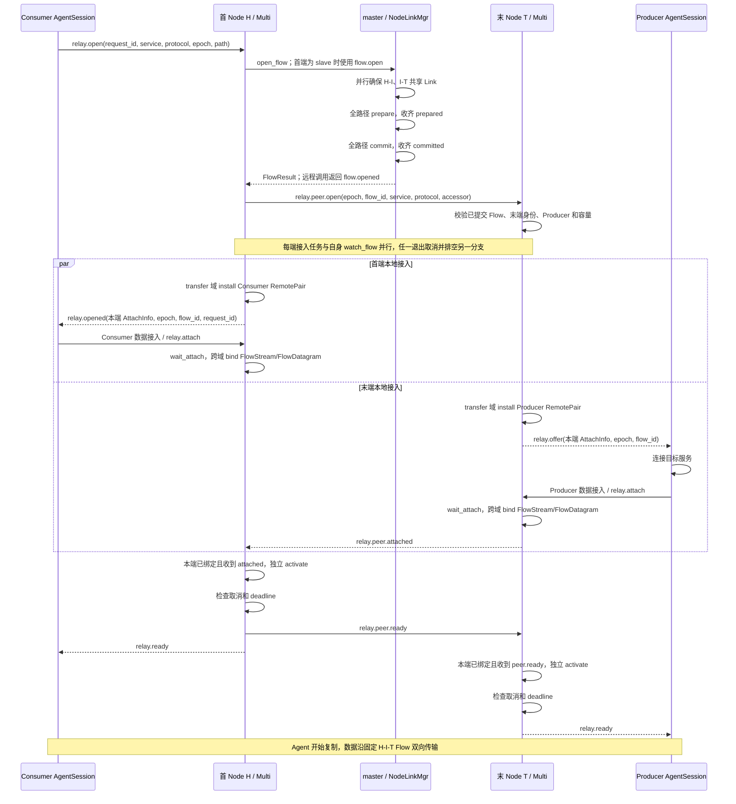

全路径 prepare 与 commit 的实际网络交互见 [全路径 Flow 的准备与提交](#全路径-flow-的准备与提交)、[Flow 路径安装与释放协议](#flow-路径安装与释放协议)；它们是两轮独立确认，不能用单个 Node 的
committed 推断全路径成功。H 本身为 master 时仍执行同一事务，只省去 flow.open/opened 的远程往返。
opened/offer、双方 attach 的相对到达顺序不固定，各端只等自己的 Agent；peer 事件可以先于本端
完成绑定到达，peer_prepared_ 保留该事实，待本端就绪后继续，不要求事件同时发生。

| 本端条件 | ingress H 的处理 | egress T 的处理 |
|---|---|---|
| 安装成功 | 保存一个 Consumer AttachInfo，向 C 发 opened | 保存一个 Producer AttachInfo，向 P 发 offer |
| 本端 Agent 已接入 | 绑定 forward 发送、reverse 接收的 Flow 端口 | 绑定 reverse 发送、forward 接收的 Flow 端口 |
| 本端绑定完成 | 等待来自 T 的 peer.attached | 发送 peer.attached，然后等待 H 的 peer.ready |
| peer 条件满足 | 独立 activate，再检查停止及期限，发送 peer.ready 和本端 Agent ready | 独立 activate，再检查停止及期限，发送本端 Agent ready |
| 开始 bridge | 持续等待本端复制，同时监视 Flow 关闭 | 同左 |
| 运行终止 | 排空两个结构化分支；清理本端并负责 close_flow | 排空两个结构化分支；清理本端，Flow 全路径释放由首端协调 |

TCP/TLS 接入格式与单节点相同；UDP 首末各有自己的 session_id，并通过普通控制连接接收 ready。
Multi 的 bind 和 activate 之间存在 peer 屏障，不能套用 Single 的 bind_and_activate。

#### 角色、身份、数据方向与统计

H/T 各有独立本地 uuid/ticket/data_port，仅用来接入自己的 RemotePair；共同的 epoch/flow_id 才是
Node 间业务身份。两个 Node 的本地 uuid 属于独立命名空间，可以相同；本地 uuid 不能
代替 Flow ID。中间 I 对本业务仅有 FlowState 和共享 Link，没有 NodeSession、LocalPair/RemotePair、
Agent 票据、服务注册或目标 socket，见 [一次业务在各 Node 上的组成](#一次业务在各-node-上的组成)。

本业务的注册和 ServiceTraffic 在 T；H 的 RemotePair 不持有该服务统计，H/I 不重复统计服务流量。
H/T 仍各自按本 Node 对应协议的数据配置限速，数据域的转发字节用于 Node 带宽观测，与服务统计分开。

Flow 的 forward 是 H→T、reverse 是 T→H：Consumer 请求字节使用 reverse=false，Producer 返回字节
使用 reverse=true。相邻 TCP Link 的主动连接方由 Node 名字排序决定，不改变业务方向；“请求/响应”、
Flow 方向和物理连接主动/被动不能互相推导。实际 DATA/FIN、TLS 和 UDP 转换见 [多节点协议数据路径](#多节点协议数据路径)。
正常 TCP/TLS 结束还需双方 peer.finished 才释放 Flow；UDP 没有 FIN/正常 EOF，收尾分支见 [建立、转发与收尾的责任边界](#建立转发与收尾的责任边界)。

### 多节点协议数据路径

首末完成本地绑定和激活后，业务复用固定 NodeFlow；TCP、TLS 与 UDP 分别保留自己的帧、结束和丢包语义。

#### 多节点 TCP 的分帧、每跳传递与 FIN

接入的三类组件各自完成一段工作：

| 位置 | 输入 → 输出 | 实际操作 |
|---|---|---|
| Consumer / Producer AgentSession | 本地 TCP ↔ 首/末 Node TCP | relay_tcp 双向复制，正常 EOF 只半关闭对端发送 |
| H/T StreamPipeline RemotePair | Agent TCP ↔ NodeFlow | 两个持续协程：read_remote_pair 将字节切成 DATA；write_remote_pair 写回 DATA 或处理 FIN |
| H/I/T FlowProtocol/LnkChannel | 逻辑 Flow ↔ 相邻 TCP NodeLink | 查 Flow 身份、方向和入边，按固定路径入队；中间节点直接移动载荷，不经过业务控制协程 |

RemotePair 使用 65467 字节的读取缓冲，从 Agent stream 读到多少就转发多少，按对应方向限速，将拥有载荷的 DATA 交给 stream channel。
数据侧长期发送协程接手后提交返回，该方向可以复用
读缓冲。NodeLink 的单写循环按队列写二进制头和载荷，一条 Link 可交错承载多个 Flow，但每个 Flow
同方向 DATA/FIN 的提交与交付顺序保持一致。应用的原始 TCP 写入边界不保留，终点把收到的块顺序写回 stream。

DATA/FIN 没有逐帧远端业务确认，交接完成只保证数据侧拥有载荷，不能解释为已经入队或末端应用已经收到。
每跳可靠与顺序由该 TCP socket 提供。每 Flow 每方向有固定信用窗口，prepare 按数量、身份和邻接状态准入。
缺少出边信用的帧停留在本方向，取得信用后进入 Link 的 FairQueue，按流标签交错、从队首写出；本地方向窗口满时异步提交挂起。
中间节点向下游写完、终点向 Agent 写完并释放公开载荷后，才归还相邻入边信用。
正常拥塞不关闭 Flow；越窗、格式错误与真实 I/O 失败仍有明确失败边界，
数学模型见 [状态变量、准入条件与有界性证明](#状态变量准入条件与有界性证明)，背压实例见 [慢末端的背压、恢复与数值示例](#慢末端的背压恢复与数值示例)，容量与性能分析见 [数量准入、逐 Flow 边界与实际占用](#数量准入逐-flow-边界与实际占用)、[窗口、信用周转时间与性能分析](#窗口信用周转时间与性能分析)。

中间 I 用 `(epoch, flow_id)` 找到 Active 表项，验证 forward 来自 previous 或 reverse 来自 next。
forward 送 next，reverse 送 previous；不能从任意相邻 Link 注入相同 ID 的 DATA。
payload 在数据域移动到出边队列，不再次生成 JSON/CBOR，不为每帧启动协程，也不建立第二份业务 session。
到 H/T 时，Flow 没有对应出边，帧进入该 Flow 的终点接收队列，由 RemotePair 的持续接收协程读取并写回 Agent。

一次“请求发送完，再等待回复”的半关闭按如下方式贯穿全路径：

```text
应用 EOF
  → Consumer Agent 半关闭发往 H 的 socket
  → H read_remote_pair 在前序 DATA 之后提交 forward FIN
  → I 按同方向顺序转发 FIN
  → T write_remote_pair 读到 FIN，shutdown Producer socket 的 send
  → Producer Agent 将 EOF 继续传给目标服务

目标回复及 EOF
  → Producer Agent 发往 T
  → T 提交 reverse DATA，最后提交 reverse FIN
  → I 原路径返回
  → H 写回回复，收到 FIN 后半关闭 Consumer socket 的 send
  → Consumer Agent 向应用交付回复及 EOF
```

FIN 只结束一个方向；相反方向仍接受 DATA。FlowProtocol 拒绝该方向 FIN 后的 DATA 和重复 FIN。
两个 FIN 到达后仍保留 Flow，直至首末本地写入完成并完成 finished 协商。
H/T 各自的 read/write 两方向都结束并排空后才发 peer.finished；双方都看到对方 finished 后，
各自发送正常 relay.closed，H 请求 master 关闭 Flow。Agent 完成本地复制并收到正常 closed 后
释放入口连接引用。

真实 I/O 错误则取消并排空 RemotePair 另一方向；未处于外部取消且端点仍可用时，尽力发 RESET，
原因最多 512 字节。RESET 终止该 Flow 并唤醒接收者，Multi 同时通过 peer.close 和 Flow close 收敛，
不等待双方正常 finished。其他共用同一 Link 的 Flow 保持运行；物理 Link 失败才使依赖它的 Flow 一起失效。

#### 多节点 TLS 的加密边界与复制

建立流程仍按 [多节点路径建立与首末接入](#多节点路径建立与首末接入)，只将协议设为 tls。首末 Node 分别选择自己的 TLS StreamPipeline，两个 Agent
分别在 tls.port 完成 mTLS 并发送 attach；NodeLinkMgr 创建 `transport="tcp"` 的 Flow，不创建 TLS NodeLink。

```text
应用 TCP ↔ Consumer Agent
  ↔ 接入 mTLS ↔ H TLS RemotePair
  ↔ 解密后的业务字节 / TCP NodeFlow ↔ I ↔ T TLS RemotePair
  ↔ 接入 mTLS ↔ Producer Agent ↔ 目标 TCP
```

H 的 read_remote_pair 从接入 TLS stream 读取应用字节，以普通 DATA 交给 NodeFlow；I 不接触 Agent TLS
状态，只转发二进制帧；T 的 write_remote_pair 将字节写入 Producer TLS stream，由接入 TLS 重新加密。
反向传输对称。Node 间共享数据通道是明文 TCP，接入 mTLS 不会使 H-I-T 变成端到端 TLS 通道；
业务本身使用 HTTPS/SSH 时，它的加密内容仍作为原始字节传递。

Multi 使用 StreamPipeline 的 RemotePair 和与 Single 共用的 Agent relay_tls。TLS 接入使用与 Single 相同的
length32-fin-v1 DATA/FIN 分帧：read_remote_pair 收到业务 FIN 后在前序 DATA 之后提交 Flow FIN；
write_remote_pair 收到 Flow FIN 后发送 TLS 内的业务 FIN，保留反方向。TCP 接入仍用 EOF/shutdown(send)。
TLS 传输 EOF 或 stream_truncated 不代替业务 FIN，而作为真实 I/O 失败传播 RESET。
结束顺序为双向排空、首末 peer.finished、relay.closed 和 Flow close。

#### 多节点 UDP 的报文转换、队列与生命周期

建立过程使用相同 Multi 控制消息，但 Flow transport 为 udp。相邻 Node 共用 UDP NodeLink，首末
DatagramMgr 各安装一个只面向本地 Agent 的 RemotePair，分别分配自己的 uuid/ticket/session_id。
两个 Agent 仍向自己的 Node 每 500 ms 发送 relay.attach 并等控制 ready；Node 间 Link 的 UDP 接入
握手是另一层，仅建立一次，不随每个业务报文或 Flow 重做。

设 Consumer 的 session_id 为 C，Producer 的为 P，共同 Flow 身份为 `(E, F)`，一包请求依次转换为：

```text
本地应用 → Consumer：原始 datagram payload
Consumer → H：[C][payload]
H RemotePair → UDP NodeFlow：DATA(epoch=E, flow_id=F, reverse=false, payload)
H → I：[H-I Link ID][32 字节 Node DATA 头][payload]
I → T：[I-T Link ID][同一 Flow 身份与方向的 Node DATA 头][payload]
T → Producer：[P][payload]
Producer → 目标：原始 datagram payload
```

回复反向逐跳返回，reverse=true，每跳使用对应相邻 Link 的 ID；H 最后加回 C，Consumer 去掉头后
发给当前本地应用 endpoint。业务 session_id 不穿过 NodeFlow，Link ID 也不暴露给 Agent。
一次 DATA 对应一个完整 UDP payload，不合并、拆分、重排或重传；零字节用户报文仍是合法 DATA。

H 的共享 UDP 接收循环验证 session、固定来源、RemotePair active 和 payload ≤65467，剥离 8 字节
头并直接检查令牌，足够时调用 FlowDatagram::try_send 将 payload 复制一次到池块并投递 16 项发送队列。
没有额外的业务入站队列或转发协程；超限、满队列和池容量不足只丢当前包。
I 验证 epoch、flow_id、方向、物理来源和预期入边，再将帧移动到另一相邻 Link 的发送队列。

T 的 write_remote_pair 持续从 Flow 接收完整 datagram，令牌不足丢当前包；足够时用两段 buffer
一次发送 `[P][payload]`，帧载荷持有到共享 UDP socket 的发送完成，不额外构造发送任务对象或
逐包 co_spawn。反向在 T/H 以同一方式工作。
Flow/Link 身份失效、接收通道关闭或 RemotePair 真实发送失败会结束桥接并走 Multi 清理；
UDP 队列满和超限只丢当前整包，所有准入层遵循同一规则。

Single 最大用户 payload 为 65499 字节，Multi 为 65467；超出 Multi 上限由接入检查丢弃，
没有应用层分片。Agent 和共享 UDP listener 保留完整报文接收缓冲，Node 帧载荷上限独立于接收缓冲容量。
UDP 各处容量不足均丢当前整包，不关闭健康 Flow、不等待空间。只有身份失效、真实 I/O 错误和控制中止结束桥接。
UDP Flow 只接受 DATA，没有 FIN 或对端正常 EOF；控制器的桥接通常持续到取消/失效，不通过
peer.finished 判定正常完成。首末控制失效、服务离线、Link/Flow 失败或 stop 后，关闭本地队列、删除
binding 并通知 Agent，首 Node 协调关闭 Flow，已建立的物理 Link 留给其他业务复用。
Consumer 保留本地 forward；下一次重建重新选路、分配 Flow 和接入身份，不复活已关闭 session。

### 建立、转发与收尾的责任边界

#### 从正常半关闭到 Flow 释放

TCP/TLS 的单方向 EOF 或业务 FIN 只结束该方向，反向继续排空；两个方向都结束才算本端 bridge
完成。Multi 的首末还要相互确认本端已完成写入，Flow 释放条件包含首末本地排空和对端 finished 确认：

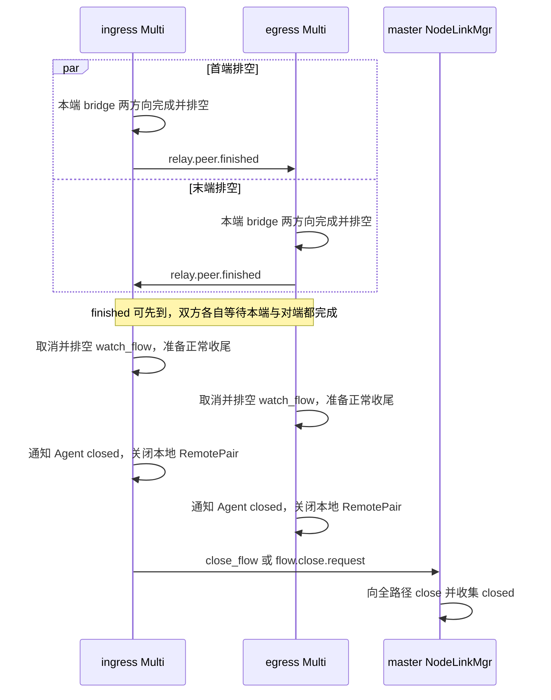

图中只展开正常完成；Multi 的统一收尾还会在非 from_peer 情况下尽力发 peer.close，具体顺序见
[统一收尾入口与不同协议的通知](#统一收尾入口与不同协议的通知)。正常 reason="stream complete" 的 relay.closed 表示 Node 已排空，不取消 Agent 自己尚未完成
的本地复制；AgentSession 按实际复制结果判断成功，之后释放入口连接引用。
UDP 没有 FIN、对端正常 EOF 和普通 finished 完成条件，bridge 通常一直等待取消、控制失效或 I/O 失败。

#### 失败场景与处理边界

| 场景 | 首个处理组件 | 对业务和共享资源的影响 |
|---|---|---|
| Single open 无服务或协议不符 | RelayNode / RegistryMgr | 立即 relay.error，不创建 LocalPair 或等待服务实例 |
| 业务任务额度不足 | start_relay | 拒绝新实例；已有实例和关闭未排空实例继续占名额；重复 Multi open 仍先匹配 |
| manager 数据资源额度不足 | install_local_pair / install_remote_pair | 结束本实例建立，既有配对及端点保持运行 |
| Multi path/epoch 不合法或 Flow 建立失败 | 首端 RelayNode / Multi / NodeLinkMgr | 向 Consumer error，保留实际阶段；已产生的 Flow 授权回滚，共享 Link 保留 |
| Multi 末端无服务、协议不符或不是已提交终点 | 末端 RelayNode | 返回 peer.close(stage=bind)，首端收尾并关闭 Flow，不保留出口等待实例 |
| attach 非法、票据错误、角色重复或 UDP 来源改变 | 本协议数据 listener | TCP/TLS 只拒绝当前 socket，UDP 只丢当前包；不替换已有接入、不关闭健康配对 |
| 本端业务 deadline 到期 | Single / Multi | 取消接入或 peer 等待，通知已知 Agent/peer，按统一顺序释放；不延长或传播双端预算 |
| 未识别 socket setup 到期 | StreamPipeline setup 任务 | 关闭该 socket 并减少 pending 计数；业务若仍缺一侧，继续受自己的 deadline 约束 |
| Producer 建立中 relay.reject | 所属控制器 | 终止本业务；ready 后 reject 不再当作建立失败；错误控制会话或不匹配身份无效 |
| Agent 显式 cancel 或普通控制断线 | 所属控制器 | 幂等记录首次原因并发取消信号，唤醒挂起操作；该连接的服务由 Registry 注销 |
| Multi 收到认证 peer.close | Multi | 保留对端 stage/reason，取消本端，不反向回声 |
| Multi Flow/Link/路径失效 | FlowProtocol → NodeLinkMgr → watch_flow | 取消并排空本地复制；单 Flow 错误只结束本 Flow，物理 Link 失败影响其依赖 Flow |
| 集群控制失败 | NodeLinkMgr 和 Multi | 清理本地 Flow 授权、多节点实例；不整体取消不依赖集群的 Single；远端收敛限制见 [失败回滚、主动释放与失效通知](#失败回滚主动释放与失效通知) |
| TCP/TLS 真实 I/O、截断或非法业务帧 | 数据复制/RemotePair | 传播原错误，取消并排空对向；Multi 尽力 RESET 并控制关闭，不等正常 finished |
| UDP 超限、令牌不足、队列或池容量不足 | 当前准入层 | 丢当前整包，不等空间、不重传、不关闭健康 Flow |
| Node 共享 UDP listener 的单包错误 | DatagramMgr | 按 [单节点 UDP 的建立、来源绑定与逐包转发](#单节点-udp-的建立来源绑定与逐包转发) 保留 listener；本端 RemotePair 返回任务真实失败则结束该业务 |
| 整机 stop | RelayNode | 停止新业务，取消并排空全部实例，然后才关闭共享 NodeLink、集群和数据监听，见 [RelayNode 停止流程](#relaynode-停止流程) |

TCP 正常 EOF、TLS 正常业务 FIN、预期取消和真实错误分开处理。TLS 传输 EOF/stream_truncated 不能
伪装成业务 FIN；RESET 最大原因长度为 512 字节。UDP 同样保留真实 I/O 失败，不能把队列满当成它。

#### 统一收尾入口与不同协议的通知

所有取消路径只请求终止，由实例 run 的统一出口完成实际清理。进入出口时屏蔽外层取消，保证跨域
close 仍可完成；不能在收到 cancel 时直接把 NodeSession 从容器删除。

| 顺序 | Single | Multi |
|---|---|---|
| 1. 排空 | 等 bridge/attach 退出，复制层先排空所属子任务 | parallel group 先取消并排空 establish_and_transfer 与 watch_flow 的另一分支 |
| 2. 固定终止状态 | 屏蔽取消，标记 stop_requested_，保留首次 reason | 屏蔽取消，标记 stop_requested_，保留 progress、实际 stage、首次 reason 和 from_peer |
| 3. 通知与本地释放 | 先跨域 close_local_pair，再 close_agents | 先 close_agent，再在已开 peer 且非 from_peer 时发 peer.close，随后跨域 close_remote_pair |
| 4. 全路径释放 | 无 Flow | 只有 ingress 且取得 flow_id 时调用 close_flow；egress 不替首端发全路径释放请求 |
| 5. 任务完成 | run 返回，RelayNode completion 从唯一容器移除实例 | 同左，Flow 清理失败记录后仍完成本端收尾 |

| 控制器与阶段 | Consumer 通知 | Producer 通知及去重 |
|---|---|---|
| Single 尚未 ready | relay.error，保留 request_id，已知时带 uuid | 已分配 uuid 且 Producer 与 Consumer 不同控制连接时发 relay.closed；同一连接由 error 表达终止 |
| Single 已 ready 的 TCP/TLS | 不再发正常 closed，数据 socket 表达 EOF/错误 | 同左 |
| Single 已 ready 的 UDP | relay.closed | 不同控制连接分别发；同一连接只发一份 |
| Multi ingress 尚未 ready | relay.error，包含原 request_id/path、epoch、stage/reason 及已知 Flow/接入字段 | 由 egress 通知其本地 Producer |
| Multi ingress 已 ready | relay.closed，包含原 request_id/path 和已知身份 | 同上 |
| Multi egress | 不直接通知远端 Consumer | 仅在 AgentNotified 之后向本地 Producer 发 closed，不携带 Consumer request_id |

Single 按是否已分配 uuid 决定 Producer 关闭通知；通知提交没有独立送达确认。安装前失败没有接入
描述，只能发送已知的错误字段。Multi 同样只有保存 AttachInfo 后才把接入字段写入关闭消息，不能把
monostate 当默认全零描述。通知以 to_params 返回的协议字段为基础，补充本端业务字段。

manager 关闭时先移除表项，阻止迟到 attach/UDP 包继续查到旧资源，再关闭 I/O、唤醒等待者、释放
UUID 和 accessor。已经启动 I/O 的持有者继续排空，缓冲不能提前销毁；NodeSession 的描述仍保留供
Single 释放资源后的关闭通知使用。两端分别释放自己的本地资源，master 负责 Flow 的全路径关闭确认。

## 4. 数据面与载荷所有权

FlowProtocol 管理逻辑流，LnkChannel 管理邻接传输，本地数据 manager 处理 Agent 数据接入和复制。
路径授权来自 [NodeLinkMgr 全路径安装与授权事务](#nodelinkmgr-全路径安装与授权事务)，首末激活来自 [Node 业务实例与 Single / Multi 首末协调](#node-业务实例与-single--multi-首末协调)；完整 Single/Multi 请求过程见[业务建立、转发与收尾](#3-业务建立转发与收尾)。

### 本地数据管理与接入边界

TCP/TLS 各有一个 StreamPipeline，UDP 使用一个 DatagramMgr 和共享 socket。manager 在自己的
transfer executor 拥有 LocalPair / local_pairs_、RemotePair / remote_pairs_；两类资源合计受本协议
max_relays 约束。注册服务不分配这些资源，只有业务建立才 install；资源没有“等待服务上线”状态。

| 资源 | 拥有内容 | NodeSession 保存的值描述 | 使用方式 |
|---|---|---|---|
| Stream LocalPair | 双方 stream、票据、接入事件、统计、令牌桶及 active/closed | AttachPair | Single 双方接入同一 Node，manager 直接双向复制 |
| Datagram LocalPair | 双方 session、来源 endpoint、预编码头、接入/结束事件、统计与令牌桶 | AttachPair | Single 共享接收循环按 Binding 逐包转发，业务任务等待 finished |
| Stream RemotePair | RelayEndpoint 公共状态、一个 Agent stream、FlowStream | AttachInfo | Multi 桥接本端 Agent 与 TCP Flow |
| Datagram RemotePair | RelayEndpoint 公共状态、一个 session/来源、FlowDatagram | AttachInfo | Multi 入站逐包 try_send，返回方向由持续协程写回 Agent |

RelayEndpoint 只抽取 TCP/TLS/UDP RemotePair 共有的角色、票据、事件、active/closed、限速与统计，
不拥有具体 socket 或来源。LocalPair、RemotePair 是运行资源；AttachInfo、AttachPair 只是跨域复制的
值描述，定义及字段范围见 [接入描述与身份的使用范围](#接入描述与身份的使用范围)。NodeSession 内部读取字段，不在内部反复解析端点 JSON；构造普通
控制通知时才调用 AttachInfo::to_params。TLS 的 tls_framing 根据协议生成，UDP session_id 必须非零。

| manager 操作 | LocalPair / Single | RemotePair / Multi |
|---|---|---|
| install | 分配同 uuid、分角色的 ticket/session，返回 AttachPair | 按本端 Agent role 分配，返回 AttachInfo |
| wait | 等双方接入或关闭 | 等一个本端 Agent 接入或关闭 |
| bind | 绑定服务统计、accessor 与令牌桶 | 跨到 FlowProtocol 绑定正确方向的端口，再记录本端统计和限速 |
| activate | 已接入并绑定后设 active | 本端已绑定且 peer 条件满足后设 active |
| run | 流式双向复制，或等待共享 UDP 的本业务结束 | 流式双向桥接，或 UDP 返回方向接收/发送 |
| close | 移除索引、关闭资源、唤醒等待者并释放 UUID/统计 | 移除索引、关闭本端 Flow port/接入资源并释放 UUID |

三类 manager 共用线程安全的 RelayIdAllocator，uuid 在本 Node 内不冲突；数据表中的票据、来源与
运行标记是验证实际接入的依据。manager 不保存 Agent 控制会话、业务请求或控制通知。NodeSession
跨域调用方式见 [RelayNode 编排与四个执行域](#relaynode-编排与四个执行域)：Single 的 bind 和 activate 在同一个短任务执行，Multi 在 peer 协调前后分开。
attach 只校验凭据并发布事件，控制器激活后才发 ready；TCP/TLS 的传输差异由 transport policy 表达。

#### RelayAttach 首帧

TCP、TLS、UDP 使用同一个逻辑首帧：

```text
[4 字节大端 payload 长度][CBOR CtrlMessage payload]
```

payload 是：

```text
{
  "command": "relay.attach",
  "params": {
    "role": 1 | 2,
    "uuid": <non-zero uint64>,
    "ticket": <non-zero uint64>
  }
}
```

`role=1` 是 Producer，`role=2` 是 Consumer。payload 长度必须在 1～64 KiB。TCP/TLS 在 stream 上精确读取一帧；UDP 的一个 datagram 必须完整包含一帧，而且长度字段必须与剩余长度完全一致。

TLS 数据通道先完成 mTLS 握手，再在加密流内发送 attach；其 params 额外要求
`tls_framing="length32-fin-v1"`，与 Node 下发的 TLS endpoint 描述符一致。TCP 和 UDP 的 attach 位于明文数据通道，
不携带该字段；ticket 只通过已认证控制连接下发。

manager 按 `uuid` 查找 Relay，再验证 ticket 是否属于声明的 role。以下情况会被拒绝：帧或 CBOR 非法、命令错误、Relay 不存在或过期、ticket/role 不匹配、同一 role 重复接入、超过 setup timeout 或容量上限。

`uuid` 是索引，不是认证凭据。每个 role 的 64 位非零 ticket 由 OpenSSL `RAND_bytes` 生成，并在 Relay 销毁时失效。

#### DatagramHeader 与 UDP 来源绑定

UDP attach 完成后，公网数据报格式为：

```text
[session_id: 8 字节大端序][用户 payload: 0..65499 字节]
```

单节点双方获得不同非零 session_id 和 ticket，uuid 相同；多节点首末各有本地端点。
DatagramMgr 的 bindings_ 将 session_id 关联到 uuid 和方向，再查本地配对或端点并验证已固定的来源。
ready 前 payload、未知 session、短报文、错来源和超长报文丢弃；不缓存，也不替换已绑定来源。
单节点改写对端 session 头并转发，多节点剥离本地头送入 NodeFlow，返回时写回本地头。
单节点保留原载荷范围，多节点上限为 65467 字节，由 UDP 最大线载荷 65507 减去 8 字节 NodeLink 标识和
32 字节帧头得到，无应用层分片。

服务离线时只有 Agent 本地 forward。Node 收到无服务的 open 立即返回 unavailable，
不创建 waiting Relay、timer、binding 或 Flow。注册服务不接管旧请求；新的业务必须重新选路及申请。
服务存在时 Single 的 udp.setup_timeout_ms 限制从业务创建到双方 attach、绑定和激活，默认 10 秒。
建立完成后无运行期租约；取消、控制失效或 stop 结束业务并清除双方 binding。

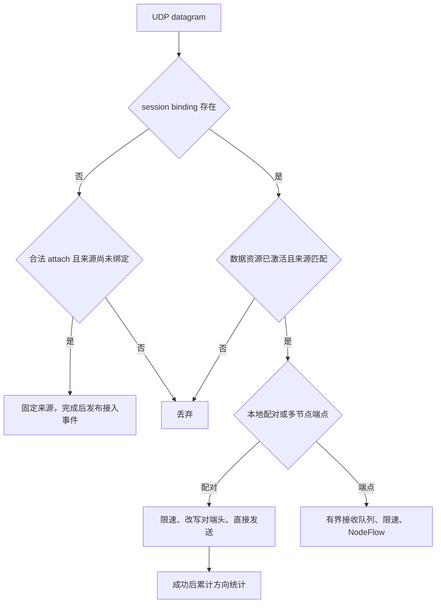

共享 UDP socket 可有不同端点的发送同时等待完成，每次发送都是完整报文，各端点自身保持串行。
单节点接收循环在发送完成前不复用接收缓冲；多节点返回协程持有帧载荷直到发送完成，取消或关闭 socket 后也等待 I/O 完成再释放。
多节点本地接收队列满或 UDP 令牌不足只丢当前报文；Flow/Link 数据入队失败由业务异常边界处理，
不保证仅丢一包。当前没有独立的共享 DatagramMgr 发送队列。
关闭配对/端点后 session 与旧票据立即失效，迟到 attach 不能复活资源。

### TCP、TLS 与 UDP 复制机制

`xfr_channel` 是 Agent 和 Node 共用的数据复制模块。它接收已经完成连接、握手和 attach 的 socket，
负责双向复制、限速、流量计数和关闭传播。调用方仍拥有 socket，并负责 Relay 索引和控制消息生命周期。

| 协议 | 公网数据保护 | 转发对象 | 限速行为 | 关闭特点 |
|---|---|---|---|---|
| `tcp` | 明文，attach ticket 鉴权 | TCP byte stream | 等待令牌，形成背压 | 支持 TCP 半关闭排空 |
| `tls` | client 到 server 的 mTLS；server 可见明文 | TLS 内 DATA/FIN 对应的业务 byte stream | 等待令牌，形成背压 | 业务 FIN 半关闭，真实错误整体关闭 |
| `udp` | 明文，`session_id` 路由 | 完整 datagram | 令牌不足时整包丢弃 | 随控制会话或显式取消释放 |

#### XfrChannel 复制入口

| 函数 | 使用模块 | 两端类型 | 责任 |
|---|---|---|---|
| `relay_tcp()` | AgentSession、StreamPipeline | TCP ↔ TCP | 双向复制、等待式限速、流量计数和半关闭 |
| `relay_tls(TCP, TLS)` | AgentSession | 本地 TCP ↔ 公网 TLS | 本地明文与数据 TLS stream 双向复制 |
| `relay_tls(TLS, TLS)` | StreamPipeline | Producer TLS ↔ Consumer TLS | 解密后的 payload 复制、限速和流量计数 |
| `relay_udp_connected()` | AgentSession | 本地 UDP ↔ 公网 UDP | 增删 session header，并在两个 connected socket 间逐包转发 |

流式函数内部同时运行两个复制方向。任一方向发生致命错误时取消配对方向；正常 EOF 按对应 transport 的
关闭规则收敛。UDP Node 的逐包路由由 DatagramMgr 直接实现，
`relay_udp_connected()` 只用于 Agent 本地目标与 Node session 之间的转换。

#### TCP Pipeline

双方和服务器都运行两个异步复制方向。`relay_tcp()` 每个方向使用 32 KiB 缓冲区，一次读取后等待对应写入完成，再开始下一次读取；每方向保持一个在途读写块。

普通 EOF 使用半关闭：A 读到 EOF 后只对 B 执行 `shutdown(send)`，B 到 A 的方向继续运行并排空。两个方向都结束后再关闭 socket。显式取消由调用方清理双方。

`transfer_tcp()` 的读写错误、限速等待取消和非预期 shutdown 错误以异常传播。`relay_tcp()` 复用
`await_transfers()`：一个方向失败后取消并排空另一方向，按完成顺序保留原始错误；配对方向的空闲读取和限速等待一并取消、排空。正常 EOF 仍只半关闭发送方向，等待反向数据与 EOF，不触发对向取消。
真实 TCP socket 测试覆盖两侧 RST、发送失败、限速等待中的对向失败，以及双向半关闭回传和流量计数。
TLS 的 Single/Multi 退出策略分别见 [单节点 TLS 的接入、解密与结束](#单节点-tls-的接入解密与结束) 和 [多节点 TLS 的加密边界与复制](#多节点-tls-的加密边界与复制)，不直接套用普通 TCP 的结束规则。

TCP/TLS 复制和 RemotePair 的两个方向统一调用各自令牌桶的 consume(bytes)。TokenBucket 负责预留令牌和可取消等待，
仅首次需要等待时创建定时器并在后续等待中复用；限速定时器由 TokenBucket 持有。UDP 继续使用 try_consume，令牌不足直接丢包。

#### TLS Pipeline

TLS 复制按应用明文字节背压和统计。TLS 连接终止于 RelayAgent 与 RelayNode，Node 可见明文 payload。
业务层 SSH、HTTPS 等协议的端到端加密独立于中继 TLS。

单节点与多节点直接共用 relay_tls 的业务 DATA/FIN 复制：FIN 后保留反方向，
真实错误取消并排空对向。TLS 1.2/1.3 均通过受 TLS 保护的业务 FIN 表达半关闭，不用底层 TCP FIN 代替。
首末桥接在 TLS 业务 FIN 和 NodeFlow FIN 之间转换，保留双向排空，见 [Node 业务实例与 Single / Multi 首末协调](#node-业务实例与-single--multi-首末协调)。
控制连接的 TLS shutdown 则由 TLSChannel 自己完成，不与数据复制的结束策略混用。

#### UDP Datagram

Consumer 在路由可用后主动打开 UDP Relay，不等待首个本地报文。双方各自创建 connected UDP transfer socket，发送 attach，收到 ready 后转发。

Agent 服务方的 relay_udp_connected 使用现有 await_transfers 拥有两个方向。单侧 socket I/O 失败抛出原始异常，
取消并排空对向；message_size 仍只丢弃当前包，不把正常超长报文升级为会话失败。调用方主动取消已经记录 reason，
关闭 socket 产生的异常不会覆盖首次中止原因。发送完成时校验实际长度，短写按发送失败处理。

DatagramMgr 逐包完成接收、路由、校验、头部改写和发送。限速只计算 session header 后的用户 payload，令牌不足直接丢弃整包。服务等待只在 Agent 本地进行；Node 的 `udp.setup_timeout_ms` 限制实际接入，ready 后不再计时。

### FlowProtocol、端点与本地逻辑流状态

#### 公共边界与实现归属

| 类型 | 职责与所有权 |
|---|---|
| `NodeLinkMgr` | 控制域协调路径事务、验证控制参数，生成 LinkSpec/FlowSpec，消费 ProtocolEvent |
| `FlowProtocol` | 数据域拥有公共流表、邻接通道、载荷池、事件、监控和任务排空；按值包含 Stream/Datagram 协议实现 |
| `LnkChannel` | FlowProtocol 按值持有；拥有相邻 NodeLink、认证、socket 与物理发送队列 |
| `lnk::FlowStream` | 部件的 TCP/TLS 端点，交接数据与 FIN、通知写完成、RESET 和关闭 |
| `lnk::FlowDatagram` | 部件的 UDP 端点，有界报文收发，满则丢整包 |
| `lnk::FlowState` | 内部流实例；transport 选择协议，私有 Stream/Direction 和 Datagram 归拢各协议数据 |
| `lnk::NodeLink` | 内部邻接连接实例；Phase 表示建立及关闭进度，保存唯一物理读写状态 |
| `lnk::PooledBuffer / std::pmr::synchronized_pool_resource` | 单块载荷所有者与共享分配器，使用同一份帧存储 |

生产实现集中在 flow_protocol.h/.cpp 和 lnk_channel.h/.cpp 两组文件。
FlowSpec、LinkSpec、ProtocolEvent 和端点类是部件使用的边界；共享的实现状态统一放在 lnk 内，
Stream/Direction、Datagram 是 FlowState 的私有类型，UDP 发送项是 LnkChannel 的私有 DatagramWrite。
这些定义参与成员布局或跨两组实现文件访问，保留在头文件；容量、刷新和超时策略常量留在实现单元。
两类端点的 Queue 均为私有类型，成员统一使用 send_queue_/receive_queue_，不向部件提供原始 channel。

FlowProtocol::Stream 与 Datagram 是服务内部按值包含的两份协议实现，只持有 FlowProtocol&：
Stream 负责信用、DATA/FIN/RESET、写完成与端点任务，Datagram 负责有界投递、丢包及其发送任务。
FlowState::Stream、Stream::Direction 和 FlowState::Datagram 则只保存流实例的数据；内部名称不重复 State。
共同身份、邻接资源、Flow 删除和退役、内存池及 Node 级任务管理仍保留一份，无继承、PImpl 或注册回调。

#### 本地状态与方向语义

数据域由 LnkChannel::connections_ 保存邻接连接，由 FlowProtocol::flows_ 保存逻辑流的 FlowState。
FlowState 保存不可变 id/epoch、transport、previous/next Link ID、Prepared/Active/Closed、准备期限和数据状态，
不保存服务、Agent socket、完整路径或 JSON。transport 选择 TCP 或 UDP。
TCP 构造时创建 Stream，包含双向信用、终点帧队列及绑定后的 Stream 端口；Datagram 包含
UDP 端点接收队列和端口，中间节点不分配接收队列。节点角色由 previous/next 表达，不另存角色标识。

forward 沿提交路径，reverse 沿原路径返回，与 TCP 建连方向无关。中间 Node 验证实际入边与方向后直接
移动载荷到出边队列，首末 Node 才交付本 Flow 的接收者。共享 A–B 可同时承载 A→B→C 和 A→B→D，
两个 Flow 各自关闭或失败；物理 A–B 断开才使依赖它的全部 Flow 失败。

TCP 的 DATA、FIN 在同方向保持顺序。FIN 后拒绝该方向 DATA 和重复 FIN，反方向仍能传输；RESET 仍可终止
本 Flow。两个方向均 FIN 不自动删除表项，正常完成由首末控制器排空后显式 close。UDP Flow 仅接受 DATA，
保留 datagram 边界，不提供重传、排序或分片，关闭走控制协议。

#### 端点绑定与任务生命周期

FlowProtocol::prepare_flow、commit_flow、close_flow、bind_stream_flow、bind_datagram_flow 都是数据域同步操作。
逻辑 Flow 先 prepare/commit，绑定只是附加本地端点并启动所属长期任务，不另设公开 Run 或启动状态。
StreamPipeline/DatagramMgr 在绑定调用处通过一次 co_spawn 跨到数据域，取回端点后检查本地业务是否已关闭；
绑定后的逐帧交接使用 native concurrent_channel。

绑定顺序为公共身份/协议/角色检查、创建并登记端口、启动一个协议父任务、返回端口。
TCP 的 Stream::run 持有该 Flow，使用 wait_for_one_error 组合 send_loop 与 receive_loop；正常 FIN 只结束
对应子循环，真实错误取消另一侧，等两侧排空后统一报告最先发生的错误并关闭 Flow。
异常处理取完成顺序中的首个异常；此前正常 FIN 的完成记录不会覆盖该异常。
两个子循环借用父任务的共享 Flow 句柄及 FlowStream&，既不复制持有关系，也不在内部重复 catch/关闭。
已在绑定前完成的本地方向由 send_loop 读取数据域 Direction::finished 后直接结束，不单独增加启动分支。
UDP 的 Datagram::run 是单个发送循环，借用所属 Flow 的端口。

#### 端点接口与邻接交界

Stream 的接口为同步 copy_payload(span)、send(PooledBuffer)、finish_send()、receive()、complete_receive()、
reset(reason) 和 close(reason)。copy_payload 按实际数据长度从共享池取得存储并复制一次；send 移动所有权。
receive 返回 optional<PooledBuffer>：有值表示 DATA，包括空 DATA；nullopt 表示正常 FIN；取消和失败用异常表达。
DATA/FIN 在同一个 Queue 中有序交接，发送半关闭与整个 Flow 关闭分开，每端点只有一个发送者和一个接收者。
Datagram 的接口为 try_send(span)、receive() 和 close(reason)。try_send 同步复制一次到共享池，receive
返回 PooledBuffer；满队列、池容量不足或端口关闭均丢包返回 false，没有完成确认、窗口等待或 FIN。
公共接口不传入回调、计费字节数、方向状态或内部帧。

Flow 与 NodeLink 在同一数据域直接调用：物理读循环校验帧后调用 FlowProtocol::receive；
CREDIT 按出边规则单独处理，业务帧检查身份、生命周期及入边后按 transport 分流一次。
Stream::receive 处理信用检查及 DATA/FIN/RESET，Datagram::receive 只接受 DATA、满队列丢包。
Stream::route/Datagram::route 决定出边或终点；取得出边信用的帧调用 LnkChannel::enqueue 同步入队；
TCP 写成功后调用 FlowProtocol::written 释放本跳占用，失败则关闭依赖该 Link 的 Flow。
NodeLink 不管理第二套 Flow 信用，不注册回调，也不通过额外热路径事件队列转发。

绑定公共检查负责身份、协议、生命周期及端点位置，协议绑定函数只检查自己的端口是否已绑定。
关闭按协议集中清理，专用流程直接使用构造时建立的状态；保留端口未绑定、异步恢复后的关闭状态，
以及端口操作的具体实例检查。迟到完成仅作用于原实例，不修改复用 ID 的新 Flow。

### LnkChannel 与共享 NodeLink 邻接传输

NodeLinkMgr 与数据 manager 同层，由 RelayNode 直接拥有。一个无向 Node 对、一个 transport 对应一个
共享 NodeLink；TCP 和 UDP 分开建立。master 的 ensure_link 合并并发申请，成功后返回已有 ID。
控制协议只描述 Node、地址、epoch、Link ID 和凭据，不包含 service 或 Agent 状态。

| 命令 | 方向 | 作用 |
|---|---|---|
| link.prepare / prepared | master ↔ 两端 | 安装本次身份和凭据；UDP 在 prepared 前完成解析并固定 endpoint |
| link.connect | master → 两端 | 收齐 prepared 后按固定角色开始接入 |
| link.ready | 两端 → master | 两端均完成接入后，ensure_link 返回成功 |
| link.error | 端点 → master | 返回原失败阶段和原因 |
| link.close / closed | master ↔ 两端 | 清理物理连接及依赖它的 Flow |
| link.attach / attached | 相邻 Node 数据 socket | 校验 epoch、ID、Node 身份、凭据和 data_version |

每次外层尝试使用新的非零 Link ID 和凭据；建立最多 10 秒。TCP 由排序靠前的 Node 主动连接，
排序靠后的 Node 等待接入。每次只解析、连接一次，不反向尝试；UDP 双方各发送一次 attach 并响应 attached，
不增加可靠传输或重发。失败交给外层业务处理，不在物理通道内部自动重连。

NodeLink 使用 Preparing、Resolving、Prepared、WaitingForPeer、Connecting、Attaching、Ready、Closed
表达进度。attached 与 acknowledged 是 UDP 接入的两个独立事实，支持乱序到达；不能合并成单一进度。
connect 在启动任务前离开 Prepared，重复命令不会启动第二条连接链；异步恢复不能覆盖 Closed。
通知的 stage 从当前状态生成，心跳失败单独报告 keepalive。

TCP 每条 Link 拥有一个读循环和一个写循环；UDP 共用 LnkChannel 的一个接收循环和一个发送循环。
TCP 主动建立和认证接入完成后均进入 tcp_run，用 wait_for_one 组合读写，任一退出就取消并排空另一侧。
建立/接入父任务持有 NodeLink，tcp_run、tcp_read、tcp_write 只借用引用，物理 writer 属于该父任务的并发组。
物理 Link 不提供业务半关闭，I/O 错误在组合排空后由父任务关闭该 Link 及其依赖 Flow。
接入 socket 在认证后移交给 Link，pending 集合的清理 guard 只覆盖 bootstrap；不把已移出的 socket
和清理 guard 保留到整个连接结束。
Node 数据通道为明文 TCP/UDP，其凭据来自已认证的集群控制连接；服务限速和统计不放在中间 Link 上。

每 5 秒发送 PING，20 秒未收到新的有效 PONG 则关闭 Link。PONG 序号必须大于 last_ack_ping 且不超过
已发送 PING 序号；重复、倒退或伪造未来响应不能延长存活期限。正常 DATA 不代替 PONG。
FlowProtocol 的一个 monitor 等待最近的 Link 建立、心跳、Flow 准备、信用刷新或关闭身份回收期限；
LnkChannel::poll 同步检查邻接状态，无待检查对象时无限等待。

共享任务的组合、期限监控与停止排空统一见 [FlowProtocol 共享任务与期限监控](#flowprotocol-共享任务与期限监控)。

### Node 数据通道二进制帧

NodeLink 接入完成后，业务 DATA/FIN/RESET、CREDIT 与 PING/PONG 都使用固定 32 字节 LnkFrameHeader。
整数以大端逐字段编码，不传输 C++ struct 内存布局；没有 JSON/CBOR 业务载荷封装。

| 偏移 | 字节数 | 字段 |
|---|---|---|
| 0 | 1 | magic = 0x4e |
| 1 | 1 | version = 2 |
| 2 | 1 | DATA=1、FIN=2、RESET=3、PING=4、PONG=5、ATTACH=7、ATTACHED=8、CREDIT=9；6 未使用 |
| 3 | 1 | bit0 为 reverse，其余位为零 |
| 4 | 4 | body_length |
| 8 | 8 | 非零 master epoch |
| 16 | 8 | 非零 flow_id；接入与保活帧为零 |
| 24 | 8 | PING/PONG 非零 sequence；CREDIT 为累计授信上限；其他帧为零 |

DATA 为 0..65467 字节原始载荷，FIN 无帧体，RESET 为最多 512 字节原因。PING/PONG 与 CREDIT 无帧体。
CREDIT 的 reverse 表示受控 DATA 的方向，沿 DATA 反向返回相邻上游，在这一跳终止，不穿透整条路径。
LnkFrameHeader::maximum_payload 按 `65507 - DatagramHeader::length - LnkFrameHeader::length` 推导，
最大 Node UDP 数据报为 65507 字节；每跳重新封装，帧头不随路径长度累加。TCP/TLS 多节点接入的读取缓冲
也采用最大 DATA 载荷 65467 字节，按实际读取长度立即提交，不等待填满。Agent 与本地 UDP 的大接收缓冲保留。
Node UDP 接收循环复用一个 65508 字节数组（包含一个检测字节），校验报文后仅按非空载荷长度申请池块并复制。
接收数组位于跨异步等待存活的协程帧中，每 Node 一份；按载荷长度向标准池申请存储，不携带接收头部空间。
每个 UDP Flow 方向的接收队列最多 16 包，载荷按需分配，满时丢当前包。启用 UDP 限速时，burst 必须至少容纳希望转发的报文。
此上限不保证实际路径 MTU 允许直接发送；部署须将所有 Node 数据版本同步升级到 2，旧版本不能参与新信用协议。

TCP 的首帧 attach/attached 继续采用 WireMessage/CBOR 并校验 data_version=2，之后只接受 Node 二进制帧。
TCP socket 已绑定相邻 Link 身份，后续帧不重复发送 Node 字符串和凭据。
UDP 每包为 8 字节相邻 NodeLink ID + 32 字节头 + 帧体，精确验证报文长度、epoch 和固定 source endpoint；
只有 ATTACH/ATTACHED 的帧体是 WireMessage/CBOR。Agent→Node 的 UDP 接入同样只有 attach 需要控制解码，
正常 session 报文仅解码二进制头。

本地端点检查数据大小，每跳网络解码检查帧格式；内部 Frame 分派及编码直接使用已校验字段。
普通逻辑流错误只关闭本 Flow，畸形物理帧或真实 Link I/O 失败才关闭物理通道。来源、epoch、方向、预期入边
和 FIN 状态在逐帧接收时校验。

### 数据热路径与载荷所有权转移

| 路径 | 每包/每块执行过程 | 内存及调度边界 |
|---|---|---|
| Agent UDP 请求方 | listener 接收 → 取得当前 session → ready/原因/长度检查 → 二进制头和 payload 两个 buffer 发送 | 不查 relays_、不读 JSON、不逐包 co_spawn；跨发送等待持有 session 的 shared_ptr 及所属 socket |
| Agent UDP 返回方 | session 长期接收循环 → 校验缓存头 → 发往 forward 当前 local_peer | 复用大接收缓冲，发送完成后再复用；无逐包发送对象 |
| Node 单节点 UDP | 共享 socket 接收 → bindings_ 与 LocalPair 索引 → source/激活/令牌检查 → 原地改头并直接发送 | 复用收到的完整报文；没有逐包协程、共享发送队列或 payload 副本 |
| Node 多节点 UDP 入 Flow | listener 校验 RemotePair → 限速 → FlowDatagram::try_send → Flow 有界发送队列 | 复制一次到共享池，跨域移动池块；没有 RemotePair 入站队列或转发协程，满队列丢包 |
| Node 多节点 UDP 回 Agent | 一个长期 write_remote_pair → FlowDatagram 接收 channel → 缓存 session 头与 payload 分散发送 | 每个端点串行，没有消费确认，帧存活到本次 socket 写完 |
| Node TCP/TLS 首末 | read_remote_pair 读缓冲 → 限速 → FlowStream 交接；反向 channel 收帧 → 写 socket → 通知完成 | 池缓冲所有权跨域；每端点两个长期数据任务，不逐帧 co_spawn，写完后归还信用 |
| Node 中间转发 | 固定头解码 → 查 Flow/方向/入边 → Frame 移到出边队列 → 长期物理写循环 | 使用类型化头字段，PooledBuffer 移动和切片不复制载荷；每跳不启动业务协程 |

#### TCP/TLS 的调用链与所有权转移

以 H → I → T 的一个方向为例，反向使用独立的方向状态，流程相同：

```text
H StreamPipeline::read_remote_pair
  → FlowStream::copy_payload：固定读缓冲按实际长度复制一次到池块
  → FlowStream::send：PooledBuffer 移入 send_queue_（容量 0）
  → FlowProtocol::Stream::send_loop：接手最多一块未准入数据
  → Stream::try_send：窗口足够才移动池块到 Frame、计入 buffered_bytes
  → Stream::route：Frame 移入该方向 pending_frames
  → Stream::flush：出边信用足够时按 Flow/方向标签移入 NodeLink::writes（FairQueue）
  → LnkChannel::tcp_write：唯一 writer 写头与载荷
  → FlowProtocol::written：释放池块和本跳占用，唤醒本地发送者

I LnkChannel::tcp_read：完整头解码后直接读入 PooledBuffer
  → FlowProtocol::receive：查流、生命周期和入边，按协议分流
  → Stream::receive：检查 FIN 状态和接收信用
  → Stream::route / Stream::flush：移动同一块载荷至下游队列
  → tcp_write / written：写成功后释放本跳占用，按刷新条件向上游授信

T tcp_read / receive / Stream::receive / Stream::route
  → FlowState::Stream::receive_queue：终点缓冲队列
  → Stream::receive_loop：同一池块移入端点 channel，仍保留 charge
  → FlowStream::receive：业务侧取得 PooledBuffer 所有权
  → StreamPipeline::write_remote_pair：限速、直接写池块至 Agent socket、归还池块
  → FlowStream::complete_receive：发 receive_completed_ 通知
  → Stream::receive_loop / Stream::release_buffer：释放本跳占用，按信用刷新规则合并发布上游信用
```

| 边界 | 数据内存操作 | 何时允许复用或释放 |
|---|---|---|
| 接入 socket → FlowStream | 固定读取缓冲按实际长度复制一次到池块，channel 移动所有权 | 交接完成后源侧可以复用读缓冲 |
| 本地准入 → 方向队列 | 同一池块移入 Frame，本地内存按原分配大小计费，线上信用按载荷视图长度计费 | 未准入块只留在唯一发送任务中 |
| 方向队列 → Link 队列 → writer | Frame 和 PooledBuffer 移动，载荷无再次复制 | 下游 socket 写完成后释放 |
| 中间节点接收 → 转发 | TCP 直接读入池块；UDP 校验共享接收数组中的报文后，按实际载荷长度复制到池块，再移动 | 接收数组可立即复用，池块在下游 I/O 完成或关闭排空后释放 |
| 终点 → 业务 socket | 原池块移入业务域，无出口载荷复制 | 下游写成功后归还池块，再通知退还信用；失败关闭 Flow |

发送交接只表示数据任务接手了载荷，不表示已入队、写入网络或远端消费。send_queue_ 容量为 0，
任务最多暂存一块；窗口满时在 send_space_ 挂起，不接收下一次交接，源侧最后停止新一轮 socket 读取。
窗口之外还包含端点任务暂存块及业务读缓冲；窗口计费与进程内存分别统计。

终点 receive_queue_ 容量为 1，Stream::receive_loop 每次只交付一帧 DATA，并等待容量为 1 的
receive_completed_，完成前不交付下一帧。限速等待和 socket 写入期间继续占用信用。
FIN 使用同队列的 nullopt，排在 DATA 后；无需 DATA 完成通知，只释放 FIN 的管理占用。
错误走 RESET/关闭，不把失败的写入当作成功消费。

send_space_ 是一个数据域 channel，只属于已绑定的本地 Stream 发送者。
它与跨域 DATA 队列、终点写完成通知分别表达容量可用、载荷交接和成功消费，不重复计费。
没有 optional channel、懒创建、逐帧发送者登记或借用 caller span。

#### UDP 的独立路径

DatagramMgr 的共享 listener 校验来源及激活状态，令牌足够时直接调用 FlowDatagram::try_send；
没有额外的 RemotePair::received 队列及 read_remote_pair。端点 send_queue_ 固定 16 项。
try_send 将接收缓冲复制一次到池块，Datagram::run 移动池块到 Frame，Datagram::route 直接投递邻接 UDP
队列；任一准入队列满立即丢整包，没有空间等待或流信用。

邻接 udp_read 使用固定的 65508 字节数组接收完整包，校验固定来源、Link ID、epoch 和长度后，
将非空载荷按实际长度复制进池，再移动至下一跳；空载荷不申请池块。
池容量不足时丢当前包并继续接收，不因下一次接收缓冲申请失败而终止共享接收循环。
终点 Datagram::route 直接移动原池块到 datagram.receive_queue；该 16 项队列在 Flow 构造
时建立，与端点 receive_queue_ 共享，允许绑定前已有报文到达。出队即释放位置，不需要确认任务。
DatagramMgr::write_remote_pair 持有该池块，使用缓存的 Agent session 头和载荷两段 buffer 发送，
完成后释放；令牌不足丢当前包。每个串行写循环最多再持有一个发送中的报文。

LnkChannel::DatagramWrite 只保存 Frame 和 link_id。udp_write 出队后检查原 Flow 仍未关闭、目标
Link ID/epoch 仍有效，复制 endpoint 后发送，不把表迭代器或 NodeLink 引用带过 await。
发送失败重新按身份查 Link；排队的旧帧不会创建或影响复用身份的新 Flow。
UDP 没有 Stream、CREDIT、FIN、空间通知或消费确认。

#### 池缓冲与剩余开销

lnk::Frame 保存头和独占、可移动的 lnk::PooledBuffer。标准同步池负责复用或回收同一块存储，
PooledBuffer 保存池块的原分配地址、大小及 span 视图，切片不改变归还地址。
空载荷不分配字节块，新块不做零初始化。业务载荷使用 PooledBuffer：接入端按实际长度复制到池块，
每个 Node UDP 接收跳也从共享数组复制一次到池块；TCP 邻接接收直接读入池块。
进入池块后的跨执行器交接和终点输出都移动原块。UDP 在每个接收跳复制一次，持有的池块按实际载荷长度申请。
直接使用 `std::pmr::synchronized_pool_resource`，不保留包装类或类型别名。
FlowProtocol 创建池时将最大必需池化块设为 65,536 B，
上游为 `new_delete_resource()`，其余池选项采用标准库默认值。分配和归还可跨线程执行，
载荷访问仍由唯一缓冲所有者执行。没有自定义预算、锁、空闲链表或字节统计。
标准池自行补充 chunk 并保留缓存，业务完全空闲时也不主动 release；不承诺固定 RSS 上限。

只有共享 Link 写队列的帧保活原 FlowState；Flow 自有队列的 owner 为空。
在途写操作即使越过流表删除仍能持有原帧至完成，但关闭后的迟到 written 不归还信用。
FlowProtocol、端口和业务池缓冲共享池的生命周期。PooledBuffer 的 deleter 持有资源引用，
只保活分配器，不保活整个协议；stop 排空协议任务，已交付业务的缓冲可在协议停止、销毁后继续存活，
最后一块缓冲或端口释放后池再销毁。缓冲只接受共享资源，不提供借用资源的构造路径。
FlowProtocol 创建池时使用标准堆作为上游；分配计数由测试可执行文件完成，生产代码不保留测试注入参数。

每次网络输入使用 std::map 查 Flow/Link，为 O(log F)/O(log L)；端点长期任务持有已绑定实例，
逐帧不查流表。信用计算是常数次整数比较与加减，队列准入与移动摊销 O(1)，状态随 Flow 数线性增长。
中间节点没有每 Flow 后台任务；首末 Stream 各登记一个父任务，其内部组合两个方向子循环；Datagram 各登记一个发送任务。

剩余开销来自 socket I/O、Asio 完成调度、查表、入口一次复制、shared_ptr 保活、TLS 加解密和业务统计。
载荷预热后的复用不需要逐块向堆申请；池扩充、std::deque/map 及 Asio 操作和协程帧仍可能分配，
吞吐边界见 [共享数据面容量与逐跳信用](#5-逐跳信用流控与容量)；当前功能回归未验证真实链路 1 Gbps 或能耗表现。

### FlowProtocol 共享任务与期限监控

FlowProtocol::activate 只启动一个受计数管理的 run 任务。run 使用
make_parallel_group(wait_for_one) 组合 TCP accept、UDP read、UDP write 和 monitor 四个长期循环：
任一个结束就取消其余循环，等待全部退出后处理最先发生的异常。
共享循环的意外结束通过统一 request_stop 关闭 Flow、邻接资源和事件队列；普通 Link 或 Flow 超时
仍只清理相应实例，monitor 继续服务其他对象。

子循环把取消和致命 I/O 错误向并发组传播，不各自重复查询停止或取消状态。
accept_loop 直接等待接入；成功返回后先检查 stopping，停止状态下不派生接入任务。
udp_write 直接等待发送队列；取包后先检查 stopping，停止状态下不再修改 close_all 已清理的队列计数。
UDP 收包可继续的错误和无效报文继续丢弃，单包发送失败只关闭对应 Link，不升级为整个服务失败。

monitor 实际到期时对 Flow 和 retired_ 各扫描一次，完成准备超时、过期身份清理及最近期限计算；
只有节点信用批次到期时才检查各 TCP 方向的待发布额度。
monitor_timer_ 由 FlowProtocol 持有；prepare、信用释放和邻接状态变化可推进最近期限。
expires_at 已安装更早期限，operation_aborted 后直接等待新期限，不额外扫描；
stop 会立即退出等待，并发组的协程取消则向上传播。
单次解析、握手及帧 I/O 使用 cancel_after 设置超时。
动态接入、Link 与端点任务统一计数，stop 关闭资源后等待 run 及动态任务全部排空，
协议通道排空后才能销毁；标准同步池由端口和在途业务缓冲继续保活至最后一次归还。

## 5. 逐跳信用、流控与容量

多节点 TCP/TLS Flow 采用**每条 Flow、每个方向、每个相邻跳独立的接收信用**：
节点限制 Flow 数量和每方向的信用窗口，再按下游释放速度推进 DATA；末端或中间链路变慢时，背压逐跳传回入口。
UDP 使用有界队列和逐包丢弃，见 [数量准入、逐 Flow 边界与实际占用](#数量准入逐-flow-边界与实际占用)；它不参与 TCP 信用计算。

本节按“计费与数学模型 → 安装和传输流程 → 信用刷新 → 背压实例 → 容量与性能分析”展开。
[数据热路径与载荷所有权转移](#数据热路径与载荷所有权转移) 补充池缓冲所有权和实际调用链，[多节点路径建立与首末接入](#多节点路径建立与首末接入)、[多节点协议数据路径](#多节点协议数据路径) 补充业务建路、首末接入与半关闭流程。

当前固定参数为每方向 320 KiB 窗口、1000 个 Flow 身份上限、20 ms 节点信用批次。
参数实验记录见[信用参数实验与扫描计数](#信用参数实验与扫描计数)。

### 设计边界与计费模型

业务限速、Flow 信用与网络传输的控制范围如下：

| 机制 | 控制对象 | 当前实现 |
|---|---|---|
| 业务限速 | 单位时间内允许通过的用户载荷字节 | 首末业务端点的 TokenBucket；等待期间仍占对应的缓冲资源 |
| Flow 信用与背压 | 每条 Flow 每方向尚未完成下游写入的缓存承诺 | 固定计费窗口，逐跳接收授信与发送校验 |
| 网络可靠传输与拥塞控制 | 相邻节点之间的网络传输 | NodeLink 的 TCP socket |

本项目按数量准入 Flow，按固定方向窗口约束逐跳积压；传输时不另设需要各流竞争的连接级信用窗口。

当前实现常量为：

| 符号 | 含义 | 当前值 |
|---|---|---|
| `W` | 每节点、每 Flow、每方向的 DATA 计费窗口 | `320 × 1024 = 327680` 字节 |
| `h` | 每帧管理计费；每方向另留一个 FIN 位置 | `128` 字节 |
| `N` | 每节点活动及退休 Flow 身份合计上限 | `1000` |
| `τ` | 节点级小额信用批次的合并间隔 | `20 ms` |

这些值分别限制帧数量、逐跳缓存、身份数量和信用通知频率，不包含进程 RSS 核算或全局字节预算。

这些值固定在 [`flow_protocol.cpp`](../protocol/src/flow_protocol.cpp) 和
[`lnk_channel.h`](../protocol/inc/lnk_channel.h)，不从配置读取；同义 Flow 数量上限统一使用 `lnk::max_flow_count`。

窗口使用 **charge（逻辑计费字节）**，包含载荷取整和帧管理计费。标准池实际块尺寸不参与线协议计算。
对长度 `x`，统一使用以下取整函数：

```text
class(x) = 0                                  ，x = 0
         = 不小于 max(x, 256) 的最小 2 的幂    ，x > 0
c(x)     = class(x) + h
```

切片只缩短载荷视图；本地内存按原分配长度 `a` 计 `c(a)`，线上信用按载荷视图长度 `p` 计 `c(p)`。
`Frame::memory_charge()` 用于本地准入和释放，`Frame::charge()` 用于线上信用扣除和归还。
邻接接收端按帧体长度 `p` 分配，因此接收后两种计费相同；发送端使用切片时，本地内存计费可以更大。
以下 TCP 线上信用分析使用 `c(p) = class(p) + 128`。128 是管理计费余量，Node 线协议头另为 32 字节。

| DATA 载荷 `p` | 逻辑载荷计费 | 单帧 `c(p)` | 一个初始 W 可容纳的完整帧数 | 对应用户载荷总量 |
|---|---|---|---|---|
| 空 DATA | 0 | 128 | 2560 | 0 字节 |
| 1 字节 | 256 | 384 | 853 | 853 字节 |
| 4096 字节 | 4096 | 4224 | 77 | 315392 字节 |
| 4097 字节 | 8192 | 8320 | 39 | 159783 字节 |
| 32768 字节 | 32768 | 32896 | 9 | 294912 字节 |
| 65467 字节 | 65536 | 65664 | 4 | 261868 字节 |

空 DATA 仍计 `128` 字节，保持与 EOF 的区别；FIN 不消耗 DATA 信用，另占一个 `h`，并排在同方向 DATA 后。
一个方向最多接纳 2560 个尚未释放的空 DATA。
h 是协议固定值，独立于节点 ABI 和 `sizeof(Frame)`。
RESET、CREDIT、PING/PONG 不等待 DATA 信用，但仍受控制队列、物理 writer 和 socket 的处理能力约束。

### 状态变量、准入条件与有界性证明

以下模型针对一条 Active TCP Flow 的一个方向；关闭、数量释放与迟到完成见 [数量准入、逐 Flow 边界与实际占用](#数量准入逐-flow-边界与实际占用)。
对节点 `i`，统一使用以下符号：

| 符号 | Direction 字段 | 含义 |
|---|---|---|
| `Q_i` | 由 `received_bytes - released_bytes` 推导，有入边时适用 | 已从上游接纳、尚未完成下游写入的 DATA charge |
| `B_i` | `buffered_bytes` | 本跳已准入、尚未释放的 DATA 与 FIN 本地内存 charge |
| `A_i` | `received_bytes` | 累计从入边接纳的 DATA charge |
| `R_i` | `released_bytes` | 累计完成下游写入、可重新授给上游的 DATA charge |
| `G_i` | `receive_limit` | 本节点已发布给上游的累计绝对上限 |
| `S_i` | `sent_bytes` | 累计送进出边 NodeLink DATA 队列的 DATA charge |
| `L_i` | `send_limit` | 本节点最近接受的下游累计绝对上限 |
| — | `finished` | 本方向已接纳 FIN；反方向和整个 Flow 的生命周期独立 |

信用批次期限 `FlowProtocol::credit_deadline_` 属于节点；Direction 不保存独立期限。

这些计数承担不同职责：`buffered_bytes` 也计本地产生的数据与 FIN，不能一律由 `A_i-R_i` 替代；
`released_bytes` 与 `receive_limit` 分别表示已完成和已发布额度，二者的差值承载待合并信用。
`sent_bytes/send_limit` 则约束另一条出边，不能与入边计数合并。
方向 `finished` 置位后拒绝重复 FIN 与后续 DATA；FlowStream 的终止标志位于业务执行器，约束业务调用生命周期，
不与数据执行器上的 Flow 状态重复。Link 队列中的 Frame 持有原 FlowState 至在途写完成。

带下标的 `B_i` 是某条 Flow 某方向的当前逻辑占用，不表示全局字节预算。
有入边时 `B_i = Q_i + 尚未释放的 FIN charge`。方向队列、终点交付、Link 队列和正在执行的 socket 写入
都属于同一份本跳占用；在这些位置之间移动帧，不减少 `B_i`。

**接收端：已授出的额度覆盖未完成写入的数据。**

有入边的方向在 commit 时初始化 `A_i = R_i = 0`，并发布 `G_i = W`。
收到 charge 为 `c` 的 DATA，仅当 `A_i + c <= G_i` 时接纳，随后增加 `A_i` 和 `B_i`。
成功写出后，增加 `R_i` 并减少 `B_i`；发布新 CREDIT 时令 `G_i = R_i + W`。
刷新合并期间保留旧的 `G_i`，因此始终有：

```text
R_i <= A_i <= G_i <= R_i + W

0 <= Q_i = A_i - R_i <= G_i - R_i <= W
B_i <= W + h
```

这个不变量直接给出缓存上界：上游即使用完所有已获信用，也只能使本节点保留最多 W 的 DATA charge。
接收一帧只在已有授信内增加占用；释放减少占用；更新授信把可接收总量推进到 `R_i + W`，三种操作均保持上界。

**发送端：本地容量和下游信用分别约束两个阶段。**

首节点从本地 Stream 接手 DATA 后，先满足 `B_i + c(a) <= W` 才能准入本地方向队列；
缺本地容量时，唯一发送任务持有该未准入池块并等待 `send_space_`。
对已有出边的节点，方向队首 DATA 仅在 `S_i + c(p) <= L_i` 时进入共享 Link 队列，随后按 `c(p)` 增加 `S_i`。
缺下游信用时，帧留在本方向的 `pending_frames`，没有进入 Link writer 等待。

对一条相邻边 `j → i`，初始 `L_j = 0`；有效初始 CREDIT 必须为 W。
后续只接受单调增加且满足 `S_j <= 新 L_j <= S_j + W` 的合法上限，重复或旧值直接忽略。
在当前 TCP 路径的相同 charge 口径下：

```text
A_i <= S_j <= L_j <= G_i <= R_i + W
```

`S_j - A_i` 包括发送队列和网络中的在途 DATA；`L_j` 可以因 CREDIT 尚未送达而小于 `G_i`。
收到 CREDIT 时更新累计绝对上限；重复 CREDIT 不累加额度，也不放大窗口。

首节点在本地发送方向没有入边，不使用 `A_i - R_i` 描述占用；其 `B_i` 由本地准入和写完成约束。
本地 socket 写成功只释放 `B_i`，不会增加 `L_i`；它仍要收到下游 CREDIT，才能继续消耗下游窗口。
forward/reverse 各维护一套状态、互不借用额度。

### 从路径安装到完成写入的实际流程

以下以 Consumer → H → I → T → Producer 的 forward 方向为例；反向按 T → I → H 独立执行。
先由 NodeLinkMgr 完成路径安装和首末接入，具体控制事务见 [NodeLinkMgr 全路径安装与授权事务](#nodelinkmgr-全路径安装与授权事务)、[多节点路径建立与首末接入](#多节点路径建立与首末接入)。

1. **prepare 准入。** H、I、T 各自检查 Flow 数量、身份、相邻 Link 和准备期限，通过后建立
   Prepared 状态。活跃与退休身份共用 1000 个名额，载荷池按需分配。
2. **commit 授信。** 各节点进入 Active；forward 的 I 向 H、T 向 I 发布初始 W。
   H 的 forward 没有入边，因此不为该方向向前发布 CREDIT。各节点对 reverse 做对应的独立初始化。
3. **H 本地准入。** RemotePair 从 Agent 读取、按用户字节限速，把池缓冲交给 FlowStream。
   数据侧发送任务在本地窗口足够时计入 `B_H`，再由 `flush` 按 `L_H-S_H` 决定是否入 H→I 的 Link 队列。
4. **I 接收和转发。** I 验证 `(epoch, flow_id)`、Active 状态、方向和预期入边，再校验 `A_I+c <= G_I`。
   接纳后计入 I 的窗口；满足 T 授予的信用后进入 I→T 的 Link 队列。
5. **中间写完成。** NodeLink 的 `async_write` 成功后调用 `written → release_buffer`，归还原池块并减少本跳占用。
   H 释放 `B_H`、唤醒本地发送者；I 同时增加 `R_I`，按刷新策略向 H 更新授信。
6. **T 终点交付。** T 接收后仍保留 charge，只把池缓冲所有权交给 FlowStream。
   RemotePair 完成限速等待和 Agent socket 写入、归还缓冲，再调用 `complete_receive()`。
   T 的长期接收任务收到通知后减少 `B_T`、增加 `R_T`，按刷新策略向 I 更新授信。

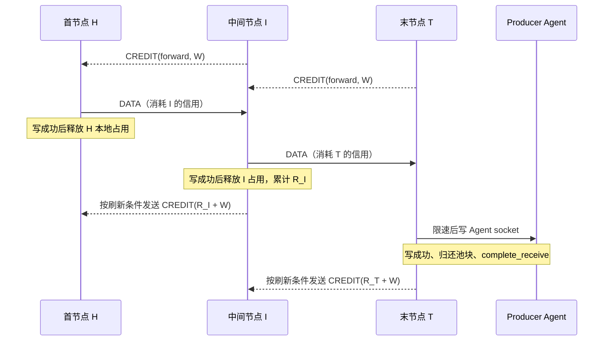

I→H 的信用更新取决于 I→T 的写完成，可以早于 T→Agent 的写完成；两者通过有限窗口逐跳关联。
CREDIT 在相邻一跳终止，`reverse` 标记它约束的 DATA 方向，CREDIT 自身沿该 DATA 的反方向传递。

Stream 的 `send/finish_send` 返回只表示交接完成；发送任务可能仍持有一块等待本地准入的数据。
`receive` 用可选载荷区分 DATA 与 EOF。终点一次只交付一个 DATA，收到 `complete_receive` 前不交付下一帧。
这些边界分别表达“接手载荷”“允许进入本跳窗口”“成功向下游写入”，不能互相代替。
socket 写成功表示数据已交给对应的本地传输栈，不保证远端业务应用已经处理。

### 缓存释放、信用合并与控制帧调度

**释放本地占用立即生效，发布上游信用可以合并。** DATA 写成功后，`release_buffer` 立即减少 `B_i`；
有入边时再令 `R_i += c`。从队列取出帧、移动池块或单独归还池块，都不触发这一成功写入确认。
FIN 只归还自身的管理占用，不增加 `R_i`；写入失败进入关闭流程，不发布成功消费额度。

设当前尚未发布的新增额度为 `Δ_i = R_i + W - G_i`，每次成功释放 DATA 后执行：

```text
减少本地 buffered_bytes
若本方向有入边：
    检查 released_bytes + 本帧 charge + W 是否溢出
    累计 released_bytes
    若 Δ_i >= W/4 或 A_i == G_i：立即发布 R_i + W
    否则若节点尚无信用批次：设置节点 credit_deadline_ = now + τ，并推进共享 monitor 的期限
通知需要空间的本地发送任务
共享 monitor 在节点批次到达时：
    清除本批次期限
    遍历所有 Active TCP Flow 的两个方向
    仅对有入边且 R_i + W > G_i 的方向发布 R_i + W
    没有后续小额释放时，不安排下一信用批次
```

阈值为 `W/4 = 81920` 计费字节。`A_i == G_i` 表示本节点已接收到旧授信的全部 DATA；
这个判断发生在释放 DATA 时。节点首个小额释放设置一次共享期限，其他 Flow/方向加入同一批次，
不推迟期限。某方向先满足即时刷新条件时，只发布该方向；共享期限保留，供其他方向使用。
到期批次跳过已发布完额度的方向，不重复发布 CREDIT。Flow 全部关闭或都已即时刷新后，
已安排的批次最多再执行一次空检查；不会持续空转。初始 W 在 commit 时发布，不等待 τ。
初始、即时和批次授信共用 `publish_credit`，由 `receive_limit` 去重；没有独立的待刷新队列或期限堆。
最近期限允许保留到最后一次空检查；批次状态不保存待刷新集合或计数。

同一 Link 上尚未发出的同一 `(flow_id, reverse)` CREDIT 合并为最新绝对上限。
物理 writer 优先处理控制帧，连续最多 16 个控制帧后允许已就绪 DATA 推进；普通控制 FIFO 与
待发 CREDIT 表分别维护。相邻 TCP Link 启用 TCP_NODELAY。控制帧仍需等待当前 socket 写入和事件循环调度。

TCP DATA/FIN 进入共享 `FairQueue`，标签由准确的 Flow 对象身份和方向组成。
入队先找同标签最后一帧，再向后跳过一段标签不重复的帧，在首次重复之前插入；无同标签则从队首扫描。
writer 仍只取队首，不维护轮次、每流子队列或调度游标；同方向 DATA/FIN 顺序不变。
所有队列为空时等待原 writable 通知，取得信用和写完成后的缓存释放流程不变。
这是近似帧公平，不保证字节等份或固定等待时间；算法、验证范围和容器比较见 [FairQueue](FairQueue.md)。

首个小额释放的计划等待为 20 ms；批次内后续释放的计划等待为 0～20 ms。
这是到批次的计划等待，不是 CREDIT 到达上游的时延上界。各节点独立形成批次，不要求时钟对齐。

### 慢末端的背压、恢复与数值示例

当 T→Agent 写入变慢，T 的交付仍占窗口，`R_T` 的增长随之变慢，授给 I 的额度无法持续推进。
I 仍能使用先前已经获授的额度发送；当 `L_I-S_I` 小于队首 DATA 的 charge 时，后续 DATA 留在 I。
随着 I 的出边写入停止推进，`R_I` 不再增长，H 也逐渐耗尽 I 的可用信用；H 本地方向队列累积，
本地准入开始等待。发送任务不再接下一次交接，RemotePair 随后暂停继续读取 Agent，背压传到源端。
网络与各层缓存允许背压传播前保留有限的在途数据，整个过程不要求各节点同时停住。

恢复时，T 写完一帧会释放本地占用；满足刷新条件后 T→I 更新 CREDIT，I 将待发帧继续送往 T。
I 的 socket 写成功后也释放占用，并按自己的累计状态向 H 更新 CREDIT。
两跳可以流水推进，每一跳都用自己的 `R+W` 授信，不转发另一跳的 CREDIT，也不等待端到端逐帧 ACK。

以 T 初始接收连续 32768 字节 DATA 为例，假设对应帧都已从 I 发出，T 暂未完成业务写入：

```text
c = 32768 + 128 = 32896
9c = 296064 <= W = 327680
10c = 328960 > W
旧额度剩余 = W - 9c = 31616 < c
```

此时 I 已经不能发送下一帧，虽然剩余额度仍非零；T 的 `A_T=296064` 也没有等于 `G_T=327680`。
该状态下，下一次发送需要等待释放后的小额信用刷新。

| 观察时点 | `A_T` | `R_T` | `G_T` | `Q_T=A_T-R_T` | 刷新行为 |
|---|---|---|---|---|---|
| 收到 9 帧、尚未写出 | 296064 | 0 | 327680 | 296064 | 已用额度不足再接一帧 |
| 写完第 1 帧 | 296064 | 32896 | 327680 | 263168 | `Δ=32896<W/4`，启动节点 20 ms 批次，或加入已有批次 |
| 期限先到，仍只写完 1 帧 | 296064 | 32896 | 360576 | 263168 | 发布 `R+W`，额度增加一帧的 charge |
| 另一分支：期限前已写完 3 帧 | 296064 | 98688 | 426368 | 197376 | `3c=98688>=W/4`，提前发布；共享批次保留，到期跳过本方向 |

最后两行是从“写完第 1 帧”出发的两种分支，未包含后来新 DATA 的接收。
若走三帧分支，I 收到新上限后，剩余可发额度为 `426368-296064=130304`，
足够再发送 3 帧，之后仍留下 31616 的零头。窗口按整帧准入，不因剩余空间非零就允许超额发送。

共享 Link 的物理读循环继续解析其他 Flow 和控制帧，不在这条 Flow 的下游空间上挂起。
有信用的其他 Flow 可以进入共享队列并按标签交错；同流 FIFO、当前写入及 TCP 丢包造成的队头阻塞仍存在。
这保证协议层不会因等待某条 Flow 的信用而停读整条 Link，不承诺各流的带宽份额或延迟上界。

### 数量准入、逐 Flow 边界与实际占用

Flow 按身份数量准入，不预留全局字节预算。prepare 校验数量、身份和邻接状态后建立 Flow，
commit 仍负责激活和发布初始信用；两阶段用于多节点协调，并非仅为预留内存。
`flows_ + retired_` 合计最多 1000 个身份，关闭后的身份在 10 秒内禁止复用。
控制域的活动和关闭中 Flow 请求同样受统一的 1000 上限约束。

TCP 每方向已准入 DATA charge 不超过 W，另允许一个 FIN；UDP 按每端点 16 项队列限制积压。
以下是满载窗口/队列的逻辑容量模型，不是预分配或标准池实际占用：

```text
TCP 每 Flow 双向逻辑容量 = 2 × (W + h) = 655616 字节
1000 条 TCP Flow 的双向逻辑容量 ≈ 625.244 MiB / 节点
UDP 双向满尺寸队列模型 = 2 × 16 × (65536 + h) = 2101248 字节 / Flow
1000 条 UDP Flow 的队列模型 ≈ 2003.906 MiB / 节点
```

这些数值不包含窗口外的串行交接块、共享 Link 的读写、其他队列、固定数组、池缓存及内核存储。
同一方向经过 n 个节点时，各节点独立维持窗口，已准入 DATA charge 合计不超过 nW；反方向另计。

| 层次 | 覆盖范围 | 边界 |
|---|---|---|
| Flow 身份与业务数量 | Prepared、Active、退休身份及业务控制任务 | 按身份数量限制，不设全局预留字节上限 |
| `buffered_bytes` | 已准入、仍在本跳队列、Link 写入或终点交付的帧 | DATA 不超过 W，另留一个 FIN；移动不减计费 |
| 标准同步池 | 在用及标准库保留的块、chunk 和内部元数据 | 无应用层字节上限；允许保留高水位缓存 |
| 其他资源 | 固定读缓冲、协程/队列/状态对象、TLS 和内核 socket 缓冲 | 依靠数量、队列与长度边界约束，不承诺固定 RSS |

Flow 关闭会清空其队列，池块由最终持有者归还；迟到的 written 不再修改已关闭 Flow 的信用。
128 字节管理 charge 及载荷取整属于稳定的协议计费，不是所有 C++ 对象和分配器开销的逐字节统计。
当前 Frame 为 96 字节，编译期断言约束其本体不超过 h；不能据此认为所有管理开销均被 h 覆盖。
TCP 端点队列容量仍为 `W/h+1=2561` 项，允许窗口占满后再排入唯一的 FIN。

其他共享容量沿用以下边界：

| 状态或队列 | 当前上限 | 超限处理 |
|---|---|---|
| Link 申请 / 端点授权 | 各 1000 条 | 拒绝新申请 |
| master 活动及关闭中 Flow | 合计 1000 条 | 拒绝新事务 |
| FlowProtocol `flows_ + retired_` | 合计 1000 条；关闭身份短暂保留，禁止立即复用 | 拒绝 prepare |
| 每 TCP Link DATA/FIN FairQueue | 从各 Flow 方向的信用窗口准入 | 缺信用帧留在本 Flow；同流 FIFO、跨流交错，共享 writer 不另设信用等待 |
| 每 TCP Link 一般控制 FIFO | 4096 条；CREDIT 另按 Flow/方向合并，项数受 Flow 身份容量约束 | 控制准入失败关闭相应 Flow 或 Link |
| 每 UDP Flow 端点发送 / 接收队列 | 各 16 包 | 丢当前包，保留健康 Flow |
| 共享 UDP 发送队列 | 100 项；其中业务最多 96 项 | 为保活留 4 项；业务超限丢包 |
| FlowProtocol 控制事件 | 4096 条 | 事件溢出使本地协调失效并排空通道 |
| Node 数据 TCP 握手接入 | 100 个 | 拒绝新 socket |

UDP `try_send` 返回 false 表示当前包没有入队；出队立即释放位置，每个串行终点写循环可另持有一个在发包。
UDP 不创建 Stream 状态，不发送 CREDIT，不等待空间，不做逐包消费确认。

### 窗口、信用周转时间与性能分析

**吞吐先取决于信用周转，再受分帧效率和链路资源约束。**

设 `T_i` 为相邻边向节点 i 发送 DATA，到相应下游写入完成、释放并让发送者收到可复用 CREDIT 的周转时间。
它包含传输、下游排队或消费、合并与调度；下游拥塞时也会包含更远处背压造成的等待，不能直接等同于相邻网络 RTT。
忽略整帧零头时，计费量速率的乐观上限为 `8W/T_i` bit/s。若用户载荷与 charge 的长期比例为
`η_i = 用户载荷字节 / DATA charge`，则维持用户速率 r 所需的基本窗口条件为：

```text
r <= 8 × η_i × W / T_i
W >= r × T_i / (8 × η_i)
```

对等长 DATA，一个初始窗口实际可承载的用户载荷为 `floor(W/c(p)) × p`，见 [设计边界与计费模型](#设计边界与计费模型) 的表。
例如 32768 字节块的 `η≈99.61%`，但整帧准入使一个初始窗口只能容纳 288 KiB 用户数据；
4097 字节块因 size class 向上取整，`η≈49.24%`。分帧大小和零头会让实际表现低于连续字节模型。

取 `η=1` 且忽略整帧零头，320 KiB 的窗口给出以下参考上限：

| 信用周转 `T_i` | 单流、单方向乐观上限 |
|---|---|
| 30 ms | 约 87.4 Mbps |
| 100 ms | 约 26.2 Mbps |
| 200 ms | 约 13.1 Mbps |

多跳可以流水传输，各跳分别满足窗口条件；稳定速率还受最慢链路、首末限速和共享 writer/CPU 制约。
不能仅按跳数把同一个 W 平均分配，也不能从逐流信用推导带宽公平。
当前约 100 条均匀活跃 Flow 合计 1 Gbps 的目标，相当于每流约 10 Mbps。
在 `T_i=200 ms、η_i≈1` 的模型中，每跳每流的基本窗口需求约为 `250000` 字节，当前窗口约为其 1.31 倍；
4097 字节分帧需要约 `507689` 字节，超过当前窗口，不能沿用大块载荷的估算。
只剩少量大流时，100 ms 周转下单流 1 Gbps 的基本需求已为 `12.5 MB`，超过当前 W。
这些是设计估算；当前功能回归不构成真实链路 1 Gbps 的测量结果。

在每流 10 Mbps、T=200 ms 的连续模型中，4 KiB 分帧需要约 251.8 KiB 窗口，
32 KiB 需要约 245.1 KiB，320 KiB 分别约为其 1.27 和 1.31 倍。
考虑整帧零头，9 个 32 KiB DATA 在同一周转下约支持 11.80 Mbps，4 个最大 DATA 约支持 10.47 Mbps；
4097 字节 DATA 只有约 6.39 Mbps，不能把大块载荷的余量推广到所有分帧。

| 每方向 W | TCP 双向逻辑窗口 | 百流窗口模型 / 节点 |
|---|---:|---:|
| 256 KiB | 512 KiB + 256 B | 50.024 MiB |
| **320 KiB（当前）** | **640 KiB + 256 B** | **62.524 MiB** |
| 512 KiB | 1 MiB + 256 B | 100.024 MiB |
| 1 MiB | 2 MiB + 256 B | 200.024 MiB |

从 512 KiB 调至 320 KiB，DATA 窗口容量减少 37.5%，代价是能够覆盖的信用周转缩短；
不能据此声称进程 RSS 同比降低。初始 CREDIT 必须等于本地 W，当前协议没有窗口或计费单位协商，
相邻节点需使用一致的参数。

**节点级批次将小额信用刷新集中到同一次唤醒。**

当前 τ 为 20 ms，每个 FlowProtocol 只有一个共享信用批次期限，并复用唯一的 monitor_timer_。
参数研究的结论与各类负载的扫描次数集中记录在 [参数研究结论与扫描计数](#信用参数实验与扫描计数)。

| 当前状态 | 批次的影响 |
|---|---|
| 释放使 `Δ_i>=W/4`，或释放时 `A_i==G_i` | 立即刷新，不等待批次 |
| 节点没有待处理批次 | 首个小额释放安排 now + 20 ms |
| 节点已有待处理批次 | 加入原批次，计划等待为剩余时间，不新增每流期限 |
| 小额释放后，发送者剩余额度不足下一帧 | 恢复可能依赖下一批次；计划等待不超过 20 ms |
| 没有 DATA 成功写出 | 没有新信用产生，修改 τ 不能恢复发送 |

连续产生小额释放时，每节点信用批次频率不超过约 `1/20 ms≈50 次/秒`；
实际批次之间还可能有等待首次释放的空隙。三节点的计数要分别相加，准备超时、心跳和退役清理也会触发扫描，
50 仅约束信用批次周期，不是全部 monitor 扫描或定时器回调的总上限。提前期限打断等待时直接重等，不额外全量扫描。

相较原每方向固定等待 20 ms，共享批次会让部分方向更早发布额度，改变更新的聚集方式。
若一次只释放少量 charge，仍可能等待接近 20 ms；两跳串行等待可接近 40 ms 的计划等待，
网络、控制帧写入和事件循环调度还会增加实际时延。已有额度、阈值即时刷新和两跳流水会缩短等待。
只考虑某方向独自每周期释放 `Δ<W/4`、且发送者依赖该更新时，理想化信用供给速率仍可写为 `8Δ/τ` bit/s；
该估算不描述批次内其他方向的剩余等待，更不能直接预测整条路径的用户吞吐。
τ 不改变 W、数量限制或单 Flow 缓存上界；节点级批次也不保证 RSS 下降。

动态窗口、字节公平调度（如 DRR）和跨帧的有界批量写仍为待实现项。
当前提供共享队列的标签交错、CREDIT 合并和有界控制优先；不提供端到端业务 ACK、逐流公平字节带宽或延迟保证。

### 失败边界、源码定位与验证

| 观察到的状态或故障 | 当前行为 |
|---|---|
| 本地 DATA 窗口不足 | 发送任务等待 `send_space_`，后续交接挂起，保留健康 Flow |
| 队首 DATA 超过剩余下游信用 | 留在 `pending_frames`，新 CREDIT 到达后继续 flush |
| 重复或旧 CREDIT | 忽略，不增加额度 |
| 非法初始/新增信用上限、计数器溢出、网络 DATA 越窗 | 关闭对应 Flow |
| 已校验 Flow 内的窗口/队列容量不变量被破坏 | 关闭对应 Flow；队列容量保持固定 |
| 物理帧格式错误、NodeLink socket I/O 失败 | 关闭 Link 并清理依赖 Flow |
| FIN | 同方向有序 EOF，保留反方向；不增加 DATA 信用 |
| RESET、控制失效或 Flow 关闭 | 唤醒并排空挂起任务、释放业务状态；失败写入不算成功消费 |
| UDP 队列满 | 丢当前报文并计数，不进入 TCP 信用等待 |

排查发送停顿时，先区分本地 `buffered_bytes` 不足空间、下游 `send_limit-sent_bytes` 不足、
终点迟迟没有 `complete_receive`，以及信用正在合并或排队四个位置，再检查网络和业务限速。
这些字段是实现状态，可用于源码分析和测试检查；当前没有对应的一套公开监控接口。

| 要核对的机制 | 源码位置 |
|---|---|
| 原分配长度、线上信用与本地内存计费 | [`lnk_channel.h`](../protocol/inc/lnk_channel.h)：`PooledBuffer`、`Frame::charge_for_payload/charge/memory_charge` |
| 数量准入、prepare/commit/关闭 | [`flow_protocol.cpp`](../protocol/src/flow_protocol.cpp)：`prepare_flow`、`commit_flow`、`close_flow` |
| DATA 准入、队首信用检查和接收授信校验 | 同文件：`Stream::try_send`、`receive`、`flush`、`receive_credit` |
| 写完成、信用刷新与期限 | 同文件：`written`、`Stream::release_buffer`、`publish_credit`、`poll` |
| 首末交接与串行消费确认 | 同文件的 `Stream::send_loop/receive_loop`；[`pipeline_mgr.cpp`](../node/src/pipeline_mgr.cpp) 的 `read_remote_pair/write_remote_pair` |
| 控制合并、共享队列与物理写完成 | [`lnk_channel.cpp`](../protocol/src/lnk_channel.cpp)：`enqueue`、`tcp_read`、`tcp_write`；[`fair_queue.h`](../protocol/inc/fair_queue.h) 封装按标签排列与删除 |

回归按组件职责归类，使用生产端点的异步发送、可选载荷/EOF、布尔 Datagram 准入和异常语义。

| 测试 | 覆盖边界 |
|---|---|
| [`lnk_flow_control_test.cpp`](../test/protocol/lnk_flow_control_test.cpp) | 本地准入与取消、节点信用批次、阈值/耗尽刷新、满窗口 FIN、信用校验、数量准入和退休身份到期、UDP 有界丢包及三跳停读恢复 |
| [`fair_queue_test.cpp`](../test/protocol/fair_queue_test.cpp) | 独立参考模型、穷举/随机轨迹、有限状态进展、哈希冲突与 Frame 所有权；真实 writer 交错由上项 wire 场景验证 |
| [`lnk_flow_receive_test.cpp`](../test/protocol/lnk_flow_receive_test.cpp) | 端点交付、载荷所有权、执行器、消费确认、取消和任务排空 |
| [`lnk_channel_flows_test.cpp`](../test/protocol/lnk_channel_flows_test.cpp) | 真实共享 Link 的 Flow 生命周期、FIN/RESET、并发响应和隔离 |
| [`pooled_buffer_test.cpp`](../test/common/pooled_buffer_test.cpp) | 标准池复用、稳定逻辑计费和跨线程存储生命周期 |

信用批次场景驱动真实端点任务，并用受控的 `poll(now)` 检查期限前 1 ns 与到期时的行为，不依赖 sleep；
不同 Flow 与相反方向共享批次，其中一条即时刷新或关闭不能取消另一条的待发布额度。
满窗口 FIN 场景同时验证精确耗尽刷新，数量场景覆盖 TCP、UDP、混合各 1000 个 Flow、超额拒绝和退休身份到期后复用。
真实 wire 与三跳测试负责验证共享 Link 的健康流进展、背压传播、恢复顺序和失败隔离，不能由受控期限检查替代。
用例不向生产类增加测试开关；功能回归验证协议和资源边界，性能结论需对应负载下的实测。

## 6. 配置、启动与停止

### RelayNode master 配置

完整字段以 [`node/node.example.json`](../node/node.example.json) 为准。master 的 `cluster.address` 是集群监听地址：

```json
{
  "bandwidth_mbps": 100,
  "cluster": {
    "role": "master",
    "node_id": "master-1",
    "address": "0.0.0.0",
    "control_port": 18447,
    "tcp_port": 18448,
    "udp_port": 18448
  },
  "control": {
    "address": "0.0.0.0",
    "advertise_address": "203.0.113.10",
    "port": 18443,
    "max_connections": 512,
    "max_services": 256,
    "max_services_per_session": 64
  },
  "tcp": {
    "address": "0.0.0.0",
    "port": 18444,
    "max_setup_connections": 512,
    "max_relays": 128,
    "setup_timeout_ms": 10000,
    "rx_bytes_per_second": 2000000,
    "rx_max_burst_bytes": 262144,
    "tx_bytes_per_second": 2000000,
    "tx_max_burst_bytes": 262144
  },
  "tls": {
    "address": "0.0.0.0",
    "port": 18446,
    "max_setup_connections": 512,
    "max_relays": 128,
    "setup_timeout_ms": 10000,
    "rx_bytes_per_second": 2000000,
    "rx_max_burst_bytes": 262144,
    "tx_bytes_per_second": 2000000,
    "tx_max_burst_bytes": 262144
  },
  "udp": {
    "address": "0.0.0.0",
    "port": 18445,
    "max_relays": 128,
    "setup_timeout_ms": 10000,
    "rx_bytes_per_second": 2000000,
    "rx_max_burst_bytes": 262144,
    "tx_bytes_per_second": 2000000,
    "tx_max_burst_bytes": 262144
  },
  "certificate": {
    "server_ca_file": "/etc/relayweave/certs/server-ca.pem",
    "ca_file": "/etc/relayweave/certs/client-ca.pem",
    "certificate_chain": "/etc/relayweave/certs/server.pem",
    "private_key": "/etc/relayweave/certs/server.key"
  },
  "channel": {
    "handshake_timeout_ms": 5000,
    "disconnect_timeout_ms": 5000,
    "heartbeat_interval_ms": 5000,
    "heartbeat_timeout_ms": 20000,
    "max_queued_messages": 100
  }
}
```

`cluster` 是必填对象，`role` 只允许 `master` 或 `slave`，所有节点的 `node_id` 必须非空且唯一，并且不能使用为广播保留的 `all`。当前配置不提供关闭集群的角色，也不读取旧版服务器配置字段。

### RelayNode slave 配置

slave 的控制和数据端口按本节点实际端口填写。它的 `cluster.address` 和 `cluster.control_port` 指向 master：

```json
"cluster": {
  "role": "slave",
  "node_id": "slave-1",
  "address": "203.0.113.10",
  "control_port": 18447,
    "tcp_port": 18448,
    "udp_port": 18448
}
```

slave 的 `control.advertise_address` 填写 Agent 可访问的 slave 地址，例如 `203.0.113.11`。slave 连接失败或断开后每隔 5 秒重试，master 不主动连接 slave。集群断开时普通客户端监听和 Single 业务继续运行，Multi 及本地 Flow 授权按集群失联规则清理。

### 容量与超时配置

| 配置 | 作用范围 |
|---|---|
| `control.max_connections` | 普通控制会话上限；master 集群连接使用同值的独立上限；本 Node ingress/egress Multi 业务也使用同值的独立上限，不限制 Single 数量 |
| `control.max_services` | 本节点全部注册服务上限 |
| `control.max_services_per_session` | 一条普通控制连接可注册的服务上限 |
| `tcp/tls.max_setup_connections` | 正在读取 attach 的未归属 TCP/TLS socket 上限 |
| `tcp/tls/udp.max_relays` | 对应协议的建立中、活动和关闭未排空业务任务上限；manager 同时约束等待和活动数据资源 |
| `tcp/tls.setup_timeout_ms` | 两个独立用途：每个 accepted socket 从 setup 任务开始到传输准备及合法 attach 的期限；每个 NodeSession 从创建到接入、绑定、激活并发送 ready 前的业务期限 |
| `udp.setup_timeout_ms` | 每个 NodeSession 从创建到接入、绑定、激活并发送 ready 前的期限；Single 管双方，Multi 只管本端，默认 10000 毫秒，不限制运行期 |
| `channel.max_queued_messages` | 单条 TLSChannel 的读写队列与 ClusterMgr 出站消息队列容量 |
| `relay.open_timeout_ms` | Agent 本端 TCP/TLS/UDP 的建立超时；请求方从入口选择前、服务方从收到 offer 开始计时，不传递给其他端；不限制运行期 |
| `server.connect_timeout_ms` | RelayAgent 的解析/连接和数据连接超时 |

Node 的建立与关闭期限按所有者区分，不能把不同计时器视为一份跨进程预算：

| 期限 | 起点、边界与结束条件 |
|---|---|
| Single 业务 deadline | 创建 NodeSession 时计算；等待双方 attach、绑定及激活，ready 前最后检查；ready 后不再计时 |
| Multi 本端业务 deadline | 首末各从自己的 NodeSession 创建时计算；首端还覆盖 open_flow；首末不互传剩余时间，ready 后不再计时 |
| TCP/TLS 未识别接入 setup | 每个 accepted socket 的 run_transfer_session 开始时单独计算；TLS 握手和 attach 解析共用该 socket 的剩余预算，不包含之前的调度等待或之后的业务运行 |
| Link / Flow 建立 | 新 Link 最多 10 秒；master Flow 的 links 阶段有 10 秒计时，全部边就绪后 prepare/commit 共用重新开始的 10 秒；数据域 Prepared 表项按 ttl_ms 到期 |
| slave 远程 open 等待 | 最多 30 秒，仍会被首端业务 deadline 或显式取消提前打断，未接受成功结果时尽力发送关闭请求 |
| Flow 关闭 | master 最多等待全路径 closed 10 秒；slave 最多等待本地 Flow 关闭 10 秒，语义不同 |
| 运行期存活 | 没有 Relay/Flow 周期租约；控制连接与物理 Link 使用各自心跳，显式取消、成员/epoch 或 Link 失效触发清理 |

TCP/TLS 的 `rx/tx_bytes_per_second` 为 0 时不限制；非零时配合对应 burst 值使用等待式令牌桶。UDP 使用同样方向定义，但无法对 datagram 做部分等待，令牌不足就丢包。
UDP 任一方向的速率非零时，必须显式配置对应的 `rx_max_burst_bytes` 或 `tx_max_burst_bytes` 为正整数；
缺失或为 0 会在配置加载阶段报错。burst 应至少容纳该方向希望转发的最大报文，否则更大的报文仍会丢弃。

TLSChannel 的发送队列满时拒绝本帧、记录原因并直接关闭通道；编码失败、底层 TLS 写失败或业务接收队列满也进入同一关闭边界。系统没有可靠消息队列，不重试单条控制消息，也不会把 `send()` 调用当成成功确认。

### RelayNode 进程启动流程

构造只组装部件，不接受业务。main 解析一次配置，准备普通 Agent 控制/TLS 数据使用的 TLS context；
RelayNode 构造时验证四个 io_context 互异，加载内部集群 TLS context，构造 Registry、三类数据
manager、ClusterMgr、NodeMetrics、Topology、NodeLinkMgr/FlowProtocol 和借用依赖的 NodeControl。
普通 TLS context、四个服务 io_context 由 main 保活，集群 context 由 Node 自己持有，见 [RelayNode 的包含关系与借用关系](#relaynode-的包含关系与借用关系)。

main 给 control/TCP/UDP/cluster_data 建立四个 work guard 并启动四个 worker，通过 control_io 的
post 提交 start 并等待结果。主线程运行 signal_io，等待进程信号或 Node 致命故障通知，正常运行共五个线程。

| RelayNode 状态 | 进入条件 | 可以做什么与退出条件 |
|---|---|---|
| Created | 构造成功，尚未 start | 允许启动一次；直接 stop 不必调度各域任务，进入 Stopped |
| Running | start 的部件启动阶段成功，准备接受普通控制连接 | 普通业务与 peer.open 可创建实例；不保证 slave 已加入集群或服务已经注册 |
| Stopping | 外部 stop 开始、start 部分失败，或 master 控制模块致命故障 | 拒绝新业务，排空已发布任务，保留关闭所需的依赖；无法确认排空时保持该状态并允许顺序重试 stop |
| Stopped | stop 所有阶段完成，包括已处理错误后返回 false | 顺序重复 stop 复用原结果；不能重新 start |

start 按以下顺序执行；各部件在对应步骤发布自己的后台任务：

1. 打开、bind、listen 普通 control acceptor。
2. tcp_pipeline.start、tls_pipeline.start 绑定各自监听并发布 accept/setup 任务。
3. datagram_mgr.start 绑定共享 UDP socket，发布接收循环。
4. nodelink_mgr.start 打开共享 NodeLink 的 TCP/UDP 监听资源。
5. metrics.start 记录 uptime 起点并借用 FlowProtocol，为集群查询先准备可读指标。
6. cluster_mgr.start：master 绑定集群控制口并发布接入/投递任务；slave 发布连接与重连任务。
7. topology.start 发布探测和报告任务；nodelink_mgr.activate 激活协议数据任务与控制侧事件消费。
8. 切换 Running，发布普通 control_accept_loop，再 metrics.activate 启动三个队列探针和控制侧流量采样。

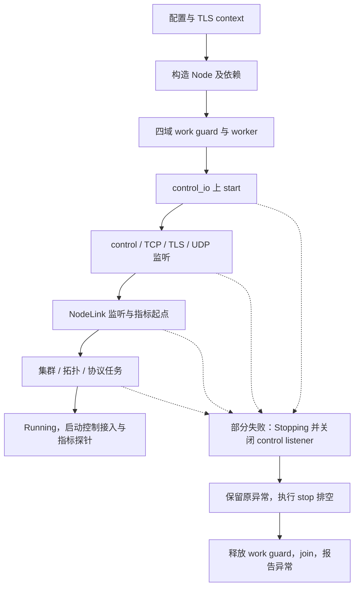

Running 是本机接受业务的状态，不是集群握手完成或单条业务 ready。slave 的连接失败按 [ClusterMgr::Connector 重连](#clustermgrconnector-重连)
重连；只有取得当前拓扑和有效 epoch 后才能建立多节点 Flow。服务注册、普通身份查询和业务 ready
分别由各自协议确认；start 成功仅表示本节点启动完成。

监听、UDP 或集群启动失败时，start 的回滚只关闭控制监听、保留 Stopping 并抛出原异常；main
仍在各执行域存活时调用 stop，收拢已发布任务，再释放 work guard、join worker，最后报告启动异常。
其他调用者也可在 worker run 前串行 bootstrap，或在 control_io 调用 start；不能与 stop 重叠，失败
后同样必须保持执行域运行来排空，不能直接析构 Node。

### RelayNode 停止流程

`RelayNode::stop()` 是同步收敛接口，由 `control_io`、`transfer_tcp_io`、`transfer_udp_io`、`cluster_data_io` 之外的所有者线程顺序调用，且不能与 start() 重叠。
main 在收到信号、Node 致命故障通知或启动失败后顺序调用 stop()。stop 不支持并发调用；信号回调和工作线程不调用该接口。
以 Stopped 状态复用顺序重复调用的结果；control、TCP/TLS、UDP 阶段依次执行，返回 bool 表示是否正常关闭：

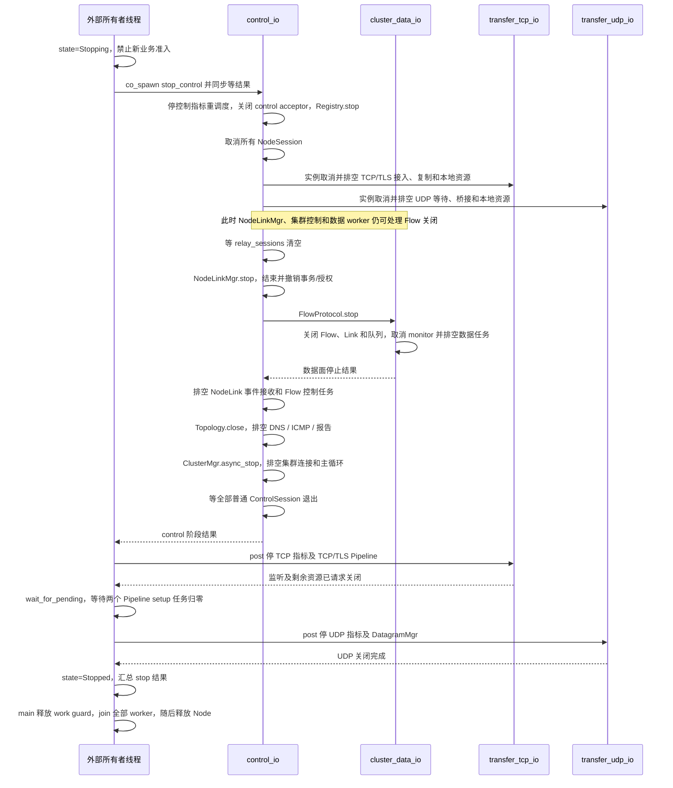

Node 先取消并排空所有单节点及多节点 NodeSession；该过程仍需 NodeLinkMgr 和集群控制处理关闭确认及失效通知。
随后共享数据任务在独立 cluster_data_io 中取消并等待退出，再关闭集群控制连接；最后主程序 join 数据线程。其余三个停止阶段分别由对应 executor 执行，外部同步 `stop()` 通过 `use_future` 逐阶段等待。control 侧先让
Registry 停止接受新状态并断开现有普通会话，等待 ClusterMgr 和全部 ControlSession 结束，确保
RelayNode 的控制命令不会再创建新业务。业务复制子任务已由实例排空，随后各数据 manager 关闭监听。
ClusterMgr 首先把自身置为非运行状态，再取消 master accept/slave connect、关闭出站消息队列和全部成员
session 并等待退出。ClusterMgr 不维护额外的业务收件箱；停止返回后不再调用 RelayNode。

业务排空期间保留共享依赖和数据 listener；stop_relays 等待业务容器清空后才进入共享部件与监听关闭阶段。
数据域的指标取消处理可以迟到，但不得重新调度或访问已停止的 Registry/FlowProtocol。

需要等待排空的模块关闭接口返回 `asio::awaitable<bool>`，模块内部记录错误，对外只交付关闭结果。
正常返回（包括 false）均保证所属任务已经退出；false 表示关闭阶段发生了已处理的错误，或 master 控制模块发生致命故障。
普通历史运行错误不会单独使随后完成排空的关闭返回 false；master 控制模块致命故障会保留失败结果，确保进程失败退出。调用方取消不会中断模块排空，
并发、重复关闭等待同一完成条件，并保持同一关闭结果。

NodeLinkMgr 接收 FlowProtocol 的关闭结果后，仍等待通知和 Flow 控制任务退出。
Topology 和 ClusterMgr 的完成事件在后台协程退出时唤醒等待者；无法确认排空完成的失败单独保留，
由关闭接口抛出，不能转换成普通 false 或提前设置 Stopped。Topology 仅在 DNS / ICMP 排空后置为 Stopped。
RelayNode 依次调用 NodeLinkMgr、Topology、ClusterMgr，不因某一步返回 false 而跳过后续模块或会话排空，
随后完成 TCP/TLS、UDP 停止，设置 Stopped 并返回汇总结果，不保存或重抛模块历史运行异常。
任务提交或排空本身失败时，异常交给外层，Node 保持 Stopping，后续顺序调用 stop() 可以再次进入关闭流程。
main 等待系统信号或 Node 致命故障通知，stop() 在回调外调用；先释放 work guard、join 全部线程，再结束 Node 生命周期。
正常关闭退出 0，已完成但关闭结果为 false 时退出 1；启动异常在清理与 join 后报告原始原因。
已取消的指标处理函数可以迟到，但只释放模块自身，不再访问注册表或协议服务；不使用 io_context.stop() 跳过排空，也不增加全局强停超时。

TCP/TLS accept 后、首帧解析前的 socket 由各 StreamPipeline 的独立 setup 协程持有；
关闭 acceptor 后，这些任务仍继续至接入完成、失败或 setup_timeout。每个实例自己的 `pending_sockets_` 记录这部分协程；TCP/TLS 停止阶段在进入
UDP 停止前使用原子 wait 等待它们归零。accept/setup 协程按值捕获 Pipeline 的 shared_ptr，
未完成接入继续受现有 setup_timeout 约束，不增加待接入 socket 管理表。
业务复制由 NodeSession 的控制任务跨域拥有并排空。

### 失败收敛与恢复

错误交给能结束相关资源的最小所有者处理；恢复由会话或连接的外层机制承担，业务结果继续依赖响应和实际完成。

#### 异常处理边界

异常按能处理它的最小边界收敛：

| 异常位置 | 处理者 | 结果 |
|---|---|---|
| 配置字段、地址、证书/私钥加载 | `main()` / 构造或 `start()` | 启动失败并退出，不进入部分运行状态 |
| TLS 握手、解析、连接、节点识别 | 当前连接协程 | 清理本连接；RelayAgent 或 slave connector 按自己的规则重连 |
| 普通客户端发送非法控制命令 | `run_control_session` | 只关闭该控制会话并注销其服务 |
| 非法/过期 `relay.attach` | 当前数据接入协程 | 只关闭该数据 socket，等待中的 Relay 由 timer 或后续错误清理 |
| 单条集群业务消息字段非法 | `ClusterMgr::receive` / RelayNode 消息处理 | 拒绝该消息，继续接收后续集群消息 |
| TLSChannel 编码/入队失败或后台读写/心跳错误 | TLSChannel | 进入统一关闭并让外层接收自然结束 |
| server stop 期间的取消错误 | 各停止边界 | 保留原停止原因，排空资源 |

底层使用 `asio::use_awaitable` 的操作默认通过异常传播错误。accept 循环、停止取消、UDP 逐包收发等需要按错误码继续或区分 `operation_aborted` 的位置使用无异常结果。错误表示方式在其处理边界内保持一致。

RelayNode 的启动与业务任务提交用 ScopeGuard 回滚，异常自然向上传递。普通控制会话在退出时只记录一条结果日志，
正常断开及节点停止使用 INFO，运行中的异常使用 ERROR。peer 消息先校验身份，再处理已有实例；
仅新建 peer 业务的失败转为 peer.close，身份字段错误由 ClusterMgr::receive 拒绝，不构造 peer.close。

#### 故障场景与恢复行为

| 故障 | 当前行为 |
|---|---|
| RelayAgent 初始服务器不可达 | primary 按配置指数退避重连；连接恢复后注册和发现服务 |
| Agent 主控制连接断开 | 清空服务位置和路由，取消全部业务；重连后重新注册、发现并建立新业务 |
| 服务尚未发现 | 每 5 秒经 primary 查询；TCP/TLS 新本地连接直接关闭 |
| 服务从节点 A 迁移到 B | A 返回 unavailable/mismatch 后清路由并重新发现 B |
| master 集群端口断线 | slave 每 5 秒重连；本地控制连接及双方均在本节点的 Single 可继续，依赖集群控制的业务清理 |
| 重复 `node_id` 或保留值 `all` | master 返回 `cluster.error`，拒绝加入 |
| 普通客户端控制连接断开 | 注销该会话服务，取消相关 Relay |
| 数据一侧未按时 attach | setup timer 清理 Relay 和已到达的一侧 |
| 业务消息发送后断线 | 不保存、不补发、不自动重试；由协议响应和业务超时判断 |
| RelayNode/RelayAgent 停止 | 取消监听、解析、连接、timer 和 Relay，等待所属协程退出 |

系统不包含 master 选举、备用 master、全局服务目录同步、历史消息或恰好一次投递保证。
Agent 业务通过首末端点接入显式 Node 路径；已有业务保持建路时的路径，不做存量换路。

## 7. 控制协议规范

控制通道使用 `WireMessage` 长度帧承载 CBOR 编码的 `CtrlMessage`。消息结构为：

```text
{
  "command": "命令名",
  "params": { ... }
}
```

共享协议库使用 `CtrlCommand` 表示普通控制命令和 Link/Flow 事务命令。发送方可用枚举构造 `CtrlMessage`，
接收方通过 `type()` 得到枚举并分派。`params` 在内存中使用 `nlohmann::json` 对象表示，线上编码是 CBOR，
不是 JSON 文本；文中的 JSON 示例只用于展示字段。业务处理器负责校验自身字段和状态。

`CtrlCommand` 保持平铺枚举，底层使用 uint32_t，按 `[大类:8][子类:8][命令:16]` 编码。
仅定义 `CTRL_GROUP_MASK` 和 `CTRL_SUBGROUP_MASK` 两个掩码宏，各组起始值直接放在枚举中，具体命令随后自动递增。
`ctrl_command_group(command)` 和 `ctrl_command_subgroup(command)` 将取掩码和类型转换封装为 constexpr 函数，
分别与 `CtrlCommand::Link`、`CtrlCommand::Flow` 等大类和 `CtrlCommand::RelayPeer` 等子类比较，不按字符串前缀分派已知业务命令。
子类掩码包含大类位，保证不同大类的同号子类不会混淆。枚举值仅供进程内部分类，不写入线上消息。
分组按实际分派职责划分，不按命令字符串中的点号机械分层；当前仅 RelayPeer 需要单独的子类。
`type()` 仍从 command 字符串解析枚举；集群入口由 ClusterMgr 解析，普通控制入口由 RelayNode 解析，
解析后的枚举传给 NodeLinkMgr、NodeControl、NodeSession 及控制器，后续分派使用该枚举。
NodeLinkMgr 先按大类进入 Link 或 Flow；Flow 入口再区分远程请求和事务消息，不在大类分派前单独处理请求。

集群 wire 继续把 `source/target` 放在 `params` 中。非保留的普通 cluster command 仍以字符串透传，
`type()` 对它们返回 `Unknown`；`cluster.*` 命令由集群握手保留。扩展命令仍使用同一
长度帧、CBOR 和 `{command, params}` wire 格式。

大消息分页统一在 `protocol/inc/message.h` 和 `protocol/src/message.cpp` 中实现：

- `WireMessage::pack` 对不超过 64 KiB 的消息保持原单帧编码；较大消息先完整编码为 CBOR，再按最多 65472 字节拆分。
- 分片帧的 CBOR 根对象为 `{"__fragment": [page_index, page_count, bytes]}`，`bytes` 是 CBOR byte string；每帧仍使用四字节大端长度头，payload 不超过 64 KiB，逻辑消息上限为 16 MiB。
- `TLSChannel::send` 将一条消息的全部帧作为一个队列项连续写入 TCP；每条连接的 `MessageReceiver` 只维护一个组装缓冲和页序计数，无消息 ID、乱序缓存或分页超时。
- 收到第 0 页时开始新组；后续页必须连续且总页数一致。末页到达时仍缺页则丢弃整条消息，保持连接。业务处理器只接收重组后的完整 `CtrlMessage`。
- Node 间转发也先接收完整消息，再修改路由字段并自动重新拆分，不需要业务模块预估内部路由开销。

集群业务消息（含 `command`、`params` 和 `target`）的估算预算为 **16 MiB − 1 KiB**，
最终输出上限保持 **16 MiB**。预留的 1 KiB 属于路由层，业务不能占用；超过输入上限的数据需由调用方拆成业务消息。
`source` 最多 256 字节，连同少量 CBOR 结构开销由 1 KiB 预留覆盖；删除 `target` 再写入 `source`
不会增加 params 的字段数量。
ClusterRoom 在改写前统一检查输入预算，远端消息、本地消息及成员公告共用这一入口；超限消息丢弃并记录日志，
来源和目标连接继续工作。本地提交额外预检查，以便同步返回 InvalidMessage。
检查直接读取消息，不复制 JSON 或构造编码缓冲：固定消息外层预估 64 字节，params 内的标量和容器头各按 9 字节，
字符串和字段名按字节长度加 9，二进制按字节长度加 18（含可选 subtype 标签）。估算不追求精确占满预算。
TLS 和消息重组统一保留原来的 16 MiB 上限，无集群专用配置或解码分支；实际打包仍执行最终大小限制。

Node、Agent、Dashboard 需要同步升级；不兼容旧的业务分页字段和大消息解码方式。

控制消息按组件分成以下几组。普通客户端控制和集群控制均使用 mTLS；数据 socket 上的 attach 是
接入握手，业务复制开始后不再用 CtrlMessage 包装 TCP 字节或 UDP payload。

| 组件 | 接收入口与执行域 | 负责的命令 | 推进的状态 |
|---|---|---|---|
| TLSChannel | 通道读循环，通道所属 executor | `ping/pong` | 控制连接存活；消息在通道内部消费 |
| NodeControl / RegistryMgr | `NodeControl::handle_client/handle_cluster`，control_io | `server.identify`、`service.*`、`node.lookup`、状态及拓扑查询 | 节点身份、注册、发现和查询结果 |
| AgentControl / NodeConnection | `NodeConnection::run` / `AgentControl::handle_control_message`，control_io | `server.identified`、服务/节点定位结果、`topology.snapshot` | 控制连接 Ready、服务位置、入口等待和候选路径 |
| Forwarder / AgentSession | AgentControl 投递到 transfer_io | `relay.opened/offer/ready/error/closed` | 单次业务接入、数据复制和退出 |
| NodeSession / Single / Multi | `handle_relay`、`handle_relay_peer`，control_io | `relay.open/reject/cancel`、`relay.peer.*` | LocalPair 或 RemotePair 的建立和收尾 |
| ClusterMgr / ClusterRoom | 集群连接读循环，control_io | `cluster.*` 与普通集群消息路由 | 成员加入、广播和定向交付 |
| Topology | RelayNode 集群分派，control_io | `topology.members/report/query/snapshot` | 成员版本、质量报告和快照 |
| NodeLinkMgr | `handle`、`receive_events`，control_io | `link.*`、`flow.*` | Link 授权、Flow 路径事务；实际 Flow 状态由 FlowProtocol 拥有，邻接 I/O 由所属 LnkChannel 执行 |

字段作用域：

| 字段 | 作用域与含义 |
|---|---|
| `request_id` | 请求方分配的关联号，响应原样返回；Agent 实际使用非零值。定位、拓扑、集群状态及 Multi 请求要求非零；注册、本节点查询和 Single open 的解析允许零 |
| `uuid` | Node 内的本地数据资源 ID；Single 双方共享，Multi 首末各自分配。必须连同业务 Node、协议识别，不能视为集群全局 ID |
| `ticket` | 本地数据接入凭据，非零 uint64，与 uuid、role 配合；仅在对应资源存在时有效 |
| UDP `session_id` | Agent→Node 数据报的 8 字节路由身份，每个 role 独立分配；不等于集群查询中的控制会话 session_id |
| 集群查询 `session_id` | 入口 Node 的普通控制会话 ID，仅用于把跨节点查询响应转回原客户端 |
| `epoch` | master 本次运行的集群代次，旧代次的 Link、Flow 与 Multi 通知不能推进新业务 |
| Link `id` | 一条共享物理通道的身份；关联两端 Node、transport 和授权 token |
| `flow_id` | 本次路径业务的逻辑身份，与 epoch 配合；路径相同的新业务仍分配新 ID |
| Flow `request_id` | master 为 prepare/commit/close 事务分配的关联号，与 Agent relay.open 的 request_id 独立 |

`command` 长度为 1..32 字节，只允许英文字母、数字和点号；存在的 `params` 必须是对象。
`protocol` 取 `tcp/tls/udp`；Node Link/Flow 的 `transport` 只取 `tcp/udp`，TLS 业务对应 TCP NodeFlow。
`TLSChannel::send` 和 `ClusterMgr::send` 表示本地提交，不表示对端已处理；业务以相应确认消息推进。
`ping/pong` 不带业务参数，心跳周期和无入站帧期限由 channel 配置控制，不等同于数据 NodeLink 的二进制 PING/PONG。

### 身份、注册与发现

表中的 client 是普通 mTLS 控制客户端，server 是它连接的入口 RelayNode；服务发布和业务发现由 Agent 使用，
本节点服务列表也可由其他普通客户端查询。

| 命令 | 方向 | 主要字段 | 含义 |
|---|---|---|---|
| `server.identify` | client → server | 空对象 | 请求节点身份 |
| `server.identified` | server → client | `node_id` | 返回当前节点 ID |
| `service.register` | client → server | `request_id`, `service`, `protocol` | 注册本地服务 |
| `service.ok` | server → client | `request_id`, `service`, `protocol` | 注册成功 |
| `service.error` | server → client | `request_id`, `service`, `protocol`, `reason` | 注册失败 |
| `service.lookup` | client → server | `request_id`, `service`, `protocol` | 从当前集群定位服务 |
| `service.located` | server → client | `request_id`, `service`, `protocol`, `node_id`, `address`, `port` | 返回服务节点控制端点 |
| `service.list` | client → server | `request_id` | 查询本节点注册服务 |
| `service.listed` | server → client | `request_id`, `services` | 返回服务名数组 |
| `node.lookup` | Agent → primary Node → 目标 Node | `request_id`, `node_id` | 定位所选入口的控制地址 |
| `node.located` | 目标 Node → primary → Agent | `request_id`, `node_id`, `address`, `port` | 返回目标 Node 自己发布的控制端点 |
| `node.error` | primary → Agent | `request_id`, `node_id`, `reason` | 所选 Node 不在当前成员表中 |

服务名长度为 1～64 字节，只允许 `A-Z`、`a-z`、`0-9`、`.`、`_`、`-`。服务名在单个 RelayNode Registry 内唯一；注册和使用的协议必须一致。

NodeConnection 完成 mTLS 后发送 `server.identify`，收到 `server.identified` 并确认 node_id 后才成为 Ready。
primary Ready 后发布 services、查询 forwards 的服务位置和拓扑；业务控制消息经 primary 和集群交付实际入口，不建立附加控制连接。
普通控制 socket 的每条消息由 ControlSession 交给 RelayNode；客户端不能在此连接上直接发送 Link、Flow 或 peer 命令。

RegistryMgr 将服务绑定到注册它的控制会话。同一会话同名同协议重复注册复用原条目，其他会话同名或
同一会话改变协议返回 `service.error`；断线删除该会话的全部服务，没有独立注销命令或离线注册租约。
`service.list` 只返回本节点的名称数组，不包含服务位置，也不查询整个集群。

`service.lookup` 先查入口本地 Registry；命中且协议一致立即回复，未命中则广播给在线 Node。
各节点只对自己有服务的查询回复 `service.located`，入口把结果转回原控制会话；无节点命中时没有
“集群查询结束”或统一 unavailable 响应，由 Agent 的发现轮询继续查找。多个节点同名时，Agent 接受
当前 request_id 的第一个有效结果，服务位置不提前触发目标 Node 的额外控制连接。

`node.lookup` 与服务发现分开：Agent 先确定路径，再通过 primary 查询首 Node 的实际控制地址。
primary 从成员表判断 Node 是否在线；自己是目标时直接返回本机 advertise_address/port，否则定向查询目标。
目标回复自己的控制端点，不能把 topology.members 的数据探测地址直接当成控制端口地址。
Agent 不再使用 node.lookup 定位业务入口；该查询仍供内部工具和观测使用。
普通控制连接上的未知命令或未通过基本字段解析的消息会结束该控制会话，并注销其服务及关联业务；
已经合法解析的注册冲突、无服务或业务建立失败则由对应 service.error/relay.error 表达。

### Agent 控制经集群转发

Agent 只连接配置的 primary。relay.open/cancel/reject 携带逻辑入口 node_id，primary 本地交付或
使用 ClusterMgr 定向发送原命令，附带 agent_session_id；relay.open 另带原 Agent 的 accessor。
入口用 AgentPeer 保存本地弱会话或 `(primary Node ID, Agent 会话 ID)` 回复地址，继续由原有
NodeSession 和 Single/Multi 控制器管理业务，不创建虚拟 TLS 会话或远端 Agent 注册记录。

opened/offer/ready/error/closed 沿此地址回到 primary，按现存会话转给 Agent；内部 source、target、
agent_session_id 不外泄。agent_session_id 与 UDP 数据 session_id 独立。primary 不保存远端业务等待表。
原 Agent 会话已退出时丢弃回复；远端实例由统一的会话退出或成员失联通知清理。
控制会话使用已有随机 ID 机制，回复地址身份独立于业务 ID。
数据端点显式返回 data_address，数据面及 opened/attach/ready 流程保持不变。

primary 的 Agent 会话退出后广播内部 relay.detach，入口按回复地址取消关联业务。
primary 节点离开或集群失联时，使用现有成员与故障通知清理远端来源；Multi 同时撤销 Flow 授权。
纯本地 Single 不受其他节点的集群失联影响。
提交 opened/ready 失败时回滚本次建立；终结通知和 relay.detach 只尝试提交一次，通信故障由集群层统一触发失效清理，
不轮询队列、不重试单条消息。正常流结束依靠已有双向 EOF 排空，不因结束 AgentSession 关闭 primary。

### 业务控制消息

| 命令 | 方向 | 主要字段 | 含义 |
|---|---|---|---|
| `relay.open` | Consumer → server | `request_id`, `service`, `protocol`, `node_id`；Multi 另含 `path`, `epoch` | 请求创建本地配对或路径中继 |
| `relay.opened` | server → Consumer | `request_id`, `service`, `protocol`, `uuid`, `node_id`, `data_address`, `data_port`, `ticket`；UDP 另含 `session_id` | 下发 Consumer 数据连接参数 |
| `relay.offer` | server → Producer | `service`, `protocol`, `uuid`, `node_id`, `data_address`, `data_port`, `ticket`；UDP 另含 `session_id` | 要求 Producer 建立数据连接 |
| `relay.ready` | server → 本端 Agent | `uuid`, `protocol`；Multi 另含 `epoch`, `flow_id` | 数据资源已绑定并激活，可以开始业务 |
| `relay.reject` | Producer → server | `uuid`, `reason` | Producer 无法连接本地目标或数据端口 |
| `relay.cancel` | client → server | `uuid` 或 `request_id`，可含 `reason` | 取消 Relay 或尚未完成的打开请求 |
| `relay.closed` | server → Agent | `uuid`, `service`, `protocol`, `reason`；Single 两方、Multi 请求方带原 Consumer `request_id` | Single 用于 UDP 及建立失败的 Producer；Multi 用于已 ready 的请求方和已通知的服务方 |
| `relay.error` | server → client | `request_id`, `service`, `protocol`，可选 `uuid`, `reason` | 打开、配对或对端处理失败 |

Single 的 `relay.opened` 与 `relay.offer` 给出同一个 uuid、各 role 不同的 ticket；UDP 的 session_id 也各不相同。
Multi 首末各返回自己的本地 uuid/ticket/data_port，opened/offer 额外带相同的 epoch/flow_id，供 Agent
选择多节点复制和校验后续通知。数据主机取 data_address，独立于 primary 控制连接的地址。

`relay.offer` 没有 Consumer 的 request_id。Producer Agent 收到后分配自己的本地实例号，并按控制来源及
uuid 去重；未配置该服务或协议不符时发 `relay.reject`。目标连接、数据连接或握手失败时，建立中的
Producer 也用 reject；运行中的双方失败用 cancel。Node 只接受属于该控制会话的 uuid/请求号，ready 后
的 reject 不再作为建立失败处理。

请求方可以在尚未拿到 uuid 时按 request_id 取消。Forwarder 对 opened/error 按请求号匹配请求方，
对 ready/closed/error 按已知 uuid 匹配，并同时校验逻辑 Node 和协议；同 Agent 同时承担 Single 两个角色时，
一个 uuid 通知会作用到两个实例。未匹配的迟到 opened 触发 cancel，由 Node 释放相应接入资源。
AgentSession 进一步校验消息中存在的 epoch/flow_id，旧 Flow 通知不推进当前实例。
Agent 每次实例只提交一次 open；UDP 建立期间重发的是数据 attach。Multi 的同请求同参数重复 open
复用已有实例，Single 没有按 request_id 缓存 open 结果，重复 open 会创建另一项本地配对。

Single 建立失败向 Consumer 发 error；已有 uuid 且 Producer 控制连接不同于 Consumer 时向 Producer
发 closed。ready 后 TCP/TLS 通过数据 socket 表达结束，不再发送正常 closed，UDP 则必须显式通知。
Multi 建立失败的 Consumer 收到 error，
ready 后收到 closed；已获得 offer 的 Producer 收到 closed。Multi 关闭消息还携带 stage/epoch，以及已知的
flow_id；Consumer 额外收到原 path/request_id，已安装端点时还带本地接入字段。

`reason` 保留首次终止原因；Multi 的 `stage` 表示实际失败位置，可以来自另一端或 Flow 建立结果，
不必等于接收方自己的进度。它是协议文本，不是所有模块共用的有限状态枚举。
Multi 正常 `reason="stream complete"` 的 closed 只表示 Node 已排空；Agent 仍要完成自己的复制，
不能收到 closed 就截断最后一段数据。UDP 的 closed 没有半关闭含义，直接结束当前实例。

### 运行状态查询

客户端请求均带 request_id。server.loaded 返回原 request_id 和三类队列延迟，server.traffic.reported
返回原 request_id 和 services 数组；server.status.reported 还带 node_id、uptime_ms、必填 relays 数组，每个在线 Node
独立回复一条。内部 status.query/report 增加 [Node 的查询处理与观测旁路](#node-的查询处理与观测旁路) 中的入口会话路由字段。

| 命令 | 响应 | 说明 |
|---|---|---|
| `server.load` | `server.loaded` | 返回 `control_queue_delay_us`、`transfer_tcp_queue_delay_us`、`transfer_udp_queue_delay_us` |
| `server.traffic` | `server.traffic.reported` | 返回本节点当前注册服务的累计流量和实时带宽 |
| `server.cluster` | 每节点一条完整 `server.status.reported` | 通过任意入口按需查询整个集群；协议层透明组装，不发送全局完成消息 |
| 集群内部 `server.status.query` | `server.status.report` | 入口向在线 Node 广播，各节点独立定向返回；入口转换成客户端 reported |

排队延迟是周期 timer 从计划到期时间到 handler 实际开始执行的延迟。第一次采样前为 `UINT32_MAX`，有效值最大饱和到 `UINT32_MAX - 1`。查询只读已保存快照，不跨 executor 等待实时采样。

流量数组的每项包含 `service`、`protocol`、`rx_bytes`、`tx_bytes`、`rx_bytes_per_second`、`tx_bytes_per_second` 和
`accessors`（客户端控制端点到活动业务数的映射）。Accessor 中 IPv4 使用 `address:port`，IPv6 使用 `[address]:port`。
RX 表示 Producer/service 到 Consumer，TX 表示反方向。Single 在实际数据写入成功后计数，TCP 写错误前
已经写出的部分也累计；Multi 只在服务所在末 Node 计数，Producer→Flow 在成功入队后累计 RX，
Flow→Producer 在 socket 写入后累计 TX，首 Node 和中间 Node 不重复计费。这些是本地传输计数，
不表示最终应用已接收。统计不包含控制帧、Node 帧头、TLS record、attach 和 UDP session header。
带宽按实际采样间隔换算，并以系数 0.5 做 EMA。

`server.load` 和 `server.traffic` 只报告当前节点；`server.cluster` 广播查询，各在线节点把独立完整报告定向发回入口，入口只转发、不聚合或缓存结果。普通客户端共用客户端证书；任意通过 mTLS 的客户端均可请求这些信息；接口没有独立管理员权限。

`relays` 只包含已 Ready 且尚未关闭的业务，由 Single/Multi 控制器只读现有元数据，NodeSession 分派，NodeControl 在 control_io 汇总，不访问数据域队列。
Single 报告 mode、service、protocol、uuid、consumer_peer、producer_peer。Multi 首节点报告 mode、role=ingress、service、protocol、epoch、flow_id、agent_peer 和完整有序 path；末节点报告 role=egress 和 Producer 的 agent_peer，不报告 path。
Python 按同一 server.cluster 请求轮次收集；已知成员全部回复后发布，三个周期仍缺报则发布部分结果并列出缺报节点。Multi 按 epoch + flow_id 拼接，并验证服务、协议和路径端点；未拼齐的业务不生成路线。
每轮替换业务集合，空数组清理旧业务，断线使当前业务失效，成员或 epoch 变化清理旧轮次。同端点、服务、协议和有序路径合并成一条线路，业务 ID 转为字符串。
`dashboard/flow_map.py` 集中实现拼接、合并、车站计数、确定性 BFS 网格布局和转义 SVG；页面处理车站及路线选择，不提供筛选、缩放或拖动控件。车站使用拓扑已有的 `available` 字段显示带宽余量，路线按连接数显示线宽。空闲成员仍显示车站，图幅过大时可在图内滚动，保证标签可读。Flow 数据只存在内存，不写入历史 SQLite。
Node 与 Dashboard 统一升级，不支持缺失 relays 的旧报告；Agent 无需为本功能修改。完整字段和接口见 [Dashboard 说明](../dashboard/README.md#current-flows)。

### 成员、质量与快照

| 命令 | 方向 | 主要字段 |
|---|---|---|
| `topology.members` | master → 全体 Node | `epoch`, `version`, `master`, `members: [{node_id, address}]`；ClusterRoom 加入/退出成员后发布 |
| `topology.report` | Node → master（master 本机处理） | `epoch`, `members_version`, `sequence`、三类排队延迟、`links`；来源身份取集群认证 source |
| `topology.query` | client → 入口 → master | `request_id`；入口附加内部会话路由字段 |
| `topology.snapshot` | master → 入口 → client | `request_id`, `epoch`, `snapshot_version`, `created_age_ms`, `nodes`, `links` |

节点条目包含 `node_id`、`address`、`report_age_ms`、三类排队延迟和带宽可用率 `available`。
Node 根级配置 `bandwidth_mbps` 为必填正整数，表示入站业务 payload 吞吐预算，单位十进制 Mbps。
control 延迟探测回调每五秒按实际间隔计算 NodeLink 接收速率，并加上现有各服务 RX 速率之和；
FlowProtocol 仅在接收到有效 DATA 时累计 payload，入口、中间和出口节点均按接收量统计。
服务 TX 和 NodeLink 发送量不参与带宽估算。可用率为
`clamp(1 - 总速率 × 8 / (bandwidth_mbps × 1000000), 0, 1)`，不统计帧头或重传。
首次采样前 `available=1`，估计速率为零时为 1，超载为 0；快照中缺失/过期报告的值为 null。
有向链路条目包含 `source`、`destination`、长期 `rtt_ms`、`jitter_ms`、`loss_rate`、
`transmitted/received/completed`、`age_ms` 及质量摘要，例如：

```json
"quality": {"cost": 20.0, "confidence": 0.8, "usable": true}
```

摘要严格使用这三个字段。Node、Agent、Dashboard 应统一升级；不维护新旧质量格式混用分支。
`server.status.reported` 的服务状态结构保持独立，拓扑汇总不会改变该报文。大消息由 protocol 在 TCP 连接上透明拆分重组；master 回复经入口转发前校验来源并移除内部路由字段。有效性规则见 [拓扑消费与 Dashboard](RelayWeave设计.md#44-拓扑消费与-dashboard) 节。

`topology.members` 是 Node 的成员输入，不直接下发给 Agent。Topology 根据成员地址维护探测，
用递增 sequence 发布本 Node 的有向质量；master 校验认证 source、epoch、成员版本和序列，汇总不可变快照。
Agent 和 Dashboard 通过任意普通控制入口发 `topology.query`；入口为 master 时本地回复，否则转给 master，
只接受 master 来源的 snapshot。Agent 只消费 primary 上的当前快照，epoch 改变会清空路径缓存并使
未完成的入口等待及业务建立失效，已 ready 的业务不因同 epoch 普通指标更新而换路。

### 成员握手与跨节点消息路由

| 命令 | 方向 | 字段与结果 |
|---|---|---|
| `cluster.join` | slave → master 集群控制口 | `node_id`，可含 `address`；地址缺失或空时使用 node_id |
| `cluster.joined` | master → slave | 无业务参数；本连接的 Node 身份已被接受 |
| `cluster.error` | master → slave，或本地组件通知 | `reason`；加入冲突或实际集群断线；单条提交结果由 SendResult 报告 |

ClusterSession 在 mTLS 成功后限时等待 join。node_id 不能为空、不能是广播目标 `all`，也不能与在线成员重名；
成功后 ClusterRoom 绑定连接与 node_id，回复 joined 并发布新 members。master 的本地参与者也在同一个 room 中，
发给 master 本机的普通集群消息使用相同分派入口。

`cluster.*` 只用于集群连接建立及失效，不能通过普通 ClusterMgr::send 作为可路由业务命令发送。
后续 Link、Flow、peer 和查询消息都使用普通 CtrlMessage，并按以下路由：

1. 发送 Node 的 ClusterMgr 写入 `params.target`；定向为目标 Node ID，广播为 `all`。
2. slave 将消息送到 master；master 本机消息也提交到 ClusterRoom。
3. ClusterRoom 从连接绑定的身份写入 `source`，覆盖发送方自行携带的值，去掉 target，再交付目标。
4. 接收 Node 从 source 判断权限；广播包含发送 Node 和 master 的本地参与者。

认证来源是集群连接已绑定的 Node 身份。定向目标不在线时丢弃消息，不生成未投递回执。
发送接口只提交消息；业务通过响应确认结果，未收到响应时按建立期限超时。slave 重连后重新加入，断线期间
的消息没有历史重放，Link/Flow/Relay 各自按现有状态和期限收敛。

普通客户端的跨节点查询另加入口路由字段：入口写入自己的控制会话 session_id；回复 Node 在响应中
写 requester_node、session_id 和原 request_id，定向发回入口。入口确认 requester_node 是自己且会话仍存在，
把认证 source 转成响应 node_id，去掉 source/requester_node/session_id 再发给客户端。
Topology snapshot 额外要求 source 是 master，并移除这一步临时生成的 node_id。
查询回复的内部会话 ID 和业务 UDP session_id 虽然同名，使用在完全不同的通道与状态表中。

### 共享 Link 建立协议

master 以排序后的 `(left, right, transport)` 合并申请。新尝试生成 epoch/id/token，并发布两端地址与
固定 cluster.tcp_port/udp_port；已有 Ready Link 直接复用。各 Flow 只引用 Link ID，不携带它的 token。
token 是 master 随机生成的非空字符串，端点按原值比较，不将其内容解释成业务身份。

| 消息 | 方向 | 字段与处理 |
|---|---|---|
| `link.prepare` | master → left/right | `epoch`, `master`, `id`, `left`, `right`, `transport`, `token`, `left_address`, `right_address`, `tcp_port`, `udp_port`；另为本端写 `peer`, `peer_address` |
| `link.prepared` | 两端 → master | 返回本次授权身份；本地准备已完成，UDP 已解析并固定对端 endpoint |
| `link.connect` | master → 两端 | 本次授权参数；收齐两端 prepared 才发送，通知数据域开始实际接入 |
| `link.ready` | 两端 → master | 本次身份；实际 Link 已接入，收齐两端 ready 才让 ensure_link 成功 |
| `link.error` | 两端 → master | 身份及 `stage`, `reason`；本次尝试失败，master 向两端 close |
| `link.close` | master → 两端 | 本次授权参数；关闭 socket、队列和依赖该 Link 的本地 Flow |
| `link.closed` | 两端 → master | 本次身份及已知原因；数据域已经关闭，不只是收到了 close 命令 |

端点只接受当前 epoch/master 且 source 为 master 的 prepare/connect/close。prepare 校验自身是 left/right
之一、peer 是另一端、地址与成员表一致、transport 为 tcp/udp、token 非空且数据端口与本机配置一致。
connect/close 对照已有授权的 token、两端身份及 transport；master 按 Link ID 和认证 source 分别累计
两端的 prepared/ready，重复确认不会重复启动连接或提前完成。

TCP 的字典序较小 Node 主动连接较大 Node 的 cluster.tcp_port。TCP 建好后：

```text
主动端 -> 被动端：WireMessage(link.attach)
被动端 -> 主动端：WireMessage(link.attached)
双方 -> master：link.ready
```

attach/attached 在数据连接上发送，字段为 `id`, `epoch`, `node`, `token`, `data_version=2`。
接收端将 node 与授权 peer 比较，并校验 ID、epoch、token 和数据版本；成功后该 TCP socket 绑定
一条相邻 Link，后续使用二进制 Node 帧，不逐帧传 Node 字符串或凭据。

UDP 两端都在 connect 后向固定 endpoint 各发一次 ATTACH，并对收到的合法 ATTACH 回 ATTACHED。
包格式是 Node UDP Link ID 前缀、二进制 ATTACH/ATTACHED 头及上述 WireMessage 帧体。
来源 endpoint、身份和 token 全部匹配后分别设置“收到 attach”和“收到 attached”；二者都成立才 Ready，
支持先收到确认的乱序场景。NodeLink UDP 接入不重发、不提供可靠传输；Agent 每 500 ms 重发 relay.attach。

一次 Link 建立最多 10 秒，失败由外层新业务重新申请新 ID/token，不在 Link 内部自动重连。
建立后的存活使用二进制 PING/PONG：每 5 秒发一次，20 秒没有新的有效 PONG 则关闭。
关闭共享 Link 会使引用它的全部 Flow 失效；单独关闭一个 Flow 不会关闭仍可复用的 Link。

### Flow 路径安装与释放协议

首 Node 为 master 时直接调用本地 open_flow；首 Node 为普通 Node 时先通过集群请求 master：

| 消息 | 方向 | 字段与处理 |
|---|---|---|
| `flow.open` | 首 Node → master | `epoch`, `flow_id`, `path`, `transport`；首 Node 预分配 ID，path.front 必须是认证 source |
| `flow.opened` | master → 首 Node | `epoch`, `flow_id`, `stage`, `reason`；成功时 stage=ready、reason 为空，失败返回实际阶段与原因 |
| `flow.close.request` | 首 Node → master | `epoch`, `flow_id`；只能由该 Flow 路径的首 Node 请求关闭 |

这些扩展命令由字符串分派，不在 CtrlCommand 枚举内，但仍遵循同一 CBOR、command 和来源路由规则。
首 Node 等待远程 open 结果最多 30 秒，业务建立 deadline 可以更早取消；未接受结果或中断时发
close.request，master 在接收 open 时同步登记事务，再处理后续异步建立与取消。

master 验证当前 epoch、无环的 2..8 Node 路径、在线成员和容量，并冻结 addresses。
并行 ensure 全部相邻 Link 后，取得与 path 顺序对应的 links 数组，统一执行 prepare/commit：

| 消息 | 方向 | 字段与处理 |
|---|---|---|
| `flow.prepare` | master → 路径全部 Node | `epoch`, `master`, `flow_id`, 事务 `request_id`, `path`, `addresses`, `transport`, `links`, `ttl_ms` |
| `flow.prepared` | 路径 Node → master | 本次事务身份与路径参数；本地数据表项 Prepared，邻接 Link 已验证 Ready |
| `flow.commit` | master → 路径全部 Node | 同一事务身份、path/addresses/links/transport；仅对已经 prepare 的表项激活 |
| `flow.committed` | 路径 Node → master | 本次事务参数；本地数据表项已经 Active |
| `flow.error` | 路径 Node → master | 本次身份及 `stage`, `reason`；建立或运行失效，master 回滚/关闭本 Flow |
| `flow.close` | master → 路径全部 Node | 本次事务参数及 `stage`, `reason`；停止交付并清空该 Flow 队列 |
| `flow.closed` | 路径 Node → master | 本次事务身份；本地数据资源已释放，可累计关闭确认 |

`path[i]` 对应 `addresses[i]`，`links[i]` 连接 path[i] 与 path[i+1]。每个节点仅保存自己的 previous/next
Link：首 Node 没有 previous，末 Node 没有 next。端点 prepare 验证 source 为当前 master、身份与地址
快照有效、自身恰在路径上、Link 数为 Node 数减一、Link ID 非零、transport 匹配及 ttl_ms 为 1..10000。
FlowProtocol 进一步校验本地相邻 Link 和数据域容量；完成操作后通过 ProtocolEvent 队列把确认交回 NodeLinkMgr。

master 按认证 source 在路径中的位置累计确认，prepared 全齐才 commit，committed 全齐才返回成功。
prepare/commit 共用 10 秒期限；ttl_ms 是未提交表项的本地准备期限，Active 后无运行租约。
同身份同参数的 prepare/commit 幂等，冲突 prepare 拒绝；commit 不会凭空创建表项。
commit/close 对照端点已授权的 request_id/path/addresses/links/transport；master 的确认也核对事务
身份、路径、Link 列表、transport 和 source，旧事务消息不能完成新事务。

失败或调用方关闭时 master 向全路径发 close，并等待 closed，最多 10 秒；普通首 Node 发 close.request
后等待自己的本地 Flow 关闭，最多 10 秒。不存在的 Flow 收到 close 仍可确认；数据域短暂保留关闭身份，
退休期内拒绝迟到 prepare。仅删除本 Flow 的授权、队列和事务，物理 Link 留作复用。
详细状态所有权、控制失联和发送溢出的收敛边界见 [NodeLinkMgr 全路径安装与授权事务](#nodelinkmgr-全路径安装与授权事务) 与 [取消、唤醒与排空](RelayWeave设计.md#63-取消唤醒与排空)。

### 首末业务协调协议

Flow 提交只说明所有路径 Node 的数据表项可用，还没有服务、Agent socket 或 ready 状态。
首末业务通过 `relay.peer.*` 在已认证的集群控制连接上协调；中间 Node 不参与服务查询、offer 或业务接入。
这些命令由字符串分派，公共字段是 `epoch`, `flow_id`，认证 source 由 ClusterRoom 写入。

| 消息 | 方向 | 附加字段、发送条件与接收行为 |
|---|---|---|
| `relay.peer.open` | 首 Node → 末 Node | `service`, `protocol`, `accessor`；Flow 已提交后发送，accessor 是 Consumer 控制端点。末 Node 验证自己是该 Flow 的末端、source 为首端、transport 与业务对应，再查 Registry 创建 Producer NodeSession |
| `relay.peer.attached` | 末 Node → 首 Node | 无附加业务字段；Producer attach 完成且 RemotePair 已绑定 Flow，允许首 Node 激活 |
| `relay.peer.ready` | 首 Node → 末 Node | 无附加业务字段；Consumer attach、Flow 绑定和首端激活完成，允许末 Node 激活 |
| `relay.peer.finished` | 首末互发 | 无附加业务字段；本端双向流复制及 FIN 已排空，表示本端完成，不代替对端的排空 |
| `relay.peer.close` | 首末互发 | `stage`, `reason`；取消、失败或完成收尾。对端保留原因并结束本端实例，不反向重复 close |

RelayNode 按 epoch/flow_id 和预期 peer source 分派到已存在的 Multi 控制器。
新的 peer.open 只能在末 Node 上创建实例：egress_ready 必须确认 Flow 已 committed，路径首末身份及
transport 一致，Registry 中的服务在线且协议匹配；否则回 peer.close(stage=bind, reason)。
peer.open 不携带 Agent 的 request_id、首 Node 的本地 uuid 或原始 path，它们不属于末端本地接入身份。

末 Node 安装 Producer RemotePair、发送 offer、等待 attach 并绑定 Flow 后发送 attached。
首 Node 安装 Consumer RemotePair、发送 opened、完成本地 attach/bind，并收到 attached 后激活，
发送 peer.ready 和给 Consumer 的 relay.ready。末 Node 收到 peer.ready 后激活，并给 Producer 发 relay.ready。
双方 ready 按首末协商顺序发送；Flow 和已绑定端点承载两次通知之间的有界缓冲。

首末 Node 分别从自身 NodeSession 创建时开始计算协议 setup_timeout，Agent 也按自己的 open_timeout
计时，不把绝对 deadline 或剩余预算传给对端。建立期限覆盖本端的等待与协调；ready 后没有业务运行租约，
仍受控制连接和 NodeLink 的存活检查影响。
TCP/TLS 在双方 finished 后正常收尾，由首 Node 关闭 Flow；UDP 没有 FIN/finished 的正常数据结束，
依靠取消、控制失效、Flow 失效或 stop 收尾。

## 8. 资源模型与验证

资源模型分别统计对象、载荷、队列和协程。逻辑信用约束单 Flow 的在途数据，进程 RSS 还包含
分配器缓存、固定缓冲和运行库开销；验证按协议行为、资源边界和性能指标分别进行。

### Node 链路内存与分配口径

资源占用按对象本体、池载荷、队列、协程固定数组和控制授权分别统计。
对象大小来自 2026-10-20 的 Linux aarch64、libstdc++、Asio 1.38.2 环境，属于历史测量；
结构布局、ABI 或依赖版本变化后应重新测量，复现见[Node 链路常量与复现](#node-链路常量与复现)。
下文区分对象本体、容量推导、实际分配与 RSS；窗口和队列容量均不表示启动时预分配。

#### 对象本体

| 类型 | `sizeof` | 说明 |
|---|---|---|
| `lnk::PooledBuffer` | 48 B | 指针 + deleter（含 `shared_ptr<memory_resource>`）+ span |
| `lnk::Frame` | 96 B | `LnkFrameHeader` 32 B + `PooledBuffer` 48 B + `shared_ptr` 16 B；静态断言要求 ≤ 128 B |
| `lnk::FlowState` | 616 B | 含 TCP 端点接收 channel（200 B）与双向 Direction |
| `lnk::FlowStream` | 1088 B | 4 个 channel（各 200–232 B）+ 共享状态 |
| `lnk::FlowDatagram` | 360 B | 发送 channel + 共享接收 channel 指针等 |
| `lnk::NodeLink` | 832 B | socket/resolver/channel/FairQueue/map；成员扫描集合增加 56 B（原 776 B） |
| `LnkChannel` | 648 B | 表 + acceptor + UDP socket + 共享发送 channel |
| `FlowProtocol` | 1336 B | 表 + 池共享指针 + 事件 channel + monitor；已移除预留字节计数 |
| `TLSChannel` | 1416 B | TLS stream + 4 个 channel + 状态 |
| `CtrlMessage` | 56 B | 命令字符串 + `optional<njson>` |
| Asio channel（容量型） | 200–232 B | `FrameChannel`/`OptChannel`/`DatagramChannel` 200 B；`SigChannel` 232 B |

这些数值只覆盖对象本体；socket 内核状态、容器动态存储、共享控制块及协程帧另计。
NodeLink 使用明文 TCP/UDP，不含 SSL。一个多节点 TCP Flow 的对象本体为
616 B（中间节点）或 616 + 1088 B（已绑定首末节点），不能据此推断总分配量。

#### 标准池与逻辑计费

标准同步池的配置、跨线程归还及生命周期见 [池缓冲与剩余开销](#池缓冲与剩余开销)，逐 Flow 数量与窗口边界见 [数量准入、逐 Flow 边界与实际占用](#数量准入逐-flow-边界与实际占用)。
原申请长度用于归还资源和本地内存计费；切片只改变视图，不改变原地址和申请长度。
线上信用只依赖视图长度，保证发送端扣除与接收端归还一致：

```text
Frame::charge_for_payload(a) = 128                         , a = 0
                            = 128 + bit_ceil(max(a, 256)) , a > 0
Frame::charge() = Frame::charge_for_payload(payload.size())
Frame::memory_charge() = Frame::charge_for_payload(payload.allocation_size())
```

`allocation_size()` 不等于标准池的内部块大小。标准库自行管理 chunk、元数据和高水位缓存，
生产池不保留 live/retained 字节账本；测试侧统计上游申请，清理后验证最后一个池引用释放。
默认 chunk 扩展对 RSS 的实测影响及其限制见 [标准载荷池性能复核](#标准载荷池性能复核)。

#### 共享队列与端点队列

| 队列 | 容量 | 存储 | 位置 |
|---|---|---|---|
| 端点 `receive_queue`（TCP 首末） | 2561 | Asio channel + `deque` | `flow_protocol.cpp` |
| 中间节点接收队列（TCP） | 0（保留 channel 对象，不作端点交付） | Asio channel | `flow_protocol.cpp` |
| `FlowStream::send_queue_` | 0（rendezvous） | Asio channel | `flow_protocol.cpp` |
| `FlowStream::receive_queue_` | 1 | Asio channel | `flow_protocol.cpp` |
| `FlowStream::receive_completed_` / `send_space_` | 1 / 1 | Asio channel | `flow_protocol.cpp` |
| `FlowDatagram` 发送 / 接收 | 16 / 16 | Asio channel | `flow_protocol.cpp` |
| `NodeLink::controls` | 4096 | `deque<Frame>` | `lnk_channel.h` |
| `NodeLink::writes` | 无独立上限 | `FairQueue` + `list` | `lnk_channel.h` |
| UDP 共享发送队列 | 100（业务 ≤ 96） | Asio channel | `lnk_channel.cpp` |
| `FlowProtocol::events_` | 4096 | concurrent channel | `flow_protocol.cpp` |
| 控制连接写/读队列 | 100 各（默认） | Asio channel | `tls_channel.h` |
| 集群 master 出站队列 | 100（默认） | Asio channel | `cluster_mgr.cpp` |
| `accepting_`（NodeLink 待认证） | 100 | `set` | `lnk_channel.cpp` |

端点接收队列 2561 项的 `Frame` 对象本体约 240 KiB；容器管理及分配器开销另计，
容量不是启动时预分配量。实际仅在大量空 DATA 且末端不消费时接近该项数。

#### 协程内固定数组

| 缓冲 | 大小 | 数量级 | 位置 |
|---|---|---|---|
| `transfer_tcp` 读缓冲 | 32 KiB（零初始化） | 每方向 1 个 | `xfr_channel.cpp` |
| `transfer_tls` 读缓冲 | 65,467 B（零初始化） | 每方向 1 个 | `xfr_channel.cpp` |
| `relay_udp_connected` 本地→传输 | 65,500 B | 1 个 | `xfr_channel.cpp` |
| `relay_udp_connected` 传输→本地 | 65,508 B | 1 个 | `xfr_channel.cpp` |
| `read_remote_pair` | 65,467 B | 每 RemotePair 1 个 | `pipeline_mgr.cpp` |
| `DatagramMgr::receive_datagram` | 65,508 B（零初始化） | **每 Node 1 个**（共享） | `datagram_mgr.cpp` |
| `LnkChannel::udp_read` | 65,508 B（不做零初始化） | **每 Node 1 个**（共享）；校验后按实际载荷复制进池 | `lnk_channel.cpp` |
| `Forwarder::receive_local_datagrams` | 65,500 B | 每个 UDP forward 1 个 | `forwarder.cpp` |
| `Forwarder::receive_datagrams` | 65,508 B | 每个 UDP 请求方（Consumer）会话 1 个 | `forwarder.cpp` |

注意：这些数组位于协程帧内，**随协程存活**，不随单次 I/O 释放。
单节点 TCP/TLS 每个 LocalPair 或每个 Agent 会话的双向复制缓冲分别为
64 KiB（TCP）或 130,934 B（TLS）。一个完整业务包含两个 Agent 会话和一个 Node LocalPair，
不能只把一个 Agent 与一个 Node 的缓冲相加作为端到端总量，见 [端到端固定存储估算](#端到端固定存储估算)。

#### 控制面描述保留

业务接入元数据与建路授权分别计量。NodeSession 的 AttachInfo/AttachPair 保存普通数值字段，
不持有 socket 或队列；NodeLinkMgr 按下表保留完整 Link/Flow JSON 授权。对象大小和 RSS 采用对应
实验的测量口径，NodeSession 当前布局未重测。

`NodeLinkMgr` 为授权与重放检查保留完整描述：

| 表 | 内容 | 上限 | 生命周期 |
|---|---|---|---|
| `link_endpoints_` | Link prepare 的完整 `njson`（含 token、地址、端口、peer） | 1000 | 直到 Link 关闭 |
| `link_requests_` | master 的 `shared_ptr<LinkRequest>`，对象内保存参数 | 1000 | 成功后作为复用记录保留；链路失效、成员变化或停止时清理 |
| `flow_endpoints_` | Flow prepare 的完整 `njson`（path、addresses、links、transport） | 1000 | 直到 Flow 关闭 |
| `flow_requests_` / `closing_flows_` | `shared_ptr<FlowRequest>`，对象内保存参数；关闭时转入关闭表 | 创建时两表合计 < 1000 | 成功 Flow 关闭时从活跃表移除，关闭确认或关闭超时后清理关闭表 |
| `remote_flows_` | 远端 `flow.open` 等待结果 | 1000 | 结果返回或超时 |
| `flow_watches_` | 关闭等待 | 与业务同量 | 关闭通知到达 |
| `FlowProtocol::retired_` | 仅 `id + time_point` | 1000 | 10 秒 |

`flow_requests_` 保存的是指向 `FlowRequest` 的指针，不能与 `FlowRequest::params` 算成两份 JSON。
master 同时为路径节点时，本地 `flow_endpoints_` 才额外保留一份端点参数；其他路径节点的副本属于其他进程。
Link 也类似：master 可以管理不连接自身的 A↔B 链路，此时 master 没有该 Link 的本地 endpoint。
事件转发还会产生临时 JSON 副本。每份描述的实际分配量随路径、地址和字符串长度变化，
尚未测量，不按固定 0.5–1 KiB 或「三份描述」推算收益。

#### 端到端固定存储估算

以下按一个完整业务的两个 Agent 会话、单节点的一个 LocalPair 或多节点的两个 RemotePair 计数。
第一张表只加总**随业务增长的固定复制数组**；池载荷、Flow/Pair 对象、容器管理、其他协程帧、
socket 内核缓冲、OpenSSL 内部缓冲及 Asio 完成队列均另计，不将单个端点的小计称为系统总量。

| 场景 | 两个 Agent 的固定数组 | Node 固定数组 | 完整业务的固定数组合计 |
|---|---|---|---|
| 单节点 TCP | 2 × 65,536 B | 65,536 B | 196,608 B = 192 KiB |
| 单节点 TLS | 2 × 130,934 B | 130,934 B | 392,802 B ≈ 383.6 KiB |
| 单节点 UDP | 请求方 65,508 B + 服务方 131,008 B | 无逐业务复制数组，共享 listener 另计 | 196,516 B ≈ 191.9 KiB |
| 多节点 TCP | 2 × 65,536 B | 首末各 65,467 B；中间无逐 Flow 复制数组 | 262,006 B ≈ 255.9 KiB |
| 多节点 TLS | 2 × 130,934 B | 首末各 65,467 B；中间无逐 Flow 复制数组 | 392,802 B ≈ 383.6 KiB |
| 多节点 UDP | 请求方 65,508 B + 服务方 131,008 B | 无逐业务复制数组；共享接收和在途池块另计 | 196,516 B ≈ 191.9 KiB |

UDP 还需按实际部署计入每 Node 的 `DatagramMgr` 共享 65,508 B 接收数组、
每个 Agent UDP forward 的共享 65,500 B 接收数组，以及每 Node 的 NodeLink 共享 65,508 B 接收数组。
NodeLink 排队持有的载荷按实际长度申请，标准池内部块、chunk 和缓存另计。
它们不都随业务数线性增长，不能逐业务重复相加；池存储也不能与逻辑窗口模型相加作为 RSS。

多节点 Flow 的对象本体另计：每个路径节点一个 616 B `FlowState`，每个已绑定 TCP 首末节点再加
1,088 B `FlowStream`，或每个 UDP 首末节点再加 360 B `FlowDatagram`；容器动态存储另计。
每条 Flow 在**每个路径 Node** 的 `cluster_data_io` 上独立限制窗口或队列：

| 场景 | 每 Flow 双向逻辑容量 | 说明 |
|---|---|---|
| 多节点 TCP/TLS | 640.25 KiB | 双向 `W + h`，窗口/队列模型而非常驻分配 |
| 多节点 UDP | 2.0 MiB | 双向 16 包满尺寸，窗口/队列模型而非常驻分配 |

### Node 链路协程数量

本节按源码中主要长期应用协程列出生命周期，不把每次返回 `awaitable` 的函数都算作独立协程。
例如 `NodeSession::run/wait_attach/bind/bridge`、`relay_tcp/relay_tls/relay_udp_connected`
以及 `Transport::relay` 中的普通返回包装没有自己的语言级协程帧。
协程职责、执行域与排空方式见 [协程启动与排空](RelayWeave设计.md#631-协程启动与排空)；本节只补充计数口径。
下表不穷举逐次 I/O 的 `send/receive/read_tls_data` 等辅助协程，也不统计 Asio 的组合操作和
`co_spawn` 内部包装；编译器还可能消除部分分配。因此长期应用协程数、实际存活帧数、
堆分配次数和执行域唤醒次数必须分别测量，不能互相替代。

#### 进程级常驻

| 协程 | Node | Agent |
|---|---|---|
| `FlowProtocol::run` | 1 | — |
| 其子循环：`accept_loop`、`udp_read`、`udp_write`、`monitor` | 4 | — |
| `NodeLinkMgr::receive_events` | 1 | — |
| `ClusterMgr::accept_loop` 或 `slave_loop` | 1 | — |
| `accept_sessions` + `deliver_messages`（仅 master） | 2 | — |
| `Connector::run`（仅 slave，也承担连接级收消息） | 1 | — |
| `RelayNode::control_accept_loop` | 1 | — |
| `TcpPipeline::accept_loop` | 1 | — |
| `TlsPipeline::accept_loop` | 1 | — |
| `DatagramMgr::receive_datagram` | 1 | — |
| `AgentControl::discovery_loop`（配置了 forwards 时） | — | 1 |
| `Forwarder::accept_stream`（每个 TCP/TLS forward） | — | 1 |
| `Forwarder::receive_local_datagrams`（每个 UDP forward） | — | 1 |

按表内服务均已启动的口径，Node 的 master 为 13 个、slave 为 12 个主要长期协程；
slave 计入了 `slave_loop` 和 `Connector::run`，但尚未计入 `TLSChannel` 内部循环。
`Connector::run` 同时是连接级会话接收循环，与下一节合计时不要重复计算。
Agent 的发现任务受 forwards 配置影响，每个 TCP/TLS/UDP forward 各增加一个监听/接收任务，
控制连接另计；不把固定的「2–3 个」当作所有配置下的基数。

#### 连接级

| 协程 | 频率 | 稳态 |
|---|---|---|
| `TLSChannel::run` | 每条 TLS 控制连接 | 1 |
| `rloop` / `wloop` / `keepalive` | 每条 TLS 控制连接 | 3 |
| `ClusterSession::reader` | 每个集群成员（master 侧） | 1 |
| `Connector::run` | slave 的集群控制连接 | 1（已计入 [进程级常驻](#进程级常驻)） |
| `run_control_session` | 每条 Agent 控制连接（Node 侧） | 1 |
| `NodeConnection::run` | 每条控制连接（Agent 侧） | 1 |
| `run_transfer_session` | 每个接入中的数据 socket | 建立期临时 |
| `LnkChannel::establish` 或 `accept` | 每条 TCP NodeLink | 1（持有 Link 到关闭） |
| `tcp_run` + `tcp_read` + `tcp_write` | 每条 TCP NodeLink | 3 |

即：每条 TLS 控制连接有 5 个、每条 TCP NodeLink 有 4 个主要长期应用协程。
UDP NodeLink 没有逐 Link 常驻数据协程，复用进程级 UDP 收发循环。

#### 业务级

| 协程 | 频率 | 稳态 |
|---|---|---|
| `ControlRouterSingle::run` / `ControlRouterMulti::run` | 每业务 1 个，由 `NodeSession::run` 返回 | 1 |
| `ControlRouterMulti::establish_and_transfer` | 每个多节点首末业务 | 1 |
| `ControlRouterMulti::watch_flow` | 每个多节点首末业务 | 1 |
| `NodeSession::wait_attach` 返回的 manager 等待任务 | 每业务一次跨域 `co_spawn` | 接入期临时，包装函数不另计帧 |
| `NodeSession::install/close` 的同步数据操作 | 每业务各一次跨域 `co_spawn`（提前失败时可能跳过） | 建立或关闭期短协程，不在逐帧转发路径 |
| `NodeSession::bind_and_activate` 返回的操作 | 每 Single 业务一次跨域 `co_spawn`，同步完成绑定和激活 | 建立期临时 |
| `NodeSession::bind` 返回的绑定操作及 `activate` | Multi 绑定先到 transfer，再到 data；peer 协调后另一次跨域 `co_spawn` 激活 | 绑定或激活期临时，不由调用层数推断分配数 |
| `run_remote_pair` → `await_transfers` | 每 TCP/TLS RemotePair | 4（父任务 + 组合 + 2 方向） |
| `run_local_pair` → `relay_*` → `await_transfers` | 每 TCP/TLS LocalPair | 4（同上） |
| `FlowProtocol::Stream::run` + `send_loop` + `receive_loop` | 每个 TCP Flow 端点 | 3 |
| `FlowProtocol::Datagram::run` | 每个 UDP Flow 端点 | 1 |
| `ensure_link` | 每次 Flow 建立 × 每条边 | 建立期临时 |
| `open_flow` + edges channel | 每个多节点 ingress | 建立期临时 |
| `AgentSession::run` + `attach` | 每业务 | run 长期存在，attach 仅建立期 |
| `AgentSession` 的 `relay_tcp`/`relay_tls`/`relay_udp_connected` | 每业务 | 3（`await_transfers` + 2 方向） |
| `relay_agent.cpp` `select_relay` | 每个新业务 1 次 | 建立期临时 |

#### 按场景汇总

| 场景 | Node 侧（每业务） | Agent 侧（每业务） |
|---|---|---|
| 单节点 TCP | 控制器 `run` 1 + `run_local_pair` 1 + 组合 1 + 方向 2 = **5** | 每个 Agent 会话：`run` 1 + 组合 1 + 方向 2 = **4** |
| 单节点 TLS | 同上 = **5** | 同上 = **4** |
| 单节点 UDP | 控制器 `run` 1 + `run_local_pair` 1（等待 `finished`）= **2** | 服务方 `run` + 组合 + 方向 2 = **4**；请求方 2 |
| 多节点 TCP/TLS 首末 | `run` 1 + `watch_flow` 1 + `establish_and_transfer` 1 + `run_remote_pair` 1 + 组合 1 + 方向 2 + Flow 端点 3 = **10** | **4** |
| 多节点 UDP 首末 | `run` 1 + `watch_flow` 1 + `establish_and_transfer` 1 + `run_remote_pair` 1 + `write_remote_pair` 1 + `Datagram::run` 1 = **6** | 服务方 4；请求方 2 |
| 中间 Node | 0（仅 Flow 表项，无端点任务） | — |

Node 首末节点和两个 Agent 分别计数；表内不包含进程级及共享 Link 协程，
也不包含上述等待调用的辅助帧，不能据此直接估算堆内存。

### 运行开销与资源约束

#### 数据热路径

| 编号 | 现象 | 影响 | 位置 |
|---|---|---|---|
| H1 | UDP 复用接收数组，校验后按实际载荷复制进池 | 按实际载荷长度申请池块并复制一次；标准池实际尺寸由实现管理 | `lnk_channel.cpp` `udp_read` |
| H2 | `FairQueue::push` 查同 tag、扫描不重复区间、插入 `list` | 已复用成员 `unordered_set` 的桶；集合节点仍按扫描分配，list 节点仍需分配；已有同标签连续入队缓存 | `fair_queue.h` |
| H3 | 发送 rendezvous、接收逐 DATA 等待一次 `complete_receive` | 有逐帧交接与确认成本；实际跨线程唤醒取决于队列和执行器调度，未测量 | `flow_protocol.cpp` |
| H4 | 标准同步池的内部同步 | 分配/归还跨执行域，实际争用需测量；没有自定义全局锁 | `lnk_channel.h` |
| H5 | 每帧 `map` 查找（Flow、Link、credits） | O(log F) + O(log L)，热路径固定成本 | `flow_protocol.cpp`、`lnk_channel.cpp` |
| H6 | 端点接收队列按 `Frame` 存储 | 空 DATA 场景帧对象本体可接近 240 KiB，容器开销另计 | `flow_protocol.cpp` |
| H7 | `Frame::charge()` 按视图长度计线上信用，`memory_charge()` 按原申请长度计本地内存 | 切片后两端信用一致，本地仍预算完整分配；不代表标准池实际尺寸 | `lnk_channel.h` |
| H8 | 部分复制/接收缓冲使用 `{}` 零初始化 | 源码要求创建时清零；是否生成实际 memset 需看优化后产物，不是每包成本 | `datagram_mgr.cpp`、`xfr_channel.cpp` |

#### 控制面

| 编号 | 现象 | 影响 | 位置 |
|---|---|---|---|
| C1 | `ClusterMgr::send` 提交前执行 `WireMessage::pack` | 在发送入口报告编码失败；room 不再重复编码校验 | `cluster_mgr.cpp` |
| C2 | 事件转发复制整份 njson 并追加字段 | 完整 endpoint JSON 深拷贝 | `nodelink_mgr.cpp` |
| C3 | 成功的 `LinkRequest` 作为链路复用记录保留完整参数 | 长期保留建立期对象及 JSON；失效时清理，不是无期限泄漏 | `nodelink_mgr.cpp` |
| C4 | `send_all` 先复制公共参数，再分别构造消息 | 产生 1+N 次参数副本 | `nodelink_mgr.cpp` |
| C5 | `relay.*` 分派线性扫描 `relay_sessions_` / `relays_` | 每消息 O(n)；Agent 上限 1000，Node 全部会话不能统一按 512 计算 | `relay_node.cpp`、`forwarder.cpp` |
| C6 | `TLSChannel::send` 每消息一次 `post` + `shared_from_this` | 控制消息逐条分配/原子操作 | `tls_channel.cpp` |
| C7 | `AsyncEvent::wait` 每个挂起等待者在帧内持有 channel（对象 232 B）并注册到 vector | 按业务建立/释放及组件停止触发，不在逐帧路径；channel 内部存储和 vector 增长可能分配 | `async_event.h` |
| C8 | 控制连接队列满即关闭连接 | 突发控制消息可能造成连接抖动 | `tls_channel.cpp` |
| C9 | `FlowProtocol::events_` 溢出即终止数据面 | 事件突发会导致全部 Flow 失效 | `flow_protocol.cpp` |

#### 生命周期

| 编号 | 现象 | 影响 |
|---|---|---|
| L1 | `TLSChannel`、`FlowState`、`NodeLink` 使用 `shared_ptr` 保活 | 复制/销毁有引用计数成本；移动和按引用持有不等于每个操作都增加一次计数 |
| L2 | `FlowStream::close/reset`、`FlowDatagram::close` 向数据域 `post` 一个捕获 `shared_ptr` 的 lambda | 关闭路径的异步包装与保活成本 |
| L3 | Multi 绑定涉及 control → transfer → data → transfer → control | 各域分别访问所属状态；唤醒与分配次数独立测量 |
| L4 | `NodeSession::wait_attach`、`bridge` 返回跨域 `co_spawn` 操作 | 有任务包装与完成交接成本；两个包装函数本身不是语言级协程 |
| L5 | `NodeLinkMgr` 的 `AsyncEvent` 与 `steady_timer` 每请求各一个 | 请求级固定开销 |

#### 配置与接口约束

| 对象 | 接口与资源约束 |
|---|---|
| 控制消息 | 集群入口估算预算为 16 MiB − 1 KiB；最终消息上限 16 MiB；每连接拥有独立有界队列，溢出关闭该通道 |
| 服务与业务索引 | Agent 请求表按请求身份 O(log n) 查找；Node 请求身份包含控制会话；同一 Agent 双角色允许共享 uuid |
| Link 复用记录 | master 保存成功 LinkRequest 的完整授权与地址快照；master 可以不是 Link 的数据端点 |
| Link/Flow JSON | 普通 JSON 复制为深拷贝；事务确认包含接收端校验所需的身份与授权字段 |
| 复制缓冲 | 普通 TCP 每方向 32 KiB；read_remote_pair 为 65,467 B；TLS 缓冲容纳完整业务帧；UDP 缓冲保留最大报文检测范围 |
| Flow 端点 | Stream 的载荷交接和消费确认分别计数；DATA/FIN 按方向有序；窗口之外计入端点暂存与业务读缓冲 |
| 容量参数 | 参数保持正值、有效范围与派生容量关系，并检查算术溢出；Flow 按数量准入，方向窗口独立计费 |
| 内存池 | 标准同步池支持跨执行域分配和归还，缓存可保留至高水位；分配器生命周期独立于协议服务 |
| AsyncEvent | 广播完成、迟到等待者立即完成、单等待者独立取消、取消后注销；通知与取消竞争遵循完成结果 |
| Multi 绑定 | 建立期经过 control → transfer → cluster_data → transfer → control；各阶段检查所属资源及关闭状态 |
| 执行域 | 每个服务 io_context 由一个 worker 驱动；挂起读、限速和慢写期间由原任务持有缓冲，缓冲持有者数独立于线程数 |
| 观测 | 在所属执行域采样并读取快照；队列延迟与队列深度分别统计；数据帧路径不发送逐帧统计消息 |

### 验证范围与测量方法

| 验证对象 | 已有覆盖 | 未覆盖条件与测量入口 |
|---|---|---|
| NodeLink UDP 接收 | `udp_relay_benchmark.cpp` 覆盖 `relay_udp_connected`，负载为 1400 B；多节点收发由功能用例覆盖 | 性能测量需经过 LnkChannel::udp_read、中间转发和 FlowDatagram 端点 |
| 控制消息编码 | cluster 集成测试覆盖路由和连接行为 | 本地与多个远端、单播、广播和分片场景下的编码次数、分配字节与耗时 |
| FairQueue | 参考模型对拍；成员集合版本完成完整矩阵对照，数据见 [FairQueue](FairQueue.md#成员扫描集合复用) | Flow 负载下的吞吐、等待和分配；容器微基准与业务测量分别记录 |
| TCP/TLS 复制缓冲 | `tcp_relay_benchmark.cpp`、`tls_relay_benchmark.cpp`；32 KiB TCP 回归与[回环对照](#普通-tcp-32-kib-缓冲的历史对照) | 高并发、空闲连接、慢写及启动成本；read_remote_pair 使用 Pipeline 多节点负载，Flow 直连基准不经过该数组 |
| 控制状态与索引 | node/agent/cluster 功能用例 | 大量会话分派、频繁开关和长时间 Link 复用时的分配与 CPU |
| 端点交接与信用 | `flow_benchmark.cpp`、`congestion_benchmark.cpp`、`run_congestion_network.py` 主要覆盖 TCP Flow | 逐帧等待时间、真实接入 socket 的端到端负载 |
| 池与等待者 | 池和 AsyncEvent 功能用例 | 多执行域争用、多等待者与取消负载下的总分配、CPU 和等待时间 |

UDP 包长使用 64/512/1400 B 和最大合法载荷 65,467 B，后者不是 65,536 B。
覆盖双向、多 Flow、慢末端、队列满、数量接近上限、分配失败、关闭和身份复用，并同时报告实际收包率和丢包率。

#### 功能不变量

| 范围 | 必须保持的行为 |
|---|---|
| 数据复制 | TCP 双向半关闭、TLS 业务 FIN、UDP 丢整包语义；读取范围不超过已填充载荷 |
| 信用 | [状态变量、准入条件与有界性证明](#状态变量准入条件与有界性证明) 中的 `A ≤ G`、`G = R + W`、单 Flow 窗口有界；消费完成前不归还信用 |
| 协程与池 | 资源销毁前完成任务排空；交付给业务的池块可独立存活并最终归还 |
| 控制面 | 分发前校验、错误隔离、epoch/来源/路径授权、失效清理与关闭确认 |
| 索引 | 同 Agent 双角色共享 uuid；不同控制会话的同 request_id 相互隔离；迟到消息检查及失败回滚 |
| AsyncEvent | 独立取消、广播、迟到等待者立即完成、通知与取消竞争结果 |
| FairQueue | 参考模型次序、每 tag FIFO、DATA/FIN 排序、健康 Flow 推进及关闭清理 |

#### 测量方法

对比同机、相同编译参数、相同负载与预热条件下的基线和候选，保存源码版本、配置、原始样本和重复测量结果。
观测吞吐/包速率、CPU、p99 延迟、进程 RSS、测试侧分配次数/字节、逻辑窗口及 Link 队列峰值。
生产池不提供 live/retained 统计；基准排空任务并释放端点、协议持有者后，以弱引用验证池最终销毁。
没有 CPU 或 RSS 测量时，不用对象尺寸或一次入队耗时替代这些结论。

小缓冲方案同时看系统调用次数，UDP 同时看 offered/received/丢包，
池优化看测试侧分配、固定并发下的 RSS 趋势和最终资源释放，信用方案看慢末端停止读取后的收敛和恢复时间。
每组结果注明适用负载和部署条件；微基准、功能检查与端到端性能分别报告。

### Node 链路常量与复现

| 符号/项 | 值 | 位置 |
|---|---|---|
| `lnk::max_flow_count` | 1000 | [`lnk_channel.h`](../protocol/inc/lnk_channel.h)，协调与数据域共用 |
| `flow_window_bytes` (`W`) | 327,680 | `flow_protocol.cpp` |
| `datagram_queue_capacity` | 16 | `flow_protocol.cpp` |
| `retired_flow_ttl` | 10 s | `flow_protocol.cpp` |
| `Frame::buffer_overhead` (`h`) | 128 | [`lnk_channel.h`](../protocol/inc/lnk_channel.h) |
| 标准同步池最大必需池化块 | 65,536 B；并非最大允许分配长度 | `flow_protocol.cpp` |
| `udp_send_queue_capacity` | 100 | [`lnk_channel.cpp`](../protocol/src/lnk_channel.cpp) |
| `reserved_control_frames` | 4 | `lnk_channel.cpp` |
| `control_queue_capacity` | 4096 | `lnk_channel.cpp` |
| `max_pending_accepts` | 100 | `lnk_channel.cpp` |
| `link_setup_timeout` | 10 s | `lnk_channel.cpp` |
| `heartbeat_interval` / `heartbeat_timeout` | 5 s / 20 s | `lnk_channel.cpp` |
| `frame_read_timeout` | 20 s | `lnk_channel.cpp` |
| 事件队列容量 | 4096 | `flow_protocol.cpp` |
| `TLSChannelConfig::max_queued_messages` | 100 | [`tls_channel.h`](../protocol/inc/tls_channel.h) |
| `WireMessage::max_payload_length` | 64 KiB | [`message.h`](../protocol/inc/message.h) |
| `WireMessage::max_message_length` | 16 MiB | `message.h` |
| `cluster_max_message_length` / `cluster_message_headroom` | 16 MiB − 1 KiB / 1 KiB | [`cluster_mgr.h`](../node/inc/cluster_mgr.h) |
| `cluster_max_node_id_length` | 256 字节 | `cluster_mgr.h` |
| `LnkFrameHeader` | 32 B，`maximum_payload` 65,467 | `message.h` |
| `DatagramHeader` | 8 B，`maximum_user_payload` 65,499 | `message.h` |
| `NodeLinkMgr::max_flow_nodes` | 8 | [`nodelink_mgr.h`](../node/inc/nodelink_mgr.h) |
| 表容量 | 1000（Link/Flow/remote Flow） | `nodelink_mgr.cpp`、`nodelink_req.cpp` |
| Agent `relays_` 上限 | 1000 | [`forwarder.cpp`](../agent/src/forwarder.cpp) |
| Node/Agent 线程数 | 5 / 3 | `node/src/main.cpp`、`agent/src/main.cpp` |

#### 对象大小与容量推导

`sizeof` 测量（不需要链接业务库）：

```console
cat > /tmp/sizes.cpp <<'EOF'
#include "flow_protocol.h"
#include "tls_channel.h"
#include <cstdio>
int main() {
    std::printf("Frame=%zu PooledBuffer=%zu FlowState=%zu FlowStream=%zu FlowDatagram=%zu\n",
                sizeof(lnk::Frame), sizeof(lnk::PooledBuffer), sizeof(lnk::FlowState),
                sizeof(lnk::FlowStream), sizeof(lnk::FlowDatagram));
    std::printf("NodeLink=%zu LnkChannel=%zu FlowProtocol=%zu LnkFrameHeader=%zu\n",
                sizeof(lnk::NodeLink), sizeof(LnkChannel), sizeof(FlowProtocol), sizeof(LnkFrameHeader));
    std::printf("TLSChannel=%zu CtrlMessage=%zu\n", sizeof(TLSChannel), sizeof(CtrlMessage));
    return 0;
}
EOF
g++ -std=c++20 -Iprotocol/inc -Ivendor/asio-1.38.2/include \
    -Ivendor/json-3.12.0/include /tmp/sizes.cpp -o /tmp/sizes -pthread -lssl -lcrypto
/tmp/sizes
```

推导值的计算方式：

```text
TCP Flow 双向逻辑窗口 = 2 × (327,680 + 128) = 655,616
UDP Flow 双向队列模型 = 2 × 16 × (65,536 + 128) = 2,101,248
Flow 数量准入 = flows_.size() + retired_.size() < 1000
端点队列深度  = 327,680 / 128 + 1            = 2561
单节点 TCP 固定数组合计 = 2 × (2 × 32,768) + 2 × 32,768 = 196,608
单节点 TLS 固定数组合计 = 2 × (2 × 65,467) + 2 × 65,467 = 392,802
多节点 TCP 固定数组合计 = 2 × (2 × 32,768) + 2 × 65,467 = 262,006
UDP 逐业务固定数组合计 = 65,508 + (65,500 + 65,508) = 196,516
```

上述固定数组合计不含共享 listener、池载荷和其他对象，不代表 RSS。
结构布局或常量变更时，重新执行本节测量与推导，更新 [共享数据面容量与逐跳信用](#5-逐跳信用流控与容量)、[Node 链路内存与分配口径](#node-链路内存与分配口径)、[Node 链路协程数量](#node-链路协程数量) 和本节。

## 附录 A. 实验与测量记录

本附录记录各次实验的版本、日期、环境、负载、结果和适用范围。实验数据不代表其他版本或部署环境的性能。

### 信用参数实验与扫描计数

以下研究分别使用 W=512 KiB 和 W=320 KiB，均包含各自实验条件。2026-10-20 的数量准入与标准池实现
不包含原 256 MiB 全局预留和自定义池字节上限；该版本的分配与 RSS 测量见[标准载荷池性能复核](#标准载荷池性能复核)。

历史参数研究使用 W=512 KiB。每方向期限阶段比较过 2/8/12/16/20 ms；
20 ms 在小包负载下减少了扫描与部分 CPU 成本，同时增加某些发送等待尾部，因此没有把吞吐或 RSS 改善作为普遍结论。
随后固定 20 ms 比较每方向期限与节点级批次，三次重复的 500 Mbps 小包扫描中位数从 6334.6 降至 99.3 轮/秒，
但 CREDIT 从 7617.3 增至 9865.0 帧/秒：后加入的方向更早发布，每次更新可能更小。
该组正常到期和提前期限打断回调各约 99.3 次/秒，扫描减少不等于定时器回调全部消失。
普通 Release 的交错对照中，同场景吞吐约 489 Mbps，CPU 中位数由 73.93% 降至 66.92%；
大块与接近单核饱和的场景仍有短跑波动，不据此承诺所有场景加速。

以下为移除全局预算前、W=320 KiB 的八类负载补测：三节点、单进程、单 io 线程、Release 研究副本，
预热 1 秒、每阶段 3 秒、各跑一次，编译和回归均在测量前结束。
计数仅覆盖测量阶段，排除预热和排空；全部载荷、顺序、方向窗口、排空及池块归还检查通过。
这是单次功能与计数验证，不与历史三次中位数直接推断新旧窗口的吞吐、CPU 或 RSS 收益。

一次扫描表示某节点执行一轮 `poll`，表中为三节点之和；Flow 检查次数是遍历的条目数。
除完全背压为一条 Flow 外，均为 100 条 Flow。切换场景依次列出高速、降速、恢复三个阶段；
网络实验的 RTT 为每跳 RTT，带宽在隔离 namespace 中切换；本机切换调整终点消费速度。

| 场景 | 全量扫描轮/秒（三节点合计） | Flow 检查/秒（三节点合计） |
|---|---:|---:|
| 4 KiB，1000 Mbps | 99.0 | 9900 |
| 4 KiB，500 Mbps | 99.3 | 9933 |
| 32 KiB，不限速 | 99.3 | 9933 |
| 32 KiB，1000→100→1000 Mbps | 95.3 / 17.7 / 79.7 | 9533 / 1767 / 7967 |
| 百流中暂停一条 | 99.3 | 9933 |
| 单流完全背压 | 1.0 | 1 |
| RTT 50 ms，1000→100→1000 Mbps | 99.3 / 93.3 / 100.3 | 9933 / 9333 / 10033 |
| RTT 100 ms，1000→100→1000 Mbps | 98.3 / 93.7 / 100.0 | 9833 / 9367 / 10000 |

完全背压的 3 秒中只扫描 3 轮，测量开始后仍存在在途写完成与信用传播，不能记作零扫描；
没有观察到持续的 20 ms 空转，解除暂停后也验证了恢复和排空。
所有阶段满足 `flow_visits = monitor_rounds × flows`，且
`published = threshold_updates + exhausted_updates + timer_updates`。

逐阶段计数来自独立研究副本，探针未进入业务代码。日常验证使用上述组件回归，
性能测量使用 [benchmark/README.md](../benchmark/README.md) 中的普通 Flow、拥塞和网络基准。
工作区原始测量目录为 `build-credit-study/window320-validation`；历史记录在 `node-batch-comparison`、
`node-native-comparison` 与 `extended-comparison`，包含命令、源码/二进制摘要和逐阶段结果，不作为源码文件维护。
这些实验不包含 Agent、控制面建路或 TLS 接入，不能外推为目标机器上的吞吐或延迟保证。

### UDP 接收与数量准入的历史验证

本节记录 2026-10-19 和 2026-10-20 的功能验证与短时性能测量。

2026-10-19，Debug 构建通过，`node_links`、`node_flows`、`lnk_flow_control` 三项 CTest 均通过。

`node_links` 的原始 UDP 接收用例检查 1/64/512/65,467 B 载荷按实际长度申请，
以及空载荷不申请池块、复用接收数组不覆盖仍持有的旧载荷、畸形长度拒绝和池分配失败后丢包/恢复。
`node_flows` 覆盖实际多节点 UDP 双向转发，`lnk_flow_control` 覆盖既有队列有界、丢包和准入行为。
该次记录采用旧自定义有界池；当前实际分配失败注入与数量上限验证见 [数量准入与标准池验证（2026-10-20）](#数量准入与标准池验证2026-10-20)。
这些功能检查不替代吞吐、CPU 或 RSS 基准，当前未声称端到端性能收益。

#### 数量准入与标准池验证（2026-10-20）

Linux aarch64、GCC 14.2.0、libstdc++、Asio 1.38.2，Release 构建。以下 11 项相关 CTest 均通过：
`pooled_buffer`、`fair_queue`、`lnk_flow_control`、`lnk_flow_receive`、`lnk_channel_flows`、
`node_relay_capacity`、`node_links`、`node_flows`、`relay_integration`、`udp_relay_integration`、`relay_paths`。
`relay_integration` 首次在随机端口绑定阶段遇到 Address already in use，单独重跑通过。

- 数量：TCP、UDP、混合分别达到 1000 Flow，第 1001 个拒绝；关闭后的退休身份继续占名额，10 秒到期后可重新准入。
- 业务任务：暂停数据执行域，TCP/TLS/UDP 分别设置 1/2/3 个 `max_relays`，验证各自准入额度；取消后在排空前仍拒绝，排空后恢复全部名额。
- 信用与结束：保留慢消费者、满队列、消费确认、DATA/FIN 顺序、RESET、健康流推进和单/多节点收发回归。
- 池与所有权：两个线程分别预热后，合计 20,000 次取块归还无新增上游分配；覆盖移动、切片、最大块、跨线程归还、载荷越过协议销毁存活及最终释放。
- 实际分配失败：由测试侧 `FailingPayloadPool` 注入，覆盖 UDP 丢当前包后恢复、TCP RESET 分配失败仍关闭；生产池无故障注入接口。

上述 11 项回归的第二轮执行全部通过。基准在一次执行器交接后检查清理结果，
小包、常规流量、八节点最大载荷、拥塞恢复及暂停跨越测量结束的 5 个场景均通过数据、窗口和池最终销毁检查；
记录位于 `build-fair-queue/standard-pool/cleanup-review/`。

固定并发观测使用 8 个混合 TCP/UDP Flow，连续 40 轮建立、传输、关闭；TCP 载荷 32,768 B，UDP 载荷 65,467 B。
该次测试进程 RSS 首轮/末轮/峰值均为 8 MiB，没有随轮次持续上升。观测包含同进程先前用例及分配器缓存，
是短时趋势检查，不是长期泄漏证明或固定 RSS 上限，也不要求空闲后 RSS 立即下降。

同机对照采用修改前 `46e67de` 的可执行文件和当前工作树，两者均为 Release。
以下保留首轮三秒短测记录；其中吞吐降幅的稳定性判断已由后续补测修正，见 [标准载荷池性能复核](#标准载荷池性能复核)。
三节点、同进程单 io 线程、双向、32 KiB 分帧；每轮预热 1 秒、测量 3 秒，10/100 Flow 各交错重复 3 次。
以下为各项中位数，CPU 以单核 100% 计；RSS 为每轮测量阶段峰值的中位数：

| Flow | 实现 | 吞吐 / Mbps | CPU / % | RSS / MiB |
|---|---|---:|---:|---:|
| 10 | 原自定义有界池 | 3785.66 | 99.81 | 15.36 |
| 10 | 标准同步池 | 2953.39 | 99.91 | 22.70 |
| 100 | 原自定义有界池 | 3024.61 | 99.94 | 91.91 |
| 100 | 标准同步池 | 2902.06 | 99.51 | 142.75 |

这组历史短测的吞吐差值约为 22%/4%，后续未稳定复现，不作为退化结论；RSS 更高。初次短测另覆盖 1/10/100 Flow 和
10 Flow 的消费降速/恢复与单流暂停；后者两版均能恢复并保持健康流推进。
全部 20 个新旧基准场景的数据、窗口、排空与各自释放检查通过；新实现的 10 个场景均通过池弱引用销毁检查。
该版本按数量准入 Flow，使用标准同步池；实验未覆盖跨机器或高 RTT 性能。

原始样本及报表保存在 `build-fair-queue/standard-pool/comparison/` 和 `build-fair-queue/standard-pool/repeats/`，
均含 `timeline.csv`、`flows.csv`、元数据和汇总；旧结果只验证停止后在用载荷释放，新结果验证清理后池资源最终销毁。

### 标准载荷池性能复核

2026-10-20，复核移除全局字节预算、将 PayloadPool 改为标准同步池后的性能。复核期间未修改生产代码。

#### 结论

此前三秒短测得出的“十流下降约 22%、百流下降约 4%”不能作为稳定回归结论。
延长测量、交错重复并隔离分配器后，未复现这一固定降幅；测量结果未给出稳定加速结论。
短测的比较方向会随运行条件改变，旧样本缺少足够的调度记录，不能追溯为某个确定的 CPU 或缓存问题。

已确认两项成本：标准同步池的预热取还路径比旧池慢几十纳秒；默认 chunk 扩展明显增加上游申请和 RSS。
前者不足以解释原先 22% 的链路差距，后者有分配追踪与调整 chunk 的对照支持。

#### 方法与范围

环境为 Raspberry Pi 5、Linux aarch64、GCC 14.2.0、libstdc++、Asio 1.38.2、Release。
CPU governor 保持 `ondemand`，没有修改系统配置；固定核实验使用 CPU 2。
长测记录的开始/结束频率为 2.4 GHz，温度约 52～55°C；没有连续监测所有外部负载，不能将环境噪声视为完全消除。

共增加 63 个 Flow 场景和 24 组分配微基准：

- 原始二进制对照：旧版 `46e67de` 与当前实现，三节点、单进程单 io 线程、双向、32 KiB 分帧；预热两秒、测十秒，交错重复三次，覆盖 10/100 Flow。十流另做不绑核长测及绑核/不绑核三秒短测。
- 分配器隔离：在同一份当前协议代码中，通过基准夹具替换池，比较旧池、只去掉池预算检查的旧池、标准同步池、标准非同步池、每 chunk 最多八块的标准同步池及直接上游分配。四种主要池分别在 10/100 Flow 下交错长测三次。
- 微基准：预热后保持 64/600 个 32 KiB 块，分别测纯取还和取还加复制；记录上游请求。所有测量串行执行，编译结束后才开始测量。
- CPU 采样：对旧池、标准同步池和非同步池各做一次十五秒的用户态硬件采样，另由进程 CPU 时间统计用户态/内核态比例。采样场景用于定位，未混入普通吞吐中位数。

非同步池仅用于单线程诊断。项目的跨线程分配、归还仍需要同步保证。

#### 原始生产二进制长测

下表为三轮测量的中位数；括号是吞吐最小～最大值，单位 Mbps。RSS 是各轮测量峰值的中位数。

| 条件 | Flow | 旧实现吞吐 | 新实现吞吐 | 旧/新 RSS，MiB |
|---|---:|---:|---:|---:|
| 固定 CPU 2，测十秒 | 10 | 3587.59（3329.26～3675.84） | 3685.73（3684.18～3718.20） | 15.66 / 22.69 |
| 固定 CPU 2，测十秒 | 100 | 2805.60（2787.89～2817.54） | 2838.84（2820.43～2881.45） | 91.89 / 142.77 |
| 不绑核，测十秒 | 10 | 3696.00（3527.34～3872.42） | 3713.75（3460.70～3849.18） | 见原始 CSV |

三秒短测中，不绑核的十流中位数为旧 3850.91、新 3383.40 Mbps；固定核则为旧 3386.68、新 3563.08 Mbps，比较方向反转。
不绑核长测记录到每轮 0～7 次 CPU 迁移，两版都有快慢轮次；没有证据将差距单独归因于迁移。
上述数据说明原先的固定降幅缺少重复性，不证明所有部署条件下两版性能相同。

#### 同一协议代码，只替换池

每种条件重复三次，固定 CPU 2，预热两秒、测十秒；下表均为中位数。

| 池 | 十流吞吐，Mbps | 百流吞吐，Mbps | 十流/百流 RSS，MiB |
|---|---:|---:|---:|
| 原自定义有界池 | 3647.09 | 2833.32 | 15.70 / 91.92 |
| 标准同步池，默认 chunk | 3715.24 | 2889.29 | 22.64 / 142.70 |
| 标准非同步池，默认 chunk | 3656.57 | 2865.24 | 24.50 / 142.72 |
| 标准同步池，每 chunk 最多八块 | 3659.07 | 2891.55 | 17.36 / 103.06 |

去掉同步没有稳定提高链路吞吐；限制 chunk 显著降低 RSS，却没有稳定提高吞吐。
因此，不能把整体链路的快慢简单解释为锁竞争或 RSS 大小。

#### 已定位的分配与内存成本

##### 预热取还成本

纯取还微基准每次包括一次归还和一次分配，测量阶段均未增加上游分配：

| 保持的 32 KiB 块数 | 旧池 | 标准同步池 | 标准非同步池 |
|---|---:|---:|---:|
| 64 | 32.15 ns | 93.09 ns | 42.93 ns |
| 600 | 37.39 ns | 96.52 ns | 49.08 ns |

本机标准库二进制的同步池路径包含档位查找、读写锁、线程局部池查找及 chunk/位图管理；旧池常用路径为 mutex 加空闲链表取还。
这些工作解释了微基准中的额外成本。但在约 3～4 Gbps、32 KiB 分帧、三节点的负载下，
每帧约三次载荷分配，额外约 60 ns/次折算只约占单核 0.2%～0.3%，不能解释原先约 22% 的差距。
这只是预热路径的量级估算，不覆盖缓存状态、缺块和上游申请。

用户态采样中，直接池函数和读写锁仅占少量样本；复制、校验与异步调度占用更多。
进程统计显示这组回环负载超过一半 CPU 时间在内核态；该实验没有采集内核调用栈，不能精确拆分其成本。
没有足够证据把余下波动归因于某一种缓存、复制或内核路径。

##### 默认 chunk 扩展

追踪标准池的上游请求后，32 KiB 档依次申请容纳约 15、30、60、120、240、480、960 块的 chunk，另加少量位图存储。
单个首末节点的累计池请求峰值如下，单位 MiB：

| Flow | 原自定义池 | 标准同步池默认 chunk | 标准同步池每 chunk 最多八块 |
|---|---:|---:|---:|
| 10 | 3.4688 | 7.0327 | 3.4705 |
| 100 | 34.4062 | 59.5329 | 34.4757 |

旧池逐块补充，标准池按 chunk 批量补充。在百流场景，默认池的两个首末节点合计多申请约 50.25 MiB，
与进程 RSS 增加约 50.8 MiB 接近，对应于该组测量中的主要内存增量。
每 chunk 最多八块的对照减少了这部分余量，但 RSS 仍高于旧池；上游请求字节不包含其分配器的对齐浪费等全部成本。
本轮没有继续分解这一剩余差异，也没有将该选项应用到生产。

全部 63 个 Flow 场景的数据一致性、窗口、排空及各自资源释放检查通过；33 个带上游追踪的场景在池销毁后，
申请/归还次数相等、上游在用字节归零。观测到的较高运行期 RSS 不等同于池载荷泄漏。

#### 实验产物与适用范围

原始数据、诊断源代码、编译产物、执行脚本、CPU 样本、上游请求、环境及二进制 SHA-256 均保存在：
`build-fair-queue/standard-pool/diagnosis/`。
其中 `production/` 是原始二进制长测，`long/` 是同协议换池长测，`short/`、`unpinned_long/` 复核运行条件，
`samples/` 保存采样，`micro.csv` 保存微基准。各 Flow 目录保留完整 CSV、JSON 和日志。

全局预留只在建立/关闭时记账，当前 10/100 Flow 也没有触发旧预算；RelayNode 的任务准入不在本基准路径中。
这些测量未隔离全局预留或 RelayNode 任务准入的性能影响。默认 chunk 条件下的缓存占用高于旧池，
每 chunk 最多八块的选项仅用于实验，生产配置仍使用标准库默认值。

### 普通 TCP 32 KiB 缓冲的历史对照

2026-10-19，普通 TCP 复制数组由每方向 64 KiB 缩为 32 KiB，保留限速、计数和半关闭。

该次 `tcp_relay` 回归通过，覆盖两侧读写失败、限速等待取消、双向半关闭及流量计数。
Release（GCC 14.2.0、`-O3 -DNDEBUG`）下，沿用 `benchmark_tcp_relay`，每方向发送 4,096 块，
修改前后各预热一次，再交替运行五次取中位数；每次检查内容、顺序和 FIN。
本机回环结果如下，CPU 时间指传输相同数据所用的进程 CPU 秒数，并非 CPU 使用率：

| 数据块 | 64 KiB 缓冲吞吐 | 32 KiB 缓冲吞吐 | 吞吐变化 | CPU 时间（64 → 32 KiB） |
|---|---:|---:|---:|---:|
| 1,400 B | 1,364 Mbps | 1,404 Mbps | 约 +3.0% | 0.0644 → 0.0653 s（约 +1.3%） |
| 32,768 B | 9,690 Mbps | 5,834 Mbps | 约 −39.8% | 0.2206 → 0.3677 s（约 +66.6%） |

大块样本的五次测量均出现明显吞吐下降。
上述是本机回环负载，不能直接推断受网络带宽或限速约束的部署结果；高并发 RSS 也尚未测量。
原始 JSON、汇总及修改前源码/可执行文件保存在 `build-fair-queue/tcp-buffer-32k/`。

TLS 仍要求缓冲容纳完整合法业务帧，不能直接缩至 32 KiB；UDP 接收缓冲同样保留最大报文检测能力。
本记录不替代高并发空闲连接、慢写或真实网络部署的 RSS、系统调用与吞吐测量。

### AsyncEvent 等待队列构造实验

该构造实验比较默认 deque 与按需 vector 队列：在 Asio 1.38.2、预热 service 后，
1000 次构造探针中 channel 从 232 B 降至 176 B，每次构造堆申请从两次、568 B 降至零。
实验仅覆盖构造，未测量端到端负载；生产实现使用默认 deque。功能覆盖见 `test/common/async_event_test.cpp`，
接口规则见[配置与接口约束](#配置与接口约束)。

## 相关文档

- [系统上下文、Agent、路由与通用约束](RelayWeave设计.md)
- [对象所有权与通用生命周期](RelayWeave设计.md#62-对象包含与生命周期原则)
- [共享异步事件、取消与排空原则](RelayWeave设计.md#63-取消唤醒与排空)
- [模块源码索引](RelayWeave设计.md#附录-b-模块源码索引)
- [测试分组与运行方法](../test/README.md)
- [证书制作与部署](证书制作与部署.md)
- [打包与安装](RelayWeave打包与安装.md)
- [FairQueue](FairQueue.md)
