# RelayWeave 系统架构与详细设计

本文档是 RelayWeave 项目的系统架构与工程技术设计规范，全面阐述 RelayWeave 的网络拓扑、执行域并发模型、控制面与路径事务、路由与质量评估模型、数据面与逐跳信用流控、双 CA 零信任安全体系、端到端业务时序、资源消耗模型以及控制协议规范。

---

## 1. 系统上下文与架构总览

### 1.1 设计目标与核心职责

RelayWeave 是一套专为多云互联、边缘上云与内网穿透场景设计的高性能、低延迟、高韧性网络中继编排系统。在复杂的广域网环境中，跨云或跨地域公网直连往往面临丢包率高、跨国/跨区抖动剧烈、NAT/防火墙隔离以及链路单点故障难以快速自愈等痛点。

RelayWeave 通过在不同区域服务器上构建中继节点覆盖网（Overlay Mesh），结合持续的主动质量探测、有界最短路径计算（Dijkstra）、逐跳信用背压流控（Hop-by-Hop Credit Flow Control）以及硬件友好的定长二进制分帧机制，实现跨网络拓扑的高吞吐、透明中继传输。

系统核心设计目标包括：

1. **多协议全双工中继**：原生支持 TCP、TLS（Agent 与 Node 之间安全加密传输，由 Node 终结 TLS 并桥接后端业务）以及 UDP 业务中继。
2. **极简高效的数据面**：控制信令与业务载荷严格物理分离。数据面绝不引入 JSON、CBOR 或动态反射序列化框架；跨节点传输使用定长 32 字节二进制帧头，配合 C++20 PMR（多态内存资源）载荷池，实现载荷缓冲复用与所有权转移，杜绝中间节点的重复内存分配与二次深拷贝。
3. **结构化并发与无锁执行域**：基于 C++20 协程（`asio::awaitable`）与 Boost.Asio 构建。Node 内部按职责划分为 4 个单线程执行域，Agent 划分为 2 个执行域。各执行域内状态串行无锁化，跨执行域通过有界异步通道传递，消除多线程竞态与锁同步开销。
4. **端到端智能动态选路**：内置持续的主动探测机制（ICMP），基于指数加权移动平均（EMA）与对数正态质量模型量化各跳链路成本；通过带中继惩罚的最短路径算法，动态规避拥塞链路，支持 2~8 节点的多跳透明中继。
5. **逐跳背压与近似公平调度**：采用针对 TCP Flow 的逐跳信用（Credit）流量控制协议，严格限制跨节点缓冲上限；在多流复用单条物理 TCP 连接时，采用 FairQueue 启发式交错插入算法，在 `O(1)` 队首弹出开销下实现无饿死的近似轮询调度。
6. **双 CA 安全认证体系**：控制面通信全量采用 mTLS 双向认证。Server CA 与 Client CA 物理隔离，结合节点证书 SAN（Subject Alternative Name）主机名校验与集群成员身份管理，实现控制链路身份认证与防窃听。

---

### 1.2 部署角色与网络拓扑

RelayWeave 体系包含以下核心进程角色与拓扑层级：

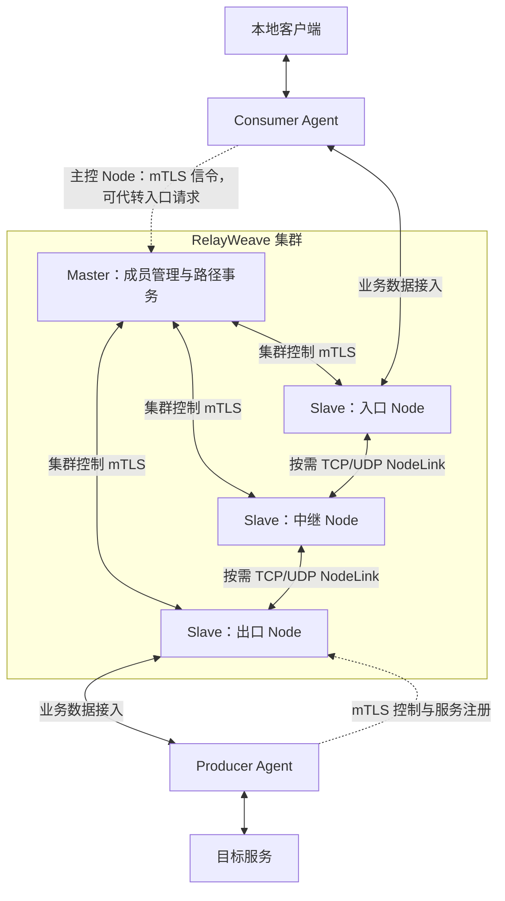

#### 进程角色定义

1. **RelayNode (Master)**：
   - 集群控制协调中心。管理节点接入（`ClusterJoin`）、生成集群授权纪元（`Epoch`）、维护单调递增的成员版本（`version`）、下发全局成员列表（`TopologyMembers`）。
   - 路径事务协调者：负责全路径 Flow 的两阶段安装与授权事务（`FlowPrepare` -> `FlowCommit`），维护 8 节点位图状态。
   - 控制信令交换机：在集群节点间路由定向控制单播（Unicast）和全网广播（Broadcast）。
   - 同时具备普通 RelayNode 的全部数据面与业务接入承载能力。
2. **RelayNode (Slave)**：
   - 业务边缘与核心骨干节点。主动向 Master 发起集群长连接并维持心跳。
   - 暴露公共接入端口：向 Agent 提供控制连接、TCP/TLS/UDP 业务接入端口。
   - 建立并维护与相邻节点的共享数据传输管道（`NodeLink`），执行高性能二进制分帧转发、逐跳信用流控与 FairQueue 调度。
   - 运行单节点会话控制器（`ControlRouterSingle`）与多节点会话控制器（`ControlRouterMulti`）。
3. **RelayAgent (Consumer 客户端代理)**：
   - 部署在客户端侧（如办公终端、边缘采集机）。
   - 拥有本地监听转发器（`Forwarder`），将本地端口（如 `127.0.0.1:10022`）映射为远端集群服务名（如 `service: prod-ssh`）。
   - 与主控 Node 保持控制长连接，主动拉取服务目录与拓扑快照，基于链路成本自主计算最优入口与中继路径，发起建连并桥接流量。
4. **RelayAgent (Producer 服务端代理)**：
   - 部署在目标业务服务器侧或同网段跳板机上。
   - 配置并导出本地真实服务（如 `target: 127.0.0.1:22`），向主控 Node 发起 `ServiceRegister` 注册服务条目。
   - 监听 Node 派发的 `RelayOffer` 请求，与真实业务服务建连，并反向连接 Node 数据端口完成流量对接。
5. **RelayDashboard**：
   - 独立的集群可视化与监控面板，通过控制通道查询 Node 运行指标、拓扑快照与流量统计。

---

### 1.3 核心实体与概念模型

系统内运行着若干高度解耦且生命周期明确的核心实体：

| 实体名称 | 作用域与归属 | 生命周期与核心职责 |
|---|---|---|
| **Service** | 全局业务逻辑名 | 业务服务的逻辑标识（如 `web-app`, `mysql-db`），绑定具体的传输协议（TCP/TLS/UDP）与目标网络端点。由 Producer Agent 声明并注册至集群。 |
| **NodeSession** | Node 进程内 (`control_io`) | 代表 Node 上的一次中继业务会话实例。根据路径类型持有 `ControlRouterSingle`（单节点）或 `ControlRouterMulti`（多节点首末端），负责接入鉴权、就绪协商、状态报告与生命周期收尾。 |
| **AgentSession** | Agent 进程内 (`transfer_io`) | 代表 Agent 端一次具体的客户端业务连接。持有本地 socket 与远端 Node 数据 socket，负责首帧认证（`RelayAttach`）、全双工流拷贝以及半关闭收尾。 |
| **Flow** | 跨节点逻辑通道 | 跨越 2～8 个节点的端到端数据传输流，由 64 位 `flow_id` 与集群纪元 `epoch` 唯一标识。在两端挂接 `FlowStream` 或 `FlowDatagram`，在中间跳挂接相邻的 `NodeLink`。 |
| **NodeLink** | 两相邻 Node 间物理通道 | 两个相邻 RelayNode 之间基于 TCP 或 UDP 建立的长生命周期物理传输链路。复用承载该链路上的所有并发 Flow，负责固定二进制分帧、心跳保活、信用合并与公平排队。 |
| **Epoch** | 集群授权纪元 | 64 位无符号整数。Master 启动时生成非零随机值，在该 Master 生命周期内保持不变。成员变更递增独立的 `version`；Flow 授权校验 Epoch、Master、路径成员及其地址，防止失效路径继续承载流量。 |

---

### 1.4 网络接口与端口划分

每个 RelayNode 进程对外暴露以下 6 种明确职责的网络接口与监听端口（以示例配置为例）：

| 示例端口 | 传输 | 配置项 | 对端与协议 |
|---|---|---|---|
| 18443 | TCP/mTLS | `control.port` | Agent 控制通道，4 字节长度前缀 + CBOR 控制帧。 |
| 18444 | TCP | `tcp.port` | Agent 先发送 `relay.attach` 控制帧，再传输原始 TCP 数据。 |
| 18445 | UDP | `udp.port` | Agent 先用独立 CBOR `relay.attach` 报文接入；业务报文携带 8 字节 `session_id`。 |
| 18446 | TLS/mTLS | `tls.port` | TLS 握手后发送 `relay.attach`；业务使用 `length32-fin-v1`。 |
| 18447 | TCP/mTLS | `cluster.control_port` | Master 监听集群控制；Slave 使用 `cluster.address` 和此端口连接 Master。 |
| 18448 | 普通 TCP/UDP | `cluster.tcp_port` / `cluster.udp_port` | NodeLink；TCP 先交换 CBOR `link.attach` / `link.attached`，后续使用二进制帧；UDP 还带 8 字节 link ID。 |

---

### 1.5 核心设计原则与架构约束

为了在多云与跨地域复杂网络下兼顾极致性能与工程可控性，RelayWeave 在系统设计与协议实现中遵循以下核心原则与运行约束：

1. **数据面与控制面分离**：
   - 业务载荷在数据面上流转时，不进入 JSON、CBOR 或动态反射序列化框架，采用定长二进制帧头 `LnkFrameHeader` 与 `DatagramHeader` 通过显式大端编解码进行封装。
   - 接入握手阶段的 `RelayAttach` 等信令通过轻量 CBOR 控制帧进行交换，兼顾灵活性与解析效率。
2. **有界中继跳数与位图状态追踪**：
   - 一条 Flow 路径包含的节点数限制在 **2 到 8 个节点**之间（`[2, max_flow_nodes]`，其中 `max_flow_nodes = 8`）。
   - Master 使用单字节无符号整数（`uint8_t`）按位（`1 << node_index`）跟踪各节点在 `FlowPrepare`、`FlowCommit`、`FlowClose` 阶段的确认应答，通过 `O(1)` 位操作更新事务确认进度。
3. **事件驱动的 Flow 生命周期管理**：
   - Flow 路径在两阶段提交成功后持续有效，直至显式关闭或授权失效，不依赖周期性的心跳续租机制。
   - Flow 触发释放的典型事件包括：控制连接断开（发起端或对端 Agent 掉线）；Master 纪元变化、路径节点离线或地址变化导致授权失效；承载 Flow 的物理 NodeLink 异常中断；业务数据传输完成（双向 FIN/EOF）、会话取消或进程停机触发显式关闭。
4. **端到端半关闭语义完整传递**：
   - TCP 与 TLS 业务在中继路径上完全保留标准 BSD Socket 的双向半关闭（Half-Close）能力。
   - TCP 写半关闭沿路径传递为对向 EOF 或 Flow `Fin` 帧；TLS 数据连接使用零长度业务帧（`length32-fin-v1`）传递 FIN，对向数据通道在完全刷写前保持正常接收。
5. **面向数据报的拥塞保护与无应用层分片**：
   - UDP 业务在队列满时采取尾丢弃策略，丢包保护健康流而不主动关闭 Flow。
   - 单节点最大载荷 65,499 字节（`65507 - 8`），多节点最大载荷 65,467 字节（`65507 - 8 - 32`）。超出上限的数据报在入口直接丢弃，节点间严禁执行应用层分片。


## 2. 节点架构与执行域模型

### 2.1 RelayNode 部件拓扑与四大独立执行域

RelayNode 采用经典的无共享（Shared-Nothing）事件驱动并发模型。为了消除高并发转发时的跨线程锁争用，RelayNode 将进程的核心执行逻辑划分为 **4 个独立且各由单个线程驱动的 Asio 执行域（`io_context`）**：

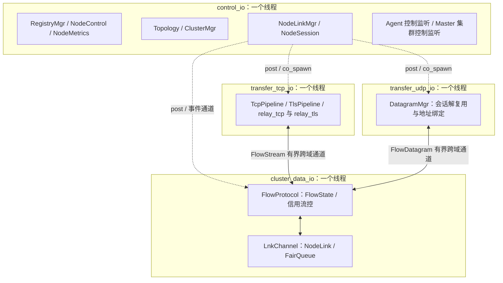

#### 四大执行域详细职责

1. **`control_io`（控制执行域）**：
   - **驱动线程**：单线程运行。
   - **托管组件**：`RegistryMgr`、`Topology`、`NodeControl`、`NodeMetrics`、`NodeLinkMgr`（控制事务状态机）、`ClusterMgr`、`NodeSession` 容器。
   - **职责范围**：处理来自 Agent 的控制长连接（端口 18443）；Master 节点的集群控制监听（端口 18447）；服务注册与发现；拓扑测量数据聚合与快照生成；Flow 路径安装（`FlowPrepare` / `FlowCommit`）事务驱动；业务会话协调（`ControlRouterSingle` / `ControlRouterMulti`）。
2. **`transfer_tcp_io`（TCP/TLS 传输执行域）**：
   - **驱动线程**：单线程运行，使用普通调度，Linux 线程名为 `node-tcp`。
   - **托管组件**：`TcpPipeline`、`TlsPipeline`。
   - **职责范围**：监听公网 TCP 业务端口（18444）与 TLS 业务端口（18446）；完成接入连接的 TLS 握手与证书校验；接收并验证首个 CBOR `relay.attach` 控制帧；负责 Agent 侧客户端 socket 与本地 `FlowStream` 端口之间全双工异步流式数据拷贝（`xfr_channel.h` 中的转发函数）。
3. **`transfer_udp_io`（UDP 传输执行域）**：
   - **驱动线程**：单线程运行，使用普通调度，Linux 线程名为 `node-udp`。
   - **托管组件**：`DatagramMgr`。
   - **职责范围**：独占监听公网 UDP 业务单端口（18445）；基于 8 字节 `DatagramHeader` 执行数据报解复用；维护客户端远端反射地址（Endpoint Mapping）；与本地 `FlowDatagram` 端口执行异步报文收发。
4. **`cluster_data_io`（专网数据链路执行域）**：
   - **驱动线程**：单线程运行。
   - **托管组件**：`FlowProtocol`、`LnkChannel`、`std::pmr::synchronized_pool_resource` 载荷池。
   - **职责范围**：管理节点间物理 `NodeLink`（TCP/UDP 端口 18448）；执行 32 字节二进制定长帧头（`LnkFrameHeader`）封装与解包；运行 `FlowStream` / `FlowDatagram` 内部状态机；执行逐跳信用计数与返还计算；驱动 `FairQueue` 发送调度。

#### 对象所有权图谱与依赖生命周期

RelayNode 遵循层次化所有权模型。父对象负责组件生命周期，借用者（Borrower）通过引用访问依赖；异步任务通过 `shared_ptr` 保留在途会话、Flow 与载荷池，关闭时统一排空：

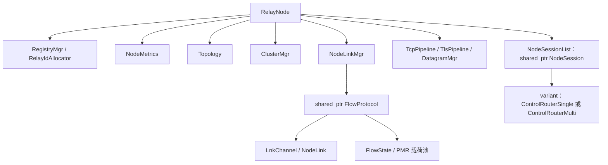

- **构造与析构次序**：成员声明顺序严格遵循依赖顺序。底层服务（如 `RegistryMgr`、`Topology`、`ClusterMgr`）优先声明，借用其引用的管理器（如 `NodeLinkMgr`、`NodeControl`）后声明。停机时先排空借用方的任务，再由 C++ 逆序析构释放依赖组件。
- **跨执行域通信协作**：
  - 各执行域内部的状态变量（如 `FlowState`、`NodeLink`、`NodeSession`）仅在其所属的单线程 `io_context` 上串行读写，杜绝锁争用；跨域共享的 `RelayIdAllocator`、服务访问者集合与同步 PMR 池分别使用内部同步机制。
  - 跨域信令触发：使用 `asio::post(target_executor, ...)` 或 `asio::dispatch`。
  - 跨域流式数据传递：使用 Asio 实验性并发通道 `asio::experimental::concurrent_channel`，其内部实现保证了不同执行域之间线程安全的数据推送与非阻塞等待。

Node 通过普通 `RelayRequest` 将已解析的业务构造参数传入 NodeSession 和控制器。两个 Router 只保留业务推进、匹配和状态报告所需的字段，协议由 NodeSession 已选定的数据管理器确定，epoch/Flow/peer 使用各自已有成员。JSON 只在输入、输出边界出现，不作为内部请求镜像。

#### 配对状态与跨域准备

配对对象使用普通继承，共享基类均不依赖具体 Flow 类型：

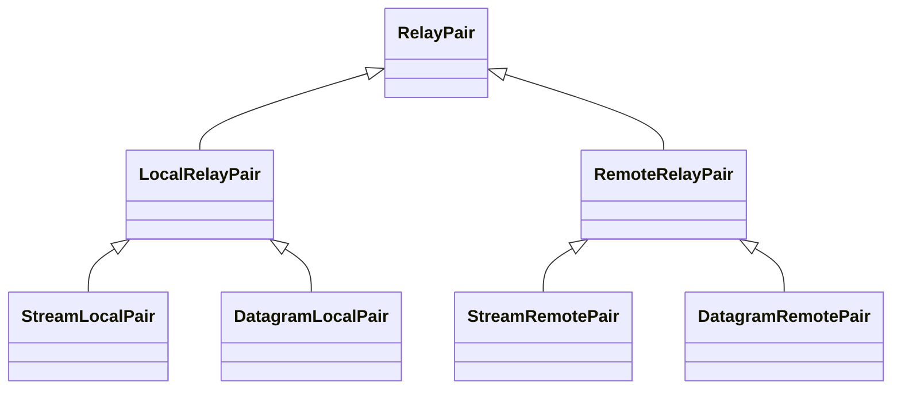

图中的 Stream/Datagram 类型分别是两个管理器内部的 `LocalPair` / `RemotePair`，沿用 RelayPair 系列命名。`RelayPair` 统一接入事件、closed/active、限速和计数绑定，提供虚析构与 `close()`；`LocalRelayPair` 实现完整的双端接入等待、准备、激活及访问者回收；`RemoteRelayPair` 实现单端接入等待、驱动 Flow 绑定、绑定后关闭检查、计数绑定、激活与方向计数。具体派生类持有 socket、UDP session/source 和各自的 Flow 端口，覆盖 `close()`，远端类型另覆盖受保护的 `bind_flow()`。公共准备流程不依赖具体 Flow 类型，也不使用模板或统一 Flow 适配接口。

管理器负责容量、ID、容器及 UDP session/bindings。准备入口查表后持有局部 `shared_ptr`，直接 `co_await pair->prepare(...)`，共同生命周期只在配对类中实现。NodeSession 仍通过原有 `co_spawn` 投递到传输域，多跳 Flow 绑定仍只跨一次协议域。为共享这些流程，建立期间增加嵌套协程帧：单跳增加配对 prepare，多跳增加配对 prepare 与具体 bind_flow；没有额外的独立协程链或跨域通知，逐包转发也不经过虚函数分派。

关闭时管理器先移除查找关联及 UDP bindings，再调用具体配对对象的 `close()`，最后释放 ID。具体类关闭 Flow/socket 或唤醒 UDP 结束事件，公共类负责关闭标记、接入唤醒与本地访问者回收。绑定期间关闭时，管理器协程仍持有对象；晚返回的 Flow 先交给具体配对对象持有，公共 prepare 检查 closed 后再次通过虚 close 回收它并抛出异常。因此具体 close 即使已标记 closed 也会关闭新交付的资源，本地访问者则通过清除已有 active 状态保证只回收一次。

多跳激活仍在 peer 同步后、`relay.ready` 前完成，防止 UDP 提前转发。准备过程沿用控制器的绝对建立期限，取消与关闭继续由原有任务链排空。准备接口返回 `awaitable<void>`，接入、Flow 绑定的失败与取消均通过 `use_awaitable` 自然传播，不把异常作为返回值。Node 将接入、绑定与 peer 就绪协调统一记为 `prepare` 阶段，就绪前收到 Agent 拒绝或业务取消时也使用该阶段；`relay.error`、peer close 的诊断字段不再区分原 attach/bridge。原错误原因与 Flow 关闭、控制断线等独立阶段保留。

每个管理器的 local/remote 配对接口合计从 12 个减为 9 个。按一次正常生命周期中 NodeSession 发往传输域的调用计数，单跳由 5 次减为 4 次（install、prepare、bridge、close），多跳每个端点由 6 次减为 5 次（额外保留 activate）；多跳绑定 Flow 所需的一次传输域到协议域调用保持不变。

---

### 2.2 RelayAgent 部件拓扑与双执行域

`RelayAgent` 按值持有唯一 `NodeConnection`，不再通过连接管理器包装；连接对象在 start 时创建在途操作，在停止后等待任务与 TLS 通道排空。

RelayAgent 采用精炼的双执行域架构，将轻量的控制管理与高吞吐的业务转发彻底解耦：

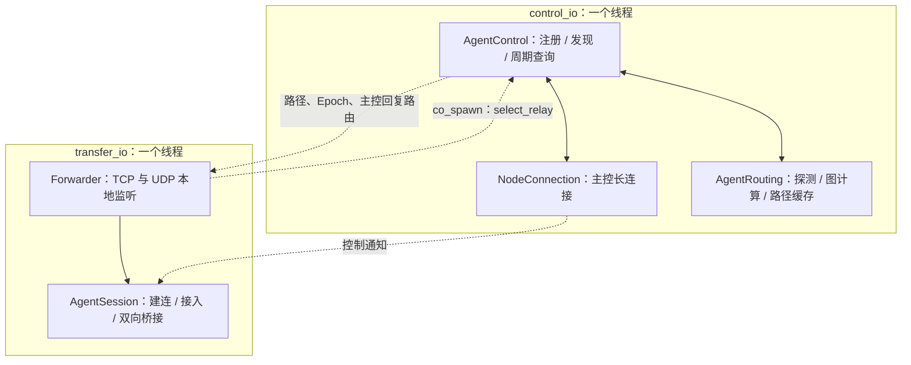

#### 双执行域职责

Agent 和 Node 工作线程保留普通调度策略，仅通过 `set_current_thread_name()` 设置 Linux 线程名；Agent 使用 `agent-control` / `agent-transfer`，Node 使用 `node-control` / `node-tcp` / `node-udp` / `node-data`。

1. **`control_io`（控制执行域）**：
   - 托管 `NodeConnection`：维护与主控 RelayNode 的安全 mTLS 控制通道（端口 18443），执行重连与心跳。
   - 托管 `AgentControl`：负责服务注册（`ServiceRegister`）；发起服务查询（`ServiceLookup`）；获取集群拓扑快照并更新探测目标。
   - 托管 `AgentRouting`：维护链路质量度量，执行有节点数约束的最短路径计算并管理本地候选路径缓存。
2. **`transfer_io`（传输执行域）**：
   - 托管 `Forwarder`：管理配置文件声明的所有本地监听器（`forwards`）。
   - 托管 `AgentSession`：每个进入的流式客户端连接或 UDP 客户端关联实例化一个 `AgentSession`，驱动数据传输与生命周期管理。

#### 跨域协作：`select_relay` 异步调用链

当本地客户端连接进入 `Forwarder`（运行在 `transfer_io`）时，选路与接入流程如下：
1. `Forwarder` 截获连接，提取目标服务名称与类型，在 `transfer_io` 上发起异步协程调用：
   `co_await agent_.select_relay(service_key, destination, deadline)`
2. 协程内部切换至 `control_io`：
   - `AgentControl` 检查服务位置（`service_locations_`）与请求期限；服务位置由服务发现循环预先查询并更新。
   - 确定目的 Node 后，调用 `AgentRouting::select_path()` 在图模型中计算到达目标 Node 的最佳路径及逻辑入口节点。
   - 使用直接持有的 `NodeConnection`，将逻辑入口记录在回复路由中，由主控 Node 代转控制请求。
3. 选路结果（包含路径列表、Epoch、逻辑入口与主控路由）打包返回给 `transfer_io`。
4. `Forwarder` 在 `transfer_io` 上启动目标数据端口的连接建立，完成握手后开始桥接。

---

AgentSession 用 `optional<RelayEndpoint>` 表示尚未获得或已获得的接入端点。地址、端口、uuid、ticket、UDP session 与可选 Flow ID 在消息入口完整校验后安装；TLS framing 在入口检查，不保存重复字符串。Forwarder 直接访问这些字段完成原有消息分派和去重；已有 ServiceKey 和 RelaySelection 继续拥有服务协议、选路及 epoch，不将整份 Node 报文留在会话中。

UDP 本地 forward 按 `(forward_id, 客户端 IP, 客户端端口)` 查找独立关联。每个监听器只保存 endpoint → request ID 索引，`relays_` 持有会话；客户端 endpoint 固定保存在该会话的 DatagramData 中。不同客户端复用现有协议分别建立 Node session / Flow，Producer 为每个会话创建独立目标 socket；回包不会再根据最后一次本地发送者选择地址。

首包到来且服务可用、共享容量与建立并发允许时，先保存一份实际长度的 `optional<BytesBuf>` 首包并同步安装索引，再异步开始选路和 attach。建立过程中后续报文直接丢弃，不覆盖首包或延长绝对建立期限；零长度首包也会被保存。attach 返回并收到 ready 后按最终路径的载荷上限检查首包，超长则丢弃，否则发送；缓存保持到异步发送完成，随后清空并开放正常本地转发。原始报文不拼接、不拆分、不自动重放，未准入客户端没有额外等待表。没有预建会话池、自动重建或逐客户端重试定时器；新报文可在旧关联排空后重新触发建立。

Consumer UDP 会话的建立中、运行中和关闭中状态均占用 Agent 原有 1000 个共享会话额度，每会话至多保存一份首包（最大 65499 字节），释放任务时清空首包与 endpoint 索引。新客户端准入时从现有会话容器统计尚未 ready 的 Consumer UDP 会话，同一 Agent 所有 UDP forward 共用建立并发上限，代码固定为 100 个，不提供配置项。ready 会话、TCP/TLS 和 Producer 不占用该建立额度；失败会话排空移除后释放额度。达到上限时直接丢弃新客户端报文，不排队。没有时间窗口、速率限制或独立计数器；此并发上限不代替集群总消息预算。

一个由 Forwarder 持有并排空的 idle 任务扫描已完成首包处理的 Consumer UDP 会话，检查周期为 idle timeout 与 1 秒的较小值。合法出站业务报文成功发送、通过长度/session 校验的入站业务报文更新活动时间，空包也算活动；建立期间丢弃、超长或无效报文不续期。默认空闲 60 秒后通过现有 cancel 链路释放两端会话、目标 socket、Node 配对和 Flow。服务下线、服务所在 Node 改变或控制断开时取消原关联；重复的同位置通知不重建会话。关联索引在任务排空后按 endpoint 和 request ID 同时匹配删除，迟到通知不会复活已关闭会话，也不把用过的会话换绑给其他客户端。直接接入 Node 的其他 UDP 客户端仍不具备 Node 通用 idle 回收。

### 2.3 核心辅助与状态管理组件

#### 2.3.1 DualIndexMap 双向安全状态索引

在异步代理系统中，往往需要基于不同键快速查找同一业务实体（例如：通过业务 `uuid` 或通过内部 `session_id` 查找 `NodeSession`；通过 `request_id` 或 `flow_id` 关联握手上下文）。

`protocol/inc/dualindex_map.h` 提供了 `DualIndexMap<KeyA, KeyB, Value, Mode>`，具备以下工程特性：
- **双索引一致性**：主键唯一，副键可选，默认支持重复副键，也可设置唯一副键模式。插入重复键时返回已有记录；更新副键或删除记录时同步维护两个索引。
- **无悬空引用保证**：内部统一管理容器元素生命周期，杜绝传统维护两个独立 `std::map` 时易产生的索引不同步与悬空指针风险。

#### 2.3.2 LRUCache 路由与查询缓存

`protocol/inc/lru_cache.h` 提供了基于哈希表与双向链表组合的模板化 `LRUCache<Key, Value>`：
- 用于 Agent 端的路径计算结果缓存（`AgentRouting`），以目的节点为键，容量为 16，TTL 为 15 秒。
- 支持指定容量上限（Capacity）。每次命中元素提升至表头，容量溢出时淘汰表尾最久未访问的条目；过期条目在查询时移除，命中不延长 TTL。
- 哈希查询与普通更新平均具备 `O(1)` 时间复杂度。

#### 2.3.3 AsyncEvent 结构化无竞争异步事件

在 C++20 协程编程中，多个协程往往需要等待某一个异步操作完成（例如：多个等待特定 Flow 安装完毕的协程；或者优雅停机时等待所有后台任务排空的协程）。

`protocol/inc/async_event.h` 封装了 `AsyncEvent`：
- **多等待者安全挂起**：内部维护挂起协程队列，支持任意数量的协程并发执行 `co_await event.wait()`。
- **一次性广播通知语义**：调用 `event.notify_all()` 唤醒全部等待协程，后续 `wait()` 立即返回成功；等待被取消时返回 `false`。
- **无锁化设计**：完全与所在执行器的事件循环协同工作，消除了传统多线程条件变量的互斥锁竞争。


## 3. 控制面：集群编排与路径事务

### 3.1 集群拓扑与成员管理 (ClusterMgr)

RelayWeave 集群采用以 **Master 为协调核心、Slave 通过 Master 交换信令** 的星形控制拓扑，数据链路由各节点两两按需直连。集群控制逻辑由 `node/src/cluster_mgr.cpp` 中的 `ClusterMgr` 统一负责，运行在 `control_io` 执行域。

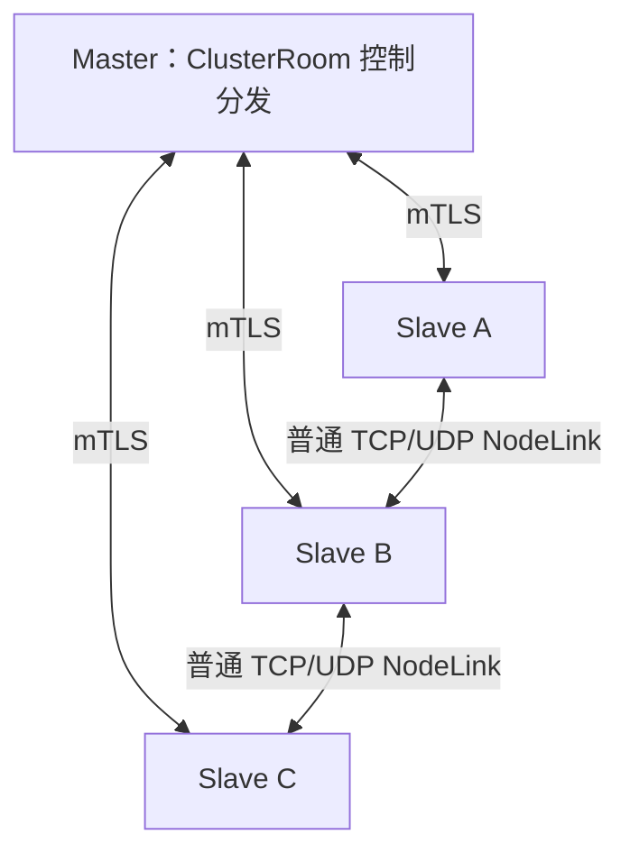

#### 3.1.1 Master-Slave 控制拓扑与 ClusterRoom 分发模型

- **Master 角色职责**：Master 节点维护唯一的 `ClusterRoom` 对象，集中管理所有已接入 Slave 节点的控制会话（`TLSChannel`）。
- **Slave 接入与重连机制**：
  - Slave 启动后，通过内置的 `ClusterMgr::Connector` 主动连接 Master 的集群控制端口（示例 18447）。
  - 若连接中断，`Connector` 按固定 5 秒间隔自动重连，直至控制链路恢复。
- **结构化并发 Accept Loop**：Master 的 `accept_loop` 采用 C++20 协程并发接收传入连接。在接入新 Slave 连接后，先执行严格的 TLS 双向证书校验，并在加入 `ClusterRoom` 之前验证对端身份。

#### 3.1.2 成员加入、Epoch 纪元与成员版本管理

1. **成员加入流程 (`ClusterJoin`)**：
   - Slave 建立 TLS 连接后，向 Master 发送 `cluster.join` 控制消息，携带本机的 `node_id` 与发布地址 `address`。
   - Master 接收到请求后，检查 `node_id` 非空、长度不超过 256 字节、非保留名 `all` 且在集群内唯一；连接身份由 mTLS 证书链验证。
   - 校验通过后，Master 登记该节点，并向该 Slave 回复 `cluster.joined` 报文。
   - 随后，Master 递增成员版本 `version`，向所有已加入节点广播 `topology.members`，携带 Epoch、version、Master 标识与完整成员列表。
2. **Epoch 纪元防呆机制**：
   - Master 启动时生成非零随机 Epoch，该进程生命周期内保持不变；节点重新接入更新成员 version。
   - 所有中继路径 Flow 的创建与交互均携带创建时的 Epoch；一旦节点收到属于旧 Epoch 的控制报文，立即判定为过期分区消息并拒绝执行。

#### 3.1.3 集群消息定向路由与广播

Master 的 `ClusterRoom` 作为集群内部的控制交换矩阵，提供两类消息投递模式：
- **定向交付（Unicast）**：源节点在消息参数中指定 `target`。Master 查表，移除 `target` 并按连接身份写入 `source`，将消息投递至目标节点的专用控制连接，用于首末节点握手（`RelayPeerOpen` / `RelayPeerReady`）。
- **全网广播（Broadcast）**：通过 `target: "all"` 分发服务/状态查询、会话解绑和成员通知。Master 一律向已加入的其他参与者投递，排除认证 source，不按业务命令分类。发布方自行完成需要的本地处理。
- **成员发布**：`publish_members()` 先通过定向交付将成员表应用到本机 Master，再广播给其他节点。每个节点仍只应用一次；通用路由层不为 `topology.members` 设置特殊回送规则。
- **拓扑查询**：Master 本地直接生成快照；Slave 仅向 `topology_.master_id()` 单播 `topology.query`，Master 按原 session/request 路由返回快照。尚未获知 Master 时不提交无目标查询，发现端沿用原有查询周期。该路径不增加缓存、目录或后台任务。

---

### 3.2 服务目录与服务发现

RelayWeave 采用分布式的服务发现架构，服务注册在节点本地集中维护，通过集群广播或定向查询对全网透明。

#### 3.2.1 本机服务注册与注销 (RegistryMgr)

- **服务声明**：运行在服务端侧的 Producer Agent 启动后，向其接入的 RelayNode 发送 `service.register` 报文，包含 `request_id`、服务名（`service`）与协议（`tcp`/`tls`/`udp`）；本地目标地址仅保存在 Agent 配置中。
- **注册存储**：RelayNode 的 `RegistryMgr` 组件管理本机服务条目，为服务分配内部识别上下文，成功后向 Agent 回复 `service.ok`。若 Registry 检测到注册冲突或容量超限，回复 `service.error`；非法消息字段会在参数校验阶段抛出错误。
- **连接断开级联注销**：Producer Agent 与 Node 之间的控制连接断开时，`RegistryMgr` 自动将该 Agent 声明的所有服务条目清空，并在集群内广播 `relay.detach`（携带 `agent_session_id`）以清理关联中继；服务目录由后续查询重新确认，防止流量路由至空端点。

#### 3.2.2 节点地址发布与 Agent 服务发现全流程

1. **公网地址发布 (`advertise_address`)**：
   - 每个 RelayNode 在配置文件中指定公网可达的 `advertise_address`。
   - 节点在向集群和 Agent 宣告存在时，统一发布此地址，屏蔽内网 NAT 私有 IP 的差异。
2. **服务发现流程 (`ServiceLookup`)**：
   - Consumer Agent 连接就绪后为配置的 forwards 查询服务；发现循环每 5 秒对未解析条目重试 `service.lookup` 并查询拓扑，得到映射后才供本地业务选择。
   - Node 优先检索本地 `RegistryMgr`；若本地未注册，则通过集群控制网向各节点查询，获取注册了该服务的宿主节点（Egress Node）。
   - 查询成功后，Node 向 Agent 返回 `service.located` 报文，包含 `request_id`、`service`、`protocol`、`node_id` 与 `address`；地址用于探测，不再携带未使用的控制端口。
   - 集群返回的 `topology.snapshot` 仅在认证后的 `source` 等于当前 Master 时回送给 Agent；随后继续验证 requester、会话及快照结构。
   - Consumer Agent 将发现结果记录在 `service_locations_` 映射表中，并据此更新链路探测目标。

---

### 3.3 NodeSession 与会话控制器

每当有新的中继业务请求到达 RelayNode 时，`RelayNode` 会在 `control_io` 执行域为其实例化一个 `NodeSession` 对象。根据业务选取的路径类型，`NodeSession` 按值持有两种互斥的会话控制器之一：

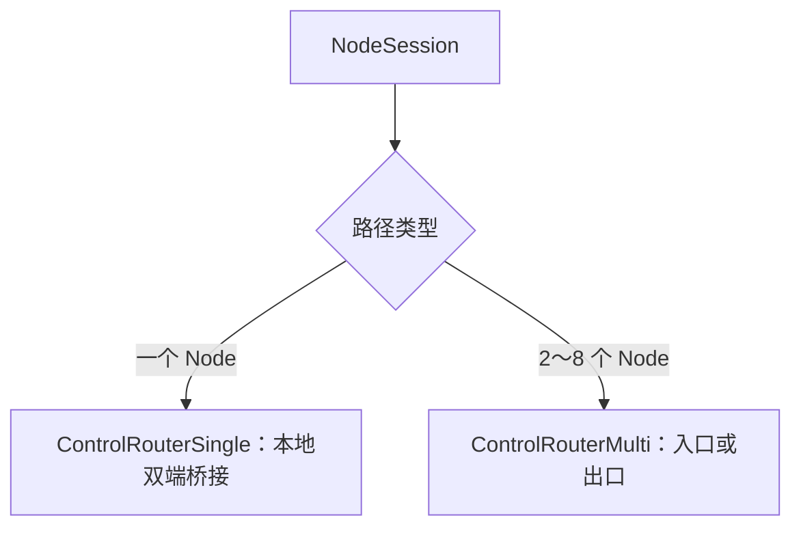

#### 3.3.1 单节点会话编排：ControlRouterSingle

当 Consumer Agent 与 Producer Agent 恰好接入同一个 RelayNode（或经主控代转到单个服务节点，业务请求不携带 `path`）时，启用 `ControlRouterSingle`：

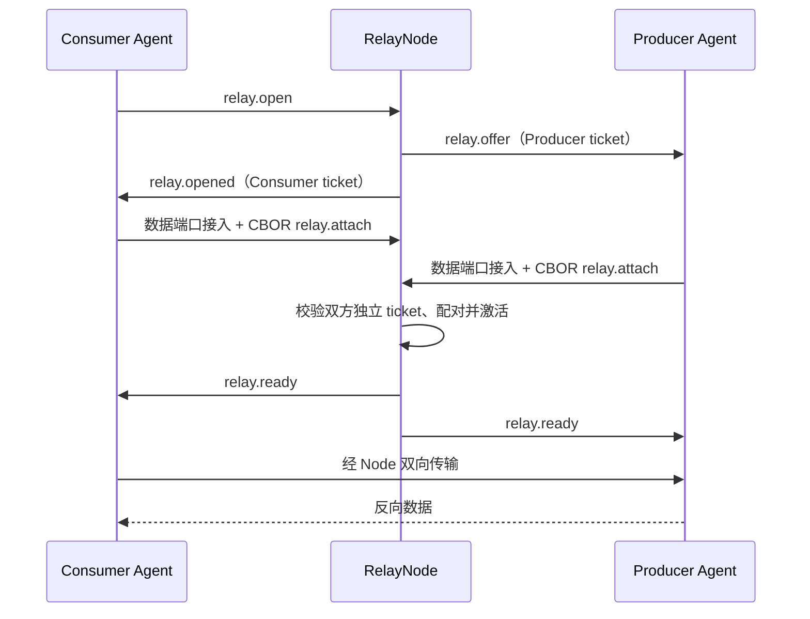

1. **参数提取与分配**：为本次会话分配 Node 本地唯一的 64 位 `uuid` 及双端独立的鉴权令牌 `ticket`，设置绝对建立截止时间（默认 10s）。
2. **双端通知**：同时向 Consumer 发送 `relay.opened`，向 Producer 发送 `relay.offer`。
3. **数据端口接入拦截**：两端 Agent 收到信令后，分别连接 Node 的公网数据端口（TCP/TLS 为 18444/18446，UDP 为 18445），并发送 `WireMessage` 封装的 CBOR `relay.attach`；UDP 接入报文独立发送，业务数据报另加会话头。
4. **配对与激活**：Node 的数据执行域验证每端的 `uuid`、角色与对应 `ticket` 后，将双端 Socket 配对，触发 `bridge()` 开启直接流式数据拷贝，同时控制面回送 `relay.ready`。

#### 3.3.2 多节点首末协调：ControlRouterMulti

当选路结果跨越多个节点（如 `path: [node-A, node-B, node-C]`）时，首节点（Ingress）与尾节点（Egress）分别实例化 `ControlRouterMulti` 进行分布式协同：

1. **Ingress 节点动作**：
   - 接收 Consumer Agent 的 `relay.open` 报文。
   - 调用 `NodeLinkMgr::open_flow()` 请求 Master 在集群路径上分配并安装端到端 Flow。
   - Flow 安装完成后，Ingress 节点向 Egress 节点发送集群单播 `relay.peer.open` 报文，附带 Flow ID、服务名与访问者信息；同时安装本地接入端点并向 Consumer 返回 `relay.opened`。
2. **Egress 节点动作**：
   - 收到 `relay.peer.open` 后，在本地 `RegistryMgr` 查找目标服务与 Producer Agent。
   - 向 Producer Agent 发送 `relay.offer`。
   - Producer Agent 连接 Egress 节点的数据端口并提交 `RelayAttach`。
   - Egress 节点将数据端口与 Flow 的本地末端（`FlowStream`/`FlowDatagram`）完成绑定，向 Ingress 节点回送集群单播 `relay.peer.attached`。
3. **激活屏障与数据流转**：
   - Consumer Agent 根据 `relay.opened` 连接 Ingress 数据端口并提交 `RelayAttach`。
   - Ingress 节点等待 Consumer 接入并绑定 Flow 首端，同时等待 Egress 的 `relay.peer.attached`；随后激活本地端点，向 Egress 发送 `relay.peer.ready`，向 Consumer 发送 `relay.ready`。
   - Egress 收到 `relay.peer.ready` 后激活本地端点并通知 Producer，双方数据进入多跳 Flow 管道流转。

---

### 3.4 路径安装与事务管理 (NodeLinkMgr)

`NodeLinkMgr` 是跨节点数据管道与 Flow 路径的唯一协调者与事务管理器，声明在 `node/inc/nodelink_mgr.h` 中。

#### 3.4.1 NodeLink 共享邻接连接建立与复用

任意两个物理相邻的 RelayNode 之间，至多维护一条激活的共享 TCP NodeLink 和一条 UDP NodeLink。
- **邻接键归一化**：
  `LinkKey = std::tuple<std::string, std::string, RelayProtocol>`
  规范化排序规则：`left = std::min(nodeA, nodeB)`，`right = std::max(nodeA, nodeB)`。无论从哪一端发起建链请求，均映射为唯一的 `LinkKey`。
- **Master 驱动的两阶段建链**：
  1. Master 向两端同时下发 `link.prepare`。两端各自预留监听或端口资源，完成后回复 `link.prepared`。
  2. Master 收到两端就绪后，指派发起端执行 `link.connect`。发起端主动连接接收端的 NodeLink 端口（18448）并交换 CBOR `link.attach` / `link.attached`；UDP 使用二进制 `Attach` / `Attached` 帧封装关联消息。
  3. 双向握手完成后，两端均向 Master 上报 `link.ready`，物理链路正式进入可复用就绪态。

#### 3.4.2 全路径 Flow 安装事务 (两阶段提交与位图确认)

当业务需要建立一条跨越 `N` 个节点（`2 ≤ N ≤ 8`）的 Flow 时，Master 节点执行严格的两阶段安装事务：

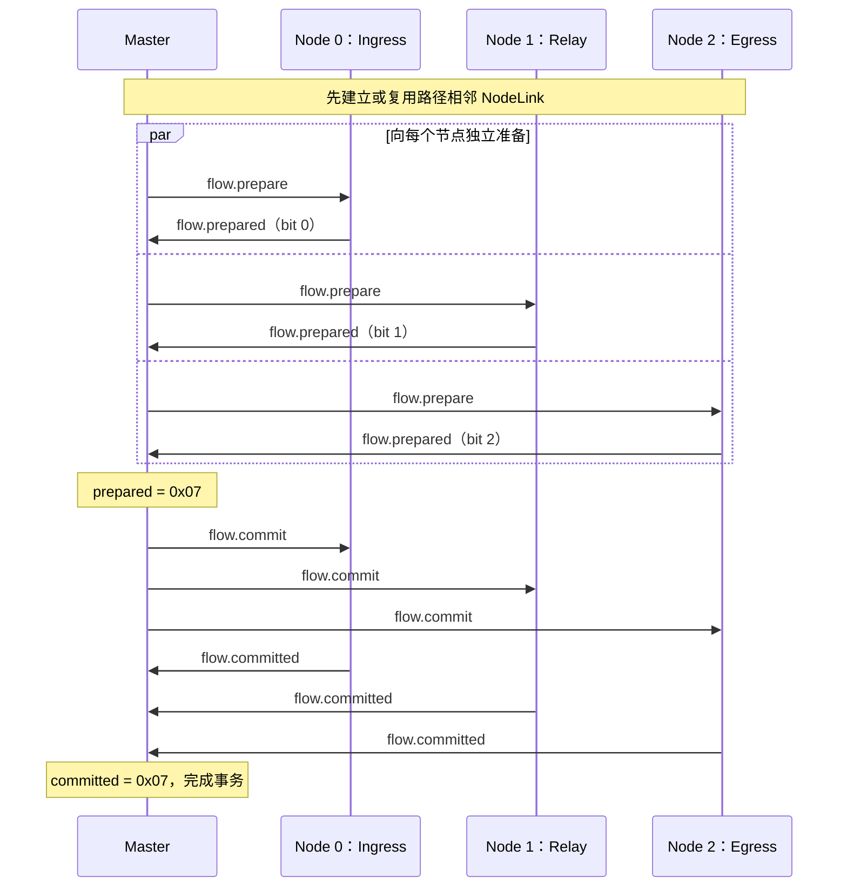

NodeLinkMgr 在 control_io 用普通 `LinkParams`、`FlowParams` 保存已解析的授权参数；Master 请求另持有确认位图、结果和期限，本地 Flow 端点另持有 committed 状态。路径、地址和 transport 在输入边界解析，成员变化校验及事务推进直接访问类型字段，不保存 JSON 镜像。跨域仍使用现有 `LinkSpec`、`FlowSpec`。Prepare 是内存预留，不包含持久化。

1. **第一阶段：准备（`FlowPrepare`）**：
   - Master 协调非零 64 位 `flow_id`（远程入口请求时由入口生成），向路径中所有节点下发 `flow.prepare`，携带完整的 `path`、`addresses`、`links`、`request_id` 与 `ttl_ms`，各节点据此派生上一跳与下一跳信息。
   - 各节点在本地 `FlowProtocol` 中创建处于 `Prepared` 状态的 `FlowState`，初始化队列与流控计数，提交时发布初始信用。
   - 节点完成后回复 `flow.prepared`。Master 使用单字节位图 `prepared |= (1 << node_index)` 记录应答。当所有位全部置 1 时，第一阶段完成。

2. **第二阶段：提交（`FlowCommit`）**：
   - Master 向路径上的各节点发送 `flow.commit` 报文，只携带 `master`、`epoch`、`flow_id`、`request_id`；认证 `source` 由集群层填入。节点按本地预留参数核对身份，不再接收或比较整条路径。
   - 各节点在数据执行域上将 `FlowState` 的状态切换为 `Active`，激活物理 NodeLink 与 Flow 之间的数据分发路由。
   - Prepared、Committed、Closed、Error 回复只携带同一事务身份和相应 stage/reason。Master 按已保存的路径核对认证来源及阶段，再通过位图 `committed` 校验所有节点均已激活，随后向发起请求的 Ingress 节点返回成功结果。

#### 3.4.3 事务超时、回滚与主动释放机制

- **超时回滚**：创建事务时设置 10 秒期限，邻接建链完成、发送 prepare 前重设 10 秒期限，准备与提交共用后一个期限。若超时时间内任何一个节点未响应或返回错误，Master 立即判定事务失败，向全路径节点发送 `flow.close` 触发回滚清理，并向发起端报错。
- **主动释放（`FlowClose`）**：业务结束或客户端断开时，远程入口发送 `flow.close.request`，由 Master 下发 `flow.close`。Master 收集路径上所有节点的 `flow.closed` 确认，完成全路径清理确认；关闭确认最多等待 10 秒，超时记录错误并释放协调状态，**但物理共享的 NodeLink 保持长连接常驻，不随单条 Flow 的关闭而断开**。

---

### 3.5 控制通道通信保障 (TLSChannel & WireMessage)

所有的控制通道（Agent 与 Node 之间、Node 与 Master 之间）均基于 `protocol/inc/tls_channel.h` 中的 `TLSChannel` 运行，基于 TLS 保证信道的机密性与完整性。

#### 3.5.1 WireMessage 帧结构与分片机制

控制信道承载 CBOR 编码的 `CtrlMessage`，底层通过 `WireMessage`（`protocol/inc/message.h`）进行二进制封包：

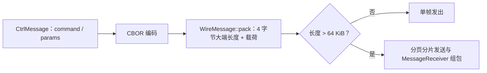

- **定长 4 字节前缀**：网络字节序（大端）表示载荷长度。单包最大载荷长度为 **16 MB**。
- **分片保护**：当控制消息载荷超过 64 KB 时，底层通道自动进行页面级分片组包（`MessageReceiver`），避免一次性大内存分配导致系统震荡。

#### 3.5.2 TLSChannel 心跳与断线重连状态机

- **心跳机制**：双向周期性发送 `heartbeat.ping` 控制帧（默认间隔 5s），对端必须立即回复 `heartbeat.pong`。
- **失联判定**：当持续未收到心跳响应的时间达到 `heartbeat_timeout_ms`（默认 20s）时，`TLSChannel` 主动切断 TCP 连接，触发物理 Socket `close()` 并向拥有者抛出断线异常。


## 4. 路由面：链路测量与路径决策

RelayWeave 不依赖静态配置的网关路由，而是通过内置的**持续主动测量网络、指数衰减质量模型与带中继惩罚的最短路径图算法**，动态发现并实时规避互联网公网中的拥塞与劣质链路。

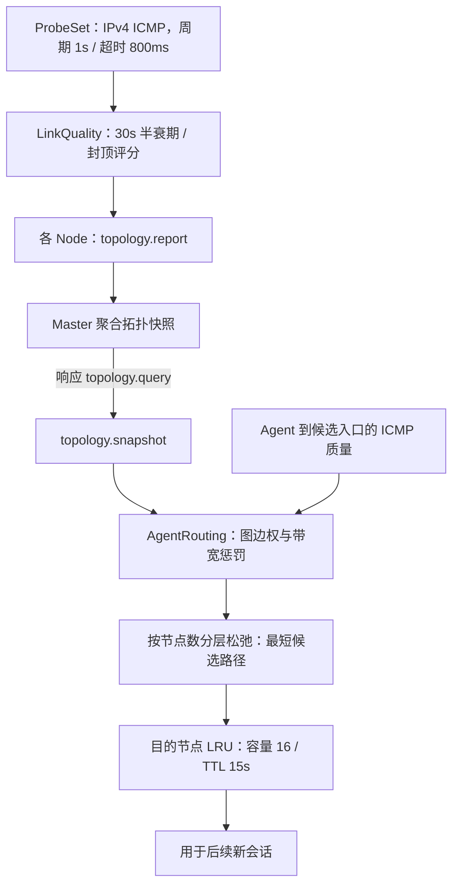

---

### 4.1 主动探测与指标采集 (ProbeSet & ICMP)

链路测量由 `route/src/probe_set.cpp` 和 `route/src/icmp.cpp` 协同完成：
1. **ICMP 质量探测与 NodeLink 保活**：
   - Linux 环境下通过原始套接字（Raw Socket）周期发送 ICMP Echo Request 报文，测量往返时延（RTT），探测周期 1 秒、超时 800ms。
   - 跨节点物理链路通过在既有 NodeLink 上发送轻量级定长 `Ping` 二进制帧进行保活，独立于 ICMP 链路质量统计。
2. **高精度单调时钟采样**：发包前记录 `std::chrono::steady_clock::now()`，回包解析后计算纳秒级微小时延，避免系统时钟回拨或 NTP 调步产生假时延。
3. **样本过滤**：单次采样 RTT 限制在合法区间 0～60,000 ms。任何格式错误、乱序过期的探测样本直接丢弃，不污染统计历史。

---

### 4.2 链路质量评估模型 (LinkQuality)

`route/src/link_quality.cpp` 实现了基于**指数加权衰减（EMA）与对数正态综合成本打分**的质量评估器。模型同时维护成功 RTT 的诊断统计与包含失败惩罚的评分统计，输出链路成本、置信度与可用状态，为路径选择提供统一的毫秒级成本尺度。

#### 4.2.1 指数加权移动平均（EMA）与半衰期设计

为了快速响应突发网络劣化的同时平滑瞬时网络毛刺，模型采用**统一的 30 秒半衰期（Half-Life）衰减机制**：

$$
\lambda = 2^{-\Delta t / 30}
$$

其中 `Δt` 为本次探测完成时间距上一次完成时间的间隔（秒）。每完成一次探测，先按该间隔衰减历史，再累加当前样本；经过 30 秒，旧样本的权重降为原来的一半。

评估器持续维护以下衰减累加量（`Ema` 结构体）：

| 数学记号 | 实现字段 | 统计含义 |
|---|---|---|
| `W_c` | `completed_weight` | 全部已完成探测的衰减权重，包括成功与失败。 |
| `W_r` | `received_weight` | 成功探测的衰减权重。 |
| `R_1` / `R_2` | `rtt_sum` / `rtt_square_sum` | 成功 RTT 的加权和、加权平方和。 |
| `S_1` / `S_2` | `score_sum` / `score_square_sum` | 全部探测评分的加权和、加权平方和。 |

设当前成功指示量为 `I`（成功为 1，失败为 0），成功样本 RTT 为 `r`，本次评分为 `s`，则更新规则为：

$$
\begin{aligned}
W_c' &= \lambda W_c + 1, & W_r' &= \lambda W_r + I \\
R_1' &= \lambda R_1 + I r, & R_2' &= \lambda R_2 + I r^2 \\
S_1' &= \lambda S_1 + s, & S_2' &= \lambda S_2 + s^2
\end{aligned}
$$

失败样本的 RTT 项贡献为 0，但仍衰减已有的成功统计。`record()` 接受的成功 RTT 必须为有限值且处于 0～60,000ms，完成时间不得早于上一次样本；非法样本不改变统计状态。

当两次完成探测的间隔达到 **30 分钟**时，重新建立衰减历史与连续失败计数，避免长期停用后的旧质量影响新一轮评价。`total_completed` 与 `total_received` 继续保留生命周期累计计数。

#### 4.2.2 失败惩罚机制与打分封顶替换

传统的网络测量若直接将丢包视为无穷大时延，会导致均值失真；若忽略丢包，又会低估链路劣化。RelayWeave 采用实用的**打分封顶替换（Capped Score Substitution）**策略，以 `scoring_timeout = 800ms` 为统一评分上限：

$$
s = \begin{cases}
\min(r,800), & \text{探测成功} \\
800, & \text{探测失败}
\end{cases}
$$

1. **成功 RTT 保留真实诊断值**：`rtt_sum` 与 `rtt_square_sum` 累加实际 RTT，便于观察真实时延与抖动；评分统计则将成功样本封顶为 800ms。
2. **失败样本进入评分分布**：超时或丢包以 800ms 累加到 `score_sum` 与 `score_square_sum`，将高惩罚样本纳入评分均值与离散程度计算，使间歇丢包的快速链路承担更高成本。
3. **丢包率独立保留**：失败计入已完成权重、不计入成功权重，形成衰减丢包率，并参与可用性判定。

这一设计使 RTT 均值、抖动、丢包率与综合成本各自具有明确含义：诊断指标用于解释链路状态，评分指标用于比较转发路径。

#### 4.2.3 质量评估输出与边权成本公式

调用 `assess(now)` 输出当前时刻的评估快照，包含以下三个层级：

| 输出层级 | 关键字段 | 用途 |
|---|---|---|
| **诊断统计 `metrics`** | `rtt_ms`、`jitter_ms`、`loss_rate` | 展示成功 RTT 均值、标准差与衰减丢包率。 |
| **质量摘要 `quality`** | `cost`、`confidence`、`usable` | 表达基础评分、证据充分程度与路由准入状态。 |
| **采样状态** | `total_completed`、`total_received`、`last_success_age` | 表达累计完成量、成功量与最后成功探测的年龄。 |

##### 1. 诊断 RTT、抖动与丢包率

成功 RTT 的加权均值与标准差分别为：

$$
\mu_r = \frac{R_1}{W_r}, \qquad
\sigma_r = \sqrt{\max\left(0,\frac{R_2}{W_r}-\mu_r^2\right)}
$$

其中 `jitter_ms` 取标准差 `σ_r`，反映 RTT 样本自身的离散程度。衰减丢包率为：

$$
p_{\mathrm{loss}} = \operatorname{clamp}\left(1-\frac{W_r}{W_c},0,1\right)
$$

当尚无完成样本、评价时间早于最后样本，或成功衰减权重低于 `1e-9`、衰减丢包率达到 1 时，质量成本为空、置信度为 0、链路不可用；最后成功年龄与生命周期计数仍可用于诊断。

##### 2. 有界对数正态尾部成本

评分统计覆盖成功与失败两类样本。设评分均值为 `m`、方差为 `v`，则：

$$
m = \operatorname{clamp}\left(\frac{S_1}{W_c},0,800\right), \qquad
v = \max\left(0,\frac{S_2}{W_c}-m^2\right)
$$

模型用这两个矩拟合对数正态分布的 **95% 分位成本**，使偶发高延迟与丢包对路径选择产生比平均 RTT 更明显的影响。取标准正态 95% 分位常量 `z = 1.6448536269514715`，当 `m > 0` 且 `v > 0` 时：

$$
c_v = \min\left(\frac{\sqrt{v}}{m},\sqrt{\exp(z^2)-1}\right), \qquad
\sigma_{\log} = \sqrt{\ln(1+c_v^2)}
$$

$$
C = \min\left(800,\;m\exp\left(z\sigma_{\log}-\frac{\sigma_{\log}^2}{2}\right)\right)
$$

当均值或方差为 0 时，直接取 `C = m`。变异系数 `c_v` 的上限使 `σ_log` 不超过 `z`，保持尾部成本随离散程度增大而不下降；最终成本封顶为 800ms，避免极端样本导致数值发散。

**等权样本评分示例**：以下样本均在同一时刻完成，权重相等，仅比较基础成本 `cost`。

| 探测结果 | 成功 RTT 均值 | 成功 RTT 抖动 | 衰减丢包率 | 基础成本 `C` |
|---|---|---|---|---|
| 全部成功，RTT 均为 20ms | 20ms | 0ms | 0% | 20ms |
| 成功 RTT 为 10ms、30ms，各占一半 | 20ms | 10ms | 0% | 约 38.906ms |
| 9 次成功 RTT 为 20ms，1 次失败 | 20ms | 0ms | 10% | 约 365.938ms |

因此，低平均 RTT 但持续丢包的链路，可能比稳定的较高 RTT 链路成本更高；诊断 RTT 与路由评分共同解释这一选路结果。

##### 3. 置信度与冷启动处理

置信度综合采样覆盖时间与有效证据量，范围为 0～1。设 `T_span` 为首个到最后一个完成样本的时间跨度，`T_idle` 为评价时刻距最后完成样本的间隔，二者单位均为秒：

$$
q_{\mathrm{time}} = \operatorname{clamp}\left(\frac{T_{\mathrm{span}}}{30},0,1\right)
$$

$$
W_{\mathrm{effective}} = W_c\,2^{-T_{\mathrm{idle}}/30}, \qquad
W_{\mathrm{target}} = \frac{0.8\times0.5\times30}{\ln2} \approx 17.312
$$

$$
q = \min\left(q_{\mathrm{time}},\frac{W_{\mathrm{effective}}}{W_{\mathrm{target}}}\right)
$$

- **时间覆盖约束**：刚开始探测时，即使瞬间收到大量样本，采样时间覆盖度仍较低；连续观察达到 30 秒后，该项可达到 1。
- **有效证据约束**：稀疏采样或长时间没有新结果时，衰减后的证据量降低，置信度随之下降。
- **冷启动选路**：可用性由链路质量与时效门限决定，置信度通过后续附加成本影响候选排序，使新链路可以参与比较并承担适度的证据不足惩罚。

##### 4. 链路可用性门限

在具备有效成功证据的基础上，`usable` 要求以下条件**同时成立**：

| 判定项 | 准入条件 | 保护目的 |
|---|---|---|
| 衰减丢包率 | 小于 0.5 | 排除近期多数探测失败的链路。 |
| 连续失败次数 | 少于 5 次 | 快速识别持续失联，避免旧成功历史掩盖当前故障。 |
| 最后成功年龄 | 小于 45 秒 | 保证链路近期具有成功通信证据。 |
| 最后完成样本年龄 | 小于 15 秒 | 排除停止更新或探测任务停滞的评价结果。 |

成功样本将连续失败计数清零；达到任一门限即取消路由准入，后续探测恢复并满足全部条件后重新参与选路。

##### 5. 新鲜度修正与最终边权

`routing_cost(quality, age)` 将基础成本与置信度转换为最终路由边权。`age` 表示成功探测的年龄；拓扑汇总与 Agent 使用快照时继续累加等待时间。设其秒数为 `a`，新鲜度系数为：

$$
f(a) = \begin{cases}
1, & 0\le a\le25 \\
1+0.5\left(\dfrac{a-25}{20}\right)^2, & 25<a<45
\end{cases}
$$

$$
C_{\mathrm{route}} = C f(a) + 5(1-q)
$$

前 25 秒保持基础成本，之后以二次项增加老化惩罚；低置信度附加 0～5ms 成本。800ms 封顶作用于基础评分，最终边权还会叠加这些修正。当 `usable` 为假、成本或置信度非法、年龄为负或达到 45 秒时，返回空值，图模型不接纳该边。

例如，`cost = 20ms`、`confidence = 1` 时，年龄为 25 秒的边权为 20ms，35 秒时为 22.5ms，达到 45 秒后失效；同样的 20ms 新鲜链路在置信度为 0.4 时，边权为 23ms。Agent 还要求拓扑快照与来源节点报告保持在 15 秒有效期内，使链路年龄与拓扑报告时效共同约束选路。

---

### 4.3 动态图模型与最短路径算法 (RouteGraph)

`route/src/route_graph.cpp` 提供了拓扑图模型与带约束的最短路径求解器。

#### 4.3.1 拓扑快照聚合与发布

1. **节点定期上报**：各 RelayNode 在探测本地到相邻节点的质量后，封装为 `topology.report` 发送至 Master。
2. **Master 全局聚合**：Master 维护全网两两节点的链路质量矩阵，通过 `topology.snapshot` 响应查询。
3. **Agent 消费快照**：Agent 接收快照并在本地重构图邻接表，无需向所有潜在中继节点独立发起海量探测，有效收敛全网测量开销。

#### 4.3.2 有界最短路径扩展与中继惩罚 (relay_penalty)

在实际公网中，如果直接路径与两跳中继路径的时延仅相差 1ms，选择中继路径会无端消耗中间节点的带宽、内存与 CPU，增加额外的潜在故障点。

为此，`RouteGraph` 按实际 Node 数分层扩展候选路径，并在每次扩展时计入**固定中继惩罚常数**：

$$
\text{relay\_penalty} = 2.0\text{ ms}
$$

- **算法执行规则**：
  - 从候选入口节点集合（`Entry`）出发向目标节点搜索。
  - 每当算法从当前中继节点向下一跳节点扩展一条弧（Arc）时，路径总成本累加规则为：

    $$
    \text{Cost}_{\mathrm{new}} = \text{Cost}_{\mathrm{curr}} + \text{Cost}_{\mathrm{edge}} + \text{relay\_penalty}
    $$

  - **工程决策效果**：每增加一条 Node 间弧，就承担 **2.0ms 中继成本**；路径比较同时考虑接入质量、链路评分和节点带宽余量，使传输质量优化与系统资源开销保持合理权衡。

**节点带宽余量惩罚**：`AgentRouting` 使用节点报告的可用带宽比例 `b`，为入口及后续经过的节点增加资源成本：

$$
P_{\mathrm{bandwidth}}(b)=10\left(\frac{1}{\max(b,0.05)}-1\right)
$$

例如，余量为 100% 时惩罚为 0ms，50% 时为 10ms，10% 时为 90ms，低于 5% 后封顶为 190ms。缺少余量数据或报告过期时，该项取 0；Node 间边仍需通过链路质量与报告时效校验。

对于包含 `n` 个 Node 的路径，设入口为 `v_0`、出口为 `v_(n-1)`，总成本为：

$$
C_{\mathrm{path}}=C_{\mathrm{access}}(v_0)+P_{\mathrm{bandwidth}}(v_0)
+\sum_{i=1}^{n-1}\left(C_{\mathrm{route}}(v_{i-1},v_i)+P_{\mathrm{bandwidth}}(v_i)+2\right)
$$

Agent 对每个可测入口计算到目的节点的候选路径，按总成本排序；成本相同则按节点序列字典序择优。这样，入口接入、每跳质量、节点资源余量与额外中继开销均纳入同一决策尺度。

#### 4.3.3 Agent 路径决策与多节点候选路由缓存

- **跳数深度约束**：`RouteGraph::shortest_paths` 在搜索中接受 `max_nodes` 参数（Agent 端默认配置为 4，协议最大支持 8）。超过最大节点深度的路径分支被剪枝。
- **LRU 缓存机制**：Agent 将计算得到的最优路径（如 `agent -> node-shanghai -> node-tokyo -> target`）缓存在本地 LRU 缓存中（容量 16，TTL 15 秒）。在拓扑无显著变化或会话重连时直接命中，避免频繁触发重复的图遍历计算。


## 5. 数据面：协议栈、流控与调度

数据面是 RelayWeave 实现超低时延与超高吞吐的核心。它负责在物理传输通道上承载各条并发业务流，运行在 `cluster_data_io` 执行域。

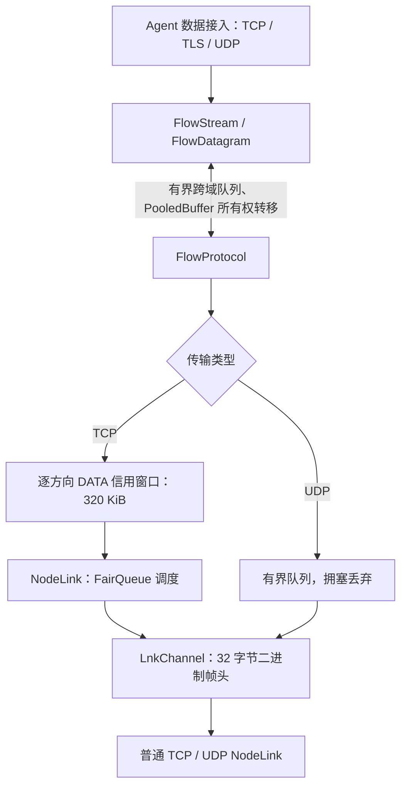

---

### 5.1 数据通道二进制帧与接入协议

所有进入数据面的网络报文，均使用精简的高性能二进制定长头部进行编解码，坚决规避文本与动态序列化开销。

#### 5.1.1 固定二进制帧头结构 (LnkFrameHeader: 32 字节)

跨节点物理 `NodeLink` 上流转的每一个数据或控制帧，统一以定长 **32 字节** 的 `LnkFrameHeader`（`protocol/inc/message.h`）为前缀：


| 字段 | 长度 | 含义与取值约束 |
|---|---|---|
| **Magic** | 8 bits | 固定魔数 `0x4E`（ASCII 字符 `'N'`），用于快速识别非法字节流。 |
| **Version** | 8 bits | 协议版本号，当前版本为 `2`。 |
| **Kind** | 8 bits | 帧类型枚举（`LnkFrType`），详见 5.1.2 节。 |
| **Flags** | 8 bits | 标志位集合。低 1 位（Bit 0）表示 `reverse`（反向数据传输标识）。 |
| **Body Length** | 32 bits | 网络字节序（大端）。后续承载的用户载荷字节数，最大不超过 65,467 字节。 |
| **Epoch** | 64 bits | 本帧所属的集群版本号，与当前集群 Epoch 不一致时立即丢弃。 |
| **Flow ID** | 64 bits | 逻辑流的全局唯一 64 位标识；若为 NodeLink 控制帧（如 Ping/Pong/Attach/Attached），此字段填 `0`。 |
| **Sequence** | 64 bits | 复合序列号。在 Ping/Pong 中用作单调心跳序号；在 Credit 帧中用作累加信用上限（Cumulative Limit）。 |

#### 5.1.2 帧类型枚举与语义规范 (LnkFrType)

`LnkFrType` 覆盖数据传输与链路层控制指令：
- `Data (1)`：携带用户业务载荷数据帧。
- `Fin (2)`：流式传输半关闭通知帧。表示本方向的数据已发送完毕，不再有后续 Data 帧。
- `Reset (3)`：流异常中断帧。强制销毁指定 Flow。
- `Ping (4) / Pong (5)`：物理链路心跳探测与往返时延测量帧。
- `Attach (7) / Attached (8)`：UDP NodeLink 建立时的双向对称关联激活握手帧。
- `Credit (9)`：逐跳流量控制帧。下游向上游返还信用额度，`sequence` 携带累加释放上限。

#### 5.1.3 Agent 业务接入头

1. **TCP/TLS 接入消息 `RelayAttach`**：接入参数包含 `role`、`uuid`、`ticket`。`RelayAttach::to_msg()` 生成 `relay.attach`，通过 `WireMessage` 编成 4 字节大端长度 + CBOR：

   ```json
   {"command":"relay.attach","params":{"role":2,"uuid":1048576,"ticket":9876543210}}
   ```

   `Producer=1`、`Consumer=2`，UUID 与 ticket 非零。TLS 先完成双向 TLS 握手，并在参数中附加 `tls_framing: "length32-fin-v1"`。单节点两端有相同 UUID、不同 ticket；多节点首末端的 UUID 是各自 Node 本地分配的，不要求相同。

2. **TLS 业务分帧**：`protocol/inc/xfr_channel.h` 定义 `tls_data_framing = "length32-fin-v1"`。每帧为 4 字节大端长度 + 数据，长度上限 65,467；长度为 0 表示本方向业务 FIN，独立于 TLS `close_notify`，以支持 TLS 1.2 的业务半关闭。TCP 数据端口在 attach 后直接传输原始字节流。

3. **UDP `DatagramHeader`**：Agent 的业务数据报以 8 字节大端非零 `session_id` 开头。首次接入直接发送 `WireMessage::pack(relay.attach)`，不加 session 头；收到 ready 前每 500ms 重试 attach，业务报文为会话头 + 用户载荷。Node 根据会话 ID 解复用并绑定来源地址。UDP 两端有各自的会话 ID，无 TCP 式接入连接。

4. **UDP NodeLink 封装**：8 字节 link ID + 32 字节 `LnkFrameHeader` + 载荷，最大用户载荷为 `65507 - 8 - 32 = 65467`；该 link ID 不等于 Agent 的 session ID。

---

### 5.2 逻辑流传输引擎 (FlowProtocol)

`FlowProtocol` 声明于 `protocol/inc/flow_protocol.h`，是承载所有逻辑流的顶层状态机服务。

#### 5.2.1 FlowState 生命周期与状态迁移

每个 Flow 在节点内维护一个 `FlowState` 对象：

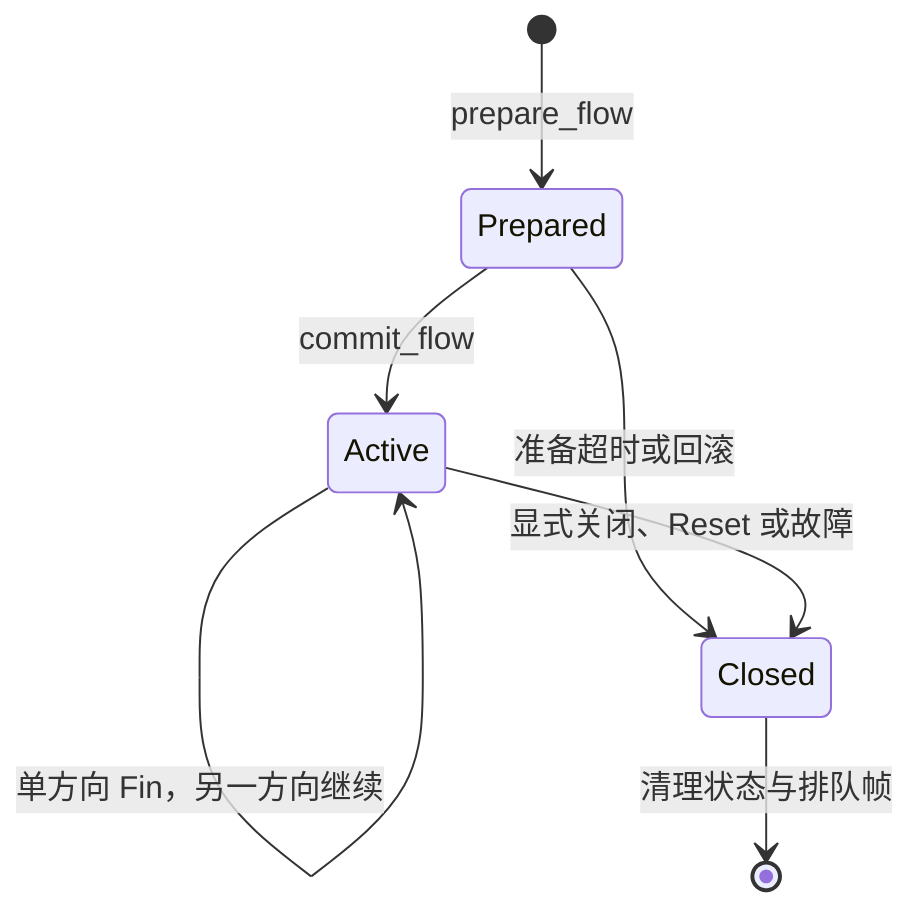

- **`Prepared` 阶段**：节点响应 Master 的 `FlowPrepare` 事务，初始化流控参数与缓冲区队列，但不接收和转发数据帧。
- **`Active` 阶段**：收到 `FlowCommit` 后进入激活状态。允许数据在邻接链路与端点间流转，本地端口绑定后启动对应的端点收发任务。
- **`Closed` 阶段**：双向传输结束或收到异常关闭指令，释放所有排队帧与流控额度，向控制面抛出排空事件。

#### 5.2.2 流式传输端口：FlowStream

面向 TCP 与 TLS 业务，业务数据通过 `FlowStream` 进出：
- `pool`：端口持有不可重绑定的共享分配资源句柄，调用方直接构造 `PooledBuffer` 载荷。TCP 复用 32 KiB 堆读取缓冲，读完后按实际长度分配池块并复制；TLS 先校验帧长度，再直接读入对应大小的池块。端口状态和发送载荷上限统一由 `send()` 检查。
- `send(PooledBuffer)`：向 Flow 写入不超过 `maximum_chunk_size` 的数据块，封装为 `Frame` 并受发送信用约束；信用不足时由有界发送队列向调用方传递背压。
- `finish_send()`：触发本端半关闭，向下游排队发送 `Fin` 帧。
- `receive()`：协程等待下游数据交付；返回 `std::nullopt` 时表示收到对端 `Fin` 帧（EOF）。
- `complete_receive()`：**核心流控反馈契约**。调用方仅在真正将数据写出给本地客户端或下游 Socket 后，才调用此接口，触发流控信用向上游释放。

#### 5.2.3 数据报传输端口：FlowDatagram

面向 UDP 业务，通过 `FlowDatagram` 交互：
- `try_send(span<uint8_t>)`：非阻塞快速发送。队列满、端口关闭或分配失败时返回 `false`；超限载荷抛出参数错误，由入口预先检查并丢弃。
- `receive()`：协程等待下一个有效数据报。

---

### 5.3 物理邻接传输层 (LnkChannel & NodeLink)

`LnkChannel` 负责底层物理 Socket 的实际 I/O 驱动与多路复用。

- **TCP NodeLink**：
  - 物理连接建立时先交换 CBOR `link.attach` / `link.attached` 进行对端确认，之后切入全二进制数据流。
  - 每个连接拥有独立的 `tcp_read` 与 `tcp_write` 协程循环。写路径由 `FairQueue` 统一调度；读路径解析 32 字节帧头后，直接通过 `FlowProtocol::receive()` 按 Flow ID 分派。
- **UDP NodeLink**：
  - 节点间采用单一共享 UDP Socket（端口 18448）。
  - 在正式转发前，两端必须通过定长 `Attach` / `Attached` 帧完成双向对端识别与端口绑定。

---

### 5.4 逐跳信用流控机制 (Hop-by-Hop Credit Flow Control)

RelayWeave 摒弃了端到端粗粒度的 TCP 窗口流控，在 Overlay 网络中实现了**逐跳（Hop-by-Hop）的精细化信用流控**。

#### 5.4.1 逻辑计费模型与 Frame 内存开销计算

每一帧在信道上流转时，都会消耗确定数量的信用额度（Credit Units）。`Frame::charge_for_payload(size)` 提供了稳定的计费规范：

$$
\text{charge}(S) = 128 + \begin{cases} 0, & S = 0 \\ \text{bit\_ceil}(\max(S, 256)), & S > 0 \end{cases}
$$

- **空帧与 FIN 帧**：固定计费 **128 字节**。
- **带载荷数据帧**：基础管理开销 128 字节加上载荷向上取整至 2 的幂次（最小 256 字节）。例如 1000 字节载荷向上对齐为 1024，计费为 `128 + 1024 = 1152` 信用额度。
- **内存对齐静态断言**：源码中静态断言 `sizeof(Frame) <= 128`，确保逻辑计费模型覆盖底层对象元数据开销。

池块按实际载荷长度分配，本地预算与线上 DATA 信用均使用 `Frame::charge()`，保持收发双方一致。TCP 读到 1 字节时，只创建 1 字节池块，本地占额与 DATA 信用均为 `256 + 128`。本地占额和线上信用仍独立维护，在实际写出或下游消费后释放；FIN 占用本地管理预算，不消耗 DATA 信用。

#### 5.4.2 状态变量与发送准入控制

在 Flow 的每个传输方向上，维护以下核心状态变量：
- `sent_bytes`：本跳已累计发送的数据计费总和。
- `send_limit`：本跳允许累计发送的信用上限值（初始为每个方向 320 KiB，由对端返回的累加 Sequence 推进）。
- `released_bytes`：本端已向下游完整写出并释放的计费总和。

**发送准入条件**：

$$
\mathrm{sent\_bytes} + \text{charge}(frame) \le \mathrm{send\_limit}
$$

当该条件不满足时，该 Flow 的后续帧被拦截在 `pending_frames` 队列中，暂停物理发送。

**在途缓冲上限分析**：
由于单流初始信用窗口为 `W_init = 320 KiB`，且只有在收到对端的信用返还时 `send_limit` 才会增长，因此在任何时刻，单条 Flow 在本跳物理发送队列与链路中滞留的飞行数据量上限被严格限制为：

$$
\text{Max Flight Bytes} \le W_{\mathrm{init}} + \text{Max Frame Charge} \approx 320\text{ KiB} + 65.5\text{ KiB} \approx 385.5\text{ KiB}
$$

这一机制保证了无论网络发生何等严重的延迟或下游阻塞，单条流都不会无限制消耗中继节点的内存。

#### 5.4.3 信用发布、合并与定时聚合调度

- **累加绝对限额设计**：`Credit` 控制帧的 `sequence` 字段传递的是**累加绝对限额（`released_bytes + W_init`）**，而非增量 Delta。这一设计使得即使偶发网络乱序或丢失了前一个 Credit 帧，最新的 Credit 帧也能完整覆盖并自愈状态，避免流控漂移。
- **信用合并（Coalescing）**：同一条 NodeLink 上的多条 Flow 释放信用时，更新 `NodeLink::credits` 映射表进行合并。
- **定时调度**：所有待发送的信用帧在全局定时器 `credit_deadline_` 到达时批量刷写，避免每释放一个微小数据包就发送一个空 Credit 报文，节省链路带宽。

#### 5.4.4 慢末端背压传递与链路级恢复分析

当多跳链路的最末端消费者（如由于网络卡顿、磁盘写满导致读取缓慢）发生阻塞时：
1. 尾节点 `FlowStream::complete_receive()` 停止被调用；
2. 尾节点的 `released_bytes` 停止增长，停止向倒数第二跳发送 `Credit` 帧；
3. 倒数第二跳节点的 `send_limit` 维持不变，随着本地已发数据累加至上限，触发准入拦截，帧开始在本地 `pending_frames` 堆积；
4. 倒数第二跳的缓冲达到本地上限后，停止向上游调用 `complete_receive()`；
5. **背压沿着全路径各跳逐级向上反向传递**，直至入口 Ingress 节点；
6. Ingress 节点停止读取客户端 Socket，TCP 原生滑动窗口自然缩小填满，从客户端源头上阻止流量涌入。
7. 当末端恢复读取后，`Credit` 帧沿着路径逐级反向激活，整条链路在毫秒级内自动恢复全双工平稳吞吐。

---

### 5.5 近似公平队列调度算法 (FairQueue)

#### 5.5.1 多流复用问题与公平队列设计目标

当成百上千条并发 Flow 共享同一条物理 TCP NodeLink 发送连接时，如果采用朴素的单 FIFO 队列，一个突发发送大文件的 Flow 会迅速填满整个发送队列，导致交互式 SSH 等小数据流面临严重的队头阻塞。

传统的加权公平排队（WFQ）算法需要为每个流维护独立的子队列和时间戳，在高并发连接下会产生较大的内存开销与常数级遍历成本。

`protocol/inc/fair_queue.h` 实现了实用的 **FairQueue** 算法，其设计目标为：
1. 内部仅维护单一扁平 `std::list<Entry>`，无需维护多级子队列；
2. 出队严格在队首 `O(1)` 弹出；
3. 入队时通过**同标签交错插入（Tag Interleaving）**，实现无饿死的近似轮询调度；
4. 流关闭时支持按标签批量删除，不破坏其他流的相对排队顺序。

#### 5.5.2 标签定义、交错插入规则与成员扫描集合复用

FairQueue 将调度工作前移到入队阶段：**先保持同一流方向的帧顺序，再把新帧插入其他流帧之间的合适位置**。发送协程始终读取队首，因而可以使用单一列表完成多流交错调度。

##### 1. 流标签与同流顺序

流标签定义为 `FlowWriteTag { const FlowState *flow, bool reverse }`，由具体 Flow 对象与传输方向共同标识。两个方向分别参与调度，同一数值 Flow ID 被新对象复用时，也可通过对象身份区分。

每次插入都从**队列中最后一个同标签项之后**开始查找位置，确保同一标签始终保持 FIFO 顺序。TCP DATA 与 FIN 使用同一套标签与队列，FIN 因此排在该方向此前的 DATA 之后，保留业务半关闭语义。

##### 2. 最长不重复标签前缀与插入边界

`push(tag, value)` 的具体过程分为以下四步：

1. **确定扫描起点**：如果 `last_inserted_` 仍有效且标签与本次相同，直接取其后继；否则从队尾反向查找最后一个同标签项，找到后从其后继开始扫描；当前队列中没有该标签时，从队首开始。
2. **清空本次扫描记录**：调用 `seen_.clear()`，为本次扫描重新记录出现过的标签。
3. **跳过最长不重复前缀**：依次检查当前位置标签。若该标签首次进入 `seen_`，扫描位置向后移动；一旦遇到已出现的标签，停止扫描。
4. **就地插入并更新缓存**：在停止位置之前执行 `list::insert`；若已到队尾，则追加到末尾。将新节点保存到 `last_inserted_`，供后续连续同标签入队复用。

**插入边界由扫描区间中的首次重复标签决定，该标签可以属于任意 Flow。** 例如向 `A1, B1, A2, B2` 插入此前不存在的 `C1`，扫描先跳过 A1、B1，在第二个 A 标签的 A2 处停止，得到 `A1, B1, C1, A2, B2`。

标签互不相同的片段相当于一次局部轮询：已经在该片段出现的流即将再次占据发送位置时，新帧获得插入机会。此轮次由当前队列内容自然形成，调度器只维护扫描集合与插入位置缓存。

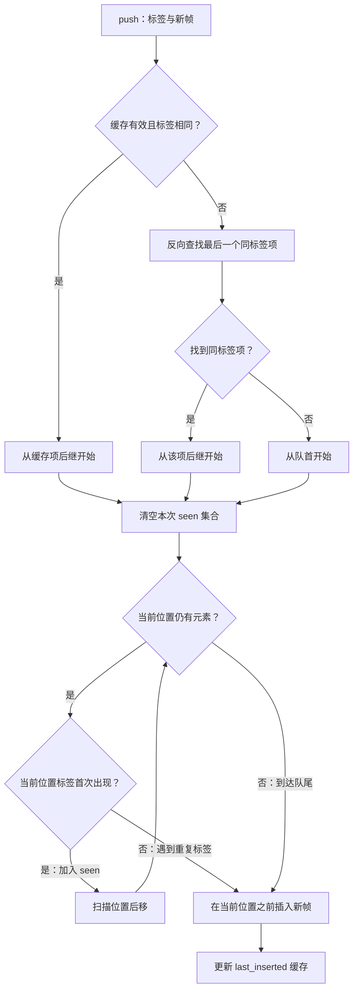

##### 3. 多流突发入队推演

设 A 流已经积压 A1、A2、A3，随后 B、C 两条流连续到达。各次插入的扫描过程如下：

| 新到帧 | 扫描起点 | 跳过的标签片段 | 停止位置 | 插入后的队列 |
|---|---|---|---|---|
| B1 | 队首 A1 | A1 | A2：A 标签重复 | A1, B1, A2, A3 |
| B2 | 最后一个 B 标签项 B1 之后 | A2 | A3：A 标签重复 | A1, B1, A2, B2, A3 |
| C1 | 队首 A1 | A1, B1 | A2：A 标签重复 | A1, B1, C1, A2, B2, A3 |
| C2 | 最后一个 C 标签项 C1 之后 | A2, B2 | A3：A 标签重复 | A1, B1, C1, A2, B2, C2, A3 |

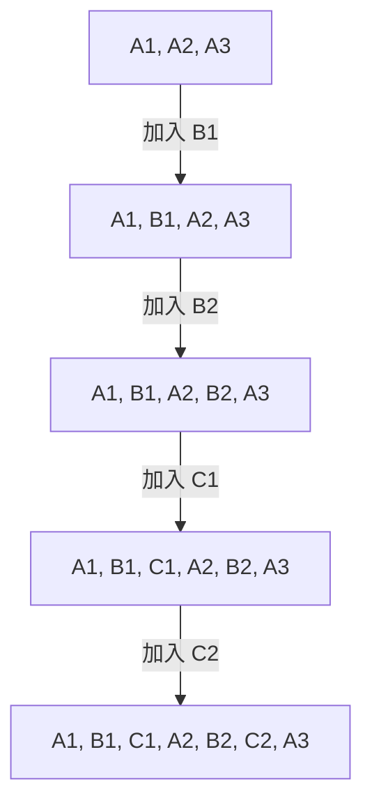

B2、C2 都排在各自前一帧之后，同时穿插在 A 的积压帧之间。队首 A1 始终保留下一次发送机会，新流量则可以在 A2 之前参与交错，兼顾旧帧推进与新流响应。

当扫描区间内各标签均不重复时，新帧直接追加到末尾；当同标签帧已在队尾时，新帧也直接追加。两种情况都延续该流既有的帧顺序。

##### 4. 插入缓存与扫描集合复用

- **连续入队缓存**：`last_inserted_` 指向最近插入的节点。连续同标签入队时，它恰好也是该标签的最后一个排队项，可以省去反向查找；其他情况下仍按列表内容定位。
- **稳定迭代器**：`std::list` 插入保持已有节点迭代器有效；`pop()` 删除缓存项时将其失效，`erase(tag)` 与 `clear()` 在删除前统一清除插入缓存。
- **哈希桶复用**：成员 `seen_` 在每次扫描前清空，保留底层桶容量以减少重复扩容；列表节点与哈希集合元素仍按需分配。

#### 5.5.3 算法复杂度、出队/删除语义与正确性验证

##### 1. 操作复杂度与调度开销

设当前队列总长度为 `Q`，各操作的开销如下：

| 操作 | 复杂度 | 行为 |
|---|---|---|
| `push(tag, value)` | 通常哈希假设下最坏为 `O(Q)` | 反向定位最后一个同标签项，再扫描不重复标签片段；缓存命中时省去定位步骤。 |
| `front()` / `pop()` | `O(1)` | 直接访问并移除队首，发送热路径无需寻找下一个流。 |
| `erase(tag)` | `O(Q)` | 线性删除指定标签的全部排队项，保留其他项的相对顺序。 |
| `clear()` | `O(Q)`，另含扫描集合元素清理 | 释放排队节点、载荷与集合元素，重置缓存状态。 |

交错单位为**帧及其流方向标签**。不同流的帧长可以不同，因此实际字节份额与等待时间还取决于载荷大小、活跃标签数、信用窗口和物理链路速率；FairQueue 提供近似轮询的帧级公平性。

##### 2. NodeLink 发送路径中的协作

TCP NodeLink 将 DATA 与 FIN 放入 `writes` 公平队列，Credit 按 Flow ID 与方向在 `credits` 中合并，其他控制帧进入 `controls`。写协程优先处理控制帧与 Credit；当业务队列非空时，连续发送 16 个控制帧后选取一个业务帧，再重新开始控制优先计数。

Flow 关闭时，分别清除该对象正反两个方向的排队标签，释放尚未发送的载荷。逐跳信用负责准入与背压，FairQueue 负责已进入共享业务发送队列的出队次序，两者共同控制多流复用时的积压与响应延迟。

##### 3. 参考模型与有界状态验证

`test/protocol/fair_queue_test.cpp` 使用独立的向量参考模型描述“最后一个同标签项之后，跳过最长不重复前缀再插入”的规则，并逐操作核对实际队列：

- **穷举轨迹**：遍历三种标签入队与一次出队操作的全部 65,536 条八步轨迹，检查出队顺序、同标签 FIFO、长度与空队列状态。
- **混合操作**：以固定随机种子覆盖入队、出队、按标签删除与清空，并使用常量哈希模拟冲突；同时验证可移动载荷与分配资源的生命周期。
- **积压推进模型**：以八个 A 帧为初始积压，在每次出队前插入 1～3 个 B/C 帧，搜索有界状态图，检查是否存在持续阻止末尾旧 A 帧前进的循环。

这些验证分别覆盖插入语义、流内顺序、删除行为与有界负载下的进展性，为单列表近似公平调度提供可复现的依据。

---

### 5.6 内存池与零拷贝流水线 (PMR Buffer Pool)

#### 5.6.1 std::pmr::synchronized_pool_resource 载荷缓冲池设计

高并发网络代理在传统实现中，频繁在堆上执行 `malloc/free` 会引发内存碎片与系统调用开销。RelayWeave 在数据面引入了 C++17/20 标准的多态内存资源：
- 在 `cluster_data_io` 上创建唯一的 `std::pmr::synchronized_pool_resource` 对象。
- 配置针对 256B、1KB、4KB、16KB、64KB 常见网络分块的专属 Chunk 预热内存池。

#### 5.6.2 PooledBuffer 跨执行域所有权转移

`protocol/inc/lnk_channel.h` 封装了 `PooledBuffer`：
```cpp
class PooledBuffer {
    struct Deleter {
        std::size_t size = 0;
        std::shared_ptr<std::pmr::memory_resource> resource;
        void operator()(std::uint8_t *storage) const noexcept {
            resource->deallocate(storage, size);
        }
    };
    std::unique_ptr<std::uint8_t, Deleter> storage_;
};
```
- **智能析构器携带池指针**：当 `PooledBuffer` 跨越执行域从 `transfer_tcp_io` 投递至 `cluster_data_io` 并在数据写出后析构时，其自带的 Deleter 将内存归还给其原始所属的 PMR 内存池，无需显式跨线程回调。
- **完整载荷所有权**：`size()` 直接读取 Deleter 保存的请求分配长度，载荷始终覆盖完整池块；移走或清空后返回零。无需单独保存有效长度或提供截短、容量接口；池自身的分配器元数据和历史保留容量仍需通过 RSS 另行评估。

#### 5.6.3 数据热路径分配与拷贝分析

在整个数据流转的热路径上：
1. Agent 的多跳 TCP 接入复用 32 KiB 堆读取缓冲，再将实际读取的字节复制到对应大小的池块；多跳 TLS 在 `read_remote_pair` 的 TLS 分支读取帧头，校验后按长度构造池块并直接读取帧体。NodeLink TCP 同样按帧体长度直接读入池缓冲；
2. 构建 `Frame` 对象（占用栈帧或队列节点，不分配载荷堆空间）；
3. 移交所有权至 `FlowStream` 并挂入 `FairQueue`；
4. 物理 TCP Socket 集中调用 `async_write` 发送；
5. 发送完成后归还信用并触发 `PooledBuffer` 析构还池。
TCP 入口从复用读取缓冲向实际长度的池块复制一次，之后接入 Stream 和各中继跳之间均通过移动语义传递池缓冲。TCP 入口读协程复用一块 32 KiB 读取缓冲；跨域发送仍是零容量交接，协议发送循环最多暂存一块等待本地窗口的载荷，两者需要在已计费窗口之外计入。TLS 入口两处暂存分别不超过一个合法帧（65,467 字节），FIN 不分配载荷。

TLS 读写直接融合进实际转发协程：`transfer_tls` 在循环外一次分配堆缓冲，TLS 读取使用 64 KiB，TCP 读取使用 32 KiB；每帧只按校验后的实际长度读写，不再调整缓冲大小。`read_remote_pair` 按帧长构造独立的 `PooledBuffer` 并移交 Flow。两处读取后继续共用各自的结束、限速及发送流程。TLS 写入处直接组合四字节长度头和载荷发送，结束时发送零长度头；Flow 的空 DATA 不写入 TLS，也不视为 FIN。共享的 `decode_tls_data_size` 和 `encode_tls_data_size` 是普通同步函数，仅编解码四字节长度；解码时校验接收长度，编码时使用调用处已受限的发送长度，不操作缓冲或执行 I/O。它们不再把约 64 KiB 数组嵌入协程帧，且没有增加发送队列。单节点普通 TCP 复制继续使用原有 32 KiB 数组。


## 6. 安全体系与证书信任模型

RelayWeave 构建在**严格的双向 TLS（mTLS）与物理隔离的双证书颁发机构（Dual-CA Architecture）**之上。本章阐述双 CA 隔离架构、证书职能划分与身份校验规则。证书签发、安装部署、轮换与排障见 [证书制作与部署](证书制作与部署.md)。

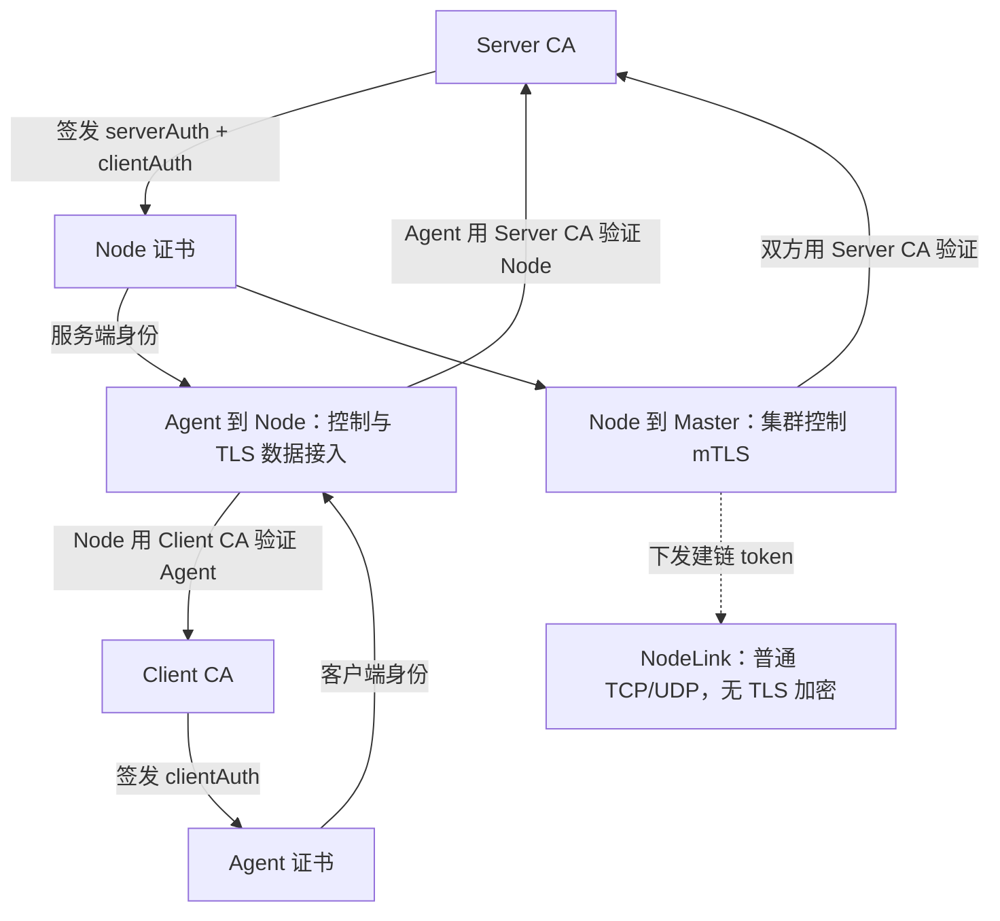

---

### 6.1 双向 TLS (mTLS) 与双 CA 隔离架构

#### 6.1.1 信任边界：Server CA 与 Client CA 物理隔离

将客户端与节点的签发根分离，可以独立管理两类身份的准入与轮换范围，并结合证书用途约束维护控制面的信任边界。

RelayWeave 确立了**两条互不相交的根信任链**：
1. **Server CA (`server-ca.pem`)**：
   - 唯一的职能是为所有的 RelayNode 服务器签发节点证书（`server.pem`）。
   - **分发范围**：分发给所有 RelayAgent（作为受信任服务端根）以及所有 RelayNode（作为节点间集群控制的互信根）。
2. **Client CA (`client-ca.pem`)**：
   - 唯一的职能是为授权接入的 RelayAgent 签发客户端身份证书（`shared-client.pem`）。
   - **分发范围**：分发给 RelayNode 节点，作为 Agent 控制端口 18443 与 TLS 数据端口 18446 的客户端验证根 `ca_file`；Agent 使用 Server CA 验证 Node。

#### 6.1.2 节点证书与客户端证书职能划分

- **服务器节点证书（`server.pem`）**：
  - 拥有扩展密钥用法：`extendedKeyUsage = serverAuth, clientAuth`。
  - 在集群控制连接（端口 18447）上，发起端节点以其作为客户端身份、对端节点以其作为服务端身份，完成同 CA 下的对等 mTLS 握手。
- **客户端接入证书（`shared-client.pem`）**：
  - 拥有扩展密钥用法：`extendedKeyUsage = clientAuth`。
  - 仅用于在端口 18443 向 Node 出示身份，无法伪装成中继节点。

---

### 6.2 身份校验与 SAN 规划规范

#### 6.2.1 node_id 与证书 Subject / SAN 映射规范

每个 RelayNode 必须具备唯一的系统标识符 `node_id`（如 `master-1`, `edge-bj-01`）。在签发该节点证书时，必须遵循以下主题备用名称（SAN, Subject Alternative Name）规则：

1. **IP 条目（`IP:<address>`）**：
   - 必须包含该节点绑定的所有对外公网 IP、专网 IP 或浮动 IP。
   - 必须精确覆盖节点配置文件中的 `control.advertise_address`。
2. **DNS 条目（`DNS:<hostname>`）**：
   - 若通过域名或内部服务名访问，必须包含对应的完整主机名（如 `DNS:master-1.internal`）。
   - 推荐将节点的 `node_id` 本身作为一个标准 DNS 条目写入 SAN（如 `DNS:master-1`），用于集群内部的纯逻辑身份识别。

#### 6.2.2 Agent-to-Node 与 Node-to-Node 双向验证矩阵

| 通信通道 | 握手类型 | 客户端校验服务端的规则 | 服务端校验客户端的规则 |
|---|---|---|---|
| **Agent -> Node 控制面 (18443)** | mTLS | 校验 Server 证书由 `server-ca.pem` 签发；校验连接的目标 IP/域名匹配 Server 证书的 SAN 列表。 | 校验 Client 证书由 `client-ca.pem` 签发；检查证书未过期。 |
| **Node -> Master 集群控制 (18447)** | mTLS | 校验 Master 证书由 `server-ca.pem` 签发；校验 Master 的 SAN。 | 校验 Slave 证书由 `server-ca.pem` 签发；校验 Slave 声明的 `node_id` 与证书 SAN 中的标识一致。 |
| **Node <-> Node 数据链路 (18448)** | 普通 TCP/UDP | 基于 Master 下发的 Token 和共享连接确认完成配对，数据面采用定长二进制帧头，不运行附加 TLS。 | 基于 Master 下发的 Token 和共享连接确认完成配对。 |

---

## 7. 端到端业务全流程与时序

### 7.1 单节点中继业务时序 (Single-Node Relay)

单节点中继是网络穿透的基础形态。Consumer Agent 与 Producer Agent 同时连接到同一个 RelayNode 实例（或业务请求不携带多跳路径）：

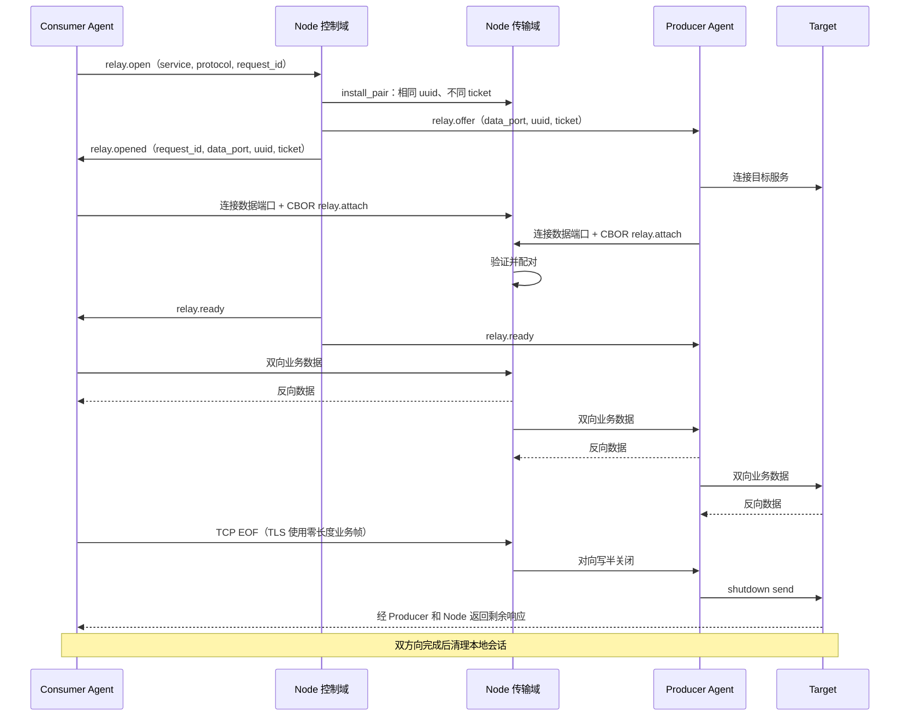

#### 流程关键阶段说明

1. **会话协商（信令阶段）**：
   - Consumer Agent 捕获本地客户端连接，向 Node 控制端口（18443）发送 `relay.open`。
   - Node 验证服务存在并分配 Node 本地唯一的 `uuid` 与双端独立的鉴权凭证 `ticket`。
   - Node 在 `control_io` 上创建 `ControlRouterSingle`，并发向 Producer 发送 `relay.offer`、向 Consumer 返回 `relay.opened`，通知双方连接数据端口（18444）。
2. **数据接入与配对（接入屏障）**：
   - 双端 Agent 异步建立到 Node 数据端口（18444）的 TCP 连接。
   - 双端在 Socket 建立后的第一个包发送长度前缀 + CBOR 编码的 `relay.attach`，附带各自的角色（`Consumer=2` / `Producer=1`）、`uuid` 与 `ticket`。
   - `prepare_local` 在传输执行域内等待两端凭证匹配，随后连续绑定流量计数与限速并激活配对，一次返回控制域。
3. **数据桥接与半关闭（传输阶段）**：
   - 控制面回送 `relay.ready`，通知客户端开始发送业务数据。
   - 随后调用 `relay_tcp()` / `relay_tls()`，启动双向协程流式复制循环。
   - **双向半关闭（FIN/EOF）**：当客户端关闭写端（发送 FIN）时，Node 端读取到 EOF，向服务端对向 Socket 发送 `shutdown(SHUT_WR)`。服务端仍可继续反向发送剩余响应数据，直至服务端也发送 EOF。双向均关闭后，Node 清理该会话资源。TLS 接入通过 `length32-fin-v1` 的零长度业务帧传递业务 FIN。

---

### 7.2 多节点中继业务时序 (Multi-Node Relay)

跨越多个中继节点（如 `Agent-A -> Node-1 (Ingress) -> Node-2 (Relay) -> Node-3 (Egress) -> Agent-B`）的业务中继流程：

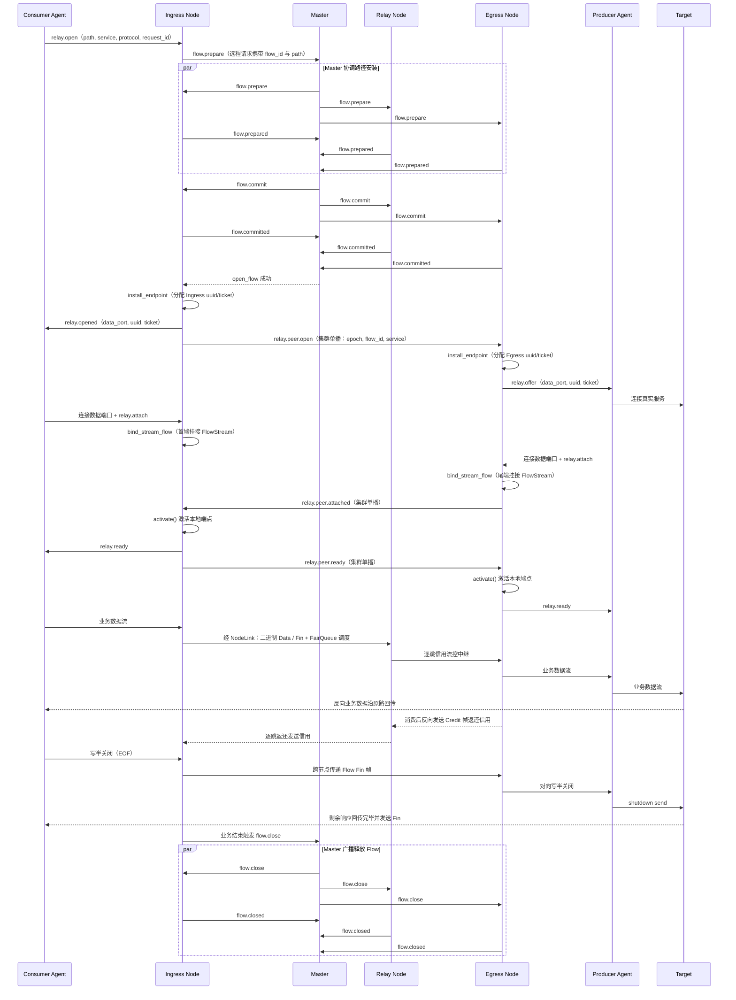

#### 流程关键阶段说明

1. **路由计算与请求发起**：
   - Consumer Agent 本地运行 Dijkstra 图算法，决定当前业务的最优路径为 `[Node-1, Node-2, Node-3]`。
   - 向 Ingress Node-1 发起 `relay.open`，附带完整路径。
2. **Master 两阶段 Flow 安装事务**：
   - Ingress Node-1 向 Master 申请开启全路径 Flow。
   - Master 下发 `flow.prepare` 并通过位图等待路径上 3 个节点全部就绪；随后下发 `flow.commit` 激活所有节点的物理转发路由。
3. **首末节点握手（Cluster Unicast）**：
   - Node-1 通过 Master 提供的集群单播能力向 Node-3 发送 `relay.peer.open`。
   - Node-3 唤醒 Producer Agent 发送 `relay.offer` 并等待其连接数据端口发送 `RelayAttach`。
   - Node-3 将 Producer Socket 挂载到 Flow 的尾部端点（`bind_stream_flow`），向 Node-1 回复单播 `relay.peer.attached`。
4. **入口激活与全双工数据流转**：
   - Node-1 收到尾端接入后，通知 Consumer Agent 连接其数据端口并完成 `RelayAttach` 认证。
   - Node-1 挂接首端 `FlowStream`，向 Node-3 发送 `relay.peer.ready`，向 Consumer 发送 `relay.ready`。
   - 数据进入 `FlowStream`，被切分为定长二进制帧，通过逐跳信用流控（`Credit`）和 `FairQueue` 调度在跨节点物理 `NodeLink` 上穿梭传输。
5. **双向半关闭与事务销毁**：
   - 业务完成时，EOF 转化为 `LnkFrType::Fin` 二进制帧沿路径流动。双向数据均完成刷写后，Ingress 节点向 Master 发送 `flow.close`，Master 释放整条路径并回收资源。

---

### 7.3 异常场景与故障收敛机制

| 异常故障场景 | 检测与触发机制 | 自动化收敛与自愈行为 |
|---|---|---|
| **Agent 异常离线** | TCP RST 或 `TLSChannel` 心跳超时（20s）。 | Node 立即销毁对应的 `NodeSession`；关闭所有关联的局部数据 Socket；若为多节点 Flow，向上游或下游发送 `LnkFrType::Reset` 帧，随后通过 Master 触发 `flow.close`。 |
| **中继节点崩溃/离线** | Master 检测到 Slave 集群控制连接断开。 | 1. Master 将该节点从活跃列表中剔除，**递增成员版本 `version`**；<br>2. Master 向全网存活节点广播 `topology.members`；<br>3. 各节点收到新拓扑后，**立即作废所有包含离线节点或基于旧授权构建的 Flow**，数据通道丢弃旧帧并清理；<br>4. Agent 收到拓扑失效通知，在本地清空路由缓存，重新运行 Dijkstra 计算新的替代路径。 |
| **慢客户端导致流控窗口耗尽** | 接收端停止返还信用，发送端 `sent_bytes == send_limit` 且持续超时。 | 发送队列达到容量上限时触发有界阻塞；若超出配置的会话超时阈值（`setup_timeout_ms`），Node 判定为超时会话，执行优雅熔断（Cancel），回送错误信令并关闭 Flow。 |
| **网络分区导致 Master 失联** | Slave 节点的 `ClusterMgr::Connector` 连续超时。 | Slave 节点停止接纳新的多节点 `relay.open` 请求（降级为仅支持单节点本地 Relay）；后台 Connector 启动固定 5 秒间隔自动重连；一旦重连成功并同步新成员列表，自动恢复全功能。 |


## 8. 运行时生命周期与资源模型

### 8.1 结构化并发与优雅停机

RelayWeave 严格遵守结构化并发（Structured Concurrency）原则。任何协程链都由生存期更长的宿主对象明确拥有；当服务停止时，遵循严格的依赖逆序停机策略，等待所有存活协程与异步 I/O 优雅排空（Drain），杜绝内存悬空与资源泄漏。

#### 8.1.1 RelayNode 优雅停机流程

当主进程捕获 `SIGINT` 或 `SIGTERM` 信号时，调用 `node->stop()` 按以下依赖顺序关停：

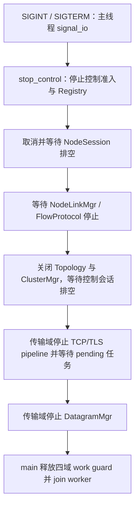

1. **阶段 1：停止准入**：关闭控制监听器（`control_acceptor_`）与集群监听器，关闭 TCP/TLS/UDP 公网数据接入监听器，拒绝一切新的 Agent 连接与会话创建请求。
2. **阶段 2：取消活跃会话与路径事务**：向所有活跃的 `NodeSession` 投递取消信号，正在建立中的 Flow 路径触发两阶段回滚与 `close_flow`，正在传输中的 Flow 发送 `LnkFrType::Reset` 帧，断开与 Agent 的业务 Socket。
3. **阶段 3：协程任务异步排空**：启动 `AsyncEvent` 与 `steady_timer` 异步屏障，等待所有 `NodeSession`、Pipeline 读写协程以及 `LnkChannel` 数据任务自然退出，等待 `active_control_sessions_` 归零。
4. **阶段 4：执行域终止与线程汇聚**：释放 `control_work`、`tcp_work`、`udp_work`、`data_work` 四个工作守卫，四个单线程 `io_context` 结束 `run()` 循环，主线程调用 `worker.join()` 汇聚所有系统线程，顺次调用对象析构函数。

#### 8.1.2 RelayAgent 停机顺序与任务排空

RelayAgent 调用 `agent.stop()` 同样遵循结构化排空：
1. 在控制域停止服务发现轮询定时器（`discovery_timer_.cancel()`）、探测刷新与连接管理，并向传输域投递存活会话失效通知；
2. 等待发现、探测和控制连接后台任务排空；
3. 在传输域等待 `Forwarder::async_stop()` 完成，关闭本地监听（`forwards`）并排空存活会话；
4. 由主程序释放工作守卫、汇聚线程并销毁组件。

---

### 8.2 资源消耗模型与并发容量推导

#### 8.2.1 协程数量模型 (Coroutine Budget)

RelayNode 内部的活体协程由进程常驻任务、控制连接、NodeLink、业务中继与路径事务共同构成，数量随运行状态呈现明确的确定性：

| 协程类别 | 归属执行域 | 数量估算公式 | 说明与典型数值 (以并发 1000 连接为例) |
|---|---|---|---|
| **进程常驻协程** | 各域 | `C_static = 6～8` | 包括：Control Accept Loop (1), Cluster Accept Loop (1), TCP Accept Loop (1), TLS Accept Loop (1), FlowProtocol Monitor Loop (1), Topology Probe (1~2)。 |
| **控制连接协程** | `control_io` | `C_ctrl = 2 × N_agent + 2 × N_cluster` | 每个控制连接维护独立的读消息协程与写排队协程。例如 50 个 Agent + 10 个集群节点 = 120 个协程。 |
| **业务中继协程** | 数据执行域 | 单节点 TCP：`C_relay = 2 × N_tcp`<br>多节点首尾跳：`C_relay = 4 × N_multi`<br>UDP 会话：`C_relay = 2 × N_udp` | 单节点流式中继包含双向流拷贝 2 个协程；多节点首尾跳各包含 Socket ↔ FlowStream 双向 2 个协程（首尾合计 4 个协程）；UDP 维护 2 个异步循环。 |

**容量分析**：当节点并发承载 **1,000 个活跃 TCP 中继连接** 时，全局协程总数约为 **2,000～4,000 个**，实际取决于单节点与多节点路径比例。协程帧大小与编译器、异步操作和局部状态有关，不能统一按几十至上百字节估算。多跳 Stream 入口与 TLS 复制已移除内嵌的约 64 KiB 数组，但仍持有独立分配的读取缓冲；单节点普通 TCP 复制仍含 32 KiB 数组。容量评估须合计协程分配、读取与暂存载荷、已计费窗口和池保留容量。

#### 8.2.2 内存消耗与分配口径 (Memory Layout & Sizeof)

各核心组件的 C++ 对象尺寸（64 位架构编译期测量）与内存占用口径如下表所示：

| 对象/数据结构名称 | 对象尺寸 (sizeof) | 内存归属与生命周期 | 计费与分配口径 |
|---|---|---|---|
| **`Frame`** | **80 字节** | 栈/发送队列节点 | 静态断言约束 `sizeof(Frame) <= 128`。本地占额与线上 DATA 信用按同一载荷长度计费。 |
| **`NodeSession`** | **288 字节** | `control_io` | 会话存活期间由 `NodeSessionList` 智能指针持有，会话结束即刻释放。按值持有控制器。 |
| **`FlowState`** | **~480 字节** | `cluster_data_io` | 包含流状态、双向流控计数器、等待队列。由 `FlowProtocol::flows_` 持有。 |
| **`NodeLink`** | **832 字节** | `cluster_data_io` | 包含物理 Socket、FairQueue 发送队列、信用合并表等。每对节点按 transport 复用一条，常驻内存。 |
| **`PooledBuffer`** | **32 字节** | 跨域移动持有 | 包含 `unique_ptr` 及携带分配长度和共享资源的 `Deleter`。底层内存块来自 PMR 池。 |
| **`FairQueue`** | **88 字节** | `NodeLink` 成员 | 内部维护 `std::list` 头结点与成员 `unordered_set`（复用桶容量）。 |

在实际生产部署中，进程物理 RSS 内存主要由双方向发送/接收缓冲、队列积压、协程帧、TLS 状态、PMR 预热保留容量以及 Socket 内核缓冲区构成。

#### 8.2.3 性能复核与基准测试数据总结

根据基准测试与长测性能复核（Release 模式 `-O3 -DNDEBUG`）：
1. **FairQueue 容器选型复核**：
   - 相比基础版本，经节点布局优化和插入缓存改进后，FairQueue 在 10/100/400 标签、深度 1~64 混合场景下的综合开销降低约 **18.4%**。
   - 引入成员 `unordered_set` 桶复用后，入队耗时再降低 **16.1%**，混合增删收发耗时再降低 **22.5%**，单次入队平均仅需 **3.2 微秒**。
2. **PMR 标准载荷池长测验证**：
   - 在高频数据帧周转长测中，PMR 载荷池预分配机制有效消除了系统分配器的锁竞争，物理 RSS 内存保持平稳，未出现内存碎片堆积与异常增长。


## 9. 配置参考与可观测性

### 9.1 RelayNode 完整配置字典与示例

RelayNode 启动时接受一个 JSON 格式的配置文件，各段落对应不同的功能与执行域：

```json
{
  "bandwidth_mbps": 100,
  "certificate": {
    "ca_file": "/etc/relayweave/certs/client-ca.pem",
    "server_ca_file": "/etc/relayweave/certs/server-ca.pem",
    "certificate_chain": "/etc/relayweave/certs/server.pem",
    "private_key": "/etc/relayweave/certs/server.key"
  },
  "channel": {
    "handshake_timeout_ms": 5000,
    "disconnect_timeout_ms": 5000,
    "heartbeat_interval_ms": 5000,
    "heartbeat_timeout_ms": 20000,
    "max_queued_messages": 100
  },
  "cluster": {
    "role": "master",
    "node_id": "master-1",
    "address": "0.0.0.0",
    "control_port": 18447,
    "tcp_port": 18448,
    "udp_port": 18448
  },
  "control": {
    "address": "0.0.0.0",
    "port": 18443,
    "advertise_address": "203.0.113.10",
    "max_connections": 512,
    "max_services": 256,
    "max_services_per_session": 64
  },
  "tcp": {
    "address": "0.0.0.0",
    "port": 18444,
    "max_setup_connections": 512,
    "max_relays": 128,
    "setup_timeout_ms": 10000,
    "rx_bytes_per_second": 2000000,
    "rx_max_burst_bytes": 262144,
    "tx_bytes_per_second": 2000000,
    "tx_max_burst_bytes": 262144
  },
  "tls": {
    "address": "0.0.0.0",
    "port": 18446,
    "max_setup_connections": 512,
    "max_relays": 128,
    "setup_timeout_ms": 10000,
    "rx_bytes_per_second": 2000000,
    "rx_max_burst_bytes": 262144,
    "tx_bytes_per_second": 2000000,
    "tx_max_burst_bytes": 262144
  },
  "udp": {
    "address": "0.0.0.0",
    "port": 18445,
    "max_relays": 128,
    "setup_timeout_ms": 10000,
    "rx_bytes_per_second": 2000000,
    "rx_max_burst_bytes": 262144,
    "tx_bytes_per_second": 2000000,
    "tx_max_burst_bytes": 262144
  },
  "log": {
    "debug_enable": false
  }
}
```

#### 核心配置字段详解

| 配置段落 / 字段 | 类型 | 默认值 / 约束 | 说明 |
|---|---|---|---|
| **`certificate.ca_file`** | 路径 | 必填 | Client CA 根证书路径。用于在控制端口（18443）与 TLS 端口上校验接入 Agent 的客户端证书。 |
| **`certificate.server_ca_file`** | 路径 | 必填 | Server CA 根证书路径。用于在集群控制端口（18447）上校验对端 Node 的身份。 |
| **`certificate.certificate_chain`** | 路径 | 必填 | 本节点的 TLS 证书链文件。 |
| **`certificate.private_key`** | 路径 | 必填 | 本节点的 TLS 私钥文件（权限必须为 0600）。 |
| **`cluster.role`** | 字符串 | `"master"` 或 `"slave"` | 集群角色。`master` 负责路径安装协调；`slave` 需配置连接 Master。 |
| **`cluster.node_id`** | 字符串 | 必填 | 全网唯一的节点标识字符串（<=256 字节，非保留名 all）。 |
| **`control.advertise_address`** | 字符串 | 必填 | 向集群和 Agent 广播的本节点公网可达 IP 或主机名。必须包含在节点证书的 SAN 列表中。 |
| **`tcp/tls/udp.setup_timeout_ms`** | 整数 | 10000 ms (10s) | 会话建立阶段等待两端 `RelayAttach` 握手的绝对超时时限。 |
| **`rx/tx_bytes_per_second`** | 整数 | 字节/秒 | 令牌桶流量整形速率。设置为 0 时表示不限速。 |

流式限速先通过同步的 `TokenBucket::reserve` 扣款并计算等待截止时间；不限速、空载荷或余额充足时返回空，仅返回截止时间时才进入 `wait_until` 协程等待。一次载荷只进行一次额度计算，定时器在首次等待时创建并复用。UDP 使用同步的 `try_consume`，额度不足时丢包，不预留债务或等待。每个令牌桶在同一执行器上访问，最多一个等待在途。

---

### 9.2 RelayAgent 完整配置字典与示例

RelayAgent 负责声明导出的服务（`services`）或本地监听端口映射（`forwards`）：

```json
{
  "server": {
    "host": "203.0.113.10",
    "port": 18443,
    "connect_timeout_ms": 5000
  },
  "certificate": {
    "ca_file": "/etc/relayweave/certs/server-ca.pem",
    "certificate_chain": "/etc/relayweave/certs/shared-client.pem",
    "private_key": "/etc/relayweave/certs/shared-client.key",
    "server_name": ""
  },
  "channel": {
    "handshake_timeout_ms": 5000,
    "disconnect_timeout_ms": 5000,
    "heartbeat_interval_ms": 5000,
    "heartbeat_timeout_ms": 20000,
    "max_queued_messages": 100
  },
  "reconnect": {
    "initial_delay_ms": 500,
    "max_delay_ms": 10000
  },
  "relay": {
    "open_timeout_ms": 10000,
    "udp_idle_timeout_ms": 60000
  },
  "routing": {
    "max_nodes": 4
  },
  "services": [
    {
      "name": "prod-ssh",
      "protocol": "tcp",
      "target_host": "127.0.0.1",
      "target_port": 22
    },
    {
      "name": "internal-dns",
      "protocol": "udp",
      "target_host": "127.0.0.1",
      "target_port": 53
    }
  ],
  "forwards": [
    {
      "service": "prod-ssh",
      "protocol": "tcp",
      "listen_address": "127.0.0.1",
      "listen_port": 10022
    },
    {
      "service": "internal-dns",
      "protocol": "udp",
      "listen_address": "127.0.0.1",
      "listen_port": 10053
    }
  ],
  "log": {
    "debug_enable": false
  }
}
```

#### 核心配置字段详解

| 配置段落 / 字段 | 类型 | 说明 |
|---|---|---|
| **`server.host` / `port`** | 字符串/整数 | 初次启动连接的主控 RelayNode 控制端口（默认 18443）。 |
| **`relay.udp_idle_timeout_ms`** | 正整数，默认 60000 | Consumer UDP 关联双向业务空闲期限；回收通过既有取消链路释放 Node/Producer 资源。 |
| **`routing.max_nodes`** | 整数 (默认 4) | 运行 Dijkstra 算法时计算的最长中继跳数上限。 |
| **`services`** | 数组 (Producer 配置) | 声明本机对外提供的真实后端服务。Agent 启动后自动向 Node 发起 `ServiceRegister`。 |
| **`forwards`** | 数组 (Consumer 配置) | 声明本机需要监听的本地转发端口。当本地客户端连接进入时，触发选路与中继桥接。 |

---

### 9.3 运行指标、拓扑可观测性与日志规范

#### 9.3.1 核心度量指标 (NodeMetrics)

`NodeMetrics` 组件在运行时持续收集以下维度的原子度量指标，可通过控制信令 `server.status_query` 或 Dashboard 实时拉取：
- **流量统计**：累计转发字节数（`forwarded_bytes`）、各服务实时瞬时收发速率（Rx/Tx Bps）。
- **会话状态**：当前并发活跃会话数（`active_relays`）、累计已完成会话数、累计异常终止数。
- **队列深度**：物理 NodeLink 的发送积压帧数（`writes.size()`）、信用挂起帧数（`pending_frames.size()`）。
- **网络质量**：各邻接链路的 RTT、抖动、丢包率与评分结果。

#### 9.3.2 项目日志规范

系统遵循统一结构化日志规范，以便于在生产环境中实现日志集中收集、分析与全链路排障：
- **`[INF]`（关键进展）**：仅记录监听启动、控制连接建立/断开、服务注册/发现、中继业务建立/关闭等里程碑事件。
- **`[DEB]`（诊断细节）**：记录 TLS 握手协商参数、候选路由评分排序、关闭细化原因等。
- **`[ERR]`（真实故障）**：记录 I/O 异常、鉴权失败、超时断开，必须携带具体阶段、端点与原始错误描述。
- **标准关系符号**：
  - `[+]`：连接或会话已建立
  - `[x]`：连接或会话已断开
  - `->`：流向或路径指向
  - `<->`：全双工双向连接
- **日志输出标准样例**：
  ```text
  [DEB] handle_tls_handshake(142): TLS handshake complete role=client peer=203.0.113.10:18443 version=TLSv1.3 cipher=TLS_AES_256_GCM_SHA384
  [INF] run_control_session(89): Control [+] node=master-1 peer=203.0.113.10:18443
  [DEB] select_path(215): Routes service=prod-ssh -> node-3 candidates=2 max_nodes=4
  [DEB] select_path(220): Route #1 cost=42.150 service=prod-ssh: agent -> node-1 -> node-3 *
  [DEB] select_path(221): Route #2 cost=58.320 service=prod-ssh: agent -> node-1 -> node-2 -> node-3
  [INF] start_relay(312): Relay [+] tcp consumer service=prod-ssh uuid=1048576
  [INF] bridge_done(450): Relay [x] tcp consumer service=prod-ssh uuid=1048576 reason=I/O ended
  [ERR] fail_flow(512): Relay open failed tcp service=prod-ssh request_id=42 uuid=0 reason=service unavailable
  ```


## 附录 A. 控制协议全量报文规范 (Wire Protocol Specification)

本附录列出 RelayWeave 控制信道承载的全部 JSON 控制指令，涵盖命令字编码、作用域以及报文参数定义。

### A.1 命令字全集对照表

控制命令字在 C++ 内部采用 32 位整型枚举 `CtrlCommand` 表达（布局为 `[group:8][subgroup:8][command:16]`），在网络传输层使用字符串 `command` 字段承载。

| 十六进制数值 | 枚举标识符 (`CtrlCommand`) | 传输层字符串名称 (`command`) | 作用域与核心功能 |
|---|---|---|---|
| `0x09000000` | `Heartbeat` | `"heartbeat"` | 心跳组基准 |
| `0x09000001` | `Ping` | `"heartbeat.ping"` | TLSChannel 双向心跳探测帧 |
| `0x09000002` | `Pong` | `"heartbeat.pong"` | TLSChannel 心跳应答帧 |
| `0x01000000` | `Relay` | `"relay"` | 业务中继组基准 |
| `0x01000001` | `RelayAttach` | `"relay.attach"` | 数据端口接入认证 |
| `0x01000002` | `RelayOpen` | `"relay.open"` | Consumer Agent 向 Ingress Node 发起开通业务 |
| `0x01000003` | `RelayOpened` | `"relay.opened"` | Ingress Node 向 Consumer Agent 返回已开通 |
| `0x01000004` | `RelayOffer` | `"relay.offer"` | Egress Node 派发给 Producer Agent 的建连通知 |
| `0x01000005` | `RelayReady` | `"relay.ready"` | Node 向两端 Agent 发送的双向桥接就绪通知 |
| `0x01000006` | `RelayReject` | `"relay.reject"` | 会话拒绝报文 |
| `0x01000007` | `RelayCancel` | `"relay.cancel"` | 会话取消报文 |
| `0x01000008` | `RelayClosed` | `"relay.closed"` | 会话正常关闭报文 |
| `0x01000009` | `RelayError` | `"relay.error"` | 会话异常错误通知 |
| `0x0100000A` | `RelayDetach` | `"relay.detach"` | 会话解绑通知 |
| `0x01010001` | `RelayPeerOpen` | `"relay_peer.open"` | Ingress Node 向 Egress Node 发起的集群单播首末协商 |
| `0x01010002` | `RelayPeerAttached` | `"relay_peer.attached"` | Egress 节点通知数据端口已接入 |
| `0x01010003` | `RelayPeerReady` | `"relay_peer.ready"` | Egress 节点通知首端 Flow 端点已挂载就绪 |
| `0x01010004` | `RelayPeerFinished` | `"relay_peer.finished"` | 首末端数据刷写结束通知 |
| `0x01010005` | `RelayPeerClose` | `"relay_peer.close"` | 首末端强制关闭通知 |
| `0x02000001` | `LinkPrepare` | `"link.prepare"` | Master 指令：准备相邻 NodeLink |
| `0x02000002` | `LinkPrepared` | `"link.prepared"` | 节点回复：NodeLink 准备就绪 |
| `0x02000003` | `LinkConnect` | `"link.connect"` | Master 指令：发起物理 NodeLink 连接 |
| `0x02000004` | `LinkReady` | `"link.ready"` | 节点上报：物理 NodeLink 已连通 |
| `0x02000005` | `LinkError` | `"link.error"` | 物理 NodeLink 异常报错 |
| `0x02000006` | `LinkClose` | `"link.close"` | 关闭物理 NodeLink |
| `0x02000007` | `LinkClosed` | `"link.closed"` | 物理 NodeLink 已关闭 |
| `0x03000001` | `FlowPrepare` | `"flow.prepare"` | Master 事务阶段一：下发全路径 Flow 预留 |
| `0x03000002` | `FlowPrepared` | `"flow.prepared"` | 节点回复事务阶段一完成 |
| `0x03000003` | `FlowCommit` | `"flow.commit"` | Master 事务阶段二：广播全路径 Flow 激活 |
| `0x03000004` | `FlowCommitted` | `"flow.committed"` | 节点回复事务阶段二完成 |
| `0x03000005` | `FlowError` | `"flow.error"` | Flow 事务执行失败 |
| `0x03000006` | `FlowClose` | `"flow.close"` | Master 或端点发起 Flow 全路径销毁 |
| `0x03000007` | `FlowClosed` | `"flow.closed"` | Flow 销毁确认 |
| `0x04000001` | `ClusterJoin` | `"cluster.join"` | Slave 向 Master 申请加入集群 |
| `0x04000002` | `ClusterJoined` | `"cluster.joined"` | Master 接纳加入并下发最新 Epoch |
| `0x04000003` | `ClusterError` | `"cluster.error"` | 集群身份或版本异常 |
| `0x05000001` | `TopologyMembers` | `"topology.members"` | Master 全网广播存活节点成员列表 |
| `0x05000002` | `TopologyReport` | `"topology.report"` | 节点向 Master 上报链路探测度量 |
| `0x05000003` | `TopologyQuery` | `"topology.query"` | Agent/Dashboard 查询集群拓扑快照 |
| `0x05000004` | `TopologySnapshot`| `"topology.snapshot"` | Master 返回全局拓扑图与质量矩阵 |
| `0x06000006` | `ServerStatusQuery`| `"server.status_query"`| 状态监控查询 |
| `0x06000007` | `ServerStatusReport`| `"server.status_report"`| 状态监控回复 |
| `0x07000001` | `ServiceRegister` | `"service.register"` | Producer Agent 向 Node 注册服务 |
| `0x07000002` | `ServiceOk` | `"service.ok"` | 服务注册成功回复 |
| `0x07000003` | `ServiceError` | `"service.error"` | 服务注册失败回复 |
| `0x07000004` | `ServiceLookup` | `"service.lookup"` | Consumer Agent 查询服务位置 |
| `0x07000005` | `ServiceLocated` | `"service.located"` | 返回服务所在的宿主 Node 信息 |

---

### A.2 各组控制消息详细 JSON 规范与参数定义

#### A.2.1 Relay 业务控制消息 (Agent <-> Node)

##### 1. `relay.open` (Consumer Agent -> Ingress Node)
```json
{
  "command": "relay.open",
  "params": {
    "service": "prod-ssh",
    "protocol": "tcp",
    "request_id": 1001,
    "path": ["node-1", "node-2", "node-3"]
  }
}
```

##### 2. `relay.opened` (Ingress Node -> Consumer Agent)
```json
{
  "command": "relay.opened",
  "params": {
    "request_id": 1001,
    "uuid": 1048576,
    "ticket": 9876543210,
    "port": 18444
  }
}
```

##### 3. `relay.offer` (Egress Node -> Producer Agent)
```json
{
  "command": "relay.offer",
  "params": {
    "service": "prod-ssh",
    "protocol": "tcp",
    "uuid": 1048576,
    "ticket": 9876543210,
    "port": 18444
  }
}
```

##### 4. `relay.ready` (Node -> Agent 双向)
```json
{
  "command": "relay.ready",
  "params": {
    "uuid": 1048576
  }
}
```

---

#### A.2.2 RelayPeer 首末业务协调消息 (Node <-> Node 集群单播)

##### 1. `relay_peer.open` (Ingress Node -> Egress Node)
```json
{
  "command": "relay_peer.open",
  "params": {
    "target_node": "node-3",
    "from_node": "node-1",
    "epoch": 42,
    "flow_id": 5001,
    "service": "prod-ssh",
    "protocol": "tcp"
  }
}
```

##### 2. `relay_peer.attached` (Egress Node -> Ingress Node)
```json
{
  "command": "relay_peer.attached",
  "params": {
    "target_node": "node-1",
    "from_node": "node-3",
    "epoch": 42,
    "flow_id": 5001
  }
}
```

##### 3. `relay_peer.ready` (Ingress Node -> Egress Node)
```json
{
  "command": "relay_peer.ready",
  "params": {
    "target_node": "node-3",
    "from_node": "node-1",
    "epoch": 42,
    "flow_id": 5001
  }
}
```

---

#### A.2.3 Flow 路径安装事务消息 (Master <-> Node)

事务身份由 `master`、`epoch`、`flow_id`、`request_id` 组成；集群层以认证连接填入 `source`。只有 Prepare 携带完整路径。Master 保留路径和确认位图，本地端点保留已验证的授权参数；后续阶段检查身份、来源和当前阶段。

##### 1. `flow.prepare` (Master -> Path Nodes)
```json
{
  "command": "flow.prepare",
  "params": {
    "source": "master-0",
    "master": "master-0",
    "epoch": 42,
    "flow_id": 5001,
    "request_id": 9001,
    "path": ["node-1", "node-2", "node-3"],
    "addresses": ["203.0.113.1", "203.0.113.2", "203.0.113.3"],
    "links": [1001, 1002],
    "transport": "tcp",
    "ttl_ms": 10000
  }
}
```

`previous`、`next` 和相邻 peer 在本地根据路径派生，属于数据域 FlowSpec，不是 Prepare wire 字段。重复 Prepare 仍比较完整授权参数；期限不属于路径身份。此阶段只预留内存资源，不持久化。

##### 2. `flow.commit` (Master -> Path Nodes)
```json
{
  "command": "flow.commit",
  "params": {
    "source": "master-0",
    "master": "master-0",
    "epoch": 42,
    "flow_id": 5001,
    "request_id": 9001
  }
}
```

##### 3. `flow.close` (Master -> Path Nodes)
```json
{
  "command": "flow.close",
  "params": {
    "source": "master-0",
    "master": "master-0",
    "epoch": 42,
    "flow_id": 5001,
    "request_id": 9001,
    "stage": "close",
    "reason": "closed by caller"
  }
}
```

##### 4. 确认与错误回复 (Path Nodes -> Master)

| 命令 | 身份字段 | 诊断字段 |
|---|---|---|
| `flow.prepared` | master、epoch、flow_id、request_id；source 为认证节点 | stage、reason |
| `flow.committed` | 同上 | stage、reason |
| `flow.closed` | 同上 | 数据端关闭事件含 stage/reason；未知事务 Close 的确认不含诊断字段 |
| `flow.error` | 同上 | stage、reason，保留原始错误原因 |

Commit、Close 和以上回复均不携带 path、addresses、links、transport、ttl_ms 或 committed。committed 仅为本地授权状态。已知事务核对身份后执行，未知 Commit 忽略；来自当前 Master、身份完整的未知 Close 直接确认，不创建端点或历史缓存。Master 只接受路径成员在对应阶段的确认，关闭期间和释放后的迟到确认不能推进建立。

此格式要求 Master 与所有 Slave 同步升级；不提供旧完整载荷协议的兼容分支或版本协商。Agent/dashboard 报文和 Link 事务格式不随本次改变。

---

#### A.2.4 Service 服务注册与发现消息 (Agent <-> Node)

##### 1. `service.register` (Producer Agent -> Node)
```json
{
  "command": "service.register",
  "params": {
    "request_id": 1,
    "service": "prod-ssh",
    "protocol": "tcp"
  }
}
```

##### 2. `service.lookup` (Consumer Agent -> Node)
```json
{
  "command": "service.lookup",
  "params": {
    "request_id": 52,
    "service": "prod-ssh"
  }
}
```

##### 3. `service.located` (Node -> Consumer Agent)
```json
{
  "command": "service.located",
  "params": {
    "request_id": 52,
    "service": "prod-ssh",
    "protocol": "tcp",
    "node_id": "node-3",
    "address": "203.0.113.12"
  }
}
```


## 附录 B. 模块源码与执行域索引对照表

| 源码路径 | 核心类 / 结构体 | 宿主执行域 (`executor`) | 核心职责与对象包含关系 |
|---|---|---|---|
| **`protocol/inc/message.h`**<br>`protocol/src/message.cpp` | `CtrlMessage`<br>`WireMessage`<br>`LnkFrameHeader`<br>`DatagramHeader`<br>`RelayAttach` | 跨域共享值类型 | 定义全系统固定二进制帧结构、CBOR 控制信令打包、控制指令枚举。无堆状态。 |
| **`protocol/inc/flow_protocol.h`**<br>`protocol/src/flow_protocol.cpp` | `FlowProtocol`<br>`FlowState`<br>`FlowStream`<br>`FlowDatagram` | `cluster_data_io` | 逻辑流状态机、端点接口抽象、逐跳信用发布与背压、帧分发管理。 |
| **`protocol/inc/lnk_channel.h`**<br>`protocol/src/lnk_channel.cpp` | `LnkChannel`<br>`NodeLink`<br>`PooledBuffer`<br>`Frame` | `cluster_data_io` | 物理相邻节点 Socket（TCP/UDP）长连接维护、PMR 缓冲池管理、帧定界。 |
| **`protocol/inc/fair_queue.h`** | `FairQueue<Tag, T>` | `cluster_data_io` | 物理 TCP NodeLink 上的流标签交错插入近似公平调度器。 |
| **`protocol/inc/tls_channel.h`**<br>`protocol/src/tls_channel.cpp` | `TLSChannel` | 独立 Strand / 执行域 | 安全 mTLS 控制流通信管道，带心跳与消息队列。 |
| **`protocol/inc/dualindex_map.h`** | `DualIndexMap<A, B, V>` | 单域值类型 | 模板化双向键安全索引哈希表。 |
| **`route/inc/link_quality.h`**<br>`route/src/link_quality.cpp` | `LinkQuality` | `control_io` | 基于 EMA 与打分截断的单尺度网络链路质量评估器。 |
| **`route/inc/route_graph.h`**<br>`route/src/route_graph.cpp` | `RouteGraph` | `control_io` | 有向加权图模型，执行带 `relay_penalty` 的 Dijkstra 最短路径搜索。 |
| **`node/inc/relay_node.h`**<br>`node/src/relay_node.cpp` | `RelayNode` | 组合根 (协调四执行域) | Node 进程组合根。管理四执行域生命周期、监听器启动与停机排空。 |
| **`node/inc/node_session.h`**<br>`node/src/node_session.cpp` | `NodeSession` | `control_io` | 单次中继业务会话容器，按值持有会话控制器。 |
| **`node/inc/control_router_single.h`**<br>`node/src/control_router_single.cpp` | `ControlRouterSingle` | `control_io` | 单节点中继业务双 Agent 协调器。 |
| **`node/inc/control_router_multi.h`**<br>`node/src/control_router_multi.cpp` | `ControlRouterMulti` | `control_io` | 多节点首末中继业务集群单播协调器。 |
| **`node/inc/nodelink_mgr.h`**<br>`node/src/nodelink_mgr.cpp` | `NodeLinkMgr` | `control_io` | 跨节点 Flow 两阶段安装事务状态机与 NodeLink 邻接建立协调器。 |
| **`node/inc/cluster_mgr.h`**<br>`node/src/cluster_mgr.cpp` | `ClusterMgr`<br>`ClusterRoom` | `control_io` | Master 集群成员网状网维护、重连与消息交换路由。 |
| **`node/inc/registry_mgr.h`**<br>`node/src/registry_mgr.cpp` | `RegistryMgr` | `control_io` | 本地服务条目注册表。 |
| **`node/inc/pipeline_mgr.h`**<br>`node/src/pipeline_mgr.cpp` | `TcpPipeline`<br>`TlsPipeline` | `transfer_tcp_io` | 公网 TCP/TLS 业务端口接入与 `xfr_channel.h` 全双工流拷贝。 |
| **`node/inc/datagram_mgr.h`**<br>`node/src/datagram_mgr.cpp` | `DatagramMgr` | `transfer_udp_io` | 公网 UDP 业务单端口监听与客户端反射地址解复用。 |
| **`agent/inc/relay_agent.h`**<br>`agent/src/relay_agent.cpp` | `RelayAgent` | 组合根 (协调双执行域) | Agent 进程组合根。管理 control_io 与 transfer_io。 |
| **`agent/inc/agent_control.h`**<br>`agent/src/agent_control.cpp` | `AgentControl` | `control_io` | Agent 服务注册、服务发现与拓扑轮询驱动。 |
| **`agent/inc/agent_routing.h`**<br>`agent/src/agent_routing.cpp` | `AgentRouting` | `control_io` | Agent 路径计算器与最优候选路径缓存。 |
| **`agent/inc/node_connection.h`**<br>`agent/src/node_connection.cpp` | `NodeConnection` | `control_io` | 直接拥有唯一主控连接、重连与停止排空。 |
| **`agent/inc/forwarder.h`**<br>`agent/src/forwarder.cpp` | `Forwarder` | `transfer_io` | 本地端口监听器（TCP/UDP）与 `AgentSession` 管理中心。 |
| **`agent/inc/agent_session.h`**<br>`agent/src/agent_session.cpp` | `AgentSession` | `transfer_io` | 客户端业务连接会话，执行本地 Socket 与远端 Node 数据端口桥接。 |
