# RelayWeave 系统架构与详细设计

本文档是 RelayWeave 项目的系统架构与工程技术设计规范，全面阐述 RelayWeave 的网络拓扑、执行域并发模型、控制面与路径事务、路由与质量评估模型、数据面与逐跳信用流控、双 CA 零信任安全体系、端到端业务时序、资源消耗模型以及控制协议规范。

工程约束与所有权审计集中于附录 C，后续演进与已知边界集中于附录 D，历次验证与性能测量集中于附录 E。正文描述最终机制；历史数据保留各自的日期、环境及适用范围，不作为当前版本的性能承诺。

| 文档 | 职责范围 |
|---|---|
| **本文** | 系统原理、协议、执行域、生命周期、工程取舍与验证依据。 |
| **[证书制作与部署](证书制作与部署.md)** | 证书签发与压缩包制作、文件部署、凭据轮换及认证排障。 |
| **[RelayWeave 打包与安装](RelayWeave打包与安装.md)** | 软件构建与打包、依赖、协议升级、安装和服务管理。 |
| **[SOCKS5 代理](SOCKS5代理设计.md)** | SOCKS5 能力、TCP/UDP 关联、隔离与容量配置。 |

---

## 1. 系统上下文与架构总览

### 1.1 设计目标与核心职责

RelayWeave 是一套专为多云互联、边缘上云与内网穿透场景设计的高性能、低延迟、高韧性网络中继编排系统。在复杂的广域网环境中，跨云或跨地域公网直连往往面临丢包率高、跨国/跨区抖动剧烈、NAT/防火墙隔离以及链路单点故障难以快速自愈等痛点。

RelayWeave 通过在不同区域服务器上构建中继节点覆盖网（Overlay Mesh），结合持续的主动质量探测、有界最短路径计算（Dijkstra）、逐跳信用背压流控（Hop-by-Hop Credit Flow Control）以及硬件友好的定长二进制分帧机制，实现跨网络拓扑的高吞吐、透明中继传输。

系统核心设计目标包括：

1. **多协议全双工中继**：原生支持 TCP、TLS（Agent 之间端到端加密，Node 透明转发）以及 UDP 业务中继。
2. **极简高效的数据面**：控制信令与业务载荷严格物理分离。数据面绝不引入 JSON、CBOR 或动态反射序列化框架；跨节点传输使用定长 32 字节二进制帧头，配合 C++20 PMR（多态内存资源）载荷池，实现载荷缓冲复用与所有权转移，杜绝中间节点的重复内存分配与二次深拷贝。
3. **结构化并发与无锁执行域**：基于 C++20 协程（`asio::awaitable`）与 Boost.Asio 构建。Node 内部按职责划分为 4 个单线程执行域，Agent 划分为 2 个执行域。各执行域内状态串行无锁化，跨执行域通过有界异步通道传递，消除多线程竞态与锁同步开销。
4. **端到端智能动态选路**：内置持续的主动探测机制（ICMP），基于指数加权移动平均（EMA）与对数正态质量模型量化各跳链路成本；通过带中继惩罚的最短路径算法，动态规避拥塞链路，支持 2~8 节点的多跳透明中继。
5. **逐跳背压与近似公平调度**：采用针对 TCP Flow 的逐跳信用（Credit）流量控制协议，严格限制跨节点缓冲上限；在多流复用单条物理 TCP 连接时，采用 FairQueue 启发式交错插入算法，在 `O(1)` 队首弹出开销下实现无饿死的近似轮询调度。
6. **双 CA 安全认证体系**：控制面通信全量采用 mTLS 双向认证。Server CA 与 Client CA 物理隔离，结合节点证书 SAN（Subject Alternative Name）主机名校验与集群成员身份管理，实现控制链路身份认证与防窃听。

---

### 1.2 部署角色与网络拓扑

RelayWeave 体系包含以下核心进程角色与拓扑层级：

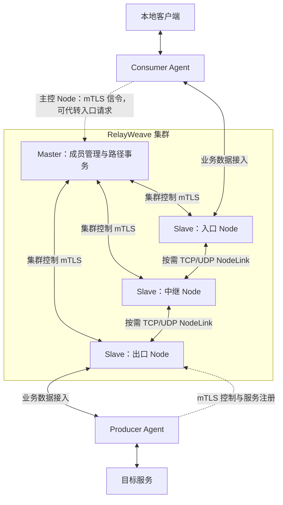

#### 进程角色定义

1. **RelayNode (Master)**：
   - 集群控制协调中心。管理节点接入（`ClusterJoin`）、生成集群授权纪元（`Epoch`）、维护单调递增的成员版本（`version`）、下发全局成员列表（`TopologyMembers`）。
   - 路径事务协调者：负责全路径 Flow 的两阶段安装与授权事务（`FlowPrepare` -> `FlowCommit`），维护 8 节点位图状态。
   - 控制信令交换机：在集群节点间路由定向控制单播（Unicast）和全网广播（Broadcast）。
   - 同时具备普通 RelayNode 的全部数据面与业务接入承载能力。
2. **RelayNode (Slave)**：
   - 业务边缘与核心骨干节点。主动向 Master 发起集群长连接并维持心跳。
   - 暴露公共接入端口：向 Agent 提供控制连接、TCP/TLS/UDP 业务接入端口。
   - 建立并维护与相邻节点的共享数据传输管道（`NodeLink`），执行高性能二进制分帧转发、逐跳信用流控与 FairQueue 调度。
   - 由 `NodeSession` 提供公共状态和取消操作，`SingleSession`、`MultiSession` 各自运行完整的建立、转发和收尾流程。
3. **RelayAgent (Consumer 客户端代理)**：
   - 部署在客户端侧（如办公终端、边缘采集机）。
   - 拥有本地监听转发器（`Forwarder`），将本地端口（如 `127.0.0.1:10022`）映射为远端集群服务名（如 `service: prod-ssh`）。
   - 与主控 Node 保持控制长连接，主动拉取服务目录与拓扑快照，基于链路成本自主计算最优入口与中继路径，发起建连并桥接流量。
4. **RelayAgent (Producer 服务端代理)**：
   - 部署在目标业务服务器侧或同网段跳板机上。
   - 配置并导出本地真实服务（如 `target: 127.0.0.1:22`），向主控 Node 发起 `ServiceRegister` 注册服务条目。
   - 监听 Node 派发的 `RelayOffer` 请求，与真实业务服务建连，并反向连接 Node 数据端口完成流量对接。
5. **RelayDashboard**：
   - 独立的集群可视化与监控面板，通过控制通道查询 Node 运行指标、拓扑快照与流量统计。

---

### 1.3 核心实体与概念模型

系统内运行着若干高度解耦且生命周期明确的核心实体：

| 实体名称 | 作用域与归属 | 生命周期与核心职责 |
|---|---|---|
| **Service** | 全局业务逻辑名 | 业务服务的逻辑标识（如 `web-app`, `mysql-db`），绑定具体的传输协议（TCP/TLS/UDP）与目标网络端点。由 Producer Agent 声明并注册至集群。 |
| **NodeSession** | Node 进程内 (`control_io`) | 代表 Node 上的一次中继业务会话实例。基类持有公共状态与数据任务；SingleSession、MultiSession 各自以完整 run 负责建立、错误处理和关闭，并提供对应的消息匹配、鉴权和状态报告。 |
| **AgentSession** | Agent 进程内 (`transfer_io`) | 代表 Agent 端一次具体的客户端业务连接。持有本地 socket 与远端 Node 数据 socket，负责首帧认证（`RelayAttach`）、全双工流拷贝以及半关闭收尾。 |
| **Flow** | 跨节点逻辑通道 | 跨越 2～8 个节点的端到端数据传输流，由 64 位 `flow_id` 与集群纪元 `epoch` 唯一标识。在两端挂接 `FlowStream` 或 `FlowDatagram`，在中间跳挂接相邻的 `NodeLink`。 |
| **NodeLink** | 两相邻 Node 间物理通道 | 两个相邻 RelayNode 之间基于 TCP 或 UDP 建立的长生命周期物理传输链路。复用承载该链路上的所有并发 Flow，负责固定二进制分帧、心跳保活、信用合并与公平排队。 |
| **Epoch** | 集群授权纪元 | 64 位无符号整数。Master 启动时生成非零随机值，在该 Master 生命周期内保持不变。成员变更递增独立的 `version`；Flow 授权校验 Epoch、Master、路径成员及其地址，防止失效路径继续承载流量。 |

---

### 1.4 网络接口与端口划分

每个 RelayNode 进程对外暴露以下 5 种明确职责的网络接口与监听端口（以示例配置为例）：

| 示例端口 | 传输 | 配置项 | 对端与协议 |
|---|---|---|---|
| 18443 | TCP/mTLS | `control.port` | Agent 控制通道，4 字节长度前缀 + CBOR 控制帧。 |
| 18444 | TCP | `tcp.port` | TCP/TLS 共用的数据入口；Node 发送 32 字节连接编号，Agent 经控制 mTLS 授权绑定后传输业务。 |
| 18445 | UDP | `udp.port` | Agent 先用独立 CBOR `relay.attach` 报文接入；业务报文携带 8 字节 `session_id`。 |
| 18447 | TCP/mTLS | `cluster.control_port` | Master 监听集群控制；Slave 使用 `cluster.address` 和此端口连接 Master。 |
| 18448 | 普通 TCP/UDP | `cluster.tcp_port` / `cluster.udp_port` | NodeLink；TCP 先交换 CBOR `link.attach` / `link.attached`，后续使用二进制帧；UDP 还带 8 字节 link ID。 |

---

### 1.5 核心设计原则与架构约束

为了在多云与跨地域复杂网络下兼顾极致性能与工程可控性，RelayWeave 在系统设计与协议实现中遵循以下核心原则与运行约束：

1. **数据面与控制面分离**：
   - 业务载荷在数据面上流转时，不进入 JSON、CBOR 或动态反射序列化框架，采用定长二进制帧头 `LnkFrameHeader` 与 `DatagramHeader` 通过显式大端编解码进行封装。
   - 接入握手阶段的 `RelayAttach` 等信令通过轻量 CBOR 控制帧进行交换，兼顾灵活性与解析效率。
2. **有界中继跳数与位图状态追踪**：
   - 一条 Flow 路径包含的节点数限制在 **2 到 8 个节点**之间（`[2, max_flow_nodes]`，其中 `max_flow_nodes = 8`）。
   - Master 使用单字节无符号整数（`uint8_t`）按位（`1 << node_index`）跟踪各节点在 `FlowPrepare`、`FlowCommit`、`FlowClose` 阶段的确认应答，通过 `O(1)` 位操作更新事务确认进度。
3. **事件驱动的 Flow 生命周期管理**：
   - Flow 路径在两阶段提交成功后持续有效，直至显式关闭或授权失效，不依赖周期性的心跳续租机制。
   - Flow 触发释放的典型事件包括：控制连接断开（发起端或对端 Agent 掉线）；Master 纪元变化、路径节点离线或地址变化导致授权失效；承载 Flow 的物理 NodeLink 异常中断；业务数据传输完成（双向 FIN/EOF）、会话取消或进程停机触发显式关闭。
4. **端到端半关闭语义完整传递**：
   - TCP 与 TLS 业务在中继路径上完全保留标准 BSD Socket 的双向半关闭（Half-Close）能力。
   - TCP 写半关闭沿路径传递为对向 EOF 或 Flow `Fin` 帧；TLS 两端 Agent 用加密零长度业务帧传递单向 FIN，双向业务排空并完成 TLS 关闭后才向 Node 传递 TCP EOF。
5. **面向数据报的拥塞保护与无应用层分片**：
   - UDP 业务在队列满时采取尾丢弃策略，丢包保护健康流而不主动关闭 Flow。
   - 单节点最大载荷 65,499 字节（`65507 - 8`），多节点最大载荷 65,467 字节（`65507 - 8 - 32`）。超出上限的数据报在入口直接丢弃，节点间严禁执行应用层分片。


## 2. 节点架构与执行域模型

### 2.1 RelayNode 部件拓扑与四大独立执行域

RelayNode 采用经典的无共享（Shared-Nothing）事件驱动并发模型。为了消除高并发转发时的跨线程锁争用，RelayNode 将进程的核心执行逻辑划分为 **4 个独立且各由单个线程驱动的 Asio 执行域（`io_context`）**：

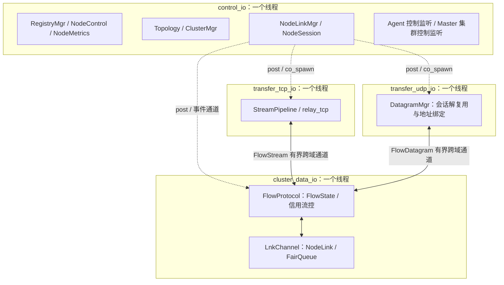

#### 四大执行域详细职责

1. **`control_io`（控制执行域）**：
   - **驱动线程**：单线程运行。
   - **托管组件**：`RegistryMgr`、`Topology`、`NodeControl`、`NodeMetrics`、`NodeLinkMgr`（控制事务状态机）、`ClusterMgr`、`NodeSession` 容器。
   - **职责范围**：处理来自 Agent 的控制长连接（端口 18443）；Master 节点的集群控制监听（端口 18447）；服务注册与发现；拓扑测量数据聚合与快照生成；Flow 路径安装（`FlowPrepare` / `FlowCommit`）事务驱动；业务会话协调（`SingleSession` / `MultiSession`）。
2. **`transfer_tcp_io`（TCP/TLS 传输执行域）**：
   - **驱动线程**：单线程运行，使用普通调度，Linux 线程名为 `node-tcp`。
   - **托管组件**：唯一的 `StreamPipeline`。
   - **职责范围**：监听 TCP/TLS 共用数据端口（18444）；发送临时连接编号并等待控制授权绑定；负责 Agent 侧客户端 socket 与本地 `FlowStream` 端口之间全双工异步流式数据拷贝（`xfr_channel.h` 中的转发函数）。
3. **`transfer_udp_io`（UDP 传输执行域）**：
   - **驱动线程**：单线程运行，使用普通调度，Linux 线程名为 `node-udp`。
   - **托管组件**：`DatagramMgr`。
   - **职责范围**：独占监听公网 UDP 业务单端口（18445）；基于 8 字节 `DatagramHeader` 执行数据报解复用；维护客户端远端反射地址（Endpoint Mapping）；与本地 `FlowDatagram` 端口执行异步报文收发。
   - **收包流程**：`receive_datagram()` 统一完成会话查找、业务校验、转发和计数；多节点数据直接提交给 Flow，单节点数据改写对端 session 头后等待 UDP 发送。未命中会话的报文交给同步 `handle_attach()` 验证 ticket 并绑定来源。单节点发送前复制目的地址并保留流量统计对象，发送完成后不再访问可能已删除的 relay 条目；不增加逐包处理协程或转发结果对象。
4. **`cluster_data_io`（专网数据链路执行域）**：
   - **驱动线程**：单线程运行。
   - **托管组件**：`FlowProtocol`、`LnkChannel`、`std::pmr::synchronized_pool_resource` 载荷池。
   - **职责范围**：管理节点间物理 `NodeLink`（TCP/UDP 端口 18448）；执行 32 字节二进制定长帧头（`LnkFrameHeader`）封装与解包；运行 `FlowStream` / `FlowDatagram` 内部状态机；执行逐跳信用计数与返还计算；驱动 `FairQueue` 发送调度。

#### 对象所有权图谱与依赖生命周期

RelayNode 遵循层次化所有权模型，默认按值或用 `unique_ptr` 持有，借用者通过引用或指针访问依赖。只有查找表移除后仍有独立 I/O、跨域关闭或晚到完成处理需要访问的对象，才使用 `shared_ptr`。异步调用本身不是共享所有权的理由：

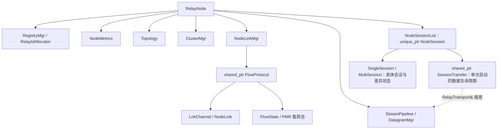

- **构造与析构次序**：成员声明顺序严格遵循依赖顺序。底层服务（如 `RegistryMgr`、`Topology`、`ClusterMgr`）优先声明，借用其引用的管理器（如 `NodeLinkMgr`、`NodeControl`）后声明。停机时先排空借用方的任务，再由 C++ 逆序析构释放依赖组件。
- **跨执行域通信协作**：
  - 各执行域内部的状态变量（如 `FlowState`、`NodeLink`、`NodeSession`）仅在其所属的单线程 `io_context` 上串行读写，杜绝锁争用；跨域共享的 `RelayIdAllocator`、服务访问者集合与同步 PMR 池分别使用内部同步机制。
  - 跨域信令触发：使用 `asio::post(target_executor, ...)` 或 `asio::dispatch`。
  - 跨域流式数据传递：使用 Asio 实验性并发通道 `asio::experimental::concurrent_channel`，其内部实现保证了不同执行域之间线程安全的数据推送与非阻塞等待。

Node 通过普通 `RelayRequest` 将已解析的业务构造参数传入 NodeSession。NodeSession 基类保存公共身份、期限、进度和停止原因；两个具体类各自的 run 主持完整根控制生命周期，SingleSession、MultiSession 是 Node 独占持有的具体会话，自身保存差异状态并运行业务，不再持有模式 variant 或 Router 回指。Single 直接保存 AttachPair，Multi 直接保存 AttachInfo。数据阶段直接调用 SessionTransfer；JSON 只在输入、输出边界出现，不作为内部请求镜像。

NodeSession 由 Node 会话容器独占持有，根协程完成处理器只借用会话地址；具体会话的 run 排空控制子协程、数据任务与 Flow 后才从容器删除它。代理的 ProxySession 使用同样的独占模型。NodeLink 待认证 socket 由握手协程的 unique_ptr 独占，accepting_ 只是停机时用于关闭 socket 的借用索引；握手结束先撤销索引，再销毁或移交 socket。远端 Flow 请求由 NodeLinkMgr 的 pending_opens_ 按值持有，open_flow 的非 Master 分支只借用容器条目；应答和失效处理更新结果并唤醒等待，不提前删除，等待退出时由同一清理范围移除条目。

AgentSession 保留共享所有权：除会话主协程之外，共享 UDP 监听任务还会独立等待向该会话发送数据，主协程可能先移除注册表。Flow 端口与协议双向关系则是「协议状态强持有端口、端口弱引用协议」，跨域投递只临时持有它们。排队载荷只延长 PMR 资源寿命，不延长整个协议或 Node 寿命。完整的持有者、释放时点及审计依据见附录 C.2。

#### 配对状态与跨域准备

配对对象使用普通继承，共享基类均不依赖具体 Flow 类型：

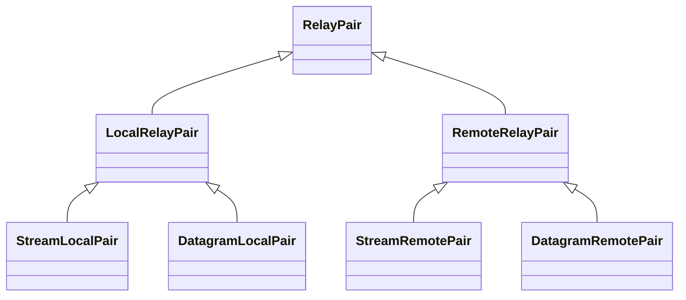

图中的 Stream/Datagram 类型分别是两个管理器在各自 .cpp 中定义的私有 `LocalPair` / `RemotePair`；头文件只保留前置声明。`RelayPair` 统一接入事件、closed/active、限速和计数绑定，提供虚析构与 `close()`；`LocalRelayPair` 实现双端接入等待、准备、独立激活及访问者回收，prepare 不开启转发或登记访问者；`RemoteRelayPair` 实现单端接入等待、驱动 Flow 绑定、绑定后关闭检查、计数绑定、激活与方向计数。具体派生类持有 socket、UDP session/source 和各自的 Flow 端口，覆盖 `close()`，远端类型另覆盖受保护的 `bind_flow()`。公共准备流程不依赖具体 Flow 类型，也不使用模板或统一 Flow 适配接口。

管理器负责容量、ID、容器及 UDP session/bindings。StreamPipeline 与 DatagramMgr 实现纯虚接口 `RelayTransport`。每个 NodeSession 只启动一次 `SessionTransfer`，数据任务借用 `RelayTransport&`，从接口取得执行器，并顺序执行 install、prepare、activate、transfer、close，不再通过管理器 variant/visit 分派或判断具体传输类型。TCP 的 prepare 内部消费控制授权并完成 socket 绑定，UDP 的 prepare 等待共享监听器的来源绑定。管理器准备协程保留局部 pair `shared_ptr`，多跳 Flow 绑定仍只跨一次 `cluster_data_io` 协议域。NodeSession 不为每个数据阶段启动跨域子协程，也不为 attach 安排独立绑定任务。

控制面与数据任务通过有界 `concurrent_channel` 交换接入授权、继续通知与阶段事件。SessionTransfer 的 Event 表示通道通知类型，State 记录控制执行器上的任务生命周期，两者不重复保存业务进度。NodeSession 等待 Installed 后通知 Agent；TCP/TLS attach 经身份与 ticket 校验后提交给同一数据任务的授权入口，每个角色只授权一次，相同连接编号的重放幂等，冲突接入拒绝。流式管理器在该任务的 prepare 调用内等待授权、greeting 写完成及 socket 绑定；UDP 继续由共享接收循环验证 attach 并通知配对。Prepared 后 NodeSession 完成 peer 协调，发送继续通知并等待 Activated，随后才发送 `relay.ready`。ready 提交后再发送下一次继续通知以启动转发。数据任务按固定顺序执行，不另用命令载荷决定下一步；激活前在数据域再次检查原始建立期限。Finished 表示转发结束，端点仍保留到 NodeSession 完成 peer finished 协调并发起关闭。

阶段事件通道容量为 5，对应 Installed、Prepared、Activated、Finished、Stopped 各一次；授权通道容量为 2，每个角色成功提交至多一次；继续通知通道容量为 1，控制流程等待当前阶段确认后才推进下一步。授权去重和任务 State 仅在 control_io 上读写，实际配对资源只在数据执行器上操作。

关闭时管理器先移除查找关联及 UDP bindings，再调用具体配对对象的 `close()`，最后释放 ID。具体类关闭 Flow/socket 或唤醒 UDP 结束事件，公共类负责关闭标记、接入唤醒与本地访问者回收。绑定期间关闭时，管理器协程仍持有对象；晚返回的 Flow 先交给具体配对对象持有，公共 prepare 检查 closed 后再次通过虚 close 回收它并抛出异常。因此具体 close 即使已标记 closed 也会关闭新交付的资源，本地访问者则通过清除已有 active 状态保证只回收一次。

安装、准备与激活事件的等待沿用会话原始绝对建立期限，重复消息不刷新期限。超时、控制断线或 peer/Flow 关闭使 NodeSession 退出阶段等待，随后关闭路径在数据域发出取消信号，能中断授权等待、greeting 等待、Flow 绑定或转发 I/O。数据任务不借用 NodeSession；管理器以引用、FlowProtocol 以可空指针借用，Node 保证先排空会话再停止它们。晚到的完成与停止处理保留任务自身，且不访问这两个借用资源。资源清理和 run() 返回后，由唯一的标准 co_spawn 完成处理器在控制域确认 Stopped，任务入口前取消也会收到确认；不使用手工完成闩锁或额外结束事件。NodeSession 在根任务的统一收尾路径禁用取消并等待完成，才能释放业务实例；不再维护独立的 binding_roles_/bindings_done_。异常通过通道原生 `std::exception_ptr` 完成参数传递，由 use_awaitable 自动抛出；管理器准备接口仍为 `awaitable<void>`。SessionTransfer 的 prepared/activate/transfer 是直接返回 wait 的普通函数，真正的阶段等待只保留一层业务协程；继续通知在该协程被等待后才发送，避免创建等待对象时产生激活或转发副作用。安装凭据由 installed 直接接收，stop 仍独立负责取消与排空。Node 将接入、绑定与 peer 就绪协调统一记为 `prepare` 阶段，独立的 Flow、控制断线等诊断阶段继续保留。

单跳和多跳每个端点的数据生命周期均只有一个启动点。控制面仍需接收必要的阶段确认，跨线程通知并未消失；改造消除的是分散的跨域协程调用、attach 完成回调和控制面绑定任务记账。实际逐包转发不经过这些阶段通道。状态归属与验收依据分别见附录 C.1、E.1。

---

### 2.2 RelayAgent 部件拓扑与双执行域

`RelayAgent` 按值持有唯一 `NodeConnection`，不再通过连接管理器包装；连接对象在 start 时创建在途操作，在停止后等待任务与 TLS 通道排空。

RelayAgent 采用精炼的双执行域架构，将轻量的控制管理与高吞吐的业务转发彻底解耦：

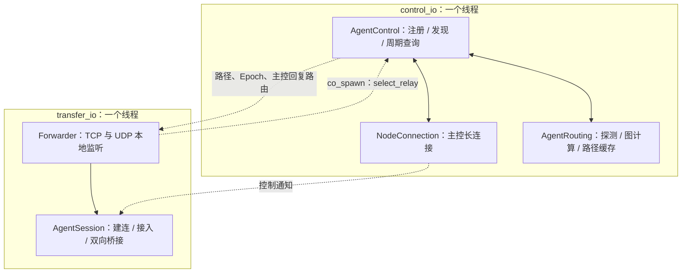

#### 双执行域职责

Agent 和 Node 工作线程保留普通调度策略，仅通过 `set_current_thread_name()` 设置 Linux 线程名；Agent 使用 `agent-control` / `agent-transfer`，Node 使用 `node-control` / `node-tcp` / `node-udp` / `node-data`。

1. **`control_io`（控制执行域）**：
   - 托管 `NodeConnection`：维护与主控 RelayNode 的安全 mTLS 控制通道（端口 18443），执行重连与心跳。
   - 托管 `AgentControl`：负责服务注册（`ServiceRegister`）；发起服务查询（`ServiceLookup`）；获取集群拓扑快照并更新探测目标。
   - 托管 `AgentRouting`：维护链路质量度量，执行有节点数约束的最短路径计算并管理本地候选路径缓存。
2. **`transfer_io`（传输执行域）**：
   - 托管 `Forwarder`：管理配置文件声明的所有本地监听器（`forwards`）。
   - 托管 `AgentSession`：每个进入的流式客户端连接或 UDP 客户端关联实例化一个 `AgentSession`，驱动数据传输与生命周期管理。

#### 跨域协作：`select_relay` 异步调用链

当本地客户端连接进入 `Forwarder`（运行在 `transfer_io`）时，选路与接入流程如下：
1. `Forwarder` 截获连接，提取目标服务名称与类型，在 `transfer_io` 上发起异步协程调用：
   `co_await agent_.select_relay(service_key, destination, deadline)`
2. 协程内部切换至 `control_io`：
   - `AgentControl` 检查服务位置（`service_locations_`）与请求期限；服务位置由服务发现循环预先查询并更新。
   - 确定目的 Node 后，调用 `AgentRouting::select_path()` 在图模型中计算到达目标 Node 的最佳路径及逻辑入口节点。
   - 使用直接持有的 `NodeConnection`，将逻辑入口记录在回复路由中，由主控 Node 代转控制请求。
3. 选路结果（包含路径列表、Epoch、逻辑入口与主控路由）打包返回给 `transfer_io`。
4. `Forwarder` 在 `transfer_io` 上启动目标数据端口的连接建立，完成握手后开始桥接。

---

AgentSession 用 `optional<RelayEndpoint>` 表示尚未获得或已获得的接入端点。地址、端口、uuid、ticket、UDP session 与可选 Flow ID 在消息入口完整校验后安装。旧 TLS framing 协商已删除。Forwarder 直接访问这些字段完成原有消息分派和去重；已有 ServiceKey 和 RelaySelection 继续拥有服务协议、选路及 epoch，不将整份 Node 报文留在会话中。

业务会话使用一个固定的 `relay.open_timeout_ms` 截止时间，覆盖选路、Node 信令、数据接入、TLS 认证和服务确认。阶段限制只用于 DNS/TCP 连接（`server.connect_timeout_ms`）和实际 TLS 握手（`channel.handshake_timeout_ms`），取其与剩余建立预算的较小值。读取连接编号、发送 UDP attach、TLS 服务名和确认字节均直接使用原始建立截止时间，不为每次协议收发重新套用 connect timeout；宣布业务 Ready 前统一检查取消与总期限。

TLS 复制结束后，`finish_tls()` 用一个 `channel.disconnect_timeout_ms` 截止时间完成 close_notify、载体写半关闭和 EOF 校验，各步不续期。传输阶段不套用建立期限；Consumer UDP 的双向空闲回收、控制通道的心跳失联判定、Node 未绑定 socket 的准入期限和多跳 Finished 收尾分别保护不同资源，独立保留。

UDP 本地 forward 按 `(forward_id, 客户端 IP, 客户端端口)` 查找独立关联。每个监听器只保存 endpoint → request ID 索引，`relays_` 持有会话；客户端 endpoint 固定保存在该会话的 DatagramData 中。不同客户端复用现有协议分别建立 Node session / Flow，Producer 为每个会话创建独立目标 socket；回包不会再根据最后一次本地发送者选择地址。

首包到来且服务可用、共享容量与建立并发允许时，先保存一份实际长度的 `optional<BytesBuf>` 首包并同步安装索引，再异步开始选路和 attach。建立过程中后续报文直接丢弃，不覆盖首包或延长绝对建立期限；零长度首包也会被保存。attach 返回并收到 ready 后按最终路径的载荷上限检查首包，超长则丢弃，否则发送；缓存保持到异步发送完成，随后清空并开放正常本地转发。原始报文不拼接、不拆分、不自动重放，未准入客户端没有额外等待表。没有预建会话池、自动重建或逐客户端重试定时器；新报文可在旧关联排空后重新触发建立。

Consumer UDP 会话的建立中、运行中和关闭中状态均占用 Agent 原有 1000 个共享会话额度，每会话至多保存一份首包（最大 65499 字节），释放任务时清空首包与 endpoint 索引。新客户端准入时从现有会话容器统计尚未 ready 的 Consumer UDP 会话，同一 Agent 所有 UDP forward 共用建立并发上限，代码固定为 100 个，不提供配置项。ready 会话、TCP/TLS 和 Producer 不占用该建立额度；失败会话排空移除后释放额度。达到上限时直接丢弃新客户端报文，不排队。没有时间窗口、速率限制或独立计数器；此并发上限不代替集群总消息预算。

一个由 Forwarder 持有并排空的 idle 任务扫描已完成首包处理的 Consumer UDP 会话，检查周期为 idle timeout 与 1 秒的较小值。合法出站业务报文成功发送、通过长度/session 校验的入站业务报文更新活动时间，空包也算活动；建立期间丢弃、超长或无效报文不续期。默认空闲 60 秒后通过现有 cancel 链路释放两端会话、目标 socket、Node 配对和 Flow。服务下线、服务所在 Node 改变或控制断开时取消原关联；重复的同位置通知不重建会话。关联索引在任务排空后按 endpoint 和 request ID 同时匹配删除，迟到通知不会复活已关闭会话，也不把用过的会话换绑给其他客户端。直接接入 Node 的其他 UDP 客户端仍不具备 Node 通用 idle 回收。

### 2.3 核心辅助与状态管理组件

#### 2.3.1 DualIndexMap 双向安全状态索引

在异步代理系统中，往往需要基于不同键快速查找同一业务实体（例如：通过业务 `uuid` 或通过内部 `session_id` 查找 `NodeSession`；通过 `request_id` 或 `flow_id` 关联握手上下文）。

`protocol/inc/dualindex_map.h` 提供了 `DualIndexMap<KeyA, KeyB, Value, Mode>`，具备以下工程特性：
- **双索引一致性**：主键唯一，副键可选，默认支持重复副键，也可设置唯一副键模式。插入重复键时返回已有记录；更新副键或删除记录时同步维护两个索引。
- **无悬空引用保证**：内部统一管理容器元素生命周期，杜绝传统维护两个独立 `std::map` 时易产生的索引不同步与悬空指针风险。

#### 2.3.2 LRUCache 路由与查询缓存

`protocol/inc/lru_cache.h` 提供了基于哈希表与双向链表组合的模板化 `LRUCache<Key, Value>`：
- 用于 Agent 端的路径计算结果缓存（`AgentRouting`），以目的节点为键，容量为 16，TTL 为 15 秒。
- 支持指定容量上限（Capacity）。每次命中元素提升至表头，容量溢出时淘汰表尾最久未访问的条目；过期条目在查询时移除，命中不延长 TTL。
- 哈希查询与普通更新平均具备 `O(1)` 时间复杂度。

#### 2.3.3 AsyncEvent 结构化无竞争异步事件

在 C++20 协程编程中，多个协程往往需要等待某一个异步操作完成（例如：多个等待特定 Flow 安装完毕的协程；或者优雅停机时等待所有后台任务排空的协程）。

`protocol/inc/async_event.h` 封装了 `AsyncEvent`：
- **多等待者安全挂起**：内部维护挂起协程队列，支持任意数量的协程并发执行 `co_await event.wait()`。
- **一次性广播通知语义**：调用 `event.notify_all()` 唤醒全部等待协程，后续 `wait()` 立即返回成功；等待被取消时返回 `false`。
- **无锁化设计**：完全与所在执行器的事件循环协同工作，消除了传统多线程条件变量的互斥锁竞争。

其语义是**同执行域的一次性广播锁存器**：先通知后等待仍成功，重复通知幂等，取消只影响相应等待者。事件必须覆盖全部等待操作的寿命；不得将其用于逐包确认、重复脉冲或跨线程直接访问。

真正挂起的等待者各持有一个容量为 1 的原生 Asio channel。私有 `ChannelTraits` 将其后备容器配置为 `std::list`，避免当前 Asio 与标准库组合下空 `deque` 的额外分配；通知值使用内嵌首值，不为此创建链表节点。广播完成后释放等待者 vector 的容量，恢复与独立取消仍遵循原生 channel 调度，不同步调用等待协程。独立取消使用 `std::erase` 注销，单次为 `O(W)`，大量分别取消仍可能累计 `O(W²)`；相关取舍和同条件测量见附录 E.4。


## 3. 控制面：集群编排与路径事务

### 3.1 集群拓扑与成员管理 (ClusterMgr)

RelayWeave 集群采用以 **Master 为协调核心、Slave 通过 Master 交换信令** 的星形控制拓扑，数据链路由各节点两两按需直连。集群控制逻辑由 `node/src/cluster_mgr.cpp` 中的 `ClusterMgr` 统一负责，运行在 `control_io` 执行域。

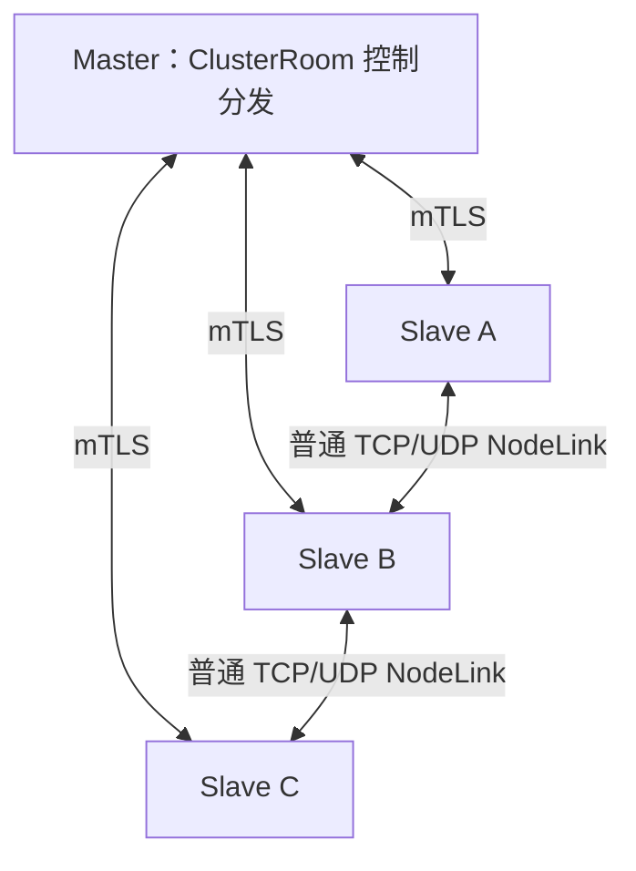

#### 3.1.1 Master-Slave 控制拓扑与 ClusterRoom 分发模型

- **Master 角色职责**：Master 节点维护唯一的 `ClusterRoom` 对象，集中管理所有已接入 Slave 节点的控制会话（`TLSChannel`）。
- **Slave 接入与重连机制**：
  - Slave 启动后，通过内置的 `ClusterMgr::Connector` 主动连接 Master 的集群控制端口（示例 18447）。
  - 若连接中断，`Connector` 按固定 5 秒间隔自动重连，直至控制链路恢复。
- **结构化并发 Accept Loop**：Master 的 `accept_loop` 采用 C++20 协程并发接收传入连接。在接入新 Slave 连接后，先执行严格的 TLS 双向证书校验，并在加入 `ClusterRoom` 之前验证对端身份。

#### 3.1.2 成员加入、Epoch 纪元与成员版本管理

1. **成员加入流程 (`ClusterJoin`)**：
   - Slave 建立 TLS 连接后，向 Master 发送 `cluster.join` 控制消息，携带本机的 `node_id` 与发布地址 `address`。
   - Master 接收到请求后，检查 `node_id` 非空、长度不超过 256 字节、非保留名 `all` 且在集群内唯一；连接身份由 mTLS 证书链验证。
   - 校验通过后，Master 登记该节点，并向该 Slave 回复 `cluster.joined` 报文。
   - 随后，Master 递增成员版本 `version`，先在本机应用 `topology.members`，再广播给其他已加入节点，携带 Epoch、version、Master 标识与完整成员列表。
2. **Epoch 纪元防呆机制**：
   - Master 启动时生成非零随机 Epoch，该进程生命周期内保持不变；节点重新接入更新成员 version。
   - 所有中继路径 Flow 的创建与交互均携带创建时的 Epoch；一旦节点收到属于旧 Epoch 的控制报文，立即判定为过期分区消息并拒绝执行。

#### 3.1.3 集群消息定向路由与广播

Master 的 `ClusterRoom` 作为集群内部的控制交换矩阵，提供两类消息投递模式：
- **定向交付（Unicast）**：源节点在消息参数中指定 `target`。Master 查表，移除 `target` 并按连接身份写入 `source`，将消息投递至目标节点的专用控制连接，用于首末节点握手（`RelayPeerOpen` / `RelayPeerReady`）等。目标可为发送者自身，包括 Master 本机。
- **全网广播（Broadcast）**：通过 `target: "all"` 分发服务/状态查询、会话解绑和成员通知。Master 一律向已加入的其他参与者投递，排除认证 source，不按业务命令分类。发布方自行完成需要的本地处理。
- **成员发布**：`publish_members()` 先通过定向交付将成员表应用到本机 Master，再广播给其他节点。每个节点仍只应用一次；通用路由层不为 `topology.members` 设置特殊回送规则。
- **拓扑查询**：Master 本地直接生成快照；Slave 仅向 `topology_.master_id()` 单播 `topology.query`，Master 按原 session/request 路由返回快照。尚未获知 Master 时不提交无目标查询，发现端沿用原有查询周期。该路径不增加缓存、目录或后台任务。

广播不承担来源节点的本地处理：服务查询先查本地注册表，集群状态查询先回复本机状态，控制断开先清理本地会话。回送只会重复这些工作；成员发布复用定向交付完成本地应用后即可使用相同广播规则。Slave 发起的每次广播因此少一次跨节点回送，Master 发起的广播少一次本地派发。成员变化时多一次本机定向路由，跨节点消息数量不变；无需增加业务命令特例、回送开关或状态。

---

### 3.2 服务目录与服务发现

RelayWeave 采用分布式的服务发现架构，服务注册在节点本地集中维护，通过集群广播或定向查询对全网透明。

#### 3.2.1 本机服务注册与注销 (RegistryMgr)

- **服务声明**：运行在服务端侧的 Producer Agent 启动后，向其接入的 RelayNode 发送 `service.register` 报文，包含 `request_id`、服务名（`service`）与协议（`tcp`/`tls`/`udp`）；本地目标地址仅保存在 Agent 配置中。
- **注册存储**：RelayNode 的 `RegistryMgr` 组件管理本机服务条目，为服务分配内部识别上下文，成功后向 Agent 回复 `service.ok`。若 Registry 检测到注册冲突或容量超限，回复 `service.error`；非法消息字段会在参数校验阶段抛出错误。
- **连接断开级联注销**：Producer Agent 与 Node 之间的控制连接断开时，`RegistryMgr` 自动将该 Agent 声明的所有服务条目清空，并在集群内广播 `relay.detach`（携带 `agent_session_id`）以清理关联中继；服务目录由后续查询重新确认，防止流量路由至空端点。

#### 3.2.2 节点地址发布与 Agent 服务发现全流程

1. **公网地址发布 (`advertise_address`)**：
   - 每个 RelayNode 在配置文件中指定公网可达的 `advertise_address`。
   - 节点在向集群和 Agent 宣告存在时，统一发布此地址，屏蔽内网 NAT 私有 IP 的差异。
2. **服务发现流程 (`ServiceLookup`)**：
   - Consumer Agent 连接就绪后为配置的 forwards 查询服务；发现循环每 5 秒对未解析条目重试 `service.lookup` 并查询拓扑，得到映射后才供本地业务选择。
   - Node 优先检索本地 `RegistryMgr`；若本地未注册，则通过集群控制网向各节点查询，获取注册了该服务的宿主节点（Egress Node）。
   - 查询成功后，Node 向 Agent 返回 `service.located` 报文，包含 `request_id`、`service`、`protocol`、`node_id` 与 `address`；地址用于探测，不再携带未使用的控制端口。
   - 集群返回的 `topology.snapshot` 仅在认证后的 `source` 等于当前 Master 时回送给 Agent；随后继续验证 requester、会话及快照结构。
   - Consumer Agent 将发现结果记录在 `service_locations_` 映射表中，并据此更新链路探测目标。

---

### 3.3 NodeSession 会话生命周期

每当有新的中继业务请求到达 RelayNode 时，`RelayNode` 在 `control_io` 创建 SingleSession 或 MultiSession，并以 unique_ptr<NodeSession> 独占持有。两个具体类各自的 run() 直接推进业务、保留错误首因、禁用取消并完成关闭；基类只提供共同状态与公共操作，不再通过 run_session / close_session 钩子调度生命周期：

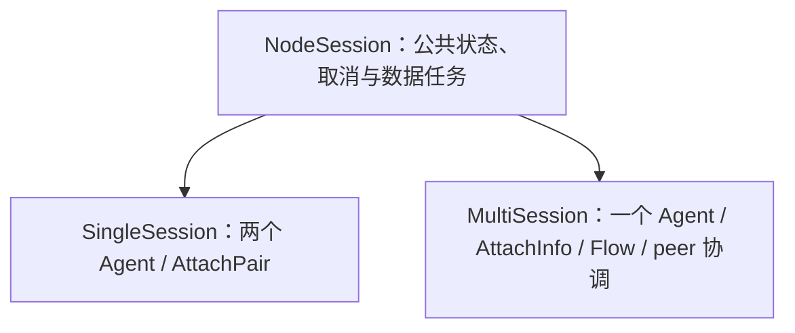

每个具体会话只有 run() 一个控制侧收尾入口：Multi 使用同控制域的原生并行组监视 Flow 关闭，并在进入收尾前排空两支；数据任务停止确认后 ingress 才释放 Flow。Single 则停止数据任务后执行原有 Agent 关闭通知。Ready 里程碑保留历史进度，close_reason_ 的存在表示会话进入结束流程，同时保存首次原因（允许空字符串），不再另存停止布尔值；正常完成原因只在根任务收尾时生成。SessionTransfer 的共享持有仅用于其独立任务和晚到停止处理，两个具体类不另建共享会话所有者；取消信号通过根任务的原生并行组传播到阶段和定时器等待。

#### 3.3.1 单节点会话编排

当 Consumer Agent 与 Producer Agent 恰好接入同一个 RelayNode（或经主控代转到单个服务节点，业务请求不携带 `path`）时，SingleSession 保存两端身份并直接完成本地配对流程：

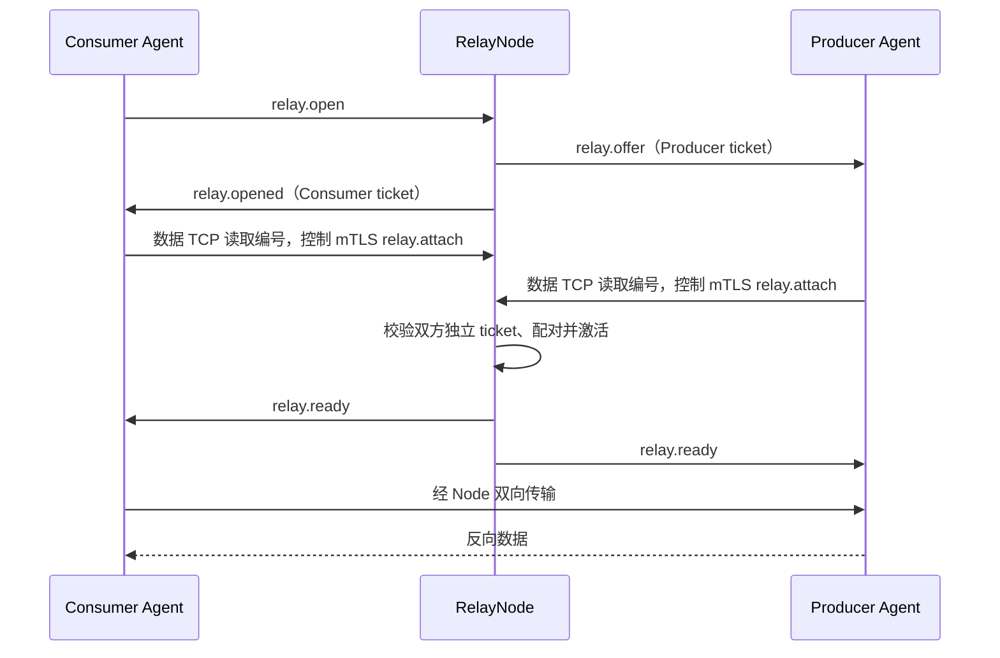

1. **参数提取与分配**：为本次会话分配 Node 本地唯一的 64 位 `uuid` 及双端独立的鉴权令牌 `ticket`，设置绝对建立截止时间（默认 10s）。
2. **双端通知**：同时向 Consumer 发送 `relay.opened`，向 Producer 发送 `relay.offer`。
3. **数据端口接入拦截**：两端 Agent 收到信令后，分别连接共用 TCP 数据端口（18444），读取 Node 的连接编号，再经现有控制 mTLS 发送 `relay.attach` 授权绑定。UDP 仍在 18445 发送独立 CBOR attach，业务数据报另加会话头。
4. **配对与激活**：NodeSession 验证来源、角色与 ticket，数据任务完成授权绑定与准备；实际激活后控制面发送 `relay.ready`，再提交 Transfer 开始流式复制。

#### 3.3.2 多节点首末协调

当选路结果跨越多个节点（如 `path: [node-A, node-B, node-C]`）时，首节点（Ingress）与尾节点（Egress）分别创建 MultiSession，持有路径、Flow 和对端协调状态：

1. **Ingress 节点动作**：
   - 接收 Consumer Agent 的 `relay.open` 报文。
   - 调用 `NodeLinkMgr::open_flow()` 请求 Master 在集群路径上分配并安装端到端 Flow。
   - Flow 安装完成后，Ingress 节点向 Egress 节点发送集群单播 `relay.peer.open` 报文，附带 Flow ID、服务名与访问者信息；同时安装本地接入端点并向 Consumer 返回 `relay.opened`。
2. **Egress 节点动作**：
   - 收到 `relay.peer.open` 后，在本地 `RegistryMgr` 查找目标服务与 Producer Agent。
   - 向 Producer Agent 发送 `relay.offer`。
   - Producer Agent 连接 Egress 节点的数据端口并提交 `RelayAttach`。
   - Egress 节点将数据端口与 Flow 的本地末端（`FlowStream`/`FlowDatagram`）完成绑定，向 Ingress 节点回送集群单播 `relay.peer.attached`。
3. **激活屏障与数据流转**：
   - Consumer Agent 根据 `relay.opened` 连接 Ingress 数据端口并提交 `RelayAttach`。
   - Ingress 节点等待 Consumer 接入并绑定 Flow 首端，同时等待 Egress 的 `relay.peer.attached`；随后激活本地端点，向 Egress 发送 `relay.peer.ready`，向 Consumer 发送 `relay.ready`。
   - Egress 收到 `relay.peer.ready` 后激活本地端点并通知 Producer，双方数据进入多跳 Flow 管道流转。

---

### 3.4 路径安装与事务管理 (NodeLinkMgr)

`NodeLinkMgr` 是跨节点数据管道与 Flow 路径的唯一协调者与事务管理器，声明在 `node/inc/nodelink_mgr.h` 中。

#### 3.4.1 NodeLink 共享邻接连接建立与复用

任意两个物理相邻的 RelayNode 之间，至多维护一条激活的共享 TCP NodeLink 和一条 UDP NodeLink。
- **邻接键归一化**：
  `LinkKey = std::tuple<std::string, std::string, RelayProtocol>`
  规范化排序规则：`left = std::min(nodeA, nodeB)`，`right = std::max(nodeA, nodeB)`。无论从哪一端发起建链请求，均映射为唯一的 `LinkKey`。
- **Master 驱动的两阶段建链**：
  1. Master 向两端同时下发 `link.prepare`。两端各自预留监听或端口资源，完成后回复 `link.prepared`。
  2. Master 收到两端就绪后，指派发起端执行 `link.connect`。发起端主动连接接收端的 NodeLink 端口（18448）并交换 CBOR `link.attach` / `link.attached`；UDP 使用二进制 `Attach` / `Attached` 帧封装关联消息。
  3. 双向握手完成后，两端均向 Master 上报 `link.ready`，物理链路正式进入可复用就绪态。

#### 3.4.2 全路径 Flow 安装事务 (两阶段提交与位图确认)

当业务需要建立一条跨越 `N` 个节点（`2 ≤ N ≤ 8`）的 Flow 时，Master 节点执行严格的两阶段安装事务：

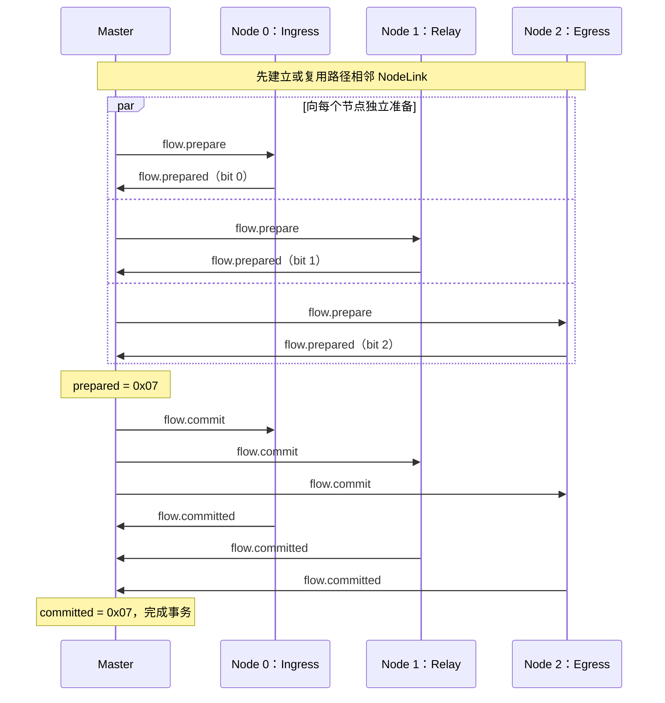

NodeLinkMgr 在 control_io 用普通 `LinkParams`、`FlowParams` 保存已解析的授权参数；MasterPath 持有阶段、阶段内复用的确认位图、结果、期限和可选远端回复目标，LocalFlow 持有本节点 committed 状态。路径、地址和 transport 在输入边界解析，成员变化校验及事务推进直接访问类型字段，不保存 JSON 镜像。跨域仍使用现有 `LinkSpec`、`FlowSpec`。Link/Flow 的入口统一校验事务信封，再分别交给本地端点命令处理或 Master 应答处理；两种角色的状态推进不交错嵌套。Prepare 是内存预留，不包含持久化。

数据面通过 ProtocolEvent 向控制面传递 Link/Flow 通知；command 直接使用已有 CtrlCommand 的对应通知值，不另设通知枚举及映射。通知负载持有 epoch、id、stage 和 reason，控制域收到后结合本地授权构造 CtrlMessage 并发送，跨域通知不构造 JSON。

控制记录按职责分为五个容器，不另建关闭中路径表或观察者表：

| 成员 | 职责与寿命 |
|---|---|
| shared_links_ / SharedLink | Master 保留的共享相邻 Link，建立后继续用于复用。 |
| paths_ / MasterPath | Master 整条路径从建立到关闭协调结束的唯一记录；Closing 仍占用容量及身份。 |
| local_links_ | 当前 Node 的 Link 授权。 |
| local_flows_ / LocalFlow | 当前 Node 的 Flow 授权，包括中间节点；按需关联一个 CloseNotice。 |
| pending_opens_ / PendingOpen | 按值拥有非 Master 入口等待建立应答的请求；open_flow 等待退出后移除。 |

open_flow 在控制域检查状态并按角色直接推进：非 Master 分支先在 pending_opens_ 原位构造请求，再发送请求，以 30 秒上限等待应答，并在退出前移除条目；发送失败也撤销条目，只有已提交但未接受的请求才补发远端关闭请求。接受结果与结果已写入分开判断：等待返回后先检查取消状态，取消后即使成功应答先于等待恢复到达，仍请求远端清理。Master 分支同步登记路径并启动或复用全部相邻 Link，随后只等待 opened；取消等待时关闭该路径，共享 Link 继续由管理器持有。构造 open_flow 的 awaitable 不读取运行状态或发起事务，实际工作在等待时开始。远端 FlowOpen 同样同步登记和启动路径，MasterPath.reply_to 保存回复目标；进入 Active 或提前 Closing 时统一发布结果并取走回复目标，保证每个远端请求只应答一次。没有独立远端应答任务或应答任务计数，events_done_ 仅等待通知接收任务退出。

MasterPath 阶段为 Linking → Preparing → Committing → Active → Closing → Released；建立失败从当前阶段直接进入 Closing。SharedLink 直接保存阶段、失败原因和完成标志，Link 身份只在 params.id 保存；生产代码不再提供单独的 Link 等待协程或完成广播事件。 共享 Link 的创建保留管理器存活、Master 角色和容量约束；路径入口已同步校验的端点、协议、epoch 和成员条件不再逐边重验。Linking 中 acknowledged 的位对应相邻边；Link 完成后在现有路径表中查找仍处于 Linking 的相关事务，直接记就绪位或关闭失败路径。所有边就绪后进入 Preparing 并清零位图，之后复用它记录各节点的 Prepare、Commit 或 Close 应答。 prepare_path 只接受调用方已确认的 Linking 事务：新建启动全程同步执行，Link 完成处理先筛选阶段，成员变化/控制失败在发布 Link 结果前已关闭路径，因此不再重复检查全局运行状态与成员快照。阶段决定接受哪种确认，诊断字符串 result.stage 不参与状态判断；没有每条边的等待协程、Edge 结果对象、聚合 channel 或完成回调。Link 完成的扫描只访问建立中的控制记录，每条路径最多七条边，不新增订阅表或反向索引。opened 通知建立结果，released 通知路径释放完成；重复关闭不刷新期限，迟到的 LinkReady、Prepare/Commit 确认均不推进 Closing。关闭超时归还身份并通过 close_error 通知主动关闭者。 成员变化或控制失败时先以原始原因结束路径，再结束相关共享 Link，避免即时链路结果传播覆盖 membership/control 首因。

LocalFlow 的 CloseNotice 只保存原因及广播事件。最后一份本地授权可先删除，等待协程持有的小通知对象继续存活到恢复结束；取消某个等待不会关闭 Flow 或唤醒其他等待者。wait_flow_closed 在所有 Node（包括 Master）上统一观察本地关闭/授权失效，不等待其他节点的关闭确认。本地授权不存在或 epoch 不匹配时立即返回 flow closed，不保存历史原因。Master 的 close_flow 另行等待 MasterPath.released；本地失效、全路径释放与会话数据任务排空是三个独立完成点。


1. **第一阶段：准备（`FlowPrepare`）**：
   - Master 协调非零 64 位 `flow_id`（远程入口请求时由入口生成），向路径中所有节点下发 `flow.prepare`，携带完整的 `path`、`addresses`、`links`、`request_id` 与 `ttl_ms`，各节点据此派生上一跳与下一跳信息。
   - 各节点在本地 `FlowProtocol` 中创建处于 `Prepared` 状态的 `FlowState`，初始化队列与流控计数，提交时发布初始信用。
   - 节点完成后回复 `flow.prepared`。Master 使用单字节位图 `prepared |= (1 << node_index)` 记录应答。当所有位全部置 1 时，第一阶段完成。

2. **第二阶段：提交（`FlowCommit`）**：
   - Master 向路径上的各节点发送 `flow.commit` 报文，只携带 `master`、`epoch`、`flow_id`、`request_id`；认证 `source` 由集群层填入。节点按本地预留参数核对身份，不再接收或比较整条路径。
   - 各节点在数据执行域上将 `FlowState` 的状态切换为 `Active`，激活物理 NodeLink 与 Flow 之间的数据分发路由。
   - Prepared、Committed、Closed、Error 回复只携带同一事务身份和相应 stage/reason。Master 按已保存的路径核对认证来源及阶段，再通过位图 `committed` 校验所有节点均已激活，随后向发起请求的 Ingress 节点返回成功结果。

#### 3.4.3 事务超时、回滚与主动释放机制

- **超时回滚**：Link 建立、Flow 建立、Flow 关闭和远端开流等待分别使用具名的 10/10/10/30 秒期限，Prepare 报文 TTL 上限从 Flow 建立期限推导。Session 保持自己的绝对建立期限，共享 Link 保持独立期限。创建事务时设置 10 秒期限，邻接建链完成、发送 prepare 前重设 10 秒期限，准备与提交共用后一个期限。若超时时间内任何一个节点未响应或返回错误，Master 立即判定事务失败，向全路径节点发送 `flow.close` 触发回滚清理，并向发起端报错。
- **主动释放（`FlowClose`）**：业务结束或客户端断开时，远程入口发送 `flow.close.request`，由 Master 下发 `flow.close`。Master 收集路径上所有节点的 `flow.closed` 确认，完成全路径清理确认；关闭确认最多等待 10 秒，超时记录错误并释放协调状态；非 Master 的 close_flow 在关闭请求提交失败时抛出带提交状态的异常，提交成功后最多等待 10 秒确认本地失效，**但物理共享的 NodeLink 保持长连接常驻，不随单条 Flow 的关闭而断开**。

---

### 3.5 控制通道通信保障 (TLSChannel & WireMessage)

所有的控制通道（Agent 与 Node 之间、Node 与 Master 之间）均基于 `protocol/inc/tls_channel.h` 中的 `TLSChannel` 运行，基于 TLS 保证信道的机密性与完整性。

#### 3.5.1 WireMessage 帧结构与分片机制

控制信道承载 CBOR 编码的 `CtrlMessage`，底层通过 `WireMessage`（`protocol/inc/message.h`）进行二进制封包：

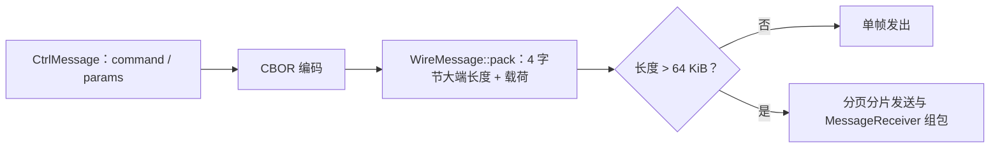

- **定长 4 字节前缀**：网络字节序（大端）表示载荷长度。单包最大载荷长度为 **16 MB**。
- **分片保护**：当控制消息载荷超过 64 KB 时，底层通道自动进行页面级分片组包（`MessageReceiver`），避免一次性大内存分配导致系统震荡。

#### 3.5.2 TLSChannel 心跳与断线重连状态机

- **心跳机制**：双向周期性发送 `ping` 控制帧（默认间隔 5s），对端必须立即回复 `pong`。
- **失联判定**：当持续未收到心跳响应的时间达到 `heartbeat_timeout_ms`（默认 20s）时，`TLSChannel` 主动切断 TCP 连接，触发物理 Socket `close()` 并向拥有者抛出断线异常。


## 4. 路由面：链路测量与路径决策

RelayWeave 不依赖静态配置的网关路由，而是通过内置的**持续主动测量网络、指数衰减质量模型与带中继惩罚的最短路径图算法**，动态发现并实时规避互联网公网中的拥塞与劣质链路。

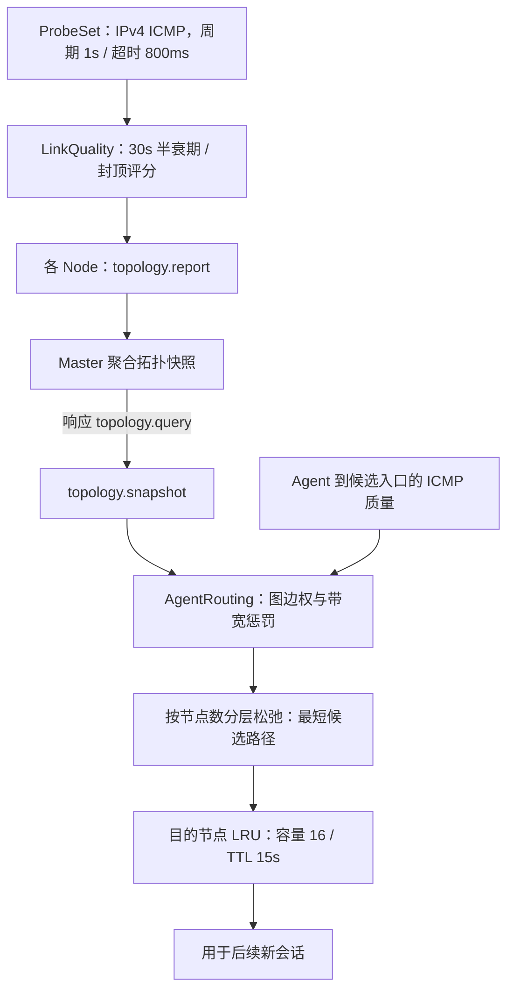

---

### 4.1 主动探测与指标采集 (ProbeSet & ICMP)

链路测量由 `route/src/probe_set.cpp` 和 `route/src/icmp.cpp` 协同完成：
1. **ICMP 质量探测与 NodeLink 保活**：
   - Linux 环境下通过原始套接字（Raw Socket）周期发送 ICMP Echo Request 报文，测量往返时延（RTT），探测周期 1 秒、超时 800ms。
   - 跨节点物理链路通过在既有 NodeLink 上发送轻量级定长 `Ping` 二进制帧进行保活，独立于 ICMP 链路质量统计。
2. **高精度单调时钟采样**：发包前记录 `std::chrono::steady_clock::now()`，回包解析后计算纳秒级微小时延，避免系统时钟回拨或 NTP 调步产生假时延。
3. **样本过滤**：单次采样 RTT 限制在合法区间 0～60,000 ms。任何格式错误、乱序过期的探测样本直接丢弃，不污染统计历史。

---

### 4.2 链路质量评估模型 (LinkQuality)

`route/src/link_quality.cpp` 实现了基于**指数加权衰减（EMA）与对数正态综合成本打分**的质量评估器。模型同时维护成功 RTT 的诊断统计与包含失败惩罚的评分统计，输出链路成本、置信度与可用状态，为路径选择提供统一的毫秒级成本尺度。

#### 4.2.1 指数加权移动平均（EMA）与半衰期设计

为了快速响应突发网络劣化的同时平滑瞬时网络毛刺，模型采用**统一的 30 秒半衰期（Half-Life）衰减机制**：

$$
\lambda = 2^{-\Delta t / 30}
$$

其中 `Δt` 为本次探测完成时间距上一次完成时间的间隔（秒）。每完成一次探测，先按该间隔衰减历史，再累加当前样本；经过 30 秒，旧样本的权重降为原来的一半。

评估器持续维护以下衰减累加量（`Ema` 结构体）：

| 数学记号 | 实现字段 | 统计含义 |
|---|---|---|
| `W_c` | `completed_weight` | 全部已完成探测的衰减权重，包括成功与失败。 |
| `W_r` | `received_weight` | 成功探测的衰减权重。 |
| `R_1` / `R_2` | `rtt_sum` / `rtt_square_sum` | 成功 RTT 的加权和、加权平方和。 |
| `S_1` / `S_2` | `score_sum` / `score_square_sum` | 全部探测评分的加权和、加权平方和。 |

设当前成功指示量为 `I`（成功为 1，失败为 0），成功样本 RTT 为 `r`，本次评分为 `s`，则更新规则为：

$$
\begin{aligned}
W_c' &= \lambda W_c + 1, & W_r' &= \lambda W_r + I \\
R_1' &= \lambda R_1 + I r, & R_2' &= \lambda R_2 + I r^2 \\
S_1' &= \lambda S_1 + s, & S_2' &= \lambda S_2 + s^2
\end{aligned}
$$

失败样本的 RTT 项贡献为 0，但仍衰减已有的成功统计。`record()` 接受的成功 RTT 必须为有限值且处于 0～60,000ms，完成时间不得早于上一次样本；非法样本不改变统计状态。

当两次完成探测的间隔达到 **30 分钟**时，重新建立衰减历史与连续失败计数，避免长期停用后的旧质量影响新一轮评价。`total_completed` 与 `total_received` 继续保留生命周期累计计数。

#### 4.2.2 失败惩罚机制与打分封顶替换

传统的网络测量若直接将丢包视为无穷大时延，会导致均值失真；若忽略丢包，又会低估链路劣化。RelayWeave 采用实用的**打分封顶替换（Capped Score Substitution）**策略，以 `scoring_timeout = 800ms` 为统一评分上限：

$$
s = \begin{cases}
\min(r,800), & \text{探测成功} \\
800, & \text{探测失败}
\end{cases}
$$

1. **成功 RTT 保留真实诊断值**：`rtt_sum` 与 `rtt_square_sum` 累加实际 RTT，便于观察真实时延与抖动；评分统计则将成功样本封顶为 800ms。
2. **失败样本进入评分分布**：超时或丢包以 800ms 累加到 `score_sum` 与 `score_square_sum`，将高惩罚样本纳入评分均值与离散程度计算，使间歇丢包的快速链路承担更高成本。
3. **丢包率独立保留**：失败计入已完成权重、不计入成功权重，形成衰减丢包率，并参与可用性判定。

这一设计使 RTT 均值、抖动、丢包率与综合成本各自具有明确含义：诊断指标用于解释链路状态，评分指标用于比较转发路径。

#### 4.2.3 质量评估输出与边权成本公式

调用 `assess(now)` 输出当前时刻的评估快照，包含以下三个层级：

| 输出层级 | 关键字段 | 用途 |
|---|---|---|
| **诊断统计 `metrics`** | `rtt_ms`、`jitter_ms`、`loss_rate` | 展示成功 RTT 均值、标准差与衰减丢包率。 |
| **质量摘要 `quality`** | `cost`、`confidence`、`usable` | 表达基础评分、证据充分程度与路由准入状态。 |
| **采样状态** | `total_completed`、`total_received`、`last_success_age` | 表达累计完成量、成功量与最后成功探测的年龄。 |

##### 1. 诊断 RTT、抖动与丢包率

成功 RTT 的加权均值与标准差分别为：

$$
\mu_r = \frac{R_1}{W_r}, \qquad
\sigma_r = \sqrt{\max\left(0,\frac{R_2}{W_r}-\mu_r^2\right)}
$$

其中 `jitter_ms` 取标准差 `σ_r`，反映 RTT 样本自身的离散程度。衰减丢包率为：

$$
p_{\mathrm{loss}} = \operatorname{clamp}\left(1-\frac{W_r}{W_c},0,1\right)
$$

当尚无完成样本、评价时间早于最后样本，或成功衰减权重低于 `1e-9`、衰减丢包率达到 1 时，质量成本为空、置信度为 0、链路不可用；最后成功年龄与生命周期计数仍可用于诊断。

##### 2. 有界对数正态尾部成本

评分统计覆盖成功与失败两类样本。设评分均值为 `m`、方差为 `v`，则：

$$
m = \operatorname{clamp}\left(\frac{S_1}{W_c},0,800\right), \qquad
v = \max\left(0,\frac{S_2}{W_c}-m^2\right)
$$

模型用这两个矩拟合对数正态分布的 **95% 分位成本**，使偶发高延迟与丢包对路径选择产生比平均 RTT 更明显的影响。取标准正态 95% 分位常量 `z = 1.6448536269514715`，当 `m > 0` 且 `v > 0` 时：

$$
c_v = \min\left(\frac{\sqrt{v}}{m},\sqrt{\exp(z^2)-1}\right), \qquad
\sigma_{\log} = \sqrt{\ln(1+c_v^2)}
$$

$$
C = \min\left(800,\;m\exp\left(z\sigma_{\log}-\frac{\sigma_{\log}^2}{2}\right)\right)
$$

当均值或方差为 0 时，直接取 `C = m`。变异系数 `c_v` 的上限使 `σ_log` 不超过 `z`，保持尾部成本随离散程度增大而不下降；最终成本封顶为 800ms，避免极端样本导致数值发散。

**等权样本评分示例**：以下样本均在同一时刻完成，权重相等，仅比较基础成本 `cost`。

| 探测结果 | 成功 RTT 均值 | 成功 RTT 抖动 | 衰减丢包率 | 基础成本 `C` |
|---|---|---|---|---|
| 全部成功，RTT 均为 20ms | 20ms | 0ms | 0% | 20ms |
| 成功 RTT 为 10ms、30ms，各占一半 | 20ms | 10ms | 0% | 约 38.906ms |
| 9 次成功 RTT 为 20ms，1 次失败 | 20ms | 0ms | 10% | 约 365.938ms |

因此，低平均 RTT 但持续丢包的链路，可能比稳定的较高 RTT 链路成本更高；诊断 RTT 与路由评分共同解释这一选路结果。

##### 3. 置信度与冷启动处理

置信度综合采样覆盖时间与有效证据量，范围为 0～1。设 `T_span` 为首个到最后一个完成样本的时间跨度，`T_idle` 为评价时刻距最后完成样本的间隔，二者单位均为秒：

$$
q_{\mathrm{time}} = \operatorname{clamp}\left(\frac{T_{\mathrm{span}}}{30},0,1\right)
$$

$$
W_{\mathrm{effective}} = W_c\,2^{-T_{\mathrm{idle}}/30}, \qquad
W_{\mathrm{target}} = \frac{0.8\times0.5\times30}{\ln2} \approx 17.312
$$

$$
q = \min\left(q_{\mathrm{time}},\frac{W_{\mathrm{effective}}}{W_{\mathrm{target}}}\right)
$$

- **时间覆盖约束**：刚开始探测时，即使瞬间收到大量样本，采样时间覆盖度仍较低；连续观察达到 30 秒后，该项可达到 1。
- **有效证据约束**：稀疏采样或长时间没有新结果时，衰减后的证据量降低，置信度随之下降。
- **冷启动选路**：可用性由链路质量与时效门限决定，置信度通过后续附加成本影响候选排序，使新链路可以参与比较并承担适度的证据不足惩罚。

##### 4. 链路可用性门限

在具备有效成功证据的基础上，`usable` 要求以下条件**同时成立**：

| 判定项 | 准入条件 | 保护目的 |
|---|---|---|
| 衰减丢包率 | 小于 0.5 | 排除近期多数探测失败的链路。 |
| 连续失败次数 | 少于 5 次 | 快速识别持续失联，避免旧成功历史掩盖当前故障。 |
| 最后成功年龄 | 小于 45 秒 | 保证链路近期具有成功通信证据。 |
| 最后完成样本年龄 | 小于 15 秒 | 排除停止更新或探测任务停滞的评价结果。 |

成功样本将连续失败计数清零；达到任一门限即取消路由准入，后续探测恢复并满足全部条件后重新参与选路。

##### 5. 新鲜度修正与最终边权

`routing_cost(quality, age)` 将基础成本与置信度转换为最终路由边权。`age` 表示成功探测的年龄；拓扑汇总与 Agent 使用快照时继续累加等待时间。设其秒数为 `a`，新鲜度系数为：

$$
f(a) = \begin{cases}
1, & 0\le a\le25 \\
1+0.5\left(\dfrac{a-25}{20}\right)^2, & 25<a<45
\end{cases}
$$

$$
C_{\mathrm{route}} = C f(a) + 5(1-q)
$$

前 25 秒保持基础成本，之后以二次项增加老化惩罚；低置信度附加 0～5ms 成本。800ms 封顶作用于基础评分，最终边权还会叠加这些修正。当 `usable` 为假、成本或置信度非法、年龄为负或达到 45 秒时，返回空值，图模型不接纳该边。

例如，`cost = 20ms`、`confidence = 1` 时，年龄为 25 秒的边权为 20ms，35 秒时为 22.5ms，达到 45 秒后失效；同样的 20ms 新鲜链路在置信度为 0.4 时，边权为 23ms。Agent 还要求拓扑快照与来源节点报告保持在 15 秒有效期内，使链路年龄与拓扑报告时效共同约束选路。

---

### 4.3 动态图模型与最短路径算法 (RouteGraph)

`route/src/route_graph.cpp` 提供了拓扑图模型与带约束的最短路径求解器。

#### 4.3.1 拓扑快照聚合与发布

1. **节点定期上报**：各 RelayNode 在探测本地到相邻节点的质量后，封装为 `topology.report` 发送至 Master。
2. **Master 全局聚合**：Master 维护全网两两节点的链路质量矩阵，通过 `topology.snapshot` 响应查询。
3. **Agent 消费快照**：Agent 接收快照并在本地重构图邻接表，无需向所有潜在中继节点独立发起海量探测，有效收敛全网测量开销。

#### 4.3.2 有界最短路径扩展与中继惩罚 (relay_penalty)

在实际公网中，如果直接路径与两跳中继路径的时延仅相差 1ms，选择中继路径会无端消耗中间节点的带宽、内存与 CPU，增加额外的潜在故障点。

为此，`RouteGraph` 按实际 Node 数分层扩展候选路径，并在每次扩展时计入**固定中继惩罚常数**：

$$
\text{relay\_penalty} = 2.0\text{ ms}
$$

- **算法执行规则**：
  - 从候选入口节点集合（`Entry`）出发向目标节点搜索。
  - 每当算法从当前中继节点向下一跳节点扩展一条弧（Arc）时，路径总成本累加规则为：

    $$
    \text{Cost}_{\mathrm{new}} = \text{Cost}_{\mathrm{curr}} + \text{Cost}_{\mathrm{edge}} + \text{relay\_penalty}
    $$

  - **工程决策效果**：每增加一条 Node 间弧，就承担 **2.0ms 中继成本**；路径比较同时考虑接入质量、链路评分和节点带宽余量，使传输质量优化与系统资源开销保持合理权衡。

**节点带宽余量惩罚**：`AgentRouting` 使用节点报告的可用带宽比例 `b`，为入口及后续经过的节点增加资源成本：

$$
P_{\mathrm{bandwidth}}(b)=10\left(\frac{1}{\max(b,0.05)}-1\right)
$$

例如，余量为 100% 时惩罚为 0ms，50% 时为 10ms，10% 时为 90ms，低于 5% 后封顶为 190ms。缺少余量数据或报告过期时，该项取 0；Node 间边仍需通过链路质量与报告时效校验。

对于包含 `n` 个 Node 的路径，设入口为 `v_0`、出口为 `v_(n-1)`，总成本为：

$$
C_{\mathrm{path}}=C_{\mathrm{access}}(v_0)+P_{\mathrm{bandwidth}}(v_0)
+\sum_{i=1}^{n-1}\left(C_{\mathrm{route}}(v_{i-1},v_i)+P_{\mathrm{bandwidth}}(v_i)+2\right)
$$

Agent 对每个可测入口计算到目的节点的候选路径，按总成本排序；成本相同则按节点序列字典序择优。这样，入口接入、每跳质量、节点资源余量与额外中继开销均纳入同一决策尺度。

#### 4.3.3 Agent 路径决策与多节点候选路由缓存

- **跳数深度约束**：`RouteGraph::shortest_paths` 在搜索中接受 `max_nodes` 参数（Agent 端默认配置为 4，协议最大支持 8）。超过最大节点深度的路径分支被剪枝。
- **LRU 缓存机制**：Agent 将计算得到的最优路径（如 `agent -> node-shanghai -> node-tokyo -> target`）缓存在本地 LRU 缓存中（容量 16，TTL 15 秒）。在拓扑无显著变化或会话重连时直接命中，避免频繁触发重复的图遍历计算。


## 5. 数据面：协议栈、流控与调度

数据面是 RelayWeave 实现超低时延与超高吞吐的核心。它负责在物理传输通道上承载各条并发业务流，运行在 `cluster_data_io` 执行域。

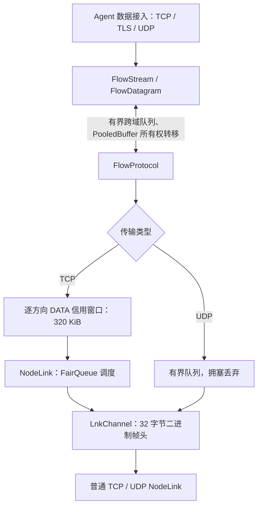

---

### 5.1 数据通道二进制帧与接入协议

所有进入数据面的网络报文，均使用精简的高性能二进制定长头部进行编解码，坚决规避文本与动态序列化开销。

#### 5.1.1 固定二进制帧头结构 (LnkFrameHeader: 32 字节)

跨节点物理 `NodeLink` 上流转的每一个数据或控制帧，统一以定长 **32 字节** 的 `LnkFrameHeader`（`protocol/inc/message.h`）为前缀：


| 字段 | 长度 | 含义与取值约束 |
|---|---|---|
| **Magic** | 8 bits | 固定魔数 `0x4E`（ASCII 字符 `'N'`），用于快速识别非法字节流。 |
| **Version** | 8 bits | 协议版本号，当前版本为 `2`。 |
| **Kind** | 8 bits | 帧类型枚举（`LnkFrType`），详见 5.1.2 节。 |
| **Flags** | 8 bits | 标志位集合。低 1 位（Bit 0）表示 `reverse`（反向数据传输标识）。 |
| **Body Length** | 32 bits | 网络字节序（大端）。后续承载的用户载荷字节数，最大不超过 65,467 字节。 |
| **Epoch** | 64 bits | 本帧所属的集群版本号，与当前集群 Epoch 不一致时立即丢弃。 |
| **Flow ID** | 64 bits | 逻辑流的全局唯一 64 位标识；若为 NodeLink 控制帧（如 Ping/Pong/Attach/Attached），此字段填 `0`。 |
| **Sequence** | 64 bits | 复合序列号。在 Ping/Pong 中用作单调心跳序号；在 Credit 帧中用作累加信用上限（Cumulative Limit）。 |

#### 5.1.2 帧类型枚举与语义规范 (LnkFrType)

`LnkFrType` 覆盖数据传输与链路层控制指令：
- `Data (1)`：携带用户业务载荷数据帧。
- `Fin (2)`：流式传输半关闭通知帧。表示本方向的数据已发送完毕，不再有后续 Data 帧。
- `Reset (3)`：流异常中断帧。强制销毁指定 Flow。
- `Ping (4) / Pong (5)`：物理链路心跳探测与往返时延测量帧。
- `Attach (7) / Attached (8)`：UDP NodeLink 建立时的双向对称关联激活握手帧。
- `Credit (9)`：逐跳流量控制帧。下游向上游返还信用额度，`sequence` 携带累加释放上限。

#### 5.1.3 Agent 业务接入头

1. **TCP/TLS 控制绑定 `RelayAttach`**：Node 接受普通 TCP socket，生成密码学安全的 32 字节随机 `connection_id` 并原样发送。Agent 精确读取后，经原主控 mTLS 发送下列报文；主控按 `node_id` 转送至数据 Node，携带经过认证的来源 Node 和 Agent session 身份。

   ```json
   {"command":"relay.attach","params":{"role":2,"uuid":1048576,"ticket":9876543210,"connection_id":"0123456789abcdef0123456789abcdef0123456789abcdef0123456789abcdef","node_id":"edge-1"}}
   ```

   `Producer=1`、`Consumer=2`，UUID 与 ticket 非零；编号为固定 64 位小写十六进制字符串。数据 Node 校验实际 AgentPeer、角色和当前票据，随后在 transfer_tcp_io 原子地消费待绑定 socket。相同请求幂等，不同连接不能覆盖已有槽位。编号公开而无授权能力，ticket 不在数据 TCP 上发送。未绑定连接受 `tcp.max_setup_connections` 和 `tcp.setup_timeout_ms` 限制；提前业务数据、断开、超时或停止均回收。单节点两端 UUID 相同、票据不同；多节点首末 UUID 各自分配。

2. **端到端 TLS 业务**：收到 `relay.ready` 后，两端 Agent 使用 TLS 1.3 双向 RPK 握手，Consumer 为 client、Producer 为 server。固定公钥来自双方原共享客户端证书，私钥沿用原配置，无需签发 Producer 证书。Consumer 在加密通道内发送 4 字节大端长度及服务名（最多 64 字节）；Producer 核对服务、连接目标后返回单字节 `1`。随后每个加密业务帧为 4 字节大端长度及数据，最大 64 KiB，与 NodeLink 载荷上限无关；零长度是单方向业务 FIN。两方向排空后才交换 TLS close_notify，再半关闭 TCP 并等待对端 EOF。Node 始终只转发原始 TCP 字节，既不解密也不解析业务帧。

3. **UDP `DatagramHeader`**：Agent 的业务数据报以 8 字节大端非零 `session_id` 开头。首次接入直接发送 `WireMessage::pack(relay.attach)`，不加 session 头；收到 ready 前每 500ms 重试 attach，业务报文为会话头 + 用户载荷。Node 根据会话 ID 解复用并绑定来源地址。UDP 两端有各自的会话 ID，无 TCP 式接入连接。

4. **UDP NodeLink 封装**：8 字节 link ID + 32 字节 `LnkFrameHeader` + 载荷，最大用户载荷为 `65507 - 8 - 32 = 65467`；该 link ID 不等于 Agent 的 session ID。

---

### 5.2 逻辑流传输引擎 (FlowProtocol)

`FlowProtocol` 声明于 `protocol/inc/flow_protocol.h`，是承载所有逻辑流的顶层状态机服务。

#### 5.2.1 FlowState 生命周期与状态迁移

每个 Flow 在节点内维护一个 `FlowState` 对象：

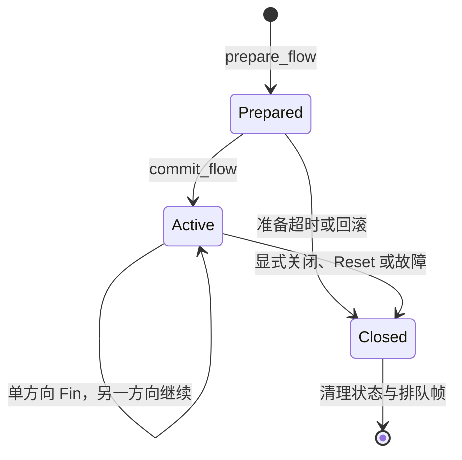

- **`Prepared` 阶段**：节点响应 Master 的 `FlowPrepare` 事务，初始化流控参数与缓冲区队列，但不接收和转发数据帧。
- **`Active` 阶段**：收到 `FlowCommit` 后进入激活状态。允许数据在邻接链路与端点间流转，本地端口绑定后启动对应的端点收发任务。
- **`Closed` 阶段**：双向传输结束或收到异常关闭指令，释放所有排队帧与流控额度，向控制面抛出排空事件。

#### 5.2.2 流式传输端口：FlowStream

面向 TCP 与 TLS 业务，业务数据通过 `FlowStream` 进出：
- `pool`：端口持有不可重绑定的共享分配资源句柄，调用方直接构造 `PooledBuffer` 载荷。TCP 复用 32 KiB 堆读取缓冲，读完后按实际长度分配池块并复制；TLS 先校验帧长度，再直接读入对应大小的池块。端口状态和发送载荷上限统一由 `send()` 检查。
- `send(PooledBuffer)`：向 Flow 写入不超过 `maximum_chunk_size` 的数据块，封装为 `Frame` 并受发送信用约束；信用不足时由有界发送队列向调用方传递背压。
- `finish_send()`：触发本端半关闭，向下游排队发送 `Fin` 帧。
- `receive()`：协程等待下游数据交付；返回 `std::nullopt` 时表示收到对端 `Fin` 帧（EOF）。
- `complete_receive()`：**核心流控反馈契约**。调用方仅在真正将数据写出给本地客户端或下游 Socket 后，才调用此接口，触发流控信用向上游释放。

#### 5.2.3 数据报传输端口：FlowDatagram

面向 UDP 业务，通过 `FlowDatagram` 交互：
- `try_send(span<uint8_t>)`：非阻塞快速发送。队列满、端口关闭或分配失败时返回 `false`；超限载荷抛出参数错误，由入口预先检查并丢弃。
- `receive()`：协程等待下一个有效数据报。

---

### 5.3 物理邻接传输层 (LnkChannel & NodeLink)

`LnkChannel` 负责底层物理 Socket 的实际 I/O 驱动与多路复用。

- **TCP NodeLink**：
  - 物理连接建立时先交换 CBOR `link.attach` / `link.attached` 进行对端确认，之后切入全二进制数据流。
  - 每个连接拥有独立的 `tcp_read` 与 `tcp_write` 协程循环。写路径由 `FairQueue` 统一调度；读路径解析 32 字节帧头后，直接通过 `FlowProtocol::receive()` 按 Flow ID 分派。
- **UDP NodeLink**：
  - 节点间采用单一共享 UDP Socket（端口 18448）。
  - 在正式转发前，两端必须通过定长 `Attach` / `Attached` 帧完成双向对端识别与端口绑定。

---

### 5.4 逐跳信用流控机制 (Hop-by-Hop Credit Flow Control)

RelayWeave 摒弃了端到端粗粒度的 TCP 窗口流控，在 Overlay 网络中实现了**逐跳（Hop-by-Hop）的精细化信用流控**。

#### 5.4.1 逻辑计费模型与 Frame 内存开销计算

每一帧在信道上流转时，都会消耗确定数量的信用额度（Credit Units）。`Frame::charge_for_payload(size)` 提供了稳定的计费规范：

$$
\text{charge}(S) = 128 + \begin{cases} 0, & S = 0 \\ \text{bit\_ceil}(\max(S, 256)), & S > 0 \end{cases}
$$

- **空帧与 FIN 帧**：固定计费 **128 字节**。
- **带载荷数据帧**：基础管理开销 128 字节加上载荷向上取整至 2 的幂次（最小 256 字节）。例如 1000 字节载荷向上对齐为 1024，计费为 `128 + 1024 = 1152` 信用额度。
- **内存对齐静态断言**：源码中静态断言 `sizeof(Frame) <= 128`，确保逻辑计费模型覆盖底层对象元数据开销。

池块按实际载荷长度分配，本地预算与线上 DATA 信用均使用 `Frame::charge()`，保持收发双方一致。TCP 读到 1 字节时，只创建 1 字节池块，本地占额与 DATA 信用均为 `256 + 128`。本地占额和线上信用仍独立维护，在实际写出或下游消费后释放；FIN 占用本地管理预算，不消耗 DATA 信用。

#### 5.4.2 状态变量与发送准入控制

在 Flow 的每个传输方向上，维护以下核心状态变量：
- `sent_bytes`：本跳已累计发送的数据计费总和。
- `send_limit`：本跳允许累计发送的信用上限值（初始为每个方向 320 KiB，由对端返回的累加 Sequence 推进）。
- `released_bytes`：本端已向下游完整写出并释放的计费总和。

**发送准入条件**：

$$
\mathrm{sent\_bytes} + \text{charge}(frame) \le \mathrm{send\_limit}
$$

当该条件不满足时，该 Flow 的后续帧被拦截在 `pending_frames` 队列中，暂停物理发送。

**在途缓冲上限分析**：
由于单流初始信用窗口为 `W_init = 320 KiB`，且只有在收到对端的信用返还时 `send_limit` 才会增长，因此在任何时刻，单条 Flow 在本跳物理发送队列与链路中滞留的飞行数据量上限被严格限制为：

$$
\text{Max Flight Bytes} \le W_{\mathrm{init}} + \text{Max Frame Charge} \approx 320\text{ KiB} + 65.5\text{ KiB} \approx 385.5\text{ KiB}
$$

这一机制保证了无论网络发生何等严重的延迟或下游阻塞，单条流都不会无限制消耗中继节点的内存。

#### 5.4.3 信用发布、合并与定时聚合调度

- **累加绝对限额设计**：`Credit` 控制帧的 `sequence` 字段传递的是**累加绝对限额（`released_bytes + W_init`）**，而非增量 Delta。这一设计使得即使偶发网络乱序或丢失了前一个 Credit 帧，最新的 Credit 帧也能完整覆盖并自愈状态，避免流控漂移。
- **信用合并（Coalescing）**：同一条 NodeLink 上的多条 Flow 释放信用时，更新 `NodeLink::credits` 映射表进行合并。
- **定时调度**：所有待发送的信用帧在全局定时器 `credit_deadline_` 到达时批量刷写，避免每释放一个微小数据包就发送一个空 Credit 报文，节省链路带宽。

#### 5.4.4 慢末端背压传递与链路级恢复分析

当多跳链路的最末端消费者（如由于网络卡顿、磁盘写满导致读取缓慢）发生阻塞时：
1. 尾节点 `FlowStream::complete_receive()` 停止被调用；
2. 尾节点的 `released_bytes` 停止增长，停止向倒数第二跳发送 `Credit` 帧；
3. 倒数第二跳节点的 `send_limit` 维持不变，随着本地已发数据累加至上限，触发准入拦截，帧开始在本地 `pending_frames` 堆积；
4. 倒数第二跳的缓冲达到本地上限后，停止向上游调用 `complete_receive()`；
5. **背压沿着全路径各跳逐级向上反向传递**，直至入口 Ingress 节点；
6. Ingress 节点停止读取客户端 Socket，TCP 原生滑动窗口自然缩小填满，从客户端源头上阻止流量涌入。
7. 当末端恢复读取后，`Credit` 帧沿着路径逐级反向激活，整条链路在毫秒级内自动恢复全双工平稳吞吐。

---

### 5.5 近似公平队列调度算法 (FairQueue)

#### 5.5.1 多流复用问题与公平队列设计目标

当成百上千条并发 Flow 共享同一条物理 TCP NodeLink 发送连接时，如果采用朴素的单 FIFO 队列，一个突发发送大文件的 Flow 会迅速填满整个发送队列，导致交互式 SSH 等小数据流面临严重的队头阻塞。

传统的加权公平排队（WFQ）算法需要为每个流维护独立的子队列和时间戳，在高并发连接下会产生较大的内存开销与常数级遍历成本。

`protocol/inc/fair_queue.h` 实现了实用的 **FairQueue** 算法，其设计目标为：
1. 内部仅维护单一扁平 `std::list<Entry>`，无需维护多级子队列；
2. 出队严格在队首 `O(1)` 弹出；
3. 入队时通过**同标签交错插入（Tag Interleaving）**，实现无饿死的近似轮询调度；
4. 流关闭时支持按标签批量删除，不破坏其他流的相对排队顺序。

#### 5.5.2 标签定义、交错插入规则与成员扫描集合复用

FairQueue 将调度工作前移到入队阶段：**先保持同一流方向的帧顺序，再把新帧插入其他流帧之间的合适位置**。发送协程始终读取队首，因而可以使用单一列表完成多流交错调度。

##### 1. 流标签与同流顺序

流标签定义为 `FlowWriteTag { const FlowState *flow, bool reverse }`，由具体 Flow 对象与传输方向共同标识。两个方向分别参与调度，同一数值 Flow ID 被新对象复用时，也可通过对象身份区分。

每次插入都从**队列中最后一个同标签项之后**开始查找位置，确保同一标签始终保持 FIFO 顺序。TCP DATA 与 FIN 使用同一套标签与队列，FIN 因此排在该方向此前的 DATA 之后，保留业务半关闭语义。

##### 2. 最长不重复标签前缀与插入边界

`push(tag, value)` 的具体过程分为以下四步：

1. **确定扫描起点**：如果 `last_inserted_` 仍有效且标签与本次相同，直接取其后继；否则从队尾反向查找最后一个同标签项，找到后从其后继开始扫描；当前队列中没有该标签时，从队首开始。
2. **清空本次扫描记录**：调用 `seen_.clear()`，为本次扫描重新记录出现过的标签。
3. **跳过最长不重复前缀**：依次检查当前位置标签。若该标签首次进入 `seen_`，扫描位置向后移动；一旦遇到已出现的标签，停止扫描。
4. **就地插入并更新缓存**：在停止位置之前执行 `list::insert`；若已到队尾，则追加到末尾。将新节点保存到 `last_inserted_`，供后续连续同标签入队复用。

**插入边界由扫描区间中的首次重复标签决定，该标签可以属于任意 Flow。** 例如向 `A1, B1, A2, B2` 插入此前不存在的 `C1`，扫描先跳过 A1、B1，在第二个 A 标签的 A2 处停止，得到 `A1, B1, C1, A2, B2`。

标签互不相同的片段相当于一次局部轮询：已经在该片段出现的流即将再次占据发送位置时，新帧获得插入机会。此轮次由当前队列内容自然形成，调度器只维护扫描集合与插入位置缓存。

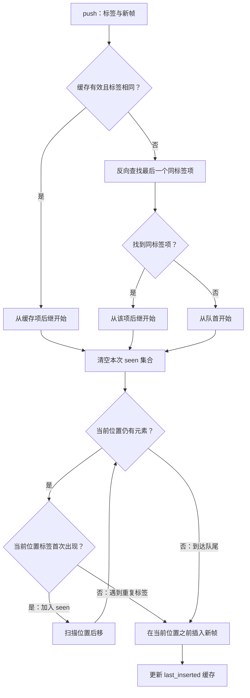

##### 3. 多流突发入队推演

设 A 流已经积压 A1、A2、A3，随后 B、C 两条流连续到达。各次插入的扫描过程如下：

| 新到帧 | 扫描起点 | 跳过的标签片段 | 停止位置 | 插入后的队列 |
|---|---|---|---|---|
| B1 | 队首 A1 | A1 | A2：A 标签重复 | A1, B1, A2, A3 |
| B2 | 最后一个 B 标签项 B1 之后 | A2 | A3：A 标签重复 | A1, B1, A2, B2, A3 |
| C1 | 队首 A1 | A1, B1 | A2：A 标签重复 | A1, B1, C1, A2, B2, A3 |
| C2 | 最后一个 C 标签项 C1 之后 | A2, B2 | A3：A 标签重复 | A1, B1, C1, A2, B2, C2, A3 |

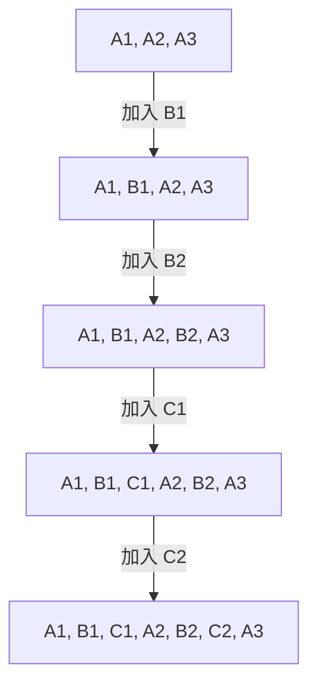

B2、C2 都排在各自前一帧之后，同时穿插在 A 的积压帧之间。队首 A1 始终保留下一次发送机会，新流量则可以在 A2 之前参与交错，兼顾旧帧推进与新流响应。

当扫描区间内各标签均不重复时，新帧直接追加到末尾；当同标签帧已在队尾时，新帧也直接追加。两种情况都延续该流既有的帧顺序。

##### 4. 插入缓存与扫描集合复用

- **连续入队缓存**：`last_inserted_` 指向最近插入的节点。连续同标签入队时，它恰好也是该标签的最后一个排队项，可以省去反向查找；其他情况下仍按列表内容定位。
- **稳定迭代器**：`std::list` 插入保持已有节点迭代器有效；`pop()` 删除缓存项时将其失效，`erase(tag)` 与 `clear()` 在删除前统一清除插入缓存。
- **哈希桶复用**：成员 `seen_` 在每次扫描前清空，保留底层桶容量以减少重复扩容；列表节点与哈希集合元素仍按需分配。

#### 5.5.3 算法复杂度、出队/删除语义与正确性验证

##### 1. 操作复杂度与调度开销

设当前队列总长度为 `Q`，各操作的开销如下：

| 操作 | 复杂度 | 行为 |
|---|---|---|
| `push(tag, value)` | 通常哈希假设下最坏为 `O(Q)` | 反向定位最后一个同标签项，再扫描不重复标签片段；缓存命中时省去定位步骤。 |
| `front()` / `pop()` | `O(1)` | 直接访问并移除队首，发送热路径无需寻找下一个流。 |
| `erase(tag)` | `O(Q)` | 线性删除指定标签的全部排队项，保留其他项的相对顺序。 |
| `clear()` | `O(Q)`，另含扫描集合元素清理 | 释放排队节点、载荷与集合元素，重置缓存状态。 |

交错单位为**帧及其流方向标签**。不同流的帧长可以不同，因此实际字节份额与等待时间还取决于载荷大小、活跃标签数、信用窗口和物理链路速率；FairQueue 提供近似轮询的帧级公平性。

##### 2. NodeLink 发送路径中的协作

TCP NodeLink 将 DATA 与 FIN 放入 `writes` 公平队列，Credit 按 Flow ID 与方向在 `credits` 中合并，其他控制帧进入 `controls`。写协程优先处理控制帧与 Credit；当业务队列非空时，连续发送 16 个控制帧后选取一个业务帧，再重新开始控制优先计数。

Flow 关闭时，分别清除该对象正反两个方向的排队标签，释放尚未发送的载荷。逐跳信用负责准入与背压，FairQueue 负责已进入共享业务发送队列的出队次序，两者共同控制多流复用时的积压与响应延迟。

##### 3. 参考模型与有界状态验证

`test/protocol/fair_queue_test.cpp` 使用独立的向量参考模型描述“最后一个同标签项之后，跳过最长不重复前缀再插入”的规则，并逐操作核对实际队列：

- **穷举轨迹**：遍历三种标签入队与一次出队操作的全部 65,536 条八步轨迹，检查出队顺序、同标签 FIFO、长度与空队列状态。
- **混合操作**：以固定随机种子覆盖入队、出队、按标签删除与清空，并使用常量哈希模拟冲突；同时验证可移动载荷与分配资源的生命周期。
- **积压推进模型**：以八个 A 帧为初始积压，在每次出队前插入 1～3 个 B/C 帧，搜索有界状态图，检查是否存在持续阻止末尾旧 A 帧前进的循环。

这些验证分别覆盖插入语义、流内顺序、删除行为与有界负载下的进展性，为单列表近似公平调度提供可复现的依据。

---

### 5.6 内存池与零拷贝流水线 (PMR Buffer Pool)

#### 5.6.1 std::pmr::synchronized_pool_resource 载荷缓冲池设计

高并发网络代理在传统实现中，频繁在堆上执行 `malloc/free` 会引发内存碎片与系统调用开销。RelayWeave 在数据面引入了 C++17/20 标准的多态内存资源：
- 在 `cluster_data_io` 上创建唯一的 `std::pmr::synchronized_pool_resource` 对象。
- 配置针对 256B、1KB、4KB、16KB、64KB 常见网络分块的专属 Chunk 预热内存池。

#### 5.6.2 PooledBuffer 跨执行域所有权转移

`protocol/inc/lnk_channel.h` 封装了 `PooledBuffer`：
```cpp
class PooledBuffer {
    struct Deleter {
        std::size_t size = 0;
        std::shared_ptr<std::pmr::memory_resource> resource;
        void operator()(std::uint8_t *storage) const noexcept {
            resource->deallocate(storage, size);
        }
    };
    std::unique_ptr<std::uint8_t, Deleter> storage_;
};
```
- **智能析构器携带池指针**：当 `PooledBuffer` 跨越执行域从 `transfer_tcp_io` 投递至 `cluster_data_io` 并在数据写出后析构时，其自带的 Deleter 将内存归还给其原始所属的 PMR 内存池，无需显式跨线程回调。
- **完整载荷所有权**：`size()` 直接读取 Deleter 保存的请求分配长度，载荷始终覆盖完整池块；移走或清空后返回零。无需单独保存有效长度或提供截短、容量接口；池自身的分配器元数据和历史保留容量仍需通过 RSS 另行评估。

#### 5.6.3 数据热路径分配与拷贝分析

在整个数据流转的热路径上：
1. Node 对多跳 TCP/TLS 使用同一个 32 KiB 堆读取缓冲，再将实际收到的原始字节复制到对应大小的池块；TLS 字节保持密文。NodeLink TCP 按载体帧长度直接读入池缓冲；
2. 构建 `Frame` 对象（占用栈帧或队列节点，不分配载荷堆空间）；
3. 移交所有权至 `FlowStream` 并挂入 `FairQueue`；
4. 物理 TCP Socket 集中调用 `async_write` 发送；
5. 发送完成后归还信用并触发 `PooledBuffer` 析构还池。
TCP 入口从复用读取缓冲向实际长度的池块复制一次，之后接入 Stream 和各中继跳之间均通过移动语义传递池缓冲。TCP 入口读协程复用一块 32 KiB 读取缓冲；跨域发送仍是零容量交接，协议发送循环最多暂存一块等待本地窗口的载荷，两者需要在已计费窗口之外计入。TCP/TLS 共用相同入口缓冲与背压路径。

Agent 的 `send_tls` / `receive_tls` 分别复用 32 KiB 本地 TCP 接收缓冲及 64 KiB TLS 接收缓冲，校验业务长度并发送 DATA/FIN；只支持实际使用的 TCP↔TLS 两个方向。同步 `decode_tls_data_size` / `encode_tls_data_size` 只编解码业务长度头。Node 删除 TLS 帧分支与 TLS↔TLS 复制，单节点统一 `relay_tcp`，多节点统一 TCP↔Flow；计数及限速按实际转发字节计费，TLS 包含握手、record 与加密业务帧开销，连接编号及控制 attach 不计入业务流量。


## 6. 安全体系与证书信任模型

RelayWeave 构建在**严格的双向 TLS（mTLS）与物理隔离的双证书颁发机构（Dual-CA Architecture）**之上。本章阐述双 CA 隔离架构、证书职能划分与身份校验规则。证书签发、安装部署、轮换与排障见 [证书制作与部署](证书制作与部署.md)。

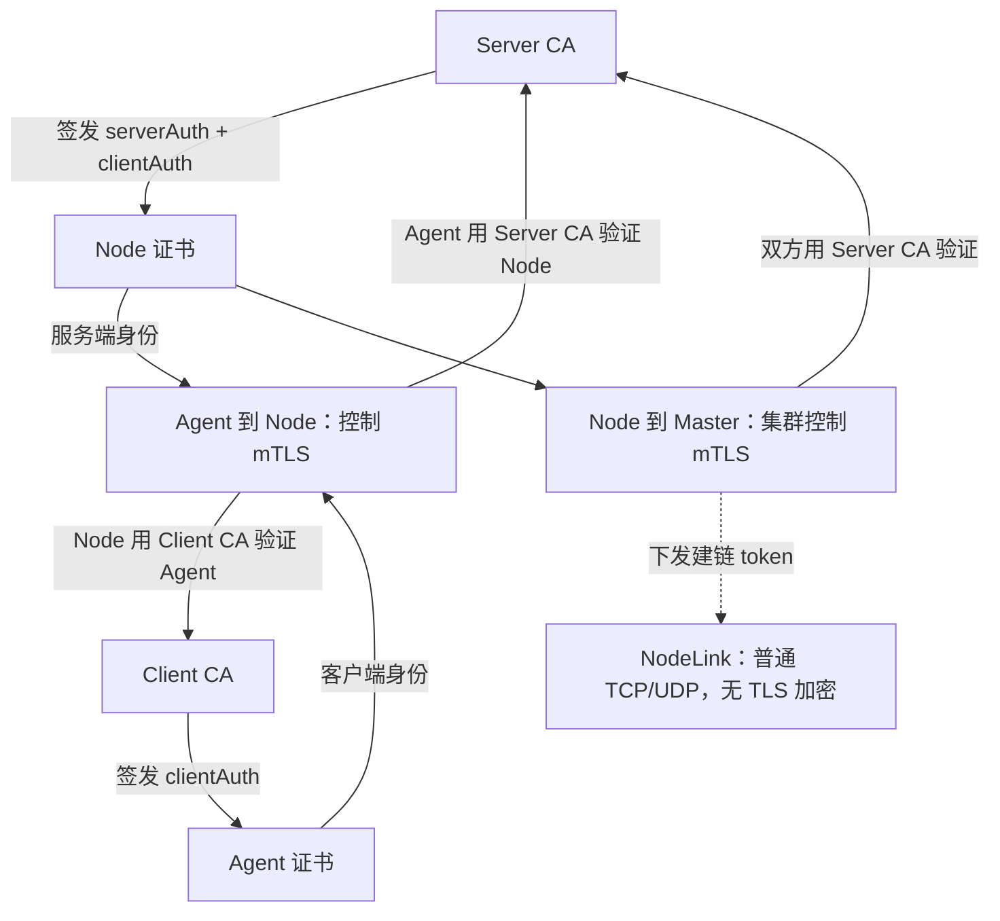

---

### 6.1 双向 TLS (mTLS) 与双 CA 隔离架构

#### 6.1.1 信任边界：Server CA 与 Client CA 物理隔离

将客户端与节点的签发根分离，可以独立管理两类身份的准入与轮换范围，并结合证书用途约束维护控制面的信任边界。

RelayWeave 确立了**两条互不相交的根信任链**：
1. **Server CA (`server-ca.pem`)**：
   - 唯一的职能是为所有的 RelayNode 服务器签发节点证书（`server.pem`）。
   - **分发范围**：分发给所有 RelayAgent（作为受信任服务端根）以及所有 RelayNode（作为节点间集群控制的互信根）。
2. **Client CA (`client-ca.pem`)**：
   - 唯一的职能是为授权接入的 RelayAgent 签发客户端身份证书（`shared-client.pem`）。
   - **分发范围**：分发给 RelayNode 节点，作为 Agent 控制端口 18443 的客户端验证根 `ca_file`；Agent 使用 Server CA 验证 Node。

#### 6.1.2 节点证书与客户端证书职能划分

- **服务器节点证书（`server.pem`）**：
  - 拥有扩展密钥用法：`extendedKeyUsage = serverAuth, clientAuth`。
  - 在集群控制连接（端口 18447）上，发起端节点以其作为客户端身份、对端节点以其作为服务端身份，完成同 CA 下的对等 mTLS 握手。
- **客户端接入证书（`shared-client.pem`）**：
  - 拥有扩展密钥用法：`extendedKeyUsage = clientAuth`。
  - X.509 证书用于端口 18443 的控制身份认证，无法伪装成中继节点；同一私钥及证书公钥也用于 Agent 间 TLS 1.3 RPK，不受 X.509 serverAuth/SAN 约束。

---

#### 6.1.3 Agent 端到端身份与信任边界

Forwarder 拥有独立业务 TLS context，复用原控制凭据，并严格固定对端 RPK 为本地证书公钥。只接受 TLS 1.3 与双向 RPK，关闭会话恢复及 0-RTT；NodeConnection 的 CA、有效期及名称校验不变。需要支持 RPK 的 OpenSSL 3.2 或更高版本。

共享私钥提供群体认证，不能区分具体客户；持有同一私钥的成员能相互冒充。只有自身节点凭据的 Node 无法冒充 Agent 或解密业务，但仍掌握服务路由、流量大小和时序，并能中断连接。服务确认不替代独立用户认证。双方共享同一凭据时，启用 TLS 只需改双方 service/forward 的 `protocol`；凭据轮换需统一部署。

### 6.2 身份校验与 SAN 规划规范

#### 6.2.1 node_id 与证书 Subject / SAN 映射规范

每个 RelayNode 必须具备唯一的系统标识符 `node_id`（如 `master-1`, `edge-bj-01`）。在签发该节点证书时，必须遵循以下主题备用名称（SAN, Subject Alternative Name）规则：

1. **IP 条目（`IP:<address>`）**：
   - 必须包含该节点绑定的所有对外公网 IP、专网 IP 或浮动 IP。
   - 必须精确覆盖节点配置文件中的 `control.advertise_address`。
2. **DNS 条目（`DNS:<hostname>`）**：
   - 若通过域名或内部服务名访问，必须包含对应的完整主机名（如 `DNS:master-1.internal`）。
   - 推荐将节点的 `node_id` 本身作为一个标准 DNS 条目写入 SAN（如 `DNS:master-1`），用于集群内部的纯逻辑身份识别。

#### 6.2.2 Agent-to-Node 与 Node-to-Node 双向验证矩阵

| 通信通道 | 握手类型 | 客户端校验服务端的规则 | 服务端校验客户端的规则 |
|---|---|---|---|
| **Agent -> Node 控制面 (18443)** | mTLS | 校验 Server 证书由 `server-ca.pem` 签发；校验连接的目标 IP/域名匹配 Server 证书的 SAN 列表。 | 校验 Client 证书由 `client-ca.pem` 签发；检查证书未过期。 |
| **Node -> Master 集群控制 (18447)** | mTLS | 校验 Master 证书由 `server-ca.pem` 签发；校验 Master 的 SAN。 | 校验 Slave 证书由 `server-ca.pem` 签发；校验 Slave 声明的 `node_id` 与证书 SAN 中的标识一致。 |
| **Node <-> Node 数据链路 (18448)** | 普通 TCP/UDP | 基于 Master 下发的 Token 和共享连接确认完成配对，数据面采用定长二进制帧头，不运行附加 TLS。 | 基于 Master 下发的 Token 和共享连接确认完成配对。 |

---

## 7. 端到端业务全流程与时序

### 7.1 单节点中继业务时序 (Single-Node Relay)

单节点中继是网络穿透的基础形态。Consumer Agent 与 Producer Agent 同时连接到同一个 RelayNode 实例（或业务请求不携带多跳路径）：

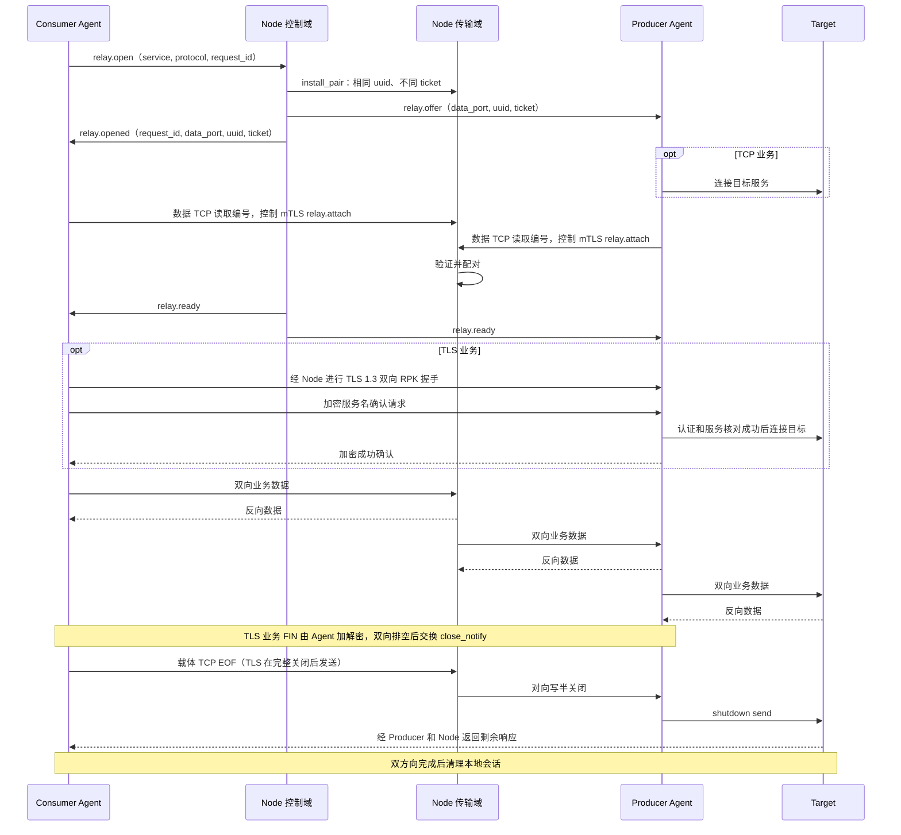

#### 流程关键阶段说明

1. **会话协商（信令阶段）**：
   - Consumer Agent 捕获本地客户端连接，向 Node 控制端口（18443）发送 `relay.open`。
   - Node 验证服务存在并分配 Node 本地唯一的 `uuid` 与双端独立的鉴权凭证 `ticket`。
   - Node 在 `control_io` 上创建 `SingleSession`，向 Producer 发送 `relay.offer`、向 Consumer 返回 `relay.opened`，通知双方连接数据端口（18444）。
2. **数据接入与配对（接入屏障）**：
   - 双端 Agent 异步建立到 Node 数据端口（18444）的 TCP 连接。
   - Node 在数据 socket 发送连接编号，双端经控制 mTLS 发送角色、uuid、ticket 和编号；Node 校验归属并授权绑定。
   - 同一个 SessionTransfer 在传输执行域完成两端授权绑定及准备，配置计费与限速；控制面等待 Prepared，提交激活并等待 Activated，随后才发送 Ready。
3. **数据桥接与半关闭（传输阶段）**：
   - 控制面回送 `relay.ready`，通知客户端开始发送业务数据。
   - NodeSession 在 Ready 提交后通过同一个 SessionTransfer 启动字节复制；TLS 业务由两端 Agent 完成握手与服务确认后使用 TCP↔TLS 复制。
   - **双向半关闭（FIN/EOF）**：当客户端关闭写端（发送 FIN）时，Node 端读取到 EOF，向服务端对向 Socket 发送 `shutdown(SHUT_WR)`。服务端仍可继续反向发送剩余响应数据，直至服务端也发送 EOF。双向均关闭后，Node 清理该会话资源。TLS 业务 FIN 只由 Agent 加解密；两端业务结束并交换 close_notify 后才向 Node 发送 TCP EOF。收尾受固定 `channel.disconnect_timeout_ms` 限制，多跳 Finished 等待同样有界。

---

### 7.2 多节点中继业务时序 (Multi-Node Relay)

跨越多个中继节点（如 `Agent-A -> Node-1 (Ingress) -> Node-2 (Relay) -> Node-3 (Egress) -> Agent-B`）的业务中继流程：

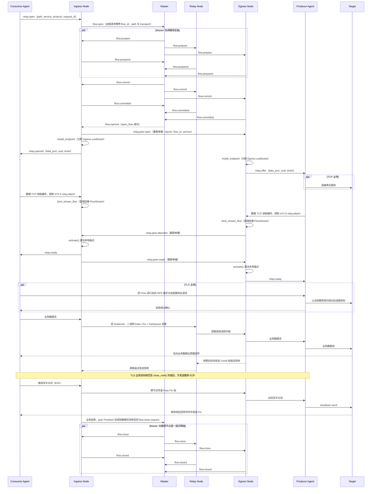

#### 流程关键阶段说明

1. **路由计算与请求发起**：
   - Consumer Agent 本地运行 Dijkstra 图算法，决定当前业务的最优路径为 `[Node-1, Node-2, Node-3]`。
   - 向 Ingress Node-1 发起 `relay.open`，附带完整路径。
2. **Master 两阶段 Flow 安装事务**：
   - Ingress Node-1 向 Master 申请开启全路径 Flow。
   - Master 下发 `flow.prepare` 并通过位图等待路径上 3 个节点全部就绪；随后下发 `flow.commit` 激活所有节点的物理转发路由。
3. **首末节点握手（Cluster Unicast）**：
   - Node-1 通过 Master 提供的集群单播能力向 Node-3 发送 `relay.peer.open`。
   - Node-3 唤醒 Producer Agent 发送 `relay.offer` 并等待其连接数据端口发送 `RelayAttach`。
   - Node-3 将 Producer Socket 挂载到 Flow 的尾部端点（`bind_stream_flow`），向 Node-1 回复单播 `relay.peer.attached`。
4. **入口激活与全双工数据流转**：
   - Node-1 返回 `relay.opened` 后，Consumer 即可完成本端接入；本端准备与尾端 `relay.peer.attached` 可并行推进，不等待尾端才通知 Consumer。
   - Node-1 同时满足本端 Prepared 与尾端准备条件后激活首端 `FlowStream`，向 Node-3 发送 `relay.peer.ready`，向 Consumer 发送 `relay.ready`；Node-3 再激活尾端并通知 Producer。
   - TCP 直接复制，TLS 先由两端 Agent 完成 RPK 握手、服务核对和目标连接。数据进入 `FlowStream`，使用定长二进制帧头，通过逐跳信用流控（`Credit`）和 `FairQueue` 在跨节点物理 `NodeLink` 上传输。
5. **双向半关闭与事务销毁**：
   - 业务完成时，载体 EOF 转化为 `LnkFrType::Fin` 二进制帧沿路径流动；TLS 的业务 FIN 和 close_notify 仅由 Agent 处理。双向数据刷写、peer Finished 协调及数据任务排空后，Ingress 通过 `flow.close.request` 请求 Master 释放路径；Master 向各路径节点提交 `flow.close` 并收集确认。

---

### 7.3 异常场景与故障收敛机制

| 异常故障场景 | 检测与触发机制 | 自动化收敛与自愈行为 |
|---|---|---|
| **Agent 异常离线** | TCP RST 或 `TLSChannel` 心跳超时（20s）。 | Node 请求对应的 `NodeSession` 取消；数据任务关闭关联端点并排空，多节点完成必要的 peer/Flow 收尾；根控制任务返回后才移除会话。 |
| **中继节点崩溃/离线** | Master 检测到 Slave 集群控制连接断开。 | 1. Master 将该节点从活跃列表中剔除，**递增成员版本 `version`**；<br>2. Master 向全网存活节点广播 `topology.members`；<br>3. 各节点收到新拓扑后，**立即作废所有包含离线节点或基于旧授权构建的 Flow**，数据通道丢弃旧帧并清理；<br>4. Agent 收到拓扑失效通知，在本地清空路由缓存，重新运行 Dijkstra 计算新的替代路径。 |
| **慢客户端导致流控窗口耗尽** | 接收端停止返还信用，发送端 `sent_bytes == send_limit`。 | 发送端按信用与有界队列施加背压，等待对端消费后继续；建立期限只用于建立阶段，运行中的连接错误、显式取消或控制失联沿原清理链路释放 Flow。 |
| **网络分区导致 Master 失联** | Slave 节点的 `ClusterMgr::Connector` 连续超时。 | Slave 节点停止接纳新的多节点 `relay.open` 请求（降级为仅支持单节点本地 Relay）；后台 Connector 启动固定 5 秒间隔自动重连；一旦重连成功并同步新成员列表，自动恢复全功能。 |


## 8. 运行时生命周期与资源模型

### 8.1 结构化并发与优雅停机

RelayWeave 严格遵守结构化并发（Structured Concurrency）原则。任何协程链都由生存期更长的宿主对象明确拥有；当服务停止时，遵循严格的依赖逆序停机策略，等待所有存活协程与异步 I/O 优雅排空（Drain），杜绝内存悬空与资源泄漏。

#### 8.1.1 RelayNode 优雅停机流程

当主进程捕获 `SIGINT` 或 `SIGTERM` 信号时，调用 `node->stop()` 按以下依赖顺序关停：

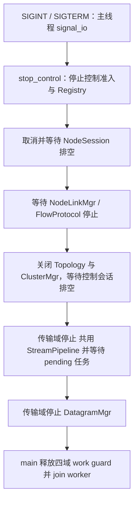

1. **阶段 1：停止准入**：关闭控制监听器（`control_acceptor_`）与集群监听器，关闭 流式 TCP 和 UDP 公网数据接入监听器，拒绝一切新的 Agent 连接与会话创建请求。
2. **阶段 2：取消活跃会话与路径事务**：向所有活跃的 `NodeSession` 投递取消信号，正在建立中的 Flow 路径触发两阶段回滚与 `close_flow`，正在传输中的 Flow 发送 `LnkFrType::Reset` 帧，断开与 Agent 的业务 Socket。
3. **阶段 3：协程任务异步排空**：启动 `AsyncEvent` 与 `steady_timer` 异步屏障，等待所有 `NodeSession`、Pipeline 读写协程以及 `LnkChannel` 数据任务自然退出，等待 `active_control_sessions_` 归零。
4. **阶段 4：执行域终止与线程汇聚**：释放 `control_work`、`tcp_work`、`udp_work`、`data_work` 四个工作守卫，四个单线程 `io_context` 结束 `run()` 循环，主线程调用 `worker.join()` 汇聚所有系统线程，顺次调用对象析构函数。

#### 8.1.2 RelayAgent 停机顺序与任务排空

RelayAgent 调用 `agent.stop()` 同样遵循结构化排空：
1. 在控制域停止服务发现轮询定时器（`discovery_timer_.cancel()`）、探测刷新与连接管理，并向传输域投递存活会话失效通知；
2. 等待发现、探测和控制连接后台任务排空；
3. 在传输域等待 `Forwarder::async_stop()` 完成，关闭本地监听（`forwards`）并排空存活会话；
4. 由主程序释放工作守卫、汇聚线程并销毁组件。

---

### 8.2 资源消耗模型与并发容量推导

#### 8.2.1 协程数量模型 (Coroutine Budget)

RelayNode 内部的活体协程由进程常驻任务、控制连接、NodeLink、业务中继与路径事务共同构成，数量随运行状态呈现明确的确定性：

| 协程类别 | 归属执行域 | 数量估算公式 | 说明与典型数值 (以并发 1000 连接为例) |
|---|---|---|---|
| **进程常驻协程** | 各域 | `C_static = 5～7` | 包括：Control Accept Loop (1), Cluster Accept Loop (1), Shared TCP Accept Loop (1), FlowProtocol Monitor Loop (1), Topology Probe (1~2)。 |
| **控制连接协程** | `control_io` | `C_ctrl = 2 × N_agent + 2 × N_cluster` | 每个控制连接维护独立的读消息协程与写排队协程。例如 50 个 Agent + 10 个集群节点 = 120 个协程。 |
| **业务中继协程** | 数据执行域 | 单节点 TCP：`C_relay = 2 × N_tcp`<br>多节点首尾跳：`C_relay = 4 × N_multi`<br>UDP 会话：`C_relay = 2 × N_udp` | 单节点流式中继包含双向流拷贝 2 个协程；多节点首尾跳各包含 Socket ↔ FlowStream 双向 2 个协程（首尾合计 4 个协程）；UDP 维护 2 个异步循环。 |

**容量分析**：当节点并发承载 **1,000 个活跃 TCP 中继连接** 时，全局协程总数约为 **2,000～4,000 个**，实际取决于单节点与多节点路径比例。协程帧大小与编译器、异步操作和局部状态有关，不能统一按几十至上百字节估算。多跳 Stream 入口与 TLS 复制已移除内嵌的约 64 KiB 数组，但仍持有独立分配的读取缓冲；单节点普通 TCP 复制仍含 32 KiB 数组。容量评估须合计协程分配、读取与暂存载荷、已计费窗口和池保留容量。

#### 8.2.2 内存消耗与分配口径 (Memory Layout & Sizeof)

各核心组件的 C++ 对象尺寸（64 位架构编译期测量）与内存占用口径如下表所示：

| 对象/数据结构名称 | 对象尺寸 (sizeof) | 内存归属与生命周期 | 计费与分配口径 |
|---|---|---|---|
| **`Frame`** | **80 字节** | 栈/发送队列节点 | 静态断言约束 `sizeof(Frame) <= 128`。本地占额与线上 DATA 信用按同一载荷长度计费。 |
| **`NodeSession` / `SessionTransfer`** | 随构建测量 | 控制状态 / 数据生命周期 | SingleSession / MultiSession 持有各自的端点与业务状态，并通过 NodeSession 持有一个数据任务；须合计数据任务对象、有界阶段/授权通道及协程帧的实际分配，不能沿用改造前仅统计 NodeSession 的尺寸。 |
| **`FlowState`** | **~480 字节** | `cluster_data_io` | 包含流状态、双向流控计数器、等待队列。由 `FlowProtocol::flows_` 持有。 |
| **`NodeLink`** | **832 字节** | `cluster_data_io` | 包含物理 Socket、FairQueue 发送队列、信用合并表等。每对节点按 transport 复用一条，常驻内存。 |
| **`PooledBuffer`** | **32 字节** | 跨域移动持有 | 包含 `unique_ptr` 及携带分配长度和共享资源的 `Deleter`。底层内存块来自 PMR 池。 |
| **`FairQueue`** | **88 字节** | `NodeLink` 成员 | 内部维护 `std::list` 头结点与成员 `unordered_set`（复用桶容量）。 |

在实际生产部署中，进程物理 RSS 内存主要由双方向发送/接收缓冲、队列积压、协程帧、TLS 状态、PMR 预热保留容量以及 Socket 内核缓冲区构成。

#### 8.2.3 性能复核与基准测试数据总结

根据基准测试与长测性能复核（Release 模式 `-O3 -DNDEBUG`）：
1. **FairQueue 容器选型复核**：
   - 相比基础版本，经节点布局优化和插入缓存改进后，FairQueue 在 10/100/400 标签、深度 1~64 混合场景下的综合开销降低约 **18.4%**。
   - 引入成员 `unordered_set` 桶复用后，入队耗时再降低 **16.1%**，混合增删收发耗时再降低 **22.5%**，单次入队平均仅需 **3.2 微秒**。
2. **PMR 标准载荷池长测验证**：
   - 在高频数据帧周转长测中，PMR 载荷池预分配机制有效消除了系统分配器的锁竞争，物理 RSS 内存保持平稳，未出现内存碎片堆积与异常增长。


## 9. 配置参考与可观测性

### 9.1 RelayNode 完整配置字典与示例

RelayNode 启动时接受一个 JSON 格式的配置文件，各段落对应不同的功能与执行域：

```json
{
  "bandwidth_mbps": 100,
  "certificate": {
    "ca_file": "/etc/relayweave/certs/client-ca.pem",
    "server_ca_file": "/etc/relayweave/certs/server-ca.pem",
    "certificate_chain": "/etc/relayweave/certs/server.pem",
    "private_key": "/etc/relayweave/certs/server.key"
  },
  "channel": {
    "handshake_timeout_ms": 5000,
    "disconnect_timeout_ms": 5000,
    "heartbeat_interval_ms": 5000,
    "heartbeat_timeout_ms": 20000,
    "max_queued_messages": 100
  },
  "cluster": {
    "role": "master",
    "node_id": "master-1",
    "address": "0.0.0.0",
    "control_port": 18447,
    "tcp_port": 18448,
    "udp_port": 18448
  },
  "control": {
    "address": "0.0.0.0",
    "port": 18443,
    "advertise_address": "203.0.113.10",
    "max_connections": 512,
    "max_services": 256,
    "max_services_per_session": 64
  },
  "tcp": {
    "address": "0.0.0.0",
    "port": 18444,
    "max_setup_connections": 512,
    "max_relays": 128,
    "setup_timeout_ms": 10000,
    "rx_bytes_per_second": 2000000,
    "rx_max_burst_bytes": 262144,
    "tx_bytes_per_second": 2000000,
    "tx_max_burst_bytes": 262144
  },
  "udp": {
    "address": "0.0.0.0",
    "port": 18445,
    "max_relays": 128,
    "setup_timeout_ms": 10000,
    "rx_bytes_per_second": 2000000,
    "rx_max_burst_bytes": 262144,
    "tx_bytes_per_second": 2000000,
    "tx_max_burst_bytes": 262144
  },
  "log": {
    "debug_enable": false
  }
}
```

#### 核心配置字段详解

| 配置段落 / 字段 | 类型 | 默认值 / 约束 | 说明 |
|---|---|---|---|
| **`certificate.ca_file`** | 路径 | 必填 | Client CA 根证书路径。用于在控制端口（18443）校验接入 Agent 的客户端证书。 |
| **`certificate.server_ca_file`** | 路径 | 必填 | Server CA 根证书路径。用于在集群控制端口（18447）上校验对端 Node 的身份。 |
| **`certificate.certificate_chain`** | 路径 | 必填 | 本节点的 TLS 证书链文件。 |
| **`certificate.private_key`** | 路径 | 必填 | 本节点的 TLS 私钥文件（权限必须为 0600）。 |
| **`cluster.role`** | 字符串 | `"master"` 或 `"slave"` | 集群角色。`master` 负责路径安装协调；`slave` 需配置连接 Master。 |
| **`cluster.node_id`** | 字符串 | 必填 | 全网唯一的节点标识字符串（<=256 字节，非保留名 all）。 |
| **`control.advertise_address`** | 字符串 | 必填 | 向集群和 Agent 广播的本节点公网可达 IP 或主机名。必须包含在节点证书的 SAN 列表中。 |
| **`tcp/udp.setup_timeout_ms`** | 整数 | 10000 ms (10s) | 会话建立阶段等待两端 `RelayAttach` 握手的绝对超时时限。 |
| **`rx/tx_bytes_per_second`** | 整数 | 字节/秒 | 令牌桶流量整形速率。设置为 0 时表示不限速。 |

流式限速先通过同步的 `TokenBucket::reserve` 扣款并计算等待截止时间；不限速、空载荷或余额充足时返回空，仅返回截止时间时才进入 `wait_until` 协程等待。一次载荷只进行一次额度计算，定时器在首次等待时创建并复用。UDP 使用同步的 `try_consume`，额度不足时丢包，不预留债务或等待。每个令牌桶在同一执行器上访问，最多一个等待在途。

---

### 9.2 RelayAgent 完整配置字典与示例

RelayAgent 负责声明导出的服务（`services`）或本地监听端口映射（`forwards`）：

```json
{
  "server": {
    "host": "203.0.113.10",
    "port": 18443,
    "connect_timeout_ms": 5000
  },
  "certificate": {
    "ca_file": "/etc/relayweave/certs/server-ca.pem",
    "certificate_chain": "/etc/relayweave/certs/shared-client.pem",
    "private_key": "/etc/relayweave/certs/shared-client.key",
    "server_name": ""
  },
  "channel": {
    "handshake_timeout_ms": 5000,
    "disconnect_timeout_ms": 5000,
    "heartbeat_interval_ms": 5000,
    "heartbeat_timeout_ms": 20000,
    "max_queued_messages": 100
  },
  "reconnect": {
    "initial_delay_ms": 500,
    "max_delay_ms": 10000
  },
  "relay": {
    "open_timeout_ms": 10000,
    "udp_idle_timeout_ms": 60000
  },
  "routing": {
    "max_nodes": 4
  },
  "services": [
    {
      "name": "prod-ssh",
      "protocol": "tcp",
      "target_host": "127.0.0.1",
      "target_port": 22
    },
    {
      "name": "internal-dns",
      "protocol": "udp",
      "target_host": "127.0.0.1",
      "target_port": 53
    }
  ],
  "forwards": [
    {
      "service": "prod-ssh",
      "protocol": "tcp",
      "listen_address": "127.0.0.1",
      "listen_port": 10022
    },
    {
      "service": "internal-dns",
      "protocol": "udp",
      "listen_address": "127.0.0.1",
      "listen_port": 10053
    }
  ],
  "log": {
    "debug_enable": false
  }
}
```

#### 核心配置字段详解

| 配置段落 / 字段 | 类型 | 说明 |
|---|---|---|
| **`server.host` / `port`** | 字符串/整数 | 初次启动连接的主控 RelayNode 控制端口（默认 18443）。 |
| **`relay.open_timeout_ms`** | 正整数，默认 10000 | 单个业务会话从创建到业务 Ready 的总建立预算，各阶段不续期。 |
| **`server.connect_timeout_ms`** | 正整数，默认 5000 | DNS/TCP 连接操作上限；业务连接同时受剩余总建立预算限制。 |
| **`channel.handshake_timeout_ms`** | 正整数，默认 5000 | 实际 TLS 握手上限；业务 TLS 同时受剩余总建立预算限制。 |
| **`channel.disconnect_timeout_ms`** | 正整数，默认 5000 | TLS 业务双向结束后，共享的关闭与载体 EOF 等待预算。 |
| **`relay.udp_idle_timeout_ms`** | 正整数，默认 60000 | Consumer UDP 关联双向业务空闲期限；回收通过既有取消链路释放 Node/Producer 资源。 |
| **`routing.max_nodes`** | 整数 (默认 4) | 运行 Dijkstra 算法时计算的最长中继跳数上限。 |
| **`services`** | 数组 (Producer 配置) | 声明本机对外提供的真实后端服务。Agent 启动后自动向 Node 发起 `ServiceRegister`。 |
| **`forwards`** | 数组 (Consumer 配置) | 声明本机需要监听的本地转发端口。当本地客户端连接进入时，触发选路与中继桥接。 |

---

### 9.3 运行指标、拓扑可观测性与日志规范

#### 9.3.1 核心度量指标 (NodeMetrics)

`NodeMetrics` 组件在运行时持续收集以下维度的原子度量指标，可通过控制信令 `server.status.query` 或 Dashboard 实时拉取：
- **流量统计**：累计转发字节数（`forwarded_bytes`）、各服务实时瞬时收发速率（Rx/Tx Bps）。
- **会话状态**：当前并发活跃会话数（`active_relays`）、累计已完成会话数、累计异常终止数。
- **队列深度**：物理 NodeLink 的发送积压帧数（`writes.size()`）、信用挂起帧数（`pending_frames.size()`）。
- **网络质量**：各邻接链路的 RTT、抖动、丢包率与评分结果。

#### 9.3.2 项目日志规范

系统遵循统一结构化日志规范，以便于在生产环境中实现日志集中收集、分析与全链路排障：
- **`[INF]`（关键进展）**：仅记录监听启动、控制连接建立/断开、服务注册/发现、中继业务建立/关闭等里程碑事件。
- **`[DEB]`（诊断细节）**：记录 TLS 握手协商参数、候选路由评分排序、关闭细化原因等。
- **`[ERR]`（真实故障）**：记录 I/O 异常、鉴权失败、超时断开，必须携带具体阶段、端点与原始错误描述。
- **标准关系符号**：
  - `[+]`：连接或会话已建立
  - `[x]`：连接或会话已断开
  - `->`：流向或路径指向
  - `<->`：全双工双向连接
- **日志输出标准样例**：
  ```text
  [DEB] handle_tls_handshake(142): TLS handshake complete role=client peer=203.0.113.10:18443 version=TLSv1.3 cipher=TLS_AES_256_GCM_SHA384
  [INF] run_control_session(89): Control [+] node=master-1 peer=203.0.113.10:18443
  [DEB] select_path(215): Routes service=prod-ssh -> node-3 candidates=2 max_nodes=4
  [DEB] select_path(220): Route #1 cost=42.150 service=prod-ssh: agent -> node-1 -> node-3 *
  [DEB] select_path(221): Route #2 cost=58.320 service=prod-ssh: agent -> node-1 -> node-2 -> node-3
  [INF] start_relay(312): Relay [+] tcp consumer service=prod-ssh uuid=1048576
  [INF] bridge_done(450): Relay [x] tcp consumer service=prod-ssh uuid=1048576 reason=I/O ended
  [ERR] fail_flow(512): Relay open failed tcp service=prod-ssh request_id=42 uuid=0 reason=service unavailable
  ```


## 附录 A. 控制协议全量报文规范 (Wire Protocol Specification)

本附录列出 RelayWeave 控制信道承载的全部 JSON 控制指令，涵盖命令字编码、作用域以及报文参数定义。

### A.1 命令字全集对照表

控制命令字在 C++ 内部采用 32 位整型枚举 `CtrlCommand` 表达（布局为 `[group:8][subgroup:8][command:16]`），在网络传输层使用字符串 `command` 字段承载。

| 十六进制数值 | 枚举标识符 (`CtrlCommand`) | 传输层字符串名称 (`command`) | 作用域与核心功能 |
|---|---|---|---|
| `0x09000000` | `Heartbeat` | — | 心跳组分类基准，不作为独立命令传输 |
| `0x09000001` | `Ping` | `"ping"` | TLSChannel 双向心跳探测帧 |
| `0x09000002` | `Pong` | `"pong"` | TLSChannel 心跳应答帧 |
| `0x01000000` | `Relay` | — | 业务中继组分类基准，不作为独立命令传输 |
| `0x01000001` | `RelayAttach` | `"relay.attach"` | 流式控制授权绑定 / UDP 数据接入 |
| `0x01000002` | `RelayOpen` | `"relay.open"` | Consumer Agent 向 Ingress Node 发起开通业务 |
| `0x01000003` | `RelayOpened` | `"relay.opened"` | Ingress Node 向 Consumer Agent 返回已开通 |
| `0x01000004` | `RelayOffer` | `"relay.offer"` | Egress Node 派发给 Producer Agent 的建连通知 |
| `0x01000005` | `RelayReady` | `"relay.ready"` | Node 向两端 Agent 发送的双向桥接就绪通知 |
| `0x01000006` | `RelayReject` | `"relay.reject"` | 会话拒绝报文 |
| `0x01000007` | `RelayCancel` | `"relay.cancel"` | 会话取消报文 |
| `0x01000008` | `RelayClosed` | `"relay.closed"` | 会话正常关闭报文 |
| `0x01000009` | `RelayError` | `"relay.error"` | 会话异常错误通知 |
| `0x0100000A` | `RelayDetach` | `"relay.detach"` | 会话解绑通知 |
| `0x01010001` | `RelayPeerOpen` | `"relay.peer.open"` | Ingress Node 向 Egress Node 发起的集群单播首末协商 |
| `0x01010002` | `RelayPeerAttached` | `"relay.peer.attached"` | Egress 节点通知数据端口已接入 |
| `0x01010003` | `RelayPeerReady` | `"relay.peer.ready"` | Ingress 节点通知首端已准备并激活，允许尾端推进 |
| `0x01010004` | `RelayPeerFinished` | `"relay.peer.finished"` | 首末端数据刷写结束通知 |
| `0x01010005` | `RelayPeerClose` | `"relay.peer.close"` | 首末端强制关闭通知 |
| `0x02000001` | `LinkPrepare` | `"link.prepare"` | Master 指令：准备相邻 NodeLink |
| `0x02000002` | `LinkPrepared` | `"link.prepared"` | 节点回复：NodeLink 准备就绪 |
| `0x02000003` | `LinkConnect` | `"link.connect"` | Master 指令：发起物理 NodeLink 连接 |
| `0x02000004` | `LinkReady` | `"link.ready"` | 节点上报：物理 NodeLink 已连通 |
| `0x02000005` | `LinkError` | `"link.error"` | 物理 NodeLink 异常报错 |
| `0x02000006` | `LinkClose` | `"link.close"` | 关闭物理 NodeLink |
| `0x02000007` | `LinkClosed` | `"link.closed"` | 物理 NodeLink 已关闭 |
| `0x02000008` | `LinkAttach` | `"link.attach"` | NodeLink 数据连接关联请求 |
| `0x02000009` | `LinkAttached` | `"link.attached"` | NodeLink 数据连接关联确认 |
| `0x03000001` | `FlowPrepare` | `"flow.prepare"` | Master 事务阶段一：下发全路径 Flow 预留 |
| `0x03000002` | `FlowPrepared` | `"flow.prepared"` | 节点回复事务阶段一完成 |
| `0x03000003` | `FlowCommit` | `"flow.commit"` | Master 事务阶段二：向路径节点逐一提交激活 |
| `0x03000004` | `FlowCommitted` | `"flow.committed"` | 节点回复事务阶段二完成 |
| `0x03000005` | `FlowError` | `"flow.error"` | Flow 事务执行失败 |
| `0x03000006` | `FlowClose` | `"flow.close"` | Master 向路径节点提交 Flow 销毁 |
| `0x03000007` | `FlowClosed` | `"flow.closed"` | Flow 销毁确认 |
| `0x03000008` | `FlowOpen` | `"flow.open"` | 非 Master 入口请求 Master 建立路径 |
| `0x03000009` | `FlowOpened` | `"flow.opened"` | Master 返回远端建立结果 |
| `0x0300000A` | `FlowCloseRequest` | `"flow.close.request"` | 非 Master 入口请求 Master 释放路径 |
| `0x04000001` | `ClusterJoin` | `"cluster.join"` | Slave 向 Master 申请加入集群 |
| `0x04000002` | `ClusterJoined` | `"cluster.joined"` | Master 接纳加入并下发最新 Epoch |
| `0x04000003` | `ClusterError` | `"cluster.error"` | 集群身份或版本异常 |
| `0x05000001` | `TopologyMembers` | `"topology.members"` | Master 全网广播存活节点成员列表 |
| `0x05000002` | `TopologyReport` | `"topology.report"` | 节点向 Master 上报链路探测度量 |
| `0x05000003` | `TopologyQuery` | `"topology.query"` | Agent/Dashboard 查询集群拓扑快照 |
| `0x05000004` | `TopologySnapshot`| `"topology.snapshot"` | Master 返回全局拓扑图与质量矩阵 |
| `0x06000001` | `ServerIdentify` | `"server.identify"` | 控制连接身份请求 |
| `0x06000002` | `ServerIdentified` | `"server.identified"` | 控制连接身份确认 |
| `0x06000003` | `ServerLoad` | `"server.load"` | 节点负载查询 |
| `0x06000004` | `ServerLoaded` | `"server.loaded"` | 节点负载回复 |
| `0x06000005` | `ServerCluster` | `"server.cluster"` | 集群状态查询 |
| `0x06000006` | `ServerStatusQuery` | `"server.status.query"` | 集群状态查询转送 |
| `0x06000007` | `ServerStatusReport` | `"server.status.report"` | 集群状态上报 |
| `0x06000008` | `ServerStatusReported` | `"server.status.reported"` | 集群状态回复 |
| `0x06000009` | `ServerTraffic` | `"server.traffic"` | 流量统计查询 |
| `0x0600000A` | `ServerTrafficReported` | `"server.traffic.reported"` | 流量统计回复 |
| `0x07000001` | `ServiceRegister` | `"service.register"` | Producer Agent 向 Node 注册服务 |
| `0x07000002` | `ServiceOk` | `"service.ok"` | 服务注册成功回复 |
| `0x07000003` | `ServiceError` | `"service.error"` | 服务注册失败回复 |
| `0x07000004` | `ServiceLookup` | `"service.lookup"` | Consumer Agent 查询服务位置 |
| `0x07000005` | `ServiceLocated` | `"service.located"` | 返回服务所在的宿主 Node 信息 |
| `0x07000006` | `ServiceList` | `"service.list"` | 服务列表查询 |
| `0x07000007` | `ServiceListed` | `"service.listed"` | 服务列表回复 |

---

### A.2 各组控制消息详细 JSON 规范与参数定义

#### A.2.1 Relay 业务控制消息 (Agent <-> Node)

##### 1. `relay.open` (Consumer Agent -> Ingress Node)
```json
{
  "command": "relay.open",
  "params": {
    "service": "prod-ssh",
    "protocol": "tcp",
    "request_id": 1001,
    "path": ["node-1", "node-2", "node-3"]
  }
}
```

##### 2. `relay.opened` (Ingress Node -> Consumer Agent)
```json
{
  "command": "relay.opened",
  "params": {
    "request_id": 1001,
    "uuid": 1048576,
    "ticket": 9876543210,
    "port": 18444
  }
}
```

##### 3. `relay.offer` (Egress Node -> Producer Agent)
```json
{
  "command": "relay.offer",
  "params": {
    "service": "prod-ssh",
    "protocol": "tcp",
    "uuid": 1048576,
    "ticket": 9876543210,
    "port": 18444
  }
}
```

##### 4. `relay.ready` (Node -> Agent 双向)
```json
{
  "command": "relay.ready",
  "params": {
    "uuid": 1048576
  }
}
```

---

#### A.2.2 RelayPeer 首末业务协调消息 (Node <-> Node 集群单播)

以下示例为 Master 转送后的接收视角：`target` 已由集群路由移除，`source` 由认证连接写入，不接受业务请求自行声明来源。

##### 1. `relay.peer.open` (Ingress Node -> Egress Node)
```json
{
  "command": "relay.peer.open",
  "params": {
    "source": "node-1",
    "epoch": 42,
    "flow_id": 5001,
    "service": "prod-ssh",
    "protocol": "tcp",
    "accessor": "198.51.100.20:50000"
  }
}
```

##### 2. `relay.peer.attached` (Egress Node -> Ingress Node)
```json
{
  "command": "relay.peer.attached",
  "params": {
    "source": "node-3",
    "epoch": 42,
    "flow_id": 5001
  }
}
```

##### 3. `relay.peer.ready` (Ingress Node -> Egress Node)
```json
{
  "command": "relay.peer.ready",
  "params": {
    "source": "node-1",
    "epoch": 42,
    "flow_id": 5001
  }
}
```

---

#### A.2.3 Flow 路径安装事务消息 (Master <-> Node)

事务身份由 `master`、`epoch`、`flow_id`、`request_id` 组成；集群层以认证连接填入 `source`。只有 Prepare 携带完整路径。Master 保留路径和确认位图，本地端点保留已验证的授权参数；后续阶段检查身份、来源和当前阶段。

##### 1. `flow.prepare` (Master -> Path Nodes)
```json
{
  "command": "flow.prepare",
  "params": {
    "source": "master-0",
    "master": "master-0",
    "epoch": 42,
    "flow_id": 5001,
    "request_id": 9001,
    "path": ["node-1", "node-2", "node-3"],
    "addresses": ["203.0.113.1", "203.0.113.2", "203.0.113.3"],
    "links": [1001, 1002],
    "transport": "tcp",
    "ttl_ms": 10000
  }
}
```

`previous`、`next` 和相邻 peer 在本地根据路径派生，属于数据域 FlowSpec，不是 Prepare wire 字段。重复 Prepare 仍比较完整授权参数；期限不属于路径身份。此阶段只预留内存资源，不持久化。

##### 2. `flow.commit` (Master -> Path Nodes)
```json
{
  "command": "flow.commit",
  "params": {
    "source": "master-0",
    "master": "master-0",
    "epoch": 42,
    "flow_id": 5001,
    "request_id": 9001
  }
}
```

##### 3. `flow.close` (Master -> Path Nodes)
```json
{
  "command": "flow.close",
  "params": {
    "source": "master-0",
    "master": "master-0",
    "epoch": 42,
    "flow_id": 5001,
    "request_id": 9001,
    "stage": "close",
    "reason": "closed by caller"
  }
}
```

##### 4. 确认与错误回复 (Path Nodes -> Master)

| 命令 | 身份字段 | 诊断字段 |
|---|---|---|
| `flow.prepared` | master、epoch、flow_id、request_id；source 为认证节点 | stage、reason |
| `flow.committed` | 同上 | stage、reason |
| `flow.closed` | 同上 | 数据端关闭事件含 stage/reason；未知事务 Close 的确认不含诊断字段 |
| `flow.error` | 同上 | stage、reason，保留原始错误原因 |

Commit、Close 和以上回复均不携带 path、addresses、links、transport、ttl_ms 或 committed。committed 仅为本地授权状态。已知事务核对身份后执行，未知 Commit 忽略；来自当前 Master、身份完整的未知 Close 直接确认，不创建端点或历史缓存。Master 只接受路径成员在对应阶段的确认，关闭期间和释放后的迟到确认不能推进建立。

此格式要求 Master 与所有 Slave 同步升级；不提供旧完整载荷协议的兼容分支或版本协商。Agent/dashboard 报文和 Link 事务格式不随本次改变。

---

#### A.2.4 Service 服务注册与发现消息 (Agent <-> Node)

##### 1. `service.register` (Producer Agent -> Node)
```json
{
  "command": "service.register",
  "params": {
    "request_id": 1,
    "service": "prod-ssh",
    "protocol": "tcp"
  }
}
```

##### 2. `service.lookup` (Consumer Agent -> Node)
```json
{
  "command": "service.lookup",
  "params": {
    "request_id": 52,
    "service": "prod-ssh"
  }
}
```

##### 3. `service.located` (Node -> Consumer Agent)
```json
{
  "command": "service.located",
  "params": {
    "request_id": 52,
    "service": "prod-ssh",
    "protocol": "tcp",
    "node_id": "node-3",
    "address": "203.0.113.12"
  }
}
```


## 附录 B. 模块源码与执行域索引对照表

| 源码路径 | 核心类 / 结构体 | 宿主执行域 (`executor`) | 核心职责与对象包含关系 |
|---|---|---|---|
| **`protocol/inc/message.h`**<br>`protocol/src/message.cpp` | `CtrlMessage`<br>`WireMessage`<br>`LnkFrameHeader`<br>`DatagramHeader`<br>`RelayAttach` | 跨域共享值类型 | 定义全系统固定二进制帧结构、CBOR 控制信令打包、控制指令枚举。无堆状态。 |
| **`protocol/inc/flow_protocol.h`**<br>`protocol/src/flow_protocol.cpp` | `FlowProtocol`<br>`FlowState`<br>`FlowStream`<br>`FlowDatagram` | `cluster_data_io` | 逻辑流状态机、端点接口抽象、逐跳信用发布与背压、帧分发管理。 |
| **`protocol/inc/lnk_channel.h`**<br>`protocol/src/lnk_channel.cpp` | `LnkChannel`<br>`NodeLink`<br>`PooledBuffer`<br>`Frame` | `cluster_data_io` | 物理相邻节点 Socket（TCP/UDP）长连接维护、PMR 缓冲池管理、帧定界。 |
| **`protocol/inc/fair_queue.h`** | `FairQueue<Tag, T>` | `cluster_data_io` | 物理 TCP NodeLink 上的流标签交错插入近似公平调度器。 |
| **`protocol/inc/tls_channel.h`**<br>`protocol/src/tls_channel.cpp` | `TLSChannel` | 独立 Strand / 执行域 | 安全 mTLS 控制流通信管道，带心跳与消息队列。 |
| **`protocol/inc/dualindex_map.h`** | `DualIndexMap<A, B, V>` | 单域值类型 | 模板化双向键安全索引哈希表。 |
| **`route/inc/link_quality.h`**<br>`route/src/link_quality.cpp` | `LinkQuality` | `control_io` | 基于 EMA 与打分截断的单尺度网络链路质量评估器。 |
| **`route/inc/route_graph.h`**<br>`route/src/route_graph.cpp` | `RouteGraph` | `control_io` | 有向加权图模型，执行带 `relay_penalty` 的 Dijkstra 最短路径搜索。 |
| **`node/inc/relay_node.h`**<br>`node/src/relay_node.cpp` | `RelayNode` | 组合根 (协调四执行域) | Node 进程组合根。管理四执行域生命周期、监听器启动与停机排空。 |
| **`node/inc/node_session.h`**<br>`node/src/node_session.cpp` | `NodeSession` / `SingleSession` / `MultiSession` / `SessionTransfer` | `control_io` / 对应传输执行域 | 控制会话与其单次启动的传输任务；同一模块维护建立、确认、转发及收尾。 |
| **`node/inc/node_common.h`** | `RelayTransport` | 对应传输执行域 | StreamPipeline / DatagramMgr 的纯虚会话资源接口；使用者借用，不拥有管理器。 |
| **`node/inc/nodelink_mgr.h`**<br>`node/src/nodelink_mgr.cpp` | `NodeLinkMgr` | `control_io` | 跨节点 Flow 两阶段安装事务状态机与 NodeLink 邻接建立协调器。 |
| **`node/inc/cluster_mgr.h`**<br>`node/src/cluster_mgr.cpp` | `ClusterMgr`<br>`ClusterRoom` | `control_io` | Master 集群成员网状网维护、重连与消息交换路由。 |
| **`node/inc/registry_mgr.h`**<br>`node/src/registry_mgr.cpp` | `RegistryMgr` | `control_io` | 本地服务条目注册表。 |
| **`node/inc/pipeline_mgr.h`**<br>`node/src/pipeline_mgr.cpp` | `StreamPipeline` | `transfer_tcp_io` | 公网 TCP/TLS 业务端口接入与 `xfr_channel.h` 全双工流拷贝。 |
| **`node/inc/datagram_mgr.h`**<br>`node/src/datagram_mgr.cpp` | `DatagramMgr` | `transfer_udp_io` | 公网 UDP 业务单端口监听与客户端反射地址解复用。 |
| **`agent/inc/relay_agent.h`**<br>`agent/src/relay_agent.cpp` | `RelayAgent` | 组合根 (协调双执行域) | Agent 进程组合根。管理 control_io 与 transfer_io。 |
| **`agent/inc/agent_control.h`**<br>`agent/src/agent_control.cpp` | `AgentControl` | `control_io` | Agent 服务注册、服务发现与拓扑轮询驱动。 |
| **`agent/inc/agent_routing.h`**<br>`agent/src/agent_routing.cpp` | `AgentRouting` | `control_io` | Agent 路径计算器与最优候选路径缓存。 |
| **`agent/inc/node_connection.h`**<br>`agent/src/node_connection.cpp` | `NodeConnection` | `control_io` | 直接拥有唯一主控连接、重连与停止排空。 |
| **`agent/inc/forwarder.h`**<br>`agent/src/forwarder.cpp` | `Forwarder` | `transfer_io` | 本地端口监听器（TCP/UDP）与 `AgentSession` 管理中心。 |
| **`agent/inc/agent_session.h`**<br>`agent/src/agent_session.cpp` | `AgentSession` | `transfer_io` | 客户端业务连接会话，执行本地 Socket 与远端 Node 数据端口桥接。 |


## 附录 C. 会话工程约束与所有权审计 (Engineering Invariants)

本附录汇总会话数据任务改造、全量共享所有权复核及异常边界审视的最终结论。机制分别由第 2、3、5、8 章展开；此处明确重构时必须保持的状态归属、异步寿命和清理责任。

### C.1 状态归属与控制生命周期

一次中继业务包含三个不同的观察维度：**业务进度、数据任务寿命、协议资源状态**。三者分别由各自执行域内的唯一持有者维护，不能通过一组跨域布尔值相互替代。

| 状态或数据 | 持有者与有效范围 | 工程约束 |
|---|---|---|
| 公共身份、service、protocol、request_id、deadline | `NodeSession`，`control_io` | 构造后按值持有；整个建立流程使用同一绝对期限。构造参数移交后不保留 JSON 镜像，不在整体 move 后继续读取原请求。 |
| 双端 Agent 与 `AttachPair` | `SingleSession` | 单节点的两种角色可以属于同一 Agent；凭据不是 socket 的所有者。 |
| 本端 Agent、`AttachInfo`、path、peer、epoch/flow_id | `MultiSession` | ingress 成功取得 Flow 身份后先记录，再检查取消和 epoch，确保退出时有释放依据；egress 不争夺路径关闭责任。 |
| `Progress` | `NodeSession` | Opening / PeerOpened / AgentNotified / Ready 记录已经到达的业务里程碑；部分通知提交后失败仍需按该历史进度收尾。 |
| `close_reason_` 与诊断 stage | `NodeSession` | 原因存在即表示进入结束流程，允许空字符串；首次原因不被后续取消错误覆盖。Ready 与正在关闭可以同时成立。 |
| Created / Running / Stopping / Stopped | `SessionTransfer` 控制侧 | 表示唯一数据任务的寿命，不表示 Agent 已就绪；停止请求与真实完成分开。 |
| Installed / Prepared / Activated / Finished / Stopped | 数据任务阶段通道 | 是按序交付的完成确认；Installed 返回凭据，Stopped 由原生任务完成处理器确认。 |
| pair、socket、UUID、UDP bindings、Flow 端口 | 具体传输执行域 | 数据任务管理业务寿命，管理器维护查找和容量；Finished 后仍保留端点，直到控制流程明确停止。 |
| 计费对象 | 会话 → `SessionTransfer::Setup` → pair | 启动和准备时逐步移交；准备后任务不再额外保留同一份共享计费引用。 |
| 临时地址、报文、角色与通知结果 | 实际使用它的同步片段或协程帧 | 跨 await 使用的地址必须拥有字符串内容，不将借用的 `string_view` 留到来源失效后；只供单阶段使用的值不提升为成员镜像。 |

控制流程由 `SingleSession::run()`、`MultiSession::run()` 各自完整表达。基类保存真正公共的状态与操作，不通过控制器回指、模式 variant 或逐阶段虚钩子调度生命周期。SessionTransfer 只借用传输资源契约，不回调 NodeSession。

```mermaid
flowchart TD
    Start["具体会话 run：保存原始期限与业务身份"] --> Install["启动一次数据任务，等待 Installed"]
    Install --> Notify["通知 Agent，等待 Prepared"]
    Notify --> Peer["多节点：peer 准备屏障"]
    Peer --> Activate["提交继续通知，等待 Activated"]
    Activate --> Ready["检查停止与期限，提交 relay.ready"]
    Ready --> Transfer["提交继续通知，等待 Finished"]
    Transfer --> Finish["多节点：有限期等待 peer Finished"]
    Finish --> Cleanup["屏蔽取消，停止并等待数据任务"]
    Cleanup --> Release["ingress 释放 Flow，根任务完成后移除会话"]
    Error["超时 / 控制失效 / peer close / Flow 失效"] --> Cleanup
```

图中数据阶段遵循统一顺序，关闭通知仍按模式处理：Single 先排空数据任务再通知 Agent；Multi 先汇合建立/转发与 Flow 监视两支，按进度通知本端 Agent 和必要的 PeerClose，再停止数据任务，最后由 ingress 释放 Flow。peer 发起关闭时保留来源标记，避免回送 PeerClose。未安装数据任务或未取得 Flow 是正常失败路径，按实际存在的资源收尾。

阶段接口保持惰性：创建 activate/transfer 的 awaitable 不发送继续通知，实际等待时才推进。停止时由根控制任务屏蔽取消，数据任务在自己的清理段屏蔽取消；不能用取消请求代替 Stopped 确认，也不能在关闭中的会话退出前归还容量。

### C.2 独占、借用与共享所有权

所有权判断依据是**谁在独立等待、容器何时移除、最后一次访问何时结束**。默认按值或独占持有；只有容器之外确有独立存活窗口时才共享持有。

#### C.2.1 独占对象与借用索引

| 对象 | 唯一所有者 | 删除或撤销时点 |
|---|---|---|
| `NodeSession` | RelayNode 的 `unique_ptr` 会话容器 | 具体 run 排空控制子协程、数据任务与 Flow 后，由根任务完成处理器移除；取消时不提前删除。 |
| `ProxySession` | ProxyServer 的 `unique_ptr` 会话容器 | 会话的并行收发已汇合，完成处理器完成日志与清理后删除；SOCKS5 UDP 关联按值属于该会话。 |
| `ClusterSession` / `LocalParticipant` | ClusterRoom 的参与者容器 | 远端 reader 排空 TLS 后通知 room 移除；room 停止须等待所有远端参与者退出。 |
| NodeLink 待认证 socket | 握手协程的 `unique_ptr` | `accepting_` 仅是停机关闭用的借用索引；握手退出先撤销索引，再销毁或移交 socket。 |
| `PendingOpen` | NodeLinkMgr 的 `pending_opens_` 按值容器 | 非 Master `open_flow` 借用条目；应答或失效只更新并唤醒，发送失败或等待退出时移除，已提交但未接受的请求补发远端关闭。 |

启动失败须回滚已登记的容器项。借用索引不能延长对象寿命，也不能在异步任务尚未退出时先销毁其所属执行器服务。

#### C.2.2 保留共享持有的实际理由

| 对象 | 独立持有者与必要性 | 结束条件及防止循环的边界 |
|---|---|---|
| RelayNode | 应用、监听根任务、控制会话及完成处理 | stop 排空业务与控制任务，应用继续排空执行器；子组件不以强引用回指根对象。RelayAgent 按值构造，任务借用，停止后同样排空执行器。 |
| StreamPipeline / DatagramMgr | Node 与监听、TCP 接入任务 | stop 关闭 I/O 后尾部完成处理仍可待运行；TCP 另等待 setup_tasks。保留共享以覆盖尾部处理。 |
| RelayIdAllocator | Node 与 TCP/UDP 管理器 | 最后一个管理器释放，无反向持有。 |
| NodeMetrics / ClusterMgr | 根组件、计时器、探针与延后故障通知 | 停止请求不代表已投递处理消失；取消探针、排空集群循环和会话，晚到处理只访问自身有效状态。 |
| SessionTransfer | 会话、原生完成处理器、晚到停止投递 | stop 等待完成；晚到处理仅访问自身信号/通道，不访问借用的管理器或协议。 |
| RelayPair / PendingConnection | 查找表与挂起的 prepare/run/bind/setup | 移除查找项后在途操作仍需持有；关闭取消 I/O 并唤醒等待，最后一项操作退出后释放。Pair 不持有任务或管理器。 |
| ServiceTraffic | 注册表、活动 pair、正在发送的本地 UDP 报文 | 服务注销不删除仍在使用的统计；最后一次业务访问后释放，无会话回指。 |
| AgentSession | Forwarder 注册表、会话主任务、共享 UDP 监听中的独立发送 | 主任务可先撤销注册；监听发送另持有会话到发送完成。Forwarder 析构前排空全部任务。 |
| TLSChannel | 会话任务、内部收发/关闭任务及跨域投递 | disconnect 排空后释放；Agent 路由、控制注册表等弱引用 channel，避免强引用循环。 |
| FlowProtocol | NodeLinkMgr、协议后台任务、跨域命令与通知等待 | stop 汇合协议任务；FlowStream / FlowDatagram 弱引用协议，端口及导出载荷可比协议活得更久。 |
| NodeLink / FlowState | 路由表、建立/转发任务及尚未写出的 Frame | 关闭先清表并取消或丢弃队列；Frame.owner 仅用于 Link 写入，Flow 自有队列不保留 owner，Flow 不持有 NodeLink。 |
| Flow 端口 / UDP 接收队列 | pair、FlowState、跨域关闭投递及端口操作 | 绑定前 UDP 即可收包，Flow 关闭后在途端口操作仍须安全返回；接收队列无协议或 Flow 回指。 |
| PMR 载荷池 | 协议、端口与 PooledBuffer deleter | 只共享分配资源，每个载荷独占内存块；最后一块归还后释放池，不反向持有协议。 |
| SharedLink / MasterPath / CloseNotice | 事务索引、定时器及建立/释放/观察等待者 | 撤销索引前发布相应结果；晚到定时处理释放记录，事务不强持有管理器。共享 Link 的旧独立等待事件已删除。 |

SessionTransfer 通过 `RelayTransport&` 借用管理器，通过可空 `FlowProtocol*` 借用多节点协议服务。Node 的关闭顺序保证先停止并等待会话，再停止这些资源。远端读写子协程借用 `RemotePair&`，父 run 持有 pair 并汇合两个方向后才返回。不能把共享 UDP 监听器跨 await 的会话句柄改成引用，也不能让导出载荷仅借用协议内存池。

### C.3 通知语义与期限边界

一次性完成、可重复唤醒、跨域消息与取消请求有不同的语义。统一接口之前应先确认是否锁存、是否可合并、是否携带结果以及是否要求逐次确认。

| 类别 | 典型成员或操作 | 保留的语义 |
|---|---|---|
| 组件退出广播 | AgentControl.discovery_done_、NodeConnection.stopped_event_、Forwarder.stopped_event_、Topology.finished_、ClusterMgr.loop_done_、FlowProtocol.tasks_done_ | 全部相关任务退出后一次性完成；不是发现结果、单次重连或停止请求。 |
| 路径建立与释放 | MasterPath.opened / released、PendingOpen.completed | 建立结果与全路径释放是独立完成点；结果本身仍由阶段、原因和事务记录表达。 |
| 本地授权失效 | LocalFlow.CloseNotice.closed | Master 与其他 Node 一致观察本地失效；观察取消不关闭 Flow，不影响其他观察者。 |
| 接入及 UDP 配对寿命 | RelayPair.attached、PendingConnection.announced、DatagramMgr.LocalPair.finished | 接入成功或关闭都可触发唤醒，恢复后仍检查实际资源；TCP greeting 完成不等于业务绑定成功。 |
| 原生通道关闭广播 | TLSChannel.run_done_channel_ | 表示真实 run 完成，与 close_channel_ 的停止请求分开。 |
| 计数变化提示 | RelayNode 会话/控制任务排空、ClusterRoom.changed_、NodeLinkMgr.events_done_ | 唤醒后复查计数或运行谓词；不以注册表为空代替任务退出。 |
| 有实际期限的重复唤醒 | MultiSession.changed_、AgentSession.changed、发现及拓扑定时器 | 接收新阶段或取消后复查谓词；建立与 Finished 各有固定期限，重复通知不续期。 |
| 数据热路径脉冲 | NodeLink.writable、FlowStream.send_space_ | 队列或信用变化可多次发生且允许合并；永久置位事件会造成忙循环。 |
| 跨域逐块确认 | FlowStream.receive_completed_ | 每次下游写出对应一次信用返还，不能合并或丢弃。 |
| 有界跨域业务消息 | SessionTransfer.events_ / proceed_ / authorizations_、FlowProtocol.events_ | 保留顺序、容量及错误交付；阶段通知不参与逐包转发。 |
| 取消信号 | cancellation_signal | 只请求中断，不能证明资源已经回收。 |
| 外部线程等待建立任务 | StreamPipeline.setup_tasks_ 的 atomic.wait/notify_all | 等待尚未退出的 setup 任务，不能阻塞运行这些任务的数据线程。 |

`unbound_.size()` 表示当前仍可认领的 socket 数，用于建立准入；`setup_tasks_` 表示尚未退出的建立任务数，用于跨执行域排空。绑定成功立即移除 unbound 项，而 setup 清理稍后结束，这两个数允许暂时不同，不能合并。

期限按资源寿命分别定义：业务建立总预算、DNS/TCP 连接上限、实际 TLS 握手上限、未绑定 socket 期限、Link/Flow 事务期限、控制心跳、Consumer UDP idle 及双向传输完成后的收尾期限。单方向 FIN 后仍有反向业务时不进入收尾计时；正常 TCP/TLS 传输不套用建立期限或任意总时长限制。

### C.4 异常、取消与资源回滚

异常只在拥有相应恢复或收尾责任的边界转换。内部同步片段已保证的不变量不重复验证；外部输入、跨 await 失效窗口、身份关联与容量约束继续在各自消费处校验。

| 边界 | 处理责任 |
|---|---|
| Agent 控制入口与 Forwarder | 控制入口验证 params 对象；Offer 解析失败回复 Reject，匹配会话处理失败调用 fail，立即取消并排空。不把非法端点异常放出 transfer 线程；request_id 要求无符号整数，浮点同值不能匹配。 |
| RelayNode / 具体 NodeSession | 入口解析 attach 一次，会话核对真实 AgentPeer、角色、UUID、ticket 和期限；授权冲突取消相应会话。根任务保留原始首因并统一收尾，完成处理器只报告逃逸异常及移除会话。 |
| SessionTransfer | 暂存原异常，禁用取消，在数据域关闭 pair 后原样交付；stop 只负责排空。清理中存在 await，不能以普通析构代替。 |
| StreamPipeline | greeting 任务独立清理 pending；转发错误直接传播，远端路径尽力提交 RESET，RESET 提交失败不覆盖原始异常。prepare/run 持有 pair 跨挂起，不能用无持有的直接返回缩短其寿命。 |
| DatagramMgr 安装 | 单一回滚范围覆盖 pair、bindings 和 UUID；后续插入分配失败时全部撤销，不留下已归还 UUID 的残余 pair。 |
| NodeLinkMgr | 格式错误在 Link/Flow 信封入口隔离；有效远端身份下的开流失败才能回送关联应答。保留事务身份、认证来源、阶段、迟到确认与过期定时器检查。 |
| 集群批量失效 | 先以 membership/control 原因关闭路径，再结束共享 Link；延后故障通知避免遍历期间重入清空容器。ClusterError 的同一具体原因传给管理器与会话，后续错误不覆盖首因。 |
| FlowProtocol / LnkChannel | TCP/共享任务错误交给所属失败边界，UDP 非法输入隔离为当前报文失败；FlowDatagram 分配失败丢当前报文。发送挂起后重新查表并核对 epoch，避免访问已删除 Link。 |

身份、角色、ticket 和数据域期限各自约束不同事实：控制授权回答“谁有权绑定”，数据域复核回答“此刻这个 socket 和配对是否仍有效”。UDP 的来源绑定依赖实际收到的报文，不能照搬流式纯控制授权。

信用更新先忽略不大于旧上限的 CREDIT。已建立的 `sent_bytes <= send_limit` 不变量使“新上限大于旧上限但小于已发送量”的重复分支无意义；初始窗口、超额窗口、累计计数溢出及重复信用的校验仍保留。


## 附录 D. 后续演进与已知边界 (Evolution & Open Issues)

本附录保留原审视、复审与改进计划的问题编号，并按后续实施结果归并。状态以 2026-11-06 已记录的最终实现为基准；未实施目标不写入正文的现有能力，历史源码行号不作为长期索引。

### D.1 改进项与实施状态

| 编号 / 批次 | 改进项 | 最终状态与设计落点 |
|---|---|---|
| 01 / A | 删除无生产调用的协议、字段和切片能力 | 已完成。NodeLookup / NodeLocated / NodeError、service.located.port 及无用途缓冲接口已删除；只为测试存在的能力不构成保留理由。 |
| 02 / A | 合并单主控连接管理 | 已完成。RelayAgent 按值持有唯一 NodeConnection，重连与排空集中于连接对象；见 2.2。 |
| 03 / B | 合并 Stream/Datagram 配对管理 | 已完成。RelayPair / LocalRelayPair / RemoteRelayPair 复用共同寿命；具体传输资源留在管理器私有派生类；见 2.1。 |
| 04 / B 及后续会话改造 | 减少连续跨域协程链 | 已完成。最终采用一次启动的 SessionTransfer、有界阶段通道及完整 Single/Multi run；早期单跳 4 次、多跳 5 次调用仅是中间版本数据。 |
| 05 / C | 内部状态强类型化 | 已完成。LinkParams、FlowParams、RelayRequest、RelayEndpoint 在边界解析，核心推进不保存 JSON 镜像。 |
| 06 / C | Flow 后续事务载荷精简 | 已完成。Prepare 保留完整路径，后续仅传身份与诊断；Link 后续消息仍传完整双端参数，因频率低而保留；见 3.4、附录 A。 |
| 07 / D | 广播收敛与集群消息预算 | 第一批完成：TopologyQuery 定向、广播排除认证来源、成员表本机应用。查询合并、消息预算与准入仍暂缓；见 D.2。 |
| 08 / D | 会话分派索引与准入计数 | 未实施。RelayNode、Forwarder、ClusterRoom 仍有全表扫描；见 D.2。 |
| 09 / E | 缓冲与复制优化 | 已完成并继续简化。最终 TCP/TLS 入口复用 32 KiB 读取缓冲，按实长复制入池；中间的 truncate/capacity/memory_charge 已再删除；见 5.6。 |
| 10 / A | 拓扑快照 Master 授权 | 已完成。校验认证 source 等于当前 Master，继续校验 requester/session 和快照结构；见 3.2。 |
| 11 / F | 普通 Agent UDP 多客户端隔离 | 已完成。完整 endpoint 索引、按需建流与首包缓存；不使用预建池；见 2.2。 |
| 12 / F、H | UDP 回收及有限收尾 | Agent UDP 双向 idle、多跳 Finished 和 TLS 收尾期限已完成；直接接入 Node 的通用 UDP idle 独立保留。 |
| 13 / A | 线程调度与命名 | 已完成。移除 Linux SCHED_RR 与 Windows ABOVE_NORMAL 的自动提升，仅保留职责线程名；不新增未经测量的调优配置。 |
| 14 / G | primary 控制闪断与业务解耦 | 未实施。Agent 控制断开仍取消关联业务，Node 仍广播 RelayDetach；见 D.2。 |
| 15 / H | Agent 端到端 TLS 与统一流式接入 | 已完成。控制 mTLS、编号绑定、统一 TCP 管道、TLS 1.3 双向 RPK；多跳 Node 不再解密业务；见第 6、7 章。 |

原 A/B/C/E 批次的删除与合并不能因后续新功能再恢复冗余包装。后续变更按范围清晰的小批实施，代码、必要测试、CMake、样例与当前文档同步更新；性能结论依赖可比较测量，安全和生命周期结论依赖身份、错误及回收验证。

### D.2 未完成项的范围与验收

#### D.2.1 集群消息预算、查询收敛与分派索引

**Master 出站队列满后停止是保留的失败策略。** 默认 `channel.max_queued_messages = 100`，本地 Master 的 send/broadcast 提交失败会触发 `master control outbound queue full`，由所有者执行停机。尚未实施的是正常业务突发的预算与准入，不能通过无限扩容、取消队列或静默丢弃关键事务消息替代。

控制消息经过三条不同路径：Master 本地提交先进入 outbound_channel_；Slave 入站在认证后直接由 ClusterRoom 路由，消耗目标 TLSChannel 写队列；TopologyMembers 由 room 直接发布。减少广播不能直接等同于降低 Master 本地出站队列高水位。

后续实施要求如下：

1. **先测量消息预算**：记录队列高水位、消息数量/字节数及建流、失败回滚和关闭突发；分别覆盖共享 Link 已存在与冷启动建链。
2. **再收敛服务发现**：服务未命中时仍会广播，Consumer 沿用 5 秒发现周期。按实际重复率评估在途查询合并，明确有界等待者、过期、会话断开及关联规则；没有一致性目录时不能改成任意节点单播。
3. **按预算控制准入和推进**：给关闭、失败回滚及必要通知留出容量，保持提交顺序与有界等待；主动压满时仍验证所有者收到失败并停机。
4. **独立推进索引与计数**：RelayNode 按 Agent 请求、端点、peer Flow 身份分派并维护协议/多跳计数；Forwarder 的 UUID 索引允许同一 Agent 双角色；ClusterRoom 索引已加入 node_id，同时保留未加入连接的准入和排空。关闭未排空仍占额，所有失败路径同步撤销索引。

单条分派扫描为 `O(N)`，不能笼统称作 `O(N²)`。索引优化验收应在扩大并发后比较分派与准入耗时，覆盖重复/冲突请求、迟到消息、同 Agent 双角色、取消范围和关闭中容量。

#### D.2.2 primary 闪断恢复与 UDP 通用回收

primary 恢复需先定义短暂失联宽限期、控制身份重绑定、服务归属和业务终态同步，再联动 Agent/Node。建立中的请求与已 Ready 的业务分开处理；仅删除 Agent 的 cancel 调用不能建立恢复语义。验收目标是在数据路径、epoch 和授权仍有效时容忍短暂控制断线，超期或验证失败则有界清理；不承诺 Master 重启后旧 Flow 存活。

普通 Agent Consumer UDP 已通过双向 idle 和既有 cancel 链路回收 Node 配对与 Flow。直接接入 Node 且长期不取消的其他客户端尚无通用 idle，DatagramMgr 的本地会话仍等待 finished。此项独立评估，不能把 Agent 的 60 秒 idle 套用于 SOCKS5 仍存活的 TCP 关联，或误写成 Node 的全局能力。

#### D.2.3 UDP 大缓冲与内存测量

UDP 发送/接收任务仍有约 64 KiB 的协程内数组，涉及公共 UDP 复制、Agent、DatagramMgr 和 SOCKS5 UDP。它们均在循环外复用，不是每包分配，也不会作为小包的完整池块排队；但每个存活任务确实有常驻成本。后续优化应同时测量协程帧、载荷、队列、池缓存及内核缓冲，不能仅将数组搬到堆上便宣称总内存降低。

### D.3 复审核验发现的处置

| 编号 | 发现 | 最终处置或剩余边界 |
|---|---|---|
| 0.1 / 广播来源 | 文档和测试声称排除来源，实际 deliver 缺少过滤 | 2026-11-02 成对修复来源排除与成员表本机应用。撤回旧完成声明；显式自单播保留，过滤依据认证来源，不信任消息自报 source。 |
| 0.2 / Agent 异常 | 非法端点可能击穿 transfer 线程并缺少清理信令 | 已修复；非法 Offer 拒绝，匹配会话异常触发 fail/cancel，测试要求在 500 ms 内观察清理信令，不能靠原 30 秒建立超时掩盖。 |
| 0.3 / 初始化与短读 | move 后读取构造参数；64 字节小包占用 32 KiB 池块 | 已修复构造依赖和移交顺序，短读改为按实际长度入池；64 字节载荷按现有分档占用 384 字节窗口。 |
| N1 | 广播为每个参与者深拷贝完整 JSON | 仍保留，约为 `O(N × 报文大小)` 的控制域开销；并入 07，评估最后一份移动或不可变共享的收益及复杂度。 |
| N2 | 单播目标不存在时静默丢弃 | 仍保留，事务可能等待原绝对期限才失败；后续评估按命令记录诊断，不在本次引入回执协议。 |
| N3 | 状态查询自回送防护不一致 | 随统一广播来源排除删除多余自来源判断；服务查询无需新增同类特判。 |
| N4 | room 停机等待没有独立显式期限 | 依赖各 TLSChannel disconnect_timeout 和 reader 完成回调移除参与者；属于隐含边界观察项，不直接认定为无限泄漏。 |
| N5 | 成员发布为 `O(N)` 消息乘 `O(N)` 全量表 | 仍保留，成员频繁变化时总字节量约 `O(N²)`；与每次少一次回送的收益分开测量。 |

2026-11-02 复审时“多跳 TLS 为明文”“Finished 无限等待”“保留 ControlRouter”的结论属于当时基线，已被 H 批次与后续会话改造替代。保留问题来源不等于恢复旧状态。

### D.4 TLS 改造后的简化建议跟踪

| 编号 | 审查主题 | 最终状态与取舍 |
|---|---|---|
| J1 | pending socket 通过 cancel/wait_read 间接表示认领 | 未实施显式 claimed 事件。现有机制还监测未绑定 socket 的断开、提前发送与到期；若替换通知方式，须同时保留这些清理能力及 greeting 完成后才允许移动 socket 的顺序。 |
| J2 | 待绑定表与建立任务计数看似重复 | 已改名为 unbound_ / setup_tasks_ 并明确准入与排空差别，见 C.3；两者不能合并。 |
| J3 | TLS DATA/FIN 与服务确认有相似长度封装 | 尚未抽取统一帧协程，也未迁移到 Agent 目录。当前只共用同步长度编解码；是否抽取以实际重复和协程层级收益判断。 |
| J4 | attach 重复 UUID 检查 | 当时重复层次已清理；控制器随后删除，最终由具体会话统一验证身份、UUID、角色、ticket 和期限，数据域仍复核资源。 |
| J5 | attach 异常在会话遍历内静默吞掉 | 已在 RelayNode 入口解析一次并记录格式错误，经专用接口传递强类型请求。 |
| J6 | RelayProtocol 同时表示服务协议与链路传输 | 保留现有枚举和本地 UDP/非 UDP 归一化；远端声明的 TLS Link 仍拒绝。未新增 flow_transport 映射函数。 |
| J7 | 建流容量仍按全表扫描 | 与 08 合流，未实施额外计数器。 |
| J8 | bindings_done_ 用 timer 表示绑定任务归零 | 随 SessionTransfer 删除逐 attach 任务、位图和该等待对象，原替换建议失去对象，不再单独待办。 |
| J9 | Agent attach 协程职责较多 | 保留观察，触及该流程时再决定拆分；TLS 目标连接必须晚于认证，UDP 重发与 Ready 等待受同一建立期限约束。 |
| J10 | TLS 关闭四步串联 | 已提取 finish_tls，共用固定收尾 deadline；close_notify、载体半关闭、EOF 和 SSL 缓冲校验保留，见 2.2。 |

控制 mTLS、32 字节连接编号、数据域提交复核、Agent RPK、加密服务确认、业务 FIN 与载体关闭分别保护不同的边界。流程精简以减少重复表示和实现为目标，不因层次相邻就合并其认证或完整性责任。


## 附录 E. 实施验证与性能测量 (Validation & Measurements)

本附录归并 2026-10-29 至 2026-11-06 的改造验证记录。**下列构建、测试次数与性能数据均为历史实测，不代表本次文档整理重新执行了相应检查。** 同一项目在不同阶段新增了测试，52 项与 53 项的总数不可直接比较；相关子集通过也不等同于全量、跨平台或服务部署验收。

### E.1 分阶段验收与关键覆盖

早期 A–F 使用项目 CMake 入口、`build-stage-a`，Debug 为 `-O0 -g0`；后续会话改造使用当时的 `build`。各次记录保留原有测试期限，没有以生产重试或无限队列掩盖失败。

| 日期 / 阶段 | 验证范围与实际结果 | 关键覆盖或限制 |
|---|---|---|
| 2026-10-29 / A | Node、Agent、Proxy 构建；28 项相关 CTest 通过 | 闲置协议删除、主控连接生命周期、Master 快照来源拒绝；工作线程为 SCHED_OTHER、优先级 0；PooledBuffer / Frame 实测 32 / 80 字节。 |
| 2026-10-29 / B 最终追加验收 | 提交 e40d271；17 项相关回归首轮通过，162.30 秒；三个重点用例各连续 20 次通过，共 668.40 秒 | udp_session_routing 每次 4.43–4.47 秒，relay_integration 4.50–4.59 秒，relay_paths 24.36–24.53 秒；77 次执行均通过，早期无堆栈偶发失败仍未定位。 |
| 2026-10-30 / C | 三个生产目标构建；22 项相关回归通过，164.49 秒；简洁性复查后另 9 项通过，118.00 秒 | 2/3/8 节点事务、精简格式、重复/冲突 Prepare、错误身份/来源/阶段、未知 Commit/Close、迟到确认和真实回滚。 |
| 2026-10-30 / E | 14 项相关回归最终通过；后续缓冲精简另行增量验证 | 所有权、按实长计费、三跳双向空/1/257 字节 DATA、信用、FIN、限速取消；性能数据属于中间实现，见 E.3。 |
| 2026-10-31 / F | 三个生产目标构建；13 项相关回归通过 | 首包与空首包、建立期丢弃、100 建立并发和共享容量、多监听器/单多节点隔离、入出站 idle 续期、迟到 Ready、真实两端 Agent 与 Node 配对排空。未测吞吐或集群总预算。 |
| 2026-11-02 / D 广播修复 | 改前重编译复现 Generic broadcast was echoed back to its source；改后 13 项回归通过 | cluster_integration 1/1，20.49 秒；Node 组 7/7，52.29 秒；端到端组 5/5，28.07 秒。验证认证来源、Master 自单播/广播、单节点成员初始化、加入退出及 Master 重启。 |
| 2026-11-03 / H | 全量 52 项累计 51 通过、1 ICMP 跳过；TLS 基准 128 次、单轮完整性冒烟通过 | 双向 RPK、错钥/缺钥/X.509 回退拒绝、共享 TCP/TLS 容量、控制绑定、延迟绑定、跨主控、真实单/三节点 TLS、大响应半关闭和停止。旧 agent_cluster_control 在 Ready 前发业务，调整测试顺序后单独通过；不称作首轮全通过。 |
| 2026-11-03 至 04 / SessionTransfer | 完整 53 项中 52 通过、1 ICMP 跳过；初版 113.49 秒，多态接入后 112.82 秒 | 两个真实执行线程与 socket；每角色 1000 次重放、冲突接入、绑定原始错误、入口前取消、准备超时、延迟激活/转发、UDP 激活前丢弃及资源/计费回收。多态接入后 session_transfer、udp_session_routing 各连续 20 次通过。 |
| 2026-11-04 / 共享所有权审计 | 完整 53 项中 52 通过、1 ICMP 跳过，110.07 秒 | 未认证 Link 停机索引清空、协议弱引用释放、远端应答/取消/迟到通知、导出载荷晚于协议析构、计费移交及独占会话排空。 |
| 2026-11-04 / 控制职责收拢 | 完整构建；UDP 连续 40 次通过，178.07 秒；最终全量 52 通过、1 ICMP 跳过，114.41 秒 | 取消首因、启动前取消、会话析构及暂存计费释放；定位并修正测试异常路径的执行器销毁顺序和异步 UDP 统计断言。 |
| 2026-11-04 / UDP 安装回滚 | 分配失败注入通过；最终全量 52 通过、1 ICMP 跳过，111.86 秒 | 逐项注入 C++ 分配失败，确认 pair、bindings、UUID 回收且容量槽可再用；边界报文夹具补足接收缓冲后未新增 RcvbufErrors。 |
| 2026-11-04 / AsyncEvent | 全部目标构建；完整回归 52 通过、1 ICMP 跳过 | 原生广播、迟到等待、独立取消及通知/取消胜出顺序；独立探针验证通知后容量释放。未做分配失败注入。 |
| 2026-11-05 / 路径事务统一推进 | 全量 52 通过、1 ICMP 跳过，116.49 秒；删除旧 Link 等待能力后全量 115.24 秒 | 所有边并行启动、反序/重复 Ready、共享 Link 的单路径取消、立即失败、迟到消息不恢复、远端成功/失败各一次应答、membership/control 首因和实际事务清空。 |
| 2026-11-05 / 通知类型统一 | 全量 52 通过、1 ICMP 跳过，116.02 秒 | ProtocolEvent 直接使用 CtrlCommand；未启用的 flow/congestion 基准入口另行通过独立编译语法检查，不等同于运行基准。 |
| 2026-11-06 / 本地观察与关闭契约 | 六项重点回归通过，67.98 秒；最终全量 52 通过、1 ICMP 跳过，120.33 秒 | 本地失效先于路径释放、Master/Slave 多观察者、观察取消隔离、关闭提交失败、实际 10 秒上限与停机通知；node_shutdown 端口冲突后连续 20 次及全量复测通过。 |
| 2026-11-06 / 最终协议审视 | 三项协议回归通过，21.56 秒；完整构建及全量 52 通过、1 ICMP 跳过、0 失败，130.23 秒 | 包括低于已发送量的旧 CREDIT；保持格式、额度、期限、队列和任务排空语义。 |

原始覆盖主要由现有测试承担：公共协议组含 pooled_buffer、relay_protocol、relay_pair、token_bucket、async_event、tls_channel_mtls、tls_rpk、tcp/tls/udp_relay、lnk_flow_receive/control 和 lnk_channel_flows；会话与集群组含 agent_session、forwarder、forwarder_messages、node_connection、session_transfer、node_relay_capacity、node_links、node_flows、node_shutdown、cluster_integration、udp_session_routing；完整路径组含 relay_integration、udp_relay_integration、relay_paths、agent_cluster、agent_cluster_control 和 proxy_relay_integration。测试入口与分组维护在 [测试目录](../test/README.md)。

后续重构继续遵循以下验收边界：真实 Agent 的端到端 TLS 不能由直接连 Node 的载体测试代替；控制绑定成功不能代替 RPK、服务确认和完整关闭校验；Flow 观察完成不能代替数据任务排空。计时器回归应驱动到实际条件满足，并使用独立测试保护期限，固定执行器轮次不能证明期限已触发。

### E.2 控制消息字节数与数量边界

#### E.2.1 Flow 事务载荷精简

2026-10-30，以生产发送及数据事件路径捕获的 2/3/8 节点事务为基础，补回旧字段重建对照，统一由 WireMessage::pack 编码。下表为固定节点名、地址、身份和诊断字符串下的 **CBOR 字节数，不含 4 字节长度头**，不是吞吐测量。

| 报文 | 2 节点：原 → 新 | 3 节点：原 → 新 | 8 节点：原 → 新 |
|---|---:|---:|---:|
| FlowPrepare | 216 → 216 | 242 → 242 | 372 → 372 |
| FlowPrepared | 239 → 143 | 265 → 143 | 395 → 143 |
| FlowCommit | 205 → 119 | 231 → 119 | 361 → 119 |
| FlowCommitted | 239 → 143 | 265 → 143 | 395 → 143 |
| FlowClose | 240 → 154 | 266 → 154 | 396 → 154 |
| FlowClosed | 246 → 139 | 272 → 139 | 402 → 139 |
| FlowError（Prepare 冲突） | 253 → 157 | 279 → 157 | 409 → 157 |

只有 Prepare 随路径增长；其余阶段仍受身份及诊断字符串长度影响。后续阶段删除 path/addresses/links、ttl_ms 回传和 committed 线上字段，并不减少协议阶段数。未知 Commit 忽略；未知 Close 仅在当前 Master 来源及完整身份通过后确认，不创建状态或历史缓存。

#### E.2.2 广播收敛与建流阶段数量

2026-11-02 广播修复后的消息数量由路由规则推导。N 为含 Master 的已加入节点总数；每跳完整 CtrlMessage 计一次，不计心跳、握手和分片，不是队列高水位实测。

| 场景 | 修改前 | 修改后 |
|---|---:|---:|
| Slave 一次拓扑查询及回复 | N + 1 | 2；10 节点时为 11 → 2 |
| Master 本地拓扑查询 | 0 | 0 |
| Slave 普通广播 | N 次跨节点传输，含回送 | N − 1 次 |
| Master 普通广播 | N − 1 次跨节点传输及一次本机派发 | 跨节点数不变，省去本机派发 |
| 成员表一次发布 | N − 1 次跨节点传输，本机依赖回送 | 网络数量不变，本机显式定向应用 |

每条新邻接 Link 的 Prepare/Prepared/Connect/Ready 各双端一条，共 8 条阶段消息；P 节点 Flow 的 Prepare/Prepared、Commit/Committed、Close/Closed 共 6P 条。复用已有 Link 不支付前者；远端入口另有 Open/Opened/CloseRequest，流式每端另有一次 control attach。此口径包含本机提交，不等于跨节点传输次数或瞬时排队量，也不含全部 Agent/peer 协调。消息预算与过载准入仍未完成压测验收。

### E.3 缓冲优化的中间版本对照

2026-10-30 的 E 批次曾采用 TCP 直接读入 32 KiB 池块、短读后保留分配容量的实现。当时控制域到传输域的 B 批次投递次数也仅为中间状态：单跳 5 → 4，多跳每端 6 → 5，协议域绑定 1 次不变。普通继承后的 TCP LocalPair/RemotePair 为 696/616 字节，UDP 为 688/560 字节，均较原实现增加 8 字节；没有据此宣称吞吐改善。

**以下缓冲数据仅适用于当时 E 批次实现。** 后续已改成复用堆读取缓冲并按实际长度复制入池，再删除截短接口；H 又取消 Node 的 TLS 解帧。下表不能用于估算当前入口的吞吐或尺寸。保留它是为说明“减少入口复制”与“短读持有大池块”的取舍，防止重复采用已放弃的优化。

当时实验使用 GNU 14.2.0、Debug（-O0 -g0）、本机回环单线程、基线 90c319f；不计 TLS 握手和 Flow 安装，终点本地消费以隔离入口开销。小包为 2048 次 64 B 顺序交互；大流量及慢端为 256 × 65467 B，慢端用生产 TokenBucket 限为 8 MiB/s。前后交替各三次取中位数，窗口与 RSS 每 1 ms 采样。

| 对象 | 修改前 → 当时 E 实现（字节） |
|---|---:|
| TCP read_remote_pair 实际协程分配 | 65760 → 336 |
| TLS read_remote_pair 实际协程分配 | 65728 → 304 |
| PooledBuffer | 32 → 40 |
| Frame | 80 → 88，仍在 128 字节管理预算内 |

“池申请”为载荷调用次数，“上游申请”为标准池向 new_delete_resource 申请的次数，含元数据。“持有峰值”为在用载荷请求字节与入口协程分配之和，不含池缓存、其他协程、TLS 或内核内存。删除的复制仅统计入口数组到池的 memcpy。

| 场景 | 池申请次数（前 → 后） | 上游申请次数（前 → 后） | 删除的入口复制字节 | 持有峰值 KiB（前 → 后） |
|---|---:|---:|---:|---:|
| TCP 64 B 小包 | 2048 → 2049 | 6 → 6 | 131072 | 64.3 → 64.3 |
| TCP 连续大流量 | 298 → 529 | 12 → 6 | 16759552 | 424.2 → 352.3 |
| TCP 慢接收端 | 352 → 529 | 10 → 6 | 16759552 | 436.2 → 352.3 |
| TLS 64 B 小包 | 2048 → 2048 | 6 → 6 | 131072 | 64.2 → 0.4 |
| TLS 连续大流量 | 256 → 256 | 6 → 6 | 16759552 | 128.1 → 128.2 |
| TLS 慢接收端 | 256 → 256 | 6 → 6 | 16759552 | 447.8 → 383.9 |

| 场景 | 吞吐 Mbit/s（前 → 后） | RSS KiB（前 → 后） | 窗口采样峰值字节（前 → 后） | 池上游保留 KiB（前 → 后） |
|---|---:|---:|---:|---:|
| TCP 64 B 小包 | 6.32 → 6.51 | 10848 → 10848 | 384 → 32896 | 2.4 → 481.5 |
| TCP 连续大流量 | 224.08 → 211.83 | 11600 → 11216 | 295552 → 296064 | 1742.1 → 481.5 |
| TCP 慢接收端 | 51.73 → 48.04 | 11536 → 11216 | 312320 → 296192 | 1681.9 → 481.5 |
| TLS 64 B 小包 | 4.41 → 4.74 | 12352 → 12416 | 384 → 384 | 2.4 → 2.4 |
| TLS 连续大流量 | 207.56 → 199.92 | 12576 → 12640 | 128 → 128 | 961.5 → 961.5 |
| TLS 慢接收端 | 51.94 → 48.57 | 12896 → 12912 | 262784 → 262784 | 961.5 → 961.5 |

TCP 从约 64 KiB 分块改为 32 KiB 后申请与交接增多，大流量 Debug 吞吐约下降 5.5%；小包池保留量由约 2.4 KiB 升至 481.5 KiB，不能隐藏在协程帧收益中。所有对照验证字节完整，窗口采样未超过 320 KiB 加 FIN 的 128 字节，停止后在用载荷和窗口归零；节点级池保留高水位缓存不等于载荷泄漏。

当时另有单节点 TLS 的 1024 次、三轮中位数对照：TCP↔TLS 在 TLS 1.2 下为 1930.20 → 1826.56 Mbit/s、TLS 1.3 下为 1797.11 → 1819.12；现已删除的 TLS↔TLS 路径分别为 1113.65 → 1133.93、1102.22 → 1097.38。方向与版本均有波动，不证明消除复制必然提升吞吐。三节点十 Flow 的不限速及 100 → 10 → 100 Mbit/s 背压检查仅验证底层发送接收相等与排空，不含 Agent 接入。

最终选择按实际长度入池后，64 字节小包恢复为 384 字节窗口占额；PooledBuffer/Frame 恢复 32/80 字节，移除 truncate/capacity/memory_charge。该最终选择没有重跑同条件吞吐对照。历史原始数据曾位于 `build-stage-a/benchmark/results/stage-e/`，不保证该本机目录随仓库保存。

### E.4 AsyncEvent 同条件微基准与实现取舍

2026-11-04 的最终复评采用 AArch64、GCC/libstdc++、C++20、`-O2 -DNDEBUG`、vendored Asio 1.38.2、单 io_context(1)。基线保存修改前完整实现，生产优化版直接包含仓库头文件；共享 channel.close 原型同样消除默认容器空分配，避免不对等比较。

各组预热后计时五次取中位数，计时关闭分配计数；分配统计另跑三次取中位数。完整轮次包含创建、协程登记、通知/取消、恢复、销毁和公共脚手架，**不是单次 notify_all 的耗时或应用吞吐**。

| 广播完整轮次 | 优化前 | 生产两项优化后 | 同容器优化的共享 channel.close 原型 |
|---|---:|---:|---:|
| 1 等待者 | 1.96 µs | 1.88 µs | 1.86 µs |
| 8 等待者 | 9.85 µs | 9.61 µs | 9.20 µs |
| 64 等待者 | 83.94 µs | 77.88 µs | 72.79 µs |
| 512 等待者 | 0.924 ms | 0.712 ms | 0.642 ms |

| 独立取消完整轮次 | 优化前 | 生产两项优化后 | 同容器优化的共享 channel.close 原型 |
|---|---:|---:|---:|
| 1 等待者 | 2.05 µs | 1.99 µs | 1.96 µs |
| 512 等待者 | 1.390 ms | 1.029 ms | 1.318 ms |

| 广播完整轮次分配请求 | 优化前 | 生产两项优化后 | 同容器优化的共享 channel.close 原型 |
|---|---:|---:|---:|
| 1 等待者 | 6 次 / 1408 字节 | 4 次 / 840 字节 | 3 次 / 832 字节 |
| 512 等待者 | 3593 次 / 962120 字节 | 2569 次 / 638600 字节 | 2559 次 / 540480 字节 |

已通知快路约为 53 → 52 ns，预热后均未观测到新堆分配请求。生产事件本体仍为 88 字节、构造零堆分配；真正挂起的每个等待者减少两次空容器分配。通知后存活事件原先在 1/512 等待者下保留 8/4096 字节 vector 容量，优化后归零。单等待者 notify_all 本身约为 0.257 → 0.265 µs，释放容量只是把工作从析构移到通知阶段，不保证单次通知更快。

共享 channel 原型的结论亦需保留修正：默认 deque 原型本体 232 字节、另两次申请 568 字节，约 800 字节常驻估算只适用于旧原型；配置相同容器后本体为 176 字节、预热构造零堆分配。此时单等待者完整成本接近，高扇出广播仍有简化空间，不能再以旧常驻开销否定该方案。原生 cancel_by_key 和生产版 std::erase 都可能在大量分别取消时累计 `O(W²)`，成本发生阶段不同；尚无应用采样证明这些一次性通知限制稳态吞吐，因此保留当前两项局部优化。

生产与候选均验证广播、幂等、迟到等待、独立取消、先通知后取消及同执行器内先提交取消后通知的胜出语义。没有采用改变剩余通知顺序的下标交换注销，也未引入自定义 awaiter 或通用通知框架。SharedLink 的旧完成事件随后删除，原来对其高扇出的优化建议不再构成生产需求。

复现文件曾位于 `/tmp/relayweave_async_event_after_bench.cpp`、`/tmp/relayweave_async_event_after_measure.py`、`/tmp/relayweave_async_event_after_timing_median.csv`、`/tmp/relayweave_async_event_after_allocations_median.csv` 和 `/tmp/relayweave_async_event_retention.cpp`；回归日志曾位于 `/tmp/relayweave_async_event_ctest.log`。这些是当时环境的临时证据路径，不是仓库交付物。

### E.5 历史异常、已定位原因与证据范围

1. **早期 B 批次偶发失败**：udp_session_routing 段错误、relay_paths 等待取消、relay_integration 总超时/心跳超时均曾出现；调试和最终重复验收未再复现，但原始无堆栈案例没有已确认根因，不能因后续通过标为已修复。
2. **2026-11-04 UDP 测试异常路径**：第 18 次重复取得 core，发现失败清理先停执行器，使持有 Node 的处理器在 control_io 析构期间释放 NodeMetrics，访问已析构的 UDP 定时器服务。修正为成功/失败都先 server->stop，再等待线程退出；第 37 次正常暴露原始断言：UDP TX payload bytes were counted incorrectly。客户端收到数据与服务端发送完成计数跨执行域无先后保证，改为同一绝对期限内观察精确计数，超预期立即失败，未增加固定 sleep，也未修改生产统计时机。最终连续 40 次通过，仅解释此次有堆栈复现。
3. **并行 UDP 边界报文接收超时**：记录到一次内核 RcvbufErrors，与多组约 64 KiB 报文排队相符；测试夹具按四个最大报文配置接收缓冲，并补充服务/方向/报文类别诊断。最终完整回归无新增该计数，生产 UDP 缓冲与尾丢弃语义保持原样。
4. **监听端口冲突**：E 批次 relay_paths 与 2026-11-06 node_shutdown 曾因 bind: Address already in use 失败，后续原样复测通过；未增加生产监听重试或延长测试期限，不能据此认定端口竞争根因已消除。
5. **2026-11-06 并行 relay_paths 超时**：首次等 relay.error 触发测试端 4 秒接收上限；单独复跑及与 cluster_integration 原组合并行两轮通过，根因未确认，原失败保留，不改生产或测试期限。
6. **环境与夹具问题**：缺少原始 ICMP socket 权限时 probe_integration 按规则跳过；测试夹具漏填监听地址曾导致 Node 构造失败，补齐后相关用例重建复验通过。跳过不能计为协议探测通过，修正夹具后的累计成功不能改写成首次全绿。

会话异常证据曾位于 `/tmp/relayweave_udp_debug/backtrace_full.txt`、`clean_37.log` 及 `/tmp/relayweave_session_refactor_*` 日志；2026-11-06 的构建、首轮失败、复测与最终完整回归曾位于 `/tmp/relayweave-nodelink-review/`，最终协议记录为 `protocol-audit-build.log`、`protocol-audit-core-tests.log`、`protocol-audit-full-ctest.log`。临时文件未作为长期依赖；复核时以源码符号、现有测试和可重新执行的构建为准。
