# RelayWeave 系统架构设计

RelayWeave 由 `relayweave-node`、`relayweave-agent`、共享 protocol 与 route 模块组成，
提供服务注册与发现、推荐路径和 TCP/TLS/UDP 数据中继。Dashboard 消费节点状态、流量和拓扑；
接入 RelayAgent 本地端口的应用属于系统外部。

证书生成、信任链、SAN 与 TLS 排错见 [证书制作与部署](证书制作与部署.md)；Debian 打包、安装、升级和
卸载见 [RelayWeave 打包与安装](RelayWeave打包与安装.md)。

章节导航：

- [1. 系统上下文与架构约束](#1-系统上下文与架构约束)

  - [1.1 设计目标与系统职责](#11-设计目标与系统职责)
  - [1.2 进程部署与网络拓扑](#12-进程部署与网络拓扑)
  - [1.3 进程角色](#13-进程角色)
  - [1.4 网络接口与监听边界](#14-网络接口与监听边界)
  - [1.5 术语](#15-术语)
  - [1.6 核心不变量](#16-核心不变量)

- [2. 逻辑架构与核心抽象](#2-逻辑架构与核心抽象)

  - [2.1 系统分层](#21-系统分层)
  - [2.2 控制、路由与数据的协作边界](#22-控制路由与数据的协作边界)
  - [2.3 服务、业务实例、Flow 与 NodeLink](#23-服务业务实例flow-与-nodelink)
  - [2.4 关键架构选择与约束](#24-关键架构选择与约束)
  - [2.5 组件职责目录](#25-组件职责目录)
  - [2.6 业务组件协作](#26-业务组件协作)

- [3. 控制面：身份、服务与业务编排](#3-控制面身份服务与业务编排)

  - [3.1 普通控制会话与本机服务目录](#31-普通控制会话与本机服务目录)
  - [3.2 集群成员与控制消息路由](#32-集群成员与控制消息路由)
  - [3.3 Agent 服务发现与入口连接](#33-agent-服务发现与入口连接)
  - [3.4 Node 业务实例与 Single / Multi 首末协调](#34-node-业务实例与-single--multi-首末协调)
  - [3.5 NodeLinkMgr 全路径安装与授权事务](#35-nodelinkmgr-全路径安装与授权事务)
  - [3.6 TLSChannel 控制通道保障](#36-tlschannel-控制通道保障)

- [4. 路由面：测量、拓扑与路径决策](#4-路由面测量拓扑与路径决策)

  - [4.1 探测管理与状态所有权](#41-探测管理与状态所有权)
  - [4.2 质量模型与边权](#42-质量模型与边权)
  - [4.3 图算法与 Agent 接口](#43-图算法与-agent-接口)
  - [4.4 拓扑消费与 Dashboard](#44-拓扑消费与-dashboard)

- [5. 数据面：接入、逻辑流与邻接传输](#5-数据面接入逻辑流与邻接传输)

  - [5.1 FlowProtocol、端点与本地逻辑流状态](#51-flowprotocol端点与本地逻辑流状态)
  - [5.2 LnkChannel 与共享 NodeLink 邻接传输](#52-lnkchannel-与共享-nodelink-邻接传输)
  - [5.3 Node 数据通道二进制帧](#53-node-数据通道二进制帧)
  - [5.4 本地数据管理与接入边界](#54-本地数据管理与接入边界)
  - [5.5 TCP、TLS 与 UDP 复制机制](#55-tcptls-与-udp-复制机制)
  - [5.6 共享数据面容量与逐跳信用](#56-共享数据面容量与逐跳信用)
    - [5.6.1 设计边界与计费模型](#561-设计边界与计费模型)
    - [5.6.2 状态变量、准入条件与有界性证明](#562-状态变量准入条件与有界性证明)
    - [5.6.3 从路径安装到完成写入的实际流程](#563-从路径安装到完成写入的实际流程)
    - [5.6.4 缓存释放、信用合并与控制帧调度](#564-缓存释放信用合并与控制帧调度)
    - [5.6.5 慢末端的背压、恢复与数值示例](#565-慢末端的背压恢复与数值示例)
    - [5.6.6 数量准入、逐 Flow 边界与实际占用](#566-数量准入逐-flow-边界与实际占用)
    - [5.6.7 窗口、信用周转时间与性能分析](#567-窗口信用周转时间与性能分析)
    - [5.6.8 失败边界、源码定位与验证](#568-失败边界源码定位与验证)
    - [5.6.9 参数研究结论与扫描计数](#569-参数研究结论与扫描计数)
  - [5.7 数据热路径与载荷所有权转移](#57-数据热路径与载荷所有权转移)

- [6. 运行时架构与系统保障](#6-运行时架构与系统保障)

  - [6.1 执行域与跨域协作](#61-执行域与跨域协作)
  - [6.2 对象包含与生命周期原则](#62-对象包含与生命周期原则)
  - [6.3 取消、唤醒与排空](#63-取消唤醒与排空)
  - [6.4 状态索引、计量与准入约束](#64-状态索引计量与准入约束)
  - [6.5 失败收敛与恢复](#65-失败收敛与恢复)
  - [6.6 认证与安全边界](#66-认证与安全边界)

- [7. 端到端业务链路](#7-端到端业务链路)

  - [7.1 多服务、多节点的整体使用示例](#71-多服务多节点的整体使用示例)
  - [7.2 Agent 入口选择、接入与业务生命周期](#72-agent-入口选择接入与业务生命周期)
  - [7.3 单节点业务建立与数据复制](#73-单节点业务建立与数据复制)
  - [7.4 多节点路径建立与首末接入](#74-多节点路径建立与首末接入)
  - [7.5 多节点协议数据路径](#75-多节点协议数据路径)
  - [7.6 建立、转发与收尾的责任边界](#76-建立转发与收尾的责任边界)

- [8. 配置、启动与停止](#8-配置启动与停止)

  - [8.1 部署配置模型](#81-部署配置模型)
  - [8.2 进程入口与启动顺序](#82-进程入口与启动顺序)
  - [8.3 协同停止与依赖排空](#83-协同停止与依赖排空)

- [9. 质量验证与架构演进](#9-质量验证与架构演进)

  - [9.1 构建、测试入口与覆盖范围](#91-构建测试入口与覆盖范围)
  - [9.2 冗余审查与测试边界](#92-冗余审查与测试边界)
  - [9.3 已知限制与扩展位置](#93-已知限制与扩展位置)

- [附录 A. 控制协议规范](#附录-a-控制协议规范)

  - [A.1 RelayNode、RegistryMgr 与 RelayAgent：身份、注册与发现](#a1-relaynoderegistrymgr-与-relayagent身份注册与发现)
  - [A.2 AgentSession 与 NodeSession：业务控制消息](#a2-agentsession-与-nodesession业务控制消息)
  - [A.3 RelayNode 与 Dashboard：运行状态查询](#a3-relaynode-与-dashboard运行状态查询)
  - [A.4 Topology 与 AgentRouting：成员、质量与快照](#a4-topology-与-agentrouting成员质量与快照)
  - [A.5 ClusterMgr：成员握手与跨节点消息路由](#a5-clustermgr成员握手与跨节点消息路由)
  - [A.6 NodeLinkMgr 与 LnkChannel：共享 Link 建立协议](#a6-nodelinkmgr-与-lnkchannel共享-link-建立协议)
  - [A.7 NodeLinkMgr：Flow 路径安装与释放协议](#a7-nodelinkmgrflow-路径安装与释放协议)
  - [A.8 ControlRouterMulti：首末业务协调协议](#a8-controlroutermulti首末业务协调协议)

- [附录 B. 模块源码索引](#附录-b-模块源码索引)

- [附录 C. 历史验证记录](#附录-c-历史验证记录)

  - [C.1 原模块整理的验证范围](#c1-原模块整理的验证范围)
  - [C.2 流控重构的阶段验证](#c2-流控重构的阶段验证)

## 1. 系统上下文与架构约束

### 1.1 设计目标与系统职责

系统把位于 NAT、防火墙或内网后的服务暴露给另一个客户端使用。服务提供方和服务使用方都主动连接公共服务器，不要求任一客户端接受公网入站连接。

以远程 SSH 为例：

1. 提供方客户端把本机 `127.0.0.1:22` 注册为 `home-ssh`；
2. 使用方客户端在本机监听 `127.0.0.1:2222`，并把该端口绑定到 `home-ssh`；
3. 用户执行 `ssh -p 2222 user@127.0.0.1`；
4. 使用方请求服务所在的服务器创建 Relay；
5. 提供方连接本地 SSH 服务，双方再分别连接该服务器的数据端口；
6. 服务器配对两条数据连接并双向转发。

同一个 RelayAgent 可以同时配置 `services` 和 `forwards`，既提供本地服务，也使用其他客户端提供的服务。一个 RelayAgent 还可以同时使用分布在多个 RelayNode 上的服务。

服务发现返回服务所在节点。控制面处理 Relay 建立、接入凭据和业务状态，数据面配对连接并转发业务数据。

集群控制只交换注册查询、拓扑和建路消息。单节点在本机转发；多节点通过已有共享 NodeLink / NodeFlow 传输业务数据。

### 1.2 进程部署与网络拓扑

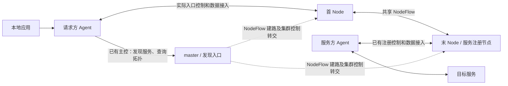

单节点路径的首末为同一个 Node，双方数据在该 Node 内配对；多节点分别接入首末 Node。
主控只发现位置、执行既有 Flow 建路和转交集群消息，不保存首末业务协调状态。
如果 master 自身被选为首/末 Node，其本地实例按普通 Node 的职责处理业务。

### 1.3 进程角色

| 角色 | 主要职责 | 主动连接方向 |
|---|---|---|
| RelayNode master | 接受普通客户端；接受 slave；路由集群消息；承载本机 Relay | 不主动连接 slave |
| RelayNode slave | 接受普通客户端；承载本机 Relay；连接 master 参与集群 | 主动连接 master |
| RelayAgent | 注册本地服务；建立本地监听；发现服务节点；连接一个或多个服务器 | 主动连接服务器 |

master 负责集群消息路由且不保存全局服务目录，同时也可以像任意 slave 一样承载普通客户端和 Relay。

### 1.4 网络接口与监听边界

每个 RelayNode 配置普通 Agent 控制/数据端口和两个 Node 共享数据端口；master 额外监听集群控制端口：

| 配置 | 传输 | 用途 |
|---|---|---|
| `control.port` | TCP + mTLS | 普通 RelayAgent 控制连接 |
| `tcp.port` | TCP | 明文流式 Relay 数据 |
| `tls.port` | TCP + mTLS | 加密流式 Relay 数据 |
| `udp.port` | UDP | UDP Relay 数据 |
| `cluster.control_port` | TCP + mTLS | master 监听 slave；slave 用它连接 master |
| `cluster.tcp_port` | TCP 明文 | Node 间共享、双向、分帧的数据连接 |
| `cluster.udp_port` | UDP 明文 | Node 间固定 socket 的共享数据报通道 |

三个 cluster 端口均必填，不再接受旧 `cluster.port`。master 的 `cluster.control_port` 与本节点其他 TCP 监听端口不同；slave 不监听集群控制端口。所有 Node 的 `cluster.tcp_port/udp_port` 必须一致，分别沿用 `tcp.address/udp.address` bind，对端地址来自 `topology.members`。TCP 与 UDP 可以使用相同数字端口。防火墙应允许 Agent 访问可能的首末 Node 控制口及数据口，并允许 Node 间共享数据端口；实际接入在选路后确定。

### 1.5 术语

| 术语 | 含义 |
|---|---|
| Node / RelayNode | 公共中继节点；按集群职责分为 master 和 slave |
| Agent / RelayAgent | 部署在业务端的客户端进程，可同时承担 Producer 和 Consumer 职责 |
| Producer | 注册 `service` 并连接本地目标的一侧 |
| Consumer | 配置 `forward`、接受本地流量并发起 `relay.open` 的一侧 |
| 普通控制会话 | 通过 RelayNode `control.port` 建立的 mTLS 会话，与节点间 ClusterSession 区分 |
| Stream Relay | `tcp` 或 `tls` 字节流中继 |
| Datagram Relay | `udp` 数据报中继 |
| 推荐路径 | 按质量成本计算的真实 Node 序列；新业务提交最佳路径，单 Node 或无可用路径走单节点回退 |

### 1.6 核心不变量

系统保持以下不变量：

1. 服务注册绑定控制会话；会话断开时注销服务并取消关联业务。
2. NodeSession 是 Node 本地业务实例。Single 管理本地双方，Multi 首末各有一个实例，关联同一 NodeFlow。
3. 服务发现保存目的节点位置，选路后才连接实际入口；多跳请求方无需连接尾 Node。
4. 业务持有共享入口连接。附加连接无业务引用满 60 秒后停止，连接池保留对象直到后台任务退出；primary 始终保留。
5. send 提交消息，opened/offer/ready 等响应推进业务状态。
6. ClusterRoom 传递控制消息，多跳数据通过共享 NodeFlow 转发；master 不保存统一业务表。
7. 每个执行域串行拥有本域状态。跨域通过 post/co_spawn 传递副本并等待数据操作。
8. 实例拥有业务任务及 Flow 监视。停止时先取消并排空业务，再停止 NodeLinkMgr，最后释放资源。

## 2. 逻辑架构与核心抽象

### 2.1 系统分层

RelayAgent 根据服务位置和路由结果确定业务入口，AgentSession 与 NodeSession 协调接入和业务状态。
NodeLinkMgr 安装相邻 Link 与完整 Flow 路径，FlowProtocol 和本地数据 manager 执行转发，LnkChannel 完成邻接 I/O。

| 职责分组 | 职责 | 主要组件 | 输出 |
|---|---|---|---|
| 服务与路径决策 | 服务定位、入口选择和路径计算 | RegistryMgr、RelayAgent、Topology、AgentRouting、route | 服务位置、Node 序列、epoch |
| 业务与路径编排 | 业务授权、建立、激活与关闭 | AgentSession、NodeSession、Single/Multi、NodeLinkMgr | 接入票据、本地数据句柄、LinkSpec/FlowSpec |
| 数据接入与逻辑流 | 本地配对、端点交接、方向与信用管理 | StreamPipeline、DatagramMgr、FlowProtocol、FlowStream/FlowDatagram | 已接手的池载荷、DATA/FIN、待发送的邻接帧 |
| 邻接传输与通道 | 接入认证、顺序收发与连接存活检测 | LnkChannel、NodeLink、TLSChannel、XfrChannel | 实际 I/O 完成、协议事件、业务 EOF 或错误 |
| 通用支撑 | 编解码、存储复用、限速与状态索引 | message、PooledBuffer、标准同步池、TokenBucket、DualIndexMap | 值对象、存储所有权和有界资源操作 |

Multi 通过 Flow 连接首末数据端点。Single 由数据 manager 在本 Node 配对，直接通过 XfrChannel 或 UDP 路由完成传输。
TLSChannel 承载普通控制和集群控制，XfrChannel 承载 Agent 及 Node 的数据复制；两者为不同上层提供通道能力。

### 2.2 控制、路由与数据的协作边界

| 子系统 | 输入与状态 | 输出 | 与其他子系统的交界 |
|---|---|---|---|
| 控制面 | 已认证会话、服务注册、业务请求、路径事务 | 服务位置、接入票据、已提交 Flow、ready/close | 把确定的身份和资源描述交给数据面，接收实际关闭事件 |
| 路由面 | 成员、实测质量、可用带宽、拓扑快照及缓存 | 新业务的入口和固定 Node 路径 | AgentSession 在建立前使用选择结果，NodeLinkMgr 验证并安装路径 |
| 数据面 | 已授权接入、LocalPair/RemotePair、邻接身份及逻辑流 | 按原路径传递的数据、写完成、EOF、丢包或失败 | 本地端口交接载荷，ProtocolEvent 报告 Link/Flow 状态 |

AgentSession 根据服务位置选择入口和路径，NodeLinkMgr 完成 Flow 安装，首末 NodeSession 完成接入、绑定和激活后发送 ready。
Agent 收到 ready 后启动业务复制；数据面校验已授权的 Link、Flow 和端点身份。
已建立业务保持提交路径；路由更新只影响后续新业务。执行域、跨域交接和停止顺序见第 6、8 章。

### 2.3 服务、业务实例、Flow 与 NodeLink

| 概念 | 身份与范围 | 资源及生命周期 |
|---|---|---|
| Service | 本 Node 内的 service / protocol | 注册控制会话拥有；断线注销，发现返回所在 Node |
| AgentSession / NodeSession | 一次业务接入及 Node 本地实例 | 管理接入、ready、复制和收尾；Multi 的首末各有一个 NodeSession |
| LocalPair / RemotePair | Node 内的 uuid、role 与 ticket | manager 拥有本地数据资源；Single 配对双方，Multi 桥接一个本地 Agent 和 Flow |
| NodeFlow | epoch + flow_id，覆盖提交的固定路径 | 每个路径 Node 保存本地 FlowState；首末绑定端点，中间只转发 |
| NodeLink | Link ID、epoch、相邻 Node 对与 transport | 相邻物理通道被多条 Flow 共享；通道失败影响依赖它的 Flow |

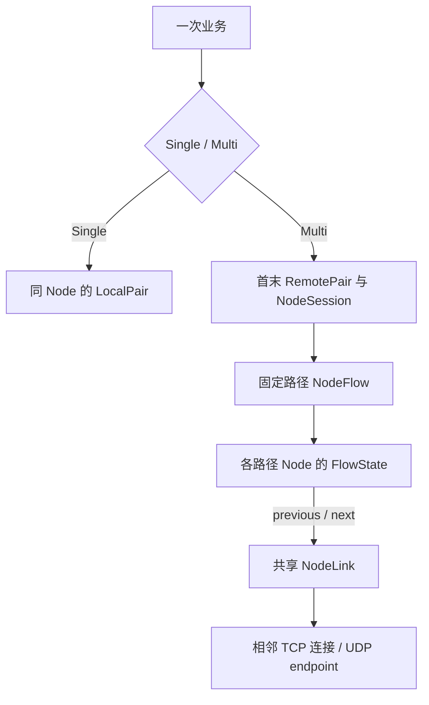

一个 NodeLink 可以承载多条不同目的路径上的 Flow。Flow 控制自己的方向和窗口；Link 管理物理收发与存活。
服务状态和 Agent socket 保留在首末业务层，中间节点只保存转发所需的 Flow 与邻接状态。
TLS 业务在 Agent↔Node 接入段使用 TLS，在 Node 间使用 TCP Flow；详细加密与信任边界见 6.6、7.5.2。

### 2.4 关键架构选择与约束

| 架构决策 | 实现 | 约束 | 详细设计 |
|---|---|---|---|
| 服务注册归属本 Node 的控制会话 | 服务生命周期由实际连接和本机注册表表达 | 集群没有全局服务目录；跨节点发现关联当前请求，采用第一个有效响应 | 3.1、3.3.2 |
| master 负责控制协调，数据沿提交路径转发 | 服务发现、路径安装与实际业务入口分别承担职责 | master 自身在路径上时才转发数据；当前没有选举与备用 master | 1.2、3.5、6.5.2 |
| Single 本地配对，Multi 首末会话加共享 Flow | 共用业务接入规则，并复用相邻 Node 通道 | 中间节点只拥有流和邻接状态；首末排空后才释放业务 Flow | 3.4、5.1、7.6 |
| TCP 逐跳信用，UDP 有界队列丢包 | 按协议提供消费背压或报文准入 | 固定窗口约束单 Flow 的吞吐；UDP 不提供信用、重传和消费确认 | 5.6、5.7 |
| 控制提交与业务确认分开 | 每次状态推进都有对应的响应与身份验证 | 本地发送成功不能证明远端处理；队列溢出关闭通道，没有可靠消息补发 | 3.6、6.4.3、附录 A |
| 状态归执行域，资源归明确所有者 | 串行更新状态，跨域转移拥有载荷，结构化等待异步任务 | 借用者先排空，所有者后销毁；同步操作与真实异步等待保持各自完成语义 | 6.1～6.3、8.3 |
| 新业务选路，活动业务保持路径 | 固定方向、邻接和帧顺序贯穿整个业务 | 当前不迁移活动连接或自动切换备用路径；扩展需定义旧数据排空语义 | 4.3、7.2.1、9.3 |

### 2.5 组件职责目录

主要模块及其边界如下：

| 模块 | 所属进程或库 | 状态所有者 | 职责与主要流程 |
|---|---|---|---|
| `RelayNode` | relayweave-node | 四个 Node executor | 直接持有 RegistryMgr，处理公共控制查询、分派两类中继命令、协调启动和停止 |
| `ControlSession` | relayweave-node | `control_io` | 接受普通客户端 mTLS 控制连接，接收命令并在断线时触发清理 |
| `ControlRouterSingle` | 单节点 NodeSession 的直接成员 | `control_io` | 本地双方接入、建立期限、ready、取消及控制通知 |
| `NodeSession` | 每个 Node 业务实例 | `control_io` | 直接持有 Single/Multi variant、本地数据句柄及唯一任务取消信号；跨域调用数据操作 |
| `ControlRouterMulti` | 多节点 NodeSession 的直接成员 | `control_io` | 首末 attached/ready/finished/close、Flow 失效与本端建立超时；不承担全局查表 |
| `RegistryMgr` | relayweave-node | `control_io` | 保存控制会话弱引用、服务注册、容量和流量统计 |
| `ClusterMgr` / `ClusterRoom` | relayweave-node | `control_io` | master 成员管理、slave 连接、广播和定向控制消息 |
| `NodeLinkMgr` | relayweave-node | `control_io` | 邻接 Link 授权与复用、全路径 Flow 事务及关闭通知 |
| `StreamPipeline<Transport>` | relayweave-node | `transfer_tcp_io` | TCP/TLS 监听、票据校验、本地配对或端点、限速和实际 I/O |
| `DatagramMgr` | relayweave-node | `transfer_udp_io` | 共享 UDP socket、票据/session/来源校验、本地配对或端点、逐包路由 |
| `FlowProtocol` / `FlowStream` / `FlowDatagram` | protocol | 协议状态在 `cluster_data_io`，端口交接连接 transfer executor | 逻辑流身份、固定路径转发、TCP 逐跳信用及 UDP 有界报文交接 |
| `LnkChannel` / `NodeLink` | protocol | `cluster_data_io` | 相邻 TCP/UDP 接入、物理收发、心跳及连接资源 |
| `RelayAgent` | relayweave-agent | `control_io` | primary/附加节点连接池、服务注册、发现和路由控制 |
| `NodeConnection` | relayweave-agent | `control_io` | 单节点解析、连接、mTLS、识别、接收和指数退避重连 |
| `Forwarder` / `AgentSession` | relayweave-agent | `transfer_io` | Forwarder 管理本地监听和实例；AgentSession 拥有单次接入、ready 等待和业务复制 |
| `Topology` | relayweave-node | `control_io` | 成员探测、质量报告、master 拓扑汇总和不可变快照 |
| `AgentRouting` | relayweave-agent | `control_io` | 探测入口与服务节点、组装拓扑、计算推荐路径 |
| `ProbeSet` / `ICMP` | route | 所属进程的 `control_io` | DNS、IPv4 去重、原始 socket 探测、历史保留和关闭 |
| `LinkQuality` / `RouteGraph` | route | 调用方 executor | 固定内存质量统计、纯边权计算和多入口最短路径 |
| `TLSChannel` | protocol | 创建它的 executor | mTLS 握手、帧收发、bounded queue、心跳和统一关闭 |
| `WireMessage` / `CtrlMessage` / `MessageReceiver` | protocol | 值对象 / 每 TCP 连接组装状态 | 长度帧、CBOR 控制消息、透明拆分与顺序重组 |
| `RelayAttach` / `DatagramHeader` | protocol | 无状态值对象 | 数据连接角色凭据和 UDP session header 编解码 |
| `DualIndexMap` | protocol | 使用者 executor | 维护一份值及主、次两条索引 |
| `RelayIdAllocator` / `ServiceTraffic` / `TokenBucket` | node/protocol | manager 或原子计数器 | Relay 标识、方向流量与令牌桶限速 |

### 2.6 业务组件协作

本地 forward 持续监听应用端口；每次业务由 AgentSession 接入 Node。
单节点在本地配对，多节点通过已有 NodeFlow 到达末 Node，再由服务方 AgentSession 连接目标服务。
NodeSession 是一次 Node 业务实例，StreamPipeline 和 DatagramMgr 是长期数据管理器。

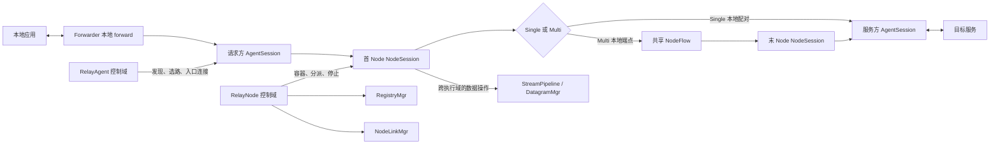

Producer 和 Consumer 是 AgentSession 的两种角色，一个 Agent 可以同时配置 services 和 forwards。
单节点双方接入同一 Node，多节点双方分别接入首末 Node；中间 Node 只有 NodeFlow 分派状态。

## 3. 控制面：身份、服务与业务编排

控制面从已认证的会话产生服务目录和业务授权，再协调业务实例与固定路径的建立。
消息字段与响应关联规则完整列于附录 A，实际数据交接见第 5 章。

### 3.1 普通控制会话与本机服务目录

每条普通客户端连接创建一个 `ControlSession`。RelayNode 为它分配非零、进程内唯一的 `session_id`，然后：

1. 在 `RegistryMgr` 中登记会话；
2. 由 `TLSChannel::start()` 完成 mTLS 握手；
3. 循环 `co_await async_receive()`；
4. 在 control executor 上同步分派控制命令；
5. 连接结束时删除该会话注册的所有服务，并取消属于该会话的 Relay。

Registry 以 session_id 保存控制会话的 weak_ptr，以 DualIndexMap 保存唯一服务名、所属 session_id、协议和统计对象。
服务名直接查主索引，断线按次索引删除该会话的全部服务；查表和容量检查不扫描过期 weak 引用。
控制任务是会话所有者，正常退出或启动失败时负责 remove(id)。注册只返回业务结果，统计对象由服务条目拥有，
实际创建 NodeSession 时通过 find_service 取得共享统计引用。

服务注册的生命周期与控制连接一致。提供方断线后服务立即从该节点消失，不保留离线注册。

服务注册流程为：

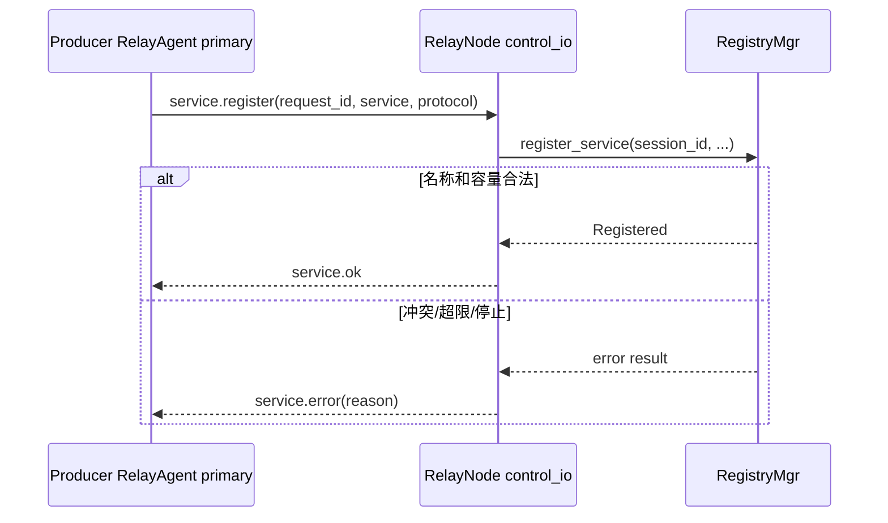

同一会话重复注册同名同协议服务是幂等成功，复用原统计对象；同一节点上其他会话注册同名服务，或同一会话改用另一协议，都会得到名称冲突。唯一性范围是单个 RelayNode，不是整个集群，因此不同节点可以同时注册同名服务，发现端采用当前请求的第一个有效响应。

所有协议在 relay.open 时从 Registry 取得 Producer。注册只更新控制域注册表，不通知数据 manager，
也不复活离线时的旧请求；服务出现后 Agent 重新发现、选路和申请实例。

### 3.2 集群成员与控制消息路由

ClusterMgr 将多个 Node 组织为可寻址的控制网络；master 的 ClusterRoom 拥有成员会话，slave 的 Connector 维持上行连接。

#### 3.2.1 ClusterRoom 成员与消息分发模型

ClusterMgr 的成员与消息分发模型由四个角色组成：

- `ClusterRoom` 管理参与者集合，并按 `target` 广播或定向投递；
- `ClusterSession` 对应 master 接受的一条 slave 连接；
- `ClusterParticipant::deliver()` 是统一的写入口；
- master 本地逻辑以一个本地 participant 加入 room。

master 接受 socket 后立刻创建 session 并加入 room。session 的读协程先调用 `TLSChannel::start()`，再等待 `cluster.join`。加入成功后，读到的普通消息交给 room；room 遍历参与者并调用 `deliver()`。远端 session 的 `deliver()` 直接调用 `TLSChannel::send()`，因此握手、帧格式、心跳、发送队列和单写协程继续由 TLSChannel 管理。

`ClusterRoom` 放在 master 的 `accept_loop()` 协程栈上，只在该结构化协程存活期间存在。停止时先停止所有 session，等待参与者退出，再离开协程。room 和 session 的生命周期由同一个 accept 协程封闭管理。

#### 3.2.2 成员加入与消息路由

| 命令 | 方向 | 参数 | 作用 |
|---|---|---|---|
| `cluster.join` | slave → master | `node_id` | TLS 握手后声明节点 ID |
| `cluster.joined` | master → slave | 无 | 确认加入成功 |
| `cluster.error` | 本地或 master → slave | `reason` | 重复 ID、未连接或本机编码错误 |
| 任意非 `cluster.*` | 任意节点 → room | 业务参数及必填 `target`；master 写入 `source` | `target=all` 广播，否则按 node_id 定向 |

`node_id` 由配置声明，master 拒绝同时在线的重复 ID，也拒绝保留值 `all`。集群 mTLS 确认对端持有 Server CA 签发的节点证书，但协议没有把证书名称与 `node_id` 绑定。

业务消息使用 `CtrlMessage {command, params}`。发送方写入 `params.target`，其中 `all` 表示广播，其他值表示目标节点 ID。master 根据已加入的 session 覆盖写入 `params.source`，调用者不能伪造来源；路由前删除 `target`，RelayNode 接收认证 `source` 和业务字段。业务消息的 `params` 必须是对象，`cluster.*` 命令、`source` 和 `target` 字段由集群层保留。

广播包含发送者，本地节点和远端节点使用相同的接收路径。定向消息只投递给当前在线的目标 participant；目标不存在时按 best-effort 语义丢弃，不退化成广播。

ClusterMgr::broadcast(message) 等价于 send("all", message)；其他 target 使用 send(target, message) 定向发送。两个接口都返回 `void`，调用返回只表示消息被交给发送机制，不表示远端收到或处理成功。需要结果的业务通过响应消息和 `request_id` 关联。集群不保存历史、不补发，也不自动重发业务消息。

#### 3.2.3 ClusterMgr::Connector 重连

slave 的 `ClusterMgr::Connector` 位于 `slave_loop()` 协程栈上。resolver、socket、retry timer 同样属于该协程栈；`ClusterMgr` 只保留一个临时裸指针用于停止时取消这些操作。

connector 对活动 `TLSChannel` 只保存 `weak_ptr`。一次连接的强引用由当前连接/接收协程持有；接收结束并清理以后弱引用自然过期。下一轮通过 `weak_ptr::expired()` 判断是否需要连接，不增加 `is_closed` 一类重复状态接口。

连接流程是：解析地址、TCP 连接、TLS 握手、发送 `cluster.join`、等待 `cluster.joined`、持续接收。解析或连接最多等待 5 秒；失败或断线后固定等待 5 秒再重试。成功不会引入另一套指数退避状态。

停止时取消 resolver、socket 和 retry timer，并断开当前 TLSChannel。master 关闭 acceptor 和出站消息队列，停止 room 内 session 并等待它们退出。RelayNode 等待 `ClusterMgr::async_stop()` 完成后才结束 control 侧停止；此时不会再有 ClusterMgr 对 RelayNode 的反向调用。

#### 3.2.4 Master accept_loop 的结构化并发

master 的 `accept_loop()` 在栈上创建 ClusterRoom 和本地 participant，然后使用 Asio awaitable 运算符并行等待：

```cpp
co_await (accept_sessions(room) && deliver_messages(room));
```

两个分支分别承担 socket 接入和本地出站消息队列消费。它们共享同一个 control executor 和同一个栈上 room，所有成员操作均在该 executor 串行执行。任一分支异常时，组合 awaitable 结束；外层保存异常，先 `co_await room.async_stop()` 收敛所有 participant，再重新抛出。清理发生在 room 析构之前。

接受到 socket 后，session 在完成 TLS 和 join 前已经计入 room 容量。连接上限同时覆盖握手中和已加入的远端成员。room 中还有一个 master 本地 participant，所以判断远端容量时为 `max_connections + 1`。

#### 3.2.5 ClusterSession 生命周期

一个 ClusterSession 只有一个 reader 协程：

1. `co_await channel->start({})` 完成服务端 TLS 握手；
2. 在握手超时时间内直接 `co_await channel->async_receive(timeout)` 等待 `cluster.join`；
3. 验证 node_id 非空、不是保留值 `all` 且未被 room 占用；
4. 回复 `cluster.joined`；
5. 持续直接 `co_await channel->async_receive()`，把业务消息交给 room；
6. 退出时断开 TLSChannel；completion handler 用 weak session 从 room 删除自己。

有限超时由 TLSChannel 的 `async_receive(timeout)` 提供；正常读循环直接 co_await，不为一次 receive 启动子协程。

session 的 `deliver()` 只调用 TLSChannel 的异步发送入口。ClusterRoom 只操作 participant 接口，socket、TLS 写队列和心跳由 ClusterSession 与 TLSChannel 管理。

#### 3.2.6 广播与定向交付

master 收到 slave 消息后，不直接信任原消息中的 `source`。ClusterRoom 使用已加入 session 的 `node_id` 覆盖该字段，删除传输字段 `target`，再根据 target 把业务消息复制给所有 participant 或只投递给一个目标。master 本地发出的消息同样填入 master 的 node_id。

此机制提供的是当前在线成员间的 best-effort 投递：

- 未加入的 session 不接收业务消息；
- 广播时离线的成员不会在重连后收到历史消息；
- 定向目标不存在或已离线时消息直接丢弃，不自动改为广播；
- 某个 participant 的 `send()` 入队失败不会回滚其他 participant；
- 响应必须是新的业务消息，并携带请求协议定义的关联字段；
- `source` 仍由 master 认证并覆盖，定向投递不会降低来源身份保证。

#### 3.2.7 ClusterMgr 与 RelayNode 接口

RelayNode 负责启动、停止和处理真实业务协议，不提供通用集群消息收件箱或 Link/Flow 调试包装接口。
业务处理器直接使用 ClusterMgr 的 `send(target, message)` 和 `broadcast(message)`。

RelayNode 独占 `ClusterMgr`，ClusterMgr 反向保存非拥有的 `RelayNode&`。ClusterMgr 在 control executor 上
验证消息来源后直接调用 RelayNode 的私有消息处理入口，该入口处理公共查询，并将中继命令交给 ControlRouterSingle/Multi。
RelayNode 消费服务、节点、集群状态和拓扑查询；NodeLink/Flow 及 `relay.peer.*` 交给各自模块处理。
`cluster.error` 清理本地 Flow 协调、端点授权及多节点业务；物理 Link 仍由成员变化和独立心跳判断失效。`cluster.joined` 及未识别的普通命令不进入额外队列。
这条直接关系与 RelayNode 控制状态位于同一串行 executor，生命周期由 RelayNode 的所有权和停止顺序保证。
发送入口拒绝业务调用使用 `cluster.*` 保留命令，并通过本地 `cluster.error` 报告。

### 3.3 Agent 服务发现与入口连接

RelayAgent 保存服务位置并管理共享控制连接；业务选定路径后取得实际入口连接，连接引用随业务排空后释放。

#### 3.3.1 RelayAgent 状态与职责

RelayAgent 分别维护入口控制连接和服务位置记录：

- 初始配置只决定 primary 入口；
- 每个 `(service, protocol)` 保存自己的目标节点；
- 每个目标节点对应一个 `NodeConnection`；
- 同一节点的多个服务复用同一连接；
- 不同节点的连接和 Relay 相互独立。

#### 3.3.2 服务发现流程

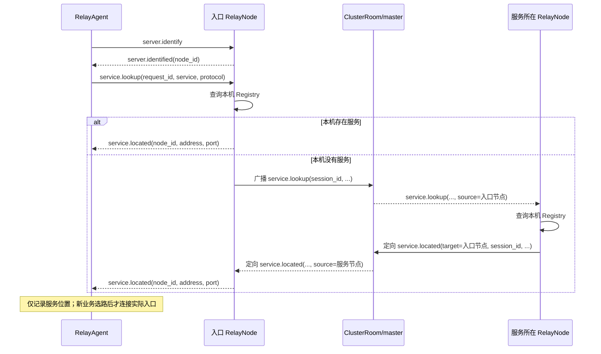

服务端不保存 pending 查询、不创建查询 timer，也不持有等待结果的客户端会话。跨集群查询携带原控制会话的 `session_id` 和入口 `requester_node`。响应回到入口节点时再查 Registry；原会话已经消失就直接丢弃。

转发给普通客户端前，入口节点：

1. 用经过 ClusterSession 认证的 `source` 填写 `node_id`；
2. 删除内部的 `source`、`requester_node`、`session_id`；
3. 保留客户端原始 `request_id`。

因此超时和过期响应全部由客户端处理。每个服务只接受当前 `request_id` 对应的位置结果；后到的旧响应被忽略。多个节点同时提供同名同协议服务时，当前请求收到的第一个有效位置会把 request 置零，后续响应不再匹配。

跨节点时同一查询的参数演变如下：

| 阶段 | 消息 | 参数 |
|---|---|---|
| RelayAgent 发给入口 | `service.lookup` | `request_id`, `service`, `protocol` |
| 入口广播 | `service.lookup` | `target=all`；上述字段 + 入口普通会话的 `session_id`；ClusterRoom 写入 `source=入口 node_id` |
| 服务节点定向响应 | `service.located` | `target=requester_node`；`requester_node`, `session_id`, `request_id`, `service`, `protocol`, `address`, `port`；ClusterRoom 写入 `source=服务节点 node_id` |
| 入口发给 RelayAgent | `service.located` | `request_id`, `service`, `protocol`, `node_id=source`, `address`, `port` |

`session_id` 只在一次 RelayNode 进程生命周期内标识普通控制会话；它不是公开客户端身份，也不会交给最终 RelayAgent。`requester_node` 用作响应的定向目标，并让入口再次确认消息属于本节点。最终 `node_id` 必须从 ClusterRoom 认证过的 `source` 生成，不能采用业务消息自己携带的 node_id。

如果服务在入口本机，RelayNode 直接构造最终 `service.located`，不经过 ClusterRoom。两条路径最后给 RelayAgent 的字段完全一致，所以客户端不需要区分本地命中和远端命中。

#### 3.3.3 集群状态查询

Dashboard 等普通客户端只需连接任意一个在线节点，每轮发送一次 `server.cluster {request_id}`。入口先直接返回自己的完整 `server.status.reported` 消息，再以 `target=all` 广播 `server.status.query {session_id, request_id}`。其他节点各生成完整状态，通过 `target=requester_node` 将 `server.status.report` 定向发回入口；入口节点对本机查询不再生成第二份报告。

查询和响应复用服务发现的路由字段与安全边界：`requester_node + session_id + request_id` 标识原请求，最终 `node_id` 只取定向响应中由 ClusterMgr 认证并覆盖的 `source`，转发前删除全部内部路由字段。不同普通控制会话即使使用相同 `request_id` 也不会串流；会话断开后迟到响应因目标节点或原 session 不存在而直接丢弃。

每条 `server.status.reported` 包含 `request_id`、`node_id`、真实服务器 uptime 和按服务名排序的完整流量报告；地址和三类队列延迟由 `topology.snapshot` 提供。业务字段不再包含 `page_index/page_count`。协议层在完整 CBOR 消息超过 64 KiB 时自动拆分，在每条 TCP 连接上顺序重组，只把完整消息交给客户端，单个 service 或 accessor map 也可以跨帧。客户端按 `request_id` 和 `node_id` 发布一次节点快照和写入一次历史记录。服务端不保存成员快照、不聚合不同节点的结果，也不发送集群完成消息。

#### 3.3.4 节点地址发布

`service.located.address` 也是客户端下一条控制连接和数据连接使用的主机地址。服务节点始终发布必填的 `control.advertise_address`；该值应填写请求方可以访问的公网 IP 或 DNS 名称，并且必须在节点证书 SAN 中。`control.address` 只用于绑定本地监听接口，可以填写 `0.0.0.0` 或 `::`，不再参与服务地址发布。

#### 3.3.5 NodeConnection 连接池

每条控制连接在可用前都执行 `server.identify/server.identified`。客户端校验服务器返回的 `node_id`：已知位置指定了节点 ID 时，实际连接到其他节点会使该次连接失败。

连接池先按 `node_id` 复用，再按 `host:port` 复用。每个 `NodeConnection` 自己运行连接、接收、清理和重连循环：

- 初始重连延迟由 `reconnect.initial_delay_ms` 指定；
- 失败后翻倍，最多到 `reconnect.max_delay_ms`；
- 连接成功后恢复初始延迟；
- 已知附加节点独立重连，不依赖 primary 在线。

`NodeConnection` 不长期保存强 TLSChannel 引用。每次 `run()` 使用成员中的
`optional<Operations>` 原位拥有 resolver、socket 和 retry timer；运行开始时构造，连接循环退出时由
scope guard 清空，`stop()` 因而可以直接取消这些对象而不引用协程栈地址。当前通道仍只保存
`weak_ptr<TLSChannel>`。协程 completion handler 在任务期间持有 RelayAgent；连接池强持有 NodeConnection，运行协程及其 completion handler 只借用连接。

连接池直接保存普通 `shared_ptr<NodeConnection>`，每个连接只有一个 shared_ptr 控制块。
EntryWait 和活动的请求方 AgentSession 保存同一连接的共享引用，EntryWait 只在入口选择期间存在。
复用现有 5 秒维护周期：附加连接只剩池内引用时开始计时，连续空闲 60 秒后调用 `stop()`；
有会话或等待者持有时不回收，短暂复用也会重新计时，primary 不参与空闲回收。
停止后连接不再 ready，但池内索引与对象保留到 `run()` 完成，随后由 Agent 的 completion handler 移除。
同节点新请求遇到停止中的连接时等待其任务退出，再使用原地址重建，整个过程仍受原建立截止时间约束。
入口查询结果只保存地址与端口，不长期保留 JSON 回复；DNS 和控制接收恢复时检查停止状态，避免启动下一阶段。
附加节点断线只结束使用它的业务实例；主控制连接恢复后重新注册和发现服务，不设计离线定位。

单条 NodeConnection 的状态转换可以表示为：

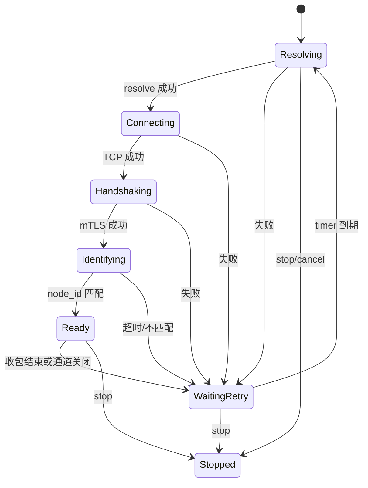

Ready 只表示 mTLS 和 `server.identified` 都成功。TCP 已连接或 TLS 已握手但尚未识别节点时，不会注册服务、安装 Forwarder 路由或发送业务请求。

连接失败后的清理顺序为：清除 weak channel、通知 owner 结束使用该控制连接的业务、等待 TLSChannel 断开、等待重连 timer。stop 会同时取消 resolver、socket 和 timer，使协程从任何阶段退出。

#### 3.3.6 路由失效与重新发现

客户端每 5 秒通过主控制连接查询尚未定位的服务；定位结果与入口控制连接独立。
主控制恢复后重新注册和发现，不增加主控离线位置缓存或备用发现通道。
只有配置了本地转发的 Agent 才运行发现及探测循环；只发布服务的 Agent 保留主控制连接和服务注册流程。
附加入口断线只清理使用它的业务，不触发服务补查；主控制连接恢复和既有轮询负责发现重试。

relay.error 的 service unavailable / service protocol mismatch 若仍对应当前目的 Node，
会清除该次服务位置并通知 Forwarder 清除可用性，再经主控查询。
单节点控制接入超时也重新发现；多节点首 Node 查询失败不删除有效的服务目的位置。
无人使用的附加入口连接在连续空闲 60 秒后停止，任务退出后从连接池移除。服务迁移后新业务重新选路，不重放旧数据或沿用旧票据。
入口失效通知只处理 control 侧等待者；服务丢失由 transfer 侧 clear_service 一次完成可用性清除、
待建立会话及 UDP 会话取消。拓扑变化和服务迁移则分别取消仍在建立的请求方会话。

发现请求和 Relay 请求使用各自执行域内的 `request_id` 分配器。它们的数值可能相同，但由命令类型、连接和对应 pending 容器共同限定，不会把服务查询响应误配到 Relay 打开请求。计数器越过 `uint64_t` 最大值后跳过零。

### 3.4 Node 业务实例与 Single / Multi 首末协调

RelayNode 拥有唯一 RegistryMgr 和 relay_sessions_ 容器，负责请求查找、实例创建、消息分派与停止排空。
NodeSession 的 variant 直接拥有一个 Single 或 Multi 控制器，两者均在 control_io 运行，只推进本实例。
数据 manager 只管理 LocalPair / RemotePair，不保存 ControlSession 或代发业务通知。

Single 从 Registry 找到 Producer，安装 LocalPair，向两端发送 opened/offer，等待双方票据接入，绑定服务
统计和 accessor，激活后发 ready，再运行双向数据复制。建立失败通知请求方 error 和已获 offer 的服务方 closed；
活动 TCP/TLS 由数据 socket 表达结束，UDP 必须发送显式关闭通知。服务离线时 open 直接失败，不占数据容量。

Multi 首 Node 先建立 NodeFlow，再向末 Node 发送 relay.peer.open；末 Node 确认自己是已提交 Flow 的终点并
找到 Producer，创建自己的 NodeSession。双方各安装一个 RemotePair，分别通知各自 Agent 接入。

| 首末消息 | 发送时机 | 对端行为 |
|---|---|---|
| relay.peer.open | 首 Node 已取得 Flow | 末 Node 验证 Flow、服务并创建业务 |
| relay.peer.attached | 末 Node 已完成 Agent 接入及 Flow 绑定 | 首 Node 可以激活 |
| relay.peer.ready | 首 Node 已绑定并激活 | 末 Node 激活自己的端点 |
| relay.peer.finished | 本端两个方向已结束并排空 | 双方均 finished 后才允许释放 Flow |
| relay.peer.close | 本端失败、取消或收尾 | 对端保留原因并关闭本端业务，不反向回声 |

首末各自激活后向自己的 Agent 发 relay.ready。TCP 接入 EOF 转为 Flow FIN、收到 FIN 只 shutdown_send；
TLS 接入在受 TLS 保护的业务 DATA/FIN 和 Flow DATA/FIN 之间转换，FIN 后保留反方向；
真实 I/O 失败尽力发送 RESET 并走控制关闭。双方 finished 的确认防止首端抢先删除仍有尾部 DATA/FIN 的 Flow。
正常 relay.closed 不取消 Agent 的本地排空，AgentSession 仍以自己复制的结果判断是否成功。

Multi 仅有四个进度值：OpeningFlow、PeerOpened、AgentNotified、Ready。peer_prepared、peer_finished 是来自
另一端的独立事件；closed 表示终止，from_peer 防止关闭通知回声。stage 是协议错误位置，可来自对端，
不能用本地 progress 覆盖；reason 保存首次原因。协议 stage、关闭 reason 与本地 progress 分别保存。

Multi 的 establish_and_transfer 与 watch_flow 是本实例的两个结构化子任务：任一退出后取消并排空另一任务。
watch_flow 只监视实际 Flow 失效，不另建 Node 级业务容器。清理只在控制器 run 末尾关闭本地资源和本 Flow，
随后 RelayNode 的 completion 从容器删除实例。

### 3.5 NodeLinkMgr 全路径安装与授权事务

NodeLink 是可共享的物理连接，NodeFlow 是固定路径上的逻辑业务。逻辑身份为 epoch + flow_id，
不额外保存 Route ID 或路径版本。每次业务重新建立分配新 flow_id，即使路径相同也不复用旧 Flow。

open_flow 在 control_io 运行。master 本地执行事务；普通首 Node 通过 flow.open/opened 请求 master
执行同一事务。请求只携带路径、transport 和身份，master 不保存 Relay 或 Agent 的业务状态。
TLS 业务使用 TCP NodeFlow，TLS 仅位于 Agent 与 Node 的接入段。

1. 校验当前 epoch、成员在线、地址快照和无环的 2..8 Node 路径。
2. 并行 ensure 相邻 Link；任一边失败结束本次事务，共享 Link 申请仍由自身期限收尾。
3. 向全路径发送 flow.prepare；数据域确认邻接 Link Ready、身份和协议匹配，安装 Prepared 表项。
4. 收齐全路径 prepared 后发送 commit；收齐 committed 后才返回可用 Flow。
5. 建立失败向全路径发送 close，回滚已准备或已提交表项；只清理本 Flow，保留共享 Link。

每次 Link 建立最多 10 秒；随后 prepare/commit 共用 10 秒期限。ttl_ms 只用于各节点未提交表项的准备期限，
不传播 Agent 或首末 Node 的业务建立预算。提交后的 Flow 没有运行租约或续租消息。
prepare/commit/close 的确认各用一个 8 位掩码记录路径参与者；8 Node 限制不约束集群总节点数。

控制确认验证认证 source、epoch、flow_id、request_id、路径和 Link 身份。相同重复命令幂等处理，
冲突参数拒绝。关闭身份在数据域保留 10 秒的有界 retired_ 记录，避免迟到 prepare 复活已关闭表项；
commit 不创建表项。retired_ 只保存 ID 和期限，不持有 NodeFlow。

| 控制表 | 所在节点及用途 | 删除时刻 |
|---|---|---|
| link_requests_ | master：合并相邻 Link 申请，保留可复用结果 | Link 失败、关闭或成员失效 |
| link_endpoints_ | 每个端点：本地 Link 的控制授权 | 本地失败、关闭或成员失效 |
| flow_requests_ | master：建立中及活动的 Flow 事务 | 进入关闭阶段 |
| closing_flows_ | master：等待全路径关闭确认 | 确认完成、关闭超时或控制失效 |
| flow_endpoints_ | 路径节点：已授权的本地 Flow 参数及 committed 事实 | 数据域关闭通知、路径或控制失效 |
| remote_flows_ | 普通首 Node：等待 master 的 open 结果 | 本次请求返回或中止 |
| flow_watches_ | 普通节点：业务等待本地 Flow 关闭 | Flow 关闭或控制失效；共享等待者持有到收尾 |

各表分别由全局协调者、端点授权管理器或当前等待任务拥有。

master close_flow 等待全路径 closed，最多 10 秒；普通首 Node 请求 master 关闭并等待本地关闭，最多 10 秒。
集群控制断开或心跳失败清理本地 Flow 与授权；epoch、路径成员或 Link 失效清理相关 Flow。发送队列溢出
会报告本地 ClusterError，未主动断开全部集群连接，因此不能保证远端旧 Flow 立即回收；后续依靠显式关闭、
控制失联或路径失效收敛。这是当前投递语义，不隐藏为运行租约。

### 3.6 TLSChannel 控制通道保障

普通控制连接和集群连接都复用 TLSChannel。它把一条 TLS stream 封装成有边界、带心跳、单写队列的消息通道，状态依次为：

```text
Created -> Handshaking -> Connected -> Closing -> Closed
```

`start()` 只允许调用一次。客户端在握手前设置 peer verification、实际连接地址的主机名验证和可选 SNI；服务端要求对端提供可信证书。握手受 `channel.handshake_timeout_ms` 限制。成功后，TLSChannel 启动一个自管理的后台 `run()`，然后 `start()` 返回。

后台 `run()` 用一个 parallel group 同时等待三个长期协程及一个关闭接收操作：

- `rloop`：唯一的 TLS 读取者，读取 4 字节长度和完整 CBOR payload；
- `wloop`：唯一的 TLS 写入者，从 bounded channel 取出完整 frame 并顺序写入；
- `keepalive`：定时发 `ping`，并检查最后一次完整入站 frame 的截止时间；
- close_channel 的原生异步接收操作：等待显式断开请求，不另开包装协程。

任一分支结束会让整个通道进入关闭流程。TLS shutdown 最多等待 `disconnect_timeout_ms`，随后关闭底层 socket、发送和接收 channel，并将状态置为 Closed。

`ping/pong` 在 TLSChannel 内部消费，不进入业务接收队列。其他消息进入 bounded receive channel；接收方长期不消费导致队列满时，TLSChannel 关闭连接，接收队列的内存占用保持在配置上限内。

`send(CtrlMessage)` 可从其他 executor 调用，它先 `post` 到 TLSChannel 自己的 executor，再编码并尝试进入写队列。编码失败或写队列拒绝 frame 时，通道立即进入统一关闭流程；外层接收循环随后清理 session、服务和 Relay，Agent/cluster connector 按原有策略重连。通道已在关闭时的后续 `send()` 不再入队。`send()` 是提交接口，不表示远端已处理消息。

`async_receive()` 先切回通道 executor。未指定 timeout 时直接等待 receive channel；传入有限 timeout 时使用 `cancel_after`。
握手后的 `cluster.join`、`server.identified` 等状态转换设有截止时间。

## 4. 路由面：测量、拓扑与路径决策

Node 和 Agent 共用 route 模块。Node 探测其他成员并上报质量；Agent 测量本地接入成本，合并集群有向边，
计算到服务注册 Node 的最佳路径。AgentSession 建立 TCP/TLS/UDP 新实例时使用最佳路径选择入口，
多节点提交路径和当前 epoch，由首 Node 使用已有 NodeLinkMgr 建立 NodeFlow；单节点或无路径使用服务位置回退。

NodeLinkMgr 安装选定路径，见 3.5；AgentSession 取得实际业务入口，见 7.2。

### 4.1 探测管理与状态所有权

```text
Node 成员 / Agent 配置入口、服务发现与拓扑
  → ProbeSet：DNS、IPv4 去重、身份映射与历史管理
  → ICMP / LinkQuality：探测完成样本与三尺度统计
  → Node 报告 → master 拓扑汇总
  → Agent：筛选远端边，合并本地接入成本
  → AgentRouting::candidate_paths：共用路由图，逐入口搜索所有目的 Node，再按成本与节点序列排序
```

`ProbeSet` 直接拥有 DNS resolver、IP 到 Node ID 的映射、ICMP 实例和重建历史。先解析完整目标集合，
再决定是否重建；IP 集合未变且探测器正常时，只更新身份映射。多个身份指向相同 IPv4 时共用一次探测。
部分 DNS 失败在下一次五秒轮询重试，不中断正常目标；等待期间目标变化时丢弃旧 revision 的解析结果。
删除或改变地址的身份立即隐藏旧测量，其他目标保持可读；重建时仅为未变 IP 保留内存历史，新 IP 从空历史开始。

`LinkQuality` 内部的 `Ema` 保存衰减累计量；`Summary` 只包含 `{cost, confidence, usable}`。
`assess(now)` 返回 `Assessment`，显式包含 quality 摘要、三尺度指标 `scales`、完成/成功计数及
`last_success_age`。`ICMP::Metrics` 使用 IP 身份，`ProbeSet::Metric` 使用 Node ID，二者携带相同的评估结果。
`ICMP::ProbeState` 保存质量统计和真实发送计数；`Session` 另拥有定时器、序列号及在途状态。
取消后的发送仍计入 transmitted，但不计入完成样本或丢包，重建不会用完成数替代发送数。

可变状态留在现有单线程 `control_io`，不新增线程、strand 或 PImpl。跨执行器异步入口使用 C++20
`co_spawn` 在所属执行器运行；调用路径可控的内部协程通过注释约束执行器并直接 `co_await`。
`stop()` 取消解析并阻止新工作，`close()` 等待刷新及全部 ICMP 协程退出，支持重复、并发关闭及调用方取消；
拥有者必须在销毁前等待关闭完成。

### 4.2 质量模型与边权

ICMP 每秒探测一次，超时 800 ms。完成样本按实际间隔衰减；只保存固定数量的聚合量，不保存样本队列。
三个尺度的半衰期为 30 秒、5 分钟、30 分钟，权重为 0.15、0.35、0.50。统计 RTT 均值、相邻成功
RTT 差绝对值的均值作为抖动、RTT 标准差及丢包率。失败样本计入完成数和丢包统计，不参与 RTT 与抖动统计；失败后不跨失败样本计算
抖动，相邻成功样本间隔达到 30 秒也不计入抖动。各尺度基础成本为：

`scale_cost = RTT + 0.5 × 抖动 + 0.25 × 标准差 − 400 × ln(1 − 丢包率)`

RTT、抖动和标准差使用毫秒，丢包率使用 0–1 的比例，`ln` 为自然对数。丢包率是各尺度衰减后的
`1 − 成功样本权重 / 完成样本权重`。丢包惩罚系数由 `LinkQuality::LOSS_PENALTY` 定义为 400，
相同丢包率的惩罚为原系数 200 时的两倍，且随丢包率增加而加速增长：

| 丢包率 | 该尺度增加的成本 |
|---|---:|
| 1% | 4.02 |
| 5% | 20.52 |
| 10% | 42.14 |
| 20% | 89.26 |
| 30% | 142.67 |

对有成功证据且丢包率小于 100% 的尺度，按其权重归一化得到摘要中的基础成本：

`quality.cost = Σ(weight × scale_cost) / Σ(weight)`

没有抖动样本时抖动项为 0；没有成功证据的尺度不参与加权。成本越低越好，没有固定上限或优良等级，
是以毫秒为基准的比较值，不能当作业务实际 RTT。例如三个尺度都稳定在 RTT 80 ms、无抖动和丢包时，
基础成本为 80；相同 RTT 且各尺度均为 10% 丢包时，基础成本约为 122.14。

信心由时间覆盖和有效证据共同约束：`confidence = min(clamp(覆盖秒数 / 1800, 0, 1),
min(1, 长尺度有效完成样本权重 / evidence_target))`，其中 `evidence_target = 0.8 × 0.5 × 1800 / ln(2)`，
约为 1039；覆盖时间为首末完成样本的间隔，有效样本权重包含截至评估时刻的衰减。
连续 30 分钟没有完成样本后重新积累统计和信心。下列任一条件
使链路不可选路：连续失败达到 5 次、短尺度丢包率达到 50%、最后成功达到 45 秒、最后完成样本达到 15 秒。
没有成功证据时 `cost=null`、`usable=false`。ICMP 反映主机往返质量，不测量业务端口、带宽或单向时延。

纯函数 `routing_cost(quality, age)` 对基础质量成本应用新鲜度及冷启动惩罚：

`quality_cost = quality.cost × freshness + 5 × (1 − confidence)`

`age` 为最后成功测量的年龄；消费远端摘要时还要累加快照经过时间。25 秒内 `freshness = 1`；
25–45 秒为 `1 + 0.5 × ((age_seconds − 25) / 20)²`。信心为 1 时无额外成本，为 0 时增加 5。
45 秒起或摘要不可用时无边权。`RouteGraph` 只接收最终非负成本。

### 4.3 图算法与 Agent 接口

| 类型或接口 | 含义 |
|---|---|
| `RouteGraph::Link {from, to, cost}` | 有向边；过滤非法成本，重复边取最低成本 |
| `RouteGraph::Entry {node, access_cost}` | 真实入口及本地接入成本，不需要虚拟 Agent 节点 |
| `RouteGraph::Path {nodes, cost}` | 真实 Node 序列与总代价 |
| `shortest_paths(entries, max_nodes)` | 一次多入口搜索全部目的地，每个服务终点之前的 Node 增加成本 2 |
| `AgentRouting::candidate_paths(now)` | 返回各目的 Node 的候选路径，按成本与节点序列排序 |

服务候选路径包含 `N` 个真实 Node 时，总代价为：

`path.cost = Agent 到入口的 edge_cost + Σ(Node 间有向边的 edge_cost) + 2 × (N − 1)`

构图时每条边的成本为 `edge_cost = quality_cost + bandwidth_penalty(目标节点)`，Agent 接入边同样处理。
`bandwidth_penalty = 10 × (1 / max(available, 0.05) − 1)`；可用率 100%、50%、20%、≤5% 分别增加 0、10、40、190。
例如 `Agent → A → B → C` 的三条边分别加 A、B、C 的惩罚，搜索后不再额外加分。
Agent 保存 `available` 原值，选路时直接计算公式；缺失/null、报告年龄未知、报告或快照达到 15 秒时惩罚为 0。
非 null 的可用率必须是 0–1 的有限数。现有候选路径缓存和指标更新规则保持不变。

每个终点之前的 Node 增加中继成本 2。单 Node 直达路径包含 Agent 到目的 Node 的接入边成本；
三 Node 路径有一条接入链路、两条 Node 间链路，并额外增加 4。当前质量基于 ICMP，因此服务协议名称
TCP、TLS 或 UDP 不改变上述公式。

shortest_paths 使用按“节点、已用节点数”分层的算法，同成本按完整节点序列排序。节点预算只计算真实
Node；孤立入口仍能给出单 Node 直达路径。后台轮询只维护探测目标和拓扑，不计算服务候选路径，
不维护路径切换状态或独立备用路径。`candidate_paths()` 为每个可用入口分别保留到各终点的一条最优路径，
不是同一入口下的全部路径枚举，也不保证候选之间节点或链路不相交。候选缓存由 RelayAgent 拥有。

TCP/TLS 每个本地连接、UDP 每个新业务实例均由 AgentSession 跨到 control_io 调用 select_relay。
calculate_service_paths 返回最佳 Node 序列；命中有效 LRU 时直接取第一候选，未命中才计算并缓存候选。
该函数是 control_io 上的同步计算，不创建协程；入口定位及控制连接等待仍由 select_relay 协程负责。
随后附当前 epoch 并取得实际入口，返回路径、入口 ServerRoute 及共享连接引用。
后台探测不触发业务选路，活动业务也不重新计算或换路；服务发现不提前建立尾 Node 控制连接。

候选按目的 Node 缓存 15 秒，LRU 容量 16，TCP/TLS/UDP 共享，空候选也缓存。
命中只更新次序，不续期；必需探测目标变化、主控制断开或拓扑 epoch 改变时清空。
同 epoch 的指标及普通快照版本变化不直接清空缓存；TTL 到期后的下一次业务使用当前测量重新计算。
有效候选只用于选择最佳路径，不复用之前的接入票据或 Flow。
`cost` 是含质量、新鲜度、冷启动、带宽及中继惩罚的路由成本，不等同于 RTT。
路径为空或仅一个 Node 时按目的服务位置走 Single；多节点首 Node 定位或连接失败结束当前实例，
不在原实例内重新选路或回退。业务实例以服务名、本地 uuid 及 Flow 身份关联。
Forwarder 使用 `ServerRoute::id`（host:port）管理入口连接与 Relay。

Agent 启动即探测配置入口，身份确认后关联 Node ID，服务发现后加入服务目标。有 forwards 时查询完整
拓扑并比较全部 Node 入口，候选探测不额外建立业务连接。服务 Node 本身可作入口；本地有效直达测量
不依赖远端拓扑。当前不向 Node 上报 Agent 推荐路径，也不迁移活动业务。

### 4.4 拓扑消费与 Dashboard

Node 每五秒上报聚合质量及控制/TCP/UDP 排队延迟，master 汇总成员和有效来源报告，提供不可变完整快照，
不集中保存原始样本。远端边参与选路必须同时满足：

- 拓扑结果年龄小于 15 秒；
- 来源 Node 报告年龄加经过时间小于 15 秒；
- 链路年龄加经过时间小于 45 秒；
- 来源发布的质量摘要 usable。

Agent 和 Dashboard 使用相同规则，以单调时钟的“请求开始时间减服务端 created_age_ms”为保守原点，
将请求和协议组装时间计入年龄。协议层丢弃缺页消息，上层只接受完整快照并保留尚有效的旧结果。
校验 request_id、epoch、版本和业务字段，请求期限为 10 秒，最多 65536 条目、1024 Node。
没有匹配请求身份的非法回复不终止当前请求。Dashboard 还保存最高已接受请求编号，同版本的
完整回复也推进水位，防止迟到回复恢复旧 epoch。断线使当前结果失效，历史记录与 HTTP 游标继续使用墙钟。

Dashboard 页面先展示集群状态和当前 Flow 交通图，再展示所选 Node 的五项精简健康指标及排队/带宽图表，最后展示集群服务。Node 选择器位于健康指标区域，页头只标识采集入口。
交通图展示已 Ready 的 Single 和 Multi 业务，独立于健康指标选择；拓扑采集提供成员、当前排队值和 API 链路质量；API 根据成本生成展示分数
`100 × exp(−cost / 100)`，线协议不发送 score，Python 不重新计算质量模型。
车站圆环显示节点配置带宽占用，圆心显示 `available` 带宽余量；报告过期或断开时显示未知。路线线宽按业务连接数采用固定平方根尺度，车站业务数量按途经路径计数一次，部分采集显示数量下界。详情只显示端点、路径、数量和余量，不展示 UUID、epoch 或 Flow ID。

## 5. 数据面：接入、逻辑流与邻接传输

FlowProtocol 管理逻辑流，LnkChannel 管理邻接传输，本地数据 manager 处理 Agent 数据接入和复制。
路径授权来自 3.5，首末激活来自 3.4；完整 Single/Multi 请求过程见第 7 章。

### 5.1 FlowProtocol、端点与本地逻辑流状态

#### 5.1.1 公共边界与实现归属

| 类型 | 职责与所有权 |
|---|---|
| `NodeLinkMgr` | 控制域协调路径事务、验证控制参数，生成 LinkSpec/FlowSpec，消费 ProtocolEvent |
| `FlowProtocol` | 数据域拥有公共流表、邻接通道、载荷池、事件、监控和任务排空；按值包含 Stream/Datagram 协议实现 |
| `LnkChannel` | FlowProtocol 按值持有；拥有相邻 NodeLink、认证、socket 与物理发送队列 |
| `lnk::FlowStream` | 部件的 TCP/TLS 端点，交接数据与 FIN、通知写完成、RESET 和关闭 |
| `lnk::FlowDatagram` | 部件的 UDP 端点，有界报文收发，满则丢整包 |
| `lnk::FlowState` | 内部流实例；transport 选择协议，私有 Stream/Direction 和 Datagram 归拢各协议数据 |
| `lnk::NodeLink` | 内部邻接连接实例；Phase 表示建立及关闭进度，保存唯一物理读写状态 |
| `lnk::PooledBuffer / std::pmr::synchronized_pool_resource` | 单块载荷所有者与共享分配器，使用同一份帧存储 |

生产实现集中在 flow_protocol.h/.cpp 和 lnk_channel.h/.cpp 两组文件。
FlowSpec、LinkSpec、ProtocolEvent 和端点类是部件使用的边界；共享的实现状态统一放在 lnk 内，
Stream/Direction、Datagram 是 FlowState 的私有类型，UDP 发送项是 LnkChannel 的私有 DatagramWrite。
这些定义参与成员布局或跨两组实现文件访问，保留在头文件；容量、刷新和超时策略常量留在实现单元。
两类端点的 Queue 均为私有类型，成员统一使用 send_queue_/receive_queue_，不向部件提供原始 channel。

FlowProtocol::Stream 与 Datagram 是服务内部按值包含的两份协议实现，只持有 FlowProtocol&：
Stream 负责信用、DATA/FIN/RESET、写完成与端点任务，Datagram 负责有界投递、丢包及其发送任务。
FlowState::Stream、Stream::Direction 和 FlowState::Datagram 则只保存流实例的数据；内部名称不重复 State。
共同身份、邻接资源、Flow 删除和退役、内存池及 Node 级任务管理仍保留一份，无继承、PImpl 或注册回调。

#### 5.1.2 本地状态与方向语义

数据域由 LnkChannel::connections_ 保存邻接连接，由 FlowProtocol::flows_ 保存逻辑流的 FlowState。
FlowState 保存不可变 id/epoch、transport、previous/next Link ID、Prepared/Active/Closed、准备期限和数据状态，
不保存服务、Agent socket、完整路径或 JSON。transport 明确选择 TCP/UDP，不再通过成员是否存在判断协议。
TCP 构造时创建 Stream，包含双向信用、终点帧队列及绑定后的 Stream 端口；Datagram 包含
UDP 端点接收队列和端口，中间节点不分配接收队列。节点角色由 previous/next 表达，不另存角色标识。

forward 沿提交路径，reverse 沿原路径返回，与 TCP 建连方向无关。中间 Node 验证实际入边与方向后直接
移动载荷到出边队列，首末 Node 才交付本 Flow 的接收者。共享 A–B 可同时承载 A→B→C 和 A→B→D，
两个 Flow 各自关闭或失败；物理 A–B 断开才使依赖它的全部 Flow 失败。

TCP 的 DATA、FIN 在同方向保持顺序。FIN 后拒绝该方向 DATA 和重复 FIN，反方向仍能传输；RESET 仍可终止
本 Flow。两个方向均 FIN 不自动删除表项，正常完成由首末控制器排空后显式 close。UDP Flow 仅接受 DATA，
保留 datagram 边界，不提供重传、排序或分片，关闭走控制协议。

#### 5.1.3 端点绑定与任务生命周期

FlowProtocol::prepare_flow、commit_flow、close_flow、bind_stream_flow、bind_datagram_flow 都是数据域同步操作。
逻辑 Flow 先 prepare/commit，绑定只是附加本地端点并启动所属长期任务，不另设公开 Run 或启动状态。
StreamPipeline/DatagramMgr 在绑定调用处通过一次 co_spawn 跨到数据域，取回端点后检查本地业务是否已关闭；
此后的每帧操作使用 native concurrent_channel，不再跨域启动短协程。

绑定顺序为公共身份/协议/角色检查、创建并登记端口、启动一个协议父任务、返回端口。
TCP 的 Stream::run 持有该 Flow，使用 wait_for_one_error 组合 send_loop 与 receive_loop；正常 FIN 只结束
对应子循环，真实错误取消另一侧，等两侧排空后统一报告最先发生的错误并关闭 Flow。
异常处理取完成顺序中的首个异常；此前正常 FIN 的完成记录不会覆盖该异常。
两个子循环借用父任务的共享 Flow 句柄及 FlowStream&，既不复制持有关系，也不在内部重复 catch/关闭。
已在绑定前完成的本地方向由 send_loop 读取数据域 Direction::finished 后直接结束，不单独增加启动分支。
UDP 的 Datagram::run 就是单个发送循环，借用其 Flow 内含端口，不再套一层监督协程。

#### 5.1.4 端点接口与邻接交界

Stream 的接口为同步 copy_payload(span)、send(PooledBuffer)、finish_send()、receive()、complete_receive()、
reset(reason) 和 close(reason)。copy_payload 按实际数据长度从共享池取得存储并复制一次；send 移动所有权。
receive 返回 optional<PooledBuffer>：有值表示 DATA，包括空 DATA；nullopt 表示正常 FIN；取消和失败用异常表达。
DATA/FIN 在同一个 Queue 中有序交接，发送半关闭与整个 Flow 关闭分开，每端点只有一个发送者和一个接收者。
Datagram 的接口为 try_send(span)、receive() 和 close(reason)。try_send 同步复制一次到共享池，receive
返回 PooledBuffer；满队列、池容量不足或端口关闭均丢包返回 false，没有完成确认、窗口等待或 FIN。
公共接口不传入回调、计费字节数、方向状态或内部帧。

Flow 与 NodeLink 在同一数据域直接调用：物理读循环校验帧后调用 FlowProtocol::receive；
CREDIT 按出边规则单独处理，业务帧检查身份、生命周期及入边后按 transport 分流一次。
Stream::receive 处理信用检查及 DATA/FIN/RESET，Datagram::receive 只接受 DATA、满队列丢包。
Stream::route/Datagram::route 决定出边或终点；取得出边信用的帧调用 LnkChannel::enqueue 同步入队；
TCP 写成功后调用 FlowProtocol::written 释放本跳占用，失败则关闭依赖该 Link 的 Flow。
NodeLink 不管理第二套 Flow 信用，不注册回调，也不通过额外热路径事件队列转发。

绑定公共检查负责身份、协议、生命周期及端点位置，协议绑定函数只检查自己的端口是否已绑定。
关闭按协议集中清理，专用流程直接使用构造时建立的状态；保留端口未绑定、异步恢复后的关闭状态，
以及旧端口操作的具体实例检查，避免已关闭或复用 ID 的 Flow 被迟到完成改变。

### 5.2 LnkChannel 与共享 NodeLink 邻接传输

NodeLinkMgr 与数据 manager 同层，由 RelayNode 直接拥有。一个无向 Node 对、一个 transport 对应一个
共享 NodeLink；TCP 和 UDP 分开建立。master 的 ensure_link 合并并发申请，成功后返回已有 ID。
控制协议只描述 Node、地址、epoch、Link ID 和凭据，不包含 service 或 Agent 状态。

| 命令 | 方向 | 作用 |
|---|---|---|
| link.prepare / prepared | master ↔ 两端 | 安装本次身份和凭据；UDP 在 prepared 前完成解析并固定 endpoint |
| link.connect | master → 两端 | 收齐 prepared 后按固定角色开始接入 |
| link.ready | 两端 → master | 两端均完成接入后，ensure_link 返回成功 |
| link.error | 端点 → master | 返回原失败阶段和原因 |
| link.close / closed | master ↔ 两端 | 清理物理连接及依赖它的 Flow |
| link.attach / attached | 相邻 Node 数据 socket | 校验 epoch、ID、Node 身份、凭据和 data_version |

每次外层尝试使用新的非零 Link ID 和凭据；建立最多 10 秒。TCP 由排序靠前的 Node 主动连接，
排序靠后的 Node 等待接入。每次只解析、连接一次，不反向尝试；UDP 双方各发送一次 attach 并响应 attached，
不增加可靠传输或重发。失败交给外层业务处理，不在物理通道内部自动重连。

NodeLink 使用 Preparing、Resolving、Prepared、WaitingForPeer、Connecting、Attaching、Ready、Closed
表达进度。attached 与 acknowledged 是 UDP 接入的两个独立事实，支持乱序到达；不能合并成单一进度。
connect 在启动任务前离开 Prepared，重复命令不会启动第二条连接链；异步恢复不能覆盖 Closed。
通知的 stage 从当前状态生成，心跳失败单独报告 keepalive。

TCP 每条 Link 拥有一个读循环和一个写循环；UDP 共用 LnkChannel 的一个接收循环和一个发送循环。
TCP 主动建立和认证接入完成后均进入 tcp_run，用 wait_for_one 组合读写，任一退出就取消并排空另一侧。
建立/接入父任务持有 NodeLink，tcp_run、tcp_read、tcp_write 只借用引用，物理 writer 不再独立登记任务。
物理 Link 不提供业务半关闭，I/O 错误在组合排空后由父任务关闭该 Link 及其依赖 Flow。
接入 socket 在认证后移交给 Link，pending 集合的清理 guard 只覆盖 bootstrap；不把已移出的 socket
和清理 guard 保留到整个连接结束。
Node 数据通道为明文 TCP/UDP，其凭据来自已认证的集群控制连接；服务限速和统计不放在中间 Link 上。

每 5 秒发送 PING，20 秒未收到新的有效 PONG 则关闭 Link。PONG 序号必须大于 last_ack_ping 且不超过
已发送 PING 序号；重复、倒退或伪造未来响应不能延长存活期限。正常 DATA 不代替 PONG。
FlowProtocol 的一个 monitor 等待最近的 Link 建立、心跳、Flow 准备、信用刷新或关闭身份回收期限；
LnkChannel::poll 同步检查邻接状态，无待检查对象时无限等待。

共享任务的组合、期限监控与停止排空统一见 6.3.2。

### 5.3 Node 数据通道二进制帧

NodeLink 接入完成后，业务 DATA/FIN/RESET、CREDIT 与 PING/PONG 都使用固定 32 字节 LnkFrameHeader。
整数以大端逐字段编码，不传输 C++ struct 内存布局；没有 JSON/CBOR 业务载荷封装。

| 偏移 | 字节数 | 字段 |
|---|---|---|
| 0 | 1 | magic = 0x4e |
| 1 | 1 | version = 2 |
| 2 | 1 | DATA=1、FIN=2、RESET=3、PING=4、PONG=5、ATTACH=7、ATTACHED=8、CREDIT=9；6 未使用 |
| 3 | 1 | bit0 为 reverse，其余位为零 |
| 4 | 4 | body_length |
| 8 | 8 | 非零 master epoch |
| 16 | 8 | 非零 flow_id；接入与保活帧为零 |
| 24 | 8 | PING/PONG 非零 sequence；CREDIT 为累计授信上限；其他帧为零 |

DATA 为 0..65467 字节原始载荷，FIN 无帧体，RESET 为最多 512 字节原因。PING/PONG 与 CREDIT 无帧体。
CREDIT 的 reverse 表示受控 DATA 的方向，沿 DATA 反向返回相邻上游，在这一跳终止，不穿透整条路径。
LnkFrameHeader::maximum_payload 按 `65507 - DatagramHeader::length - LnkFrameHeader::length` 推导，
最大 Node UDP 数据报为 65507 字节；每跳重新封装，帧头不随路径长度累加。TCP/TLS 多节点接入的读取缓冲
也采用最大 DATA 载荷 65467 字节，按实际读取长度立即提交，不等待填满。Agent 与本地 UDP 的大接收缓冲保留。
Node UDP 接收循环复用一个 65508 字节数组（包含一个检测字节），校验报文后仅按非空载荷长度申请池块并复制。
接收数组位于跨异步等待存活的协程帧中，每 Node 一份；按载荷长度向标准池申请存储，不携带接收头部空间。
每个 UDP Flow 方向的接收队列最多 16 包，载荷按需分配，满时丢当前包。启用 UDP 限速时，burst 必须至少容纳希望转发的报文。
此上限不保证实际路径 MTU 允许直接发送；部署须将所有 Node 数据版本同步升级到 2，旧版本不能参与新信用协议。

TCP 的首帧 attach/attached 继续采用 WireMessage/CBOR 并校验 data_version=2，之后只接受 Node 二进制帧。
TCP socket 已绑定相邻 Link 身份，后续帧不重复发送 Node 字符串和凭据。
UDP 每包为 8 字节相邻 NodeLink ID + 32 字节头 + 帧体，精确验证报文长度、epoch 和固定 source endpoint；
只有 ATTACH/ATTACHED 的帧体是 WireMessage/CBOR。Agent→Node 的 UDP 接入同样只有 attach 需要控制解码，
正常 session 报文仅解码二进制头。

本地端点检查数据大小，每跳网络解码检查帧格式；内部 Frame 分派及编码直接使用已校验字段。
普通逻辑流错误只关闭本 Flow，畸形物理帧或真实 Link I/O 失败才关闭物理通道。来源、epoch、方向、预期入边
和 FIN 状态校验是业务隔离边界，不能因内部转发优化删除。

### 5.4 本地数据管理与接入边界

服务端按传输类型分成 TCP/TLS StreamPipeline 和 UDP DatagramMgr。
每个 manager 直接拥有 LocalPair / local_pairs_ 和 RemotePair / remote_pairs_；
LocalPair 在本 Node 上配对双方 Agent，RemotePair 桥接本地接入的 Agent 与 NodeFlow。
TCP/TLS 与 UDP 的 RemotePair 共用 app_common.h/.cpp 中的 RelayEndpoint，保存接入票据、角色、
接入事件、激活/关闭标志、限速与统计绑定；只提供公共配置绑定和按角色映射 rx/tx 的载荷计数。
具体 socket、UDP 来源和 Flow 端口由各自的 RemotePair 保存，接入校验、转发和关闭由 manager 执行。
两种资源共同消耗该协议的 max_relays 容量。资源保存票据、已接入 socket 或来源 endpoint、接入事件、
数据激活标志、限速与统计，不保存 Agent 身份、业务请求、服务等待或控制通知。

Single / Multi 分别使用 *_local_pair / *_remote_pair 操作，两者都提供 install/wait/bind/activate/run/close。
attach 只校验票据并发布接入事件，控制器完成绑定和激活后才通知 Agent ready。
TCP/TLS 的差异仍由小型 transport policy 表达；UDP 共享 listener 按 session 索引直接转发，
多节点返回路径从 FlowDatagram 的有界接收队列取包并发送。
三类 manager 共享线程安全的 RelayIdAllocator，uuid 在 Node 内不冲突；单节点双方同 uuid、不同 ticket/session。

#### 5.4.1 RelayAttach 首帧

TCP、TLS、UDP 使用同一个逻辑首帧：

```text
[4 字节大端 payload 长度][CBOR CtrlMessage payload]
```

payload 是：

```text
{
  "command": "relay.attach",
  "params": {
    "role": 1 | 2,
    "uuid": <non-zero uint64>,
    "ticket": <non-zero uint64>
  }
}
```

`role=1` 是 Producer，`role=2` 是 Consumer。payload 长度必须在 1～64 KiB。TCP/TLS 在 stream 上精确读取一帧；UDP 的一个 datagram 必须完整包含一帧，而且长度字段必须与剩余长度完全一致。

TLS 数据通道先完成 mTLS 握手，再在加密流内发送 attach；其 params 额外要求
`tls_framing="length32-fin-v1"`，与 Node 下发的 TLS endpoint 描述符一致。TCP 和 UDP 的 attach 位于明文数据通道，
不携带该字段；ticket 只通过已认证控制连接下发。

manager 按 `uuid` 查找 Relay，再验证 ticket 是否属于声明的 role。以下情况会被拒绝：帧或 CBOR 非法、命令错误、Relay 不存在或过期、ticket/role 不匹配、同一 role 重复接入、超过 setup timeout 或容量上限。

`uuid` 是索引，不是认证凭据。每个 role 的 64 位非零 ticket 由 OpenSSL `RAND_bytes` 生成，并在 Relay 销毁时失效。

#### 5.4.2 DatagramHeader 与 UDP 来源绑定

UDP attach 完成后，公网数据报格式为：

```text
[session_id: 8 字节大端序][用户 payload: 0..65499 字节]
```

单节点双方获得不同非零 session_id 和 ticket，uuid 相同；多节点首末各有本地端点。
DatagramMgr 的 bindings_ 将 session_id 关联到 uuid 和方向，再查本地配对或端点并验证已固定的来源。
ready 前 payload、未知 session、短报文、错来源和超长报文丢弃；不缓存，也不替换已绑定来源。
单节点改写对端 session 头并转发，多节点剥离本地头送入 NodeFlow，返回时写回本地头。
单节点保留原载荷范围，多节点上限为 65467 字节，由 UDP 最大线载荷 65507 减去 8 字节 NodeLink 标识和
32 字节帧头得到，无应用层分片。

服务离线时只有 Agent 本地 forward。Node 收到无服务的 open 立即返回 unavailable，
不创建 waiting Relay、timer、binding 或 Flow。注册服务不接管旧请求；新的业务必须重新选路及申请。
服务存在时 Single 的 udp.setup_timeout_ms 限制从业务创建到双方 attach、绑定和激活，默认 10 秒。
建立完成后无运行期租约；取消、控制失效或 stop 结束业务并清除双方 binding。

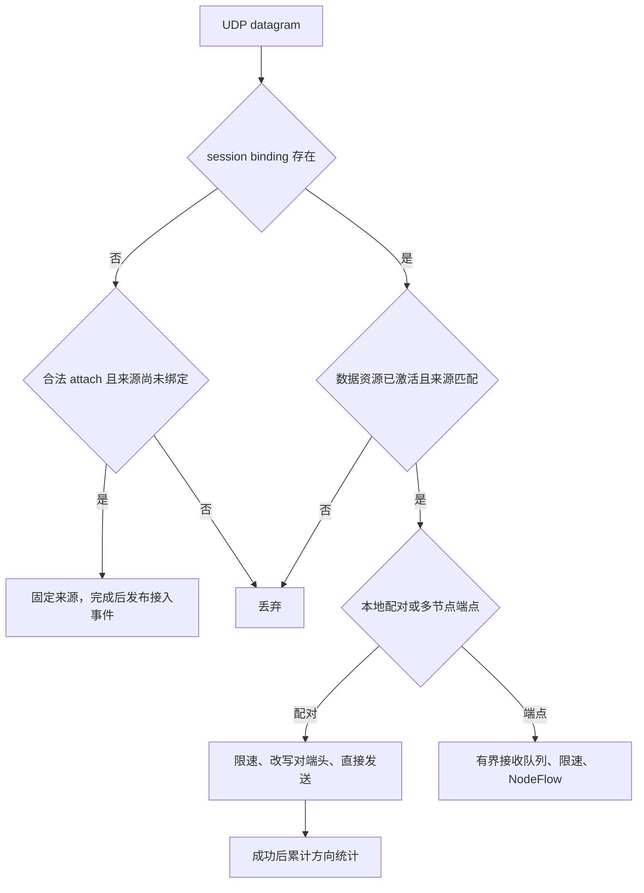

共享 UDP socket 可有不同端点的发送同时等待完成，每次发送都是完整报文，各端点自身保持串行。
单节点接收循环在发送完成前不复用接收缓冲；多节点返回协程持有帧载荷直到发送完成，取消或关闭 socket 后也等待 I/O 完成再释放。
多节点本地接收队列满或 UDP 令牌不足只丢当前报文；Flow/Link 数据入队失败由业务异常边界处理，
不保证仅丢一包。当前没有独立的共享 DatagramMgr 发送队列。
关闭配对/端点后 session 与旧票据立即失效，迟到 attach 不能复活资源。

### 5.5 TCP、TLS 与 UDP 复制机制

`xfr_channel` 是 Agent 和 Node 共用的数据复制模块。它接收已经完成连接、握手和 attach 的 socket，
负责双向复制、限速、流量计数和关闭传播。调用方仍拥有 socket，并负责 Relay 索引和控制消息生命周期。

| 协议 | 公网数据保护 | 转发对象 | 限速行为 | 关闭特点 |
|---|---|---|---|---|
| `tcp` | 明文，attach ticket 鉴权 | TCP byte stream | 等待令牌，形成背压 | 支持 TCP 半关闭排空 |
| `tls` | client 到 server 的 mTLS；server 可见明文 | TLS 内 DATA/FIN 对应的业务 byte stream | 等待令牌，形成背压 | 业务 FIN 半关闭，真实错误整体关闭 |
| `udp` | 明文，`session_id` 路由 | 完整 datagram | 令牌不足时整包丢弃 | 随控制会话或显式取消释放 |

#### 5.5.1 XfrChannel 复制入口

| 函数 | 使用模块 | 两端类型 | 责任 |
|---|---|---|---|
| `relay_tcp()` | AgentSession、StreamPipeline | TCP ↔ TCP | 双向复制、等待式限速、流量计数和半关闭 |
| `relay_tls(TCP, TLS)` | AgentSession | 本地 TCP ↔ 公网 TLS | 本地明文与数据 TLS stream 双向复制 |
| `relay_tls(TLS, TLS)` | StreamPipeline | Producer TLS ↔ Consumer TLS | 解密后的 payload 复制、限速和流量计数 |
| `relay_udp_connected()` | AgentSession | 本地 UDP ↔ 公网 UDP | 增删 session header，并在两个 connected socket 间逐包转发 |

流式函数内部同时运行两个复制方向。任一方向发生致命错误时取消配对方向；正常 EOF 按对应 transport 的
关闭规则收敛。UDP Node 的逐包路由由 DatagramMgr 直接实现，
`relay_udp_connected()` 只用于 Agent 本地目标与 Node session 之间的转换。

#### 5.5.2 TCP Pipeline

双方和服务器都运行两个异步复制方向。`relay_tcp()` 每个方向使用 32 KiB 缓冲区，一次读取后等待对应写入完成，再开始下一次读取，因此不会建立无限增长的用户态缓存。

普通 EOF 使用半关闭：A 读到 EOF 后只对 B 执行 `shutdown(send)`，B 到 A 的方向继续运行并排空。两个方向都结束后再关闭 socket。显式取消由调用方清理双方。

`transfer_tcp()` 的读写错误、限速等待取消和非预期 shutdown 错误以异常传播。`relay_tcp()` 复用
`await_transfers()`：一个方向失败后取消并排空另一方向，按完成顺序保留原始错误，避免对向空闲读取或
限速定时器使会话一直挂起。正常 EOF 仍只半关闭发送方向，等待反向数据与 EOF，不触发对向取消。
真实 TCP socket 测试覆盖两侧 RST、发送失败、限速等待中的对向失败，以及双向半关闭回传和流量计数。
TLS 的 Single/Multi 退出策略分别见 7.3.2 和 7.5.2，不直接套用普通 TCP 的结束规则。

TCP/TLS 复制和 RemotePair 的两个方向统一调用各自令牌桶的 consume(bytes)。TokenBucket 负责预留令牌和可取消等待，
仅首次需要等待时创建定时器并在后续等待中复用；调用者不再持有额外限速定时器。UDP 继续使用 try_consume，令牌不足直接丢包。

#### 5.5.3 TLS Pipeline

TLS 的复制同样按应用明文字节背压和统计。加密在 RelayAgent 与 RelayNode 之间终止，服务器能看到业务 payload，因此它不是两个客户端之间的端到端加密。需要防止服务器读取内容时，应在业务层继续使用 SSH、HTTPS 等端到端协议。

单节点与多节点直接共用 relay_tls 的业务 DATA/FIN 复制：FIN 后保留反方向，
真实错误取消并排空对向。TLS 1.2/1.3 均通过受 TLS 保护的业务 FIN 表达半关闭，不用底层 TCP FIN 代替。
首末桥接在 TLS 业务 FIN 和 NodeFlow FIN 之间转换，保留双向排空，见 3.4。
控制连接的 TLS shutdown 则由 TLSChannel 自己完成，不与数据复制的结束策略混用。

#### 5.5.4 UDP Datagram

Consumer 在路由可用后主动打开 UDP Relay，不等待首个本地报文。双方各自创建 connected UDP transfer socket，发送 attach，收到 ready 后转发。

Agent 服务方的 relay_udp_connected 使用现有 await_transfers 拥有两个方向。单侧 socket I/O 失败抛出原始异常，
取消并排空对向；message_size 仍只丢弃当前包，不把正常超长报文升级为会话失败。调用方主动取消已经记录 reason，
关闭 socket 产生的异常不会覆盖首次中止原因。实际发送长度也校验，避免截断报文被当作成功。

DatagramMgr 逐包完成接收、路由、校验、头部改写和发送。限速只计算 session header 后的用户 payload，令牌不足直接丢弃整包。服务等待只在 Agent 本地进行；Node 的 `udp.setup_timeout_ms` 限制实际接入，ready 后不再计时。

### 5.6 共享数据面容量与逐跳信用

多节点 TCP/TLS Flow 采用**每条 Flow、每个方向、每个相邻跳独立的接收信用**：
节点限制 Flow 数量和每方向的信用窗口，再按下游释放速度推进 DATA；末端或中间链路变慢时，背压逐跳传回入口。
UDP 使用有界队列和逐包丢弃，见 5.6.6；它不参与 TCP 信用计算。

本节按“计费与数学模型 → 安装和传输流程 → 信用刷新 → 背压实例 → 容量与性能分析”展开。
5.7 补充池缓冲所有权和实际调用链，7.4、7.5 补充业务建路、首末接入与半关闭流程。

#### 5.6.1 设计边界与计费模型

三种控制各自解决不同问题：

| 机制 | 控制对象 | 当前实现 |
|---|---|---|
| 业务限速 | 单位时间内允许通过的用户载荷字节 | 首末业务端点的 TokenBucket；等待期间仍占对应的缓冲资源 |
| Flow 信用与背压 | 每条 Flow 每方向尚未完成下游写入的缓存承诺 | 固定计费窗口，逐跳接收授信与发送校验 |
| 网络可靠传输与拥塞控制 | 相邻节点之间的网络传输 | NodeLink 的 TCP socket |

逐跳接收窗口的思路参考
[HTTP/2 RFC 9113 §5.2](https://www.rfc-editor.org/rfc/rfc9113.html#section-5.2) 与
[SSH RFC 4254 §5.2](https://www.rfc-editor.org/rfc/rfc4254.html#section-5.2)；
累计绝对上限的表达参考 [QUIC RFC 9000 §4.1](https://www.rfc-editor.org/rfc/rfc9000.html#section-4.1)。
RelayWeave 使用自有 Node 帧格式和内存计费单位；这些参考不表示协议兼容。
本项目按数量准入 Flow，按固定方向窗口约束逐跳积压；传输时不另设需要各流竞争的连接级信用窗口。

当前实现常量为：

| 符号 | 含义 | 当前值 |
|---|---|---|
| `W` | 每节点、每 Flow、每方向的 DATA 计费窗口 | `320 × 1024 = 327680` 字节 |
| `h` | 每帧管理计费；每方向另留一个 FIN 位置 | `128` 字节 |
| `N` | 每节点活动及退休 Flow 身份合计上限 | `1000` |
| `τ` | 节点级小额信用批次的合并间隔 | `20 ms` |

这些值分别限制帧数量、逐跳缓存、身份数量和信用通知频率，不是进程 RSS 的逐字节核算。全局字节预算已移除。

这些值固定在 [`flow_protocol.cpp`](../protocol/src/flow_protocol.cpp) 和
[`lnk_channel.h`](../protocol/inc/lnk_channel.h)，不从配置读取；同义 Flow 数量上限统一使用 `lnk::max_flow_count`。

窗口使用 **charge（逻辑计费字节）**，保持既有载荷取整和帧管理计费。标准池实际块尺寸不参与线协议计算。
设 `a` 为 `PooledBuffer` 的原分配长度，则实际计费为：

```text
class(a) = 0                                  ，a = 0
         = 不小于 max(a, 256) 的最小 2 的幂    ，a > 0
c        = class(a) + h
```

切片只缩短载荷视图，不缩小原池块，因此不能一律用当前视图长度计算内存占用。
当前 TCP 生产路径在首节点按实际读到的 `p` 字节复制，在邻接接收端按帧体长度 `p` 分配，
故以下 TCP 数值分析可使用 `c(p) = class(p) + 128`。128 是管理计费余量，Node 线协议头另为 32 字节。

| DATA 载荷 `p` | 逻辑载荷计费 | 单帧 `c(p)` | 一个初始 W 可容纳的完整帧数 | 对应用户载荷总量 |
|---|---|---|---|---|
| 空 DATA | 0 | 128 | 2560 | 0 字节 |
| 1 字节 | 256 | 384 | 853 | 853 字节 |
| 4096 字节 | 4096 | 4224 | 77 | 315392 字节 |
| 4097 字节 | 8192 | 8320 | 39 | 159783 字节 |
| 32768 字节 | 32768 | 32896 | 9 | 294912 字节 |
| 65467 字节 | 65536 | 65664 | 4 | 261868 字节 |

空 DATA 仍计 `128` 字节，保持与 EOF 的区别；FIN 不消耗 DATA 信用，另占一个 `h`，并排在同方向 DATA 后。
若空 DATA 不计管理开销，字节窗口就无法约束队列项数；当前最多 2560 个尚未释放的空 DATA。
固定 h 让不同 ABI 的节点采用相同信用单位，不能直接替换为 `sizeof(Frame)`；
减到 64 字节已小于当前 Frame 本体，增至 256 字节则进一步降低小包效率。
RESET、CREDIT、PING/PONG 不等待 DATA 信用，但仍受控制队列、物理 writer 和 socket 的处理能力约束。

#### 5.6.2 状态变量、准入条件与有界性证明

以下模型针对一条 Active TCP Flow 的一个方向；关闭、数量释放与迟到完成见 5.6.6。
对节点 `i`，统一使用以下符号：

| 符号 | Direction 字段 | 含义 |
|---|---|---|
| `Q_i` | 由 `received_bytes - released_bytes` 推导，有入边时适用 | 已从上游接纳、尚未完成下游写入的 DATA charge |
| `B_i` | `buffered_bytes` | 本跳已准入、尚未释放的 DATA 与 FIN charge |
| `A_i` | `received_bytes` | 累计从入边接纳的 DATA charge |
| `R_i` | `released_bytes` | 累计完成下游写入、可重新授给上游的 DATA charge |
| `G_i` | `receive_limit` | 本节点已发布给上游的累计绝对上限 |
| `S_i` | `sent_bytes` | 累计送进出边 NodeLink DATA 队列的 DATA charge |
| `L_i` | `send_limit` | 本节点最近接受的下游累计绝对上限 |
| — | `finished` | 本方向已接纳 FIN；反方向和整个 Flow 的生命周期独立 |

信用批次期限 `FlowProtocol::credit_deadline_` 属于节点；Direction 不保存独立期限。

这些计数承担不同职责：`buffered_bytes` 也计本地产生的数据与 FIN，不能一律由 `A_i-R_i` 替代；
`released_bytes` 与 `receive_limit` 分别表示已完成和已发布额度，二者的差值承载待合并信用。
`sent_bytes/send_limit` 则约束另一条出边，不能与入边计数合并。
方向 `finished` 防止重复 FIN 与后续 DATA；FlowStream 的终止标志位于业务执行器，约束业务调用生命周期，
不与数据执行器上的 Flow 状态重复。Frame 持有 Flow 所有者，保障在途写完成时状态仍然存活。

带下标的 `B_i` 是某条 Flow 某方向的当前逻辑占用，不表示全局字节预算。
有入边时 `B_i = Q_i + 尚未释放的 FIN charge`。方向队列、终点交付、Link 队列和正在执行的 socket 写入
都属于同一份本跳占用；在这些位置之间移动帧，不减少 `B_i`。

**接收端：已授出的额度覆盖未完成写入的数据。**

有入边的方向在 commit 时初始化 `A_i = R_i = 0`，并发布 `G_i = W`。
收到 charge 为 `c` 的 DATA，仅当 `A_i + c <= G_i` 时接纳，随后增加 `A_i` 和 `B_i`。
成功写出后，增加 `R_i` 并减少 `B_i`；发布新 CREDIT 时令 `G_i = R_i + W`。
刷新合并期间保留旧的 `G_i`，因此始终有：

```text
R_i <= A_i <= G_i <= R_i + W

0 <= Q_i = A_i - R_i <= G_i - R_i <= W
B_i <= W + h
```

这个不变量直接给出缓存上界：上游即使用完所有已获信用，也只能使本节点保留最多 W 的 DATA charge。
接收一帧只在已有授信内增加占用；释放减少占用；更新授信把可接收总量推进到 `R_i + W`，三种操作均保持上界。

**发送端：本地容量和下游信用分别约束两个阶段。**

首节点从本地 Stream 接手 DATA 后，先满足 `B_i + c <= W` 才能准入本地方向队列；
缺本地容量时，唯一发送任务持有该未准入池块并等待 `send_space_`。
对已有出边的节点，方向队首 DATA 仅在 `S_i + c <= L_i` 时进入共享 Link 队列，随后增加 `S_i`。
缺下游信用时，帧留在本方向的 `pending_frames`，没有进入 Link writer 等待。

对一条相邻边 `j → i`，初始 `L_j = 0`；有效初始 CREDIT 必须为 W。
后续只接受单调增加且满足 `S_j <= 新 L_j <= S_j + W` 的合法上限，重复或旧值直接忽略。
在当前 TCP 路径的相同 charge 口径下：

```text
A_i <= S_j <= L_j <= G_i <= R_i + W
```

`S_j - A_i` 包括发送队列和网络中的在途 DATA；`L_j` 可以因 CREDIT 尚未送达而小于 `G_i`。
收到新 CREDIT 是更新绝对上限，不执行“现有额度再加一次 CREDIT 数值”，所以重放不会放大窗口。

首节点在本地发送方向没有入边，不使用 `A_i - R_i` 描述占用；其 `B_i` 由本地准入和写完成约束。
本地 socket 写成功只释放 `B_i`，不会增加 `L_i`；它仍要收到下游 CREDIT，才能继续消耗下游窗口。
forward/reverse 各维护一套状态、互不借用额度。

#### 5.6.3 从路径安装到完成写入的实际流程

以下以 Consumer → H → I → T → Producer 的 forward 方向为例；反向按 T → I → H 独立执行。
先由 NodeLinkMgr 完成路径安装和首末接入，具体控制事务见 3.5、7.4。

1. **prepare 准入。** H、I、T 各自检查 Flow 数量、身份、相邻 Link 和准备期限，通过后建立
   Prepared 状态。活跃与退休身份共用 1000 个名额，载荷池按需分配。
2. **commit 授信。** 各节点进入 Active；forward 的 I 向 H、T 向 I 发布初始 W。
   H 的 forward 没有入边，因此不为该方向向前发布 CREDIT。各节点对 reverse 做对应的独立初始化。
3. **H 本地准入。** RemotePair 从 Agent 读取、按用户字节限速，把池缓冲交给 FlowStream。
   数据侧发送任务在本地窗口足够时计入 `B_H`，再由 `flush` 按 `L_H-S_H` 决定是否入 H→I 的 Link 队列。
4. **I 接收和转发。** I 验证 `(epoch, flow_id)`、Active 状态、方向和预期入边，再校验 `A_I+c <= G_I`。
   接纳后计入 I 的窗口；满足 T 授予的信用后进入 I→T 的 Link 队列。
5. **中间写完成。** NodeLink 的 `async_write` 成功后调用 `written → release_buffer`，归还原池块并减少本跳占用。
   H 释放 `B_H`、唤醒本地发送者；I 同时增加 `R_I`，按刷新策略向 H 更新授信。
6. **T 终点交付。** T 接收后仍保留 charge，只把池缓冲所有权交给 FlowStream。
   RemotePair 完成限速等待和 Agent socket 写入、归还缓冲，再调用 `complete_receive()`。
   T 的长期接收任务收到通知后减少 `B_T`、增加 `R_T`，按刷新策略向 I 更新授信。

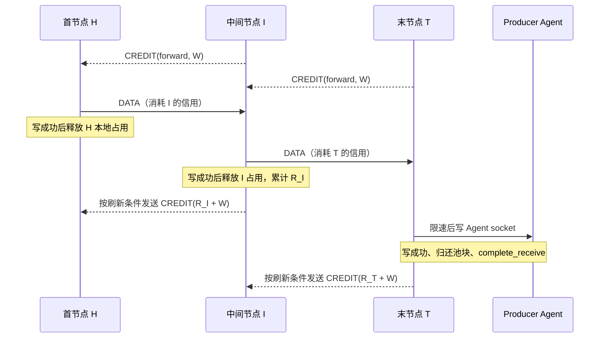

I→H 的信用更新取决于 I→T 的写完成，可以早于 T→Agent 的写完成；两者通过有限窗口逐跳关联。
CREDIT 在相邻一跳终止，`reverse` 标记它约束的 DATA 方向，CREDIT 自身沿该 DATA 的反方向传递。

Stream 的 `send/finish_send` 返回只表示交接完成；发送任务可能仍持有一块等待本地准入的数据。
`receive` 用可选载荷区分 DATA 与 EOF。终点一次只交付一个 DATA，收到 `complete_receive` 前不交付下一帧。
这些边界分别表达“接手载荷”“允许进入本跳窗口”“成功向下游写入”，不能互相代替。
socket 写成功表示数据已交给对应的本地传输栈，不保证远端业务应用已经处理。

#### 5.6.4 缓存释放、信用合并与控制帧调度

**释放本地占用立即生效，发布上游信用可以合并。** DATA 写成功后，`release_buffer` 立即减少 `B_i`；
有入边时再令 `R_i += c`。从队列取出帧、移动池块或单独归还池块，都不触发这一成功写入确认。
FIN 只归还自身的管理占用，不增加 `R_i`；写入失败进入关闭流程，不发布成功消费额度。

设当前尚未发布的新增额度为 `Δ_i = R_i + W - G_i`，每次成功释放 DATA 后执行：

```text
减少本地 buffered_bytes
若本方向有入边：
    检查 released_bytes + 本帧 charge + W 是否溢出
    累计 released_bytes
    若 Δ_i >= W/4 或 A_i == G_i：立即发布 R_i + W
    否则若节点尚无信用批次：设置节点 credit_deadline_ = now + τ，并推进共享 monitor 的期限
通知需要空间的本地发送任务
共享 monitor 在节点批次到达时：
    清除本批次期限
    遍历所有 Active TCP Flow 的两个方向
    仅对有入边且 R_i + W > G_i 的方向发布 R_i + W
    没有后续小额释放时，不安排下一信用批次
```

阈值为 `W/4 = 81920` 计费字节。`A_i == G_i` 表示本节点已接收到旧授信的全部 DATA；
这个判断发生在释放 DATA 时。节点首个小额释放设置一次共享期限，其他 Flow/方向加入同一批次，
不推迟期限。某方向先满足即时刷新条件时，只发布该方向；共享期限保留，供其他方向使用。
到期批次跳过已发布完额度的方向，所以不会重复发布。Flow 全部关闭或都已即时刷新后，
已安排的批次最多再执行一次空检查；不会持续空转。初始 W 在 commit 时发布，不等待 τ。
初始、即时和批次授信共用 `publish_credit`，由 `receive_limit` 去重；没有独立的待刷新队列或期限堆。
允许最后一次空检查，避免再维护待刷新集合或计数。

同一 Link 上尚未发出的同一 `(flow_id, reverse)` CREDIT 合并为最新绝对上限。
物理 writer 优先处理控制帧，连续最多 16 个控制帧后允许已就绪 DATA 推进；普通控制 FIFO 与
待发 CREDIT 表分别维护。相邻 TCP Link 启用 TCP_NODELAY。控制帧仍需等待当前 socket 写入和事件循环调度。

TCP DATA/FIN 进入共享 `FairQueue`，标签由准确的 Flow 对象身份和方向组成。
入队先找同标签最后一帧，再向后跳过一段标签不重复的帧，在首次重复之前插入；无同标签则从队首扫描。
writer 仍只取队首，不维护轮次、每流子队列或调度游标；同方向 DATA/FIN 顺序不变。
所有队列为空时等待原 writable 通知，取得信用和写完成后的缓存释放流程不变。
这是近似帧公平，不保证字节等份或固定等待时间；算法、验证范围和容器比较见 [FairQueue](FairQueue.md)。

首个小额释放的计划等待为 20 ms；批次内后续释放的计划等待为 0～20 ms。
这是到批次的计划等待，不是 CREDIT 到达上游的时延上界。各节点独立形成批次，不要求时钟对齐。

#### 5.6.5 慢末端的背压、恢复与数值示例

当 T→Agent 写入变慢，T 的交付仍占窗口，`R_T` 的增长随之变慢，授给 I 的额度无法持续推进。
I 仍能使用先前已经获授的额度发送；当 `L_I-S_I` 小于队首 DATA 的 charge 时，后续 DATA 留在 I。
随着 I 的出边写入停止推进，`R_I` 不再增长，H 也逐渐耗尽 I 的可用信用；H 本地方向队列累积，
本地准入开始等待。发送任务不再接下一次交接，RemotePair 随后暂停继续读取 Agent，背压传到源端。
网络与各层缓存允许背压传播前保留有限的在途数据，整个过程不要求各节点同时停住。

恢复时，T 写完一帧会释放本地占用；满足刷新条件后 T→I 更新 CREDIT，I 将待发帧继续送往 T。
I 的 socket 写成功后也释放占用，并按自己的累计状态向 H 更新 CREDIT。
两跳可以流水推进，每一跳都用自己的 `R+W` 授信，不转发另一跳的 CREDIT，也不等待端到端逐帧 ACK。

以 T 初始接收连续 32768 字节 DATA 为例，假设对应帧都已从 I 发出，T 暂未完成业务写入：

```text
c = 32768 + 128 = 32896
9c = 296064 <= W = 327680
10c = 328960 > W
旧额度剩余 = W - 9c = 31616 < c
```

此时 I 已经不能发送下一帧，虽然剩余额度仍非零；T 的 `A_T=296064` 也没有等于 `G_T=327680`。
因此“小额释放后靠定时器刷新”的分支确实会影响发送恢复。

| 观察时点 | `A_T` | `R_T` | `G_T` | `Q_T=A_T-R_T` | 刷新行为 |
|---|---|---|---|---|---|
| 收到 9 帧、尚未写出 | 296064 | 0 | 327680 | 296064 | 已用额度不足再接一帧 |
| 写完第 1 帧 | 296064 | 32896 | 327680 | 263168 | `Δ=32896<W/4`，启动节点 20 ms 批次，或加入已有批次 |
| 期限先到，仍只写完 1 帧 | 296064 | 32896 | 360576 | 263168 | 发布 `R+W`，额度增加一帧的 charge |
| 另一分支：期限前已写完 3 帧 | 296064 | 98688 | 426368 | 197376 | `3c=98688>=W/4`，提前发布；共享批次保留，到期跳过本方向 |

最后两行是从“写完第 1 帧”出发的两种分支，未包含后来新 DATA 的接收。
若走三帧分支，I 收到新上限后，剩余可发额度为 `426368-296064=130304`，
足够再发送 3 帧，之后仍留下 31616 的零头。窗口按整帧准入，不因剩余空间非零就允许超额发送。

共享 Link 的物理读循环继续解析其他 Flow 和控制帧，不在这条 Flow 的下游空间上挂起。
有信用的其他 Flow 可以进入共享队列并按标签交错；同流 FIFO、当前写入及 TCP 丢包造成的队头阻塞仍存在。
这保证协议层不会因等待某条 Flow 的信用而停读整条 Link，不承诺各流的带宽份额或延迟上界。

#### 5.6.6 数量准入、逐 Flow 边界与实际占用

Flow 不再通过全局字节预留账本准入。prepare 校验数量、身份和邻接状态后建立 Flow，
commit 仍负责激活和发布初始信用；两阶段用于多节点协调，并非仅为预留内存。
`flows_ + retired_` 合计最多 1000 个身份，关闭后的身份保留 10 秒，避免立即复用。
控制域的活动和关闭中 Flow 请求同样受统一的 1000 上限约束。

TCP 每方向已准入 DATA charge 不超过 W，另允许一个 FIN；UDP 按每端点 16 项队列限制积压。
以下是满载窗口/队列的逻辑容量模型，不是预分配或标准池实际占用：

```text
TCP 每 Flow 双向逻辑容量 = 2 × (W + h) = 655616 字节
1000 条 TCP Flow 的双向逻辑容量 ≈ 625.244 MiB / 节点
UDP 双向满尺寸队列模型 = 2 × 16 × (65536 + h) = 2101248 字节 / Flow
1000 条 UDP Flow 的队列模型 ≈ 2003.906 MiB / 节点
```

这些数值不包含窗口外的串行交接块、共享 Link 的读写、其他队列、固定数组、池缓存及内核存储。
同一方向经过 n 个节点时，各节点独立维持窗口，已准入 DATA charge 合计不超过 nW；反方向另计。

| 层次 | 覆盖范围 | 边界 |
|---|---|---|
| Flow 身份与业务数量 | Prepared、Active、退休身份及业务控制任务 | 数量上限；不再限制全局预留字节 |
| `buffered_bytes` | 已准入、仍在本跳队列、Link 写入或终点交付的帧 | DATA 不超过 W，另留一个 FIN；移动不减计费 |
| 标准同步池 | 在用及标准库保留的块、chunk 和内部元数据 | 无应用层字节上限；允许保留高水位缓存 |
| 其他资源 | 固定读缓冲、协程/队列/状态对象、TLS 和内核 socket 缓冲 | 依靠数量、队列与长度边界约束，不承诺固定 RSS |

Flow 关闭会清空其队列，池块由最终持有者归还；迟到的 written 不再修改已关闭 Flow 的信用。
128 字节管理 charge 及载荷取整属于稳定的协议计费，不是所有 C++ 对象和分配器开销的逐字节统计。
当前 Frame 为 96 字节，编译期断言约束其本体不超过 h；不能据此认为所有管理开销均被 h 覆盖。
TCP 端点队列容量仍为 `W/h+1=2561` 项，允许窗口占满后再排入唯一的 FIN。

其他共享容量沿用以下边界：

| 状态或队列 | 当前上限 | 超限处理 |
|---|---|---|
| Link 申请 / 端点授权 | 各 1000 条 | 拒绝新申请 |
| master 活动及关闭中 Flow | 合计 1000 条 | 拒绝新事务 |
| FlowProtocol `flows_ + retired_` | 合计 1000 条；关闭身份短暂保留，禁止立即复用 | 拒绝 prepare |
| 每 TCP Link DATA/FIN FairQueue | 从各 Flow 方向的信用窗口准入 | 缺信用帧留在本 Flow；同流 FIFO、跨流交错，共享 writer 不另设信用等待 |
| 每 TCP Link 一般控制 FIFO | 4096 条；CREDIT 另按 Flow/方向合并，项数受 Flow 身份容量约束 | 控制准入失败关闭相应 Flow 或 Link |
| 每 UDP Flow 端点发送 / 接收队列 | 各 16 包 | 丢当前包，保留健康 Flow |
| 共享 UDP 发送队列 | 100 项；其中业务最多 96 项 | 为保活留 4 项；业务超限丢包 |
| FlowProtocol 控制事件 | 4096 条 | 事件溢出使本地协调失效并排空通道 |
| DatagramMgr 每 RemotePair 入站队列 | 16 包；多节点入 Flow 路径不经过此队列 | 丢当前包 |
| Node 数据 TCP 握手接入 | 100 个 | 拒绝新 socket |

UDP `try_send` 返回 false 表示当前包没有入队；出队立即释放位置，每个串行终点写循环可另持有一个在发包。
UDP 不创建 Stream 状态，不发送 CREDIT，不等待空间，不做逐包消费确认。

#### 5.6.7 窗口、信用周转时间与性能分析

**吞吐先取决于信用周转，再受分帧效率和链路资源约束。**

设 `T_i` 为相邻边向节点 i 发送 DATA，到相应下游写入完成、释放并让发送者收到可复用 CREDIT 的周转时间。
它包含传输、下游排队或消费、合并与调度；下游拥塞时也会包含更远处背压造成的等待，不能直接等同于相邻网络 RTT。
忽略整帧零头时，计费量速率的乐观上限为 `8W/T_i` bit/s。若用户载荷与 charge 的长期比例为
`η_i = 用户载荷字节 / DATA charge`，则维持用户速率 r 所需的基本窗口条件为：

```text
r <= 8 × η_i × W / T_i
W >= r × T_i / (8 × η_i)
```

对等长 DATA，一个初始窗口实际可承载的用户载荷为 `floor(W/c(p)) × p`，见 5.6.1 的表。
例如 32768 字节块的 `η≈99.61%`，但整帧准入使一个初始窗口只能容纳 288 KiB 用户数据；
4097 字节块因 size class 向上取整，`η≈49.24%`。分帧大小和零头会让实际表现低于连续字节模型。

取 `η=1` 且忽略整帧零头，320 KiB 的窗口给出以下参考上限：

| 信用周转 `T_i` | 单流、单方向乐观上限 |
|---|---|
| 30 ms | 约 87.4 Mbps |
| 100 ms | 约 26.2 Mbps |
| 200 ms | 约 13.1 Mbps |

多跳可以流水传输，各跳分别满足窗口条件；稳定速率还受最慢链路、首末限速和共享 writer/CPU 制约。
不能仅按跳数把同一个 W 平均分配，也不能从逐流信用推导带宽公平。
当前约 100 条均匀活跃 Flow 合计 1 Gbps 的目标，相当于每流约 10 Mbps。
在 `T_i=200 ms、η_i≈1` 的模型中，每跳每流的基本窗口需求约为 `250000` 字节，当前窗口约为其 1.31 倍；
4097 字节分帧需要约 `507689` 字节，超过当前窗口，不能沿用大块载荷的估算。
只剩少量大流时，100 ms 周转下单流 1 Gbps 的基本需求已为 `12.5 MB`，超过当前 W。
这些是设计估算；当前功能回归不构成真实链路 1 Gbps 的测量结果。

在每流 10 Mbps、T=200 ms 的连续模型中，4 KiB 分帧需要约 251.8 KiB 窗口，
32 KiB 需要约 245.1 KiB，320 KiB 分别约为其 1.27 和 1.31 倍。
考虑整帧零头，9 个 32 KiB DATA 在同一周转下约支持 11.80 Mbps，4 个最大 DATA 约支持 10.47 Mbps；
4097 字节 DATA 只有约 6.39 Mbps，不能把大块载荷的余量推广到所有分帧。

| 每方向 W | TCP 双向逻辑窗口 | 百流窗口模型 / 节点 |
|---|---:|---:|
| 256 KiB | 512 KiB + 256 B | 50.024 MiB |
| **320 KiB（当前）** | **640 KiB + 256 B** | **62.524 MiB** |
| 512 KiB | 1 MiB + 256 B | 100.024 MiB |
| 1 MiB | 2 MiB + 256 B | 200.024 MiB |

从 512 KiB 调至 320 KiB，DATA 窗口容量减少 37.5%，代价是能够覆盖的信用周转缩短；
不能据此声称进程 RSS 同比降低。初始 CREDIT 必须等于本地 W，当前协议没有窗口或计费单位协商，
相邻节点需使用一致的参数。

**节点级批次将小额信用刷新集中到同一次唤醒。**

当前 τ 为 20 ms，每个 FlowProtocol 只有一个共享信用批次期限，并复用唯一的 monitor_timer_。
参数研究的结论与各类负载的扫描次数集中记录在 5.6.9。

| 当前状态 | 批次的影响 |
|---|---|
| 释放使 `Δ_i>=W/4`，或释放时 `A_i==G_i` | 立即刷新，不等待批次 |
| 节点没有待处理批次 | 首个小额释放安排 now + 20 ms |
| 节点已有待处理批次 | 加入原批次，计划等待为剩余时间，不新增每流期限 |
| 小额释放后，发送者剩余额度不足下一帧 | 恢复可能依赖下一批次；计划等待不超过 20 ms |
| 没有 DATA 成功写出 | 没有新信用产生，修改 τ 不能恢复发送 |

连续产生小额释放时，每节点信用批次频率不超过约 `1/20 ms≈50 次/秒`；
实际批次之间还可能有等待首次释放的空隙。三节点的计数要分别相加，准备超时、心跳和退役清理也会触发扫描，
所以 50 不是全进程所有 monitor 扫描或定时器回调的总上限。提前期限打断等待时直接重等，不额外全量扫描。

相较原每方向固定等待 20 ms，共享批次会让部分方向更早发布额度，改变更新的聚集方式。
若一次只释放少量 charge，仍可能等待接近 20 ms；两跳串行等待可接近 40 ms 的计划等待，
网络、控制帧写入和事件循环调度还会增加实际时延。已有额度、阈值即时刷新和两跳流水会缩短等待。
只考虑某方向独自每周期释放 `Δ<W/4`、且发送者依赖该更新时，理想化信用供给速率仍可写为 `8Δ/τ` bit/s；
该估算不描述批次内其他方向的剩余等待，更不能直接预测整条路径的用户吞吐。
τ 不改变 W、数量限制或单 Flow 缓存上界；节点级批次也不保证 RSS 下降。

动态窗口、字节公平调度（如 DRR）和跨帧的有界批量写仍为待实现项。
当前提供共享队列的标签交错、CREDIT 合并和有界控制优先；不提供端到端业务 ACK、逐流公平字节带宽或延迟保证。

#### 5.6.8 失败边界、源码定位与验证

| 观察到的状态或故障 | 当前行为 |
|---|---|
| 本地 DATA 窗口不足 | 发送任务等待 `send_space_`，后续交接挂起，保留健康 Flow |
| 队首 DATA 超过剩余下游信用 | 留在 `pending_frames`，新 CREDIT 到达后继续 flush |
| 重复或旧 CREDIT | 忽略，不增加额度 |
| 非法初始/新增信用上限、计数器溢出、网络 DATA 越窗 | 关闭对应 Flow |
| 已校验 Flow 内的窗口/队列容量不变量被破坏 | 关闭对应 Flow，避免以队列扩张掩盖错误 |
| 物理帧格式错误、NodeLink socket I/O 失败 | 关闭 Link 并清理依赖 Flow |
| FIN | 同方向有序 EOF，保留反方向；不增加 DATA 信用 |
| RESET、控制失效或 Flow 关闭 | 唤醒并排空挂起任务、释放业务状态；失败写入不算成功消费 |
| UDP 队列满 | 丢当前报文并计数，不进入 TCP 信用等待 |

排查发送停顿时，先区分本地 `buffered_bytes` 不足空间、下游 `send_limit-sent_bytes` 不足、
终点迟迟没有 `complete_receive`，以及信用正在合并或排队四个位置，再检查网络和业务限速。
这些字段是实现状态，可用于源码分析和测试检查；当前没有对应的一套公开监控接口。

| 要核对的机制 | 源码位置 |
|---|---|
| 原分配长度、逻辑计费与 charge | [`lnk_channel.h`](../protocol/inc/lnk_channel.h)：`PooledBuffer`、`Frame::charge_for_payload/charge` |
| 数量准入、prepare/commit/关闭 | [`flow_protocol.cpp`](../protocol/src/flow_protocol.cpp)：`prepare_flow`、`commit_flow`、`close_flow` |
| DATA 准入、队首信用检查和接收授信校验 | 同文件：`Stream::try_send`、`receive`、`flush`、`receive_credit` |
| 写完成、信用刷新与期限 | 同文件：`written`、`Stream::release_buffer`、`publish_credit`、`poll` |
| 首末交接与串行消费确认 | 同文件的 `Stream::send_loop/receive_loop`；[`pipeline_mgr.cpp`](../node/src/pipeline_mgr.cpp) 的 `read_remote_pair/write_remote_pair` |
| 控制合并、共享队列与物理写完成 | [`lnk_channel.cpp`](../protocol/src/lnk_channel.cpp)：`enqueue`、`tcp_read`、`tcp_write`；[`fair_queue.h`](../protocol/inc/fair_queue.h) 封装按标签排列与删除 |

回归按组件职责归类，使用生产端点的异步发送、可选载荷/EOF、布尔 Datagram 准入和异常语义。

| 测试 | 覆盖边界 |
|---|---|
| [`lnk_flow_control_test.cpp`](../test/protocol/lnk_flow_control_test.cpp) | 本地准入与取消、节点信用批次、阈值/耗尽刷新、满窗口 FIN、信用校验、数量准入和退休身份到期、UDP 有界丢包及三跳停读恢复 |
| [`fair_queue_test.cpp`](../test/protocol/fair_queue_test.cpp) | 独立参考模型、穷举/随机轨迹、有限状态进展、哈希冲突与 Frame 所有权；真实 writer 交错由上项 wire 场景验证 |
| [`lnk_flow_receive_test.cpp`](../test/protocol/lnk_flow_receive_test.cpp) | 端点交付、载荷所有权、执行器、消费确认、取消和任务排空 |
| [`lnk_channel_flows_test.cpp`](../test/protocol/lnk_channel_flows_test.cpp) | 真实共享 Link 的 Flow 生命周期、FIN/RESET、并发响应和隔离 |
| [`pooled_buffer_test.cpp`](../test/common/pooled_buffer_test.cpp) | 标准池复用、稳定逻辑计费和跨线程存储生命周期 |

信用批次场景驱动真实端点任务，并用受控的 `poll(now)` 检查期限前 1 ns 与到期时的行为，不依赖 sleep；
不同 Flow 与相反方向共享批次，其中一条即时刷新或关闭不能取消另一条的待发布额度。
满窗口 FIN 场景同时验证精确耗尽刷新，数量场景覆盖 TCP、UDP、混合各 1000 个 Flow、超额拒绝和退休身份到期后复用。
真实 wire 与三跳测试负责验证共享 Link 的健康流进展、背压传播、恢复顺序和失败隔离，不能由受控期限检查替代。
用例不向生产类增加测试开关；功能回归验证协议和资源边界，性能结论需对应负载下的实测。

#### 5.6.9 参数研究结论与扫描计数

当前采用 **320 KiB 方向窗口、1000 个 Flow 身份上限、20 ms 节点信用批次**。
2026-10-20 移除原 256 MiB 全局预留和自定义池字节上限；以下历史研究保留其原始实现条件。
标准池改动的后续隔离与长测见 [标准载荷池性能复核](标准载荷池性能复核.md)；首轮三秒对照的固定吞吐降幅未能稳定复现，默认 chunk 增加内存申请已由追踪确认。
减小窗口约束每条慢流的滞留量；统一批次减少期限错开导致的全量扫描；合并时间只调整信用发布时机，
不推迟本地释放，不改变 DATA/FIN 的方向窗口，也不提供逐流带宽公平或业务延迟保证。

历史参数研究使用 W=512 KiB。每方向期限阶段比较过 2/8/12/16/20 ms；
20 ms 在小包负载下减少了扫描与部分 CPU 成本，同时增加某些发送等待尾部，因此没有把吞吐或 RSS 改善作为普遍结论。
随后固定 20 ms 比较每方向期限与节点级批次，三次重复的 500 Mbps 小包扫描中位数从 6334.6 降至 99.3 轮/秒，
但 CREDIT 从 7617.3 增至 9865.0 帧/秒：后加入的方向更早发布，每次更新可能更小。
该组正常到期和提前期限打断回调各约 99.3 次/秒，扫描减少不等于定时器回调全部消失。
普通 Release 的交错对照中，同场景吞吐约 489 Mbps，CPU 中位数由 73.93% 降至 66.92%；
大块与接近单核饱和的场景仍有短跑波动，不据此承诺所有场景加速。

以下为移除全局预算前、W=320 KiB 的八类负载补测：三节点、单进程、单 io 线程、Release 研究副本，
预热 1 秒、每阶段 3 秒、各跑一次，编译和回归均在测量前结束。
计数仅覆盖测量阶段，排除预热和排空；全部载荷、顺序、方向窗口、排空及池块归还检查通过。
这是单次功能与计数验证，不与历史三次中位数直接推断新旧窗口的吞吐、CPU 或 RSS 收益。

一次扫描表示某节点执行一轮 `poll`，表中为三节点之和；Flow 检查次数是遍历的条目数。
除完全背压为一条 Flow 外，均为 100 条 Flow。切换场景依次列出高速、降速、恢复三个阶段；
网络实验的 RTT 为每跳 RTT，带宽在隔离 namespace 中切换；本机切换调整终点消费速度。

| 场景 | 全量扫描轮/秒（三节点合计） | Flow 检查/秒（三节点合计） |
|---|---:|---:|
| 4 KiB，1000 Mbps | 99.0 | 9900 |
| 4 KiB，500 Mbps | 99.3 | 9933 |
| 32 KiB，不限速 | 99.3 | 9933 |
| 32 KiB，1000→100→1000 Mbps | 95.3 / 17.7 / 79.7 | 9533 / 1767 / 7967 |
| 百流中暂停一条 | 99.3 | 9933 |
| 单流完全背压 | 1.0 | 1 |
| RTT 50 ms，1000→100→1000 Mbps | 99.3 / 93.3 / 100.3 | 9933 / 9333 / 10033 |
| RTT 100 ms，1000→100→1000 Mbps | 98.3 / 93.7 / 100.0 | 9833 / 9367 / 10000 |

完全背压的 3 秒中只扫描 3 轮，测量开始后仍存在在途写完成与信用传播，不能记作零扫描；
没有观察到持续的 20 ms 空转，解除暂停后也验证了恢复和排空。
所有阶段满足 `flow_visits = monitor_rounds × flows`，且
`published = threshold_updates + exhausted_updates + timer_updates`。

逐阶段计数来自独立研究副本，探针未进入业务代码。日常验证使用上述组件回归，
性能测量使用 [benchmark/README.md](../benchmark/README.md) 中的普通 Flow、拥塞和网络基准。
工作区原始测量目录为 `build-credit-study/window320-validation`；历史记录在 `node-batch-comparison`、
`node-native-comparison` 与 `extended-comparison`，包含命令、源码/二进制摘要和逐阶段结果，不作为源码文件维护。
这些实验不包含 Agent、控制面建路或 TLS 接入，不能外推为目标机器上的吞吐或延迟保证。

### 5.7 数据热路径与载荷所有权转移

| 路径 | 每包/每块执行过程 | 内存及调度边界 |
|---|---|---|
| Agent UDP 请求方 | listener 接收 → 取得当前 session → ready/原因/长度检查 → 二进制头和 payload 两个 buffer 发送 | 不查 relays_、不读 JSON、不逐包 co_spawn；跨发送等待保留一次 shared_ptr，防止 socket 被销毁 |
| Agent UDP 返回方 | session 长期接收循环 → 校验缓存头 → 发往 forward 当前 local_peer | 复用大接收缓冲，发送完成后再复用；无逐包发送对象 |
| Node 单节点 UDP | 共享 socket 接收 → bindings_ 与 LocalPair 索引 → source/激活/令牌检查 → 原地改头并直接发送 | 复用收到的完整报文；没有逐包协程、共享发送队列或 payload 副本 |
| Node 多节点 UDP 入 Flow | listener 校验 RemotePair → 限速 → FlowDatagram::try_send → Flow 有界发送队列 | 复制一次到共享池，跨域移动池块；没有 RemotePair 入站队列或转发协程，满队列丢包 |
| Node 多节点 UDP 回 Agent | 一个长期 write_remote_pair → FlowDatagram 接收 channel → 缓存 session 头与 payload 分散发送 | 每个端点串行，没有消费确认，帧存活到本次 socket 写完 |
| Node TCP/TLS 首末 | read_remote_pair 读缓冲 → 限速 → FlowStream 交接；反向 channel 收帧 → 写 socket → 通知完成 | 池缓冲所有权跨域；每端点两个长期数据任务，不逐帧 co_spawn，写完后归还信用 |
| Node 中间转发 | 固定头解码 → 查 Flow/方向/入边 → Frame 移到出边队列 → 长期物理写循环 | typed 字段取代 JSON，PooledBuffer 移动和切片不复制载荷；每跳不启动业务协程 |

#### 5.7.1 TCP/TLS 的调用链与所有权转移

以 H → I → T 的一个方向为例，反向使用独立的方向状态，流程相同：

```text
H StreamPipeline::read_remote_pair
  → FlowStream::copy_payload：固定读缓冲按实际长度复制一次到池块
  → FlowStream::send：PooledBuffer 移入 send_queue_（容量 0）
  → FlowProtocol::Stream::send_loop：接手最多一块未准入数据
  → Stream::try_send：窗口足够才移动池块到 Frame、计入 buffered_bytes
  → Stream::route：Frame 移入该方向 pending_frames
  → Stream::flush：出边信用足够时按 Flow/方向标签移入 NodeLink::writes（FairQueue）
  → LnkChannel::tcp_write：唯一 writer 写头与载荷
  → FlowProtocol::written：释放池块和本跳占用，唤醒本地发送者

I LnkChannel::tcp_read：完整头解码后直接读入 PooledBuffer
  → FlowProtocol::receive：查流、生命周期和入边，按协议分流
  → Stream::receive：检查 FIN 状态和接收信用
  → Stream::route / Stream::flush：移动同一块载荷至下游队列
  → tcp_write / written：写成功后释放本跳占用，按刷新条件向上游授信

T tcp_read / receive / Stream::receive / Stream::route
  → FlowState::Stream::receive_queue：终点缓冲队列
  → Stream::receive_loop：同一池块移入端点 channel，仍保留 charge
  → FlowStream::receive：业务侧取得 PooledBuffer 所有权
  → StreamPipeline::write_remote_pair：限速、直接写池块至 Agent socket、归还池块
  → FlowStream::complete_receive：发 receive_completed_ 通知
  → Stream::receive_loop / Stream::release_buffer：释放本跳占用，按 5.6.4 合并发布上游信用
```

| 边界 | 数据内存操作 | 何时允许复用或释放 |
|---|---|---|
| 接入 socket → FlowStream | 固定读取缓冲按实际长度复制一次到池块，channel 移动所有权 | 交接完成后源侧可以复用读缓冲 |
| 本地准入 → 方向队列 | 同一池块移入 Frame，信用按原分配大小计费 | 未准入块只留在唯一发送任务中 |
| 方向队列 → Link 队列 → writer | Frame 和 PooledBuffer 移动，载荷无再次复制 | 下游 socket 写完成后释放 |
| 中间节点接收 → 转发 | TCP 直接读入池块；UDP 校验共享接收数组中的报文后，按实际载荷长度复制到池块，再移动 | 接收数组可立即复用，池块在下游 I/O 完成或关闭排空后释放 |
| 终点 → 业务 socket | 原池块移入业务域，无出口载荷复制 | 下游写成功后归还池块，再通知退还信用；失败关闭 Flow |

发送交接只表示数据任务接手了载荷，不表示已入队、写入网络或远端消费。send_queue_ 容量为 0，
任务最多暂存一块；窗口满时在 send_space_ 挂起，不接收下一次交接，源侧最后停止新一轮 socket 读取。
因此窗口之外还有端点任务及业务读缓冲的固定余量，不能把窗口预算解释为精确进程内存统计。

终点 receive_queue_ 容量为 1，Stream::receive_loop 每次只交付一帧 DATA，并等待容量为 1 的
receive_completed_，完成前不交付下一帧。限速等待和 socket 写入期间继续占用信用。
FIN 使用同队列的 nullopt，排在 DATA 后；无需 DATA 完成通知，只释放 FIN 的管理占用。
错误走 RESET/关闭，不把失败的写入当作成功消费。

send_space_ 是一个数据域 channel，只属于已绑定的本地 Stream 发送者。
它与跨域 DATA 队列、终点写完成通知分别表达容量可用、载荷交接和成功消费，不重复计费。
没有 optional channel、懒创建、逐帧发送者登记或借用 caller span。

#### 5.7.2 UDP 的独立路径

DatagramMgr 的共享 listener 校验来源及激活状态，令牌足够时直接调用 FlowDatagram::try_send；
没有额外的 RemotePair::received 队列及 read_remote_pair。端点 send_queue_ 固定 16 项。
try_send 将接收缓冲复制一次到池块，Datagram::run 移动池块到 Frame，Datagram::route 直接投递邻接 UDP
队列；任一准入队列满立即丢整包，没有空间等待或流信用。

邻接 udp_read 使用固定的 65508 字节数组接收完整包，校验固定来源、Link ID、epoch 和长度后，
将非空载荷按实际长度复制进池，再移动至下一跳；空载荷不申请池块。
池容量不足时丢当前包并继续接收，不因下一次接收缓冲申请失败而终止共享接收循环。
终点 Datagram::route 直接移动原池块到 datagram.receive_queue；该 16 项队列在 Flow 构造
时建立，与端点 receive_queue_ 共享，允许绑定前已有报文到达。出队即释放位置，不需要确认任务。
DatagramMgr::write_remote_pair 持有该池块，使用缓存的 Agent session 头和载荷两段 buffer 发送，
完成后释放；令牌不足丢当前包。每个串行写循环最多再持有一个发送中的报文。

LnkChannel::DatagramWrite 只保存 Frame 和 link_id。udp_write 出队后检查原 Flow 仍未关闭、目标
Link ID/epoch 仍有效，复制 endpoint 后发送，不把表迭代器或 NodeLink 引用带过 await。
发送失败重新按身份查 Link；排队的旧帧不会创建或影响复用身份的新 Flow。
UDP 没有 Stream、CREDIT、FIN、空间通知或消费确认。

#### 5.7.3 池缓冲与剩余开销

lnk::Frame 保存头和独占、可移动的 lnk::PooledBuffer。标准同步池负责复用或回收同一块存储，
PooledBuffer 保存池块的原分配地址、大小及 span 视图，切片不改变归还地址。
空载荷不分配字节块，新块不做无用的初始化。业务路径不再新建 BytesBuf：接入端按实际长度复制到池块，
每个 Node UDP 接收跳也从共享数组复制一次到池块；TCP 邻接接收直接读入池块。
进入池块后的跨执行器交接和终点输出都移动原块。UDP 以一次载荷复制换取小包按实际大小持有池存储。
直接使用 `std::pmr::synchronized_pool_resource`，不保留包装类或类型别名。
FlowProtocol 创建池时将最大必需池化块设为 65,536 B，
上游为 `new_delete_resource()`，其余池选项采用标准库默认值。分配和归还可跨线程执行，
载荷访问仍由唯一缓冲所有者执行。没有自定义预算、锁、空闲链表或字节统计。
标准池自行补充 chunk 并保留缓存，业务完全空闲时也不主动 release；不承诺固定 RSS 上限。

只有共享 Link 写队列的帧保活原 FlowState；Flow 自有队列的 owner 为空，避免自引用。
在途写操作即使越过流表删除仍能持有原帧至完成，但关闭后的迟到 written 不归还信用。
FlowProtocol、端口和业务池缓冲共享池的生命周期。PooledBuffer 的 deleter 持有资源引用，
只保活分配器，不保活整个协议；stop 排空协议任务，已交付业务的缓冲可在协议停止、销毁后继续存活，
最后一块缓冲或端口释放后池再销毁。缓冲只接受共享资源，不提供借用资源的构造路径。
FlowProtocol 创建池时使用标准堆作为上游；分配计数由测试可执行文件完成，生产代码不保留测试注入参数。

每次网络输入使用 std::map 查 Flow/Link，为 O(log F)/O(log L)；端点长期任务持有已绑定实例，
逐帧不查流表。信用计算是常数次整数比较与加减，队列准入与移动摊销 O(1)，状态随 Flow 数线性增长。
中间节点没有每 Flow 后台任务；首末 Stream 各登记一个父任务，其内部组合两个方向子循环；Datagram 各登记一个发送任务。

剩余开销来自 socket I/O、Asio 完成调度、查表、入口一次复制、shared_ptr 保活、TLS 加解密和业务统计。
载荷预热后的复用不需要逐块向堆申请；池扩充、std::deque/map 及 Asio 操作和协程帧仍可能分配，
吞吐边界见 5.6；当前功能回归未验证真实链路 1 Gbps 或能耗表现。

## 6. 运行时架构与系统保障

各执行域串行拥有本域状态，异步任务在所属资源销毁前排空。整体启动与停止次序见第 8 章。

### 6.1 执行域与跨域协作

执行域规定谁能修改状态；跨域操作交接不可变描述或拥有存储的载荷，并等待真正的异步操作完成。

#### 6.1.1 RelayNode 编排与四个执行域

RelayNode 使用四个互相独立的单线程 `asio::io_context`：

| 执行域 | 所有者 | 目的 |
|---|---|---|
| `control_io` | control acceptor、`ControlSession`、RelayNode 公共控制状态、`RegistryMgr`、`ClusterMgr`、`Topology`、服务发现 | 控制状态按顺序修改，会话、服务表和探测状态由本执行域串行访问 |
| `transfer_tcp_io` | 两个 `StreamPipeline` 的 acceptor、Relay 索引和流式数据复制 | 把高吞吐流式数据与控制消息隔离 |
| `transfer_udp_io` | `DatagramMgr`、UDP socket、UDP 路由 | UDP 报文处理与 TCP/TLS、控制面独立调度 |
| `cluster_data_io` | `FlowProtocol` 的流表、信用、计时与所属 `LnkChannel` 的物理收发 | Node 通道与会话数据面同域运行，与业务服务限速隔离 |

RelayNode 在 control_io 查找服务和业务实例、分派 Agent 及 peer 消息；
NodeSession 用 std::variant 直接拥有 Single 或 Multi 控制器，两者执行域及层次相同。
控制器只推进自己的实例，数据管理器不保存控制会话引用、不发 opened/offer/ready/error/closed。

NodeSession 在控制域调用 install/wait/bind/activate/bridge/close；
install/activate/close 及 Single bind 是同步数据操作，直接投递并返回结果或异常；
Multi bind 在 transfer executor 取得数据域的端点句柄，仅在绑定时跨域并启动长期任务。
wait_attach/bridge 通过 co_spawn 在数据 executor 执行真正的等待及复制。Single 操作本地配对，Multi 操作 RemotePair。
跨域绑定只传不可变身份、统计引用和 accessor 副本；数据 manager 不访问控制状态。
接入角色、accessor 和 Flow 身份由所选控制器明确传给 NodeSession；
NodeSession 不读取控制器私有业务状态，数据操作和 controller variant 均为实例内部实现。
数据端点直接用已保存的 stream 或 UDP source 判断是否接入，不另存 connected 标记。
stream 端点通过 FlowStream 的 concurrent_channel 交接拥有载荷；数据域的长期发送协程负责本地准入和容量等待。
发送 channel 容量为 0，每方向一个串行提交者，数据任务最多暂存一帧，满窗口时停止接收下一帧。
datagram 使用独立 FlowDatagram，固定容量队列准入用 try_send，满则立即丢整包，无信用、窗口等待或消费确认。
端点绑定一次，逐帧不 co_spawn、不查 Flow 表，不跨域借用 caller span；跨域交接移动拥有资源引用的池缓冲。
交接完成只表示数据侧接手载荷，不表示本地入队、物理写入或远端消费；网络身份、方向和 stream 信用仍在 FlowProtocol::receive 校验。

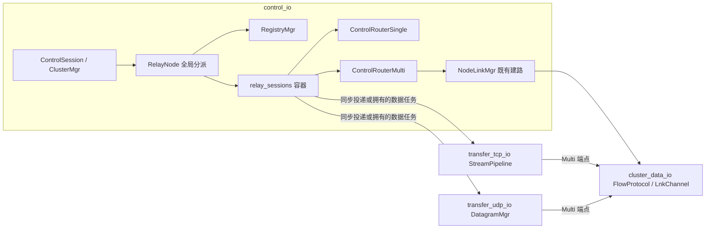

单线程执行域保证同一域内 handler 不并发执行，但不能允许同一个 socket 上出现重叠的异步读或异步写。每种 stream 的读循环和写队列仍各自保持单一所有者。

NodeLink 是相邻 Node 的物理通道，NodeFlow 是固定路径上的双向逻辑流。
NodeLinkMgr 在 control_io 协调建立，直接持有 FlowProtocol；FlowProtocol 在 cluster_data_io 拥有逻辑流表、
信用、端点任务、内存池和共享监控计时器，并按值持有负责邻接连接及物理收发的 LnkChannel。master 只协调建路和转交消息，不保存 Agent 业务实例。
NodeSession 只存在于单节点业务所在 Node，或多节点的首末 Node；中间 Node 不保存服务或 Agent socket。
共享通道与路径事务见 5.2、3.5，Single/Multi 业务协调见 3.4，二进制格式见 5.3，热路径见 5.7。

#### 6.1.2 RelayAgent、Forwarder 与业务资源归属

RelayAgent 的 control_io 拥有控制连接、服务位置、拓扑和路径缓存；Forwarder 的 transfer_io
拥有本地 forward 与 AgentSession。数据域只保存 `(service, protocol) -> 目的 Node ID`，
不保存用于选路的另一份控制连接表或服务地址。控制域通过 post 分派可用性和协议消息。

| 对象 | 生命周期与职责 |
|---|---|
| StreamForward | 配置产生的长期 acceptor；每条应用连接独立建立业务 |
| DatagramForward | 配置产生的长期 UDP socket、固定来源 IP/可更新端口、当前会话强引用、重试退避 |
| AgentSession | 一次请求方或服务方接入；独占协议 socket、接入等待、取消和实际数据复制 |
| Forwarder::relays_ | 以本地 request_id 拥有所有业务实例；按控制来源、协议、请求或 UUID 分派消息 |
| RelayAgent::entry_waits_ | 只保存尚未完成的入口定位/连接等待；建立成功、失败或取消后立即移除 |
| RelaySelection::connection | 请求方 session 强持有共享入口连接引用；业务清理后释放 |
| RelayAgent::connections_ | 强持有所有连接直至后台任务完成；按 endpoint/node_id 复用，primary 不参与空闲回收 |

Agent 通过普通共享引用判断附加连接是否仍在使用，不维护 session 使用计数或数字 lease。
只剩池内引用满 60 秒后停止；后台控制协程借用连接，Agent 等任务完成后才移除池内引用。
停止中的索引保留，因此同端点不会同时运行新旧两个连接任务。Session 释放引用无需自定义 deleter 或投递停止任务。

AgentSession 的数据资源使用 StreamData / DatagramData variant，只持有所需协议的资源。
StreamData 拥有应用/目标 TCP socket、Node TCP socket 和可选 TLS stream；
DatagramData 拥有 Node UDP socket，服务方才创建目标 UDP socket；接入时缓存二进制 session 头和路径载荷上限。
UDP 请求方的本地监听仍由 DatagramForward 拥有。

AgentSession 只保存两个控制事件标记 ready、node_closed，以及中止原因 reason。
ready 表明已收到 relay.ready，node_closed 只表示 Node 已结束业务；reason 为空表示没有中止，
非空表示已经中止并包含具体原因。cancel 保留首次原因并关闭 I/O，空原因补为默认取消文本，
后续通知或取消不覆盖原原因。fail 在首次失败发生时调用 cancel，无需保存失败类别。
活动实例处理关闭/错误通知时先验证 reason、stage，再设置 node_closed，字段错误不留下半更新状态。
UDP 的 Node 关闭始终中止实例，因此本地发送只检查 ready 和 reason，发送错误统一交给幂等 fail 处理。
建立期限耗尽的错误仍保留原始异常原因。
relay.open 是否提交只由 run 协程使用，因此 submitted 留在协程内。
收到 Node 的正常 stream complete 通知只唤醒等待，不中断本地数据复制，也不判定本地复制成功。
本地完成由 run 中的复制正常返回且没有中止表示，不额外保存 Completed 状态或完成标记。
即使 Node 已正常结束，本地排空的真实错误仍保留原因；预期取消保留原取消原因。
run 末尾统一清理，在本地中止、Node 未关闭且已提交请求或接受 offer 时通知 Node；
多跳流正常结束须排空本地双向数据并收到 Node 完成通知，之后才能释放入口引用。
TCP/TLS/UDP 共用 ready 等待；UDP 只在其中补充 attach 重发。
取消和资源回收共用幂等 close_io；Node 已关闭时不反向发送 cancel/reject，不再接受该实例的迟到通知。
中止时已由 cancel/fail 关闭 I/O，run 收尾仅在正常完成时执行 close_io，避免重复取消和关闭。
AgentSession 不再绑定协程取消信号；close_io 取消自己的定时器和 resolver、关闭自己的 socket，
异步接入步骤开始前检查 reason 与剩余建立预算，已中止时不再发起下一步操作。
select_relay 的入口等待只由 RelayAgent 的状态、连接/失效事件和原建立截止时间决定。
单个 Session 中止不会打断入口等待；它返回后 run 再检查 reason，释放已取得的入口引用并清理。
因此此阶段的回收可能延迟至剩余建立期限，默认总预算 10 秒，取消不重新计时。
Agent 整体停止仍由 invalidate_entries 设置入口等待原因并唤醒，排空业务后再释放全局资源。

业务任务独立启动并由 Forwarder 计数；运行协程持有实例直到清理结束。
Forwarder 停机同步取消全部已登记实例；Session 建立流程以 reason 检查取消，不重复读取 Forwarder 状态。
AgentSession 只引用其拥有者 Forwarder；关闭流程保活 Agent，取消并排空全部业务任务后再完成关闭。
UDP 本地发送临时保留当前实例，避免业务退出时销毁尚在发送的 socket；不保留额外弱索引或 pending 表。
DatagramForward 保存当前会话的 shared_ptr；会话仍统一登记在 relays_，清理时按对象身份解除 forward 的引用。
本地接收协程每包复制一次当前强引用并直接 async_send，不再查 relays_、读取 JSON 元数据或创建发送子协程。
发送和返回路径复用缓存的二进制头与载荷上限，接收缓冲区仍保留完整 UDP 容量。
UDP 重试由 Forwarder 拥有的独立协程执行并计入停机排空；服务失效将重试期限提前到当前时刻，
使尚未开始等待的任务也能看到唤醒，重试协程退出等待时才清除标记，
避免旧取消结果覆盖新重试。若服务已恢复，按当前服务位置建立新实例。

### 6.2 对象包含与生命周期原则

实现遵循以下原则：

1. executor 拥有状态，跨域只投递消息；
2. 只被单个协程使用的资源放在协程帧内；需要 stop、查表或独立异步操作访问的资源由对象拥有；
3. 所有者明确持有资源，观察者使用引用或 weak_ptr；NodeConnection 的连接池与 LnkChannel 的表是实际所有者；
4. `shared_ptr` 只在异步操作确实需要对象存活时按值跨越 `co_await`；
5. session 的退出负责从 room/registry 移除自身，manager 不额外延长其生命周期；
6. 需要对外提供完成语义的 stop 等待结构化协程结束；StreamPipeline 内部 detached 任务则只在执行期间
   自持对象，取消或超时后自然释放，不另建一套任务状态机。

#### 6.2.1 对象所有权关系

| 对象 | 主要所有者 | 对外引用方式 | 结束条件 |
|---|---|---|---|
| RelayNode / RelayAgent | `main()` 的 `shared_ptr` 和必要 completion | 按值跨越顶层异步任务 | stop 完成且线程退出 |
| ClusterMgr | RelayNode 的 `shared_ptr` 成员 | 非拥有的 `RelayNode&` 反向引用 | `async_stop()` 已等待主循环和成员会话退出 |
| RegistryMgr | RelayNode 的直接成员 | 会话使用 weak 引用，两类控制入口借用同一注册表 | Registry 停止并清理会话后销毁 |
| ControlRouterSingle | NodeSession 的 variant 成员 | 只推进本地双方业务协调，无全局查表或数据 I/O | 随实例任务排空后销毁 |
| NodeSession / ControlRouterMulti | RelayNode 的唯一业务容器及实例任务；实例直接拥有控制器和本地数据句柄 | 借用 NodeLinkMgr、ClusterMgr 和共享数据 manager | 取消并排空数据任务与 Flow 监视，再释放本地资源及本 Flow；不关闭共享 NodeLink |
| StreamPipeline / DatagramMgr | RelayNode 的 shared_ptr 成员，监听任务按需自持 | NodeSession 跨域操作本地配对或端点，无 Agent 控制引用 | 业务由实例排空，stop 关闭监听和剩余数据资源 |
| NodeLinkMgr / FlowProtocol / LnkChannel | RelayNode 拥有管理器；管理器持有协议服务；服务按值持有邻接传输 | 控制描述按值跨域；数据任务 completion 保留服务 | 停止申请、同步关闭资源，等待服务数据任务及管理器通知任务排空 |
| lnk::NodeLink | LnkChannel 的 connections_ 表及建立/接入父任务 | 同步函数及 TCP 读写子协程借用 NodeLink&，父任务等待组合完成后释放持有者 | close 置 Closed、取消 I/O 并删除表项，父任务排空读写后销毁 |
| lnk::FlowState | FlowProtocol 的 flows_ 表、Stream/Datagram 父任务及 Link 在途帧 | TCP 子协程借用父任务的 const shared_ptr& 和端口引用；帧保留原 Flow 身份 | 关闭队列并删除表项后，父任务等待子协程收尾；retired_ 只保存 ID/期限，不拥有 Flow |
| FlowProtocol::Stream / Datagram | FlowProtocol 按值包含 | 反向借用 FlowProtocol& | 所属父任务排空后随协议服务销毁 |
| std::pmr::synchronized_pool_resource | FlowProtocol、FlowStream/FlowDatagram 及池缓冲 deleter 共享 | 只保活标准同步分配器，支持跨线程分配归还 | 最后一个端口和在途业务缓冲释放后销毁，不依赖协议服务继续存活 |
| TLSChannel | 自己的 run 协程和当前连接协程 | manager/route 使用 `weak_ptr` | 任一读写、心跳、关闭分支结束 |
| ControlSession | 当前 session 协程 | Registry 和 Relay 使用 weak 引用 | 接收循环结束并完成 disconnect |
| ClusterRoom | master accept_loop 协程栈 | ClusterSession 保存引用，且必须先于 room 退出 | accept/delivery 停止并等待 participant 清空 |
| ClusterMgr::Connector | slave_loop 协程栈 | ClusterMgr 仅存停止用临时指针 | running=false 且当前操作取消 |
| NodeConnection | RelayAgent::connections_ 强持有；primary 始终保留 | EntryWait / 请求方 AgentSession 保存同一普通 shared_ptr，后台 run 只借用 | 附加连接连续空闲 60 秒或 Agent stop 时停止，run 完成后移出池，最后引用释放时销毁 |
| NodeConnection Operations | NodeConnection 的 `optional` 成员在 run 期间原位拥有 | stop 直接访问同 executor 上的拥有型状态 | 连接循环退出时 scope guard 清空 |
| Topology / AgentRouting | RelayNode / RelayAgent 直接拥有 | 同一 control executor 内调用 | close 已排空刷新与探测任务 |
| ProbeSet / ICMP Session | Topology 或 AgentRouting / ProbeSet 中的 ICMP 实例 | 按值读取评估结果；历史只复制 ProbeState | close 等待 DNS、探测和接收协程退出 |
| Node 本地配对 / 端点 | 对应数据 manager 的表及运行数据协程 | NodeSession 保存不透明数据句柄；数据侧无控制会话引用 | 控制器排空数据任务后 close，或 manager stop |
| AgentSession | Forwarder::relays_、运行协程与 UDP forward 的当前强引用；UDP 发送期间临时保活 | 反向引用 Forwarder、可选 forward ID；请求方持有入口连接共享句柄 | 建立失败、数据结束、控制失效或 stop，清理后释放入口句柄并解除 forward 的强引用 |
| RelayAgent DatagramForward | datagram_forwards_ 按值拥有 | 稳定 ID 定位；本地来源、当前会话强引用和重试归 forward | 当前会话引用由会话清理解除；forward 在 Forwarder 销毁时释放 |

ClusterMgr::Connector 仍使用同一 executor 上的非拥有临时指针执行取消，并在栈对象退出前清空；
NodeConnection 已不再保存指向协程栈的裸指针。这样既不悬空引用，也不无条件延长短生命周期异步对象。

Node 的控制协程持有 ControlSession，断开时按 session ID 删除注册记录和对应服务；启动协程失败时也按 ID 回滚。
RegistryMgr 不在接入或删除时扫描全部 weak 引用。数据 manager 关闭配对或端点时先从表中移除，
再通知仍持有该对象的等待者；表内同步操作只需验证接入或激活条件，跨异步等待的代码仍检查关闭状态。
NodeSession 的 install/activate/close 和 Single bind 为同步数据操作，通过投递返回结果；
Multi bind 明确跨到协议数据域，完成同步端点绑定后返回。wait_attach 和 bridge 保留真正等待的 co_spawn，
接入截止时间直接附加在数据侧等待上。
FlowProtocol 的控制通知使用绑定 control_io 的 concurrent_channel，数据侧直接发送、控制侧直接等待，由 Asio 处理线程安全、取消及完成调度，不逐通知 co_spawn；队列超限用原子标记传递，receive_event 仅保活、等待并检查错误。
TLSChannel 的 disconnect 只请求关闭，连接所有者在原有运行协程中等待排空；关闭信号直接参与并行等待，
不单独启动等待关闭信号的协程。ProbeSet/ICMP 内部已绑定执行器的协程不再重复 dispatch。
Node 同步 stop 通过 post
投递数据 manager 的同步关闭，并使用 future.get() 等待结果，再等待尚未完成的 TCP/TLS 接入任务，
无需为同步关闭启动协程，也无需先对同一个 future 调用 wait()。

### 6.3 取消、唤醒与排空

AgentSession 使用 reason 与自己的 I/O 关闭表达中止；没有业务取消信号。入口等待由 control_io 的
EntryWait、连接和期限管理。changed timer 用于状态变化时唤醒等待者。
EntryWait 由 entry_waits_ 和 select_relay 共同持有，scope guard 删除索引，普通 shared_ptr 自动释放入口连接引用。

NodeSession 的 Single/Multi cancel 会发送真实 cancellation_signal，打断正在等待的 attach、桥接或并行子任务。
Multi 的 parallel group 也会取消未完成的子任务。控制器只在 run 的统一清理入口屏蔽一次取消，保证同步投递的
资源关闭和 Flow 清理仍能完成；不在每个内部函数重复 reset_cancellation_state。
FlowProtocol::stop 通过同步 request_stop 标记 stopping、关闭 Flow 队列及邻接 socket、取消事件和 monitor，
再等待并发组与所属动态任务退出；协议通道不能在排空前销毁，池由端口和在途缓冲独立保活。
关闭后的迟到 written 或端点完成不再授信，
端点 RESET/close 还检查具体实例，避免旧端点影响复用 ID 的新 Flow。

AsyncEvent 用于一次性的多等待者完成通知，提前 notify 不丢失，单个等待者取消不取消整个对象。
可重复变化的 changed/done timer 与一次性完成事件职责不同；不把所有 timer 都替换成同一种队列。
concurrent_channel 用于跨执行器控制通知和 stream/datagram 端点交接，普通 channel 用于数据域内部帧队列和空间通知。
这些机制分别满足状态唤醒、广播完成和有界消息传输，不增加应用层回调注册或额外包装协程。

NodeConnection 在解析、连接、TLS、节点识别恢复时检查 running。停止后的恢复统一进入连接收尾，
清除弱通道引用并等待 TLSChannel::async_disconnect 后才让任务完成；不能直接 break 绕过通道排空。
后台 run 只借用连接，连接池必须持有它直到 completion，随后移除表项；这是池强所有权的实际用途。

#### 6.3.1 协程启动与保留理由

| 协程链 | 启动频率 | 原因 |
|---|---|---|
| RelayAgent discovery / NodeConnection | 每个 Agent / 每个实际入口连接一次 | 长期发现、连接接收及重连；由 Agent 计数排空 |
| Forwarder listener / retry / AgentSession | 每个监听 / 每次建立失败 / 每次业务 | listener 长期运行，retry 独立退避，Session 独占业务 I/O |
| AgentSession select_relay | 每个新业务一次 | 跨到控制域访问拓扑、位置和共享连接，完成后回到 transfer_io |
| RelayNode control accept / ControlSession | 每个 Node / 每条控制连接一次 | 接入和独立会话生命周期 |
| StreamPipeline accept / setup | 每个 TCP/TLS 监听 / 每个接入 socket 一次 | setup 做 TLS 和 attach，之后 stream 移交配对，不另启复制任务 |
| NodeSession run / wait_attach / bridge | 每次业务 / 接入阶段 / 复制阶段 | 控制任务拥有真实数据等待并排空；同步数据操作不 co_spawn |
| Multi 建立转发 + Flow 监视 | 每个多节点首末实例一组 | 业务和 Flow 失效并行，任一退出后排空另一任务 |
| RemotePair 双向循环 | 每个业务启动一次 | 持续读取、限速和 socket 写入，顺序等待 Flow 接口 |
| FlowProtocol stream 端点任务 | 每次绑定启动发送、接收各一次 | native channel 跨域交接；接收任务串行等待写完成并归还信用 |
| FlowProtocol datagram 发送任务 | 每次绑定启动一次 | 取有界通道中的包，输出不足直接丢；终点接收无需数据协程 |
| NodeLinkMgr receive_events | 每个 manager 一次 | concurrent_channel 绑定 control_io，跨域事件直接收发 |
| ensure_link 并行边任务 | 每次 Flow 建立、每条相邻边 | 并行准备并复用共享 Link，避免串行累计建立延迟 |
| FlowProtocol run：组合 LnkChannel accept、UDP read/write 和 monitor | 每个协议服务一组 | wait_for_one 统一取消和排空；共享定时器处理最近期限 |
| LnkChannel TCP read/write | 每条 TCP Link 一组 | 保持唯一读写链及有界队列顺序 |
| TLSChannel run 及读/写/心跳 | 每条控制连接一组 | 结构化并行关闭；关闭信号本身是原生接收操作 |

为某次真正等待附加超时的 co_spawn 保留，如 open_flow 的建立预算、远端 Flow 结果和关闭确认。
已经在所属执行器运行的内部调用直接 co_await；返回现有 awaitable 的函数无需另外形成协程帧。
流式限速统一通过 TokenBucket::consume 预留令牌；足额或未限速时直接返回，不足时等待桶内复用的 timer。

#### 6.3.2 FlowProtocol 共享任务与期限监控

FlowProtocol::activate 只启动一个受计数管理的 run 任务。run 参考 TLSChannel 的方式，使用
make_parallel_group(wait_for_one) 组合 TCP accept、UDP read、UDP write 和 monitor 四个长期循环：
任一个结束就取消其余循环，并等全部退出后处理最先发生的异常，避免只剩一部分数据服务继续运行。
共享循环的意外结束通过统一 request_stop 关闭 Flow、邻接资源和事件队列；普通 Link 或 Flow 超时
仍只清理相应实例，monitor 继续服务其他对象。

子循环把取消和致命 I/O 错误向并发组传播，不各自重复查询停止或取消状态。
accept_loop 直接等待接入，只在成功返回后检查 stopping，防止迟到接入在停止后派生新任务。
udp_write 直接等待发送队列，成功取包后保留 stopping 检查，防止 close_all 清零计数后被迟到完成减计数。
UDP 收包可继续的错误和无效报文继续丢弃，单包发送失败只关闭对应 Link，不升级为整个服务失败。

monitor 实际到期时对 Flow 和 retired_ 各扫描一次，完成准备超时、过期身份清理及最近期限计算；
只有节点信用批次到期时才检查各 TCP 方向的待发布额度。
monitor_timer_ 保留为成员，因为 prepare、信用释放和邻接状态变化都可能推进最近期限。
expires_at 已安装更早期限，operation_aborted 后直接等待新期限，不额外扫描；
stop 会立即退出等待，并发组的协程取消则向上传播。
单次解析、握手及帧 I/O 超时仍用 cancel_after，不再套另一套独立超时任务。
动态接入、Link 与端点任务仍由原任务计数管理，stop 关闭资源后等待 run 及动态任务全部排空，
协议通道排空后才能销毁；标准同步池由端口和在途业务缓冲继续保活至最后一次归还。

### 6.4 状态索引、计量与准入约束

通用索引支持按身份定位状态，计量与令牌桶控制服务速率，容量与期限限制资源占用；Flow 的逐跳信用另见 5.6。

#### 6.4.1 DualIndexMap 状态索引

`DualIndexMap<PrimaryKey, SecondaryKey, Value>` 为控制面和 Forwarder 提供一份值、两条查找路径。主键始终
唯一，次键可配置为唯一或非唯一，并可在对象生命周期的 pending 阶段安装或清除。主要使用关系为：

| 使用者 | 主键 | 次键 | 用途 |
|---|---|---|---|
| RelayAgent `connections_` | connection ID | `node_id` | 强持有连接，按内部连接或已识别节点复用，任务完成后删除 |
| RelayAgent `service_locations_` | `(service, protocol)` | 目的 Node ID | 保存服务位置及发现请求，独立于控制连接 |
| RegistryMgr `services_` | `(service, protocol)` | `session_id` | 服务查询，并在控制会话断开时批量注销 |

唯一次键查询使用 `find_secondary()` 返回值指针。容器中的 Node 独立分配，rehash 只重建 bucket
链，因此 Value 地址在 erase 前保持稳定；erase 和 `clear()` 同步解除两条索引。每个实例由所属 executor
串行访问，容器本身不承担跨线程同步。

#### 6.4.2 Relay 标识、流量统计与令牌桶

Node 的 TCP、TLS 和 UDP manager 共享线程安全的 `RelayIdAllocator`。分配器记录活动 ID，并在释放后允许
编号复用；三类 manager 因而可以用统一的非零 `uuid` 命名空间处理控制消息。

RegistryMgr 为每项服务创建共享 `ServiceTraffic`。Relay 只保留该统计对象的共享引用，服务注销与正在结束
的 Relay 可以安全交错。`TrafficCounter` 使用原子饱和累加，周期采样把区间字节数换算为速率并计算 EMA。
RX 固定表示 Producer 到 Consumer，TX 表示 Consumer 到 Producer。

`TokenBucket` 按方向独立配置。TCP/TLS 在读到 payload 后通过 consume 等待预约时刻再写入，背压沿 socket 传播；UDP
使用 `try_consume()` 判定整包发送，令牌不足时丢弃该 payload。统计只在成功写入对端后累计。

#### 6.4.3 容量与超时配置

| 配置 | 作用范围 |
|---|---|
| `control.max_connections` | 普通控制会话上限；同时作为 master 集群连接的独立上限 |
| `control.max_services` | 本节点全部注册服务上限 |
| `control.max_services_per_session` | 一条普通控制连接可注册的服务上限 |
| `tcp/tls.max_setup_connections` | 正在读取 attach 的未归属 TCP/TLS socket 上限 |
| `tcp/tls/udp.max_relays` | 对应协议的建立中、活动和关闭未排空业务任务上限；manager 同时约束等待和活动数据资源 |
| `tcp/tls.setup_timeout_ms` | 从创建/接受到合法 attach 完成的时间限制 |
| `udp.setup_timeout_ms` | 单节点 UDP 从创建到双方接入、绑定和激活的建立期限；默认 10000 毫秒，不限制运行期 |
| `channel.max_queued_messages` | 单条 TLSChannel 的发送队列、ClusterMgr 出站消息队列和 RelayNode 对外集群消息队列容量 |
| `relay.open_timeout_ms` | Agent 本端 TCP/TLS/UDP 的建立超时；请求方从入口选择前、服务方从收到 offer 开始计时，不传递给其他端；不限制运行期 |
| `server.connect_timeout_ms` | RelayAgent 的解析/连接和数据连接超时 |

TCP/TLS 的 `rx/tx_bytes_per_second` 为 0 时不限制；非零时配合对应 burst 值使用等待式令牌桶。UDP 使用同样方向定义，但无法对 datagram 做部分等待，令牌不足就丢包。
UDP 任一方向的速率非零时，必须显式配置对应的 `rx_max_burst_bytes` 或 `tx_max_burst_bytes` 为正整数；
缺失或为 0 会在配置加载阶段报错。burst 应至少容纳该方向希望转发的最大报文，否则更大的报文仍会丢弃。

TLSChannel 的发送队列满时拒绝本帧、记录原因并直接关闭通道；编码失败、底层 TLS 写失败或业务接收队列满也进入同一关闭边界。系统没有可靠消息队列，不重试单条控制消息，也不会把 `send()` 调用当成成功确认。

### 6.5 失败收敛与恢复

错误交给能结束相关资源的最小所有者处理；恢复由会话或连接的外层机制承担，业务结果继续依赖响应和实际完成。

#### 6.5.1 异常处理边界

异常按能处理它的最小边界收敛：

| 异常位置 | 处理者 | 结果 |
|---|---|---|
| 配置字段、地址、证书/私钥加载 | `main()` / 构造或 `start()` | 启动失败并退出，不进入部分运行状态 |
| TLS 握手、解析、连接、节点识别 | 当前连接协程 | 清理本连接；RelayAgent 或 slave connector 按自己的规则重连 |
| 普通客户端发送非法控制命令 | `run_control_session` | 只关闭该控制会话并注销其服务 |
| 非法/过期 `relay.attach` | 当前数据接入协程 | 只关闭该数据 socket，等待中的 Relay 由 timer 或后续错误清理 |
| 单条集群业务消息字段非法 | `ClusterMgr::receive` / RelayNode 消息处理 | 拒绝该消息，继续接收后续集群消息 |
| TLSChannel 编码/入队失败或后台读写/心跳错误 | TLSChannel | 进入统一关闭并让外层接收自然结束 |
| server stop 期间的取消错误 | 各停止边界 | 保留原停止原因，排空资源 |

底层使用 `asio::use_awaitable` 的操作默认通过异常传播错误。accept 循环、停止取消、UDP 逐包收发等需要按错误码继续或区分 `operation_aborted` 的位置使用无异常结果。错误表示方式在其处理边界内保持一致。

#### 6.5.2 故障场景与恢复行为

| 故障 | 当前行为 |
|---|---|
| RelayAgent 初始服务器不可达 | primary 按配置指数退避重连；连接恢复后注册和发现服务 |
| 某个附加服务器断线 | 只结束使用该入口的 AgentSession；其他节点继续工作 |
| 服务尚未发现 | 每 5 秒经 primary 查询；TCP/TLS 新本地连接直接关闭 |
| 服务从节点 A 迁移到 B | A 返回 unavailable/mismatch 后清路由并重新发现 B |
| master 集群端口断线 | slave 每 5 秒重连；各节点已有控制会话和 Relay 继续运行 |
| 重复 `node_id` 或保留值 `all` | master 返回 `cluster.error`，拒绝加入 |
| 普通客户端控制连接断开 | 注销该会话服务，取消相关 Relay |
| 数据一侧未按时 attach | setup timer 清理 Relay 和已到达的一侧 |
| 业务消息发送后断线 | 不保存、不补发、不自动重试；由协议响应和业务超时判断 |
| RelayNode/RelayAgent 停止 | 取消监听、解析、连接、timer 和 Relay，等待所属协程退出 |

系统不包含 master 选举、备用 master、全局服务目录同步、历史消息或恰好一次投递保证。
Agent 业务通过首末端点接入显式 Node 路径；已有业务保持建路时的路径，不做存量换路。

### 6.6 认证与安全边界

- control 和 cluster 通道强制 mTLS；TLS 数据通道也强制 mTLS；
- TCP、UDP 数据 payload 在公网为明文；
- ticket 把数据连接绑定到具体 Relay 和 role，但不替代 TLS 身份认证；
- UDP `session_id` 和固定来源 endpoint 只能阻止简单误路由，不能抵御能监听并伪造同源报文的攻击者；
- 共享客户端证书只证明连接方属于受信任客户端集合，不提供单客户端身份、服务所有者身份或细粒度 ACL；
- 集群成员身份信任 Server CA，`node_id` 是协议声明，不与证书主题绑定；
- `server.load`、`server.traffic`、`server.cluster` 等控制查询对所有通过普通客户端 mTLS 的连接可用。

证书角色、信任根、SAN 和私钥保护措施见 [证书制作与部署](证书制作与部署.md)。

## 7. 端到端业务链路

Single 表示两个 Agent 接入同一 Node；Multi 表示分别接入
路径首末 Node。primary 提供注册、发现和拓扑查询；Consumer 的实际业务使用所选入口控制连接，
primary 可以同时是该入口，也可以不在数据路径上。Producer 的服务注册连接属于其接入的末 Node；
集群 master 协调 Link/Flow，只有它本身在提交的 path 上时才转发该业务的数据。

| 业务 | Consumer 接入 | Node 内部路径 | Producer 接入 | 结束规则 |
|---|---|---|---|---|
| Single TCP | 本地 TCP → Agent → Node tcp.port | TCP StreamPipeline LocalPair | Node → Agent → 目标 TCP | 两个方向各自 EOF、半关闭排空 |
| Single TLS | 本地 TCP → Agent → Node tls.port 的 mTLS stream | TLS StreamPipeline LocalPair | Node mTLS → Agent → 目标 TCP | TLS 内业务 FIN 半关闭、双向排空 |
| Single UDP | 本地 UDP → Agent session datagram → Node udp.port | DatagramMgr LocalPair 改写 session 头 | Node session datagram → Agent → 目标 UDP | 控制取消/失效、Agent I/O 失败或 stop |
| Multi TCP | 本地 TCP → Agent → 首 Node tcp.port | 首 RemotePair → TCP NodeFlow → 末 RemotePair | 末 Node → Agent → 目标 TCP | 双向 FIN 排空、首末 finished 后释放 Flow |
| Multi TLS | 本地 TCP → Agent → 首 Node tls.port 的 mTLS stream | 首末 TLS RemotePair，Node 间 TCP NodeFlow | 末 Node mTLS → Agent → 目标 TCP | TLS 内业务 FIN 转 Flow FIN、双向排空及 finished |
| Multi UDP | 本地 UDP → Agent session datagram → 首 Node udp.port | 首 RemotePair → UDP NodeFlow → 末 RemotePair | 末 Node session datagram → Agent → 目标 UDP | 控制取消/失效、Flow 失败或 stop，无 FIN |

TCP/TLS 每个本地应用连接创建独立 AgentSession 和 Node 业务；UDP 每个配置 forward 使用一个当前
AgentSession，多个数据报复用它，不按应用报文或本地源端口创建 NodeSession。三类业务均先接入再 ready，
数据 manager 只有在控制器 bind/activate 完成后才允许业务转发。

### 7.1 多服务、多节点的整体使用示例

假设 home-ssh 注册在 master-1，office-rdp 注册在 slave-1，请求方 Agent 主控连接到 master-1：

1. 启动本地监听，识别主控，查询两项服务及拓扑。
2. 主控从本机或集群查询返回服务所在 Node 的身份、地址和控制口；Agent 只保存位置。
3. 每次业务由 AgentSession 按目的 Node 读取有效 LRU 或计算最佳路径。
4. home-ssh 若走单节点，复用 master-1 控制连接，双方在同一 Node 接入。
5. office-rdp 若最佳路径为 master-1 → slave-1，请求方复用 master-1 入口控制连接，
   提交路径；服务方继续使用 slave-1 的注册控制连接，两端数据通过 NodeFlow 桥接。
6. 若 office-rdp 无可用多节点路径，按服务位置取得 slave-1 控制连接并走单节点流程。
7. 已建立业务不换路；UDP 恢复时创建新实例，重新选择路径和接入。

server.host 是长期主控制和服务发现入口；实际业务入口由所选路径决定。

### 7.2 Agent 入口选择、接入与业务生命周期

请求方从本地应用进入，服务方从 offer 进入；两端以相同的接入与 ready 约束启动复制，UDP forward 在实例结束后独立决定重试。

#### 7.2.1 服务发现、选路与入口连接

service.lookup/located 返回服务所在 Node 的身份和位置，位置记录不意味着已连接该 Node。
AgentSession 在 control_io 调用 select_relay，按目的 Node 读取有效 LRU 或计算最佳路径。
无可用路径或只有一个 Node 时，入口就是服务 Node；多节点入口是路径首 Node。

服务 Node 作为入口时直接使用已发现的位置；其他入口需要时通过主控制连接查询 node.lookup/located。
同一入口复用控制连接表中的现有连接，已经在连接的入口也共享连接任务，不重复查询或连接。
主控制连接始终保留，活动业务各自保留一个入口引用；附加控制连接无业务引用满 60 秒后停止，后台任务完成后从池中移除。
发现服务不会为多跳请求方额外保留尾 Node 控制连接。

路径确定以后才发送 relay.open：单节点只携带原有 request_id/service/protocol；
多节点另带最佳 path 和当前 epoch，不传递建立超时预算。有效缓存不重新计算，仍使用当前 epoch。
入口定位失败结束当前建立，不偷偷换路径；UDP 后续重试会重新执行选择。

#### 7.2.2 单次接入、ready 与数据复制

请求方接受本地 TCP/TLS 连接或在 UDP 服务可用后创建 AgentSession；服务方收到 relay.offer 创建 AgentSession。
两种角色使用相同 run/attach 及 run 末尾的统一收尾：

1. 请求方选择入口并发送 relay.open，等待 relay.opened；服务方复用注册服务的控制连接和 offer。
2. 服务方先连接配置的目标，随后双方连接各自 Node 的 data_port。
3. TLS 接入继续使用 mTLS、主机名验证和既有握手超时。
4. 发送带 role/uuid/ticket 的 relay.attach，双方均等待 relay.ready 后开始业务。
5. 控制通知同时匹配控制来源和协议；响应按 request_id 关联请求方，活动通知按本地 UUID 关联。
   同一个 Agent 的 Single 请求方和服务方可以共用一个 UUID，ready/closed/error 必须作用于两种角色。
6. 结束时注销实例、关闭拥有的 socket，释放入口引用；UDP forward 保留并按服务状态决定重试。

单节点 TCP 使用 relay_tcp，TLS 使用 relay_tls；正常业务 EOF 保留半关闭，真实错误取消并排空对向。
多节点使用相同的 relay_tcp / relay_tls，同样允许单向 FIN 后反向排空，并在真实错误时收敛两个方向。
Multi 复制结束后等待 Node 的 stream complete 通知，再释放入口引用，避免控制关闭抢在最后 DATA/FIN 之前。
该正常通知只记录完成，不提前取消数据读取；真实错误仍保存原始原因并收敛当前实例。

relay.open_timeout_ms 是 Agent 本端 TCP/TLS/UDP 共同的建立超时，默认 10 秒。
请求方从创建 AgentSession 开始计时，包含选择入口、连接、opened、attach 和 ready；
服务方从收到 relay.offer 创建 AgentSession 开始，使用自己的配置计时。
首末 Node 各自从创建 NodeSession 开始，使用本地协议对应的 setup_timeout_ms，不跨端传递剩余预算。
各端内部阶段切换不重新计时；Agent 的 connect 和 TLS handshake 同时遵守单步超时与本端剩余建立时间。
任一端失败或超时，通过既有 cancel/close 通知其他端清理；Flow 建路超时和未提交表项的过期回收独立保留。
建立以后不再计时，不给活动业务添加租约、续期或定时结束。

#### 7.2.3 UDP 本地等待与重试

服务未定位时不创建 AgentSession，也不向 Node 申请资源。UDP listener 继续接收并丢弃无法转发的报文，
服务上线后重新选择路径并申请新实例，不复用旧票据或 Flow。服务丢失时取消当前 UDP 实例，等待重新发现。
服务在发现后、open 前消失时，Node 立即返回 service unavailable；Agent 清除该次发现并重新查询。

等待 ready 时每 500 毫秒重发 UDP attach，所有等待受同一建立预算限制。
失败后的 retry_timer 只控制新实例的退避：从 500 毫秒增加到最多 10 秒，ready 后恢复初始退避。
每次新实例重新执行选路与入口连接；已知服务位置仍有效时不重复发现。

UDP payload 沿用 session 头：单节点保留原最大载荷，多节点为 0..65467 字节，无应用层分片。
本地首次报文固定来源 IP，同一 IP 更换端口会更新返回地址；其他 IP 报文丢弃。
来源地址属于长期 forward，业务结束不重置；返回 payload 在尚无本地来源时丢弃。

#### 7.2.4 控制失效、数据端点与停止

clear_server 只取消使用该控制连接的 AgentSession，不删除服务位置。
主控制失效会清空已发现服务位置，使拓扑和未完成建立失效；恢复连接后按原流程重新发现服务。
当前不设计主控断线后的服务定位，不增加位置缓存或备用发现通道。附加入口断开只结束相关实例。
Topology epoch 变化使路径缓存及未完成建立失效，不在原实例中换路。

relay.opened/offer 仍只返回 data_port；数据主机取对应已识别控制连接的 ServerRoute.host。
首末分别拥有本地端点和票据，服务发现位置只用于目的身份及直接入口定位，不充当多跳数据目的地。
ServerRoute 的 weak TLSChannel 由业务入口引用保障存活，发送投递不能替代 opened/ready 确认。

Agent 停止先取消控制任务和探测，再关闭 Forwarder 监听、重试与业务实例，排空跨域选择及数据任务。
每个实例先完成数据取消/清理再释放入口引用，全部业务任务退出以后才销毁 Forwarder 与 Agent。

### 7.3 单节点业务建立与数据复制

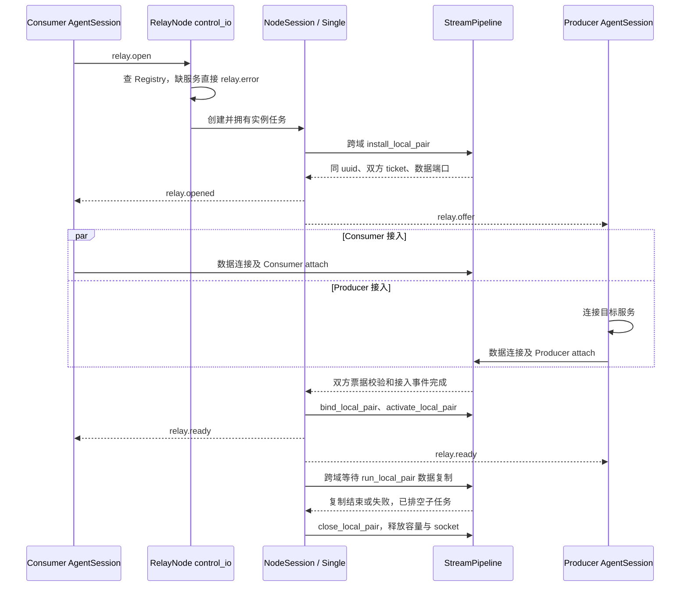

业务建立期限由 control_io 的 Single 控制器持有；数据 listener 对尚未解析出合法 attach 的 socket
另有 setup 期限和 max_setup_connections 限制。前者约束已创建业务，后者约束未识别接入。
attach 顺序不限，无效票据或重复角色只拒绝该 socket；Agent 收到 ready 后才开始传输。
建立失败通知请求方 relay.error 和已获 offer 的服务方 relay.closed，双方立即结束 ready 等待；
单节点活动 TCP/TLS 仍通过 socket 结束。
多节点流程由 Multi 协调首末，见 7.4；正常 FIN 排空和 peer.finished 保留。

#### 7.3.1 单节点 TCP 的实际数据链路

请求方 Forwarder 接受应用 TCP 连接，把 socket 移交给 Consumer AgentSession；Producer AgentSession
按 service 配置解析并连接 target_host/target_port。两个 Agent 分别主动连接同一 Node 的 tcp.port，
各发送一次 relay.attach；这两个公网 socket 和两个本地 socket 都由各自实例持有。
Node StreamPipeline 精确读完 attach 首帧后，把 socket 移入 LocalPair 的 consumer_stream 或 producer_stream。
attach 不带服务名，Node 根据 uuid/ticket/role 找到控制器已经分配的资源，不再次查 Registry。

```text
应用 TCP socket
  ↔ Consumer AgentSession.local
  ↔ Consumer AgentSession.transfer
  ↔ Node LocalPair.consumer_stream
  ↔ Node LocalPair.producer_stream
  ↔ Producer AgentSession.transfer
  ↔ Producer AgentSession.local
  ↔ 目标 TCP 服务
```

ready 后两个 Agent 调用 relay_tcp，Node 的 TcpTransport::relay 同样调用 relay_tcp。
每处启动两个持续复制方向，读取后完成限速等待与写入，再复用缓冲继续读；业务期间不再发 CBOR 帧，
也不按应用消息边界分配 Relay。Node 负责服务方向的限速和流量计数，Agent 只复制业务字节。
32 KiB 是每方向的复制缓冲大小，不是应用数据总长度限制。

应用 `shutdown(send)` 后，Consumer 读到 EOF，只半关闭它到 Node 的发送方向；Node 将对应 EOF
继续传到 Producer，再传给目标服务。目标仍可回传回复，反方向保持运行。目标也发送 EOF 后，
每段两个方向都完成并排空，Node 控制器关闭 LocalPair，两个 Agent 清理自己的实例。
任一处真实读写失败则由 await_transfers 取消并排空另一方向，异常传给当前实例的清理边界，
不会把错误当成正常 EOF 留下另一个无限等包的方向。

#### 7.3.2 单节点 TLS 的接入、解密与结束

业务 `protocol="tls"` 表示 Agent↔Node 数据接入使用 TLS，不要求本地 forward acceptor 或目标 socket
进行 RelayWeave TLS 握手。本地两段仍是 TCP；应用自己的 HTTPS/SSH 等加密可以作为业务字节通过。
两个 Agent 连接 Node 的 tls.port，按实际控制主机地址及 server_name 配置验证证书、设置主机名/SNI，
完成 mTLS 后才在加密 stream 内发送 relay.attach。Node TlsTransport::prepare 完成服务端 mTLS，
再精确读取 attach，把 TLS stream 放入 LocalPair。

```text
应用 TCP ↔ Consumer Agent
  ↔ mTLS 数据连接 ↔ Node consumer TLS stream
  ↔ 解密后的业务字节复制 ↔ Node producer TLS stream
  ↔ mTLS 数据连接 ↔ Producer Agent ↔ 目标 TCP
```

Node 读取一个 TLS stream 的应用字节并写入另一个 TLS stream，由后者重新加密；不会直接搬运原始 TLS record。
Node 的 relay_tls(TLS, TLS) 执行限速和统计，Agent 的 relay_tls(TCP, TLS) 做本地与公网转换。
attach、TLS record 和握手不计入业务流量。

Single 与 Multi TLS 统一保留业务半关闭：本地 TCP EOF 转为 TLS 内的业务 FIN，收到 FIN 只对本地
TCP 执行 shutdown(send)，反向继续复制；两个方向完成后才释放资源。真实读写错误、取消和限速等待失败
取消并排空对向，并向控制器传播原始错误。Node LocalPair 将 DATA/FIN 从一个 TLS stream 转发到另一个。

TLS 接入在原有 relay.attach 首帧后使用 `length32-fin-v1`：4 字节大端长度，1..65467 表示随后相应长度的
DATA，0 表示 FIN、无帧体。较大的业务写入拆成多帧；应用的原始 TCP 写入边界不保留。
DATA/FIN 同方向有序且均受 TLS 保护，头部和 FIN 不计业务流量；FIN 只结束业务方向，不立即关闭 TLS。
Node TLS endpoint 描述符与 TLS relay.attach 均携带 `tls_framing="length32-fin-v1"`，Agent 校验描述符，
Node 校验 attach，缺失或不同的标识拒绝接入。该格式适用于 TLS 1.2/1.3；旧版未分帧的 Agent/Node
不能与新版混用 TLS 数据接入，部署时需要配套升级。

TLS EOF、close_notify 或 stream_truncated 若在业务 FIN 之前出现，均按传输失败处理，不能当作完整业务结束。
双方业务 FIN 排空后数据所有者才关闭 TLS socket；控制通道仍使用 TLSChannel 自己的关闭流程。

#### 7.3.3 单节点 UDP 的建立、来源绑定与逐包转发

请求方服务位置可用后，DatagramForward 主动创建一个当前 Consumer AgentSession；不等第一包才创建，
也不为每个本地应用源端口建立新会话。Node Single 控制器安装 UDP LocalPair，分配同一 uuid、
不同的 producer/consumer ticket 和 session_id，再通过 opened/offer 下发。
Producer 创建一个目标 UDP socket 并 connect 到 target_host/target_port；两个 Agent 都使用独立的
transfer UDP socket connect 到 Node udp.port。UDP connect 仅固定本地 socket 的对端，并不建立可靠网络连接。

Agent 在 ready 前发送完整 WireMessage relay.attach，每 500 ms 重发一次直到 ready 或本端 deadline。
DatagramMgr 第一次合法 attach 固定该 role 的公网来源 IP/port；重复 attach 不替换来源，业务包不能
把 session 的来源重新绑定。两个 role 都已接入后，Single 绑定统计和限速、激活 LocalPair，并通过
原 mTLS 控制连接向双方发 relay.ready；没有独立的 UDP attach 成功回执。

设 Consumer 的 session_id 为 C，Producer 的为 P，一次请求与回复按如下路径传递：

```text
本地应用 -- 原始 payload --> Consumer DatagramForward
Consumer -- [C][payload] --> Node UDP listener
Node -- [P][同一 payload] --> Producer transfer socket
Producer -- 去掉 P，只发 payload --> 目标 UDP socket

目标 -- reply payload --> Producer target socket
Producer -- [P][reply payload] --> Node UDP listener
Node -- [C][同一 reply payload] --> Consumer transfer socket
Consumer -- 去掉 C，只发 reply payload --> 当前本地应用 endpoint
```

Node 收到数据报后查 bindings_，验证 LocalPair active、来源与 attach 相符、方向令牌足够，原地改写
8 字节头，并在共享 listener 的接收循环内直接 async_send_to；发送完成后才复用接收缓冲。
一次 datagram 对应一次发送，不拼包、不拆包、不解析 JSON，也不为每包启动发送协程。
Consumer 的本地监听与 Node 公网来源绑定不同：第一次有效本地报文记录来源地址，后续只接受同一 IP，
允许其端口变化，并将回复发到最近一次接受的 endpoint；它不是多应用客户端的独立会话表。

ready 前的应用包直接丢弃，不缓存等待；未知 session、来源变化、超长报文或限速不足也丢当前包。
Node 共享 listener 的单次发送失败只影响当前报文，接收循环继续，不把所有 LocalPair 一起结束。
Agent 服务方的两条复制方向使用 await_transfers，独立 socket 的 I/O 失败会取消对向并结束该实例；
请求方发送/接收失败也进入自己的 fail/清理流程。
UDP 没有 EOF 或 FIN，也没有业务空闲租约；控制取消、注册/控制失效或 stop 清除配对和双方 binding，
Node 发 closed，Agent 结束当前 session。请求方本地 listener 仍保留，服务可用时按退避重新申请新实例。

### 7.4 多节点路径建立与首末接入

假设服务在末 Node T，选择路径 H → I → T，Consumer 已取得 H 的 Ready 控制连接；Producer
继续使用向 T 注册服务的控制连接。Consumer 向 H 发送：

```json
{
  "command": "relay.open",
  "params": {
    "request_id": 101,
    "service": "home-ssh",
    "protocol": "tcp",
    "epoch": 7,
    "path": ["H", "I", "T"]
  }
}
```

H 校验 path.front 是自己、epoch 当前且 request_id 非零，再创建 ingress Multi NodeSession。
与同会话已有请求的 request_id/uuid 匹配时，同 path/epoch/service/protocol 的 open 复用已有实例，
已经发过 opened 则重发其接入参数；参数冲突直接 error，不额外创建 Flow。
路径是否无环、成员是否在线、邻接 Link 是否可用由 NodeLinkMgr 的 Flow 事务继续验证。

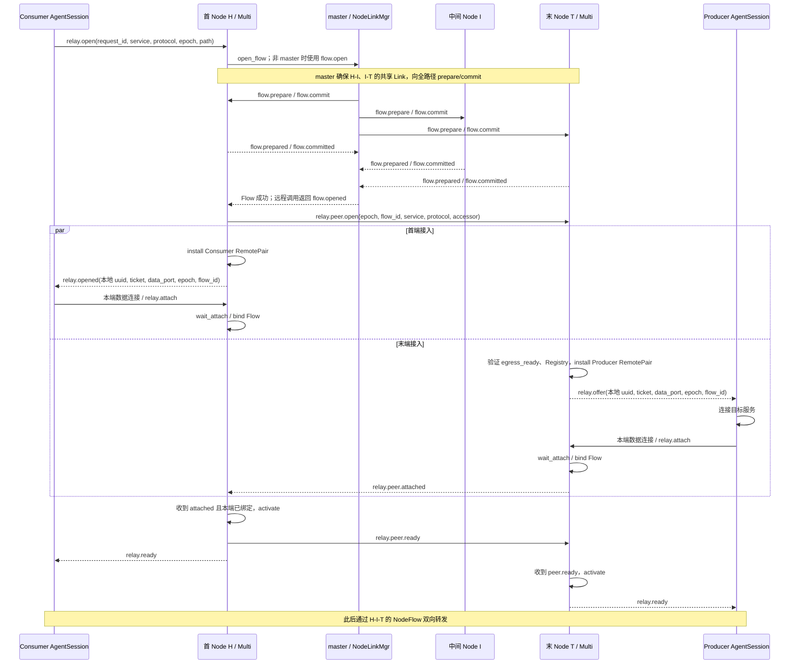

图中 prepare/commit 是两轮独立的全路径确认，不能将“某一 Node 的 committed”视为全路径提交完成；
详细确认顺序与校验见 A.7。H 本身是 master 时执行同一事务，只省去远程 flow.open/opened。
opened 与 offer 的相对到达顺序不固定，attach 也不分先后；每端只等待自己负责的 Agent。
TCP/TLS 接入与单节点一致，UDP 两端接入各增加自己的 session_id，均通过普通控制连接收到 ready。

中间 I 只有 NodeFlow 与共享 Link，没有本业务 NodeSession、LocalPair/RemotePair、服务注册、Agent
票据或目标 socket。H/T 的本地 RemotePair 连接自己的 Agent 和共同的 epoch/flow_id；本地 uuid 仅供
各自 attach 查表，Node 间传输不携带它。本业务的服务注册和统计在 T；H 的 RemotePair 不持有 ServiceTraffic，
H/I 不重复统计服务流量，但 H/T 都按自己的数据配置执行端点限速。

Flow 的 forward 是 H→T，reverse 是 T→H。它与“Consumer 的请求”或“TCP Link 的主动建连端”分别定义：
Consumer 向服务发字节时 reverse=false，Producer 回传时 reverse=true；相邻 Node 的 TCP 连接角色
由 Node 名字排序决定，即便主动连接方向相反，也不改变业务方向。

### 7.5 多节点协议数据路径

首末完成本地绑定和激活后，业务复用固定 NodeFlow；TCP、TLS 与 UDP 分别保留自己的帧、结束和丢包语义。

#### 7.5.1 多节点 TCP 的分帧、每跳传递与 FIN

接入的三类组件各自完成一段工作：

| 位置 | 输入 → 输出 | 实际操作 |
|---|---|---|
| Consumer / Producer AgentSession | 本地 TCP ↔ 首/末 Node TCP | relay_tcp 双向复制，正常 EOF 只半关闭对端发送 |
| H/T StreamPipeline RemotePair | Agent TCP ↔ NodeFlow | 两个持续协程：read_remote_pair 将字节切成 DATA；write_remote_pair 写回 DATA 或处理 FIN |
| H/I/T FlowProtocol/LnkChannel | 逻辑 Flow ↔ 相邻 TCP NodeLink | 查 Flow 身份、方向和入边，按固定路径入队；中间节点直接移动载荷，不经过业务控制协程 |

RemotePair 使用 65467 字节的读取缓冲，从 Agent stream 读到多少就转发多少，按对应方向限速，将拥有载荷的 DATA 交给 stream channel。
数据侧长期发送协程接手后提交返回，该方向可以复用
读缓冲。NodeLink 的单写循环按队列写二进制头和载荷，一条 Link 可交错承载多个 Flow，但每个 Flow
同方向 DATA/FIN 的提交与交付顺序保持一致。应用的原始 TCP 写入边界不保留，终点把收到的块顺序写回 stream。

DATA/FIN 没有逐帧远端业务确认，交接完成只保证数据侧拥有载荷，不能解释为已经入队或末端应用已经收到。
每跳可靠与顺序由该 TCP socket 提供。每 Flow 每方向有固定信用窗口，prepare 按数量、身份和邻接状态准入。
缺少出边信用的帧停留在本方向，取得信用后进入 Link 的 FairQueue，按流标签交错、从队首写出；本地方向窗口满时异步提交挂起。
中间节点向下游写完、终点向 Agent 写完并释放公开载荷后，才归还相邻入边信用。
正常拥塞不关闭 Flow；越窗、格式错误与真实 I/O 失败仍有明确失败边界，
数学模型见 5.6.2，背压实例见 5.6.5，容量与性能分析见 5.6.6、5.6.7。

中间 I 用 `(epoch, flow_id)` 找到 Active 表项，验证 forward 来自 previous 或 reverse 来自 next。
forward 送 next，reverse 送 previous；不能从任意相邻 Link 注入相同 ID 的 DATA。
payload 在数据域移动到出边队列，不再次生成 JSON/CBOR，不为每帧启动协程，也不建立第二份业务 session。
到 H/T 时，Flow 没有对应出边，帧进入该 Flow 的终点接收队列，由 RemotePair 的持续接收协程读取并写回 Agent。

一次“请求发送完，再等待回复”的半关闭按如下方式贯穿全路径：

```text
应用 EOF
  → Consumer Agent 半关闭发往 H 的 socket
  → H read_remote_pair 在前序 DATA 之后提交 forward FIN
  → I 按同方向顺序转发 FIN
  → T write_remote_pair 读到 FIN，shutdown Producer socket 的 send
  → Producer Agent 将 EOF 继续传给目标服务

目标回复及 EOF
  → Producer Agent 发往 T
  → T 提交 reverse DATA，最后提交 reverse FIN
  → I 原路径返回
  → H 写回回复，收到 FIN 后半关闭 Consumer socket 的 send
  → Consumer Agent 向应用交付回复及 EOF
```

FIN 只结束一个方向；相反方向仍接受 DATA。FlowProtocol 拒绝该方向 FIN 后的 DATA 和重复 FIN。
两个 FIN 都出现也不自动删除 Flow，因为首末 Agent 的尾部写入可能仍未完成。
H/T 各自的 read/write 两方向都结束并排空后才发 peer.finished；双方都看到对方 finished 后，
各自发送正常 relay.closed，H 请求 master 关闭 Flow。Agent 完成本地复制并收到正常 closed 后
释放入口连接引用，避免控制收尾抢在尾部数据之前。

真实 I/O 错误则取消并排空 RemotePair 另一方向；未处于外部取消且端点仍可用时，尽力发 RESET，
原因最多 512 字节。RESET 终止该 Flow 并唤醒接收者，Multi 同时通过 peer.close 和 Flow close 收敛，
不等待双方正常 finished。其他共用同一 Link 的 Flow 保持运行；物理 Link 失败才使依赖它的 Flow 一起失效。

#### 7.5.2 多节点 TLS 的加密边界与复制

建立流程仍按 7.4，只将协议设为 tls。首末 Node 分别选择自己的 TLS StreamPipeline，两个 Agent
分别在 tls.port 完成 mTLS 并发送 attach；NodeLinkMgr 创建 `transport="tcp"` 的 Flow，不创建 TLS NodeLink。

```text
应用 TCP ↔ Consumer Agent
  ↔ 接入 mTLS ↔ H TLS RemotePair
  ↔ 解密后的业务字节 / TCP NodeFlow ↔ I ↔ T TLS RemotePair
  ↔ 接入 mTLS ↔ Producer Agent ↔ 目标 TCP
```

H 的 read_remote_pair 从接入 TLS stream 读取应用字节，以普通 DATA 交给 NodeFlow；I 不接触 Agent TLS
状态，只转发二进制帧；T 的 write_remote_pair 将字节写入 Producer TLS stream，由接入 TLS 重新加密。
反向传输对称。Node 间共享数据通道是明文 TCP，接入 mTLS 不会使 H-I-T 变成端到端 TLS 通道；
业务本身使用 HTTPS/SSH 时，它的加密内容仍作为原始字节传递。

Multi 使用 StreamPipeline 的 RemotePair 和与 Single 共用的 Agent relay_tls。TLS 接入使用与 Single 相同的
length32-fin-v1 DATA/FIN 分帧：read_remote_pair 收到业务 FIN 后在前序 DATA 之后提交 Flow FIN；
write_remote_pair 收到 Flow FIN 后发送 TLS 内的业务 FIN，保留反方向。TCP 接入仍用 EOF/shutdown(send)。
TLS 传输 EOF 或 stream_truncated 不代替业务 FIN，而作为真实 I/O 失败传播 RESET。
最终按双向排空、首末 peer.finished、relay.closed 和 Flow close 收尾，避免控制关闭抢在尾部 DATA/FIN 之前。

#### 7.5.3 多节点 UDP 的报文转换、队列与生命周期

建立过程使用相同 Multi 控制消息，但 Flow transport 为 udp。相邻 Node 共用 UDP NodeLink，首末
DatagramMgr 各安装一个只面向本地 Agent 的 RemotePair，分别分配自己的 uuid/ticket/session_id。
两个 Agent 仍向自己的 Node 每 500 ms 发送 relay.attach 并等控制 ready；Node 间 Link 的 UDP 接入
握手是另一层，仅建立一次，不随每个业务报文或 Flow 重做。

设 Consumer 的 session_id 为 C，Producer 的为 P，共同 Flow 身份为 `(E, F)`，一包请求依次转换为：

```text
本地应用 → Consumer：原始 datagram payload
Consumer → H：[C][payload]
H RemotePair → UDP NodeFlow：DATA(epoch=E, flow_id=F, reverse=false, payload)
H → I：[H-I Link ID][32 字节 Node DATA 头][payload]
I → T：[I-T Link ID][同一 Flow 身份与方向的 Node DATA 头][payload]
T → Producer：[P][payload]
Producer → 目标：原始 datagram payload
```

回复反向逐跳返回，reverse=true，每跳使用对应相邻 Link 的 ID；H 最后加回 C，Consumer 去掉头后
发给当前本地应用 endpoint。业务 session_id 不穿过 NodeFlow，Link ID 也不暴露给 Agent。
一次 DATA 对应一个完整 UDP payload，不合并、拆分、重排或重传；零字节用户报文仍是合法 DATA。

H 的共享 UDP 接收循环验证 session、固定来源、RemotePair active 和 payload ≤65467，剥离 8 字节
头并直接检查令牌，足够时调用 FlowDatagram::try_send 将 payload 复制一次到池块并投递 16 项发送队列。
没有额外的业务入站队列或转发协程；超限、满队列和池容量不足只丢当前包。
I 验证 epoch、flow_id、方向、物理来源和预期入边，再将帧移动到另一相邻 Link 的发送队列。

T 的 write_remote_pair 持续从 Flow 接收完整 datagram，令牌不足丢当前包；足够时用两段 buffer
一次发送 `[P][payload]`，帧载荷持有到共享 UDP socket 的发送完成，不额外构造发送任务对象或
逐包 co_spawn。反向在 T/H 以同一方式工作。
Flow/Link 身份失效、接收通道关闭或 RemotePair 真实发送失败会结束桥接并走 Multi 清理；
UDP 队列满和超限只丢当前整包，所有准入层遵循同一规则。

Single 最大用户 payload 为 65499 字节，Multi 为 65467；超出 Multi 上限由接入检查丢弃，
没有应用层分片。Agent 和共享 UDP listener 保留完整报文接收缓冲，Node 帧载荷上限独立于接收缓冲容量。
UDP 各处容量不足均丢当前整包，不关闭健康 Flow、不等待空间。只有身份失效、真实 I/O 错误和控制中止结束桥接。
UDP Flow 只接受 DATA，没有 FIN 或对端正常 EOF；控制器的桥接通常持续到取消/失效，不通过
peer.finished 判定正常完成。首末控制失效、服务离线、Link/Flow 失败或 stop 后，关闭本地队列、删除
binding 并通知 Agent，首 Node 协调关闭 Flow，已建立的物理 Link 留给其他业务复用。
Consumer 保留本地 forward；下一次重建重新选路、分配 Flow 和接入身份，不复活已关闭 session。

### 7.6 建立、转发与收尾的责任边界

| 场景 | 负责组件 | 收敛规则 |
|---|---|---|
| Single open 时服务不存在或协议不符 | RelayNode / RegistryMgr | 立即 relay.error，不创建 LocalPair 或“等待服务”实例 |
| Multi Flow 尚未准备好、成员失效或 path 非法 | 首 Node Multi / NodeLinkMgr | 保留 Flow 实际失败阶段，向 Consumer error；关闭本次 Flow 表项，保留共享 Link |
| Multi 末 Node 无服务或不是已提交 Flow 的终点 | 末 Node RelayNode | peer.close(stage=bind)，首 Node 结束本实例并关闭 Flow |
| attach 非法、票据过期或重复角色 | 数据 listener | TCP/TLS 拒绝该接入 socket，UDP 丢当前包；不能借此替换已接入资源 |
| 本端建立 deadline 到期 | AgentSession / Single / Multi | 终止本端等待和 I/O，通知已知对端，释放本端资源；不续期或传递双端预算 |
| 正常 TCP EOF / Multi FIN | 数据复制协程 | 只半关闭对应发送方向，反向排空；Multi 再等双方 finished |
| Single/Multi TLS 业务 FIN / 传输失败 | relay_tls / TLS RemotePair | 正常 FIN 只结束对应方向；真实错误取消并排空对向 |
| Agent UDP I/O 失败或 TCP 真实错误 | 当前复制实例 | 结束该实例、排空对向，保留原原因；Node UDP 共享 listener 的单包失败另按 7.3.3 处理 |
| Multi Flow/Link 失效 | FlowProtocol → NodeLinkMgr → watch_flow | 唤醒业务并取消本地复制，通知 Agent/peer，释放 Flow；Link 失效影响依赖它的全部 Flow |
| 本地取消或控制连接断线 | 业务控制器 | 幂等保留首次原因，清理 socket/来源/队列；接收 peer.close 不反向回声 |

NodeSession 是 control_io 中业务任务的所有者，通过跨域操作管理 LocalPair/RemotePair；数据 manager
不发送 ready/closed/error。AgentSession 拥有本地/公网 socket，Forwarder 在其 run 完成后移除 relays_
并释放当前 UDP 引用。关闭索引使新包不能继续查到旧业务，已启动 I/O 的持有者继续排空后才释放缓冲。
两端关闭自己的本地资源，不依赖对方替自己释放对象；master 负责 Flow 路径的全体关闭确认。

## 8. 配置、启动与停止

配置决定网络接口、证书、服务与本地监听；启动先建立长期所有者，停止沿业务依赖关系取消并排空，再释放被借用的管理器与协议服务。

### 8.1 部署配置模型

仓库中的示例配置完整列出各组件支持的 JSON 配置项，包括使用默认值的可选项，作为部署和修改配置的参考。
Dashboard 的 HTTP 端口、采样间隔和历史数据库参数仍使用命令行选项，不属于 JSON 配置项。

#### 8.1.1 证书输入

先按 [证书制作与部署](证书制作与部署.md) 为所有服务器节点和客户端生成证书。每个服务器节点使用自己的一份 `server.pem/server.key`；普通客户端使用共享的 `shared-client.pem/shared-client.key`。

设计文档中的地址必须与证书 SAN 和实际网络路由一致。端口不属于 SAN。

#### 8.1.2 RelayNode master 配置

完整字段以 [`node/node.example.json`](../node/node.example.json) 为准。master 的 `cluster.address` 是集群监听地址：

```json
{
  "bandwidth_mbps": 100,
  "cluster": {
    "role": "master",
    "node_id": "master-1",
    "address": "0.0.0.0",
    "control_port": 18447,
    "tcp_port": 18448,
    "udp_port": 18448
  },
  "control": {
    "address": "0.0.0.0",
    "advertise_address": "203.0.113.10",
    "port": 18443,
    "max_connections": 512,
    "max_services": 256,
    "max_services_per_session": 64
  },
  "tcp": {
    "address": "0.0.0.0",
    "port": 18444,
    "max_setup_connections": 512,
    "max_relays": 128,
    "setup_timeout_ms": 10000,
    "rx_bytes_per_second": 2000000,
    "rx_max_burst_bytes": 262144,
    "tx_bytes_per_second": 2000000,
    "tx_max_burst_bytes": 262144
  },
  "tls": {
    "address": "0.0.0.0",
    "port": 18446,
    "max_setup_connections": 512,
    "max_relays": 128,
    "setup_timeout_ms": 10000,
    "rx_bytes_per_second": 2000000,
    "rx_max_burst_bytes": 262144,
    "tx_bytes_per_second": 2000000,
    "tx_max_burst_bytes": 262144
  },
  "udp": {
    "address": "0.0.0.0",
    "port": 18445,
    "max_relays": 128,
    "setup_timeout_ms": 10000,
    "rx_bytes_per_second": 2000000,
    "rx_max_burst_bytes": 262144,
    "tx_bytes_per_second": 2000000,
    "tx_max_burst_bytes": 262144
  },
  "certificate": {
    "server_ca_file": "/etc/relayweave/certs/server-ca.pem",
    "ca_file": "/etc/relayweave/certs/client-ca.pem",
    "certificate_chain": "/etc/relayweave/certs/server.pem",
    "private_key": "/etc/relayweave/certs/server.key"
  },
  "channel": {
    "handshake_timeout_ms": 5000,
    "disconnect_timeout_ms": 5000,
    "heartbeat_interval_ms": 5000,
    "heartbeat_timeout_ms": 20000,
    "max_queued_messages": 100
  }
}
```

`cluster` 是必填对象，`role` 只允许 `master` 或 `slave`，所有节点的 `node_id` 必须非空且唯一，并且不能使用为广播保留的 `all`。当前配置不提供关闭集群的角色，也不读取旧版服务器配置字段。

#### 8.1.3 RelayNode slave 配置

slave 的控制和数据端口按本节点实际端口填写。它的 `cluster.address` 和 `cluster.control_port` 指向 master：

```json
"cluster": {
  "role": "slave",
  "node_id": "slave-1",
  "address": "203.0.113.10",
  "control_port": 18447,
    "tcp_port": 18448,
    "udp_port": 18448
}
```

slave 自己的 `control.advertise_address` 应填写 Agent 可访问的 slave 地址，例如 `203.0.113.11`，不能沿用 master 地址。slave 连接失败或连接断开后每隔 5 秒重试。master 从不主动连接 slave。集群断开不停止本节点的普通客户端监听和数据中继。

#### 8.1.4 RelayAgent Producer 配置

RelayAgent 的 `services` 描述它提供的本地目标：

```json
{
  "server": {
    "host": "203.0.113.11",
    "port": 18443,
    "connect_timeout_ms": 5000
  },
  "certificate": {
    "ca_file": "/etc/relayweave/certs/server-ca.pem",
    "certificate_chain": "/etc/relayweave/certs/shared-client.pem",
    "private_key": "/etc/relayweave/certs/shared-client.key"
  },
  "services": [
    {
      "name": "home-ssh",
      "target_host": "127.0.0.1",
      "target_port": 22,
      "protocol": "tls"
    }
  ],
  "forwards": []
}
```

提供方只在配置的初始服务器上注册 `services`。该初始连接是客户端的 primary 连接；服务发现创建的附加连接不会重复注册这些服务。

#### 8.1.5 RelayAgent Consumer 配置

RelayAgent 的 `forwards` 描述本地监听和目标服务：

```json
{
  "server": {
    "host": "203.0.113.10",
    "port": 18443,
    "connect_timeout_ms": 5000
  },
  "certificate": {
    "ca_file": "/etc/relayweave/certs/server-ca.pem",
    "certificate_chain": "/etc/relayweave/certs/shared-client.pem",
    "private_key": "/etc/relayweave/certs/shared-client.key"
  },
  "services": [],
  "forwards": [
    {
      "service": "home-ssh",
      "listen_address": "127.0.0.1",
      "listen_port": 2222,
      "protocol": "tls"
    },
    {
      "service": "office-rdp",
      "listen_address": "127.0.0.1",
      "listen_port": 13389,
      "protocol": "tcp"
    }
  ],
  "relay": {"open_timeout_ms": 10000},
  "reconnect": {
    "initial_delay_ms": 500,
    "max_delay_ms": 10000
  },
  "channel": {
    "handshake_timeout_ms": 5000,
    "disconnect_timeout_ms": 5000,
    "heartbeat_interval_ms": 5000,
    "heartbeat_timeout_ms": 20000,
    "max_queued_messages": 100
  }
}
```

`server.host/server.port` 只指定初始入口。客户端通过它发现 `home-ssh` 和 `office-rdp` 所在节点，然后按需建立附加控制连接。两个服务可以位于不同服务器并同时工作。

协议必须在提供方 `services[].protocol` 和使用方 `forwards[].protocol` 中一致，只允许 `tcp`、`tls`、`udp`。

本地 forward 应绑定 `127.0.0.1`，除非明确需要允许其他主机访问。绑定 `0.0.0.0` 会把该端口暴露给
所有可达网卡。

Node 和 Agent 默认进行质量探测，Agent 默认计算推荐路径，不提供 enabled 开关。Agent 可选的
`"routing": {"max_nodes": 4}` 只限制路径中的真实 Node 数，范围为 1–8；省略整个对象时也使用 4。
探测与质量参数使用固定常量。推荐路径的范围和算法见第 4 章。

### 8.2 进程入口与启动顺序

两个进程入口只接收一个配置文件路径；配置解析或监听绑定失败会直接结束启动：

```console
relayweave-node node-config.json
relayweave-agent producer-agent-config.json
relayweave-agent consumer-agent-config.json
```

每个进程只解析一次配置文件；配置加载器在启动前校验地址、端口、证书、容量和超时等字段。

推荐启动顺序是 master、slave、服务提供方 RelayAgent、服务使用方 RelayAgent。slave 和 RelayAgent 都会重连，因此顺序不会影响最终恢复，只影响首次可用时间。

安装布局和进程托管规则由打包文档定义。

#### 8.2.1 RelayNode 进程启动流程

进程入口先按配置准备普通客户端控制/TLS 数据使用的 TLS context；RelayNode 构造时再准备集群 TLS context、Registry 和三个 Relay manager。`start()` 按以下顺序建立可运行环境：

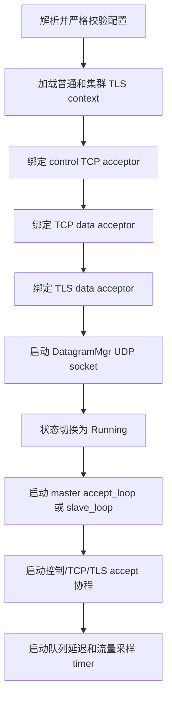

监听、UDP 或集群启动在进入 Running 前失败时，`start()` 关闭已经打开的 acceptor 并停止 DatagramMgr，然后把原异常交给 `main()`。程序不会在部分端口可用的状态下继续运行。

#### 8.2.2 RelayAgent 进程启动流程

RelayAgent 构造时从全部 `forwards` 建立服务发现集合。启动本地监听和主控制连接后，
主连接完成 TCP、mTLS 与身份识别，注册本地 `services`、查询尚未定位的服务及拓扑。
服务发现保存目的 Node ID、地址和控制端口，投递给 Forwarder 的只有服务可用性及目的 Node ID；
发现过程不创建到服务 Node 的附加控制连接。

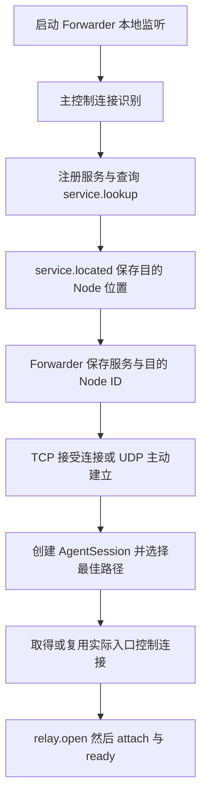

TCP/TLS 服务尚未定位时关闭当前应用连接，监听保留；UDP 此时只保留本地 forward。
服务上线由既有发现循环获知，UDP 重新选择路径后建立新业务实例。

### 8.3 协同停止与依赖排空

停止次序按资源依赖展开，保证业务实例退出期间仍能使用控制连接、数据 manager 和 Flow 关闭通知；引用规则见 6.2。

#### 8.3.1 RelayNode 停止流程

`RelayNode::stop()` 是同步收敛接口，由 `control_io`、`transfer_tcp_io`、`transfer_udp_io`、`cluster_data_io` 之外的线程调用。
它通过一次性状态保护执行以下流程：

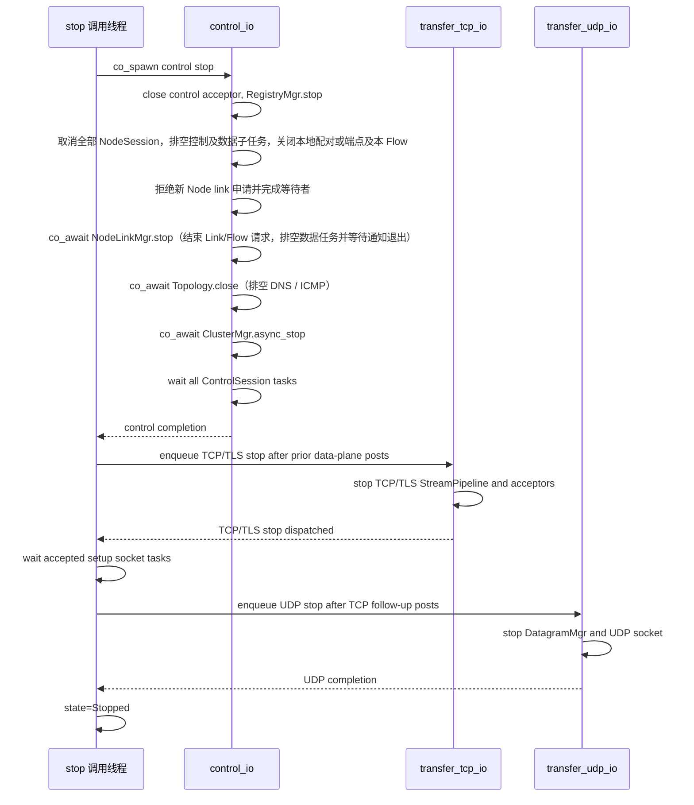

Node 先取消并排空所有单节点及多节点 NodeSession；该过程仍需 NodeLinkMgr 和集群控制处理关闭确认及失效通知。
随后共享数据任务在独立 cluster_data_io 中取消并等待退出，再关闭集群控制连接；最后主程序 join 数据线程。其余三个停止阶段分别由对应 executor 执行，外部同步 `stop()` 通过 `use_future` 逐阶段等待。control 侧先让
Registry 停止接受新状态并断开现有普通会话，等待 ClusterMgr 和全部 ControlSession 结束，确保
RelayNode 的控制命令不会再创建新业务。业务复制子任务已由实例排空，随后各数据 manager 关闭监听。
ClusterMgr 首先把自身置为非运行状态，再取消 master accept/slave connect、关闭出站消息队列和全部成员
session 并等待退出。ClusterMgr 不维护额外的业务收件箱；停止返回后不再调用 RelayNode。

TCP/TLS accept 后、首帧解析前的 socket 由各 StreamPipeline 的独立 setup 协程暂时持有，不能只关闭
acceptor 就假定它们消失。每个实例自己的 `pending_sockets_` 记录这部分协程；TCP/TLS 停止阶段在进入
UDP 停止前使用原子 wait 等待它们归零。accept/setup 协程按值捕获 Pipeline 的 shared_ptr，
业务复制由 NodeSession 的控制任务跨域拥有并排空，不再由 manager detached 启动。

#### 8.3.2 RelayAgent 停止流程

`RelayAgent::async_stop()` 是唯一的公开停止接口，调用方必须保证它完成后才销毁 Agent 或结束 executor。
一般调用方直接等待该 awaitable；Agent 进程的信号回调则在 `control_io` 上 detached 启动它，避免阻塞
`signal_io` 线程，随后由 `main()` join control/transfer 线程间接等待停止收敛。`main()` 持有的 Agent
`shared_ptr` 在 join 完成前保持有效。重复调用在 `StoppingControl` 或 `StoppingForwarder` 状态等待同一个完成
信号，在 `Stopped` 状态立即返回。尚未启动的 Agent 也走完整停止路径，以释放已构造 Forwarder 持有的
transfer work guard。
停止顺序固定为：

1. control executor 把 Agent 切换为 `StoppingControl`，取消 discovery timer、停止 AgentRouting 探测，并停止所有 NodeConnection；
2. NodeConnection 取消其拥有的 resolver/socket/retry timer，并要求当前 TLSChannel 断开；
3. discovery 协程等待 `AgentRouting::close()` 排空 DNS / ICMP；discovery 和连接协程共用任务启动、计数回滚与 completion handler，递减 control `active_tasks`；
4. control `active_tasks==0` 后，把 Agent 切换为 `StoppingForwarder`，并向 transfer executor 队列尾部启动
   `Forwarder::async_stop()`；
5. Forwarder 切换为 `Stopping`，关闭本地 acceptor 和 UDP socket，取消重试等待和全部 AgentSession；
   接受新业务及安排重试的入口在非 Running 状态拒绝新工作；
6. 监听、业务和重试任务的 completion handler 递减 transfer `active_tasks`；归零后释放
   transfer work guard、切换为 `Stopped`，通过一次性 `stopped_event`（AsyncEvent）唤醒全部停止等待者；
7. control executor 清空连接池和 service routes，把 Agent 切换为 `Stopped`，通过一次性 `stopped_event`（AsyncEvent）唤醒所有停止等待者。

RelayAgent 不靠固定延迟等待关闭。control 任务先完全退出，保证不会再产生新的 transfer 投递，然后才在
transfer 队列尾部关闭 Forwarder；两个 executor 的实际协程计数决定停止完成时刻。

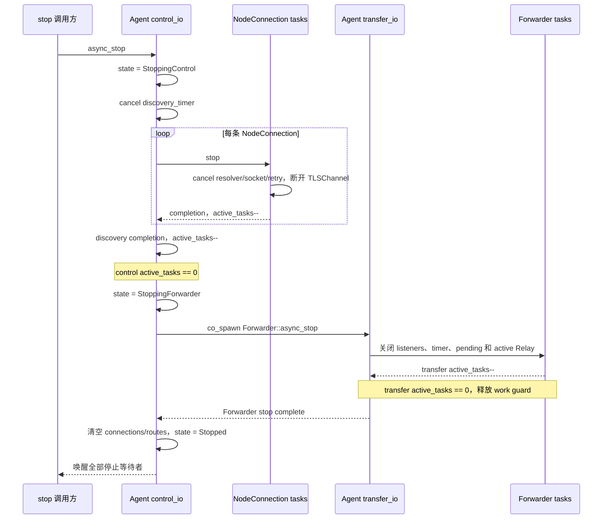

## 9. 质量验证与架构演进

验证以业务结果、跨层交接和关闭边界为依据；扩展应落在现有职责所有者中，并明确协议、顺序与资源预算的影响。历史阶段结果单独保留在附录 C。

### 9.1 构建、测试入口与覆盖范围

Debug 构建和完整测试：

```console
cmake -S . -B build -DCMAKE_BUILD_TYPE=Debug -DBUILD_TESTING=ON
cmake --build build --config Debug --parallel 1
ctest --test-dir build -C Debug --output-on-failure
```

测试目录按 `common/`、`protocol/`、`route/`、`agent/`、`node/`、`proxy/`、
`integration/`、`deployment/` 分组；夹具与资源位于 `support/`、`data/`，
性能基准和手动诊断分别位于仓库根目录的 `benchmark/` 和 `test/tools/`。分组、覆盖边界及运行方法见
[`test/README.md`](../test/README.md)。所有自动用例有超时和组件/运行类型标签。

路由模块测试集中在 `test/route/`；Agent 路由组装与 Node 拓扑测试分别位于
`test/agent/agent_routing_test.cpp` 和 `test/node/topology_test.cpp`。所有相关 CTest 使用 routing 标签，
普通权限和 ICMP 集成可以分别运行：

```console
ctest --test-dir build -C Debug -L routing -LE icmp --output-on-failure
ctest --test-dir build -C Debug -L icmp --output-on-failure
```

| 测试 | 覆盖范围 | 运行条件 |
|---|---|---|
| `link_quality` | 人工时间、三个半衰期、冷启动、稀疏样本、尖峰、失败/恢复、长期运行及摘要解析 | 无网络需求 |
| `routing` | 有向边、多入口、真实节点预算、同成本、孤立入口，随机小图与穷举对拍 | 无网络需求 |
| `probe_set` | DNS 失败重试、目标 revision、解析取消、重复/并发关闭及取消后排空 | 普通 DNS/socket 权限 |
| `agent_routing` | 请求关联、过期/乱序/非法快照、epoch、质量变化及“来源报告 14 秒旧，再过 2 秒失效” | 不需要原始 socket 权限 |
| `topology` | Node 报告解析、来源与成员校验、三字段质量和完整快照 | 不需要原始 socket 权限 |
| `probe_integration` | 真实 ICMP、共享 IP、DNS 失败不中断正常目标、历史/发送计数保留、目标变化、推荐路径及关闭 | Linux CAP_NET_RAW / Windows 管理员 |

`probe_integration` 仅在原始 socket 权限不足时返回 77，由 CTest 标为跳过；其他初始化或网络错误必须失败。
人工质量用例验证推荐路径随成本变化；真实测量需在具备上述权限的环境验证，跳过不能替代这部分验收。
`test_icmp` 是手动诊断程序，不注册为 CTest，构建后可运行 `build/test/tools/test_icmp 127.0.0.1 4`。
`routing` 生成的图示报告位于 `build/test/route/routing_test_report.html`，测试产物不进入源码或安装包。

主要测试覆盖：

- `tls_channel_mtls`：双向证书、主机名校验、握手失败与通道生命周期；
- `cluster_integration`：ClusterRoom 广播与定向发送、来源、保留/重复 ID、非法命令、成员证书、固定 5 秒重连、无历史回放和停止；
- `node_links`：共享 TCP/UDP、并发复用、握手乱序、单次失败与外层重试、凭据/旧 ID、有效 PONG、epoch/离线、超长 UDP、过期发送项、监听回滚及并发/取消停止；
- `node_flows`、`lnk_channel_flows`、`lnk_flow_receive`：双向及分叉转发、方向/epoch/FIN、RESET 与满队列、容量隔离、准备期限、控制失效、接收者唤醒及停止后公开载荷有效性；
- `lnk_flow_control`：本地信用等待与取消、消费确认、节点 20 ms 批次、多 Flow/方向隔离、阈值/精确耗尽刷新、满窗口 FIN、重复/延迟/越界信用、三跳停读恢复、UDP 丢包及数量限制；
- `lnk_frame`、`pooled_buffer`：二进制头和本地帧校验；独占缓冲移动、偏移归还、队列转移、稳定信用计费、标准池预热复用和跨线程生命周期；
- `node_relay_capacity`：暂停数据执行域时，TCP/TLS/UDP 各自的待建立和关闭中任务受 `max_relays` 约束，排空后名额可复用；
- `agent_cluster`：两个节点上的服务同时转发、主控在线时从节点恢复、服务迁移、首次目标失败、过期发现响应；
- `relay_protocol`：控制命令枚举映射、自定义命令、三种协议 attach、帧校验、UDP session header
  和协议选择；
- `relay_integration`：TCP/TLS Relay、ticket/role、半关闭、RelayAgent/RelayNode 完整往返；
- `tcp_relay`：真实 TCP socket 的读写失败、限速等待退出、原始异常保留、半关闭回传与计数；
- `tls_relay`：TLS 1.2/1.3 的 Single/Multi 接入半关闭、大回复、分帧流量计数、异常截断及非法长度；
- `udp_relay`：零长度、超过 4096 和最大合法 UDP 载荷、session/短头丢弃后的继续转发、超限丢弃及两侧 I/O 失败排空；
- `token_bucket`、`traffic_counter`：足额快路径、不足时预留、债务累积、补充与 burst 上限、无限速/空包、桶内定时器复用与等待取消，以及并发计数/采样和饱和；
- `node_config`、`node_status`、`node_lifecycle`：配置校验、旧配置拒绝、服务统计及超长报告、监听回滚和停止后的对象释放；
- `udp_relay_integration`、`udp_session_routing`：attach、路由、endpoint 固定、丢包边界、重建和统计，
  以及离线不分配资源、注册不复活旧请求、半接入超时、过期票据丢弃、ready 后无运行超时和容量恢复；
- `agent_lifecycle`、`agent_reconnect`：重复启动/停止、可等待停止、断线重连取消以及停止后的对象释放。

性能基准位于仓库根目录 `benchmark/`，由 `BUILD_BENCHMARKS` 独立启用，不注册为 CTest。
性能研究收敛为五个独立入口：TCP relay、TLS relay、UDP relay、多跳 Flow、带宽拥塞与背压。
TCP 提供相同负载的直连对照，TLS 握手与转发分开计时，UDP 分别测量往返延迟和持续双向发包；
Flow 的不限速吞吐与降速、恢复、单流暂停实验分开，真实链路整形通过隔离网络命名空间内的 HTB/IFB/netem 运行。
测量目标、运行参数与记录格式见 [`benchmark/README.md`](../benchmark/README.md)，CSV、日志、曲线和实测报告保存在构建目录并由 Git 忽略。

Dashboard 验证使用 Python 环境中的 Flask、cbor2、Waitress；部署测试仅使用标准库、临时目录、模拟 systemctl 和 dry-run，Linux 检测到 Python3 时自动注册到 CTest，
不会修改主机配置或服务。双 Node smoke 启动真实 Node、发布/消费 Agent 与 Dashboard，验证 TCP/TLS、
Slave 入口重启恢复及历史保留；具备 CAP_NET_RAW 时也验证有向质量和推荐路径，否则明确跳过相关断言。

```console
python -m unittest discover -s dashboard -p 'test_*.py'
python -m unittest discover -s test/deployment -p '*_test.py'
python test/tools/dashboard_service_smoke.py --build-dir build --two-nodes
```

### 9.2 冗余审查与测试边界

沿配置启动 → 注册/发现 → 选路与建连 → 接入/激活 → 数据转发 → 失败/停止审查生产调用关系：

- RelayNode 公开入口仅保留构造、start、stop；没有通用集群收件箱、LinkStatus、测试专用 Link/Flow 包装。
- 生产类不声明测试友元；需要检查私有状态的访问夹具完全位于 test/，不改变生产类型定义或所有权。
- Registry 注册不返回无人使用的统计引用，统计对象从服务查询取得；transport 不保留无人读取的协议常量。
- 服务位置与连接池分离，只有新业务取得实际入口；附加入口断开不触发重复服务查询。
- Session 退出从唯一业务容器删除；clear_service 仅标记受影响实例中止，实际协程收尾删除表项，避免挂起 I/O 悬空。
- LocalPair 与 RemotePair 是并列资源，共用容量预算；数据域不保留旧的服务等待、控制器或业务请求状态。
- 同步数据操作和中间节点转发不形成子协程；端点仅在绑定时跨执行器启动长期任务，逐帧 channel 交接，限速足额时直接继续复制。
- 重复身份、来源和跨等待后的存活检查仍承担实际业务边界，按值跨 co_await 的资源引用用于安全排空。
- UDP 服务方双向复制在单侧 I/O 失败时传播原异常并排空对向，避免一侧退出而实例仍挂在业务容器。
- TCP 双向复制同样传播 I/O 错误并排空对向，保留正常 EOF 的半关闭；限速等待取消不再作为正常结束。
- 路由只使用实际测量入口；ICMP 持续运行至关闭，测试自己控制结束时刻，不给生产探测增加有限次数模式。

Dashboard 的 HistoryStore 由应用创建和关闭，采集客户端只使用传入的存储；IP 查询和 UN/LOCODE 下载直接
调用真实函数，测试在测试层 mock，生产构造函数不保留测试注入分支。
未使用的容器扩展接口及独立路由查询已移除；保留实际服务容量、批量删除、拓扑和多目的地选路所需接口。

本审查不把存在的功能差异强行合并：NodeFlow 的控制授权与数据状态、peer 错误位置与本地进度、
本地 EOF 与对端 finished、单次取消与完成通知都不能互相替代。未实现扩展见 9.3。

### 9.3 已知限制与扩展位置

| 扩展 | 合理位置 | 必须明确的语义 |
|---|---|---|
| 按需增长窗口 | FlowProtocol 的方向授信与逐 Flow 容量边界 | 已授出的额度不能立即收回，增长会提高满载内存模型，需同时复核数量上限 |
| 按字节或权重公平调度 | NodeLink 物理写链之前 | 在已有标签交错基础上分配字节份额或权重，保持同方向 DATA/FIN 顺序 |
| 多物理通道或连接池 | NodeLinkMgr 建连策略与 LnkChannel 安装映射 | 安装 Flow 时固定选中 Link，不能每帧任意换 socket |
| 存量换路 | NodeLinkMgr 路径事务与 FlowProtocol 路由状态 | 需要路径代次、旧数据排空、确认和顺序保证，不能仅改目的索引 |
| 更大 Node DATA / UDP 载荷 | LnkFrameHeader 与相关接入/队列预算 | 协调升级节点格式及上限、内存计费和超长报文测试，不缩小本地接收缓冲 |

服务限速是字节每秒速率控制，信用/背压是内存和消费能力控制，两者不合并。
当前只对新业务选路，不迁移活动连接，不自动切换备用路径；不提前增加这些扩展的字段、空状态或占位类。

## 附录 A. 控制协议规范

控制通道使用 `WireMessage` 长度帧承载 CBOR 编码的 `CtrlMessage`。消息结构为：

```text
{
  "command": "命令名",
  "params": { ... }
}
```

共享协议库使用 `CtrlCommand` 表示普通控制命令和 Link/Flow 事务命令。发送方可用枚举构造 `CtrlMessage`，
接收方通过 `type()` 得到枚举并分派。`params` 在内存中使用 `nlohmann::json` 对象表示，线上编码是 CBOR，
不是 JSON 文本；文中的 JSON 示例只用于展示字段。业务处理器负责校验自身字段和状态。

集群 wire 继续把 `source/target` 放在 `params` 中。非保留的普通 cluster command 仍以字符串透传，
`type()` 对它们返回 `Unknown`；`cluster.*` 命令由集群握手保留。扩展命令仍使用同一
长度帧、CBOR 和 `{command, params}` wire 格式。

大消息分页统一在 `protocol/inc/message.h` 和 `protocol/src/message.cpp` 中实现：

- `WireMessage::pack` 对不超过 64 KiB 的消息保持原单帧编码；较大消息先完整编码为 CBOR，再按最多 65472 字节拆分。
- 分片帧的 CBOR 根对象为 `{"__fragment": [page_index, page_count, bytes]}`，`bytes` 是 CBOR byte string；每帧仍使用四字节大端长度头，payload 不超过 64 KiB，逻辑消息上限为 16 MiB。
- `TLSChannel::send` 将一条消息的全部帧作为一个队列项连续写入 TCP；每条连接的 `MessageReceiver` 只维护一个组装缓冲和页序计数，无消息 ID、乱序缓存或分页超时。
- 收到第 0 页时开始新组；后续页必须连续且总页数一致。末页到达时仍缺页则丢弃整条消息，保持连接。业务处理器只接收重组后的完整 `CtrlMessage`。
- Node 间转发也先接收完整消息，再修改路由字段并自动重新拆分，不需要业务模块预估内部路由开销。

Node、Agent、Dashboard 需要同步升级；不兼容旧的业务分页字段和大消息解码方式。

控制消息按组件分成以下几组。普通客户端控制和集群控制均使用 mTLS；数据 socket 上的 attach 是
接入握手，业务复制开始后不再用 CtrlMessage 包装 TCP 字节或 UDP payload。

| 组件 | 接收入口与执行域 | 负责的命令 | 推进的状态 |
|---|---|---|---|
| TLSChannel | 通道读循环，通道所属 executor | `ping/pong` | 控制连接存活；消息在通道内部消费 |
| RelayNode / RegistryMgr | `handle_control_message`，control_io | `server.identify`、`service.*`、`node.lookup`、状态及拓扑查询 | 节点身份、注册、发现和查询结果 |
| RelayAgent / NodeConnection | `NodeConnection::run` / `RelayAgent::handle_control_message`，control_io | `server.identified`、服务/节点定位结果、`topology.snapshot` | 控制连接 Ready、服务位置、入口等待和候选路径 |
| Forwarder / AgentSession | RelayAgent 投递到 transfer_io | `relay.opened/offer/ready/error/closed` | 单次业务接入、数据复制和退出 |
| NodeSession / Single / Multi | `handle_relay`、`handle_relay_peer`，control_io | `relay.open/reject/cancel`、`relay.peer.*` | LocalPair 或 RemotePair 的建立和收尾 |
| ClusterMgr / ClusterRoom | 集群连接读循环，control_io | `cluster.*` 与普通集群消息路由 | 成员加入、广播和定向交付 |
| Topology | RelayNode 集群分派，control_io | `topology.members/report/query/snapshot` | 成员版本、质量报告和快照 |
| NodeLinkMgr | `handle`、`receive_events`，control_io | `link.*`、`flow.*` | Link 授权、Flow 路径事务；实际 Flow 状态由 FlowProtocol 拥有，邻接 I/O 由所属 LnkChannel 执行 |

字段作用域：

| 字段 | 作用域与含义 |
|---|---|
| `request_id` | 请求方分配的关联号，响应原样返回；Agent 实际使用非零值。定位、拓扑、集群状态及 Multi 请求要求非零；注册、本节点查询和 Single open 的解析允许零 |
| `uuid` | Node 内的本地数据资源 ID；Single 双方共享，Multi 首末各自分配。必须连同控制来源、协议识别，不能视为集群全局 ID |
| `ticket` | 本地数据接入凭据，非零 uint64，与 uuid、role 配合；仅在对应资源存在时有效 |
| UDP `session_id` | Agent→Node 数据报的 8 字节路由身份，每个 role 独立分配；不等于集群查询中的控制会话 session_id |
| 集群查询 `session_id` | 入口 Node 的普通控制会话 ID，仅用于把跨节点查询响应转回原客户端 |
| `epoch` | master 本次运行的集群代次，旧代次的 Link、Flow 与 Multi 通知不能推进新业务 |
| Link `id` | 一条共享物理通道的身份；关联两端 Node、transport 和授权 token |
| `flow_id` | 本次路径业务的逻辑身份，与 epoch 配合；路径相同的新业务仍分配新 ID |
| Flow `request_id` | master 为 prepare/commit/close 事务分配的关联号，与 Agent relay.open 的 request_id 独立 |

`command` 长度为 1..32 字节，只允许英文字母、数字和点号；存在的 `params` 必须是对象。
`protocol` 取 `tcp/tls/udp`；Node Link/Flow 的 `transport` 只取 `tcp/udp`，TLS 业务对应 TCP NodeFlow。
`TLSChannel::send` 和 `ClusterMgr::send` 表示本地提交，不表示对端已处理；业务以相应确认消息推进。
`ping/pong` 不带业务参数，心跳周期和无入站帧期限由 channel 配置控制，不等同于数据 NodeLink 的二进制 PING/PONG。

### A.1 RelayNode、RegistryMgr 与 RelayAgent：身份、注册与发现

表中的 client 是普通 mTLS 控制客户端，server 是它连接的入口 RelayNode；服务发布和业务发现由 Agent 使用，
本节点服务列表也可由其他普通客户端查询。

| 命令 | 方向 | 主要字段 | 含义 |
|---|---|---|---|
| `server.identify` | client → server | 空对象 | 请求节点身份 |
| `server.identified` | server → client | `node_id` | 返回当前节点 ID |
| `service.register` | client → server | `request_id`, `service`, `protocol` | 注册本地服务 |
| `service.ok` | server → client | `request_id`, `service`, `protocol` | 注册成功 |
| `service.error` | server → client | `request_id`, `service`, `protocol`, `reason` | 注册失败 |
| `service.lookup` | client → server | `request_id`, `service`, `protocol` | 从当前集群定位服务 |
| `service.located` | server → client | `request_id`, `service`, `protocol`, `node_id`, `address`, `port` | 返回服务节点控制端点 |
| `service.list` | client → server | `request_id` | 查询本节点注册服务 |
| `service.listed` | server → client | `request_id`, `services` | 返回服务名数组 |
| `node.lookup` | Agent → primary Node → 目标 Node | `request_id`, `node_id` | 定位所选入口的控制地址 |
| `node.located` | 目标 Node → primary → Agent | `request_id`, `node_id`, `address`, `port` | 返回目标 Node 自己发布的控制端点 |
| `node.error` | primary → Agent | `request_id`, `node_id`, `reason` | 所选 Node 不在当前成员表中 |

服务名长度为 1～64 字节，只允许 `A-Z`、`a-z`、`0-9`、`.`、`_`、`-`。服务名在单个 RelayNode Registry 内唯一；注册和使用的协议必须一致。

NodeConnection 完成 mTLS 后发送 `server.identify`，收到 `server.identified` 并确认 node_id 后才成为 Ready。
primary Ready 后发布 services、查询 forwards 的服务位置和拓扑；附加连接只为实际业务入口服务，不重复注册。
普通控制 socket 的每条消息由 ControlSession 交给 RelayNode；客户端不能在此连接上直接发送 Link、Flow 或 peer 命令。

RegistryMgr 将服务绑定到注册它的控制会话。同一会话同名同协议重复注册复用原条目，其他会话同名或
同一会话改变协议返回 `service.error`；断线删除该会话的全部服务，没有独立注销命令或离线注册租约。
`service.list` 只返回本节点的名称数组，不包含服务位置，也不查询整个集群。

`service.lookup` 先查入口本地 Registry；命中且协议一致立即回复，未命中则广播给在线 Node。
各节点只对自己有服务的查询回复 `service.located`，入口把结果转回原控制会话；无节点命中时没有
“集群查询结束”或统一 unavailable 响应，由 Agent 的发现轮询继续查找。多个节点同名时，Agent 接受
当前 request_id 的第一个有效结果，服务位置不提前触发目标 Node 的额外控制连接。

`node.lookup` 与服务发现分开：Agent 先确定路径，再通过 primary 查询首 Node 的实际控制地址。
primary 从成员表判断 Node 是否在线；自己是目标时直接返回本机 advertise_address/port，否则定向查询目标。
目标回复自己的控制端点，不能把 topology.members 的数据探测地址直接当成控制端口地址。
Agent 只接受 primary 上与当前 EntryWait 的 request_id、node_id、期限相符的回复，迟到响应不会创建新连接。
普通控制连接上的未知命令或未通过基本字段解析的消息会结束该控制会话，并注销其服务及关联业务；
已经合法解析的注册冲突、无服务或业务建立失败则由对应 service.error/relay.error 表达。

### A.2 AgentSession 与 NodeSession：业务控制消息

| 命令 | 方向 | 主要字段 | 含义 |
|---|---|---|---|
| `relay.open` | Consumer → server | `request_id`, `service`, `protocol`；Multi 另含 `path`, `epoch` | 请求创建本地配对或路径中继 |
| `relay.opened` | server → Consumer | `request_id`, `service`, `protocol`, `uuid`, `data_port`, `ticket`；UDP 另含 `session_id` | 下发 Consumer 数据连接参数 |
| `relay.offer` | server → Producer | `service`, `protocol`, `uuid`, `data_port`, `ticket`；UDP 另含 `session_id` | 要求 Producer 建立数据连接 |
| `relay.ready` | server → 本端 Agent | `uuid`, `protocol`；Multi 另含 `epoch`, `flow_id` | 数据资源已绑定并激活，可以开始业务 |
| `relay.reject` | Producer → server | `uuid`, `reason` | Producer 无法连接本地目标或数据端口 |
| `relay.cancel` | client → server | `uuid` 或 `request_id`，可含 `reason` | 取消 Relay 或尚未完成的打开请求 |
| `relay.closed` | server → Agent | `uuid`, `service`, `protocol`, `reason`；Single 两方、Multi 请求方带原 Consumer `request_id` | Single 用于 UDP 及建立失败的 Producer；Multi 用于已 ready 的请求方和已通知的服务方 |
| `relay.error` | server → client | `request_id`, `service`, `protocol`，可选 `uuid`, `reason` | 打开、配对或对端处理失败 |

Single 的 `relay.opened` 与 `relay.offer` 给出同一个 uuid、各 role 不同的 ticket；UDP 的 session_id 也各不相同。
Multi 首末各返回自己的本地 uuid/ticket/data_port，opened/offer 额外带相同的 epoch/flow_id，供 Agent
选择多节点复制和校验后续通知。数据主机取发送该消息的已识别控制连接地址，不由 data_port 推导其他 Node。

`relay.offer` 没有 Consumer 的 request_id。Producer Agent 收到后分配自己的本地实例号，并按控制来源及
uuid 去重；未配置该服务或协议不符时发 `relay.reject`。目标连接、数据连接或握手失败时，建立中的
Producer 也用 reject；运行中的双方失败用 cancel。Node 只接受属于该控制会话的 uuid/请求号，ready 后
的 reject 不再作为建立失败处理。

请求方可以在尚未拿到 uuid 时按 request_id 取消。Forwarder 对 opened/error 按请求号匹配请求方，
对 ready/closed/error 按已知 uuid 匹配，并同时校验控制来源和协议；同 Agent 同时承担 Single 两个角色时，
一个 uuid 通知会作用到两个实例。未匹配的迟到 opened 会被 cancel，避免 Node 留下无人接入的资源。
AgentSession 进一步校验消息中存在的 epoch/flow_id，旧 Flow 通知不推进当前实例。
Agent 每次实例只提交一次 open；UDP 建立期间重发的是数据 attach。Multi 的同请求同参数重复 open
复用已有实例，Single 没有按 request_id 缓存 open 结果，重复 open 会创建另一项本地配对。

Single 建立失败向 Consumer 发 error，向已经获得 offer 的 Producer 发 closed；ready 后 TCP/TLS 通过
数据 socket 表达结束，不再发送正常 closed，UDP 则必须显式通知。Multi 建立失败的 Consumer 收到 error，
ready 后收到 closed；已获得 offer 的 Producer 收到 closed。Multi 关闭消息还携带 stage/epoch，以及已知的
flow_id；Consumer 额外收到原 path/request_id，已安装端点时还带本地接入字段。

`reason` 保留首次终止原因；Multi 的 `stage` 表示实际失败位置，可以来自另一端或 Flow 建立结果，
不必等于接收方自己的进度。它是协议文本，不是所有模块共用的有限状态枚举。
Multi 正常 `reason="stream complete"` 的 closed 只表示 Node 已排空；Agent 仍要完成自己的复制，
不能收到 closed 就截断最后一段数据。UDP 的 closed 没有半关闭含义，直接结束当前实例。

### A.3 RelayNode 与 Dashboard：运行状态查询

客户端请求均带 request_id。server.loaded 返回原 request_id 和三类队列延迟，server.traffic.reported
返回原 request_id 和 services 数组；server.status.reported 还带 node_id、uptime_ms、必填 relays 数组，每个在线 Node
独立回复一条。内部 status.query/report 增加 9.5 中的入口会话路由字段。

| 命令 | 响应 | 说明 |
|---|---|---|
| `server.load` | `server.loaded` | 返回 `control_queue_delay_us`、`transfer_tcp_queue_delay_us`、`transfer_udp_queue_delay_us` |
| `server.traffic` | `server.traffic.reported` | 返回本节点当前注册服务的累计流量和实时带宽 |
| `server.cluster` | 每节点一条完整 `server.status.reported` | 通过任意入口按需查询整个集群；协议层透明组装，不发送全局完成消息 |
| 集群内部 `server.status.query` | `server.status.report` | 入口向在线 Node 广播，各节点独立定向返回；入口转换成客户端 reported |

排队延迟是周期 timer 从计划到期时间到 handler 实际开始执行的延迟。第一次采样前为 `UINT32_MAX`，有效值最大饱和到 `UINT32_MAX - 1`。查询只读已保存快照，不跨 executor 等待实时采样。

流量数组的每项包含 `service`、`protocol`、`rx_bytes`、`tx_bytes`、`rx_bytes_per_second`、`tx_bytes_per_second` 和
`accessors`（客户端控制端点到活动业务数的映射）。Accessor 中 IPv4 使用 `address:port`，IPv6 使用 `[address]:port`。
RX 表示 Producer/service 到 Consumer，TX 表示反方向。Single 在实际数据写入成功后计数，TCP 写错误前
已经写出的部分也累计；Multi 只在服务所在末 Node 计数，Producer→Flow 在成功入队后累计 RX，
Flow→Producer 在 socket 写入后累计 TX，首 Node 和中间 Node 不重复计费。这些是本地传输计数，
不表示最终应用已接收。统计不包含控制帧、Node 帧头、TLS record、attach 和 UDP session header。
带宽按实际采样间隔换算，并以系数 0.5 做 EMA。

`server.load` 和 `server.traffic` 只报告当前节点；`server.cluster` 广播查询，各在线节点把独立完整报告定向发回入口，入口只转发、不聚合或缓存结果。当前所有普通客户端共用客户端证书，因此任意通过 mTLS 的客户端都能请求这些信息，它们不是独立管理员接口。

`relays` 只包含已 Ready 且尚未关闭的业务，由 Single/Multi 控制器只读现有元数据，NodeSession 分派，RelayNode 在 control_io 汇总，不访问数据域队列。
Single 报告 mode、service、protocol、uuid、consumer_peer、producer_peer。Multi 首节点报告 mode、role=ingress、service、protocol、epoch、flow_id、agent_peer 和完整有序 path；末节点报告 role=egress 和 Producer 的 agent_peer，不报告 path。
Python 按同一 server.cluster 请求轮次收集；已知成员全部回复后发布，三个周期仍缺报则发布部分结果并列出缺报节点。Multi 按 epoch + flow_id 拼接，并验证服务、协议和路径端点；未拼齐的业务不生成路线。
每轮替换业务集合，空数组清理旧业务，断线使当前业务失效，成员或 epoch 变化清理旧轮次。同端点、服务、协议和有序路径合并成一条线路，业务 ID 转为字符串。
`dashboard/flow_map.py` 集中实现拼接、合并、车站计数、确定性 BFS 网格布局和转义 SVG；页面处理车站及路线选择，不提供筛选、缩放或拖动控件。车站使用拓扑已有的 `available` 字段显示带宽余量，路线按连接数显示线宽。空闲成员仍显示车站，图幅过大时可在图内滚动，保证标签可读。Flow 数据只存在内存，不写入历史 SQLite。
Node 与 Dashboard 统一升级，不支持缺失 relays 的旧报告；Agent 无需为本功能修改。完整字段和接口见 [Dashboard 说明](../dashboard/README.md#current-flows)。

### A.4 Topology 与 AgentRouting：成员、质量与快照

| 命令 | 方向 | 主要字段 |
|---|---|---|
| `topology.members` | master → 全体 Node | `epoch`, `version`, `master`, `members: [{node_id, address}]`；ClusterRoom 加入/退出成员后发布 |
| `topology.report` | Node → master（master 本机处理） | `epoch`, `members_version`, `sequence`、三类排队延迟、`links`；来源身份取集群认证 source |
| `topology.query` | client → 入口 → master | `request_id`；入口附加内部会话路由字段 |
| `topology.snapshot` | master → 入口 → client | `request_id`, `epoch`, `snapshot_version`, `created_age_ms`, `nodes`, `links` |

节点条目包含 `node_id`、`address`、`report_age_ms`、三类排队延迟和带宽可用率 `available`。
Node 根级配置 `bandwidth_mbps` 为必填正整数，表示入站业务 payload 吞吐预算，单位十进制 Mbps。
control 延迟探测回调每五秒按实际间隔计算 NodeLink 接收速率，并加上现有各服务 RX 速率之和；
FlowProtocol 仅在接收到有效 DATA 时累计 payload，入口、中间和出口节点均按接收量统计。
服务 TX 和 NodeLink 发送量不参与带宽估算。可用率为
`clamp(1 - 总速率 × 8 / (bandwidth_mbps × 1000000), 0, 1)`，不统计帧头或重传。
首次采样前 `available=1`，估计速率为零时为 1，超载为 0；快照中缺失/过期报告的值为 null。
有向链路条目包含 `source`、`destination`、长期 `rtt_ms`、`jitter_ms`、`loss_rate`、
`transmitted/received/completed`、`age_ms` 及质量摘要，例如：

```json
"quality": {"cost": 20.0, "confidence": 0.8, "usable": true}
```

摘要严格使用这三个字段。Node、Agent、Dashboard 应统一升级；不维护新旧质量格式混用分支。
`server.status.reported` 的服务状态结构保持独立，拓扑汇总不会改变该报文。大消息由 protocol 在 TCP 连接上透明拆分重组；master 回复经入口转发前校验来源并移除内部路由字段。有效性规则见 4.4 节。

`topology.members` 是 Node 的成员输入，不直接下发给 Agent。Topology 根据成员地址维护探测，
用递增 sequence 发布本 Node 的有向质量；master 校验认证 source、epoch、成员版本和序列，汇总不可变快照。
Agent 和 Dashboard 通过任意普通控制入口发 `topology.query`；入口为 master 时本地回复，否则转给 master，
只接受 master 来源的 snapshot。Agent 只消费 primary 上的当前快照，epoch 改变会清空路径缓存并使
未完成的入口等待及业务建立失效，已 ready 的业务不因同 epoch 普通指标更新而换路。

### A.5 ClusterMgr：成员握手与跨节点消息路由

| 命令 | 方向 | 字段与结果 |
|---|---|---|
| `cluster.join` | slave → master 集群控制口 | `node_id`，可含 `address`；地址缺失或空时使用 node_id |
| `cluster.joined` | master → slave | 无业务参数；本连接的 Node 身份已被接受 |
| `cluster.error` | master → slave，或本地组件通知 | `reason`；加入冲突、断线、发送失败等控制失效 |

ClusterSession 在 mTLS 成功后限时等待 join。node_id 不能为空、不能是广播目标 `*`，也不能与在线成员重名；
成功后 ClusterRoom 绑定连接与 node_id，回复 joined 并发布新 members。master 的本地参与者也在同一个 room 中，
因此发给 master 自己的普通集群消息经过同样的分派，不创建另一套业务入口。

`cluster.*` 只用于集群连接建立及失效，不能通过普通 ClusterMgr::send 作为可路由业务命令发送。
后续 Link、Flow、peer 和查询消息都使用普通 CtrlMessage，并按以下路由：

1. 发送 Node 的 ClusterMgr 写入 `params.target`；定向为目标 Node ID，广播为 `*`。
2. slave 将消息送到 master；master 本机消息也提交到 ClusterRoom。
3. ClusterRoom 从连接绑定的身份写入 `source`，覆盖发送方自行携带的值，去掉 target，再交付目标。
4. 接收 Node 从 source 判断权限；广播包含发送 Node 和 master 的本地参与者。

认证来源是集群连接已绑定的 Node 身份。定向目标不在线时丢弃消息，不生成未投递回执。
发送接口只提交消息；业务通过响应确认结果，未收到响应时按建立期限超时。slave 重连后重新加入，断线期间
的消息没有历史重放，Link/Flow/Relay 各自按现有状态和期限收敛。

普通客户端的跨节点查询另加入口路由字段：入口写入自己的控制会话 session_id；回复 Node 在响应中
写 requester_node、session_id 和原 request_id，定向发回入口。入口确认 requester_node 是自己且会话仍存在，
把认证 source 转成响应 node_id，去掉 source/requester_node/session_id 再发给客户端。
Topology snapshot 额外要求 source 是 master，并移除这一步临时生成的 node_id。
查询回复的内部会话 ID 和业务 UDP session_id 虽然同名，使用在完全不同的通道与状态表中。

### A.6 NodeLinkMgr 与 LnkChannel：共享 Link 建立协议

master 以排序后的 `(left, right, transport)` 合并申请。新尝试生成 epoch/id/token，并发布两端地址与
固定 cluster.tcp_port/udp_port；已有 Ready Link 直接复用。各 Flow 只引用 Link ID，不携带它的 token。
token 是 master 随机生成的非空字符串，端点按原值比较，不将其内容解释成业务身份。

| 消息 | 方向 | 字段与处理 |
|---|---|---|
| `link.prepare` | master → left/right | `epoch`, `master`, `id`, `left`, `right`, `transport`, `token`, `left_address`, `right_address`, `tcp_port`, `udp_port`；另为本端写 `peer`, `peer_address` |
| `link.prepared` | 两端 → master | 返回本次授权身份；本地准备已完成，UDP 已解析并固定对端 endpoint |
| `link.connect` | master → 两端 | 本次授权参数；收齐两端 prepared 才发送，通知数据域开始实际接入 |
| `link.ready` | 两端 → master | 本次身份；实际 Link 已接入，收齐两端 ready 才让 ensure_link 成功 |
| `link.error` | 两端 → master | 身份及 `stage`, `reason`；本次尝试失败，master 向两端 close |
| `link.close` | master → 两端 | 本次授权参数；关闭 socket、队列和依赖该 Link 的本地 Flow |
| `link.closed` | 两端 → master | 本次身份及已知原因；数据域已经关闭，不只是收到了 close 命令 |

端点只接受当前 epoch/master 且 source 为 master 的 prepare/connect/close。prepare 校验自身是 left/right
之一、peer 是另一端、地址与成员表一致、transport 为 tcp/udp、token 非空且数据端口与本机配置一致。
connect/close 对照已有授权的 token、两端身份及 transport；master 按 Link ID 和认证 source 分别累计
两端的 prepared/ready，重复确认不会重复启动连接或提前完成。

TCP 的字典序较小 Node 主动连接较大 Node 的 cluster.tcp_port。TCP 建好后：

```text
主动端 -> 被动端：WireMessage(link.attach)
被动端 -> 主动端：WireMessage(link.attached)
双方 -> master：link.ready
```

attach/attached 在数据连接上发送，字段为 `id`, `epoch`, `node`, `token`, `data_version=2`。
接收端将 node 与授权 peer 比较，并校验 ID、epoch、token 和数据版本；成功后该 TCP socket 绑定
一条相邻 Link，后续使用二进制 Node 帧，不逐帧传 Node 字符串或凭据。

UDP 两端都在 connect 后向固定 endpoint 各发一次 ATTACH，并对收到的合法 ATTACH 回 ATTACHED。
包格式是 Node UDP Link ID 前缀、二进制 ATTACH/ATTACHED 头及上述 WireMessage 帧体。
来源 endpoint、身份和 token 全部匹配后分别设置“收到 attach”和“收到 attached”；二者都成立才 Ready，
支持先收到确认的乱序场景。NodeLink UDP 接入不重发、不提供可靠传输；Agent 每 500 ms 重发 relay.attach。

一次 Link 建立最多 10 秒，失败由外层新业务重新申请新 ID/token，不在 Link 内部自动重连。
建立后的存活使用二进制 PING/PONG：每 5 秒发一次，20 秒没有新的有效 PONG 则关闭。
关闭共享 Link 会使引用它的全部 Flow 失效；单独关闭一个 Flow 不会关闭仍可复用的 Link。

### A.7 NodeLinkMgr：Flow 路径安装与释放协议

首 Node 为 master 时直接调用本地 open_flow；首 Node 为普通 Node 时先通过集群请求 master：

| 消息 | 方向 | 字段与处理 |
|---|---|---|
| `flow.open` | 首 Node → master | `epoch`, `flow_id`, `path`, `transport`；首 Node 预分配 ID，path.front 必须是认证 source |
| `flow.opened` | master → 首 Node | `epoch`, `flow_id`, `stage`, `reason`；成功时 stage=ready、reason 为空，失败返回实际阶段与原因 |
| `flow.close.request` | 首 Node → master | `epoch`, `flow_id`；只能由该 Flow 路径的首 Node 请求关闭 |

这些扩展命令由字符串分派，不在 CtrlCommand 枚举内，但仍遵循同一 CBOR、command 和来源路由规则。
首 Node 等待远程 open 结果最多 30 秒，业务建立 deadline 可以更早取消；未接受结果或中断时发
close.request，master 同步登记收到的 open，避免紧随其后的取消找不到尚未创建的事务。

master 验证当前 epoch、无环的 2..8 Node 路径、在线成员和容量，并冻结 addresses。
并行 ensure 全部相邻 Link 后，取得与 path 顺序对应的 links 数组，统一执行 prepare/commit：

| 消息 | 方向 | 字段与处理 |
|---|---|---|
| `flow.prepare` | master → 路径全部 Node | `epoch`, `master`, `flow_id`, 事务 `request_id`, `path`, `addresses`, `transport`, `links`, `ttl_ms` |
| `flow.prepared` | 路径 Node → master | 本次事务身份与路径参数；本地数据表项 Prepared，邻接 Link 已验证 Ready |
| `flow.commit` | master → 路径全部 Node | 同一事务身份、path/addresses/links/transport；仅对已经 prepare 的表项激活 |
| `flow.committed` | 路径 Node → master | 本次事务参数；本地数据表项已经 Active |
| `flow.error` | 路径 Node → master | 本次身份及 `stage`, `reason`；建立或运行失效，master 回滚/关闭本 Flow |
| `flow.close` | master → 路径全部 Node | 本次事务参数及 `stage`, `reason`；停止交付并清空该 Flow 队列 |
| `flow.closed` | 路径 Node → master | 本次事务身份；本地数据资源已释放，可累计关闭确认 |

`path[i]` 对应 `addresses[i]`，`links[i]` 连接 path[i] 与 path[i+1]。每个节点仅保存自己的 previous/next
Link：首 Node 没有 previous，末 Node 没有 next。端点 prepare 验证 source 为当前 master、身份与地址
快照有效、自身恰在路径上、Link 数为 Node 数减一、Link ID 非零、transport 匹配及 ttl_ms 为 1..10000。
FlowProtocol 进一步校验本地相邻 Link 和数据域容量；完成操作后通过 ProtocolEvent 队列把确认交回 NodeLinkMgr。

master 按认证 source 在路径中的位置累计确认，prepared 全齐才 commit，committed 全齐才返回成功。
prepare/commit 共用 10 秒期限；ttl_ms 是未提交表项的本地准备期限，Active 后无运行租约。
同身份同参数的 prepare/commit 幂等，冲突 prepare 拒绝；commit 不会凭空创建表项。
commit/close 对照端点已授权的 request_id/path/addresses/links/transport；master 的确认也核对事务
身份、路径、Link 列表、transport 和 source，旧事务消息不能完成新事务。

失败或调用方关闭时 master 向全路径发 close，并等待 closed，最多 10 秒；普通首 Node 发 close.request
后等待自己的本地 Flow 关闭，最多 10 秒。不存在的 Flow 收到 close 仍可确认；数据域短暂保留关闭身份，
避免迟到 prepare 复活旧表项。仅删除本 Flow 的授权、队列和事务，物理 Link 留作复用。
详细状态所有权、控制失联和发送溢出的收敛边界见 3.5 与 6.3。

### A.8 ControlRouterMulti：首末业务协调协议

Flow 提交只说明所有路径 Node 的数据表项可用，还没有服务、Agent socket 或 ready 状态。
首末业务通过 `relay.peer.*` 在已认证的集群控制连接上协调；中间 Node 不参与服务查询、offer 或业务接入。
这些命令由字符串分派，公共字段是 `epoch`, `flow_id`，认证 source 由 ClusterRoom 写入。

| 消息 | 方向 | 附加字段、发送条件与接收行为 |
|---|---|---|
| `relay.peer.open` | 首 Node → 末 Node | `service`, `protocol`, `accessor`；Flow 已提交后发送，accessor 是 Consumer 控制端点。末 Node 验证自己是该 Flow 的末端、source 为首端、transport 与业务对应，再查 Registry 创建 Producer NodeSession |
| `relay.peer.attached` | 末 Node → 首 Node | 无附加业务字段；Producer attach 完成且 RemotePair 已绑定 Flow，允许首 Node 激活 |
| `relay.peer.ready` | 首 Node → 末 Node | 无附加业务字段；Consumer attach、Flow 绑定和首端激活完成，允许末 Node 激活 |
| `relay.peer.finished` | 首末互发 | 无附加业务字段；本端双向流复制及 FIN 已排空，表示本端完成，不代替对端的排空 |
| `relay.peer.close` | 首末互发 | `stage`, `reason`；取消、失败或完成收尾。对端保留原因并结束本端实例，不反向重复 close |

RelayNode 按 epoch/flow_id 和预期 peer source 分派到已存在的 Multi 控制器。
新的 peer.open 只能在末 Node 上创建实例：egress_ready 必须确认 Flow 已 committed，路径首末身份及
transport 一致，Registry 中的服务在线且协议匹配；否则回 peer.close(stage=bind, reason)。
peer.open 不携带 Agent 的 request_id、首 Node 的本地 uuid 或原始 path，它们不属于末端本地接入身份。

末 Node 安装 Producer RemotePair、发送 offer、等待 attach 并绑定 Flow 后发送 attached。
首 Node 安装 Consumer RemotePair、发送 opened、完成本地 attach/bind，并收到 attached 后激活，
发送 peer.ready 和给 Consumer 的 relay.ready。末 Node 收到 peer.ready 后激活，并给 Producer 发 relay.ready。
因此双方 ready 不是同时发送，Flow 和已绑定端点承担就绪通知之间的有界缓冲。

首末 Node 分别从自身 NodeSession 创建时开始计算协议 setup_timeout，Agent 也按自己的 open_timeout
计时，不把绝对 deadline 或剩余预算传给对端。建立期限覆盖本端的等待与协调；ready 后没有业务运行租约，
仍受控制连接和 NodeLink 的存活检查影响。
TCP/TLS 在双方 finished 后正常收尾，由首 Node 关闭 Flow；UDP 没有 FIN/finished 的正常数据结束，
依靠取消、控制失效、Flow 失效或 stop 收尾。

## 附录 B. 模块源码索引

- [`node/src/main.cpp`](../node/src/main.cpp)：RelayNode 配置入口、TLS context、执行线程和进程信号；
- [`node/src/node_config.cpp`](../node/src/node_config.cpp)：Node 配置解析与字段校验；
- [`node/src/relay_node.cpp`](../node/src/relay_node.cpp)：子系统构造、控制连接接入、执行域协调、公共控制入口、服务发现和状态报告，以及全局业务创建、实例及 peer 分派、取消和停止排空；
- [`node/src/control_router_single.cpp`](../node/src/control_router_single.cpp)：控制域内的本地双方接入、建立期限、ready、取消和通知；
- [`node/src/control_router_multi.cpp`](../node/src/control_router_multi.cpp)：首末协调、实例内 Flow 监视及清理；
- [`node/src/node_session.cpp`](../node/src/node_session.cpp)：直接拥有 Single/Multi 控制器和本地数据句柄，跨域操作数据 manager；
- [`node/src/pipeline_mgr.cpp`](../node/src/pipeline_mgr.cpp)：TCP/TLS StreamPipeline 模板、transport policy、Relay 配对和流式转发；
- [`node/src/cluster_mgr.cpp`](../node/src/cluster_mgr.cpp)：ClusterRoom、ClusterSession、slave connector 和集群消息路由；
- [`node/src/nodelink_mgr.cpp`](../node/src/nodelink_mgr.cpp)：共享 NodeLink 建连与复用、NodeFlow 路径准备/提交/关闭及数据通知消费；
- [`node/src/topology.cpp`](../node/src/topology.cpp)：成员探测、报告校验、master 汇总与完整拓扑快照；
- [`node/src/registry_mgr.cpp`](../node/src/registry_mgr.cpp)：控制会话和本机服务注册；
- [`node/src/datagram_mgr.cpp`](../node/src/datagram_mgr.cpp)：UDP Relay、session 路由和 endpoint 校验；
- [`node/src/app_common.cpp`](../node/src/app_common.cpp)：Relay 标识、服务流量采样、RelayEndpoint 公共绑定与计数，以及共享 Node 数据结构；
- [`agent/src/main.cpp`](../agent/src/main.cpp)：RelayAgent 配置入口、双执行域线程和进程信号；
- [`agent/src/relay_agent.cpp`](../agent/src/relay_agent.cpp)：服务器连接池、节点身份、重连和服务发现；
- [`agent/src/agent_routing.cpp`](../agent/src/agent_routing.cpp)：拓扑组装、入口探测目标及推荐路径计算；
- [`agent/src/forwarder.cpp`](../agent/src/forwarder.cpp)：本地 forward 监听、业务容器和消息分派；
- [`agent/src/agent_session.cpp`](../agent/src/agent_session.cpp)：统一单次 Agent 入口选择、目标连接、TCP/TLS/UDP 接入、复制和清理；
- [`route/src/link_quality.cpp`](../route/src/link_quality.cpp)：三尺度聚合统计、Assessment 与最终边权；
- [`route/src/probe_set.cpp`](../route/src/probe_set.cpp)：DNS、身份映射、ICMP 管理与内存历史；
- [`route/src/icmp.cpp`](../route/src/icmp.cpp)：共享原始 IPv4 socket、探测/接收协程及安全关闭；
- [`route/src/route_graph.cpp`](../route/src/route_graph.cpp)：纯成本图和按真实节点数量分层的多入口搜索；
- [`protocol/src/tls_channel.cpp`](../protocol/src/tls_channel.cpp)：mTLS 握手、收发队列、心跳和通道关闭；
- [`protocol/inc/flow_protocol.h`](../protocol/inc/flow_protocol.h)：逻辑 Flow 协议、生命周期、端点绑定与类型明确的事件；
- [`protocol/inc/lnk_channel.h`](../protocol/inc/lnk_channel.h)：NodeLink、统一 Frame 与 PooledBuffer；
- [`protocol/src/lnk_channel.cpp`](../protocol/src/lnk_channel.cpp)：Node TCP/UDP 接入、物理收发、心跳与任务排空；
- [`protocol/src/flow_protocol.cpp`](../protocol/src/flow_protocol.cpp)：逻辑流安装、路由、信用窗口、端点收发与任务回收；
- [`protocol/src/message.cpp`](../protocol/src/message.cpp)：控制命令映射、WireMessage、CtrlMessage、RelayAttach 和
  DatagramHeader 与 Node 二进制帧头编解码；
- [`protocol/src/xfr_channel.cpp`](../protocol/src/xfr_channel.cpp)：TCP/TLS/UDP 双向复制、限速和流量计数；
- [`protocol/inc/dualindex_map.h`](../protocol/inc/dualindex_map.h)：主次索引查找、次键调整与按次键批量删除。

## 附录 C. 历史验证记录

各项验证结果对应记录中的代码快照与运行环境。

### C.1 原模块整理的验证范围

2026-10-11 测试分组整理与回归补充验证：

| 检查 | 结果 | 证据 |
|---|---|---|
| Debug 全目标构建 | 通过，无编译警告 | build/test-layout-final-build.log |
| 完整 CTest | 37 项通过，1 项原始 ICMP 权限跳过，0 失败；176.79 秒 | build/test-layout-final-tests.log |
| Dashboard 单元与集成测试 | 46 项通过，无未关闭资源警告 | build/test-layout-dashboard-tests.log |
| 双 Node Dashboard smoke | TCP/TLS 服务、Slave 入口恢复、SIGTERM 与历史保留通过；原始 ICMP 断言跳过 | build/test-layout-dashboard-smoke.log |
| 部署脚本测试 | 10 项通过，也包含在 CTest deployment 组 | build/test-layout-deployment.log |
| 自动测试清单 | 原有 31 项全部保留，共 38 项；均有标签、超时，命令对应已构建程序 | build/test-layout-test-list.json |
| 文档本地链接与章节锚点 | 63 个目标有效 | 对根 README、测试 README、设计及 Dashboard 文档逐项检查 |
| 修改格式 | git diff --check 通过 | 无空白错误 |

UDP 复制回归移入 protocol 组，使用真实 socket 分别关闭目标侧与 Node 接入侧，确认对向仍在等待时也能排空，原始错误仍向调用方传播；
新增空包、4097 字节、最大合法载荷和非法报文后的继续转发检查。限速和计数从编解码测试拆到 common 组，
补充无睡眠的令牌补充/债务边界、burst 上限、空包，以及并发计数/采样、interval 饱和后的恢复。
Node 配置、服务统计和启动生命周期从完整 Relay 集成中拆为独立用例；生成的非法配置位于临时目录，
证书路径规范化后先验证有效基线，避免资源缺失造成负面测试假通过。
TCP 回归同样使用真实 socket，分别验证两侧 RST、发送失败、限速等待中的对向失败，以及正常 EOF 后的反向回传和流量计数。
已有测试覆盖 NodeConnection 停止、重复停止、建立失败、对象释放，以及单/多节点 TCP/TLS/UDP、FIN 排空、
共享 Flow 隔离、服务恢复和路由失效。生产测试接口已删除；集群测试使用真实协议对端，路由测量夹具及私有访问仅在 test/。

验证基于单机 Linux 的 loopback socket 和 mTLS。原始 ICMP 需要 CAP_NET_RAW，本机权限不足而明确跳过；
不将跳过、历史阶段结果或功能测试作为原始 ICMP、跨机器吞吐与功耗验证。

### C.2 流控重构的阶段验证

2026-10-13 完整 Debug 构建通过；`ctest --test-dir build --output-on-failure -j2` 共 40 项，
39 项通过，`probe_integration` 按原始 ICMP 权限条件跳过，0 项失败，耗时 91.00 秒。
构建记录为 build/flow-organization-build.log，完整测试记录为 build/flow-organization-full-tests.log。
README、测试 README 与本设计文档的 63 个本地文件链接及章节锚点检查通过，git diff --check 通过。
随后统一为单层 lnk 命名空间，完整 Debug 构建通过；池缓冲、帧、端点接收、信用流控、多路复用、
Node Flow 和 NodeLink 的 7 项相关回归全部通过。记录为 build/flow-namespace-build.log 和 build/flow-namespace-tests.log。

2026-10-14 共享循环组合及内部流程简化后，完整 Debug 构建通过；同一全量 CTest 命令共 40 项，
39 项通过，probe_integration 因原始 ICMP 权限不足跳过，0 项失败，耗时 90.95 秒。
记录为 build/flow-loop-simplify-build.log 和 build/flow-loop-simplify-tests.log；git diff --check 通过。

同日 FlowState 协议标识、成员归拢及接收分流整理后，完整 Debug 构建通过；全量 CTest 共 40 项，
39 项通过，probe_integration 因原始 ICMP 权限不足跳过，0 项失败，耗时 91.25 秒。
记录为 build/flow-state-build.log 和 build/flow-state-tests.log；git diff --check 通过。

同日 TCP/UDP 业务载荷统一池化、移除 UDP 额外入站队列和转发协程后，完整 Debug 构建通过；
全量 CTest 共 40 项，39 项通过，probe_integration 因原始 ICMP 权限不足跳过，0 项失败，耗时 92.77 秒。
记录为 build/flow-pool-build.log 和 build/flow-pool-tests.log；git diff --check 通过。

同日 FlowProtocol 的 Stream/Datagram 职责分开、TCP 父任务统一所有权及组合收尾后，完整 Debug 构建通过；
全量 CTest 共 40 项，39 项通过，probe_integration 因原始 ICMP 权限不足跳过，0 项失败，耗时 90.60 秒。
记录为 build/flow-lifecycle-build.log 和 build/flow-lifecycle-tests.log；63 个本地链接与章节锚点、git diff --check 通过。

以下是采用全局预留及自定义有界池时的历史验证记录；当前资源管理见 5.6.6 和盘点文档 11.6。
回归覆盖逐跳窗口满后的挂起与恢复、终点写完前不授信、三跳停读和其他 Flow 进度、双向 DATA/FIN、
RESET、重复/旧/越界 CREDIT、数量准入、关闭复用和池复用；同时覆盖端点取消、停止排空、
原生完成返回业务执行器、复用 ID 后旧端点操作隔离，以及 UDP 满队列丢整包、最大包与空包。
共享循环组合补充验证 TCP accept、UDP receive 失败及发送队列意外关闭时取消其他循环、清理 Flow 并排空；
准备超时只关闭该 Flow，提前更新 timer 期限不终止 monitor，并发组取消则唤醒并结束 monitor；
停止与尚未认证的 TCP 接入完成交错时，停止不等待新的 bootstrap 超时。
协议状态整理补充覆盖 TCP ID 被 UDP 复用后旧 TCP 端口 RESET/close 的隔离、新 UDP 端口收发，
以及 UDP 接收等待在关闭时保留实际关闭原因。
当时的 PayloadPool 预热后累计 20,000 次取块归还（其中 10,000 次由两个线程执行），上游分配次数为 0；
端点交接保持原载荷地址，已交付缓冲可以晚于协议销毁，并且只保活池。旧有容量失败用例现已由测试侧实际分配失败替代，
不再保留生产池硬上限或回收策略的专用测试。
TCP 任务组合补充验证单向 FIN 不取消反向传输、正常 FIN 后另一方向错误保留实际阶段；
接收失败取消信用等待中的发送者，排空后释放协议；物理 writer 失败取消 reader、保留原始错误，
关闭依赖 Flow，并在父任务排空后释放借用的 Link。
测试访问由夹具提供，生产接口不开放测试访问。

上述验证覆盖功能、生命周期和关闭边界，未进行跨机器 1 Gbps 或真实高 RTT 吞吐压测。
