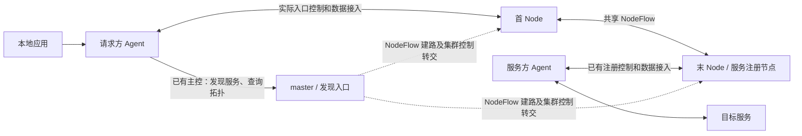
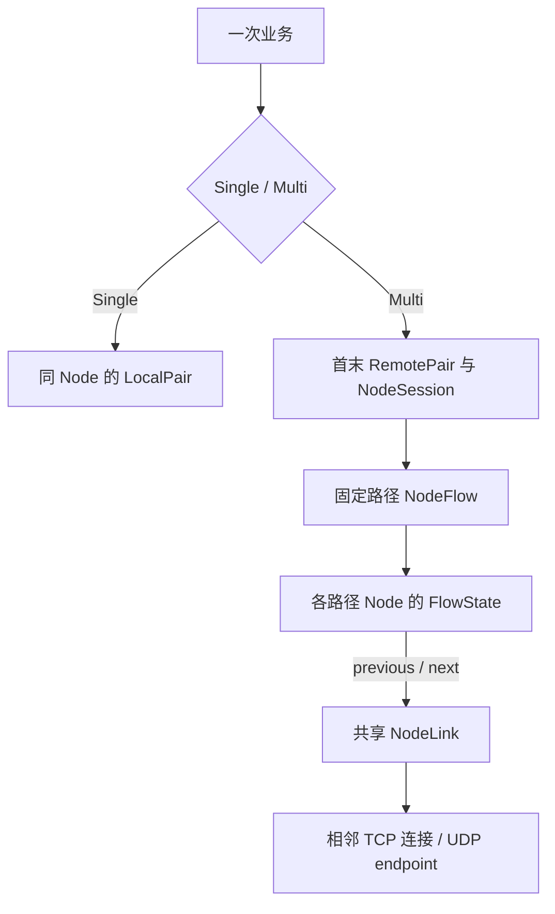

# RelayWeave 系统架构设计

RelayWeave 由 relayweave-node、relayweave-agent、共享 protocol 与 route 模块组成，提供服务注册与发现、
推荐路径和 TCP/TLS/UDP 数据中继。Dashboard 消费节点状态、流量和拓扑；接入 Agent 本地端口的应用属于系统外部。

本文保留系统上下文、通用架构、Agent 设计、路由算法、共享生命周期约束和系统级验证记录。
RelayNode 的部件、业务、协议和资源模型集中见 [RelayNode 设计](RelayNode设计.md#relaynode-设计)。

部署见 [打包与安装](RelayWeave打包与安装.md)、[证书制作与部署](证书制作与部署.md)；FairQueue 的通用接口和
容器实验见 [FairQueue](FairQueue.md)。源码注释与编码约束见 [README](../README.md#c--asio-编码约束)。

Node 的完整设计集中在 [RelayNode 设计](RelayNode设计.md)，按部件结构、控制面、业务流程、数据面、
流控、生命周期、协议和资源验证分章说明。

章节导航：

- [1. 系统上下文与架构约束](#1-系统上下文与架构约束)
  - [1.1 设计目标与系统职责](#11-设计目标与系统职责)
  - [1.2 进程部署与网络拓扑](#12-进程部署与网络拓扑)
  - [1.3 进程角色](#13-进程角色)
  - [1.4 网络接口与监听边界](#14-网络接口与监听边界)
  - [1.5 术语](#15-术语)
  - [1.6 核心不变量](#16-核心不变量)
- [2. 逻辑架构与核心抽象](#2-逻辑架构与核心抽象)
  - [2.1 系统分层](#21-系统分层)
  - [2.2 控制、路由与数据的协作边界](#22-控制路由与数据的协作边界)
  - [2.3 服务、业务实例、Flow 与 NodeLink](#23-服务业务实例flow-与-nodelink)
  - [2.4 关键架构选择与约束](#24-关键架构选择与约束)
  - [2.5 组件职责目录](#25-组件职责目录)
  - [2.6 业务组件协作](RelayNode设计.md#业务组件协作)
- [3. 控制面：身份、服务与业务编排](#3-控制面身份服务与业务编排)
  - [3.1 普通控制会话与本机服务目录](RelayNode设计.md#普通控制会话与本机服务目录)
  - [3.2 集群成员与控制消息路由](RelayNode设计.md#集群成员与控制消息路由)
  - [3.3 Agent 服务发现与入口连接](#33-agent-服务发现与入口连接)
  - [3.4 Node 业务实例与 Single / Multi 首末协调](RelayNode设计.md#node-业务实例与-single--multi-首末协调)
  - [3.5 NodeLinkMgr 全路径安装与授权事务](RelayNode设计.md#nodelinkmgr-全路径安装与授权事务)
  - [3.6 TLSChannel 控制通道保障](#36-tlschannel-控制通道保障)
- [4. 路由面：测量、拓扑与路径决策](#4-路由面测量拓扑与路径决策)
  - [4.1 探测管理与状态所有权](#41-探测管理与状态所有权)
  - [4.2 质量模型与边权](#42-质量模型与边权)
  - [4.3 图算法与 Agent 接口](#43-图算法与-agent-接口)
  - [4.4 拓扑消费与 Dashboard](#44-拓扑消费与-dashboard)
- [5. 数据面：接入、逻辑流与邻接传输](RelayNode设计.md#4-数据面与载荷所有权)
- [6. 运行时架构与系统保障](#6-运行时架构与系统保障)
  - [6.1 执行域与跨域协作](#61-执行域与跨域协作)
  - [6.2 对象包含与生命周期原则](#62-对象包含与生命周期原则)
  - [6.3 取消、唤醒与排空](#63-取消唤醒与排空)
  - [6.4 状态索引、计量与准入约束](#64-状态索引计量与准入约束)
  - [6.5 失败收敛与恢复](RelayNode设计.md#失败收敛与恢复)
  - [6.6 认证与安全边界](#66-认证与安全边界)
  - [6.7 Node 链路内存与分配口径](RelayNode设计.md#node-链路内存与分配口径)
  - [6.8 Node 链路协程数量](RelayNode设计.md#node-链路协程数量)
- [7. 端到端业务链路](RelayNode设计.md#3-业务建立转发与收尾)
  - [7.1 多服务、多节点的整体使用示例](#71-多服务多节点的整体使用示例)
  - [7.2 Agent 入口选择、接入与业务生命周期](#72-agent-入口选择接入与业务生命周期)
  - [7.3 单节点业务建立与数据复制](RelayNode设计.md#单节点业务建立与数据复制)
  - [7.4 多节点路径建立与首末接入](RelayNode设计.md#多节点路径建立与首末接入)
  - [7.5 多节点协议数据路径](RelayNode设计.md#多节点协议数据路径)
  - [7.6 建立、转发与收尾的责任边界](RelayNode设计.md#建立转发与收尾的责任边界)
- [8. 配置、启动与停止](#8-配置启动与停止)
  - [8.1 部署配置模型](#81-部署配置模型)
  - [8.2 进程入口与启动顺序](#82-进程入口与启动顺序)
  - [8.3 协同停止与依赖排空](#83-协同停止与依赖排空)
- [9. 质量验证与架构演进](#9-质量验证与架构演进)
  - [9.1 构建、测试入口与覆盖范围](#91-构建测试入口与覆盖范围)
  - [9.2 冗余审查与测试边界](#92-冗余审查与测试边界)
  - [9.3 已知限制与扩展位置](#93-已知限制与扩展位置)
  - [9.4 运行开销与资源约束](RelayNode设计.md#运行开销与资源约束)
  - [9.5 验证范围与测量方法](RelayNode设计.md#验证范围与测量方法)
- [附录 A. 控制协议规范](RelayNode设计.md#7-控制协议规范)
- [附录 B. 模块源码索引](#附录-b-模块源码索引)
- [附录 C. 历史验证记录](#附录-c-历史验证记录)
  - [C.1 原模块整理的验证范围](#c1-原模块整理的验证范围)
  - [C.2 流控重构的阶段验证](#c2-流控重构的阶段验证)
  - [C.3 UDP 接收与数量准入的历史验证](RelayNode设计.md#udp-接收与数量准入的历史验证)
  - [C.4 标准载荷池性能复核](RelayNode设计.md#标准载荷池性能复核)
  - [C.5 普通 TCP 32 KiB 缓冲的历史对照](RelayNode设计.md#普通-tcp-32-kib-缓冲的历史对照)
- [附录 D. Node 链路常量与复现](RelayNode设计.md#node-链路常量与复现)

## 1. 系统上下文与架构约束

### 1.1 设计目标与系统职责

系统把位于 NAT、防火墙或内网后的服务暴露给另一个客户端使用。服务提供方和服务使用方都主动连接公共服务器，不要求任一客户端接受公网入站连接。

以远程 SSH 为例：

1. 提供方客户端把本机 `127.0.0.1:22` 注册为 `home-ssh`；
2. 使用方客户端在本机监听 `127.0.0.1:2222`，并把该端口绑定到 `home-ssh`；
3. 用户执行 `ssh -p 2222 user@127.0.0.1`；
4. 使用方请求服务所在的服务器创建 Relay；
5. 提供方连接本地 SSH 服务，双方再分别连接该服务器的数据端口；
6. 服务器配对两条数据连接并双向转发。

同一个 RelayAgent 可以同时配置 `services` 和 `forwards`，既提供本地服务，也使用其他客户端提供的服务。一个 RelayAgent 还可以同时使用分布在多个 RelayNode 上的服务。

服务发现返回服务所在节点。控制面处理 Relay 建立、接入凭据和业务状态，数据面配对连接并转发业务数据。

集群控制只交换注册查询、拓扑和建路消息。单节点在本机转发；多节点通过已有共享 NodeLink / NodeFlow 传输业务数据。

### 1.2 进程部署与网络拓扑



单节点路径的首末为同一个 Node，双方数据在该 Node 内配对；多节点分别接入首末 Node。
主控只发现位置、执行既有 Flow 建路和转交集群消息，不保存首末业务协调状态。
如果 master 自身被选为首/末 Node，其本地实例按普通 Node 的职责处理业务。

### 1.3 进程角色

| 角色 | 主要职责 | 主动连接方向 |
|---|---|---|
| RelayNode master | 接受普通客户端；接受 slave；路由集群消息；承载本机 Relay | 不主动连接 slave |
| RelayNode slave | 接受普通客户端；承载本机 Relay；连接 master 参与集群 | 主动连接 master |
| RelayAgent | 注册本地服务；建立本地监听；发现服务节点；连接一个或多个服务器 | 主动连接服务器 |

master 负责集群消息路由且不保存全局服务目录，同时也可以像任意 slave 一样承载普通客户端和 Relay。

### 1.4 网络接口与监听边界

每个 RelayNode 配置普通 Agent 控制/数据端口和两个 Node 共享数据端口；master 额外监听集群控制端口：

| 配置 | 传输 | 用途 |
|---|---|---|
| `control.port` | TCP + mTLS | 普通 RelayAgent 控制连接 |
| `tcp.port` | TCP | 明文流式 Relay 数据 |
| `tls.port` | TCP + mTLS | 加密流式 Relay 数据 |
| `udp.port` | UDP | UDP Relay 数据 |
| `cluster.control_port` | TCP + mTLS | master 监听 slave；slave 用它连接 master |
| `cluster.tcp_port` | TCP 明文 | Node 间共享、双向、分帧的数据连接 |
| `cluster.udp_port` | UDP 明文 | Node 间固定 socket 的共享数据报通道 |

三个 cluster 端口均必填，不再接受旧 `cluster.port`。master 的 `cluster.control_port` 与本节点其他 TCP 监听端口不同；slave 不监听集群控制端口。所有 Node 的 `cluster.tcp_port/udp_port` 必须一致，分别沿用 `tcp.address/udp.address` bind，对端地址来自 `topology.members`。TCP 与 UDP 可以使用相同数字端口。防火墙应允许 Agent 访问可能的首末 Node 控制口及数据口，并允许 Node 间共享数据端口；实际接入在选路后确定。

### 1.5 术语

| 术语 | 含义 |
|---|---|
| Node / RelayNode | 公共中继节点；按集群职责分为 master 和 slave |
| Agent / RelayAgent | 部署在业务端的客户端进程，可同时承担 Producer 和 Consumer 职责 |
| Producer | 注册 `service` 并连接本地目标的一侧 |
| Consumer | 配置 `forward`、接受本地流量并发起 `relay.open` 的一侧 |
| 普通控制会话 | 通过 RelayNode `control.port` 建立的 mTLS 会话，与节点间 ClusterSession 区分 |
| Stream Relay | `tcp` 或 `tls` 字节流中继 |
| Datagram Relay | `udp` 数据报中继 |
| 推荐路径 | 按质量成本计算的真实 Node 序列；新业务提交最佳路径，单 Node 或无可用路径走单节点回退 |

### 1.6 核心不变量

系统保持以下不变量：

1. 服务注册绑定控制会话；会话断开时注销服务并取消关联业务。
2. NodeSession 是 Node 本地业务实例。Single 管理本地双方，Multi 首末各有一个实例，关联同一 NodeFlow。
3. 服务发现保存目的节点位置，选路后才连接实际入口；多跳请求方无需连接尾 Node。
4. 业务持有共享入口连接。附加连接无业务引用满 60 秒后停止，连接池保留对象直到后台任务退出；primary 始终保留。
5. send 提交消息，opened/offer/ready 等响应推进业务状态。
6. ClusterRoom 传递控制消息，多跳数据通过共享 NodeFlow 转发；master 不保存统一业务表。
7. 每个执行域串行拥有本域状态。跨域通过 post/co_spawn 传递副本并等待数据操作。
8. 实例拥有业务任务及 Flow 监视。停止时先取消并排空业务，再停止 NodeLinkMgr，最后释放资源。

## 2. 逻辑架构与核心抽象

### 2.1 系统分层

RelayAgent 根据服务位置和路由结果确定业务入口，AgentSession 与 NodeSession 协调接入和业务状态。
NodeLinkMgr 安装相邻 Link 与完整 Flow 路径，FlowProtocol 和本地数据 manager 执行转发，LnkChannel 完成邻接 I/O。

| 职责分组 | 职责 | 主要组件 | 输出 |
|---|---|---|---|
| 服务与路径决策 | 服务定位、入口选择和路径计算 | RegistryMgr、AgentControl、Topology、AgentRouting、route | 服务位置、Node 序列、epoch |
| 业务与路径编排 | 业务授权、建立、激活与关闭 | AgentSession、NodeSession、Single/Multi、NodeLinkMgr | 接入票据、本地数据句柄、LinkSpec/FlowSpec |
| 数据接入与逻辑流 | 本地配对、端点交接、方向与信用管理 | StreamPipeline、DatagramMgr、FlowProtocol、FlowStream/FlowDatagram | 已接手的池载荷、DATA/FIN、待发送的邻接帧 |
| 邻接传输与通道 | 接入认证、顺序收发与连接存活检测 | LnkChannel、NodeLink、TLSChannel、XfrChannel | 实际 I/O 完成、协议事件、业务 EOF 或错误 |
| 通用支撑 | 编解码、存储复用、限速与状态索引 | message、PooledBuffer、标准同步池、TokenBucket、DualIndexMap | 值对象、存储所有权和有界资源操作 |

Multi 通过 Flow 连接首末数据端点。Single 由数据 manager 在本 Node 配对，直接通过 XfrChannel 或 UDP 路由完成传输。
TLSChannel 承载普通控制和集群控制，XfrChannel 承载 Agent 及 Node 的数据复制；两者为不同上层提供通道能力。

### 2.2 控制、路由与数据的协作边界

| 子系统 | 输入与状态 | 输出 | 与其他子系统的交界 |
|---|---|---|---|
| 控制面 | 已认证会话、服务注册、业务请求、路径事务 | 服务位置、接入票据、已提交 Flow、ready/close | 把确定的身份和资源描述交给数据面，接收实际关闭事件 |
| 路由面 | 成员、实测质量、可用带宽、拓扑快照及缓存 | 新业务的入口和固定 Node 路径 | AgentSession 在建立前使用选择结果，NodeLinkMgr 验证并安装路径 |
| 数据面 | 已授权接入、LocalPair/RemotePair、邻接身份及逻辑流 | 按原路径传递的数据、写完成、EOF、丢包或失败 | 本地端口交接载荷，ProtocolEvent 报告 Link/Flow 状态 |

AgentSession 根据服务位置选择入口和路径，NodeLinkMgr 完成 Flow 安装，首末 NodeSession 完成接入、绑定和激活后发送 ready。
Agent 收到 ready 后启动业务复制；数据面校验已授权的 Link、Flow 和端点身份。
已建立业务保持提交路径；路由更新只影响后续新业务。执行域、跨域交接和停止顺序见[运行时架构与系统保障](#6-运行时架构与系统保障)、[配置、启动与停止](#8-配置启动与停止)。

### 2.3 服务、业务实例、Flow 与 NodeLink

| 概念 | 身份与范围 | 资源及生命周期 |
|---|---|---|
| Service | 本 Node 内的 service / protocol | 注册控制会话拥有；断线注销，发现返回所在 Node |
| AgentSession / NodeSession | 一次业务接入及 Node 本地实例 | 管理接入、ready、复制和收尾；Multi 的首末各有一个 NodeSession |
| LocalPair / RemotePair | Node 内的 uuid、role 与 ticket | manager 拥有本地数据资源；Single 配对双方，Multi 桥接一个本地 Agent 和 Flow |
| NodeFlow | epoch + flow_id，覆盖提交的固定路径 | 每个路径 Node 保存本地 FlowState；首末绑定端点，中间只转发 |
| NodeLink | Link ID、epoch、相邻 Node 对与 transport | 相邻物理通道被多条 Flow 共享；通道失败影响依赖它的 Flow |



一个 NodeLink 可以承载多条不同目的路径上的 Flow。Flow 控制自己的方向和窗口；Link 管理物理收发与存活。
服务状态和 Agent socket 保留在首末业务层，中间节点只保存转发所需的 Flow 与邻接状态。
TLS 业务在 Agent↔Node 接入段使用 TLS，在 Node 间使用 TCP Flow；详细加密与信任边界见 [认证与安全边界](#66-认证与安全边界)、[多节点 TLS 的加密边界与复制](RelayNode设计.md#多节点-tls-的加密边界与复制)。

### 2.4 关键架构选择与约束

| 架构决策 | 实现 | 约束 | 详细设计 |
|---|---|---|---|
| 服务注册归属本 Node 的控制会话 | 服务生命周期由实际连接和本机注册表表达 | 集群没有全局服务目录；跨节点发现关联当前请求，采用第一个有效响应 | [普通控制会话与本机服务目录](RelayNode设计.md#普通控制会话与本机服务目录)、[服务发现流程](RelayNode设计.md#服务发现流程) |
| master 负责控制协调，数据沿提交路径转发 | 服务发现、路径安装与实际业务入口分别承担职责 | master 自身在路径上时才转发数据；当前没有选举与备用 master | [进程部署与网络拓扑](#12-进程部署与网络拓扑)、[NodeLinkMgr 全路径安装与授权事务](RelayNode设计.md#nodelinkmgr-全路径安装与授权事务)、[故障场景与恢复行为](RelayNode设计.md#故障场景与恢复行为) |
| Single 本地配对，Multi 首末会话加共享 Flow | 共用业务接入规则，并复用相邻 Node 通道 | 中间节点只拥有流和邻接状态；首末排空后才释放业务 Flow | [Node 业务实例与 Single / Multi 首末协调](RelayNode设计.md#node-业务实例与-single--multi-首末协调)、[FlowProtocol、端点与本地逻辑流状态](RelayNode设计.md#flowprotocol端点与本地逻辑流状态)、[建立、转发与收尾的责任边界](RelayNode设计.md#建立转发与收尾的责任边界) |
| TCP 逐跳信用，UDP 有界队列丢包 | 按协议提供消费背压或报文准入 | 固定窗口约束单 Flow 的吞吐；UDP 不提供信用、重传和消费确认 | [共享数据面容量与逐跳信用](RelayNode设计.md#5-逐跳信用流控与容量)、[数据热路径与载荷所有权转移](RelayNode设计.md#数据热路径与载荷所有权转移) |
| 控制提交与业务确认分开 | 每次状态推进都有对应的响应与身份验证 | 本地发送成功不能证明远端处理；队列溢出关闭通道，没有可靠消息补发 | [TLSChannel 控制通道保障](#36-tlschannel-控制通道保障)、[容量与超时配置](RelayNode设计.md#容量与超时配置)、[控制协议规范](RelayNode设计.md#7-控制协议规范) |
| 状态归执行域，资源归明确所有者 | 串行更新状态，跨域转移拥有载荷，结构化等待异步任务 | 借用者先排空，所有者后销毁；同步操作与真实异步等待保持各自完成语义 | [执行域与跨域协作](#61-执行域与跨域协作)～[取消、唤醒与排空](#63-取消唤醒与排空)、[协同停止与依赖排空](#83-协同停止与依赖排空) |
| 新业务选路，活动业务保持路径 | 固定方向、邻接和帧顺序贯穿整个业务 | 当前不迁移活动连接或自动切换备用路径；扩展需定义旧数据排空语义 | [图算法与 Agent 接口](#43-图算法与-agent-接口)、[服务发现、选路与入口连接](#721-服务发现选路与入口连接)、[已知限制与扩展位置](#93-已知限制与扩展位置) |

### 2.5 组件职责目录

#### 2.5.1 Node 的控制、业务和数据部件

详细设计见 [Node 的控制、业务和数据部件](RelayNode设计.md#node-的控制业务和数据部件)。

#### 2.5.2 Agent 与通用支撑部件

以下部件给出 Node 的外部协作者和共享库边界；Agent 的连接池与本地应用生命周期仍按 [Agent 服务发现与入口连接](#33-agent-服务发现与入口连接)、[Agent 入口选择、接入与业务生命周期](#72-agent-入口选择接入与业务生命周期) 描述。

| 模块 | 所属进程或库 | 状态所有者 | 职责与主要流程 |
|---|---|---|---|
| `RelayAgent` | relayweave-agent | `control_io` | 组合根、配置、跨域入口与整体启动停止 |
| `AgentControl` | relayweave-agent | `control_io` | 服务注册/发现、入口等待、控制消息分派与维护循环 |
| `NodeConnectionMgr` | RelayAgent 的直接成员 | `control_io` | primary/附加连接池、身份索引、复用、空闲回收和任务排空 |
| `NodeConnection` | relayweave-agent | `control_io` | 单节点解析、连接、mTLS、识别、接收和指数退避重连 |
| `Forwarder` / `AgentSession` | relayweave-agent | `transfer_io` | Forwarder 管理本地监听和实例；AgentSession 拥有单次接入、ready 等待和业务复制 |
| `AgentRouting` | relayweave-agent | `control_io` | 探测入口与服务节点、组装拓扑、计算推荐路径并保存目的 Node 缓存 |
| `ProbeSet` / `ICMP` | route | 所属进程的 `control_io` | DNS、IPv4 去重、原始 socket 探测、历史保留和关闭 |
| `LinkQuality` / `RouteGraph` | route | 调用方 executor | 固定内存质量统计、纯边权计算和多入口最短路径 |
| `TLSChannel` | protocol | 创建它的 executor | mTLS 握手、帧收发、bounded queue、心跳和统一关闭 |
| `WireMessage` / `CtrlMessage` / `MessageReceiver` | protocol | 值对象 / 每 TCP 连接组装状态 | 长度帧、CBOR 控制消息、透明拆分与顺序重组 |
| `RelayAttach` / `DatagramHeader` | protocol | 无状态值对象 | 数据连接角色凭据和 UDP session header 编解码 |
| `DualIndexMap` | protocol | 使用者 executor | 维护一份值及主、次两条索引 |
| `RelayIdAllocator` / `ServiceTraffic` / `TokenBucket` | node/protocol | manager 或原子计数器 | Relay 标识、方向流量与令牌桶限速 |

### 2.6 业务组件协作

<a id="261-relaynode-的包含关系与借用关系"></a>
<a id="262-一次业务在各-node-上的组成"></a>
<a id="263-接入描述与身份的使用范围"></a>

详细设计见 [业务组件协作](RelayNode设计.md#业务组件协作)。

## 3. 控制面：身份、服务与业务编排

控制面从已认证的会话产生服务目录和业务授权，再协调业务实例与固定路径的建立。
消息字段与响应关联规则完整列于[控制协议规范](RelayNode设计.md#7-控制协议规范)，实际数据交接见[数据面：接入、逻辑流与邻接传输](RelayNode设计.md#4-数据面与载荷所有权)。

### 3.1 普通控制会话与本机服务目录

<a id="311-普通控制连接的接入与退出"></a>
<a id="312-服务条目注册与断线注销"></a>

详细设计见 [普通控制会话与本机服务目录](RelayNode设计.md#普通控制会话与本机服务目录)。

### 3.2 集群成员与控制消息路由

<a id="321-clusterroom-成员与消息分发模型"></a>
<a id="322-成员加入与消息路由"></a>
<a id="323-clustermgrconnector-重连"></a>
<a id="324-master-accept_loop-的结构化并发"></a>
<a id="325-clustersession-生命周期"></a>
<a id="326-广播与定向交付"></a>
<a id="327-clustermgr-与-relaynode-接口"></a>

详细设计见 [集群成员与控制消息路由](RelayNode设计.md#集群成员与控制消息路由)。

### 3.3 Agent 服务发现与入口连接

AgentControl 保存服务位置，NodeConnectionMgr 管理共享控制连接；业务选定路径后取得实际入口连接，连接引用随业务排空后释放。

#### 3.3.1 RelayAgent 状态与职责

详细设计见 [primary 与服务位置](RelayAgent设计.md#primary-与服务位置)。

#### 3.3.2 服务发现流程

详细设计见 [服务发现流程](RelayNode设计.md#服务发现流程)。

#### 3.3.3 集群状态查询

详细设计见 [集群状态查询](RelayNode设计.md#集群状态查询)。

#### 3.3.4 节点地址发布

详细设计见 [节点地址发布](RelayNode设计.md#节点地址发布)。

#### 3.3.5 NodeConnection 连接池

详细设计见 [NodeConnection 连接池](RelayAgent设计.md#nodeconnection-连接池)。

#### 3.3.6 路由失效与重新发现

详细设计见 [路由失效与重新发现](RelayAgent设计.md#路由失效与重新发现)。

#### 3.3.7 Node 的查询处理与观测旁路

详细设计见 [Node 的查询处理与观测旁路](RelayNode设计.md#node-的查询处理与观测旁路)。

### 3.4 Node 业务实例与 Single / Multi 首末协调

<a id="341-普通控制与集群消息的入口分派"></a>
<a id="342-创建容量与任务所有权"></a>
<a id="343-已有业务的匹配重复消息与断线"></a>
<a id="344-控制器进度与协商事件"></a>

详细设计见 [Node 业务实例与 Single / Multi 首末协调](RelayNode设计.md#node-业务实例与-single--multi-首末协调)。

### 3.5 NodeLinkMgr 全路径安装与授权事务

<a id="351-协调者本地授权与数据状态"></a>
<a id="352-相邻-nodelink-的合并授权与复用"></a>
<a id="353-全路径-flow-的准备与提交"></a>
<a id="354-失败回滚主动释放与失效通知"></a>

详细设计见 [NodeLinkMgr 全路径安装与授权事务](RelayNode设计.md#nodelinkmgr-全路径安装与授权事务)。

### 3.6 TLSChannel 控制通道保障

普通控制连接和集群连接都复用 TLSChannel。它把一条 TLS stream 封装成有边界、带心跳、单写队列的消息通道，状态依次为：

```text
Created -> Handshaking -> Connected -> Closing -> Closed
```

`start()` 只允许调用一次。客户端在握手前设置 peer verification、实际连接地址的主机名验证和可选 SNI；服务端要求对端提供可信证书。握手受 `channel.handshake_timeout_ms` 限制。成功后，TLSChannel 启动一个自管理的后台 `run()`，然后 `start()` 返回。

后台 `run()` 用一个 parallel group 同时等待三个长期协程及一个关闭接收操作：

- `rloop`：唯一的 TLS 读取者，读取 4 字节长度和完整 CBOR payload；
- `wloop`：唯一的 TLS 写入者，从 bounded channel 取出完整 frame 并顺序写入；
- `keepalive`：定时发 `ping`，并检查最后一次完整入站 frame 的截止时间；
- close_channel 的原生异步接收操作：等待显式断开请求，不另开包装协程。

任一分支结束会让整个通道进入关闭流程。TLS shutdown 最多等待 `disconnect_timeout_ms`，随后关闭底层 socket、发送和接收 channel，并将状态置为 Closed。

`ping/pong` 在 TLSChannel 内部消费，不进入业务接收队列。其他消息进入 bounded receive channel；接收方长期不消费导致队列满时，TLSChannel 关闭连接，接收队列的内存占用保持在配置上限内。

`send(CtrlMessage)` 可从其他 executor 调用，它先 `post` 到 TLSChannel 自己的 executor，再编码并尝试进入写队列。编码失败或写队列拒绝 frame 时，通道立即进入统一关闭流程；外层接收循环随后清理 session、服务和 Relay，Agent/cluster connector 按原有策略重连。通道已在关闭时的后续 `send()` 不再入队。`send()` 是提交接口，不表示远端已处理消息。

`async_receive()` 先切回通道 executor。未指定 timeout 时直接等待 receive channel；传入有限 timeout 时使用 `cancel_after`。
握手后的 `cluster.join`、`server.identified` 等状态转换设有截止时间。

## 4. 路由面：测量、拓扑与路径决策

Node 和 Agent 共用 route 模块。Node 探测其他成员并上报质量；Agent 测量本地接入成本，合并集群有向边，
计算到服务注册 Node 的最佳路径。AgentSession 建立 TCP/TLS/UDP 新实例时使用最佳路径选择入口，
多节点提交路径和当前 epoch，由首 Node 使用已有 NodeLinkMgr 建立 NodeFlow；单节点或无路径使用服务位置回退。

NodeLinkMgr 安装选定路径，见 [NodeLinkMgr 全路径安装与授权事务](RelayNode设计.md#nodelinkmgr-全路径安装与授权事务)；AgentSession 取得实际业务入口，见 [Agent 入口选择、接入与业务生命周期](#72-agent-入口选择接入与业务生命周期)。

### 4.1 探测管理与状态所有权

```text
Node 成员 / Agent 配置入口、服务发现与拓扑
  → ProbeSet：DNS、IPv4 去重、身份映射与历史管理
  → ICMP / LinkQuality：探测完成样本与三尺度统计
  → Node 报告 → master 拓扑汇总
  → Agent：筛选远端边，合并本地接入成本
  → AgentRouting 内部计算：共用路由图，逐入口搜索，只汇集当前目的 Node 的候选并排序
```

`ProbeSet` 直接拥有 DNS resolver、IP 到 Node ID 的映射、ICMP 实例和重建历史。先解析完整目标集合，
再决定是否重建；IP 集合未变且探测器正常时，只更新身份映射。多个身份指向相同 IPv4 时共用一次探测。
部分 DNS 失败在下一次五秒轮询重试，不中断正常目标；等待期间目标变化时丢弃旧 revision 的解析结果。
删除或改变地址的身份立即隐藏旧测量，其他目标保持可读；重建时仅为未变 IP 保留内存历史，新 IP 从空历史开始。

`LinkQuality` 内部的 `Ema` 保存衰减累计量；`Summary` 只包含 `{cost, confidence, usable}`。
`assess(now)` 返回 `Assessment`，显式包含 quality 摘要、三尺度指标 `scales`、完成/成功计数及
`last_success_age`。`ICMP::Metrics` 使用 IP 身份，`ProbeSet::Metric` 使用 Node ID，二者携带相同的评估结果。
`ICMP::ProbeState` 保存质量统计和真实发送计数；`Session` 另拥有定时器、序列号及在途状态。
取消后的发送仍计入 transmitted，但不计入完成样本或丢包，重建不会用完成数替代发送数。

可变状态留在现有单线程 `control_io`，不新增线程、strand 或 PImpl。跨执行器异步入口使用 C++20
`co_spawn` 在所属执行器运行；调用路径可控的内部协程通过注释约束执行器并直接 `co_await`。
`stop()` 取消解析并阻止新工作，`close()` 等待刷新及全部 ICMP 协程退出，支持重复、并发关闭及调用方取消；
拥有者必须在销毁前等待关闭完成。

### 4.2 质量模型与边权

ICMP 每秒探测一次，超时 800 ms。完成样本按实际间隔衰减；只保存固定数量的聚合量，不保存样本队列。
三个尺度的半衰期为 30 秒、5 分钟、30 分钟，权重为 0.15、0.35、0.50。统计 RTT 均值、相邻成功
RTT 差绝对值的均值作为抖动、RTT 标准差及丢包率。失败样本计入完成数和丢包统计，不参与 RTT 与抖动统计；失败后不跨失败样本计算
抖动，相邻成功样本间隔达到 30 秒也不计入抖动。各尺度基础成本为：

`scale_cost = RTT + 0.5 × 抖动 + 0.25 × 标准差 − 400 × ln(1 − 丢包率)`

RTT、抖动和标准差使用毫秒，丢包率使用 0–1 的比例，`ln` 为自然对数。丢包率是各尺度衰减后的
`1 − 成功样本权重 / 完成样本权重`。丢包惩罚系数由 `LinkQuality::LOSS_PENALTY` 定义为 400，
相同丢包率的惩罚为原系数 200 时的两倍，且随丢包率增加而加速增长：

| 丢包率 | 该尺度增加的成本 |
|---|---:|
| 1% | 4.02 |
| 5% | 20.52 |
| 10% | 42.14 |
| 20% | 89.26 |
| 30% | 142.67 |

对有成功证据且丢包率小于 100% 的尺度，按其权重归一化得到摘要中的基础成本：

`quality.cost = Σ(weight × scale_cost) / Σ(weight)`

没有抖动样本时抖动项为 0；没有成功证据的尺度不参与加权。成本越低越好，没有固定上限或优良等级，
是以毫秒为基准的比较值，不能当作业务实际 RTT。例如三个尺度都稳定在 RTT 80 ms、无抖动和丢包时，
基础成本为 80；相同 RTT 且各尺度均为 10% 丢包时，基础成本约为 122.14。

信心由时间覆盖和有效证据共同约束：`confidence = min(clamp(覆盖秒数 / 1800, 0, 1),
min(1, 长尺度有效完成样本权重 / evidence_target))`，其中 `evidence_target = 0.8 × 0.5 × 1800 / ln(2)`，
约为 1039；覆盖时间为首末完成样本的间隔，有效样本权重包含截至评估时刻的衰减。
连续 30 分钟没有完成样本后重新积累统计和信心。下列任一条件
使链路不可选路：连续失败达到 5 次、短尺度丢包率达到 50%、最后成功达到 45 秒、最后完成样本达到 15 秒。
没有成功证据时 `cost=null`、`usable=false`。ICMP 反映主机往返质量，不测量业务端口、带宽或单向时延。

纯函数 `routing_cost(quality, age)` 对基础质量成本应用新鲜度及冷启动惩罚：

`quality_cost = quality.cost × freshness + 5 × (1 − confidence)`

`age` 为最后成功测量的年龄；消费远端摘要时还要累加快照经过时间。25 秒内 `freshness = 1`；
25–45 秒为 `1 + 0.5 × ((age_seconds − 25) / 20)²`。信心为 1 时无额外成本，为 0 时增加 5。
45 秒起或摘要不可用时无边权。`RouteGraph` 只接收最终非负成本。

### 4.3 图算法与 Agent 接口

| 类型或接口 | 含义 |
|---|---|
| `RouteGraph::Link {from, to, cost}` | 有向边；过滤非法成本，重复边取最低成本 |
| `RouteGraph::Entry {node, access_cost}` | 真实入口及本地接入成本，不需要虚拟 Agent 节点 |
| `RouteGraph::Path {nodes, cost}` | 真实 Node 序列与总代价 |
| `shortest_paths(entries, max_nodes)` | 一次多入口搜索全部目的地，每个服务终点之前的 Node 增加成本 2 |
| `AgentRouting::select_path(service, destination)` | 返回当前目的 Node 的最佳节点序列；候选计算为私有实现 |

服务候选路径包含 `N` 个真实 Node 时，总代价为：

`path.cost = Agent 到入口的 edge_cost + Σ(Node 间有向边的 edge_cost) + 2 × (N − 1)`

构图时每条边的成本为 `edge_cost = quality_cost + bandwidth_penalty(目标节点)`，Agent 接入边同样处理。
`bandwidth_penalty = 10 × (1 / max(available, 0.05) − 1)`；可用率 100%、50%、20%、≤5% 分别增加 0、10、40、190。
例如 `Agent → A → B → C` 的三条边分别加 A、B、C 的惩罚，搜索后不再额外加分。
Agent 保存 `available` 原值，选路时直接计算公式；缺失/null、报告年龄未知、报告或快照达到 15 秒时惩罚为 0。
非 null 的可用率必须是 0–1 的有限数。现有候选路径缓存和指标更新规则保持不变。

每个终点之前的 Node 增加中继成本 2。单 Node 直达路径包含 Agent 到目的 Node 的接入边成本；
三 Node 路径有一条接入链路、两条 Node 间链路，并额外增加 4。当前质量基于 ICMP，因此服务协议名称
TCP、TLS 或 UDP 不改变上述公式。

shortest_paths 使用按“节点、已用节点数”分层的算法，同成本按完整节点序列排序。节点预算只计算真实
Node；孤立入口仍能给出单 Node 直达路径。后台轮询只维护探测目标和拓扑，不计算服务候选路径，
不维护路径切换状态或独立备用路径。内部候选计算为每个可用入口保留到当前目的 Node 的一条最优路径，
不是同一入口下的全部路径枚举，也不保证候选之间节点或链路不相交。最佳路径缓存由 AgentRouting 拥有。

TCP/TLS 每个本地连接、UDP 每个新业务实例均由 AgentSession 跨到 control_io 调用 select_relay。
AgentRouting::select_path 返回最佳 Node 序列；命中有效 LRU 时直接返回该序列，未命中才计算候选并缓存最佳节点序列。
该函数是 control_io 上的同步计算，不创建协程；入口定位及控制连接等待仍由 select_relay 协程负责。
随后附当前 epoch 并取得实际入口，返回路径、入口 ServerRoute 及共享连接引用。
后台探测不触发业务选路，活动业务也不重新计算或换路；服务发现不提前建立尾 Node 控制连接。

最佳节点序列按目的 Node 缓存 15 秒，LRU 容量 16，TCP/TLS/UDP 共享，无路径时也缓存空结果。
命中只更新次序，不续期；必需探测目标变化、主控制断开或拓扑 epoch 改变时清空。
同 epoch 的指标及普通快照版本变化不直接清空缓存；TTL 到期后的下一次业务使用当前测量重新计算。
有效候选只用于选择最佳路径，不复用之前的接入票据或 Flow。
`cost` 是含质量、新鲜度、冷启动、带宽及中继惩罚的路由成本，不等同于 RTT。
路径为空或仅一个 Node 时按目的服务位置走 Single；多节点首 Node 定位或连接失败结束当前实例，
不在原实例内重新选路或回退。业务实例以服务名、本地 uuid 及 Flow 身份关联。
NodeConnectionMgr 使用 endpoint/node_id 复用入口连接；Forwarder 使用 `ServerRoute::id`（host:port）匹配业务消息和控制失效。

Agent 启动即探测配置入口，身份确认后关联 Node ID，服务发现后加入服务目标。有 forwards 时查询完整
拓扑并比较全部 Node 入口，候选探测不额外建立业务连接。服务 Node 本身可作入口；本地有效直达测量
不依赖远端拓扑。当前不向 Node 上报 Agent 推荐路径，也不迁移活动业务。

### 4.4 拓扑消费与 Dashboard

Node 每五秒上报聚合质量及控制/TCP/UDP 排队延迟，master 汇总成员和有效来源报告，提供不可变完整快照，
不集中保存原始样本。远端边参与选路必须同时满足：

- 拓扑结果年龄小于 15 秒；
- 来源 Node 报告年龄加经过时间小于 15 秒；
- 链路年龄加经过时间小于 45 秒；
- 来源发布的质量摘要 usable。

Agent 和 Dashboard 使用相同规则，以单调时钟的“请求开始时间减服务端 created_age_ms”为保守原点，
将请求和协议组装时间计入年龄。协议层丢弃缺页消息，上层只接受完整快照并保留尚有效的旧结果。
校验 request_id、epoch、版本和业务字段，请求期限为 10 秒，最多 65536 条目、1024 Node。
没有匹配请求身份的非法回复不终止当前请求。Dashboard 还保存最高已接受请求编号，同版本的
完整回复也推进水位，防止迟到回复恢复旧 epoch。断线使当前结果失效，历史记录与 HTTP 游标继续使用墙钟。

Dashboard 页面先展示集群状态和当前 Flow 交通图，再展示所选 Node 的五项精简健康指标及排队/带宽图表，最后展示集群服务。Node 选择器位于健康指标区域，页头只标识采集入口。
交通图展示已 Ready 的 Single 和 Multi 业务，独立于健康指标选择；拓扑采集提供成员、当前排队值和 API 链路质量；API 根据成本生成展示分数
`100 × exp(−cost / 100)`，线协议不发送 score，Python 不重新计算质量模型。
车站圆环显示节点配置带宽占用，圆心显示 `available` 带宽余量；报告过期或断开时显示未知。路线线宽按业务连接数采用固定平方根尺度，车站业务数量按途经路径计数一次，部分采集显示数量下界。详情只显示端点、路径、数量和余量，不展示 UUID、epoch 或 Flow ID。

## 5. 数据面：接入、逻辑流与邻接传输

<a id="51-flowprotocol端点与本地逻辑流状态"></a>
<a id="511-公共边界与实现归属"></a>
<a id="512-本地状态与方向语义"></a>
<a id="513-端点绑定与任务生命周期"></a>
<a id="514-端点接口与邻接交界"></a>
<a id="52-lnkchannel-与共享-nodelink-邻接传输"></a>
<a id="53-node-数据通道二进制帧"></a>
<a id="54-本地数据管理与接入边界"></a>
<a id="541-relayattach-首帧"></a>
<a id="542-datagramheader-与-udp-来源绑定"></a>
<a id="55-tcptls-与-udp-复制机制"></a>
<a id="551-xfrchannel-复制入口"></a>
<a id="552-tcp-pipeline"></a>
<a id="553-tls-pipeline"></a>
<a id="554-udp-datagram"></a>
<a id="56-共享数据面容量与逐跳信用"></a>
<a id="561-设计边界与计费模型"></a>
<a id="562-状态变量准入条件与有界性证明"></a>
<a id="563-从路径安装到完成写入的实际流程"></a>
<a id="564-缓存释放信用合并与控制帧调度"></a>
<a id="565-慢末端的背压恢复与数值示例"></a>
<a id="566-数量准入逐-flow-边界与实际占用"></a>
<a id="567-窗口信用周转时间与性能分析"></a>
<a id="568-失败边界源码定位与验证"></a>
<a id="569-参数研究结论与扫描计数"></a>
<a id="57-数据热路径与载荷所有权转移"></a>
<a id="571-tcptls-的调用链与所有权转移"></a>
<a id="572-udp-的独立路径"></a>
<a id="573-池缓冲与剩余开销"></a>

详细设计见 [数据面：接入、逻辑流与邻接传输](RelayNode设计.md#4-数据面与载荷所有权)、[共享数据面容量与逐跳信用](RelayNode设计.md#5-逐跳信用流控与容量)。

## 6. 运行时架构与系统保障

各执行域串行拥有本域状态，异步任务在所属资源销毁前排空。整体启动与停止次序见[配置、启动与停止](#8-配置启动与停止)。

### 6.1 执行域与跨域协作

执行域规定谁能修改状态；跨域操作交接不可变描述或拥有存储的载荷，并等待真正的异步操作完成。

#### 6.1.1 RelayNode 编排与四个执行域

详细设计见 [RelayNode 编排与四个执行域](RelayNode设计.md#relaynode-编排与四个执行域)。

#### 6.1.2 RelayAgent、Forwarder 与业务资源归属

详细设计见 [资源归属与取消](RelayAgent设计.md#4-资源归属与取消)。

### 6.2 对象包含与生命周期原则

实现遵循以下原则：

1. executor 拥有状态，跨域只投递消息；
2. 只被单个协程使用的资源放在协程帧内；需要 stop、查表或独立异步操作访问的资源由对象拥有；
3. 所有者明确持有资源，观察者使用引用或 weak_ptr；NodeConnection 的连接池与 LnkChannel 的表是实际所有者；
4. `shared_ptr` 只在异步操作确实需要对象存活时按值跨越 `co_await`；
5. session 的退出负责从 room/registry 移除自身，manager 不额外延长其生命周期；
6. 需要对外提供完成语义的 stop 等待结构化协程结束；StreamPipeline 内部 detached 任务则只在执行期间
   自持对象，取消或超时后自然释放，不另建一套任务状态机。

#### 6.2.1 对象所有权关系

| 对象 | 主要所有者 | 对外引用方式 | 结束条件 |
|---|---|---|---|
| RelayNode / RelayAgent | `main()` 的 `shared_ptr` 和必要 completion | 按值跨越顶层异步任务 | stop 完成且线程退出 |
| ClusterMgr | RelayNode 的 `shared_ptr` 成员 | 非拥有的 `RelayNode&` 反向引用 | `async_stop()` 已等待主循环和成员会话退出 |
| NodeControl | RelayNode 的 unique_ptr 成员 | 借用 RegistryMgr、ClusterMgr、Topology、NodeMetrics 和只读业务容器 | 集群停止完成前保持可用，随 Node 销毁 |
| NodeMetrics | RelayNode 的 shared_ptr 成员及在途定时器处理函数 | Topology 和 NodeControl 只读访问 | control 先禁止重新调度，三个执行域分别取消；迟到取消处理只释放自身，不访问已停止的依赖 |
| RegistryMgr | RelayNode 的直接成员 | 会话使用 weak 引用，两类控制入口借用同一注册表 | Registry 停止并清理会话后销毁 |
| ControlRouterSingle | NodeSession 的 variant 成员 | 只推进本地双方业务协调，无全局查表或数据 I/O | 随实例任务排空后销毁 |
| NodeSession / ControlRouterMulti | RelayNode 的唯一业务容器及实例任务；实例直接拥有控制器、接入值描述和取消信号 | 借用 NodeLinkMgr、ClusterMgr 和共享数据 manager | 取消并排空数据任务与 Flow 监视，再释放本地资源及本 Flow；不关闭共享 NodeLink |
| StreamPipeline / DatagramMgr | RelayNode 的 shared_ptr 成员，监听任务按需自持 | NodeSession 跨域操作本地配对或端点，无 Agent 控制引用 | 业务由实例排空，stop 关闭监听和剩余数据资源 |
| NodeLinkMgr / FlowProtocol / LnkChannel | RelayNode 拥有管理器；管理器持有协议服务；服务按值持有邻接传输 | 控制描述按值跨域；数据任务 completion 保留服务 | 停止申请、同步关闭资源，等待服务数据任务及管理器通知任务排空 |
| lnk::NodeLink | LnkChannel 的 connections_ 表及建立/接入父任务 | 同步函数及 TCP 读写子协程借用 NodeLink&，父任务等待组合完成后释放持有者 | close 置 Closed、取消 I/O 并删除表项，父任务排空读写后销毁 |
| lnk::FlowState | FlowProtocol 的 flows_ 表、Stream/Datagram 父任务及 Link 在途帧 | TCP 子协程借用父任务的 const shared_ptr& 和端口引用；帧保留原 Flow 身份 | 关闭队列并删除表项后，父任务等待子协程收尾；retired_ 只保存 ID/期限，不拥有 Flow |
| FlowProtocol::Stream / Datagram | FlowProtocol 按值包含 | 反向借用 FlowProtocol& | 所属父任务排空后随协议服务销毁 |
| std::pmr::synchronized_pool_resource | FlowProtocol、FlowStream/FlowDatagram 及池缓冲 deleter 共享 | 只保活标准同步分配器，支持跨线程分配归还 | 最后一个端口和在途业务缓冲释放后销毁，不依赖协议服务继续存活 |
| TLSChannel | 自己的 run 协程和当前连接协程 | manager/route 使用 `weak_ptr` | 任一读写、心跳、关闭分支结束 |
| ControlSession | 当前 session 协程 | Registry 和 Relay 使用 weak 引用 | 接收循环结束并完成 disconnect |
| ClusterRoom | master accept_loop 协程栈 | ClusterSession 保存引用，且必须先于 room 退出 | accept/delivery 停止并等待 participant 清空 |
| ClusterMgr::Connector | slave_loop 协程栈 | ClusterMgr 仅存停止用临时指针 | running=false 且当前操作取消 |
| NodeConnection | NodeConnectionMgr::connections_ 强持有；primary 始终保留 | EntryWait / 请求方 AgentSession 保存同一普通 shared_ptr，后台 run 只借用 | 附加连接连续空闲 60 秒或 Agent stop 时停止，run 完成后移出池，最后引用释放时销毁 |
| NodeConnection Operations | NodeConnection 的 `optional` 成员在 run 期间原位拥有 | stop 直接访问同 executor 上的拥有型状态 | 连接循环退出时 scope guard 清空 |
| Topology / AgentRouting | RelayNode / RelayAgent 直接拥有 | 同一 control executor 内调用 | close 已排空刷新与探测任务 |
| ProbeSet / ICMP Session | Topology 或 AgentRouting / ProbeSet 中的 ICMP 实例 | 按值读取评估结果；历史只复制 ProbeState | close 等待 DNS、探测和接收协程退出 |
| Node 本地配对 / 端点 | 对应数据 manager 的表及运行数据协程 | NodeSession 按值保存 AttachInfo/AttachPair 接入描述，以 uuid 操作资源；数据侧无控制会话引用 | 控制器排空数据任务后 close，或 manager stop |
| AgentSession | Forwarder::relays_、运行协程与 UDP forward 的当前强引用；UDP 发送期间临时保活 | 反向引用 Forwarder、可选 forward ID；请求方持有入口连接共享句柄 | 建立失败、数据结束、控制失效或 stop，清理后释放入口句柄并解除 forward 的强引用 |
| Forwarder DatagramForward | datagram_forwards_ 按值拥有 | 稳定 ID 定位；本地来源、当前会话强引用和重试归 forward | 当前会话引用由会话清理解除；forward 在 Forwarder 销毁时释放 |

ClusterMgr::Connector 仍使用同一 executor 上的非拥有临时指针执行取消，并在栈对象退出前清空；
NodeConnection 直接拥有运行期 Operations；连接循环退出时销毁该状态。

Node 的控制协程持有 ControlSession，断开时按 session ID 删除注册记录和对应服务；启动协程失败时也按 ID 回滚。
RegistryMgr 不在接入或删除时扫描全部 weak 引用。数据 manager 关闭配对或端点时先从表中移除，
再通知仍持有该对象的等待者；表内同步操作只需验证接入或激活条件，跨异步等待的代码仍检查关闭状态。
NodeSession 的 install/close、Single bind_and_activate 和 Multi activate 通过 co_spawn 在所属数据 executor 执行同步操作并返回结果；
Multi bind 明确跨到协议数据域，完成同步端点绑定后返回。wait_attach 和 bridge 保留真正等待的 co_spawn，
接入截止时间直接附加在数据侧等待上。
FlowProtocol 的控制通知使用绑定 control_io 的 concurrent_channel，数据侧直接发送、控制侧直接等待，由 Asio 处理线程安全、取消及完成调度，不逐通知 co_spawn；队列超限用原子标记传递，receive_event 仅保活、等待并检查错误。
TLSChannel 的 disconnect 只请求关闭，连接所有者在原有运行协程中等待排空；关闭信号直接参与并行等待，
不单独启动等待关闭信号的协程。ProbeSet/ICMP 内部已绑定执行器的协程不再重复 dispatch。
Node 同步 stop 通过 post
投递数据 manager 的同步关闭，并使用 future.get() 等待结果，再等待尚未完成的 TCP/TLS 接入任务，
无需为同步关闭启动协程，也无需先对同一个 future 调用 wait()。

### 6.3 取消、唤醒与排空

AgentSession 使用 reason 与自己的 I/O 关闭表达中止；没有业务取消信号。入口等待由 control_io 的
EntryWait、连接和期限管理。changed timer 用于状态变化时唤醒等待者。
EntryWait 由 entry_waits_ 按值持有，select_relay 借用稳定的表项，scope guard 删除表项并释放其入口连接引用；已就绪的连接不创建 EntryWait。

NodeSession 的 Single/Multi cancel 会发送真实 cancellation_signal，打断正在等待的 attach、桥接或并行子任务。
Single/Multi 用 stop_requested_ 记录停止请求或进入收尾，取消信号负责唤醒异步等待；任务入口及 Agent/peer 通知前检查停止状态。
控制会话拥有者在释放连接前取消关联业务，Single 的 run 不重复检查双方 weak 引用是否过期；读取 Consumer 的 peer 时仍 lock 并判空，绑定前由 co_await 检查取消。
Multi 的 Flow 监视在确认 Flow 关闭后记录停止状态及原因并返回，由 parallel group 的 wait_for_one 取消并排空另一个子任务；监视等待本身的异常仍向上传递。
Flow 建立和 Agent 接入使用同一绝对截止时间。等待 peer 的循环保留超时退出判断，激活后、发送 ready 前再检查是否超过建立期限。
控制器只在 run 的统一清理入口屏蔽一次取消，保证跨域执行的
资源关闭和 Flow 清理仍能完成；不在每个内部函数重复 reset_cancellation_state。
FlowProtocol::stop 通过同步 request_stop 标记 stopping、关闭 Flow 队列及邻接 socket、取消事件和 monitor，
再等待并发组与所属动态任务退出；协议通道不能在排空前销毁，池由端口和在途缓冲独立保活。
关闭后的迟到 written 或端点完成不再授信，
端点 RESET/close 校验具体实例；旧端点操作不影响复用 ID 的新 Flow。

AsyncEvent 用于一次性的多等待者完成通知，提前 notify 不丢失，单个等待者取消不取消整个对象。
可重复变化的 changed/done timer 与一次性完成事件职责不同；不把所有 timer 都替换成同一种队列。
concurrent_channel 用于跨执行器控制通知和 stream/datagram 端点交接，普通 channel 用于数据域内部帧队列和空间通知。
这些机制分别满足状态唤醒、广播完成和有界消息传输，不增加应用层回调注册或额外包装协程。

NodeConnection 在解析、连接、TLS、节点识别恢复时检查 running。停止后的恢复统一进入连接收尾，
清除弱通道引用并等待 TLSChannel::async_disconnect 后才让任务完成；不能直接 break 绕过通道排空。
后台 run 只借用连接，连接池必须持有它直到 completion，随后移除表项；这是池强所有权的实际用途。

<a id="631-协程启动与保留理由"></a>

#### 6.3.1 协程启动与排空

| 协程链 | 启动频率 | 运行职责与完成边界 |
|---|---|---|
| AgentControl discovery / NodeConnection | 每个 Agent / 每个实际入口连接一次 | 发现和连接接收/重连分别由 AgentControl、NodeConnectionMgr 排空 |
| Forwarder listener / retry / AgentSession | 每个监听 / 每次建立失败 / 每次业务 | listener 长期运行，retry 独立退避，Session 独占业务 I/O |
| AgentSession select_relay | 每个新业务一次 | 跨到控制域访问拓扑、位置和共享连接，完成后回到 transfer_io |
| RelayNode control accept / ControlSession | 每个 Node / 每条控制连接一次 | 接入和独立会话生命周期 |
| StreamPipeline accept / setup | 每个 TCP/TLS 监听 / 每个接入 socket 一次 | setup 做 TLS 和 attach，之后 stream 移交配对，不另启复制任务 |
| NodeSession run / 数据操作 | 每次业务 / 建立、复制和关闭阶段 | 数据操作统一通过 co_spawn 跨域执行，控制任务等待完成并排空；同步操作使用短协程 |
| Multi 建立转发 + Flow 监视 | 每个多节点首末实例一组 | 业务和 Flow 失效并行，任一退出后排空另一任务 |
| RemotePair 双向循环 | 每个业务启动一次 | 持续读取、限速和 socket 写入，顺序等待 Flow 接口 |
| FlowProtocol stream 端点任务 | 每次绑定启动发送、接收各一次 | native channel 跨域交接；接收任务串行等待写完成并归还信用 |
| FlowProtocol datagram 发送任务 | 每次绑定启动一次 | 取有界通道中的包，输出不足直接丢；终点接收无需数据协程 |
| NodeLinkMgr receive_events | 每个 manager 一次 | concurrent_channel 绑定 control_io，跨域事件直接收发 |
| ensure_link 并行边任务 | 每次 Flow 建立、每条相邻边 | 并行准备并复用共享 Link，父任务收集各边结果 |
| FlowProtocol run：组合 LnkChannel accept、UDP read/write 和 monitor | 每个协议服务一组 | wait_for_one 统一取消和排空；共享定时器处理最近期限 |
| LnkChannel TCP read/write | 每条 TCP Link 一组 | 保持唯一读写链及有界队列顺序 |
| TLSChannel run 及读/写/心跳 | 每条控制连接一组 | 结构化并行关闭；关闭信号本身是原生接收操作 |

为某次真正等待附加超时的 co_spawn 保留，如 open_flow 的建立预算、远端 Flow 结果和关闭确认。
已经在所属执行器运行的内部调用直接 co_await；返回现有 awaitable 的函数无需另外形成协程帧。
流式限速统一通过 TokenBucket::consume 预留令牌；足额或未限速时直接返回，不足时等待桶内复用的 timer。

#### 6.3.2 FlowProtocol 共享任务与期限监控

详细设计见 [FlowProtocol 共享任务与期限监控](RelayNode设计.md#flowprotocol-共享任务与期限监控)。

### 6.4 状态索引、计量与准入约束

通用索引支持按身份定位状态，计量与令牌桶控制服务速率，容量与期限限制资源占用；Flow 的逐跳信用另见 [共享数据面容量与逐跳信用](RelayNode设计.md#5-逐跳信用流控与容量)。

#### 6.4.1 DualIndexMap 状态索引

`DualIndexMap<PrimaryKey, SecondaryKey, Value>` 为控制面和 Forwarder 提供一份值、两条查找路径。主键始终
唯一，次键可配置为唯一或非唯一，并可在对象生命周期的 pending 阶段安装或清除。主要使用关系为：

| 使用者 | 主键 | 次键 | 用途 |
|---|---|---|---|
| NodeConnectionMgr `connections_` | connection ID | `node_id` | 强持有连接，按内部连接或已识别节点复用，任务完成后删除 |
| RegistryMgr `services_` | `(service, protocol)` | `session_id` | 服务查询，并在控制会话断开时批量注销 |

唯一次键查询使用 `find_secondary()` 返回值指针。容器中的 Node 独立分配，rehash 只重建 bucket
链，因此 Value 地址在 erase 前保持稳定；erase 和 `clear()` 同步解除两条索引。每个实例由所属 executor
串行访问，容器本身不承担跨线程同步。

#### 6.4.2 Relay 标识、流量统计与令牌桶

Node 的 TCP、TLS 和 UDP manager 共享线程安全的 `RelayIdAllocator`。分配器记录活动 ID，并在释放后允许
编号复用；三类 manager 因而可以用统一的非零 `uuid` 命名空间处理控制消息。

RegistryMgr 为每项服务创建共享 `ServiceTraffic`。Relay 只保留该统计对象的共享引用，服务注销与正在结束
的 Relay 可以安全交错。`TrafficCounter` 使用原子饱和累加，周期采样把区间字节数换算为速率并计算 EMA。
RX 固定表示 Producer 到 Consumer，TX 表示 Consumer 到 Producer。

`TokenBucket` 按方向独立配置。TCP/TLS 在读到 payload 后通过 consume 等待预约时刻再写入，背压沿 socket 传播；UDP
使用 `try_consume()` 判定整包发送，令牌不足时丢弃该 payload。统计只在成功写入对端后累计。

#### 6.4.3 容量与超时配置

详细设计见 [容量与超时配置](RelayNode设计.md#容量与超时配置)。

### 6.5 失败收敛与恢复

<a id="651-异常处理边界"></a>
<a id="652-故障场景与恢复行为"></a>

详细设计见 [失败收敛与恢复](RelayNode设计.md#失败收敛与恢复)。

### 6.6 认证与安全边界

- control 和 cluster 通道强制 mTLS；TLS 数据通道也强制 mTLS；
- TCP、UDP 数据 payload 在公网为明文；
- ticket 把数据连接绑定到具体 Relay 和 role，但不替代 TLS 身份认证；
- UDP `session_id` 和固定来源 endpoint 只能阻止简单误路由，不能抵御能监听并伪造同源报文的攻击者；
- 共享客户端证书只证明连接方属于受信任客户端集合，不提供单客户端身份、服务所有者身份或细粒度 ACL；
- 集群成员身份信任 Server CA，`node_id` 是协议声明，不与证书主题绑定；
- `server.load`、`server.traffic`、`server.cluster` 等控制查询对所有通过普通客户端 mTLS 的连接可用。

证书角色、信任根、SAN 和私钥保护措施见 [证书制作与部署](证书制作与部署.md)。

### 6.7 Node 链路内存与分配口径

<a id="671-对象本体"></a>
<a id="672-标准池与逻辑计费"></a>
<a id="673-共享队列与端点队列"></a>
<a id="674-协程内固定数组"></a>
<a id="675-控制面描述保留"></a>
<a id="676-端到端固定存储估算"></a>

详细设计见 [Node 链路内存与分配口径](RelayNode设计.md#node-链路内存与分配口径)。

### 6.8 Node 链路协程数量

<a id="681-进程级常驻"></a>
<a id="682-连接级"></a>
<a id="683-业务级"></a>
<a id="684-按场景汇总"></a>

详细设计见 [Node 链路协程数量](RelayNode设计.md#node-链路协程数量)。

## 7. 端到端业务链路

Node 业务流程见 [业务建立、转发与收尾](RelayNode设计.md#3-业务建立转发与收尾)。

### 7.1 多服务、多节点的整体使用示例

假设 home-ssh 注册在 master-1，office-rdp 注册在 slave-1，请求方 Agent 主控连接到 master-1：

1. 启动本地监听，识别主控，查询两项服务及拓扑。
2. 主控从本机或集群查询返回服务所在 Node 的身份、地址和控制口；Agent 只保存位置。
3. 每次业务由 AgentSession 按目的 Node 读取有效 LRU 或计算最佳路径。
4. home-ssh 若走单节点，复用 master-1 控制连接，双方在同一 Node 接入。
5. office-rdp 若最佳路径为 master-1 → slave-1，请求方复用 master-1 入口控制连接，
   提交路径；服务方继续使用 slave-1 的注册控制连接，两端数据通过 NodeFlow 桥接。
6. 若 office-rdp 无可用多节点路径，按服务位置取得 slave-1 控制连接并走单节点流程。
7. 已建立业务不换路；UDP 恢复时创建新实例，重新选择路径和接入。

server.host 是长期主控制和服务发现入口；实际业务入口由所选路径决定。

### 7.2 Agent 入口选择、接入与业务生命周期

<a id="721-服务发现选路与入口连接"></a>
<a id="722-单次接入ready-与数据复制"></a>
<a id="723-udp-本地等待与重试"></a>
<a id="724-控制失效数据端点与停止"></a>

详细设计见 [本地转发与单次业务](RelayAgent设计.md#3-本地转发与单次业务)。

### 7.3 单节点业务建立与数据复制

<a id="731-单节点-tcp-的实际数据链路"></a>
<a id="732-单节点-tls-的接入解密与结束"></a>
<a id="733-单节点-udp-的建立来源绑定与逐包转发"></a>

详细设计见 [单节点业务建立与数据复制](RelayNode设计.md#单节点业务建立与数据复制)。

### 7.4 多节点路径建立与首末接入

<a id="741-从所选路径到首末业务实例"></a>
<a id="742-建路两端接入与激活屏障"></a>
<a id="743-角色身份数据方向与统计"></a>

详细设计见 [多节点路径建立与首末接入](RelayNode设计.md#多节点路径建立与首末接入)。

### 7.5 多节点协议数据路径

<a id="751-多节点-tcp-的分帧每跳传递与-fin"></a>
<a id="752-多节点-tls-的加密边界与复制"></a>
<a id="753-多节点-udp-的报文转换队列与生命周期"></a>

详细设计见 [多节点协议数据路径](RelayNode设计.md#多节点协议数据路径)。

### 7.6 建立、转发与收尾的责任边界

<a id="761-从正常半关闭到-flow-释放"></a>
<a id="762-失败发生在哪里由谁负责"></a>
<a id="763-统一收尾入口与不同协议的通知"></a>

详细设计见 [建立、转发与收尾的责任边界](RelayNode设计.md#建立转发与收尾的责任边界)。

## 8. 配置、启动与停止

配置决定网络接口、证书、服务与本地监听；启动先建立长期所有者，停止沿业务依赖关系取消并排空，再释放被借用的管理器与协议服务。

### 8.1 部署配置模型

仓库中的示例配置完整列出各组件支持的 JSON 配置项，包括使用默认值的可选项，作为部署和修改配置的参考。
Dashboard 的 HTTP 端口、采样间隔和历史数据库参数仍使用命令行选项，不属于 JSON 配置项。

#### 8.1.1 证书输入

先按 [证书制作与部署](证书制作与部署.md) 为所有服务器节点和客户端生成证书。每个服务器节点使用自己的一份 `server.pem/server.key`；普通客户端使用共享的 `shared-client.pem/shared-client.key`。

设计文档中的地址必须与证书 SAN 和实际网络路由一致。端口不属于 SAN。

#### 8.1.2 RelayNode master 配置

详细设计见 [RelayNode master 配置](RelayNode设计.md#relaynode-master-配置)。

#### 8.1.3 RelayNode slave 配置

详细设计见 [RelayNode slave 配置](RelayNode设计.md#relaynode-slave-配置)。

#### 8.1.4 RelayAgent Producer 配置

RelayAgent 的 `services` 描述它提供的本地目标：

```json
{
  "server": {
    "host": "203.0.113.11",
    "port": 18443,
    "connect_timeout_ms": 5000
  },
  "certificate": {
    "ca_file": "/etc/relayweave/certs/server-ca.pem",
    "certificate_chain": "/etc/relayweave/certs/shared-client.pem",
    "private_key": "/etc/relayweave/certs/shared-client.key"
  },
  "services": [
    {
      "name": "home-ssh",
      "target_host": "127.0.0.1",
      "target_port": 22,
      "protocol": "tls"
    }
  ],
  "forwards": []
}
```

提供方只在配置的初始服务器上注册 `services`。该初始连接是客户端的 primary 连接；服务发现创建的附加连接不会重复注册这些服务。

#### 8.1.5 RelayAgent Consumer 配置

RelayAgent 的 `forwards` 描述本地监听和目标服务：

```json
{
  "server": {
    "host": "203.0.113.10",
    "port": 18443,
    "connect_timeout_ms": 5000
  },
  "certificate": {
    "ca_file": "/etc/relayweave/certs/server-ca.pem",
    "certificate_chain": "/etc/relayweave/certs/shared-client.pem",
    "private_key": "/etc/relayweave/certs/shared-client.key"
  },
  "services": [],
  "forwards": [
    {
      "service": "home-ssh",
      "listen_address": "127.0.0.1",
      "listen_port": 2222,
      "protocol": "tls"
    },
    {
      "service": "office-rdp",
      "listen_address": "127.0.0.1",
      "listen_port": 13389,
      "protocol": "tcp"
    }
  ],
  "relay": {"open_timeout_ms": 10000},
  "reconnect": {
    "initial_delay_ms": 500,
    "max_delay_ms": 10000
  },
  "channel": {
    "handshake_timeout_ms": 5000,
    "disconnect_timeout_ms": 5000,
    "heartbeat_interval_ms": 5000,
    "heartbeat_timeout_ms": 20000,
    "max_queued_messages": 100
  }
}
```

`server.host/server.port` 只指定初始入口。客户端通过它发现 `home-ssh` 和 `office-rdp` 所在节点，然后按需建立附加控制连接。两个服务可以位于不同服务器并同时工作。

协议必须在提供方 `services[].protocol` 和使用方 `forwards[].protocol` 中一致，只允许 `tcp`、`tls`、`udp`。

本地 forward 应绑定 `127.0.0.1`，除非明确需要允许其他主机访问。绑定 `0.0.0.0` 会把该端口暴露给
所有可达网卡。

Node 和 Agent 默认进行质量探测，Agent 默认计算推荐路径，不提供 enabled 开关。Agent 可选的
`"routing": {"max_nodes": 4}` 只限制路径中的真实 Node 数，范围为 1–8；省略整个对象时也使用 4。
探测与质量参数使用固定常量。推荐路径的范围和算法见[路由面：测量、拓扑与路径决策](#4-路由面测量拓扑与路径决策)。

### 8.2 进程入口与启动顺序

两个进程入口只接收一个配置文件路径；配置解析或监听绑定失败会直接结束启动：

```console
relayweave-node node-config.json
relayweave-agent producer-agent-config.json
relayweave-agent consumer-agent-config.json
```

每个进程只解析一次配置文件；配置加载器在启动前校验地址、端口、证书、容量和超时等字段。

推荐启动顺序是 master、slave、服务提供方 RelayAgent、服务使用方 RelayAgent。slave 和 RelayAgent 都会重连，因此顺序不会影响最终恢复，只影响首次可用时间。

安装布局和进程托管规则由打包文档定义。

#### 8.2.1 RelayNode 进程启动流程

详细设计见 [RelayNode 进程启动流程](RelayNode设计.md#relaynode-进程启动流程)。

#### 8.2.2 RelayAgent 进程启动流程

详细设计见 [配置与启动](RelayAgent设计.md#配置与启动)。

### 8.3 协同停止与依赖排空

停止次序按资源依赖展开，保证业务实例退出期间仍能使用控制连接、数据 manager 和 Flow 关闭通知；引用规则见 [对象包含与生命周期原则](#62-对象包含与生命周期原则)。

#### 8.3.1 RelayNode 停止流程

详细设计见 [RelayNode 停止流程](RelayNode设计.md#relaynode-停止流程)。

#### 8.3.2 RelayAgent 停止流程

详细设计见 [RelayAgent 停止流程](RelayAgent设计.md#relayagent-停止流程)。

## 9. 质量验证与架构演进

验证以业务结果、跨层交接和关闭边界为依据；扩展应落在现有职责所有者中，并明确协议、顺序与资源预算的影响。历史阶段结果单独保留在[历史验证记录](#附录-c-历史验证记录)。

### 9.1 构建、测试入口与覆盖范围

Debug 构建和完整测试：

```console
cmake -S . -B build -DCMAKE_BUILD_TYPE=Debug -DBUILD_TESTING=ON
cmake --build build --config Debug --parallel 1
ctest --test-dir build -C Debug --output-on-failure
```

测试目录按 `common/`、`protocol/`、`route/`、`agent/`、`node/`、`proxy/`、
`integration/`、`deployment/` 分组；夹具与资源位于 `support/`、`data/`，
性能基准和手动诊断分别位于仓库根目录的 `benchmark/` 和 `test/tools/`。分组、覆盖边界及运行方法见
[`test/README.md`](../test/README.md)。所有自动用例有超时和组件/运行类型标签。

路由模块测试集中在 `test/route/`；Agent 路由组装与 Node 拓扑测试分别位于
`test/agent/agent_routing_test.cpp` 和 `test/node/topology_test.cpp`。所有相关 CTest 使用 routing 标签，
普通权限和 ICMP 集成可以分别运行：

```console
ctest --test-dir build -C Debug -L routing -LE icmp --output-on-failure
ctest --test-dir build -C Debug -L icmp --output-on-failure
```

| 测试 | 覆盖范围 | 运行条件 |
|---|---|---|
| `link_quality` | 人工时间、三个半衰期、冷启动、稀疏样本、尖峰、失败/恢复、长期运行及摘要解析 | 无网络需求 |
| `routing` | 有向边、多入口、真实节点预算、同成本、孤立入口，随机小图与穷举对拍 | 无网络需求 |
| `probe_set` | DNS 失败重试、目标 revision、解析取消、重复/并发关闭及取消后排空 | 普通 DNS/socket 权限 |
| `agent_routing` | 请求关联、过期/乱序/非法快照、epoch、质量变化及“来源报告 14 秒旧，再过 2 秒失效” | 不需要原始 socket 权限 |
| `topology` | Node 报告解析、来源与成员校验、三字段质量和完整快照 | 不需要原始 socket 权限 |
| `probe_integration` | 真实 ICMP、共享 IP、DNS 失败不中断正常目标、历史/发送计数保留、目标变化、推荐路径及关闭 | Linux CAP_NET_RAW / Windows 管理员 |

`probe_integration` 仅在原始 socket 权限不足时返回 77，由 CTest 标为跳过；其他初始化或网络错误必须失败。
人工质量用例验证推荐路径随成本变化；真实测量需在具备上述权限的环境验证，跳过不能替代这部分验收。
`test_icmp` 是手动诊断程序，不注册为 CTest，构建后可运行 `build/test/tools/test_icmp 127.0.0.1 4`。
`routing` 生成的图示报告位于 `build/test/route/routing_test_report.html`，测试产物不进入源码或安装包。

主要测试覆盖：

- `tls_channel_mtls`：双向证书、主机名校验、握手失败与通道生命周期；
- `cluster_integration`：ClusterRoom 广播与定向发送、来源、保留/重复 ID、非法命令、成员证书、固定 5 秒重连、无历史回放和停止；
- `node_links`：共享 TCP/UDP、并发复用、握手乱序、单次失败与外层重试、凭据/旧 ID、有效 PONG、epoch/离线、超长 UDP、过期发送项、监听回滚及并发/取消停止；
- `node_flows`、`lnk_channel_flows`、`lnk_flow_receive`：双向及分叉转发、方向/epoch/FIN、RESET 与满队列、容量隔离、准备期限、控制失效、接收者唤醒及停止后公开载荷有效性；
- `lnk_flow_control`：本地信用等待与取消、消费确认、节点 20 ms 批次、多 Flow/方向隔离、阈值/精确耗尽刷新、满窗口 FIN、重复/延迟/越界信用、三跳停读恢复、UDP 丢包及数量限制；
- `lnk_frame`、`pooled_buffer`：二进制头和本地帧校验；独占缓冲移动、偏移归还、队列转移、稳定信用计费、标准池预热复用和跨线程生命周期；
- `node_relay_capacity`：暂停数据执行域时，TCP/TLS/UDP 各自的待建立和关闭中任务受 `max_relays` 约束，排空后名额可复用；
- `agent_cluster`：两个节点上的服务同时转发、主控在线时从节点恢复、服务迁移、首次目标失败、过期发现响应；
- `relay_protocol`：控制命令枚举映射、自定义命令、三种协议 attach、帧校验、UDP session header
  和协议选择；
- `relay_integration`：TCP/TLS Relay、ticket/role、半关闭、RelayAgent/RelayNode 完整往返；
- `tcp_relay`：真实 TCP socket 的读写失败、限速等待退出、原始异常保留、半关闭回传与计数；
- `tls_relay`：TLS 1.2/1.3 的 Single/Multi 接入半关闭、大回复、分帧流量计数、异常截断及非法长度；
- `udp_relay`：零长度、超过 4096 和最大合法 UDP 载荷、session/短头丢弃后的继续转发、超限丢弃及两侧 I/O 失败排空；
- `token_bucket`、`traffic_counter`：足额快路径、不足时预留、债务累积、补充与 burst 上限、无限速/空包、桶内定时器复用与等待取消，以及并发计数/采样和饱和；
- `node_config`、`node_status`、`node_lifecycle`：配置校验、旧配置拒绝、服务统计及超长报告、监听回滚和停止后的对象释放；
- `udp_relay_integration`、`udp_session_routing`：attach、路由、endpoint 固定、丢包边界、重建和统计，
  以及离线不分配资源、注册不复活旧请求、半接入超时、过期票据丢弃、ready 后无运行超时和容量恢复；
- `node_connection`：mTLS 后身份门槛、按 Node/端点复用、空闲回收与新请求交错及并发停止排空；
- `agent_lifecycle`、`agent_reconnect`：重复启动/停止、可等待停止、断线重连取消以及停止后的对象释放。

性能基准位于仓库根目录 `benchmark/`，由 `BUILD_BENCHMARKS` 独立启用，不注册为 CTest。
性能研究收敛为五个独立入口：TCP relay、TLS relay、UDP relay、多跳 Flow、带宽拥塞与背压。
TCP 提供相同负载的直连对照，TLS 握手与转发分开计时，UDP 分别测量往返延迟和持续双向发包；
Flow 的不限速吞吐与降速、恢复、单流暂停实验分开，真实链路整形通过隔离网络命名空间内的 HTB/IFB/netem 运行。
测量目标、运行参数与记录格式见 [`benchmark/README.md`](../benchmark/README.md)，CSV、日志、曲线和实测报告保存在构建目录并由 Git 忽略。

Dashboard 验证使用 Python 环境中的 Flask、cbor2、Waitress；部署测试仅使用标准库、临时目录、模拟 systemctl 和 dry-run，Linux 检测到 Python3 时自动注册到 CTest，
不会修改主机配置或服务。双 Node smoke 启动真实 Node、发布/消费 Agent 与 Dashboard，验证 TCP/TLS、
Slave 入口重启恢复及历史保留；具备 CAP_NET_RAW 时也验证有向质量和推荐路径，否则明确跳过相关断言。

```console
python -m unittest discover -s dashboard -p 'test_*.py'
python -m unittest discover -s test/deployment -p '*_test.py'
python test/tools/dashboard_service_smoke.py --build-dir build --two-nodes
```

### 9.2 冗余审查与测试边界

沿配置启动 → 注册/发现 → 选路与建连 → 接入/激活 → 数据转发 → 失败/停止审查生产调用关系：

- RelayNode 公开入口仅保留构造、start、stop；没有通用集群收件箱、LinkStatus、测试专用 Link/Flow 包装。
- 生产类不声明测试友元；需要检查私有状态的访问夹具完全位于 test/，不改变生产类型定义或所有权。
- Registry 注册不返回无人使用的统计引用，统计对象从服务查询取得；transport 不保留无人读取的协议常量。
- 服务位置与连接池分离，只有新业务取得实际入口；附加入口断开不触发重复服务查询。
- Session 退出从唯一业务容器删除；clear_service 仅标记受影响实例中止，实际协程收尾删除表项，避免挂起 I/O 悬空。
- LocalPair 与 RemotePair 是并列资源，共用容量预算；数据域不保留旧的服务等待、控制器或业务请求状态。
- NodeSession 的同步数据操作通过短协程跨域执行，中间节点转发不形成逐帧子协程；端点仅在绑定时跨执行器启动长期任务，逐帧 channel 交接，限速足额时直接继续复制。
- 重复身份、来源和跨等待后的存活检查仍承担实际业务边界，按值跨 co_await 的资源引用用于安全排空。
- UDP 服务方双向复制在单侧 I/O 失败时传播原异常并排空对向，避免一侧退出而实例仍挂在业务容器。
- TCP 双向复制同样传播 I/O 错误并排空对向，保留正常 EOF 的半关闭；限速等待取消不再作为正常结束。
- 路由只使用实际测量入口；ICMP 持续运行至关闭，测试自己控制结束时刻，不给生产探测增加有限次数模式。

Dashboard 的 HistoryStore 由应用创建和关闭，采集客户端只使用传入的存储；IP 查询和 UN/LOCODE 下载直接
调用真实函数，测试在测试层 mock，生产构造函数不保留测试注入分支。
未使用的容器扩展接口及独立路由查询已移除；保留实际服务容量、批量删除、拓扑和多目的地选路所需接口。

本审查不把存在的功能差异强行合并：NodeFlow 的控制授权与数据状态、peer 错误位置与本地进度、
本地 EOF 与对端 finished、单次取消与完成通知都不能互相替代。未实现扩展见 [已知限制与扩展位置](#93-已知限制与扩展位置)。

### 9.3 已知限制与扩展位置

| 扩展 | 合理位置 | 必须明确的语义 |
|---|---|---|
| 按需增长窗口 | FlowProtocol 的方向授信与逐 Flow 容量边界 | 已授出的额度不能立即收回，增长会提高满载内存模型，需同时复核数量上限 |
| 按字节或权重公平调度 | NodeLink 物理写链之前 | 在已有标签交错基础上分配字节份额或权重，保持同方向 DATA/FIN 顺序 |
| 多物理通道或连接池 | NodeLinkMgr 建连策略与 LnkChannel 安装映射 | 安装 Flow 时固定选中 Link，不能每帧任意换 socket |
| 存量换路 | NodeLinkMgr 路径事务与 FlowProtocol 路由状态 | 需要路径代次、旧数据排空、确认和顺序保证，不能仅改目的索引 |
| 更大 Node DATA / UDP 载荷 | LnkFrameHeader 与相关接入/队列预算 | 协调升级节点格式及上限、内存计费和超长报文测试，不缩小本地接收缓冲 |

服务限速是字节每秒速率控制，信用/背压是内存和消费能力控制，两者不合并。
当前只对新业务选路，不迁移活动连接，不自动切换备用路径；不提前增加这些扩展的字段、空状态或占位类。

<a id="94-node-链路开销与演进候选"></a>

### 9.4 运行开销与资源约束

<a id="941-数据热路径"></a>
<a id="942-控制面"></a>
<a id="943-生命周期"></a>
<a id="944-实施状态与后续决策"></a>

详细设计见 [运行开销与资源约束](RelayNode设计.md#运行开销与资源约束)。

<a id="95-性能验证口径与覆盖缺口"></a>

### 9.5 验证范围与测量方法

<a id="951-回归边界"></a>
<a id="952-收益判定"></a>

详细设计见 [验证范围与测量方法](RelayNode设计.md#验证范围与测量方法)。

## 附录 A. 控制协议规范

<a id="a1-relaynoderegistrymgr-与-relayagent身份注册与发现"></a>
<a id="a2-agentsession-与-nodesession业务控制消息"></a>
<a id="a3-relaynode-与-dashboard运行状态查询"></a>
<a id="a4-topology-与-agentrouting成员质量与快照"></a>
<a id="a5-clustermgr成员握手与跨节点消息路由"></a>
<a id="a6-nodelinkmgr-与-lnkchannel共享-link-建立协议"></a>
<a id="a7-nodelinkmgrflow-路径安装与释放协议"></a>
<a id="a8-controlroutermulti首末业务协调协议"></a>

详细设计见 [控制协议规范](RelayNode设计.md#7-控制协议规范)。

## 附录 B. 模块源码索引

- [`node/src/main.cpp`](../node/src/main.cpp)：RelayNode 配置入口、TLS context、执行线程和进程信号；
- [`node/src/node_config.cpp`](../node/src/node_config.cpp)：Node 配置解析与字段校验；
- [`node/src/relay_node.cpp`](../node/src/relay_node.cpp)：子系统构造、控制连接接入、公共控制与中继入口分派、全局业务创建、实例及 peer 分派、取消和停止排空；
- [`node/inc/node_control.h`](../node/inc/node_control.h)、[`node/src/node_control.cpp`](../node/src/node_control.cpp)：NodeControl 处理公共服务注册/发现、节点定位、状态/拓扑查询、集群响应路由及状态响应校验；NodeMetrics 提供队列探针、服务流量采样、转发流量预算与运行时间；
- [`node/src/control_router_single.cpp`](../node/src/control_router_single.cpp)：控制域内的本地双方接入、建立期限、ready、取消和通知；
- [`node/src/control_router_multi.cpp`](../node/src/control_router_multi.cpp)：首末协调、实例内 Flow 监视及清理；
- [`node/src/node_session.cpp`](../node/src/node_session.cpp)：直接拥有 Single/Multi 控制器、接入值描述和取消信号，按所选模式跨域操作数据 manager，Single 合并绑定与激活；
- [`node/src/pipeline_mgr.cpp`](../node/src/pipeline_mgr.cpp)：TCP/TLS StreamPipeline 模板、transport policy、Relay 配对和流式转发；
- [`node/src/cluster_mgr.cpp`](../node/src/cluster_mgr.cpp)：ClusterRoom、ClusterSession、slave connector 和集群消息路由；
- [`node/src/nodelink_mgr.cpp`](../node/src/nodelink_mgr.cpp)：共享 NodeLink 建连与复用、NodeFlow 路径准备/提交/关闭及数据通知消费；
- [`node/src/nodelink_req.cpp`](../node/src/nodelink_req.cpp)：slave 首端 Flow 请求/取消、master 远程请求应答、出口授权检查和 Flow 关闭等待通知；
- [`node/src/topology.cpp`](../node/src/topology.cpp)：成员探测、报告校验、master 汇总与完整拓扑快照；
- [`node/src/registry_mgr.cpp`](../node/src/registry_mgr.cpp)：控制会话和本机服务注册；
- [`node/src/datagram_mgr.cpp`](../node/src/datagram_mgr.cpp)：UDP Relay、session 路由和 endpoint 校验；
- [`node/inc/app_common.h`](../node/inc/app_common.h)、[`node/src/app_common.cpp`](../node/src/app_common.cpp)：AttachInfo/AttachPair 值描述及通知字段生成、Relay 标识、服务流量采样、RelayEndpoint 公共绑定与计数；
- [`agent/src/main.cpp`](../agent/src/main.cpp)：RelayAgent 配置入口、双执行域线程和进程信号；
- [`agent/src/relay_agent.cpp`](../agent/src/relay_agent.cpp)：配置解析、模块组合、跨域入口选择和整体停止；
- [`agent/src/agent_control.cpp`](../agent/src/agent_control.cpp)：服务注册/发现、入口定位等待及控制消息分派；
- [`agent/src/node_connection_mgr.cpp`](../agent/src/node_connection_mgr.cpp)、[`agent/src/node_connection.cpp`](../agent/src/node_connection.cpp)：连接池、身份索引、空闲回收及单节点重连；
- [`agent/src/agent_routing.cpp`](../agent/src/agent_routing.cpp)：拓扑组装、入口探测目标、推荐路径计算及目的 Node 缓存；
- [`agent/src/forwarder.cpp`](../agent/src/forwarder.cpp)：本地 forward 监听、业务容器和消息分派；
- [`agent/src/agent_session.cpp`](../agent/src/agent_session.cpp)：统一单次 Agent 入口选择、目标连接、TCP/TLS/UDP 接入、复制和清理；
- [`route/src/link_quality.cpp`](../route/src/link_quality.cpp)：三尺度聚合统计、Assessment 与最终边权；
- [`route/src/probe_set.cpp`](../route/src/probe_set.cpp)：DNS、身份映射、ICMP 管理与内存历史；
- [`route/src/icmp.cpp`](../route/src/icmp.cpp)：共享原始 IPv4 socket、探测/接收协程及安全关闭；
- [`route/src/route_graph.cpp`](../route/src/route_graph.cpp)：纯成本图和按真实节点数量分层的多入口搜索；
- [`protocol/src/tls_channel.cpp`](../protocol/src/tls_channel.cpp)：mTLS 握手、收发队列、心跳和通道关闭；
- [`protocol/inc/flow_protocol.h`](../protocol/inc/flow_protocol.h)：逻辑 Flow 协议、生命周期、端点绑定与类型明确的事件；
- [`protocol/inc/lnk_channel.h`](../protocol/inc/lnk_channel.h)：NodeLink、统一 Frame 与 PooledBuffer；
- [`protocol/src/lnk_channel.cpp`](../protocol/src/lnk_channel.cpp)：Node TCP/UDP 接入、物理收发、心跳与任务排空；
- [`protocol/src/flow_protocol.cpp`](../protocol/src/flow_protocol.cpp)：逻辑流安装、路由、信用窗口、端点收发与任务回收；
- [`protocol/src/message.cpp`](../protocol/src/message.cpp)：控制命令映射、WireMessage、CtrlMessage、RelayAttach 和
  DatagramHeader 与 Node 二进制帧头编解码；
- [`protocol/src/xfr_channel.cpp`](../protocol/src/xfr_channel.cpp)：TCP/TLS/UDP 双向复制、限速和流量计数；
- [`protocol/inc/dualindex_map.h`](../protocol/inc/dualindex_map.h)：主次索引查找、次键调整与按次键批量删除。

## 附录 C. 历史验证记录

各项验证结果对应记录中的代码快照与运行环境。

### C.1 原模块整理的验证范围

2026-10-11 测试分组整理与回归补充验证：

| 检查 | 结果 | 证据 |
|---|---|---|
| Debug 全目标构建 | 通过，无编译警告 | build/test-layout-final-build.log |
| 完整 CTest | 37 项通过，1 项原始 ICMP 权限跳过，0 失败；176.79 秒 | build/test-layout-final-tests.log |
| Dashboard 单元与集成测试 | 46 项通过，无未关闭资源警告 | build/test-layout-dashboard-tests.log |
| 双 Node Dashboard smoke | TCP/TLS 服务、Slave 入口恢复、SIGTERM 与历史保留通过；原始 ICMP 断言跳过 | build/test-layout-dashboard-smoke.log |
| 部署脚本测试 | 10 项通过，也包含在 CTest deployment 组 | build/test-layout-deployment.log |
| 自动测试清单 | 共 38 项；均有标签、超时，命令对应已构建程序 | build/test-layout-test-list.json |
| 文档本地链接与章节锚点 | 63 个目标有效 | 对根 README、测试 README、设计及 Dashboard 文档逐项检查 |
| 修改格式 | git diff --check 通过 | 无空白错误 |

UDP 复制回归移入 protocol 组，使用真实 socket 分别关闭目标侧与 Node 接入侧，确认对向仍在等待时也能排空，原始错误仍向调用方传播；
新增空包、4097 字节、最大合法载荷和非法报文后的继续转发检查。限速和计数从编解码测试拆到 common 组，
补充无睡眠的令牌补充/债务边界、burst 上限、空包，以及并发计数/采样、interval 饱和后的恢复。
Node 配置、服务统计和启动生命周期从完整 Relay 集成中拆为独立用例；生成的非法配置位于临时目录，
证书路径规范化后先验证有效基线，避免资源缺失造成负面测试假通过。
TCP 回归同样使用真实 socket，分别验证两侧 RST、发送失败、限速等待中的对向失败，以及正常 EOF 后的反向回传和流量计数。
已有测试覆盖 NodeConnection 停止、重复停止、建立失败、对象释放，以及单/多节点 TCP/TLS/UDP、FIN 排空、
共享 Flow 隔离、服务恢复和路由失效。生产测试接口已删除；集群测试使用真实协议对端，路由测量夹具及私有访问仅在 test/。

验证基于单机 Linux 的 loopback socket 和 mTLS。原始 ICMP 需要 CAP_NET_RAW，本机权限不足而明确跳过；
不将跳过、历史阶段结果或功能测试作为原始 ICMP、跨机器吞吐与功耗验证。

### C.2 流控重构的阶段验证

2026-10-13 完整 Debug 构建通过；`ctest --test-dir build --output-on-failure -j2` 共 40 项，
39 项通过，`probe_integration` 按原始 ICMP 权限条件跳过，0 项失败，耗时 91.00 秒。
构建记录为 build/flow-organization-build.log，完整测试记录为 build/flow-organization-full-tests.log。
README、测试 README 与本设计文档的 63 个本地文件链接及章节锚点检查通过，git diff --check 通过。
随后统一为单层 lnk 命名空间，完整 Debug 构建通过；池缓冲、帧、端点接收、信用流控、多路复用、
Node Flow 和 NodeLink 的 7 项相关回归全部通过。记录为 build/flow-namespace-build.log 和 build/flow-namespace-tests.log。

2026-10-14 共享循环组合及内部流程简化后，完整 Debug 构建通过；同一全量 CTest 命令共 40 项，
39 项通过，probe_integration 因原始 ICMP 权限不足跳过，0 项失败，耗时 90.95 秒。
记录为 build/flow-loop-simplify-build.log 和 build/flow-loop-simplify-tests.log；git diff --check 通过。

同日 FlowState 协议标识、成员归拢及接收分流整理后，完整 Debug 构建通过；全量 CTest 共 40 项，
39 项通过，probe_integration 因原始 ICMP 权限不足跳过，0 项失败，耗时 91.25 秒。
记录为 build/flow-state-build.log 和 build/flow-state-tests.log；git diff --check 通过。

同日 TCP/UDP 业务载荷统一池化、移除 UDP 额外入站队列和转发协程后，完整 Debug 构建通过；
全量 CTest 共 40 项，39 项通过，probe_integration 因原始 ICMP 权限不足跳过，0 项失败，耗时 92.77 秒。
记录为 build/flow-pool-build.log 和 build/flow-pool-tests.log；git diff --check 通过。

同日 FlowProtocol 的 Stream/Datagram 职责分开、TCP 父任务统一所有权及组合收尾后，完整 Debug 构建通过；
全量 CTest 共 40 项，39 项通过，probe_integration 因原始 ICMP 权限不足跳过，0 项失败，耗时 90.60 秒。
记录为 build/flow-lifecycle-build.log 和 build/flow-lifecycle-tests.log；63 个本地链接与章节锚点、git diff --check 通过。

以下是采用全局预留及自定义有界池时的历史验证记录；当前资源管理见 [数量准入、逐 Flow 边界与实际占用](RelayNode设计.md#数量准入逐-flow-边界与实际占用) 和盘点文档 11.6。
回归覆盖逐跳窗口满后的挂起与恢复、终点写完前不授信、三跳停读和其他 Flow 进度、双向 DATA/FIN、
RESET、重复/旧/越界 CREDIT、数量准入、关闭复用和池复用；同时覆盖端点取消、停止排空、
原生完成返回业务执行器、复用 ID 后旧端点操作隔离，以及 UDP 满队列丢整包、最大包与空包。
共享循环组合补充验证 TCP accept、UDP receive 失败及发送队列意外关闭时取消其他循环、清理 Flow 并排空；
准备超时只关闭该 Flow，提前更新 timer 期限不终止 monitor，并发组取消则唤醒并结束 monitor；
停止与尚未认证的 TCP 接入完成交错时，停止不等待新的 bootstrap 超时。
协议状态整理补充覆盖 TCP ID 被 UDP 复用后旧 TCP 端口 RESET/close 的隔离、新 UDP 端口收发，
以及 UDP 接收等待在关闭时保留实际关闭原因。
当时的 PayloadPool 预热后累计 20,000 次取块归还（其中 10,000 次由两个线程执行），上游分配次数为 0；
端点交接保持原载荷地址，已交付缓冲可以晚于协议销毁，并且只保活池。旧有容量失败用例现已由测试侧实际分配失败替代，
不再保留生产池硬上限或回收策略的专用测试。
TCP 任务组合补充验证单向 FIN 不取消反向传输、正常 FIN 后另一方向错误保留实际阶段；
接收失败取消信用等待中的发送者，排空后释放协议；物理 writer 失败取消 reader、保留原始错误，
关闭依赖 Flow，并在父任务排空后释放借用的 Link。
测试访问由夹具提供，生产接口不开放测试访问。

上述验证覆盖功能、生命周期和关闭边界，未进行跨机器 1 Gbps 或真实高 RTT 吞吐压测。

### C.3 UDP 接收与数量准入的历史验证

<a id="c31-数量准入与标准池验证2026-10-20"></a>

详细设计见 [UDP 接收与数量准入的历史验证](RelayNode设计.md#udp-接收与数量准入的历史验证)。

### C.4 标准载荷池性能复核

<a id="结论"></a>
<a id="方法与范围"></a>
<a id="原始生产二进制长测"></a>
<a id="同一协议代码只替换池"></a>
<a id="已定位的分配与内存成本"></a>
<a id="预热取还成本"></a>
<a id="默认-chunk-扩展"></a>
<a id="产物与实施判断"></a>

详细设计见 [标准载荷池性能复核](RelayNode设计.md#标准载荷池性能复核)。

### C.5 普通 TCP 32 KiB 缓冲的历史对照

详细设计见 [普通 TCP 32 KiB 缓冲的历史对照](RelayNode设计.md#普通-tcp-32-kib-缓冲的历史对照)。

## 附录 D. Node 链路常量与复现

<a id="d1-对象大小与容量推导"></a>

详细设计见 [Node 链路常量与复现](RelayNode设计.md#node-链路常量与复现)。
