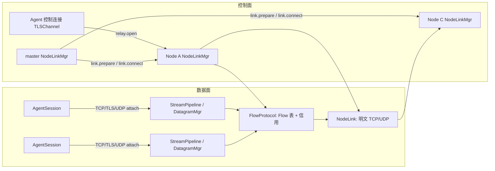

# RelayWeave 中继链路内存分配与协程盘点

本文盘点 RelayWeave 现有 Node 间、Node 与 Agent 间中继链路的内存分配和协程启动情况，
并给出可执行的优化候选。协议语义、信用不变量与生命周期规则仍以
[RelayWeave 设计](RelayWeave设计.md) 为准；本文只描述实现现状，不修改协议。

> 盘点基线：`quic` 分支 `56234c7`；2026-10-20 对照当前源码复核。
> 表内主要对象的 `sizeof` 已在当前 Linux aarch64 + libstdc++ + Asio 1.38.2 环境复测，
> P1-3 新增成员集合后 NodeLink 的变化见 6.1；其他 ABI 仍需重新测量。文中「实测」只指对象大小测量，
> 「推导」指按常量计算，「上限」指容量约束；均不代表进程 RSS 或已分配内存。
> 当前已实施 P1-1：NodeLink UDP 复用接收数组，按实际载荷长度构造池块；P1-3 已局部实施成员扫描集合复用，P1-2b 已将 transfer_tcp 缓冲缩为每方向 32 KiB；P0-1/P0-2/P0-3 未实施。
> 2026-10-20 已移除 Flow 全局字节预留和池硬上限，载荷池改为标准同步池；数量及逐 Flow 边界保留。
> 已完成 FairQueue 容器与 TCP 回环对比；真实部署的吞吐、CPU 和 RSS 影响仍需验证。第 10 章保留原建议编号，实际实施顺序以 10.1 为准。

章节导航：

- [1. 范围与口径](#1-范围与口径)
- [2. 执行域与线程](#2-执行域与线程)
- [3. 中继链路总览](#3-中继链路总览)
- [4. 控制面链路](#4-控制面链路)
- [5. 数据面链路](#5-数据面链路)
- [6. 内存分配盘点](#6-内存分配盘点)
- [7. 协程盘点](#7-协程盘点)
- [8. 端到端成本估算](#8-端到端成本估算)
- [9. 开销热点](#9-开销热点)
- [10. 改进建议与实施顺序](#10-改进建议与实施顺序)
- [11. 验证与观测](#11-验证与观测)
- [附录 A. 常量与源码定位](#附录-a-常量与源码定位)
- [附录 B. 复现方法](#附录-b-复现方法)

## 1. 范围与口径

盘点对象：

| 范围 | 内容 |
|---|---|
| 进程 | `relayweave-node`、`relayweave-agent` |
| 链路 | Node ↔ Node 集群控制、Node ↔ Node 邻接数据、Node ↔ Agent 控制、Node ↔ Agent 数据接入 |
| 关注点 | 内存分配（对象、队列、池、协程内缓冲）、协程启动频率与稳态数量、跨执行域交接 |
| 不在范围 | `route/` 探测与图算法、`proxy/`、Dashboard、打包脚本 |

现状结论分三类：

1. **分配点**：谁在什么频率分配什么，是否可以消除或复用；
2. **协程点**：谁在什么频率启动协程，是否常驻，由谁排空；
3. **边界点**：哪些数据需要跨 `io_context` 交接，交接了几次、持有多少 `shared_ptr`。

## 2. 执行域与线程

### 2.1 RelayNode

RelayNode 在 [`node/src/main.cpp:49`](../node/src/main.cpp) 建立 5 个 `io_context`，
并在 [`node/src/main.cpp:78`](../node/src/main.cpp) 为其中 4 个各启动 1 个线程；
`signal_io` 在 main 线程运行。

| 执行域 | 线程数 | 所有者 | 承载内容 |
|---|---|---|---|
| `control_io` | 1 | `RelayNode` | control acceptor、每条 Agent `ControlSession`(`TLSChannel`)、`RegistryMgr`、`ClusterMgr`、`Topology`、`NodeLinkMgr` 控制状态、`relay_sessions_`、`NodeSession`/控制器 |
| `transfer_tcp_io` | 1 | `TcpPipeline`、`TlsPipeline` | TCP/TLS 数据端口 acceptor、LocalPair/RemotePair、桥接协程与业务限速 |
| `transfer_udp_io` | 1 | `DatagramMgr` | 单个 UDP socket、`bindings_`、LocalPair/RemotePair |
| `cluster_data_io` | 1 | `FlowProtocol`、`LnkChannel` | Flow 表、逐跳信用、NodeLink socket、标准同步池、monitor |
| `signal_io` | 1（main） | `main` | `signal_set` |

结论：**每个 Node 恒定 5 个线程**，每个 `io_context` 只被 `run()` 一次，域内 handler 串行执行。
控制面、Agent 数据面、Node 数据面分别调度，避免同一个 handler 阻塞其他域的执行；
跨域交接、共享池锁和资源背压仍可能产生等待，并非完全互不影响。

### 2.2 RelayAgent

Agent 在 [`agent/src/main.cpp:38`](../agent/src/main.cpp) 建立 3 个 `io_context`，
在 [`agent/src/main.cpp:64`](../agent/src/main.cpp) 启动 2 个线程。

| 执行域 | 线程数 | 所有者 |
|---|---|---|
| `control_io` | 1 | `RelayAgent`、`NodeConnection`、`AgentRouting`、控制 `TLSChannel` |
| `transfer_io` | 1 | `Forwarder`、全部 `AgentSession`、本地监听 socket |
| `signal_io` | 1（main） | `main` |

结论：**每个 Agent 恒定 3 个线程**。业务数据复制全部在 `transfer_io`，
控制连接的重连与发现全部在 `control_io`。

## 3. 中继链路总览

### 3.1 四类链路

| # | 链路 | 传输 | 帧格式 | 面 | 所有者 |
|---|---|---|---|---|---|
| A | Node ↔ Node 集群控制 | TLS（mTLS） | 4 字节长度 + CBOR `CtrlMessage`，>64 KiB 分片 | 控制 | `ClusterMgr` / `ClusterSession` / `ClusterMgr::Connector` |
| B | Node ↔ Node 邻接数据 | 明文 TCP 或明文 UDP | 32 字节 `LnkFrameHeader`（UDP 前置 8 字节 Link ID） | 数据 | `LnkChannel` / `NodeLink` |
| C | Node ↔ Agent 控制 | TLS（mTLS） | 同 A | 控制 | `ControlSession`（Node）/ `NodeConnection`（Agent） |
| D | Node ↔ Agent 数据接入 | 明文 TCP / mTLS / 明文 UDP | attach 首帧 + 原始字节或 `DatagramHeader` + payload | 数据 | `StreamPipeline` / `DatagramMgr`（Node）/ `AgentSession`（Agent） |

### 3.2 建立路径（控制驱动数据）



建立顺序（多节点）：

1. Agent 通过控制连接发 `relay.open`，首 Node 在 `control_io` 校验路径与 epoch；
2. `NodeLinkMgr::ensure_link` 为路径上每条边并行准备共享 NodeLink；
3. master 下发 `flow.prepare` → 各节点 `FlowProtocol::prepare_flow` 校验数量、身份和邻接并建立 Flow；
4. master 下发 `flow.commit` → 各节点发布初始信用；
5. 首末节点 `install_*_pair` 并下发 endpoint 描述，Agent `attach` 后 `bind`、`activate`；
6. 首末节点互发 `relay.peer.attached/ready`，随后 `relay.ready` 返回 Agent，进入复制。

### 3.3 数据路径摘要

| 场景 | 是否经过 `FlowProtocol` | 是否跨执行域 | 是否有池分配 |
|---|---|---|---|
| 单节点 TCP/TLS | 否 | 否（同 `transfer_tcp_io`） | 否 |
| 单节点 UDP | 否 | 否（同 `transfer_udp_io`） | 否 |
| 多节点 TCP/TLS | 是 | 是（transfer ↔ cluster_data） | 是 |
| 多节点 UDP | 是 | 是（transfer_udp ↔ cluster_data） | 是 |

## 4. 控制面链路

### 4.1 Node ↔ Node

master 侧：

- [`ClusterMgr::start`](../node/src/cluster_mgr.cpp) 启动 `accept_loop`，
  内部以 `accept_sessions(room) && deliver_messages(room)` 组合运行；
- 每条成员连接创建 `ClusterSession`，其 `reader()` 先握手、再等 `cluster.join`，
  之后进入 `room.deliver(node_id, co_await channel->async_receive())` 循环；
- 发送侧统一 `asio::post` 到 `outbound_channel_`（容量 = `channel.max_queued_messages`，默认 100），
  由 `deliver_messages` 单点 fan-out。

slave 侧：

- `ClusterMgr::Connector::run` 完成 resolve → connect → `TLSChannel::start` → `cluster.join`；
- 之后循环收消息并在断开时重新连接（固定 5 秒间隔）。

控制消息路由有两处整包复制/编码：

- `ClusterRoom::deliver` 对每条消息调用 `WireMessage::pack(message)` 校验并丢弃结果，
  远端随后通过 `TLSChannel::send` 各自再次编码；
- `NodeLinkMgr::receive_events` 复制完整 endpoint JSON，再追加事件字段；
  `send_all` 先复制公共参数，再为各路径节点构造副本。

### 4.2 Node ↔ Agent

Node 侧：

- `RelayNode::control_accept_loop` 接受 socket，创建 `ControlSession`（即 `TLSChannel`）；
- 每条连接一个 `run_control_session` 协程，先 `TLSChannel::start`，再循环 `async_receive`；
- 所有命令（服务注册、查找、拓扑、`relay.*`）都在该协程内同步分派给 `RelayNode`。

Agent 侧：

- `RelayAgent::ensure_connection` 创建或复用 `NodeConnection`，`spawn_control_task(connection->run())`；
- `NodeConnection::run` 负责 resolve/connect/TLS/`server.identify`/收消息/退避重连；
- 控制消息由 `Forwarder::relay_message` 按 `request_id`/`uuid` 分派给 `AgentSession`。

`relay.*` 消息分派是线性扫描：

| 位置 | 扫描对象 | 上限 |
|---|---|---|
| `RelayNode::handle_relay` | `relay_sessions_` | Multi 会话单独受 `control.max_connections` 限制；全部会话还受 TCP/TLS/UDP 各自 `max_relays` 等约束，不能统一按 512 估算 |
| `RelayNode::handle_relay_peer` | `relay_sessions_` | 同上 |
| `Forwarder::relay_message` | `relays_` | 1000 |

Agent 的 `relays_` 已是按 request ID 建立的 `std::map`，但该分派函数仍执行扫描。
同一 Agent 可同时承担单节点业务的双方角色并共享一个 UUID；UUID 索引必须保留向多个会话分发的行为。

### 4.3 控制面内存

| 对象/动作 | 大小/分配 |
|---|---|
| `TLSChannel` | 1416 B（实测），另含 `log_context_` 字符串 |
| 写队列 `write_channel_` | 容量 `max_queued_messages`（默认 100），`std::deque` 按需增长，元素为 `BytesBuf` |
| 读队列 `receive_channel_` | 容量同上，元素为 `CtrlMessage`（对象 56 B，已含 string/optional 成员；字符串和 JSON 的动态存储另计） |
| 关闭/完成信号 | `close_channel_`、`run_done_channel_` 各容量 1 |
| 单条消息发送 | `WireMessage::pack` 产生一个 `BytesBuf`；`TLSChannel::send` 还做一次 `asio::post` + `shared_from_this` |
| 单条消息接收 | 4 B 头 + `BytesBuf payload(length)` + `njson` 反序列化（多次堆分配） |
| 分片消息 | `MessageReceiver::assembled_` 最多 16 MiB，按 63,936 B 分片重组 |

`max_queued_messages` 满时的行为是**关闭连接**（`enqueue_message` → `request_close`），
不是阻塞发送者；这是控制面现有的背压策略。

### 4.4 控制面协程

| 协程 | 频率 | 生命周期 |
|---|---|---|
| `ClusterMgr::accept_loop` / `slave_loop` | 每 Node 1 个 | 进程级 |
| `accept_sessions`、`deliver_messages` | 每 master 各 1 个 | 进程级 |
| `Connector::run` | 每 slave 1 个 | 进程级 |
| `ClusterSession::reader` | 每个集群成员连接 1 个 | 连接级 |
| `run_control_session` | 每条 Agent 控制连接 1 个 | 连接级 |
| `NodeConnection::run` | 每条 Agent 控制连接 1 个 | 连接级 |
| `TLSChannel::run` + `rloop` + `wloop` + `keepalive` | 每条 TLS 控制连接 4 个 | 连接级 |
| `NodeLinkMgr::receive_events` | 每 Node 1 个 | 进程级 |

每条 TLS 控制连接有 **5 个主要长期应用协程**（会话循环 + `TLSChannel` 的 4 个）。
这是源码层面的存活调用口径，不是实际协程帧分配数；计数限制见第 7 章。

## 5. 数据面链路

### 5.1 邻接 NodeLink

`LnkChannel` 在 `cluster_data_io` 上按 transport 维护共享 NodeLink：

| 成员 | 说明 |
|---|---|
| `connections_` | `map<Link ID, shared_ptr<NodeLink>>` |
| `accepting_` | 已接受但未认证的 socket，上限 100 |
| `udp_writes_` | 共享 UDP 发送 channel，容量 100（业务帧最多 96，预留 4 个控制帧） |
| `udp_pending_data_` | 共享队列中的业务帧计数 |

帧缓冲由 `FlowProtocol` 持有的 `std::pmr::synchronized_pool_resource` 提供，`LnkChannel` 只借用。

每条 `NodeLink` 的成员与容量：

| 成员 | 容量/说明 |
|---|---|
| `resolver` | 每 Link 1 个（仅建立期使用） |
| `socket` | 仅 TCP |
| `writable` | 容量 1，仅作「有可写数据」信号 |
| `writes` | `FairQueue<FlowWriteTag, Frame>`，无独立上限，受每 Flow 信用约束 |
| `controls` | `deque<Frame>`，上限 4096 |
| `credits` | `map<(flow_id, reverse), LnkFrameHeader>`，每 Flow 每方向至多 1 条 |
| `endpoint` | 仅 UDP |

TCP 稳态由 `tcp_run` 以 `make_parallel_group(wait_for_one)` 组合 `tcp_read` 与 `tcp_write`；
任一退出即取消并排空另一侧。UDP 全节点共享一个 `udp_read` 和一个 `udp_write`。

心跳：5 秒 PING、20 秒无有效 PONG 关闭；建立超时 10 秒；单帧读超时 20 秒。

### 5.2 逻辑 Flow

`FlowProtocol` 在 `cluster_data_io` 持有：

| 成员 | 说明 |
|---|---|
| `flows_` | `map<Flow ID, shared_ptr<FlowState>>` |
| `retired_` | 关闭后 10 秒的身份回收表，只存 ID 与期限 |
| `events_` | 跨域通知 channel，容量 4096，溢出即终止数据面 |
| `monitor_timer_` | 单一定时器，等待最近的 Link/Flow/信用期限 |
| `tasks_` / `tasks_done_` | 动态任务计数与排空事件 |
| `payload_pool_` | `std::pmr::synchronized_pool_resource` |

`FlowState` 按 transport 建立不同子状态：

| transport | 子状态 | 队列 |
|---|---|---|
| TCP 首/末节点 | `Stream` + `FlowStream` 端口 | 端点接收队列容量 2561 |
| TCP 中间节点 | `Stream`，无端口 | 接收 channel 对象仍存在，容量为 0，不作端点交付 |
| UDP 首/末节点 | `Datagram` + `FlowDatagram` 端口 | 共享接收队列容量 16 |
| UDP 中间节点 | `Datagram`，无端口 | 不建接收队列 |

### 5.3 Agent 接入（单节点）

1. Node `NodeSession::install` 在数据域创建 `LocalPair`，返回 `uuid/ticket/data_port`；
2. 控制消息把描述发给双方 Agent；Agent `AgentSession::attach` 连接数据端口并发送 `relay.attach`；
3. `StreamPipeline::accept_loop` 为每个 socket 启动 `run_transfer_session`，认证后把 socket 移入 `LocalPair`；
4. 双方 attach 后 `bind`（`TokenBucket` + `ServiceTraffic`）、`activate`、`bridge`。

数据路径不经过 `FlowProtocol`：

```
Agent local socket ⇄ AgentSession(relay_tcp / relay_tls) ⇄ LocalPair(relay_tcp / relay_tls) ⇄ Agent local socket
```

### 5.4 Agent 接入（多节点）

1. 首/末 Node 在各自数据域 `install_remote_pair`，控制消息下发含 `flow_id/epoch` 的 endpoint；
2. Agent attach 后，`NodeSession::bind` 跨到 `transfer` 再跨到 `cluster_data`，调用
   `FlowProtocol::bind_stream_flow` / `bind_datagram_flow`，取回端点句柄；
3. `run_remote_pair` 组合 `read_remote_pair` 与 `write_remote_pair`；`await_transfers` 在
   任一方向失败时取消并排空另一侧。

### 5.5 数据路径逐帧

以 H → I → T 一个方向为例（反向独立）：

```text
H read_remote_pair（65,467 B 读缓冲）
  → FlowStream::copy_payload：按实际长度复制一次到池块
  → FlowStream::send：移入 send_queue_（容量 0）
  → send_loop（数据域）→ try_send：窗口足够才转成 Frame
  → route → pending_frames → flush → NodeLink.writes(FairQueue)
  → tcp_write：写 32 B 头 + 载荷
  → written：释放池块、退还本跳占用、按 20 ms 合并授信

I tcp_read（按帧体长度直接读入池块）
  → receive → Stream::receive（校验收/发信用与入边）
  → route / flush → 下游 NodeLink.writes → tcp_write → written

T tcp_read → receive → route → 端点 receive_queue（容量 2561）
  → receive_loop → FlowStream::receive_queue（容量 1，跨域到 transfer）
  → write_remote_pair：限速 → 写 Agent socket → 归还池块
  → complete_receive → receive_loop → release_buffer → 合并授信
```

`FlowStream::send()` 完成只表示数据任务接手载荷，不表示已取得发送窗口或写入网络。
`send_loop` 在 `try_send/route` 准入时计入本地 `buffered_bytes`，下游授信还决定何时可进入 Link 队列。
即使发送 channel 容量为 0，窗口之外仍可能有发送任务暂存块、等待交接的源侧块及业务读缓冲。
接收任务每交付一个 DATA 都等待消费确认，完成前不交付下一帧；单独调大接收 channel 容量不会改变这一点。

## 6. 内存分配盘点

### 6.1 对象实测大小

| 类型 | `sizeof` | 说明 |
|---|---|---|
| `lnk::PooledBuffer` | 48 B | 指针 + deleter（含 `shared_ptr<memory_resource>`）+ span |
| `lnk::Frame` | 96 B | `LnkFrameHeader` 32 B + `PooledBuffer` 48 B + `shared_ptr` 16 B；静态断言要求 ≤ 128 B |
| `lnk::FlowState` | 616 B | 含 TCP 端点接收 channel（200 B）与双向 Direction |
| `lnk::FlowStream` | 1088 B | 4 个 channel（各 200–232 B）+ 共享状态 |
| `lnk::FlowDatagram` | 360 B | 发送 channel + 共享接收 channel 指针等 |
| `lnk::NodeLink` | 832 B | socket/resolver/channel/FairQueue/map；成员扫描集合增加 56 B（原 776 B） |
| `LnkChannel` | 648 B | 表 + acceptor + UDP socket + 共享发送 channel |
| `FlowProtocol` | 1336 B | 表 + 池共享指针 + 事件 channel + monitor；已移除预留字节计数 |
| `TLSChannel` | 1416 B | TLS stream + 4 个 channel + 状态 |
| `CtrlMessage` | 56 B | 命令字符串 + `optional<njson>` |
| Asio channel（容量型） | 200–232 B | `FrameChannel`/`OptChannel`/`DatagramChannel` 200 B；`SigChannel` 232 B |

这些数值只覆盖对象本体；socket 内核状态、容器动态存储、共享控制块及协程帧另计。
NodeLink 使用明文 TCP/UDP，不含 SSL。一个多节点 TCP Flow 的对象本体为
616 B（中间节点）或 616 + 1088 B（已绑定首末节点），不能据此推断总分配量。

### 6.2 标准同步池

直接使用 `std::pmr::synchronized_pool_resource`，不保留包装类或类型别名；
[`FlowProtocol`](../protocol/src/flow_protocol.cpp) 创建池时指定以下配置：

| 项 | 当前行为 |
|---|---|
| 总量 | 无应用层字节预算；按需分配并允许保留高水位缓存 |
| 池选项 | 最大必需池化块 65,536 B，其余选项使用标准库默认值 |
| 上游 | `std::pmr::new_delete_resource()` |
| 并发 | 标准池支持跨线程分配、归还；无项目自定义 mutex |
| 生命周期 | FlowProtocol、端口和池块 deleter 共享；最后一个引用释放后销毁 |
| 统计 | 生产池不保留 live/retained 字节统计；基准观察 RSS、逻辑窗口占用和最终资源释放 |

逻辑计费已与分配器分离：

```text
Frame::charge_for_payload(a) = 128                               , a = 0
                            = 128 + bit_ceil(max(a, 256))       , a > 0
Frame::charge()              = Frame::charge_for_payload(payload.allocation_size())
```

`PooledBuffer::allocation_size()` 返回原申请长度，供标准资源归还及稳定信用计费使用，
不代表标准池的内部块大小。切片只改变视图，原地址和申请长度保持不变。
NodeLink UDP 从固定数组按实际载荷长度构造池块，空载荷不分配。
标准池的块尺寸、chunk、内部元数据和缓存由实现管理；不能把协议计费档位当成实际分配大小。

### 6.3 数量准入与单 Flow 容量

Flow 不再受全局字节预留预算限制。prepare 只检查数量、身份和邻接状态，再创建逻辑业务状态；
`flows_ + retired_` 合计最多 1000，退休身份保留 10 秒。协调层和数据层共用 `lnk::max_flow_count`。

| transport | 单方向逻辑边界 | 双向模型 / Flow | 1000 Flow 模型 |
|---|---|---|---|
| TCP | DATA 为 W=327,680，另有唯一 FIN 的 128 | 655,616 B | 约 625.244 MiB |
| UDP | 每端点 16 包；满尺寸按逻辑 65,536+128 估算 | 2,101,248 B | 约 2003.906 MiB |

这些是窗口/队列模型，不是预分配或固定 RSS 上限；源侧交接块、共享 Link、标准池缓存及其他资源另计。
满载时的内存规模由数量和单业务边界共同决定，不能只用控制 socket 数代替业务数量。

| 数量限制 | 来源与范围 |
|---|---|
| 控制连接 / master 集群连接 | `control.max_connections`，分别计数 |
| TCP/TLS 建立中 socket | `max_setup_connections` |
| TCP/TLS/UDP 业务 | 对应 `max_relays`；控制任务从启动到关闭排空均计数，数据 manager 也保留容量检查 |
| Flow | 统一常量 1000，包含活动/准备/退休身份以及各自协调表的边界 |
| Link 申请 / 授权 | 内部各 1000，独立于 Flow 额度 |
| Agent Relay / 入口查询等待 | 内部各 1000 |

建立中的请求在创建异步业务任务前即消耗对应协议的数量名额；完成回调才释放。
数据域处理变慢时，不会绕过 `max_relays` 累积无界的待安装控制任务。

### 6.4 队列容量

| 队列 | 容量 | 存储 | 位置 |
|---|---|---|---|
| 端点 `receive_queue`（TCP 首末） | 2561 | Asio channel + `deque` | `flow_protocol.cpp` |
| 中间节点接收队列（TCP） | 0（保留 channel 对象，不作端点交付） | Asio channel | `flow_protocol.cpp` |
| `FlowStream::send_queue_` | 0（rendezvous） | Asio channel | `flow_protocol.cpp` |
| `FlowStream::receive_queue_` | 1 | Asio channel | `flow_protocol.cpp` |
| `FlowStream::receive_completed_` / `send_space_` | 1 / 1 | Asio channel | `flow_protocol.cpp` |
| `FlowDatagram` 发送 / 接收 | 16 / 16 | Asio channel | `flow_protocol.cpp` |
| `NodeLink::controls` | 4096 | `deque<Frame>` | `lnk_channel.h` |
| `NodeLink::writes` | 无独立上限 | `FairQueue` + `list` | `lnk_channel.h` |
| UDP 共享发送队列 | 100（业务 ≤ 96） | Asio channel | `lnk_channel.cpp` |
| `FlowProtocol::events_` | 4096 | concurrent channel | `flow_protocol.cpp` |
| 控制连接写/读队列 | 100 各（默认） | Asio channel | `tls_channel.h` |
| 集群 master 出站队列 | 100（默认） | Asio channel | `cluster_mgr.cpp` |
| `accepting_`（NodeLink 待认证） | 100 | `set` | `lnk_channel.cpp` |

端点接收队列 2561 项的 `Frame` 对象本体约 240 KiB；容器管理及分配器开销另计，
容量不是启动时预分配量。实际仅在大量空 DATA 且末端不消费时接近该项数。

### 6.5 协程内固定缓冲

| 缓冲 | 大小 | 数量级 | 位置 |
|---|---|---|---|
| `transfer_tcp` 读缓冲 | 32 KiB（零初始化） | 每方向 1 个 | `xfr_channel.cpp` |
| `transfer_tls` 读缓冲 | 65,467 B（零初始化） | 每方向 1 个 | `xfr_channel.cpp` |
| `relay_udp_connected` 本地→传输 | 65,500 B | 1 个 | `xfr_channel.cpp` |
| `relay_udp_connected` 传输→本地 | 65,508 B | 1 个 | `xfr_channel.cpp` |
| `read_remote_pair` | 65,467 B | 每 RemotePair 1 个 | `pipeline_mgr.cpp` |
| `DatagramMgr::receive_datagram` | 65,508 B（零初始化） | **每 Node 1 个**（共享） | `datagram_mgr.cpp` |
| `LnkChannel::udp_read` | 65,508 B（不做零初始化） | **每 Node 1 个**（共享）；校验后按实际载荷复制进池 | `lnk_channel.cpp` |
| `Forwarder::receive_local_datagrams` | 65,500 B | 每个 UDP forward 1 个 | `forwarder.cpp` |
| `AgentSession::receive_datagrams` | 65,508 B | 每个 UDP 请求方（Consumer）会话 1 个 | `agent_session.cpp` |

注意：这些数组位于协程帧内，**随协程存活**，不随单次 I/O 释放。
单节点 TCP/TLS 每个 LocalPair 或每个 Agent 会话的双向复制缓冲分别为
64 KiB（TCP）或 130,934 B（TLS）。一个完整业务包含两个 Agent 会话和一个 Node LocalPair，
不能只把一个 Agent 与一个 Node 的缓冲相加作为端到端总量，见第 8 章。

### 6.6 控制面状态保留

`NodeLinkMgr` 为授权与重放检查保留完整描述：

| 表 | 内容 | 上限 | 生命周期 |
|---|---|---|---|
| `link_endpoints_` | Link prepare 的完整 `njson`（含 token、地址、端口、peer） | 1000 | 直到 Link 关闭 |
| `link_requests_` | master 的 `shared_ptr<LinkRequest>`，对象内保存参数 | 1000 | 成功后作为复用记录保留；链路失效、成员变化或停止时清理 |
| `flow_endpoints_` | Flow prepare 的完整 `njson`（path、addresses、links、transport） | 1000 | 直到 Flow 关闭 |
| `flow_requests_` / `closing_flows_` | `shared_ptr<FlowRequest>`，对象内保存参数；关闭时转入关闭表 | 创建时两表合计 < 1000 | 成功 Flow 关闭时从活跃表移除，关闭确认或关闭超时后清理关闭表 |
| `remote_flows_` | 远端 `flow.open` 等待结果 | 1000 | 结果返回或超时 |
| `flow_watches_` | 关闭等待 | 与业务同量 | 关闭通知到达 |
| `FlowProtocol::retired_` | 仅 `id + time_point` | 1000 | 10 秒 |

`flow_requests_` 保存的是指向 `FlowRequest` 的指针，不能与 `FlowRequest::params` 算成两份 JSON。
master 同时为路径节点时，本地 `flow_endpoints_` 才额外保留一份端点参数；其他路径节点的副本属于其他进程。
Link 也类似：master 可以管理不连接自身的 A↔B 链路，此时 master 没有该 Link 的本地 endpoint。
事件转发还会产生临时 JSON 副本。每份描述的实际分配量随路径、地址和字符串长度变化，
尚未测量，不按固定 0.5–1 KiB 或「三份描述」推算收益。

## 7. 协程盘点

本章按源码中主要长期应用协程列出生命周期，不把每次返回 `awaitable` 的函数都算作独立协程。
例如 `NodeSession::run/wait_attach/bind/bridge`、`relay_tcp/relay_tls/relay_udp_connected`
以及 `Transport::relay` 中的普通返回包装没有自己的语言级协程帧。
下表不穷举逐次 I/O 的 `send/receive/read_tls_data` 等辅助协程，也不统计 Asio 的组合操作和
`co_spawn` 内部包装；编译器还可能消除部分分配。因此长期应用协程数、实际存活帧数、
堆分配次数和执行域唤醒次数必须分别测量，不能互相替代。

### 7.1 进程级常驻

| 协程 | Node | Agent |
|---|---|---|
| `FlowProtocol::run` | 1 | — |
| 其子循环：`accept_loop`、`udp_read`、`udp_write`、`monitor` | 4 | — |
| `NodeLinkMgr::receive_events` | 1 | — |
| `ClusterMgr::accept_loop` 或 `slave_loop` | 1 | — |
| `accept_sessions` + `deliver_messages`（仅 master） | 2 | — |
| `Connector::run`（仅 slave，也承担连接级收消息） | 1 | — |
| `RelayNode::control_accept_loop` | 1 | — |
| `TcpPipeline::accept_loop` | 1 | — |
| `TlsPipeline::accept_loop` | 1 | — |
| `DatagramMgr::receive_datagram` | 1 | — |
| `RelayAgent::discovery_loop`（配置了 forwards 时） | — | 1 |
| `Forwarder::accept_stream`（每个 TCP/TLS forward） | — | 1 |
| `Forwarder::receive_local_datagrams`（每个 UDP forward） | — | 1 |

按表内服务均已启动的口径，Node 的 master 为 13 个、slave 为 12 个主要长期协程；
slave 计入了 `slave_loop` 和 `Connector::run`，但尚未计入 `TLSChannel` 内部循环。
`Connector::run` 同时是连接级会话接收循环，与下一节合计时不要重复计算。
Agent 的发现任务受 forwards 配置影响，每个 TCP/TLS/UDP forward 各增加一个监听/接收任务，
控制连接另计；不把固定的「2–3 个」当作所有配置下的基数。

### 7.2 连接级

| 协程 | 频率 | 稳态 |
|---|---|---|
| `TLSChannel::run` | 每条 TLS 控制连接 | 1 |
| `rloop` / `wloop` / `keepalive` | 每条 TLS 控制连接 | 3 |
| `ClusterSession::reader` | 每个集群成员（master 侧） | 1 |
| `Connector::run` | slave 的集群控制连接 | 1（已计入 7.1） |
| `run_control_session` | 每条 Agent 控制连接（Node 侧） | 1 |
| `NodeConnection::run` | 每条控制连接（Agent 侧） | 1 |
| `run_transfer_session` | 每个接入中的数据 socket | 建立期临时 |
| `LnkChannel::establish` 或 `accept` | 每条 TCP NodeLink | 1（持有 Link 到关闭） |
| `tcp_run` + `tcp_read` + `tcp_write` | 每条 TCP NodeLink | 3 |

即：每条 TLS 控制连接有 5 个、每条 TCP NodeLink 有 4 个主要长期应用协程。
UDP NodeLink 没有逐 Link 常驻数据协程，复用进程级 UDP 收发循环。

### 7.3 业务级

| 协程 | 频率 | 稳态 |
|---|---|---|
| `ControlRouterSingle::run` / `ControlRouterMulti::run` | 每业务 1 个，由 `NodeSession::run` 返回 | 1 |
| `ControlRouterMulti::establish_and_transfer` | 每个多节点首末业务 | 1 |
| `ControlRouterMulti::watch_flow` | 每个多节点首末业务 | 1 |
| `NodeSession::wait_attach` 返回的 manager 等待任务 | 每业务一次跨域 `co_spawn` | 接入期临时，包装函数不另计帧 |
| `NodeSession::bind` 返回的绑定操作 | Multi 先到 transfer，再到 data；Single 用 `invoke_on` | 绑定期临时，不由调用层数推断分配数 |
| `run_remote_pair` → `await_transfers` | 每 TCP/TLS RemotePair | 4（父任务 + 组合 + 2 方向） |
| `run_local_pair` → `relay_*` → `await_transfers` | 每 TCP/TLS LocalPair | 4（同上） |
| `FlowProtocol::Stream::run` + `send_loop` + `receive_loop` | 每个 TCP Flow 端点 | 3 |
| `FlowProtocol::Datagram::run` | 每个 UDP Flow 端点 | 1 |
| `ensure_link` | 每次 Flow 建立 × 每条边 | 建立期临时 |
| `open_flow` + edges channel | 每个多节点 ingress | 建立期临时 |
| `AgentSession::run` + `attach` | 每业务 | run 长期存在，attach 仅建立期 |
| `AgentSession` 的 `relay_tcp`/`relay_tls`/`relay_udp_connected` | 每业务 | 3（`await_transfers` + 2 方向） |
| `relay_agent.cpp` `select_relay` | 每个新业务 1 次 | 建立期临时 |

### 7.4 每场景主要长期应用协程数

| 场景 | Node 侧（每业务） | Agent 侧（每业务） |
|---|---|---|
| 单节点 TCP | 控制器 `run` 1 + `run_local_pair` 1 + 组合 1 + 方向 2 = **5** | 每个 Agent 会话：`run` 1 + 组合 1 + 方向 2 = **4** |
| 单节点 TLS | 同上 = **5** | 同上 = **4** |
| 单节点 UDP | 控制器 `run` 1 + `run_local_pair` 1（等待 `finished`）= **2** | 服务方 `run` + 组合 + 方向 2 = **4**；请求方 2 |
| 多节点 TCP/TLS 首末 | `run` 1 + `watch_flow` 1 + `establish_and_transfer` 1 + `run_remote_pair` 1 + 组合 1 + 方向 2 + Flow 端点 3 = **10** | **4** |
| 多节点 UDP 首末 | `run` 1 + `watch_flow` 1 + `establish_and_transfer` 1 + `run_remote_pair` 1 + `write_remote_pair` 1 + `Datagram::run` 1 = **6** | 服务方 4；请求方 2 |
| 中间 Node | 0（仅 Flow 表项，无端点任务） | — |

Node 首末节点和两个 Agent 分别计数；表内不包含进程级及共享 Link 协程，
也不包含上述等待调用的辅助帧，不能据此直接估算堆内存。

## 8. 端到端成本估算

以下按一个完整业务的两个 Agent 会话、单节点的一个 LocalPair 或多节点的两个 RemotePair 计数。
第一张表只加总**随业务增长的固定复制数组**；池载荷、Flow/Pair 对象、容器管理、其他协程帧、
socket 内核缓冲、OpenSSL 内部缓冲及 Asio 完成队列均另计，不将单个端点的小计称为系统总量。

| 场景 | 两个 Agent 的固定数组 | Node 固定数组 | 完整业务的固定数组合计 |
|---|---|---|---|
| 单节点 TCP | 2 × 65,536 B | 65,536 B | 196,608 B = 192 KiB |
| 单节点 TLS | 2 × 130,934 B | 130,934 B | 392,802 B ≈ 383.6 KiB |
| 单节点 UDP | 请求方 65,508 B + 服务方 131,008 B | 无逐业务复制数组，共享 listener 另计 | 196,516 B ≈ 191.9 KiB |
| 多节点 TCP | 2 × 65,536 B | 首末各 65,467 B；中间无逐 Flow 复制数组 | 262,006 B ≈ 255.9 KiB |
| 多节点 TLS | 2 × 130,934 B | 首末各 65,467 B；中间无逐 Flow 复制数组 | 392,802 B ≈ 383.6 KiB |
| 多节点 UDP | 请求方 65,508 B + 服务方 131,008 B | 无逐业务复制数组；共享接收和在途池块另计 | 196,516 B ≈ 191.9 KiB |

UDP 还需按实际部署计入每 Node 的 `DatagramMgr` 共享 65,508 B 接收数组、
每个 Agent UDP forward 的共享 65,500 B 接收数组，以及每 Node 的 NodeLink 共享 65,508 B 接收数组。
NodeLink 排队持有的载荷按实际长度申请，标准池内部块、chunk 和缓存另计。
它们不都随业务数线性增长，不能逐业务重复相加；池存储也不能与逻辑窗口模型相加作为 RSS。

多节点 Flow 的对象本体另计：每个路径节点一个 616 B `FlowState`，每个已绑定 TCP 首末节点再加
1,088 B `FlowStream`，或每个 UDP 首末节点再加 360 B `FlowDatagram`；容器动态存储另计。
每条 Flow 在**每个路径 Node** 的 `cluster_data_io` 上独立限制窗口或队列：

| 场景 | 每 Flow 双向逻辑容量 | 说明 |
|---|---|---|
| 多节点 TCP/TLS | 640.25 KiB | 双向 `W + h`，窗口/队列模型而非常驻分配 |
| 多节点 UDP | 2.0 MiB | 双向 16 包满尺寸，窗口/队列模型而非常驻分配 |

## 9. 开销热点

### 9.1 数据热路径

| 编号 | 现象 | 影响 | 位置 |
|---|---|---|---|
| H1 | 已优化：UDP 复用接收数组，校验后按实际载荷复制进池 | 小包不再申请最大接收块；标准池实际尺寸由实现管理，代价是多一次复制 | `lnk_channel.cpp` `udp_read` |
| H2 | `FairQueue::push` 查同 tag、扫描不重复区间、插入 `list` | 已复用成员 `unordered_set` 的桶；集合节点仍按扫描分配，list 节点仍需分配；已有同标签连续入队缓存 | `fair_queue.h` |
| H3 | 发送 rendezvous、接收逐 DATA 等待一次 `complete_receive` | 有逐帧交接与确认成本；实际跨线程唤醒取决于队列和执行器调度，未测量 | `flow_protocol.cpp` |
| H4 | 标准同步池的内部同步 | 分配/归还跨执行域，实际争用需测量；没有自定义全局锁 | `lnk_channel.h` |
| H5 | 每帧 `map` 查找（Flow、Link、credits） | O(log F) + O(log L)，热路径固定成本 | `flow_protocol.cpp`、`lnk_channel.cpp` |
| H6 | 端点接收队列按 `Frame` 存储 | 空 DATA 场景帧对象本体可接近 240 KiB，容器开销另计 | `flow_protocol.cpp` |
| H7 | `Frame::charge()` 把原申请长度映射为逻辑信用单位 | 保持既有信用协议，不代表标准池实际尺寸；切片不改变计费 | `lnk_channel.h` |
| H8 | 部分复制/接收缓冲使用 `{}` 零初始化 | 源码要求创建时清零；是否生成实际 memset 需看优化后产物，不是每包成本 | `datagram_mgr.cpp`、`xfr_channel.cpp` |

### 9.2 控制面

| 编号 | 现象 | 影响 | 位置 |
|---|---|---|---|
| C1 | `ClusterRoom::deliver` 每条消息 `WireMessage::pack` 后丢弃 | 校验包含按值拷贝及完整 CBOR 编码；远端各自再次编码 | `cluster_mgr.cpp` |
| C2 | 事件转发复制整份 njson 并追加字段 | 仍有完整 endpoint JSON 深拷贝；P0-2 未实施 | `nodelink_mgr.cpp` |
| C3 | 成功的 `LinkRequest` 作为链路复用记录保留完整参数 | 长期保留建立期对象及 JSON；失效时清理，不是无期限泄漏 | `nodelink_mgr.cpp` |
| C4 | `send_all` 先复制公共参数，再分别构造消息 | 显式产生 1+N 次参数副本；P0-2 未实施 | `nodelink_mgr.cpp` |
| C5 | `relay.*` 分派线性扫描 `relay_sessions_` / `relays_` | 每消息 O(n)；Agent 上限 1000，Node 全部会话不能统一按 512 计算 | `relay_node.cpp`、`forwarder.cpp` |
| C6 | `TLSChannel::send` 每消息一次 `post` + `shared_from_this` | 控制消息逐条分配/原子操作 | `tls_channel.cpp` |
| C7 | `AsyncEvent::wait` 每个挂起等待者在帧内持有 channel（对象 232 B）并注册到 vector | channel 内部存储和 vector 增长可能分配，不能直接等同于每次恰好一次堆分配 | `async_event.h` |
| C8 | 控制连接队列满即关闭连接 | 突发控制消息可能造成连接抖动 | `tls_channel.cpp` |
| C9 | `FlowProtocol::events_` 溢出即终止数据面 | 事件突发会导致全部 Flow 失效 | `flow_protocol.cpp` |

### 9.3 生命周期

| 编号 | 现象 | 影响 |
|---|---|---|
| L1 | `TLSChannel`、`FlowState`、`NodeLink` 使用 `shared_ptr` 保活 | 复制/销毁有引用计数成本；移动和按引用持有不等于每个操作都增加一次计数 |
| L2 | `FlowStream::close/reset`、`FlowDatagram::close` 向数据域 `post` 一个捕获 `shared_ptr` 的 lambda | 关闭路径的异步包装与保活成本 |
| L3 | Multi 绑定涉及 control → transfer → data → transfer → control | 各域拥有不同状态，换异步接口不自动消除必要交接；实际唤醒/分配需测量 |
| L4 | `NodeSession::wait_attach`、`bridge` 返回跨域 `co_spawn` 操作 | 有任务包装与完成交接成本；两个包装函数本身不是语言级协程 |
| L5 | `NodeLinkMgr` 的 `AsyncEvent` 与 `steady_timer` 每请求各一个 | 请求级固定开销 |

## 10. 改进建议与实施顺序

以下按影响范围、预期收益、证据充分程度和实施风险排列，不能只按改动小或分配点多判断优先级。
原 P0/P1/P2 编号仅用于追溯，不再表示优先级。除对象大小和容量推导外，收益均为待验证判断，
不把源码操作次数减少直接等同于吞吐、CPU 或 RSS 改善。所有方案都必须保持设计文档 5.6 的信用与有界性不变量，
保留半关闭、取消排空和授权校验，并且不在 NodeLink 引入第二套流控。

### 10.1 按重要性与预期收益排序

第 0 项是后续性能决策的测量前提，本身不直接提高吞吐；第 1～3 项优先验证，
第 4～9 项按部署负载推进，第 10～13 项只有发现对应瓶颈后才启动。
P1-2 拆为普通 TCP 缓冲尺寸与去零初始化，避免把容量收益和启动成本混为一谈。

| 顺序 | 原编号 | 建议 | 重要性与收益成立的条件 | 风险 / 决策条件 |
|---|---|---|---|---|
| 0 | P2-5 | 最小观测集，补 NodeLink UDP 和控制编码基准 | 决策前提；避免在未覆盖真实路径的基准上判断优化 | 低到中；按所属域取快照，控制采集开销 |
| 1 | P1-1 | 已实施：固定数组接收，按实际载荷保存 | 避免小包在途持有最大接收块；收益取决于包长和队列积压 | 增加一次复制；实际分配失败丢当前包并继续接收，性能收益待测 |
| 2 | P0-1 | 控制消息编码一次并复用结果 | 集群广播和大控制消息可省重复编码；远端数越多越值得 | 中；保留分发前校验、独立队列和缓冲寿命 |
| 3 | P1-3 | 已局部实施：复用 FairQueue 扫描集合的桶 | 减少重复桶分配和扩容；逐帧 CPU 收益需对比 | 低；节点仍分配，桶容量常驻，入队复杂度和公平语义不变 |
| 4 | P1-2b | 已局部实施：transfer_tcp 每方向改为 32 KiB | 每个双向中继的固定数组减少 64 KiB；本机大块回环吞吐下降约 40% | 改动小但吞吐代价明显；需按内存与吞吐目标取舍 |
| 5 | P2-2 | 利用现有 request 表并补正确的路由索引 | 大量业务控制消息时降低扫描成本，不改善稳态数据复制 | 低到中；保留身份校验及 UUID 多会话分发 |
| 6 | P0-2 | 未实施：事件 JSON 与授权存储优化 | 收益取决于事件量；先单独评估局部改动 | 不与 P0-1 合并实施 |
| 7 | P0-3 | 未实施：压缩成功 Link 记录 | 长期控制内存收益未测、预计较小 | 新增状态转换前先证明收益，另行评估 |
| 8 | P1-2a | 验证并移除无用零初始化 | 改动小，主要影响建连/任务启动，数组大小不变 | 低；只读取实际填充范围，并确认优化后确有清零成本 |
| 9 | P2-4 | 有选择地开放容量配置 | 提高部署适配性，本身无直接性能收益 | 中；维持派生容量关系和逐 Flow 准入 |
| 10 | P2-1 | 已实施：标准同步池与数量准入 | 删除两层字节预算、自定义锁/空闲链表/回收，保持背压 | 允许标准池缓存，不承诺固定 RSS；补测见 11.7 |
| 11 | P1-4 | 重新设计端点流水线与完成确认 | 仅在逐帧交接限制吞吐时值得，单改 channel 容量不足 | 高；重审窗口外余量、完成顺序和 FIN |
| 12 | P0-4 | 轻量化 AsyncEvent | 非逐帧路径，分配收益和替代方案成本尚未测 | 中到高；独立取消与通知竞争语义必须保持 |
| 13 | P2-3 | 减少 Multi 绑定包装开销 | 每业务仅建立时发生，预计收益小 | 中；各执行域状态校验和往返不能直接省略 |

排序会随负载证据调整：没有多节点 UDP 的部署不应优先做第 1 项；
如果 FairQueue 已占主要 CPU，第 3 项应提前；建连风暴场景则应优先看第 2、5、6 项。
去零初始化可以作为独立小改提前安排，但不因此宣称它比逐帧热点更重要。

### 10.2 测量前提：最小可观测性（顺序 0，P2-5）

现有 `benchmark/flow_workload.h` 采集逻辑 `buffered_bytes`、RSS、CPU 和吞吐，并在夹具清理后检查池最终释放，
`RelayNode` 已有 control/TCP/UDP 域队列延迟探针，可复用测量思路。
现有 `tasks_` 只统计所属协议动态任务，不是整个进程实际协程帧数；队列延迟也不是队列深度。

首批只补能回答优化问题的计数：

- 分配：实际失败次数；需要深入分析时在测试侧统计上游申请与复用，不给生产池恢复字节账本；
- 准入与丢包：Flow 数量拒绝、UDP 队列满、令牌不足和实际分配失败的分类计数；
- 热路径：Link 队列深度峰值、发送任务等待本地窗口/下游信用的时间、终点交付至消费完成的时间；
- 实验需要时再增加池锁等待/持锁时间及详细逐 Flow 状态，避免一开始导出所有高频状态。

快照由拥有状态的执行域采集，避免 control 域直接遍历 data 域容器；标准池不提供内部缓存统计。
不为每帧发送统计消息；锁计时等高成本诊断应可按实验启用。
补充覆盖 NodeLink UDP 接收和集群编码分发的基准，覆盖缺口见 11.2。

### 10.3 优先验证的高收益候选（顺序 1～3）

**顺序 1：UDP 小包按实际载荷保存（P1-1，已实施）**

`udp_read` 复用一个不做零初始化的 65,508 B 数组接收报文，保留来源、Link ID、epoch、
帧头和精确长度校验，以及最大合法报文外一个检测字节。数组跨 co_await 存活，位于协程帧中，
每 Node 的共享接收循环只有一份，不随 Flow 或包数增加。

非空载荷校验通过后，直接使用现有 `PooledBuffer(pool, payload_span)` 按实际载荷长度申请并复制，
再将池块移入后续处理；空载荷仍使用空缓冲。接收数组可立即复用，已交付载荷独立存活。
握手报文仍直接从接收数组解码；来源、帧头或长度校验失败的报文不创建业务载荷池块。

历史自定义池中，小包持有量曾由 65,536 B 降为 256 B class。当前标准池按实际载荷申请，
64 B 载荷的请求长度为 64 B；内部块与缓存不等于请求长度，不能继续沿用旧池的物理占用倍数。
代价是每个非空载荷多一次用户态复制，最大合法载荷也有这次复制成本。
归还池块不保证 RSS 立即下降。UDP 队列和满队列丢整包语义保留；
全局字节预算已由本次资源管理简化移除，当前准入边界见第 6.3 节。

载荷分配位于现有异常捕获范围内，实际分配失败丢当前包并继续接收；固定接收数组独立于载荷池。
未增加缓冲池、借用等待或新的转发任务，生产代码改动仅在 udp_read。
功能验证覆盖实际分配长度、接收数组复用、空包、最大包、畸形长度以及分配失败后恢复。

没有使用小缓冲截断后重读同一包的方案。现有 udp_relay_benchmark 也未覆盖 NodeLink 接收，
本轮不以该程序宣称吞吐、CPU 或 RSS 改善；多节点 UDP 性能基准仍是后续工作。

**顺序 2：避免控制消息重复编码（P0-1，候选）**

现状：Room 修改 source、删除 target 后调用 `WireMessage::pack(message)` 完整校验并丢弃结果，
远端随后各自编码；master 本地参与者直接接收 CtrlMessage。

可评估在保留分发前校验的前提下复用编码结果，减少远端重复编码。
R 个远端的 Room 校验和转发编码理论上可由 R+1 次降为 1 次，不包括 slave 发往 master 的原始编码。
实现前需比较字节复制、共享所有权及接口变化的成本，不预设应采用哪种队列或存储方案。

不能直接把完整校验下放到各连接：否则可能让非法消息先被本地接收，或导致目标连接编码失败关闭。
必须保留命令、参数形状、16 MiB 长度和可编码性约束，以及每连接独立队列、溢出关闭和分片顺序。
收益以编码/分配及实际负载测量为准，不把编码次数减少直接当作 CPU、吞吐或 RSS 改善。

**顺序 3：降低 FairQueue 入队成本（P1-3）**

现状：已有「最近插入项同 tag」缓存；否则反向查同 tag，随后扫描标签不重复的区间，
用 `unordered_set` 判断重复并插入 `list`。出队本身已为常数时间。

已局部实施：将 `unordered_set` 从 `push()` 局部变量移为成员，每次扫描前 `clear()`，
队列 `clear()` 时也清空集合，保留桶供后续入队复用。只减少重复桶分配和扩容，
集合节点仍会释放并重新分配；上轮扫描标签保留至下次入队或清空，桶容量保留至队列销毁。
插入位置、查找缓存和出队规则不变，未引入最后位置索引、自写哈希表或内存池。

`tag → 最后 iterator` 索引只能省去反向查找，不能消除后续区间扫描和集合节点分配，
因此不能将该候选描述成 O(1) 入队或每帧只分配一次。
进一步优化应先证明收益，再比较额外常驻内存、异常安全和实际扫描长度。
不要仅为追求零分配引入自写侵入式结构；Frame 所有权、关闭删除及已有维护成本都需计入。

每流子队列加轮转游标会改变现有按积压插入交错的次序，不能默认视作等价替换。
沿用 [FairQueue.md](FairQueue.md) 的测量方法、独立参考模型、穷举/随机对拍及真实 socket 回归。
已有历史结果使用的 Frame 布局与当前不同，不用于判断本次桶复用的收益。

本次验证：沿用比较程序的完整负载矩阵，直接对比修改前后的生产版本，数据见
[FairQueue 成员扫描集合复用](FairQueue.md#成员扫描集合复用)。FairQueue 对拍、`lnk_channel_flows`、
`lnk_flow_control` 均已通过，覆盖每标签 FIFO、DATA/FIN 排序、健康流推进和关闭后的载荷释放。
容器基准不代表业务 CPU 或吞吐；这些收益仍需另用 Flow 多流负载验证。

### 10.4 按实际负载推进的优化（顺序 4～6）

**顺序 4：普通 TCP 缓冲尺寸（P1-2b）**

已将 `transfer_tcp` 每方向缓冲由 64 KiB 改为 32 KiB，保留原有读写、限速、计数和半关闭流程。
一个 LocalPair 或 Agent 会话的双向数组合计由 128 KiB 变为 64 KiB，固定数组减少 64 KiB；
1,000 个这样的双向中继仅该项减少约 62.5 MiB，不代表 RSS 必然下降同等数值。
后续重点比较高并发空闲连接、单流吞吐和慢写时的 CPU、RSS、系统调用次数及延迟。
`read_remote_pair` 本次仍保留 65,467 B；其普通 TCP 分支可单独实验，需覆盖多节点 Pipeline 路径。

本次 `tcp_relay` 回归通过，覆盖两侧读写失败、限速等待取消、双向半关闭及流量计数。
Release（GCC 14.2.0、`-O3 -DNDEBUG`）下，沿用 `benchmark_tcp_relay`，每方向发送 4,096 块，
修改前后各预热一次，再交替运行五次取中位数；每次检查内容、顺序和 FIN。
本机回环结果如下，CPU 时间指传输相同数据所用的进程 CPU 秒数，并非 CPU 使用率：

| 数据块 | 64 KiB 缓冲吞吐 | 32 KiB 缓冲吞吐 | 吞吐变化 | CPU 时间（64 → 32 KiB） |
|---|---:|---:|---:|---:|
| 1,400 B | 1,364 Mbps | 1,404 Mbps | 约 +3.0% | 0.0644 → 0.0653 s（约 +1.3%） |
| 32,768 B | 9,690 Mbps | 5,834 Mbps | 约 −39.8% | 0.2206 → 0.3677 s（约 +66.6%） |

大块样本五次均出现明显吞吐损失，不能把缩小缓冲描述成没有性能代价。
上述是本机回环负载，不能直接推断受网络带宽或限速约束的部署结果；高并发 RSS 也尚未测量。
原始 JSON、汇总及修改前源码/可执行文件保存在 `build-fair-queue/tcp-buffer-32k/`。

TLS 的当前 `read_tls_data` 要求缓冲容纳完整业务帧，直接缩至 32 KiB 会拒绝合法大帧。
TLS 若要减少固定容量，需另外设计分段读或按帧长分配，保持业务 FIN、长度校验和限速行为，
不与普通 TCP 缓冲缩小混为同一个小改。UDP 同样不能通过缩小接收缓冲来保留大包。

暂不采用「每执行域 4～8 块环形池」：同域协程仍会同时挂起在空闲读、限速、信用等待或慢写上，
少数连接就可能长期持有全部块，阻止其他连接读取。
池若要覆盖所有并发方向，内存收益又未必成立；共享 `transfer_*` 和 `read_remote_pair` 的块不能消除该所有权问题。
仅在完整证明准入、可取消等待、关闭排空及无饥饿后，才单独评估借用池。

**顺序 5：控制消息索引（P2-2）**

Agent 的 `relays_` 已是按 request ID 建立的 `std::map`，先让按请求匹配的分支使用现有查找，
从 O(n) 扫描降为 O(log n)，并保留 server、protocol、消息类型和 consumer/producer 条件。
无需重复增加 request ID 索引，也不预先承诺所有路由都变成 O(1)。

UUID 路由至少保留 server、protocol 和角色语义：同一个 Agent 可同时承担单节点业务的两个角色并共享 UUID，
一个键必须允许匹配多个会话。Node 的 request 路由需带控制会话身份，peer 路由仍检查 epoch、Flow ID 和来源节点。
索引在 endpoint 获得 UUID 时就要更新，并覆盖失败回滚、关闭和业务移除，不能只在创建/析构时维护。
索引命中后继续走原授权检查，避免裸指针在异步生命周期中悬空。

验收：覆盖同一 Agent 双角色、不同连接使用相同 request ID、重复消息、迟到消息及关闭后清理；
在大量并发会话/建连负载下比较分派 CPU 和索引内存。

**顺序 6：事件 JSON 与授权存储（P0-2，未实施）**

现有事件转发复制完整 endpoint JSON，send_all 还保留公共参数副本。
后续可先单独评估按 master 实际校验字段构造回执，以及去掉 send_all 公共副本的局部方案。
项目使用的 nlohmann::json 普通复制是深拷贝，不能假设存在可直接修改的浅拷贝。

字段裁剪必须对照接收方：Flow 回执检查 request_id/path/links/transport；
端点 commit/close 还检查 addresses，Link connect/close 检查 token 等授权信息。
长期授权结构化涉及更多表和生命周期，应先证明收益。当前保留原代码和协议字段，P0-2 尚未实施。

### 10.5 收益较小或以部署适配为主（顺序 7～9）

**顺序 7：压缩成功 Link 记录（P0-3，未实施）**

成功 `LinkRequest` 是 `ensure_link` 的复用缓存，同时支持错误关闭、成员/地址变更校验，不能成功后直接删除。
master 可以管理不连接自身的链路，因此不能把 master 记录移交给本地 `link_endpoints_` 作为唯一副本。

若后续测量表明值得，再区分建立中的请求和已建立记录，后者保留规范化节点对、transport、ID、epoch、成员地址及关闭授权等必要信息，
移除确已不再使用的建立期状态。是否移除 timer/event 应结合等待者仍持有旧请求的生命周期设计。
本轮评估认为新增记录、状态转换和失效清理的改动较大，而收益仅是每个共享 Link 的少量控制状态，
不影响逐帧路径，因此保持现状。先量化真实长期分配再重启；不预先承诺每 Link 省 0.5～1 KiB。
验收须包含规范化复用、并发合并、失败后新 ID、关闭后重建、地址变化、epoch 变化及停止排空。

**顺序 8：去掉无用零初始化（P1-2a）**

先核对所有读写都只访问实际填充范围，再验证优化后产物是否仍有清零，
对 `transfer_tcp/transfer_tls` 等不依赖初值的读缓冲移除 `{}`。
`read_remote_pair` 当前已经未做零初始化，不能重复计算该处收益。
数组容量不变，主要可能减少协程启动时清零及相应 CPU/页面触达，不宣称必然降低稳态 RSS。
通过建连频繁负载与复制完整性、EOF/FIN/错误传播回归验证；不必为这一小改先引入缓冲池。

**顺序 9：有选择的只读配置（P2-4）**

当前保留已有数量配置和内部上限，不新增全局内存配置。若将来开放更多数量或窗口参数，
应校验正值、范围及溢出，并维护端点队列和两端信用单位的一致性。
不再引入 W 与全局字节预算的准入关系，也不恢复逐 Flow 预留账本。

### 10.6 只有发现瓶颈后再启动（顺序 10～13）

**顺序 10：标准同步池与数量准入（P2-1，已实施）**

直接使用标准同步池，删除 PayloadPool 包装类及自定义锁、预算、空闲链表、字节统计与跨档回收。
Flow 全局预留也已移除，计费统一移到 `Frame::charge_for_payload()`，保持信用线协议不变。
分配与归还仍可跨执行域；共享资源保持在最后一个端口/缓冲释放后销毁，不在 stop 时强制 release。
标准池允许保留高水位缓存，不承诺固定 RSS 上限。后续只有测出标准池内部争用后，才另评估替代设计。

**顺序 11：端点流水线与完成确认（P1-4）**

现状是发送交接与信用准入分离，接收侧每 DATA 等待一次消费确认。
发送队列增至 2～4 只会允许更多源侧预读，不会自动减少逐帧交接；
接收队列增至 2 而 `receive_loop` 仍逐帧等待确认，也不会形成多帧流水线。

只有等待测量证明该路径限制吞吐后，才设计多个在途交付、对应的 charge 记录及完成确认。
必须保证只在实际消费后释放对应信用，保持 FIN 位于旧 DATA 之后，错误/取消时可排空全部在途载荷。
发送队列中尚未准入的块不属于当前窗口计费，每增加一层最多新增一个最大载荷缓冲（标准池的实际块大小及管理存储另计），
还需计入源侧等待交接和发送任务暂存余量；深度设为 2～4 仍需核对每业务持有量。
至少重审单 Flow 窗口、交接暂存、关闭时滞留量及队列上限，不能先断言现有计费无需调整。

**顺序 12：AsyncEvent 等待者轻量化（P0-4）**

现有 Waiter 在等待协程帧内持有 channel，而不是单独 `new Waiter`。
改用 `shared_ptr<State>`、类型擦除 handler 或共享 timer 仍会引入操作状态/容器分配，收益必须实测。
它不在逐帧热路径，不因对象有 232 B 就列为高优先级。

替代方案必须保留广播、迟到等待者立即完成、单个等待者独立取消、取消后注销和通知先提交时的结果优先级。
共享 timer 修改到期时间会取消已有等待，不能直接用 `operation_aborted` 判断是通知还是调用者取消。
沿用 `test/common/async_event_test.cpp` 的完整行为约束，再比较分配和维护复杂度。

**顺序 13：Multi 绑定异步包装（P2-3）**

当前 transfer 校验 endpoint → data 绑定 Flow → transfer 安装句柄 → control 完成，
绑定返回后还会检查 endpoint 是否已关闭，必要时关闭刚创建的端口。
这些域拥有不同可变状态，改成 `async_initiate` 不自动消除必要交接，也不能从 control 域直接读写 endpoint。

可以单独减少包装或整理接口，但需保留跨域期间的关闭处理、句柄释放和任务排空。
它每业务仅建立时发生；没有建连分配/调度热点证据时，预计收益低于上述逐帧和大数组问题。

### 10.7 不建议直接采用的改动

| 候选 | 原因 |
|---|---|
| 小 UDP 缓冲接收截断后重读同一包 | 已消费的报文尾部无法通过下一次普通接收恢复 |
| 直接把 TLS 读缓冲缩成 16 KiB | 当前接口要求容纳完整合法业务帧 |
| 每执行域固定 4～8 个共享借用块 | 挂起的空闲读或慢写可能占满池，阻碍其他连接；线程数不代表在途所有者数 |
| FairQueue 加最后位置索引就声称 O(1) | 后续标签区间扫描和临时集合成本仍然存在 |
| 只调大 channel 就声称减少完成通知 | 接收循环仍逐帧等待确认，交接语义未变 |
| 删除成功 LinkRequest，把本地 endpoint 当全局缓存 | 破坏复用，且 master 不一定是 Link 端点 |
| 去掉 `frame_overhead` 计费 | 空 DATA 会失去字节窗口对帧数量的约束 |
| 给 TCP 中间节点增加可缓存的端点交付队列 | 当前只有容量 0 的 channel 对象，增加缓存会放大内存并引入无用交付 |
| UDP 引入重传/流信用 | 与满队列丢整包语义冲突，属于协议变更 |
| 多线程驱动同一 io_context | 现有对象依赖域内串行，需重新审计共享状态 |
| 合并 FlowProtocol 与 StreamPipeline 执行域 | 改变业务限速与 Node 数据面之间的调度隔离，不能作为局部优化 |

## 11. 验证与观测

以下包含已实施 P1-1 和后续候选的验证要求。P1-1 功能验证结果见 11.5；
不把载荷池块大小减少当作进程级吞吐或 RSS 实测。

### 11.1 功能验证

```console
cmake -S . -B build -DCMAKE_BUILD_TYPE=Debug -DBUILD_TESTING=ON
cmake --build build --parallel
ctest --test-dir build -L unit --output-on-failure
ctest --test-dir build -L protocol --output-on-failure
ctest --test-dir build -L node --output-on-failure
ctest --test-dir build -L agent --output-on-failure
ctest --test-dir build -L integration --output-on-failure
```

按变更影响选择测试；数据面改动覆盖 `-L end_to_end`，控制面改动覆盖 `-L cluster`。
上述标签有交集，不必为了同一提交反复执行相同用例。标签与分组见 [测试目录](../test/README.md)。
性能对比使用相同 Release 构建参数，不能以 Debug 功能回归结果推断性能。

### 11.2 性能基准的覆盖范围与缺口

| 改动 | 现有覆盖 | 必须补充或注意 |
|---|---|---|
| P1-1 NodeLink UDP 接收 | `udp_relay_benchmark.cpp` 只测 `relay_udp_connected`，当前负载为 1400 B | 需补经过 `LnkChannel::udp_read`、中间转发和 FlowDatagram 端点的多节点 UDP 基准；现有程序不能直接证明该优化收益 |
| P0-1 控制消息一次编码 | cluster 集成测试验证路由和连接行为 | 需补本地 + 多远端、单播/广播/分片的编码次数、分配字节和时间比较 |
| P1-3 FairQueue | FairQueue 对拍；成员集合版本已按比较程序完整矩阵与修改前版本对比 | 数据见 [FairQueue.md](FairQueue.md#成员扫描集合复用)；业务收益仍需 Flow 基准，不沿用旧布局耗时 |
| P1-2a/b 复制缓冲 | `tcp_relay_benchmark.cpp`、`tls_relay_benchmark.cpp` 覆盖复制函数；32 KiB TCP 回归与回环对比已完成，见 10.4 | 高并发/空闲连接/慢写及启动成本仍待测；变更 `read_remote_pair` 时补 Pipeline 多节点负载，Flow 直连基准不经过该数组 |
| P2-2 / P0-2 / P0-3 控制状态 | node/agent/cluster 功能用例 | 增加大量会话分派、频繁开关及长时间 Link 复用的分配和 CPU 测量 |
| P1-4 流水线 | `flow_benchmark.cpp`、`congestion_benchmark.cpp`、`run_congestion_network.py` | 先建立等待时间基线；这些基准主要覆盖 TCP Flow，另补真实接入 socket 的端到端验证 |
| P2-1 / P0-4 锁与等待者 | 池和 AsyncEvent 功能用例 | 增加真实多执行域争用或多等待者/取消负载，比较替代方案总分配，不能只比较 sizeof |

UDP 包长使用 64/512/1400 B 和最大合法载荷 65,467 B，后者不是 65,536 B。
覆盖双向、多 Flow、慢末端、队列满、数量接近上限、分配失败、关闭和身份复用，并同时报告实际收包率和丢包率。

### 11.3 回归重点

| 改动 | 必须保持的行为 |
|---|---|
| 任何内存改动 | TCP 双向半关闭、TLS 业务 FIN、UDP 丢整包语义及实际读取范围 |
| 任何信用改动 | 5.6.2 的 `A ≤ G`、`G = R + W`、单 Flow 窗口有界；消费完成前不归还信用 |
| 任何协程/池改动 | stop 在资源销毁前排空所属任务；交付出去的池块仍能独立存活并正确归还 |
| 任何控制面改动 | 分发前校验、错误隔离、epoch/来源/路径授权、失效清理与关闭确认 |
| 索引改动 | 同 Agent 双角色共享 UUID、不同控制会话同 request ID、迟到消息和失败回滚 |
| AsyncEvent 改动 | 独立取消、广播、迟到等待者、通知与取消竞争结果 |
| FairQueue 改动 | 参考模型次序、每 tag FIFO、DATA/FIN 排序、健康 Flow 推进及关闭清理 |

### 11.4 收益判定口径

对比同机、相同编译参数、相同负载与预热条件下的基线和候选，保存源码版本、配置、原始样本和重复测量结果。
观测吞吐/包速率、CPU、p99 延迟、进程 RSS、测试侧分配次数/字节、逻辑窗口及 Link 队列峰值。
生产池不再提供 live/retained 统计；基准排空任务并释放端点、协议持有者后，以弱引用验证池最终销毁。
没有 CPU 或 RSS 测量时，不用对象尺寸或一次入队耗时替代这些结论。

小缓冲方案同时看系统调用次数，UDP 同时看 offered/received/丢包，
池优化看测试侧分配、固定并发下的 RSS 趋势和最终资源释放，信用方案看慢末端停止读取后的收敛和恢复时间。
只在结果支持且正确性回归通过时实施；如果主要收益来自不符合部署的负载，应调整 10.1 的顺序而非推广为普遍收益。

### 11.5 P1-1 回归范围

2026-10-19，Debug 构建通过，`node_links`、`node_flows`、`lnk_flow_control` 三项 CTest 均通过。

`node_links` 的原始 UDP 接收用例检查 1/64/512/65,467 B 载荷按实际长度申请，
以及空载荷不申请池块、复用接收数组不覆盖仍持有的旧载荷、畸形长度拒绝和池分配失败后丢包/恢复。
`node_flows` 覆盖实际多节点 UDP 双向转发，`lnk_flow_control` 覆盖既有队列有界、丢包和准入行为。
该次记录采用旧自定义有界池；当前实际分配失败注入与数量上限验证见 11.6。
这些功能检查不替代吞吐、CPU 或 RSS 基准，当前未声称端到端性能收益。

### 11.6 数量准入与标准池验证（2026-10-20）

Linux aarch64、GCC 14.2.0、libstdc++、Asio 1.38.2，Release 构建。以下 11 项相关 CTest 均通过：
`pooled_buffer`、`fair_queue`、`lnk_flow_control`、`lnk_flow_receive`、`lnk_channel_flows`、
`node_relay_capacity`、`node_links`、`node_flows`、`relay_integration`、`udp_relay_integration`、`relay_paths`。
`relay_integration` 首次在随机端口绑定阶段遇到 Address already in use，单独重跑通过。

- 数量：TCP、UDP、混合分别达到 1000 Flow，第 1001 个拒绝；关闭后的退休身份继续占名额，10 秒到期后可重新准入。
- 业务任务：暂停数据执行域，TCP/TLS/UDP 分别设置 1/2/3 个 `max_relays`，验证各自准入额度；取消后在排空前仍拒绝，排空后恢复全部名额。
- 信用与结束：保留慢消费者、满队列、消费确认、DATA/FIN 顺序、RESET、健康流推进和单/多节点收发回归。
- 池与所有权：两个线程分别预热后，合计 20,000 次取块归还无新增上游分配；覆盖移动、切片、最大块、跨线程归还、载荷越过协议销毁存活及最终释放。
- 实际分配失败：由测试侧 `FailingPayloadPool` 注入，覆盖 UDP 丢当前包后恢复、TCP RESET 分配失败仍关闭；生产池无故障注入接口。

代码整理后，上述 11 项回归再次全部通过。基准清理以一次执行器交接代替限时轮询，
小包、常规流量、八节点最大载荷、拥塞恢复及暂停跨越测量结束的 5 个场景均通过数据、窗口和池最终销毁检查；
记录位于 `build-fair-queue/standard-pool/cleanup-review/`。

固定并发观测使用 8 个混合 TCP/UDP Flow，连续 40 轮建立、传输、关闭；TCP 载荷 32,768 B，UDP 载荷 65,467 B。
该次测试进程 RSS 首轮/末轮/峰值均为 8 MiB，没有随轮次持续上升。观测包含同进程先前用例及分配器缓存，
是短时趋势检查，不是长期泄漏证明或固定 RSS 上限，也不要求空闲后 RSS 立即下降。

同机对照采用修改前 `46e67de` 的可执行文件和当前工作树，两者均为 Release。
以下保留首轮三秒短测记录；其中吞吐降幅的稳定性判断已由后续补测修正，见 11.7。
三节点、同进程单 io 线程、双向、32 KiB 分帧；每轮预热 1 秒、测量 3 秒，10/100 Flow 各交错重复 3 次。
以下为各项中位数，CPU 以单核 100% 计；RSS 为每轮测量阶段峰值的中位数：

| Flow | 实现 | 吞吐 / Mbps | CPU / % | RSS / MiB |
|---|---|---:|---:|---:|
| 10 | 原自定义有界池 | 3785.66 | 99.81 | 15.36 |
| 10 | 标准同步池 | 2953.39 | 99.91 | 22.70 |
| 100 | 原自定义有界池 | 3024.61 | 99.94 | 91.91 |
| 100 | 标准同步池 | 2902.06 | 99.51 | 142.75 |

这组历史短测的吞吐差值约为 22%/4%，后续未稳定复现，不作为退化结论；RSS 更高。初次短测另覆盖 1/10/100 Flow 和
10 Flow 的消费降速/恢复与单流暂停；后者两版均能恢复并保持健康流推进。
全部 20 个新旧基准场景的数据、窗口、排空与各自释放检查通过；新实现的 10 个场景均通过池弱引用销毁检查。
本次收益是移除硬预算账本及自定义池管理，不能据此声称降低内存或提高吞吐；未做跨机器或高 RTT 性能验收。

原始样本及报表保存在 `build-fair-queue/standard-pool/comparison/` 和 `build-fair-queue/standard-pool/repeats/`，
均含 `timeline.csv`、`flows.csv`、元数据和汇总；旧结果只验证停止后在用载荷释放，新结果验证清理后池资源最终销毁。

### 11.7 标准池性能复核

后续完成 63 个 Flow 场景、24 组微基准以及用户态采样；原始二进制长测与同协议换池对照均未复现固定的 22%/4% 吞吐下降。
固定核与不绑核均做了三轮十秒长测。短测比较方向会变化，不能据此宣称新版加速或稳定退化。

内存增加已定位到默认 chunk 批量扩展：百流首末节点各向上游申请约 59.53 MiB，旧池约 34.41 MiB。
诊断中将每 chunk 限为八块后，RSS 中位数从约 142.70 降至 103.06 MiB，吞吐无稳定提升；生产配置未修改。
标准同步池取还多约 60 ns，量级不足以解释此前约 22% 的链路差距；没有证据将大幅波动归因于池锁。
方法、范围、原始数据位置与限制见 [标准载荷池性能复核](标准载荷池性能复核.md)。

## 附录 A. 常量与源码定位

| 符号/项 | 值 | 位置 |
|---|---|---|
| `lnk::max_flow_count` | 1000 | [`lnk_channel.h`](../protocol/inc/lnk_channel.h)，协调与数据域共用 |
| `flow_window_bytes` (`W`) | 327,680 | `flow_protocol.cpp` |
| `datagram_queue_capacity` | 16 | `flow_protocol.cpp` |
| `retired_flow_ttl` | 10 s | `flow_protocol.cpp` |
| `Frame::buffer_overhead` (`h`) | 128 | [`lnk_channel.h`](../protocol/inc/lnk_channel.h) |
| 标准同步池最大必需池化块 | 65,536 B；并非最大允许分配长度 | `flow_protocol.cpp` |
| `udp_send_queue_capacity` | 100 | [`lnk_channel.cpp`](../protocol/src/lnk_channel.cpp) |
| `reserved_control_frames` | 4 | `lnk_channel.cpp` |
| `control_queue_capacity` | 4096 | `lnk_channel.cpp` |
| `max_pending_accepts` | 100 | `lnk_channel.cpp` |
| `link_setup_timeout` | 10 s | `lnk_channel.cpp` |
| `heartbeat_interval` / `heartbeat_timeout` | 5 s / 20 s | `lnk_channel.cpp` |
| `frame_read_timeout` | 20 s | `lnk_channel.cpp` |
| 事件队列容量 | 4096 | `flow_protocol.cpp` |
| `TLSChannelConfig::max_queued_messages` | 100 | [`tls_channel.h`](../protocol/inc/tls_channel.h) |
| `WireMessage::max_payload_length` | 64 KiB | [`message.h`](../protocol/inc/message.h) |
| `WireMessage::max_message_length` | 16 MiB | `message.h` |
| `LnkFrameHeader` | 32 B，`maximum_payload` 65,467 | `message.h` |
| `DatagramHeader` | 8 B，`maximum_user_payload` 65,499 | `message.h` |
| `NodeLinkMgr::max_flow_nodes` | 8 | [`nodelink_mgr.h`](../node/inc/nodelink_mgr.h) |
| 表容量 | 1000（Link/Flow/remote Flow） | `nodelink_mgr.cpp`、`nodelink_requests.cpp` |
| Agent `relays_` 上限 | 1000 | [`forwarder.cpp`](../agent/src/forwarder.cpp) |
| Node/Agent 线程数 | 5 / 3 | `node/src/main.cpp`、`agent/src/main.cpp` |

## 附录 B. 复现方法

`sizeof` 测量（不需要链接业务库）：

```console
cat > /tmp/sizes.cpp <<'EOF'
#include "flow_protocol.h"
#include "tls_channel.h"
#include <cstdio>
int main() {
    std::printf("Frame=%zu PooledBuffer=%zu FlowState=%zu FlowStream=%zu FlowDatagram=%zu\n",
                sizeof(lnk::Frame), sizeof(lnk::PooledBuffer), sizeof(lnk::FlowState),
                sizeof(lnk::FlowStream), sizeof(lnk::FlowDatagram));
    std::printf("NodeLink=%zu LnkChannel=%zu FlowProtocol=%zu LnkFrameHeader=%zu\n",
                sizeof(lnk::NodeLink), sizeof(LnkChannel), sizeof(FlowProtocol), sizeof(LnkFrameHeader));
    std::printf("TLSChannel=%zu CtrlMessage=%zu\n", sizeof(TLSChannel), sizeof(CtrlMessage));
    return 0;
}
EOF
g++ -std=c++20 -Iprotocol/inc -Ivendor/asio-1.38.2/include \
    -Ivendor/json-3.12.0/include /tmp/sizes.cpp -o /tmp/sizes -pthread -lssl -lcrypto
/tmp/sizes
```

推导值的计算方式：

```text
TCP Flow 双向逻辑窗口 = 2 × (327,680 + 128) = 655,616
UDP Flow 双向队列模型 = 2 × 16 × (65,536 + 128) = 2,101,248
Flow 数量准入 = flows_.size() + retired_.size() < 1000
端点队列深度  = 327,680 / 128 + 1            = 2561
单节点 TCP 固定数组合计 = 2 × (2 × 32,768) + 2 × 32,768 = 196,608
单节点 TLS 固定数组合计 = 2 × (2 × 65,467) + 2 × 65,467 = 392,802
多节点 TCP 固定数组合计 = 2 × (2 × 32,768) + 2 × 65,467 = 262,006
UDP 逐业务固定数组合计 = 65,508 + (65,500 + 65,508) = 196,516
```

上述固定数组合计不含共享 listener、池载荷和其他对象，不代表 RSS。
修改结构布局或常量后，应重新执行本节测量与推导，并同步第 6、8 章和附录 A。
