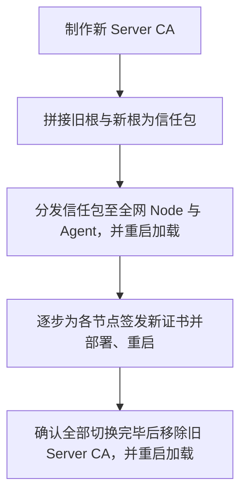

# RelayWeave 证书制作与部署

本文说明 RelayWeave 的证书签发、文件部署、上线验证、证书轮换与故障排查。双 CA 信任模型、证书职能与身份校验见 [安全体系与证书信任模型](RelayWeave设计.md#6-安全体系与证书信任模型)，软件包安装与服务管理见 [RelayWeave 打包与安装](RelayWeave打包与安装.md)。

---

## 1. 证书制作与部署实操指南

项目提供了全自动化的生产证书签发工具 `scripts/generate_certificates.sh`，同时也支持标准 OpenSSL 手工签发。

### 1.1 自动化脚本签发流程 (scripts/generate_certificates.sh)

1. **命令格式**：
   ```bash
   bash scripts/generate_certificates.sh <输出目录> <node_id=host1[,host2...]...>
   ```
2. **签发示例**：
   为 1 台 Master（公网 IP `203.0.113.10`）和 2 台 Slave（IP `203.0.113.11` 与 `203.0.113.12`，带内网域名）签发完整证书集群：
   ```bash
   bash scripts/generate_certificates.sh /secure/relayweave/certs \
       master-1=203.0.113.10,master-1.cluster.internal \
       slave-1=203.0.113.11,slave-1.cluster.internal \
       slave-2=203.0.113.12,slave-2.cluster.internal
   ```
3. **输出产物目录结构**：
   ```text
   /secure/relayweave/certs/
   ├── server-ca.pem            # Server CA 根证书
   ├── server-ca.key            # Server CA 私钥（离线加密保存）
   ├── client-ca.pem            # Client CA 根证书
   ├── client-ca.key            # Client CA 私钥（离线加密保存）
   ├── shared-client.pem
   ├── shared-client.key
   ├── nodes/
   │   ├── master-1/{server.pem,server.key,server-ca.pem,client-ca.pem}
   │   ├── slave-1/{server.pem,server.key,server-ca.pem,client-ca.pem}
   │   └── slave-2/{server.pem,server.key,server-ca.pem,client-ca.pem}
   └── agent/{shared-client.pem,shared-client.key,server-ca.pem,client-ca.pem}
   ```

脚本交互式读取 Server CA 与 Client CA 的私钥口令，验证证书链、用途、SAN 和密钥匹配后输出文件，并拒绝覆盖已有证书集。Node 部署对应 `nodes/<node_id>/` 目录，Agent 使用 `agent/` 目录；两把 CA 私钥保存在离线签发端。

### 1.2 OpenSSL 手工签发全流程

如果需要在企业自有的离线 CA 或现有 PKI 体系中签发，可执行以下标准 OpenSSL 步骤：

#### 步骤 1：创建 Server CA
```bash
# 生成 Server CA 私钥 (推荐 EC prime256v1 或 RSA 4096)
openssl ecparam -name prime256v1 -genkey -noout -out server-ca.key

# 生成 Server CA 自签名根证书 (有效期 10 年)
openssl req -x509 -new -nodes -key server-ca.key -sha256 -days 3650 \
    -subj "/C=CN/O=RelayWeave/CN=RelayWeave Server Root CA" \
    -out server-ca.pem
```

#### 步骤 2：为节点 master-1 签发服务器证书
```bash
# 生成节点私钥
openssl ecparam -name prime256v1 -genkey -noout -out master-1.key

# 生成 CSR
openssl req -new -key master-1.key -out master-1.csr \
    -subj "/C=CN/O=RelayWeave/CN=master-1"

# 编写扩展属性文件 master-1.ext
cat << 'EXT' > master-1.ext
basicConstraints = CA:FALSE
keyUsage = digitalSignature, keyEncipherment
extendedKeyUsage = serverAuth, clientAuth
subjectAltName = @alt_names

[alt_names]
DNS.1 = master-1
DNS.2 = master-1.cluster.internal
IP.1 = 203.0.113.10
EXT

# 使用 Server CA 签发 (有效期 2 年)
openssl x509 -req -in master-1.csr -CA server-ca.pem -CAkey server-ca.key \
    -CAcreateserial -out master-1.pem -days 730 -sha256 -extfile master-1.ext
```

#### 步骤 3：创建 Client CA
```bash
openssl ecparam -name prime256v1 -genkey -noout -out client-ca.key
openssl req -x509 -new -nodes -key client-ca.key -sha256 -days 3650 \
    -subj "/C=CN/O=RelayWeave/CN=RelayWeave Client Root CA" \
    -out client-ca.pem
```

#### 步骤 4：签发客户端共享证书
```bash
openssl ecparam -name prime256v1 -genkey -noout -out shared-client.key
openssl req -new -key shared-client.key -out shared-client.csr \
    -subj "/C=CN/O=RelayWeave/CN=relayweave-agent"

cat << 'EXT' > client.ext
basicConstraints = CA:FALSE
keyUsage = digitalSignature, keyEncipherment
extendedKeyUsage = clientAuth
EXT

openssl x509 -req -in shared-client.csr -CA client-ca.pem -CAkey client-ca.key \
    -CAcreateserial -out shared-client.pem -days 730 -sha256 -extfile client.ext
```

### 1.3 文件部署规范与目录权限

手工签发的 `master-1.pem` / `master-1.key` 部署时重命名为 `server.pem` / `server.key`，或将配置指向原文件名。

| 角色 | 运行时证书文件 | 配置项 |
|---|---|---|
| RelayNode | `server.pem`、`server.key`、`server-ca.pem`、`client-ca.pem` | `certificate.certificate_chain`、`private_key`、`server_ca_file`、`ca_file` |
| RelayAgent | `shared-client.pem`、`shared-client.key`、`server-ca.pem` | `certificate.certificate_chain`、`private_key`、`ca_file` |

安装 Debian 包后，可使用部署工具完成验证、配置与证书安装：

```bash
sudo relayweave-provision-node \
    --cert-dir /secure/relayweave/certs/nodes/master-1 \
    --config /secure/relayweave/config/node.json \
    --verify-host 203.0.113.10 --start

sudo relayweave-provision-agent \
    --cert-dir /secure/relayweave/certs/agent \
    --config /secure/relayweave/config/agent.json --start
```

Agent 部署目录中的 `client-ca.pem` 用于安装前验证，工具只将 Server CA、客户端证书和私钥安装到 Agent。

在各个服务器节点部署证书文件时，必须严格执行最小权限原则：

```bash
# 创建配置目录并归属 relayweave 运行用户
sudo install -d -m 0755 -o relayweave -g relayweave /etc/relayweave/certs
sudo chown -R relayweave:relayweave /etc/relayweave/certs

# 所有证书文件与 CA 信任文件设为 0644
sudo chmod 0644 /etc/relayweave/certs/*.pem

# 所有私钥文件设为 0600 (仅本进程可读，禁止组和其他用户读取)
sudo chmod 0600 /etc/relayweave/certs/*.key
```

### 1.4 部署前连通性与证书验证命令

在启动服务前，管理员可执行本地验证以排除配置问题：

1. **校验证书信任链**：
   ```bash
   openssl verify -CAfile /etc/relayweave/certs/server-ca.pem /etc/relayweave/certs/server.pem
   # 输出为: /etc/relayweave/certs/server.pem: OK
   ```
2. **校验私钥与证书匹配性（公钥 SHA-256 对照）**：
   ```bash
   openssl x509 -noout -pubkey -in /etc/relayweave/certs/server.pem | openssl sha256
   openssl pkey -in /etc/relayweave/certs/server.key -pubout | openssl sha256
   # 两者输出的 Hash 必须完全一致
   ```
3. **模拟在线 TLS 握手测试**：
   ```bash
   openssl s_client -connect 203.0.113.10:18443 \
       -CAfile /etc/relayweave/certs/server-ca.pem \
       -cert /etc/relayweave/certs/shared-client.pem \
       -key /etc/relayweave/certs/shared-client.key \
       -verify_return_error -verify_ip 203.0.113.10
   # 检查返回结果中: Verify return code: 0 (ok)
   ```

---

## 2. 证书轮换与应急运维



### 2.1 叶子证书续期

当节点证书即将到期时：
1. 保持原 `server-ca.key` 不变，生成新的 CSR 并重新签发 `server.pem`；
2. 覆盖服务器上的 `server.pem`；
3. 逐节点执行 `systemctl restart relayweave-node`，重新加载证书与私钥。节点重启会关闭其既有连接，Agent 按重连机制恢复控制连接与后续业务。

### 2.2 集群新增节点流程

1. 使用既有 `server-ca.pem` 与 `server-ca.key` 为新节点签发独立证书（将新节点的 IP 写入 SAN）；
2. 将新节点证书与私钥推送到新服务器；
3. 新服务器将既有的 `server-ca.pem` 与 `client-ca.pem` 放置在配置路径；
4. 启动新节点并配置连接 Master，Master 自动接纳并递增成员版本，广播至全网。

### 2.3 客户端私钥泄露应急处置

若怀疑某个终端的 `shared-client.key` 泄露：
1. 重新生成新的 Client CA（`client-ca-v2.pem` / `client-ca-v2.key`）；
2. 基于新 Client CA 签发全新的客户端共享证书；
3. 将新的客户端证书分发到所有受信任的 RelayAgent；
4. 更新所有 RelayNode 上的 `ca_file` 为 `client-ca-v2.pem`，并重启节点加载新信任根；
5. 节点加载新的 Client CA 后拒绝旧证书，既有连接随重启关闭。

### 2.4 Server CA 双根重叠平滑轮换

当 Server CA 自身需要到期更换或算法升级时，遵循**先扩展信任、后替换叶子、最后清理旧根**的顺序：

1. **阶段 1：制作新 CA 并拼接信任包**
   `cat server-ca-v1.pem server-ca-v2.pem > server-ca-bundle.pem`
2. **阶段 2：全网分发信任包**
   将 `server-ca-bundle.pem` 下发至全网所有 RelayNode 与 RelayAgent，逐进程重启加载。此时集群同时信任新老两套 CA。
3. **阶段 3：滚动替换节点证书**
   使用 `server-ca-v2.pem` 逐步为各个节点签发新证书并部署，逐节点重启加载。
4. **阶段 4：收尾清理**
   当全网所有节点的 `server.pem` 均已切换为新根签发后，从信任包中移除旧的 `server-ca-v1.pem`，重新分发并重启进程加载。

### 2.5 TLS 常见错误排查手册

| 错误特征字符串 | 常见原因 | 修复指引 |
|---|---|---|
| `tlsv1 alert unknown ca` | 对端在验证本端证书时，本地未配置对应的受信任 CA，或证书链不完整。 | 检查客户端是否正确加载了 `server-ca.pem`；检查服务端是否正确配置了 `client-ca.pem`。 |
| `hostname mismatch` / `IP address mismatch` | 证书 SAN 列表未包含连接时所使用的目标 IP 或域名。 | 重新签发节点证书，在 `subjectAltName` 中添加该 IP 或主机名。 |
| `unsuitable certificate purpose` | 证书的 `extendedKeyUsage` 不匹配当前操作（如客户端证书试图充当服务端）。 | 确认为节点签发的证书包含 `serverAuth`，客户端证书包含 `clientAuth`。 |
| `private key does not match certificate` | 配置中指定的 `.key` 与 `.pem` 公钥不匹配。 | 使用 1.4 节中的公钥 Hash 比对命令检查文件配对情况。 |
| `certificate has expired` / `not yet valid` | 证书过期或本机系统时间与真实时间偏差过大（NTP 异常）。 | 校对服务器系统时钟；检查证书有效截止期并按 2.1 节续约。 |
