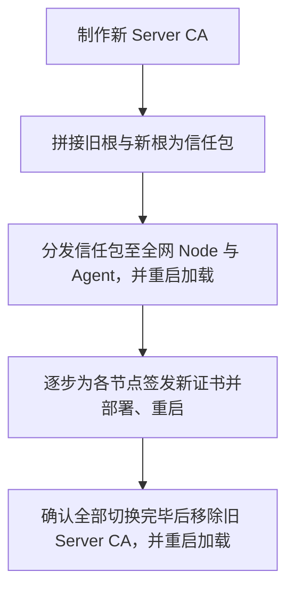

# RelayWeave 证书制作与部署

本文说明 RelayWeave 的证书签发、文件部署、上线验证、证书轮换与故障排查。双 CA 信任模型、证书职能与身份校验见 [安全体系与证书信任模型](RelayWeave设计.md#6-安全体系与证书信任模型)，软件包安装与服务管理见 [RelayWeave 打包与安装](RelayWeave打包与安装.md)。

TLS 业务复用双方已有的 `shared-client.pem` 公钥和对应私钥，采用 TLS 1.3 双向裸公钥认证（RPK）。启用端到端 TLS 无需重新签发证书，也不要求 Producer 的客户端证书增加 `serverAuth`。控制 mTLS 的 CA、有效期和名称校验仍照常执行；`certificate.server_name` 只用于 Node 控制连接。共享凭据只能认证同一凭据群体，不能区分具体客户；更换私钥时须同步更新互联双方。

---

## 1. 证书制作与部署实操指南

项目提供交互式签发与证书部署工具。Deb 负责安装程序、示例配置、systemd unit 和空证书目录；证书由签发端单独生成和分发，不放入 Deb。

### 1.1 交互式生成证书压缩包

在安全的签发机器上运行：

```bash
bash scripts/generate_certificates.sh
```

按提示选择新建证书集，或导入已有的 `ca-backup.tar.gz` 复用 CA，然后输入新的输出目录、有效期、各 Node ID 及逗号分隔的 IP/域名。Node 可以有多个 SAN，例如 `203.0.113.10,master-1.cluster.internal,2001:db8::10`；Node ID 留空结束添加。脚本展示清单，确认后隐藏读取两把 CA 的口令并生成证书。

默认采用 RSA 3072 位密钥，CA 有效期 3650 天，叶子证书 365 天。新签证书不能超过 CA 的剩余有效期。复用 CA 时可以新增或重签 Node，选择是否续期客户端证书；续期默认保留共享客户端私钥，更换私钥需要明确选择，并同步更新所有互联 Agent。重新签发 Node 证书会生成新的 Node 私钥。

输出目录必须不存在，完成证书链、用途、SAN 和密钥匹配验证后才发布产物：

| 压缩包 | 包内全部文件 |
|---|---|
| `node-master-1.tar.gz`（每个 Node 各一包） | `server.pem`、`server.key`、`server-ca.pem`、`client-ca.pem` |
| `client.tar.gz`（Agent 共用） | `shared-client.pem`、`shared-client.key`、`server-ca.pem` |
| `ca-backup.tar.gz`（仅供离线签发端） | `server-ca.pem`、`server-ca.key`、`client-ca.pem`、`client-ca.key`、`shared-client.pem`、`shared-client.key` |

压缩包内不包含脚本、配置、清单或说明。所有压缩包权限为 `0600`；CA 私钥使用口令加密。`ca-backup.tar.gz` 同时包含共享客户端私钥，只应保存在离线签发端，不能分发给 Node 或 Agent。每次生成都保留新的备份包，用于后续续期。

复用 CA 不会改变现有信任根。新建证书集会生成新的信任根，不能作为逐台平滑轮换的替代；跨 CA 轮换见第 2 节。

### 1.2 OpenSSL 手工签发全流程

如果需要在企业自有的离线 CA 或现有 PKI 体系中签发，可执行以下标准 OpenSSL 步骤：

#### 步骤 1：创建 Server CA
```bash
# 生成 Server CA 私钥 (推荐 EC prime256v1 或 RSA 4096)
openssl ecparam -name prime256v1 -genkey -noout -out server-ca.key

# 生成 Server CA 自签名根证书 (有效期 10 年)
openssl req -x509 -new -nodes -key server-ca.key -sha256 -days 3650 \
    -subj "/C=CN/O=RelayWeave/CN=RelayWeave Server Root CA" \
    -out server-ca.pem
```

#### 步骤 2：为节点 master-1 签发服务器证书
```bash
# 生成节点私钥
openssl ecparam -name prime256v1 -genkey -noout -out master-1.key

# 生成 CSR
openssl req -new -key master-1.key -out master-1.csr \
    -subj "/C=CN/O=RelayWeave/CN=master-1"

# 编写扩展属性文件 master-1.ext
cat << 'EXT' > master-1.ext
basicConstraints = CA:FALSE
keyUsage = digitalSignature, keyEncipherment
extendedKeyUsage = serverAuth, clientAuth
subjectAltName = @alt_names

[alt_names]
DNS.1 = master-1
DNS.2 = master-1.cluster.internal
IP.1 = 203.0.113.10
EXT

# 使用 Server CA 签发 (有效期 2 年)
openssl x509 -req -in master-1.csr -CA server-ca.pem -CAkey server-ca.key \
    -CAcreateserial -out master-1.pem -days 730 -sha256 -extfile master-1.ext
```

#### 步骤 3：创建 Client CA
```bash
openssl ecparam -name prime256v1 -genkey -noout -out client-ca.key
openssl req -x509 -new -nodes -key client-ca.key -sha256 -days 3650 \
    -subj "/C=CN/O=RelayWeave/CN=RelayWeave Client Root CA" \
    -out client-ca.pem
```

#### 步骤 4：签发客户端共享证书
```bash
openssl ecparam -name prime256v1 -genkey -noout -out shared-client.key
openssl req -new -key shared-client.key -out shared-client.csr \
    -subj "/C=CN/O=RelayWeave/CN=relayweave-agent"

cat << 'EXT' > client.ext
basicConstraints = CA:FALSE
keyUsage = digitalSignature, keyEncipherment
extendedKeyUsage = clientAuth
EXT

openssl x509 -req -in shared-client.csr -CA client-ca.pem -CAkey client-ca.key \
    -CAcreateserial -out shared-client.pem -days 730 -sha256 -extfile client.ext
```

### 1.3 文件部署规范与目录权限

手工签发的 `master-1.pem` / `master-1.key` 部署时重命名为 `server.pem` / `server.key`，或将配置指向原文件名。

| 角色 | 运行时证书文件 | 配置项 |
|---|---|---|
| RelayNode | `server.pem`、`server.key`、`server-ca.pem`、`client-ca.pem` | `certificate.certificate_chain`、`private_key`、`server_ca_file`、`ca_file` |
| RelayAgent | `shared-client.pem`、`shared-client.key`、`server-ca.pem` | `certificate.certificate_chain`、`private_key`、`ca_file` |

先安装当前主机所需的 Deb，编辑 `/etc/relayweave/node.json` 或 `/etc/relayweave/agent.json`，然后运行 Deb 已提供的部署命令：

```bash
sudo relayweave-provision-node
# 或
sudo relayweave-provision-agent
```

无参数运行进入交互菜单，选择安装/更新或卸载证书。安装时选择本机对应的压缩包，目标目录默认 `/etc/relayweave/certs`。首次安装与替换使用同一流程；只处理证书文件，不修改 JSON，不安装软件，不启动、停止或重启服务。

也可直接使用命令：

```bash
# 只验证，不安装；可以不使用 sudo。
relayweave-provision-node --install-certs ./node-master-1.tar.gz --dry-run
relayweave-provision-agent --install-certs ./client.tar.gz --dry-run

# 首次安装或更新证书。
sudo relayweave-provision-node --install-certs ./node-master-1.tar.gz
sudo relayweave-provision-agent --install-certs ./client.tar.gz

# 指定证书目录，配置中的路径须由管理员相应设置。
sudo relayweave-provision-node --install-certs ./node-master-1.tar.gz --cert-dir /custom/certs

# 备份并卸载当前角色证书；不删除配置或改变服务状态。
sudo relayweave-provision-node --remove-certs
sudo relayweave-provision-agent --remove-certs
```

Node 包必须恰好包含表中四个文件，Agent 包必须恰好包含三个文件。安装端验证证书有效期、用途和私钥匹配，Node 还验证签发链与已有 Node 身份；Agent 的签发链在生成端验证，不额外分发 Client CA。旧目录若带有 `client-ca.pem`，原带参数的 Agent 部署方式仍会使用它验证，但不会安装它。Dashboard 保持原有四文件输入要求。

覆盖或卸载前，原文件保存到 `/var/backups/relayweave/<角色>-<UTC时间>-<随机后缀>/`，目录权限为 `0700`。文件写入或删除失败时尝试恢复原文件；可手工将备份中的相应文件复制回证书目录。备份包含私钥，应限制访问。Node 和 Agent 共用同一目录时，卸载一方会保留另一方使用的 `server-ca.pem`，也不会删除无关文件。

证书安装为 `root:root`；目录 `0755`，公钥证书 `0644`，私钥 `0600`，与 Deb 中默认以 root 运行的服务一致。自定义服务用户需要管理员另行调整权限。脚本不执行进程内热更新；完成配置与证书安装后，首次启动或更新加载由管理员手工执行：

```bash
sudo systemctl start relayweave-node
sudo systemctl start relayweave-agent
# 已运行的服务加载新证书：
sudo systemctl restart relayweave-node
sudo systemctl restart relayweave-agent
```

源码调用入口为 `bash scripts/provision_relayweave.sh node ...` 或 `agent ...`；无参数启动源码脚本时先选择角色。`--dry-run` 可单独传入交互流程。原有 `--cert-dir SOURCE --config FILE [--start|--restart]` 完整部署接口继续保留，只有显式传入启停参数才改变服务状态。

### 1.4 部署前连通性与证书验证命令

在启动服务前，管理员可执行本地验证以排除配置问题：

1. **校验证书信任链**：
   ```bash
   openssl verify -CAfile /etc/relayweave/certs/server-ca.pem /etc/relayweave/certs/server.pem
   # 输出为: /etc/relayweave/certs/server.pem: OK
   ```
2. **校验私钥与证书匹配性（公钥 SHA-256 对照）**：
   ```bash
   openssl x509 -noout -pubkey -in /etc/relayweave/certs/server.pem | openssl sha256
   openssl pkey -in /etc/relayweave/certs/server.key -pubout | openssl sha256
   # 两者输出的 Hash 必须完全一致
   ```
3. **模拟在线 TLS 握手测试**：
   ```bash
   openssl s_client -connect 203.0.113.10:18443 \
       -CAfile /etc/relayweave/certs/server-ca.pem \
       -cert /etc/relayweave/certs/shared-client.pem \
       -key /etc/relayweave/certs/shared-client.key \
       -verify_return_error -verify_ip 203.0.113.10
   # 检查返回结果中: Verify return code: 0 (ok)
   ```

---

## 2. 证书轮换与应急运维



### 2.1 叶子证书续期

当节点证书即将到期时：
1. 运行交互式生成脚本，选择复用原 `ca-backup.tar.gz`，输入该 Node ID 和 SAN 重新签发；
2. 在对应 Node 上使用 `relayweave-provision-node --install-certs 新证书包.tar.gz` 安装新证书与私钥；
3. 逐节点执行 `systemctl restart relayweave-node`，重新加载证书与私钥。节点重启会关闭其既有连接，Agent 按重连机制恢复控制连接与后续业务。

### 2.2 集群新增节点流程

1. 使用既有 `server-ca.pem` 与 `server-ca.key` 为新节点签发独立证书（将新节点的 IP 写入 SAN）；
2. 将新节点证书与私钥推送到新服务器；
3. 新服务器将既有的 `server-ca.pem` 与 `client-ca.pem` 放置在配置路径；
4. 启动新节点并配置连接 Master，Master 自动接纳并递增成员版本，广播至全网。

### 2.3 客户端私钥泄露应急处置

若怀疑某个终端的 `shared-client.key` 泄露：
1. 重新生成新的 Client CA（`client-ca-v2.pem` / `client-ca-v2.key`）；
2. 基于新 Client CA 签发全新的客户端共享证书；
3. 将新的客户端证书分发到所有受信任的 RelayAgent；
4. 更新所有 RelayNode 上的 `ca_file` 为 `client-ca-v2.pem`，并重启节点加载新信任根；
5. 节点加载新的 Client CA 后拒绝旧证书，既有连接随重启关闭。

### 2.4 Server CA 双根重叠平滑轮换

当 Server CA 自身需要到期更换或算法升级时，遵循**先扩展信任、后替换叶子、最后清理旧根**的顺序：

1. **阶段 1：制作新 CA 并拼接信任包**
   `cat server-ca-v1.pem server-ca-v2.pem > server-ca-bundle.pem`
2. **阶段 2：全网分发信任包**
   将 `server-ca-bundle.pem` 下发至全网所有 RelayNode 与 RelayAgent，逐进程重启加载。此时集群同时信任新老两套 CA。
3. **阶段 3：滚动替换节点证书**
   使用 `server-ca-v2.pem` 逐步为各个节点签发新证书并部署，逐节点重启加载。
4. **阶段 4：收尾清理**
   当全网所有节点的 `server.pem` 均已切换为新根签发后，从信任包中移除旧的 `server-ca-v1.pem`，重新分发并重启进程加载。

### 2.5 TLS 常见错误排查手册

| 错误特征字符串 | 常见原因 | 修复指引 |
|---|---|---|
| `tlsv1 alert unknown ca` | 对端在验证本端证书时，本地未配置对应的受信任 CA，或证书链不完整。 | 检查客户端是否正确加载了 `server-ca.pem`；检查服务端是否正确配置了 `client-ca.pem`。 |
| `hostname mismatch` / `IP address mismatch` | 证书 SAN 列表未包含连接时所使用的目标 IP 或域名。 | 重新签发节点证书，在 `subjectAltName` 中添加该 IP 或主机名。 |
| `unsuitable certificate purpose` | 证书的 `extendedKeyUsage` 不匹配当前操作（如客户端证书试图充当服务端）。 | 确认为节点签发的证书包含 `serverAuth`，客户端证书包含 `clientAuth`。 |
| `private key does not match certificate` | 配置中指定的 `.key` 与 `.pem` 公钥不匹配。 | 使用 1.4 节中的公钥 Hash 比对命令检查文件配对情况。 |
| `certificate has expired` / `not yet valid` | 证书过期或本机系统时间与真实时间偏差过大（NTP 异常）。 | 校对服务器系统时钟；检查证书有效截止期并按 2.1 节续约。 |
